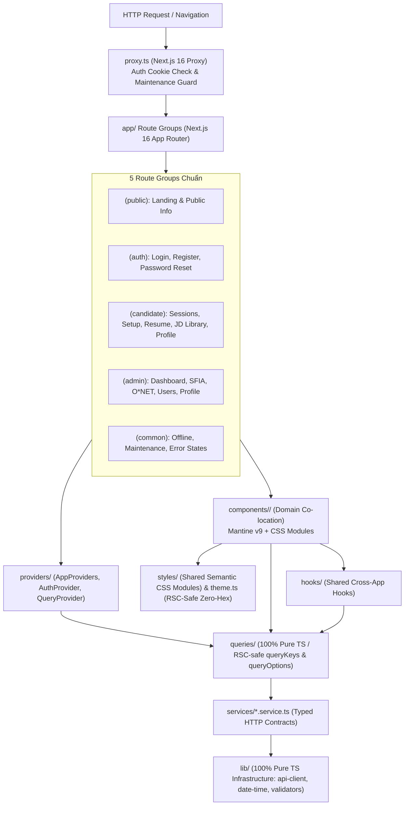

# Chuyên Đề 01: Kiến Trúc Ứng Dụng & Cấu Trúc Thư Mục (Architecture & Project Structure)

> **Dự án:** Intervia Frontend (`client/`)  
> **Phiên bản:** 9.0 (Intervia Next.js 16 + React 19 + Mantine v9 Standard)  
> **Cổng điều hướng:** [Master Hub](../README.md) | [Quick Reference](../QUICK_REFERENCE.md) | [Cẩm nang Mantine v9](../../mantine/README.md)  
> **Tài liệu liên quan:** [Coding Standards](./coding-standards.md) | [State Management](./state-management.md) | [Component Patterns](../02-ui-and-design-system/component-patterns.md) | [Design System & Styling](../02-ui-and-design-system/design-system-and-styling.md)  
> **Tính chất tài liệu:** Chuẩn mực kiến trúc mục tiêu (Normative Standard) cho toàn bộ tính năng mới và các màn hình migrate sang Next.js 16 App Router + Mantine v9; không sao chép mẫu từ mã nguồn legacy chưa chuẩn hóa trong `client/`.  
> **Cơ sở tham chiếu quốc tế:**
>
> - [Next.js 16 App Router — Project Structure & Route Groups](https://nextjs.org/docs/app/getting-started/project-structure)
> - [React 19 — Server and Client Components](https://react.dev/reference/rsc/server-components)
> - [Mantine v9 — Usage with Next.js App Router](https://mantine.dev/guides/next/)
> - [Vercel React Best Practices (`client/.agents/skills/vercel-react-best-practices/`)](../../../.agents/skills/vercel-react-best-practices/SKILL.md)

---

## MỤC LỤC

1. [Triết Lý Kiến Trúc & Luồng Phụ Thuộc Một Chiều](#1-triết-lý-kiến-trúc-luồng-phụ-thuộc-một-chiều)
2. [Kiến Trúc Monorepo & Cấu Trúc Thư Mục Mục Tiêu `client/`](#2-kiến-trúc-monorepo-cấu-trúc-thư-mục-mục-tiêu-client)
3. [Ranh Giới Server Components (RSC) vs `'use client'` Với Mantine v9](#3-ranh-giới-server-components-rsc-vs-use-client-với-mantine-v9)
4. [Quy Tắc Hybrid Co-location, Rule of Three & Đóng Băng `components/ui/`](#4-quy-tắc-hybrid-co-location-rule-of-three-đóng-băng-componentsui)
5. [Component Anatomy 4 Khối, Tránh Barrel Imports, Assets & Naming Guard](#5-component-anatomy-4-khối-tránh-barrel-imports-assets-naming-guard)
6. [Case Study Co-location & Bảng Đối Chiếu Anti-Pattern vs Best Practice](#6-case-study-co-location-bảng-đối-chiếu-anti-pattern-vs-best-practice)
7. [Ánh Xạ Tooling Kiểm Toán CI](#7-ánh-xạ-tooling-kiểm-toán-ci)
8. [Checklist Định Lượng PR Review Gate](#8-checklist-định-lượng-pr-review-gate)

---

## 1. Triết Lý Kiến Trúc & Luồng Phụ Thuộc Một Chiều

Kiến trúc Frontend của **Intervia** ưu tiên ba thuộc tính cốt lõi: **tính dự đoán được (Predictability)**, **tách biệt chặt ranh giới Server/Client của Next.js 16 App Router**, và **cô lập thay đổi theo miền nghiệp vụ (Feature Isolation)**. Mọi tệp mới phải trả lời rõ ngay ba câu hỏi: _thuộc miền nghiệp vụ nào_, _chạy trên Server hay Client_, và _phụ thuộc một chiều về tầng nào_.



### Quy tắc phụ thuộc một chiều (Unidirectional Dependency Rule)

- `app/` được phép import từ `providers/`, `components/`, `styles/`, `queries/`, `hooks/`, `services/`, `types/`, `lib/`, `config/`, và `theme.ts`.
- `providers/` chứa các Client Providers (`'use client'`) và được phép import từ `queries/`, `services/`, `types/`, `@mantine/*`, `@tanstack/react-query`.
- `components/` được phép import từ `@mantine/*`, `@tabler/icons-react`, `styles/`, `queries/`, `hooks/`, `types/`, `lib/`, `config/`, và các tệp trong cùng miền `components/<domain>/`. **Cấm** import ngược từ `app/`.
- `queries/` là tầng **100% Pure TypeScript / RSC-safe** (không `'use client'`, không import `react`), chỉ import `@tanstack/react-query`, `services/`, `types/`, `lib/`.
- `hooks/` được phép import từ `queries/`, `services/`, `types/`, `lib/`, `@tanstack/react-query`, `@mantine/hooks`. **Cấm** import UI component hoặc CSS Module.
- `services/` chỉ import tầng HTTP client, schema `zod`, và type DTO thuần từ `types/`. **Tuyệt đối không** import `react`, `next/navigation`, `components/`, hay `@mantine/core`.
- `types/` chứa các Pure TypeScript Domain & API Contracts (Zero Dependencies, không import React, Next.js, Mantine hay Browser DOM) ánh xạ 1:1 theo Bounded Contexts của Backend.
- **Quản lý style tập trung (`styles/`):** Ưu tiên Mantine Style Props (Tier 1) → Import trực tiếp shared semantic CSS Modules từ `@/styles/{surfaces,interactions,typography}.module.css` trong TSX cho pattern lặp ≥ 2 nơi (Tier 2) → Chỉ tạo `<Component>.module.css` cục bộ cho layout/animation đặc thù của riêng component đó (Tier 3).

---

## 2. Kiến Trúc Monorepo & Cấu Trúc Thư Mục Mục Tiêu `client/`

### 2.1. Phân tách 3 workspace trong Monorepo

- `client/` — Next.js `16.2.6` (App Router) + React `19.2.4` + Mantine v9 (`^9.8.2`) + TanStack Query v5 + TypeScript 5 (`npm`).
- `server/` — NestJS Backend API (REST + SSE + Prisma + PostgreSQL + BullMQ).
- `ai-service/` — Dịch vụ AI xử lý sinh câu hỏi, giọng nói và đánh giá năng lực STAR/SFIA.

Frontend **tuyệt đối không** import mã nguồn trực tiếp từ `server/` hay `ai-service/`; mọi trao đổi dữ liệu đi qua hợp đồng HTTP/SSE chuẩn hóa (xem [API Contracts & Resilience](../03-quality-and-security/api-contracts-and-resilience.md)).

### 2.2. Cấu trúc thư mục mục tiêu của `client/`

```text
client/
├── app/                          # Next.js 16 App Router (5 Route Groups + Root files)
│   ├── (public)/                 # Trang công khai không yêu cầu đăng nhập
│   ├── (auth)/                   # Luồng xác thực: login, register, reset-password
│   ├── (candidate)/              # Không gian ứng viên: sessions, setup, resume, jd-library, profile
│   ├── (admin)/                  # Không gian quản trị: dashboard, sfia, onet, users, profile
│   ├── (common)/                 # Trang trạng thái hệ thống: offline, maintenance, unauthorized
│   ├── layout.tsx                # RootLayout (RSC): ColorSchemeScript, mantineHtmlProps, MantineProvider, AppProviders
│   ├── globals.css               # @layer mantine, components + @mantine/*/styles.layer.css + View Transitions
│   ├── error.tsx                 # Route Segment Error Boundary
│   ├── global-error.tsx          # Fatal Root Layout Error Boundary
│   └── not-found.tsx             # 404 Page
├── providers/                    # Toàn bộ React Context & App-level Client Providers ('use client')
│   ├── AppProviders.tsx          # DatesProvider, Notifications, ModalsProvider, QueryProvider, AuthProvider
│   ├── AuthProvider.tsx          # AuthProvider, useAuth, applyAuthenticatedSession
│   ├── QueryProvider.tsx         # QueryProvider (TanStack Query v5)
│   └── __tests__/                # Unit tests cho providers
├── styles/                       # Shared Semantic CSS Modules (surfaces, interactions, typography)
├── components/                   # Domain UI Components (100% Mantine v9 Zero-Hex)
│   ├── <domain>/                 # admin, auth, interview, interview-setup, jd-library, sessions, landing, report, sfia, onet, resume, profile
│   └── layout/ & common/         # Khung AppShell và mẫu UI tái sử dụng dựng trên Mantine v9
├── queries/                      # 100% Pure TS / RSC-safe (query-client.ts, keys.ts, *.queries.ts) + __tests__/
├── hooks/                        # Custom hooks dùng chung (useSessionEvents, useCountdown)
├── services/                     # Domain API Services (1 tệp / 1 ngữ cảnh nghiệp vụ) + __tests__/
├── types/                        # Central Pure TypeScript Domain & API Contracts (11 Bounded Contexts + barrel)
├── lib/                          # 100% Pure TS Infrastructure (api-client.ts, auth-redirect, date-time, form-errors, setup-helpers)
├── middleware/                   # Guard định tuyến (Auth cookie presence, Maintenance mode)
├── proxy.ts                      # Next.js 16 Proxy entry point (thay middleware.ts)
├── config/                       # Hằng số tĩnh (navigation, feature flags)
├── theme.ts                      # SSOT Mantine v9 Theme (RSC-safe, Zero-Hex, 5 semantic roles, focusClassName)
├── test-utils/                   # Custom render (@test-utils) + fixtures/report.fixture.ts
├── e2e/                          # Playwright end-to-end specs
├── scripts/                      # check-ui-rules.mjs, verify-docs-integrity.mjs
└── docs/                         # docs/mantine/ (Tactical Lookup) & docs/docs/ (Enterprise Standards)
```

---

## 3. Ranh Giới Server Components (RSC) vs `'use client'` Với Mantine v9

Next.js 16 App Router mặc định mọi tệp trong `app/` là **React Server Component (RSC)**. Theo quy tắc `server-serialization` trong `vercel-react-best-practices`, mọi props đi qua ranh giới Server → Client đều bị tuần tự hóa (serialize) vào payload HTML/RSC. Vì vậy cần đẩy `'use client'` xuống **nút lá (leaf component)** nhỏ nhất và chỉ truyền đúng các trường dữ liệu mà Client Component thực sự dùng.

### Bảng phân định trách nhiệm Server vs Client

| Thành phần                                                                                              |              Môi trường               | Quy định bắt buộc                                                                                                                                           |
| :------------------------------------------------------------------------------------------------------ | :-----------------------------------: | :---------------------------------------------------------------------------------------------------------------------------------------------------------- |
| `app/layout.tsx`, `app/(group)/layout.tsx`, `page.tsx`                                                  |    **Server Component** (mặc định)    | Đọc `params`/`searchParams`, cấu hình `metadata`, tải dữ liệu ban đầu và chỉ truyền props tối giản xuống Client Component.                                  |
| `client/theme.ts`                                                                                       |      **RSC-Safe Shared Module**       | **Tuyệt đối không đặt `'use client'`** để `app/layout.tsx` import trực tiếp ở Server (xem [Setup Mantine v9](../../mantine/02-setup-forms-hooks-guide.md)). |
| Component có `useState`, `useEffect`, `useQuery`, `useMutation`, `useForm`, `@mantine/hooks`, `onClick` | **Client Component (`'use client'`)** | Cô lập tại nút lá tương tác; không đánh dấu `'use client'` ở trang gốc chỉ vì có 1 nút bấm hoặc thanh lọc nhỏ.                                              |
| Component Mantine v9 tĩnh (`Container`, `Stack`, `Group`, `Title`, `Text`, `Paper`)                     |           **RSC & Client**            | Render trực tiếp trong Server Component hoặc truyền làm `children` vào Client wrapper (**Donut / Slot Pattern**).                                           |
| `proxy.ts` & `middleware/*`                                                                             |       **Next.js Proxy Runtime**       | Chỉ xử lý định tuyến nhẹ (kiểm tra tồn tại cookie, maintenance redirect). `config.matcher` trong `proxy.ts` phải là static literal tương thích Turbopack.   |

### Ví dụ đối chiếu `server-serialization` (adapted từ `vercel-react-best-practices` sang Mantine v9)

```tsx
// Incorrect: Truyền toàn bộ object 50 trường qua ranh giới Server -> Client
interface FullCandidateRecord {
  id: string
  displayName: string
  internalAuditTrail: string[]
  rawCvText: string
}

async function BadProfilePage() {
  const candidate = await loadCandidateRecord()
  return <CandidateHeaderBad candidate={candidate} />
}

function CandidateHeaderBad({ candidate }: { candidate: FullCandidateRecord }) {
  return <Text fw={600}>{candidate.displayName}</Text>
}

// Correct: Chỉ truyền đúng trường cần hiển thị qua ranh giới RSC -> Client
import { Container, Paper, Stack, Text, Title } from '@mantine/core'

interface CandidateSummary {
  displayName: string
  targetRole: string
}

function CandidateGreeting({ displayName, targetRole }: CandidateSummary) {
  return (
    <Paper withBorder p="md" radius="md">
      <Stack gap="xs">
        <Title order={2} size="h4">
          {displayName}
        </Title>
        <Text size="sm" c="dimmed">
          Vị trí mục tiêu: {targetRole}
        </Text>
      </Stack>
    </Paper>
  )
}

export async function CandidateProfileShell({
  loadSummary,
}: {
  loadSummary: () => Promise<CandidateSummary>
}) {
  const { displayName, targetRole } = await loadSummary()

  return (
    <Container size="lg" py="xl">
      <Stack gap="lg">
        <Title order={1}>Hồ sơ ứng viên</Title>
        <CandidateGreeting displayName={displayName} targetRole={targetRole} />
      </Stack>
    </Container>
  )
}
```

---

## 4. Quy Tắc Hybrid Co-location, Rule of Three & Đóng Băng `components/ui/`

### 4.1. Chiến lược Thin `app/`, Domain Co-location & Rule of Three

1. **Chiến lược Thin `app/` (Store project files outside `app/`):** Thư mục `app/` chỉ chứa các tệp định tuyến chuẩn của Next.js 16 App Router (`page.tsx`, `layout.tsx`, `loading.tsx`, `error.tsx`, `global-error.tsx`, `not-found.tsx`) và `*Layout.module.css` gắn trực tiếp với `layout.tsx`. **Không tạo `_components/` trong `app/`**.
2. **Domain Co-location & Sub-feature Grouping trong `components/<domain>/`:** Toàn bộ UI component, `*Client.tsx`, route hooks, `WidgetName.module.css`, `WidgetName.test.tsx`, và `WidgetName.stories.tsx` của một miền nghiệp vụ được đặt đồng vị (co-located) trong `components/<domain>/`. Khi một miền vượt quá ~15 tệp hoặc có từ 2 cụm chức năng độc lập trở lên, gom thành **tối đa 1 cấp thư mục con `kebab-case`** (`components/<domain>/<sub-feature>/`):
   - **Tệp gốc domain (`components/<domain>/`):** Giữ trình điều phối chính duy nhất (`SetupWizardClient.tsx`, `SessionRoomClient.tsx`, `ReportClient.tsx`, `ResumeClient.tsx`, `AppLayout.tsx`) cùng các schema, constants, helper hoặc hook dùng chung xuyên suốt nhiều thư mục con trong miền.
   - **Miền đa màn hình độc lập:** Các miền chứa nhiều trang độc lập (`auth/login/`, `auth/register/`, `auth/reset-password/`, `common/status-pages/`) đặt `*Client.tsx` vào đúng thư mục chức năng của nó.
   - **Đồng vị trong thư mục con:** Mỗi component đi kèm `.module.css`, `.test.tsx`, `.stories.tsx` nằm trực tiếp cùng cấp trong thư mục chức năng đó; **không** lồng thêm cấp thứ 2 và **không** tạo barrel `index.ts`.
   - **Quy ước đường dẫn import:** Dùng `./FileName` cho tệp nằm cùng thư mục; dùng path alias `@/components/<domain>/...` cho mọi import khác thư mục (tuyệt đối tránh `../` leo cấp).
3. **Thăng cấp theo Rule of Three:**
   - Lần 1: Viết cục bộ trong `components/<domain>/` của miền nghiệp vụ tương ứng.
   - Lần 2: Cân nhắc tách nếu hai miền chia sẻ hoàn toàn cùng hợp đồng dữ liệu và tương tác.
   - Lần 3: Bắt buộc trích xuất lên `components/common/` (dùng xuyên miền).
4. **Đóng băng `components/ui/`:** Theo nguyên tắc **Mantine-First**, mọi UI primitive (`Button`, `TextInput`, `Modal`, `Table`, `Paper`, `Tabs`, `Select`) được import trực tiếp từ `@mantine/core`. **Tuyệt đối cấm** thêm wrapper mỏng mới trong `components/ui/`.

### 4.2. Phân tách trách nhiệm `layout`, `common`, và `<domain>`

- **`app/(group)/layout.tsx` & `components/layout/`:** Chỉ phụ trách khung `AppShell`, điều hướng và kiểm soát ranh giới layout — không chứa logic gọi API nộp bài hay chỉnh sửa hồ sơ.
- **`components/common/`:** Chứa mẫu giao diện dùng chung xuyên nhiều miền (banner ngoại tuyến, empty state, error fallback) dựng trên Mantine v9 primitives.
- **`components/<domain>/`:** Đóng gói toàn bộ UI & Client Shell đặc thù từng miền (`auth`, `interview`, `interview-setup`, `jd-library`, `sessions`, `landing`, `report`, `sfia`, `onet`, `resume`, `profile`).

---

## 5. Component Anatomy 4 Khối, Tránh Barrel Imports, Assets & Naming Guard

### 5.1. Component Anatomy chuẩn 4 khối

Mọi tệp `.tsx` (giới hạn ≤ 250 dòng theo [`STD-SIZE-001`](./coding-standards.md#std-size-001)) sắp xếp theo 4 khối cố định:

1. **Directive & Imports:** `'use client'` (chỉ khi cần) → React/Next → `@mantine/*` & `@tabler/icons-react` → module cục bộ → CSS Module (`import classes from './X.module.css'`).
2. **Types & Hằng số ngoài render:** `interface Props`, Zod schema, hằng số và JSX tĩnh hoisted ra module scope (`rendering-hoist-jsx`).
3. **Component Body:** Hooks → Derived values (tính trực tiếp) → Event handlers (`handle*`) → Early returns (`isLoading`/`error`) → Mantine JSX.
4. **Pure helpers nội bộ:** Chỉ giữ helper thuần ≤ 30 dòng; lớn hơn phải tách sang tệp riêng cùng thư mục.

### 5.2. Tránh Barrel File Imports (`bundle-barrel-imports`) & Vòng lặp phụ thuộc

Theo quy tắc `bundle-barrel-imports` trong `vercel-react-best-practices`, import qua barrel `index.ts` khổng lồ có thể khiến bundler tải hàng nghìn module thừa (tốn 200–800ms mỗi cold start và làm chậm HMR):

```ts
// Incorrect: Tạo hoặc import từ barrel file gom toàn bộ module nội bộ
import { sessionService, authService } from '@/services'

// Correct: Bật optimizePackageImports cho thư viện UI & dùng direct import cho module nội bộ
// next.config.ts (đã cấu hình trong client/next.config.ts)
import type { NextConfig } from 'next'

const nextConfig: NextConfig = {
  experimental: {
    optimizePackageImports: [
      '@mantine/core',
      '@mantine/hooks',
      '@mantine/form',
      '@mantine/notifications',
      '@mantine/modals',
      '@mantine/dropzone',
      '@tabler/icons-react',
    ],
  },
}

export default nextConfig
```

- Với module nội bộ mới (`services/`, `hooks/`, `components/`): **không tạo barrel `index.ts` re-export hàng loạt**; import trực tiếp từ tệp nguồn cụ thể.
- **Chống Circular Dependencies:** Khi hai module cùng dùng chung một kiểu dữ liệu, tách kiểu đó ra tệp `types.ts` trung lập.

### 5.3. Static Assets Pipeline & Cross-Platform Case-Sensitive Naming

- **Hình ảnh (`next/image`):** Dùng `next/image` (hoặc `<Image component={NextImage} />` của Mantine) có `width`/`height` tường minh để tránh CLS; tài nguyên tĩnh đặt tại `client/public/`.
- **Web Fonts (`next/font/google`):** Tự host `Geist` và `Geist_Mono` tại `app/layout.tsx` và nối CSS variables vào `client/theme.ts`.
- **Icons (`@tabler/icons-react`):** Chỉ dùng `@tabler/icons-react` với `stroke={1.5}`; cấm inline `<svg>` và không thêm thư viện icon cạnh tranh mới.
- **Cross-Platform Case-Sensitive Naming:** Do môi trường phát triển có thể chạy Windows (case-insensitive) nhưng CI/Vercel chạy Linux (case-sensitive), quy ước đặt tên bắt buộc nhất quán 100%:
  - React Component, CSS Module, Test, Story: `PascalCase` (`SessionCard.tsx`, `SessionCard.module.css`, `SessionCard.test.tsx`, `SessionCard.stories.tsx`).
  - Custom Hook: `camelCase` có tiền tố `use` (`useSessionTimer.ts`, `useFilterParams.ts`).
  - Service, Lib, Config, Utility, App Router files: `kebab-case` (`session.service.ts`, `date-time.ts`, `page.tsx`, `layout.tsx`).

---

## 6. Case Study Co-location & Bảng Đối Chiếu Anti-Pattern vs Best Practice

### Case Study: Cấu trúc Thin `app/` & Domain Co-location cho màn hình Live Interview Session

```text
app/(candidate)/sessions/[sessionId]/
└── page.tsx                              # Server Component shell đọc params.sessionId (chỉ routing)

components/interview/
├── SessionRoomClient.tsx                 # 'use client' điều phối chính phiên phỏng vấn (ở gốc domain)
├── workspace/                            # Cụm giao diện làm bài trực tiếp
│   ├── LiveInterviewWorkspace.tsx
│   ├── LiveInterviewWorkspace.module.css # CSS Module dùng rem() và --mantine-color-*
│   ├── SessionHeaderBar.tsx
│   ├── CountdownTimer.tsx
│   ├── QuestionCard.tsx
│   └── TextAnswerInput.tsx
├── voice/                                # Cụm ghi âm, sóng âm và duyệt transcript
│   ├── VoiceRecorder.tsx
│   ├── VoiceWaveform.tsx
│   ├── VoiceTranscriptReview.tsx
│   └── useVoiceRecorder.ts
├── status/                               # Trạng thái phòng chờ & tiến trình phản hồi
│   ├── SessionStatusView.tsx
│   └── FeedbackProgressPanel.tsx
└── hooks/                                # Custom hooks điều phối phòng phỏng vấn
    ├── useInterviewDraft.ts
    ├── useSessionInitialization.ts
    └── useSessionRoomTurns.tsx
```

### Bảng đối chiếu Anti-Pattern vs Best Practice

| Tình huống                  | Anti-Pattern (Tránh)                                                | Best Practice (Chuẩn mực)                                                                          |
| :-------------------------- | :------------------------------------------------------------------ | :------------------------------------------------------------------------------------------------- |
| Tạo nút hoặc input mới      | Tạo wrapper `components/ui/PrimaryButton.tsx` bọc lại nút           | Import trực tiếp `<Button color="brand">` từ `@mantine/core`                                       |
| Đặt `'use client'`          | Đặt `'use client'` ở đầu `page.tsx` hoặc `client/theme.ts`          | Giữ `page.tsx` và `theme.ts` RSC-safe; đẩy `'use client'` xuống nút lá tương tác                   |
| Truyền dữ liệu RSC → Client | Truyền nguyên bản ghi 50 trường cho component chỉ hiển thị 2 trường | Chỉ chọn và truyền đúng các trường serializable cần hiển thị (`server-serialization`)              |
| Tổ chức import nội bộ       | Gom 20 module vào `index.ts` rồi import qua barrel                  | Direct import từ tệp đích; bật `optimizePackageImports` cho `@mantine/*` (`bundle-barrel-imports`) |
| Đặt tên tệp trên Windows    | Import `./sessioncard` khi tệp thực tế là `SessionCard.tsx`         | Khớp chính xác 100% chữ hoa/thường để không lỗi build trên Linux CI/Vercel                         |
| Component chỉ dùng ở 1 miền | Đặt ngay vào `components/common/` hoặc trộn lẫn vào `app/`          | Đặt tại `components/<domain>/`, chỉ thăng cấp lên `components/common/` khi đạt Rule of Three       |

---

## 7. Ánh Xạ Tooling Kiểm Toán CI

| Khía cạnh kiến trúc                                               | Công cụ kiểm tra (`client/`)                  | Lệnh thực thi                |
| :---------------------------------------------------------------- | :-------------------------------------------- | :--------------------------- |
| An toàn kiểu, path alias (`@/*`, `@test-utils`), ranh giới import | TypeScript 5 (`tsconfig.json`)                | `npm run typecheck`          |
| Quy tắc Next.js App Router, React Hooks & Storybook               | ESLint 9 (`eslint-config-next`)               | `npm run lint`               |
| Kiểm tra biên giới Mantine-First, Zero-Hex, cấm raw HTML          | `scripts/check-ui-rules.mjs`                  | `npm run ui:lint -- <files>` |
| Xác thực RSC/Client boundary & cấu hình `proxy.ts`                | Next.js 16 Production Build                   | `npm run build`              |
| Định dạng mã nguồn thống nhất                                     | Prettier (`semi: false`, `singleQuote: true`) | `npm run format:check`       |

---

## 8. Checklist Định Lượng PR Review Gate

- [ ] **1. Đúng Route Group & Thin `app/` + Domain Co-location:** Trang đặt đúng 1 trong 5 Route Groups (chỉ routing files trong `app/`); UI component & test đặt co-located trong `components/<domain>/`, chỉ thăng cấp lên `components/common/` theo Rule of Three.
- [ ] **2. Đóng băng `components/ui/`:** Không tạo thêm bất kỳ thin wrapper nào trong `components/ui/`; import trực tiếp từ `@mantine/core`.
- [ ] **3. Ranh giới RSC & Serialization gọn:** `page.tsx`, `layout.tsx`, `theme.ts` không gắn `'use client'` thừa; chỉ truyền props tối thiểu qua ranh giới Server → Client (`server-serialization`).
- [ ] **4. Chiều phụ thuộc một chiều:** `services/` không import React/UI; `hooks/` không import UI; `components/` không import từ `app/`.
- [ ] **5. Direct Import & Zero Circular Dep:** Không tạo barrel `index.ts` mới cho module nội bộ (`bundle-barrel-imports`); không có vòng lặp import.
- [ ] **6. Case-Sensitive Naming:** 100% tên tệp và đường dẫn import khớp chính xác chữ hoa/thường (`PascalCase`, `camelCase`, `kebab-case`).
- [ ] **7. Co-location kiểm thử & CSS:** Component mới đi kèm `*.module.css` (nếu cần style tùy biến) và `*.test.tsx` dùng `@test-utils`.
- [ ] **8. Static & Build Gate:** Đạt Exit Code `0` cho `npm run typecheck`, `npm run lint`, `npm run format:check`, `npm run ui:lint -- <touched>`, và `npm run build`.
