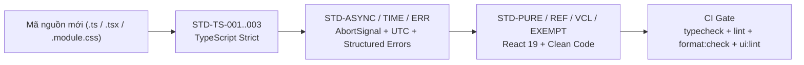

# Chuyên Đề 02: Tiêu Chuẩn Coding Standards Doanh Nghiệp & TypeScript Strict (`STD-*`)

> **Dự án:** Intervia Frontend (`client/`)  
> **Phiên bản:** 9.0 (Intervia Next.js 16 + React 19 + Mantine v9 Standard)  
> **Cổng điều hướng:** [Master Hub](../README.md) | [Quick Reference](../QUICK_REFERENCE.md) | [Cẩm nang Mantine v9](../../mantine/README.md)  
> **Tài liệu liên quan:** [Architecture & Structure](./architecture-and-structure.md) | [State Management](./state-management.md) | [Design System & Styling](../02-ui-and-design-system/design-system-and-styling.md) | [API Contracts & Resilience](../03-quality-and-security/api-contracts-and-resilience.md)  
> **Vai trò SSOT:** Nguồn chân lý duy nhất cho **16 Core Rule IDs (`STD-*`)** và **18 Vercel Sub-Rules (`STD-JS-001..014`, `STD-ADV-001..004`)**.  
> **Cơ sở tham chiếu quốc tế:**
>
> - [TypeScript 5 Handbook — Narrowing & Discriminated Unions](https://www.typescriptlang.org/docs/handbook/2/narrowing.html#discriminated-unions)
> - [React 19 Documentation — `ref` as Prop, `use()` & Keeping Components Pure](https://react.dev/blog/2024/12/05/react-19)
> - [MDN Web Docs — `AbortController` & `Intl.DateTimeFormat`](https://developer.mozilla.org/en-US/docs/Web/API/AbortController)
> - [RFC 9457 — Problem Details for HTTP APIs](https://datatracker.ietf.org/doc/html/rfc9457)
> - [Vercel React Best Practices & Composition Patterns](../../../.agents/skills/vercel-react-best-practices/SKILL.md)

---

## MỤC LỤC

1. [Triết Lý Coding Standards & Master Standards Router](#1-triết-lý-coding-standards-master-standards-router)
2. [An Toàn Kiểu Tuyệt Đối — TypeScript Strict (`STD-TS-001..003`)](#2-an-toàn-kiểu-tuyệt-đối-typescript-strict-std-ts-001003)
3. [Xử Lý Bất Đồng Bộ, Thời Gian & Phân Cấp Lỗi (`STD-ASYNC`, `STD-TIME`, `STD-ERR`)](#3-xử-lý-bất-đồng-bộ-thời-gian-phân-cấp-lỗi-std-async-std-time-std-err)
4. [Clean Code, React 19 & Quản Trị Ngoại Lệ (`STD-PURE` Đến `STD-VCL`)](#4-clean-code-react-19-quản-trị-ngoại-lệ-std-pure-đến-std-vcl)
5. [Bảng Tham Chiếu 18 Vercel Sub-Rules (`STD-JS-001..014` & `STD-ADV-001..004`)](#5-bảng-tham-chiếu-18-vercel-sub-rules-std-js-001014-std-adv-001004)
6. [Bảng Đối Chiếu Anti-Pattern vs Best Practice](#6-bảng-đối-chiếu-anti-pattern-vs-best-practice)
7. [Ánh Xạ Tooling Kiểm Toán CI](#7-ánh-xạ-tooling-kiểm-toán-ci)
8. [Checklist Định Lượng PR Review Gate (12 Tiêu Chí)](#8-checklist-định-lượng-pr-review-gate-12-tiêu-chí)

---

## 1. Triết Lý Coding Standards & Master Standards Router

Bộ quy chuẩn viết mã đảm bảo **tính dự đoán được**, **an toàn kiểu tĩnh trước runtime**, và **sự đồng nhất giữa kỹ sư và AI coding agents**. Toàn bộ mã mới tuân thủ `client/.prettierrc` (`semi: false`, `singleQuote: true`, `trailingComma: 'es5'`). Mọi đoạn mã minh họa dưới đây đều tự chứa (self-contained), bám sát chuẩn TypeScript 5, React 19, Mantine v9 và `vercel-react-best-practices`.



### Master Standards Router (Điều hướng sang 15 chuyên đề còn lại)

| Lĩnh vực                                              |  Tiền tố SSOT  | Chuyên đề phụ trách                                                                                                                                                                  |
| :---------------------------------------------------- | :------------: | :----------------------------------------------------------------------------------------------------------------------------------------------------------------------------------- |
| Kiến trúc App Router, Co-location, RSC Boundary       | _(Guidebook)_  | [`01-foundations/architecture-and-structure.md`](./architecture-and-structure.md)                                                                                                    |
| Server State (TanStack Query v5), Context, SSE, URL   | _(Guidebook)_  | [`01-foundations/state-management.md`](./state-management.md)                                                                                                                        |
| Component Patterns & Mantine Composition              | _(Guidebook)_  | [`02-ui-and-design-system/component-patterns.md`](../02-ui-and-design-system/component-patterns.md)                                                                                  |
| Forms (`@mantine/form` v9 + Zod v4)                   | _(Guidebook)_  | [`02-ui-and-design-system/forms-and-validation.md`](../02-ui-and-design-system/forms-and-validation.md)                                                                              |
| Mantine-First, Zero-Hex Styling & Storybook           |  `SEM-*` (19)  | [`02-ui-and-design-system/design-system-and-styling.md`](../02-ui-and-design-system/design-system-and-styling.md) & [Cẩm nang Mantine](../../mantine/01-strict-rules-and-styling.md) |
| Khả năng tiếp cận WCAG 2.2 AA                         | `A11Y-*` (12)  | [`02-ui-and-design-system/accessibility.md`](../02-ui-and-design-system/accessibility.md)                                                                                            |
| View Transitions & Motion                             | `MOTION-*` (8) | [`02-ui-and-design-system/view-transitions-and-motion.md`](../02-ui-and-design-system/view-transitions-and-motion.md)                                                                |
| Responsive Web, Breakpoints & Touch UX                |  `MOB-*` (10)  | [`02-ui-and-design-system/responsive-and-touch-ux.md`](../02-ui-and-design-system/responsive-and-touch-ux.md)                                                                        |
| Kiểm thử 4 tầng (Vitest 4, `@test-utils`, Playwright) | _(Guidebook)_  | [`03-quality-and-security/testing-and-qa.md`](../03-quality-and-security/testing-and-qa.md)                                                                                          |
| Hợp đồng API, Query Deduping & Resilience             |  `API-*` (12)  | [`03-quality-and-security/api-contracts-and-resilience.md`](../03-quality-and-security/api-contracts-and-resilience.md)                                                              |
| Bảo mật Giao diện & Quản trị Phiên                    |  `SEC-*` (11)  | [`03-quality-and-security/security-and-auth.md`](../03-quality-and-security/security-and-auth.md)                                                                                    |
| Hiệu năng & Core Web Vitals                           | `PERF-*` (13)  | [`04-performance-and-ops/performance-and-web-vitals.md`](../04-performance-and-ops/performance-and-web-vitals.md)                                                                    |
| Observability & Telemetry                             |  `OBS-*` (9)   | [`04-performance-and-ops/observability-and-telemetry.md`](../04-performance-and-ops/observability-and-telemetry.md)                                                                  |
| Quốc tế hóa & Bản địa hóa (`next-intl`, `Intl`)       |  `I18N-*` (9)  | [`04-performance-and-ops/internationalization.md`](../04-performance-and-ops/internationalization.md)                                                                                |
| Release Engineering, Vercel & CI/CD                   |  `OPS-*` (12)  | [`04-performance-and-ops/release-and-devops.md`](../04-performance-and-ops/release-and-devops.md)                                                                                    |

---

## 2. An Toàn Kiểu Tuyệt Đối — TypeScript Strict (`STD-TS-001..003`)

<a id="std-ts-001"></a>

### 2.1. `STD-TS-001` — Tuyệt Đối Cấm `any` & Ép Kiểu Mù Quáng `as unknown as` (`ERROR` · `[Active]`)

- **Quy định:** Cấm khai báo biến, tham số hay giá trị trả về kiểu `any`, và cấm ép kiểu cưỡng bức `as unknown as T`. Mọi dữ liệu không tin cậy từ bên ngoài (JSON phản hồi API, `sessionStorage`, URL query params, SSE payload) bắt buộc đi qua kiểu `unknown` kết hợp Type Guard hoặc **Zod v4** (`zod` `^4.4.3`).

```ts
// Incorrect: Dùng any hoặc JSON.parse(...) as T bỏ qua kiểm tra runtime
export function parseDraftBad(raw: any) {
  return raw.roleTitle.trim()
}

// Correct: Dùng unknown kết hợp Zod v4 safeParse
import { z } from 'zod'

const interviewDraftSchema = z.object({
  roleTitle: z.string().trim().min(1),
  level: z.enum(['INTERN', 'FRESHER', 'JUNIOR', 'MID']),
})

export type InterviewDraft = z.infer<typeof interviewDraftSchema>

export function parseDraft(raw: unknown): InterviewDraft | null {
  const result = interviewDraftSchema.safeParse(raw)
  return result.success ? result.data : null
}
```

<a id="std-ts-002"></a>

### 2.2. `STD-TS-002` — Khai Báo Tường Minh Kiểu Trả Về Cho Exported Functions & Hooks (`WARN` · `[Active]`)

- **Quy định:** Mọi hàm export ở tầng service, utility và custom hooks bắt buộc khai báo tường minh kiểu trả về (ví dụ `Promise<SessionSummary[]>`, `UseCountdownResult`) để khóa chặt hợp đồng nội bộ và ngăn lỗi suy luận kiểu lan rộng khi refactor.

<a id="std-ts-003"></a>

### 2.3. `STD-TS-003` — Discriminated Unions & Truy Cập Mảng/Record An Toàn (`WARN` · `[Active: strict: true]` / `[Target: noUncheckedIndexedAccess]`)

- **Quy định:** Mô hình hóa các trạng thái loại trừ lẫn nhau bằng **Discriminated Union** thay vì tổ hợp 3–4 cờ boolean rời rạc (`isLoading`, `isError`, `isSuccess`). Luôn kiểm tra tồn tại khi đọc phần tử `arr[0]` hoặc `record[key]` để sẵn sàng bật `noUncheckedIndexedAccess` trong `tsconfig.json`.

```tsx
// Correct: Discriminated Union + kiểm tra chỉ mục mảng an toàn với Mantine v9
import { Alert, Loader, Text } from '@mantine/core'

export type AsyncViewState<T> =
  | { status: 'idle' }
  | { status: 'loading' }
  | { status: 'error'; message: string }
  | { status: 'success'; items: T[] }

export function FirstQuestionPreview({
  state,
}: {
  state: AsyncViewState<{ id: string; prompt: string }>
}) {
  switch (state.status) {
    case 'idle':
      return null
    case 'loading':
      return <Loader size="sm" color="brand" />
    case 'error':
      return <Alert color="danger">{state.message}</Alert>
    case 'success': {
      const firstItem = state.items[0]
      return firstItem ? (
        <Text size="sm">{firstItem.prompt}</Text>
      ) : (
        <Text size="sm" c="dimmed">
          Chưa có câu hỏi nào.
        </Text>
      )
    }
  }
}
```

---

## 3. Xử Lý Bất Đồng Bộ, Thời Gian & Phân Cấp Lỗi (`STD-ASYNC`, `STD-TIME`, `STD-ERR`)

<a id="std-async-001"></a>

### 3.1. `STD-ASYNC-001` — Liên Kết `signal?: AbortSignal` Cho Tìm Kiếm & Fetch (`ERROR` · `[Active cho code mới]` / `[Target cho legacy]`)

- **Quy định:** Mọi hàm tìm kiếm hoặc gọi API kéo dài viết mới bắt buộc nhận `signal?: AbortSignal` và chuyển tiếp xuống `fetch`, đồng thời xác thực phản hồi bằng Zod v4 thay vì ép kiểu `as`.

```ts
// Correct: Tự chứa với AbortSignal + Zod v4 validation
import { z } from 'zod'

const sessionItemSchema = z.object({
  id: z.string(),
  roleTitle: z.string(),
  createdAt: z.string().datetime(),
})

const searchResponseSchema = z.object({
  items: z.array(sessionItemSchema),
})

export type SessionItem = z.infer<typeof sessionItemSchema>

export async function searchSessions(
  baseUrl: string,
  query: string,
  signal?: AbortSignal
): Promise<SessionItem[]> {
  const url = `${baseUrl}/sessions?q=${encodeURIComponent(query.trim())}`
  const response = await fetch(url, { credentials: 'include', signal })
  if (!response.ok) {
    throw new Error(`HTTP_${response.status}`)
  }
  const raw: unknown = await response.json()
  return searchResponseSchema.parse(raw).items
}
```

<a id="std-time-001"></a>

### 3.2. `STD-TIME-001` — Lưu Trữ & Trao Đổi Thời Gian Chuẩn ISO-8601 UTC (`ERROR` · `[Active]`)

- **Quy định:** 100% mốc thời gian trao đổi giữa Frontend và Backend là chuỗi **ISO-8601 UTC** kết thúc bằng `Z` (ví dụ `2026-11-23T10:30:00.000Z`). Cấm truyền chuỗi ngày tháng địa phương thiếu thông tin múi giờ.

<a id="std-time-002"></a>

### 3.3. `STD-TIME-002` — Hiển Thị Ngày Giờ Qua Hoisted `Intl.DateTimeFormat` (`ERROR` · `[Active]`)

- **Quy định:** Cấm tự nối chuỗi `getDate() + '/' + (getMonth() + 1)` và cấm khởi tạo `new Intl.DateTimeFormat(...)` bên trong hàm render. Khởi tạo formatter một lần ở module scope với `timeZone` tường minh để đồng nhất SSR và Client (không lệch hydration).

```tsx
// Correct: Hoisted Intl.DateTimeFormat + Mantine Text polymorphic component="time"
import { Text } from '@mantine/core'

const VIETNAM_DATE_TIME_FORMATTER = new Intl.DateTimeFormat('vi-VN', {
  timeZone: 'Asia/Ho_Chi_Minh',
  day: '2-digit',
  month: '2-digit',
  year: 'numeric',
  hour: '2-digit',
  minute: '2-digit',
})

export function formatVietnamDateTime(isoUtc: string): string {
  const date = new Date(isoUtc)
  return Number.isNaN(date.getTime())
    ? ''
    : VIETNAM_DATE_TIME_FORMATTER.format(date)
}

export function SessionTimestamp({ createdAt }: { createdAt: string }) {
  return (
    <Text component="time" dateTime={createdAt} size="xs" c="dimmed">
      {formatVietnamDateTime(createdAt)}
    </Text>
  )
}
```

<a id="std-err-001"></a>

### 3.4. `STD-ERR-001` — Phân Cấp Lỗi Miền Có Cấu Trúc (`ERROR` · `[Active/Target]`)

- **Quy định:** Tuyệt đối cấm `throw 'Lỗi mạng'` (ném chuỗi thô). Mọi lỗi HTTP phải được chuẩn hóa vào lớp lỗi có cấu trúc (`statusCode`, `errorCode`, `details`, `requestId`, `correlationId`) và tương thích tiến hóa sang chuẩn **RFC 9457 Problem Details** (`[Target Standard]`).

---

## 4. Clean Code, React 19 & Quản Trị Ngoại Lệ (`STD-PURE` Đến `STD-VCL`)

<a id="std-pure-001"></a>

### 4.1. `STD-PURE-001` — Pure Render & Bất Biến Dữ Liệu (`ERROR` · `[Active]`)

Component React phải thuần khiết: không mutate trực tiếp `props` hay mảng state (`items.sort()`, `items.push()`), không chạy side-effect trong render body; luôn dùng spread hoặc `toSorted()`.

<a id="std-name-001"></a>

### 4.2. `STD-NAME-001` — Quy Ước Đặt Tên Đối Xứng (`WARN` · `[Active]`)

- Boolean: tiền tố `is`, `has`, `can`, `should` (`isSubmitting`, `hasResume`).
- Handler nội bộ: tiền tố `handle` (`handleStartSession`, `handleDeleteJd`).
- Callback prop từ cha: tiền tố `on` (`onStartSession`, `onDeleteJd`).

<a id="std-size-001"></a>

### 4.3. `STD-SIZE-001` — Giới Hạn Kích Thước Tệp Component ≤ 250 Dòng (`WARN` · `[Active]`)

Mỗi tệp `.tsx` giữ ≤ **250 dòng** để tránh "God Component". Khi vượt ngưỡng, tách sub-component co-located trong cùng thư mục `components/<domain>/` hoặc trích logic sang custom hook.

<a id="std-ref-001"></a>

### 4.4. `STD-REF-001` — Chuẩn Hóa `ref` & `use()` Trên React 19 (`ERROR` · `[Active]`)

Theo quy tắc `react19-no-forwardref` trong `vercel-composition-patterns`, trên **React `19.2.4`**, truyền `ref` trực tiếp như prop thông thường (không bọc `React.forwardRef`) và ưu tiên `use(Context)` thay cho `useContext(Context)` trong code mới:

```tsx
// Incorrect: Dùng React.forwardRef thừa trên React 19
import { forwardRef } from 'react'
import { TextInput, type TextInputProps } from '@mantine/core'

const LegacyInput = forwardRef<HTMLInputElement, TextInputProps>(
  (props, ref) => <TextInput ref={ref} {...props} />
)

// Correct: Truyền ref trực tiếp như prop thông thường trên React 19
import { TextInput, type TextInputProps } from '@mantine/core'

export function FocusablePromptInput({
  ref,
  ...props
}: TextInputProps & { ref?: React.Ref<HTMLInputElement> }) {
  return <TextInput ref={ref} {...props} />
}
```

<a id="std-clean-001"></a>

### 4.5. `STD-CLEAN-001` — Khử Rác Debugging (`ERROR` · `[Active]`)

Cấm tuyệt đối `console.log()` và `debugger` trong mã nguồn production. Chỉ giữ `console.error` có kiểm soát ở Error Boundary cho tới khi áp dụng Structured Logger (`OBS-005`).

<a id="std-exempt-001"></a>

### 4.6. `STD-EXEMPT-001` — Ngoại Lệ Có Thời Hạn `interviewcoach-convention-exempt` (`WARN` · `[Active]`)

Các tình huống kỹ thuật hiếm hoi (như DOM mount container cho canvas audio waveform hoặc biểu đồ) bắt buộc ghi chú thích theo đúng cú pháp mà `scripts/check-ui-rules.mjs` kiểm tra:

```tsx
// Correct: Ngoại lệ có Rule ID, lý do cụ thể và hạn sử dụng YYYY-MM-DD
import { Box } from '@mantine/core'

export function AudioWaveformMount({
  containerRef,
}: {
  containerRef: React.Ref<HTMLDivElement>
}) {
  // interviewcoach-convention-exempt: SEM-GOV-001 Third-party audio canvas mount node until: 2026-12-31
  return <Box ref={containerRef} />
}
```

<a id="std-memo-001"></a>

### 4.7. `STD-MEMO-001` — Memoization Tỉnh Táo (`WARN` · `[Active]`)

Không bọc `useMemo`/`useCallback` cho phép tính nguyên thủy rẻ (`rerender-simple-expression-in-memo`). Chỉ memoize khi xử lý tập dữ liệu lớn (> 50–100 phần tử), ổn định object Context value, hoặc truyền callback xuống component con bọc `React.memo`.

<a id="std-magic-001"></a>

### 4.8. `STD-MAGIC-001` — Cấm Magic Pixel & Magic Z-Index (`WARN` · `[Active]`)

Cấm hằng số vô nghĩa (`padding: 13px`, `z-index: 9999`, timeout `300000` không tên). Dùng Mantine scale (`xs`–`xl`), thang Z-Index Mantine (`100`–`400`), và hằng số đặt tên rõ nghĩa (`DEFAULT_DEDUPING_INTERVAL_MS = 5_000`).

<a id="std-vcl-001"></a>

### 4.9. `STD-VCL-001` — Render Có Điều Kiện Tường Minh Bằng Ternary (`ERROR` · `[Active]`)

Áp dụng trực tiếp quy tắc `rendering-conditional-render` từ `vercel-react-best-practices`: cấm `{count && <Badge>{count}</Badge>}` vì khi `count === 0` React sẽ render chuỗi `"0"` ra DOM.

```tsx
// Incorrect: Rò rỉ ký tự "0" khi count === 0
function BadCountBadge({ count }: { count: number }) {
  return count && <Badge color="brand">{count}</Badge>
}

// Correct: Dùng phép so sánh tường minh với ternary ? : null
import { Badge } from '@mantine/core'

export function PendingCountBadge({ count }: { count: number }) {
  return count > 0 ? (
    <Badge color="brand" variant="light">
      {count}
    </Badge>
  ) : null
}
```

> **Bảng thay thế 1-1 Raw HTML → Mantine v9:** Tra cứu tập trung tại [Quy tắc UI chặt chẽ (`docs/mantine/01`)](../../mantine/01-strict-rules-and-styling.md) và [Design System & Styling](../02-ui-and-design-system/design-system-and-styling.md).

---

## 5. Bảng Tham Chiếu 18 Vercel Sub-Rules (`STD-JS-001..014` & `STD-ADV-001..004`)

<a id="std-js-group"></a>

### 5.1. 14 Quy Tắc Hiệu Năng JavaScript (`STD-JS-001..014` · `WARN`)

| Mã Quy Chuẩn | Rule Name (`vercel-react-best-practices`) | Quy tắc tóm tắt                                                                            |
| :----------: | :---------------------------------------- | :----------------------------------------------------------------------------------------- |
| `STD-JS-001` | `js-early-exit`                           | Thoát hàm sớm bằng guard clauses thay vì lồng sâu `if/else`.                               |
| `STD-JS-002` | `js-combine-iterations`                   | Gộp nhiều vòng `.filter().map()` liên tiếp trên mảng lớn thành 1 lần duyệt.                |
| `STD-JS-003` | `js-set-map-lookups`                      | Dùng `Set`/`Map` (`O(1)`) thay cho `Array.includes()` (`O(N)`) trong vòng lặp.             |
| `STD-JS-004` | `js-tosorted-immutable`                   | Dùng `array.toSorted()` hoặc `[...array].sort()`, không mutate mảng gốc.                   |
| `STD-JS-005` | `js-batch-dom-css`                        | Gom thay đổi CSS qua CSS Modules / `mod` thay vì đổi nhiều style rời rạc.                  |
| `STD-JS-006` | `js-index-maps`                           | Lập `Map` theo ID khi tra cứu lặp nhiều lần trên danh sách kỹ năng/câu hỏi.                |
| `STD-JS-007` | `js-cache-function-results`               | Cache kết quả hàm thuần tính toán nặng bằng `Map` ở module scope.                          |
| `STD-JS-008` | `js-cache-storage`                        | Cache giá trị đọc từ `localStorage`/`sessionStorage` trên RAM, tránh đọc lặp trong render. |
| `STD-JS-009` | `js-cache-property-access`                | Lưu tham chiếu thuộc tính lồng sâu vào biến cục bộ trong vòng lặp lớn.                     |
| `STD-JS-010` | `js-length-check-first`                   | So sánh `a.length === b.length` trước khi so sánh sâu hai mảng.                            |
| `STD-JS-011` | `js-hoist-regexp`                         | Hoist đối tượng `RegExp` ra ngoài hàm render/vòng lặp.                                     |
| `STD-JS-012` | `js-min-max-loop`                         | Tìm min/max trong 1 vòng lặp (`O(N)`) thay vì gọi `.sort()` (`O(N log N)`).                |
| `STD-JS-013` | `js-flatmap-filter`                       | Dùng `.flatMap()` khi vừa lọc vừa ánh xạ để giảm cấp phát mảng trung gian.                 |
| `STD-JS-014` | `js-request-idle-callback`                | Đẩy công việc phụ không khẩn cấp sang `requestIdleCallback` (có fallback `setTimeout`).    |

<a id="std-adv-group"></a>

### 5.2. 4 Quy Tắc Advanced React (`STD-ADV-001..004` · `WARN`)

| Mã Quy Chuẩn  | Rule Name (`vercel-react-best-practices`) | Quy tắc tóm tắt                                                                                                                       |
| :-----------: | :---------------------------------------- | :------------------------------------------------------------------------------------------------------------------------------------ |
| `STD-ADV-001` | `advanced-effect-event-deps`              | Không đưa hàm trả về từ `useEffectEvent` vào mảng dependency của `useEffect`.                                                         |
| `STD-ADV-002` | `advanced-event-handler-refs`             | Lưu callback vào `useRef` (cập nhật trong `useEffect(..., [handler])`) hoặc dùng `useEffectEvent` để không re-subscribe listener/SSE. |
| `STD-ADV-003` | `advanced-init-once`                      | Khởi tạo cấu hình ứng dụng một lần duy nhất ở module scope hoặc root entry.                                                           |
| `STD-ADV-004` | `advanced-use-latest`                     | Đọc giá trị mới nhất trong async callback qua ref ổn định mà không làm vỡ dependency.                                                 |

---

## 6. Bảng Đối Chiếu Anti-Pattern vs Best Practice

| Tình huống                              | Anti-Pattern (Tránh)                                           | Best Practice (Chuẩn mực)                                                                      |
| :-------------------------------------- | :------------------------------------------------------------- | :--------------------------------------------------------------------------------------------- |
| Parse dữ liệu ngoài (API, Storage, SSE) | `const data = JSON.parse(raw) as Payload`                      | Dùng `unknown` + `schema.safeParse(raw)` của Zod v4 (`STD-TS-001`)                             |
| Trạng thái bất đồng bộ nhiều nhánh      | 4 biến `isLoading`, `isError`, `isEmpty`, `data` rời rạc       | 1 Discriminated Union `{ status: 'idle' \| 'loading' \| 'error' \| 'success' }` (`STD-TS-003`) |
| Định dạng ngày giờ trong component      | `new Intl.DateTimeFormat('vi-VN').format(d)` ngay trong render | Hoist `Intl.DateTimeFormat` ra module scope với `timeZone` tường minh (`STD-TIME-002`)         |
| Component cần nhận `ref` trên React 19  | Bọc `React.forwardRef<HTMLInputElement, Props>(...)`           | Nhận `ref` trực tiếp như prop thông thường (`STD-REF-001`, `react19-no-forwardref`)            |
| Render badge số lượng                   | `{items.length && <Badge>{items.length}</Badge>}`              | `{items.length > 0 ? <Badge>{items.length}</Badge> : null}` (`STD-VCL-001`)                    |
| Đồng bộ ref callback trong `useEffect`  | `useEffect(() => { cbRef.current = cb })` (thiếu deps array)   | `useEffect(() => { cbRef.current = cb }, [cb])` hoặc `useEffectEvent(cb)` (`STD-ADV-002`)      |

---

## 7. Ánh Xạ Tooling Kiểm Toán CI

| Nhóm Quy Chuẩn                                 | Công cụ thực thi (`client/`)                                          | Lệnh chạy                           |
| :--------------------------------------------- | :-------------------------------------------------------------------- | :---------------------------------- |
| `STD-TS-001..003`                              | TypeScript 5 (`tsc --noEmit`) + ESLint (`@typescript-eslint`)         | `npm run typecheck && npm run lint` |
| `STD-CLEAN-001`, `STD-VCL-001`, `STD-PURE-001` | ESLint 9 (`eslint-config-next`)                                       | `npm run lint`                      |
| `STD-EXEMPT-001`, `STD-MAGIC-001`              | `scripts/check-ui-rules.mjs` (`--strict-expiry` trên CI)              | `npm run ui:lint -- <files>`        |
| Định dạng mã nguồn                             | Prettier (`semi: false`, `singleQuote: true`, `trailingComma: 'es5'`) | `npm run format:check`              |
| Toàn vẹn tài liệu & ví dụ code                 | `scripts/verify-docs-integrity.mjs`                                   | `npm run verify:docs`               |

---

## 8. Checklist Định Lượng PR Review Gate (12 Tiêu Chí)

- [ ] **1. Zero `any`:** Không dùng `any` và không ép kiểu `as unknown as` (`STD-TS-001`).
- [ ] **2. Explicit Contracts:** Exported functions, services và custom hooks khai báo tường minh kiểu trả về (`STD-TS-002`).
- [ ] **3. Safe Unions & Indexing:** Trạng thái đa nhánh dùng Discriminated Union; mọi truy cập `arr[i]` có kiểm tra tồn tại (`STD-TS-003`).
- [ ] **4. Request Cancellation:** Các hàm search/fetch viết mới hỗ trợ `signal?: AbortSignal` (`STD-ASYNC-001`).
- [ ] **5. UTC & Hoisted `Intl`:** API truyền ISO-8601 UTC; hiển thị qua hoisted `Intl.DateTimeFormat` (`STD-TIME-001`, `STD-TIME-002`).
- [ ] **6. Structured Errors:** Lỗi HTTP dùng lớp lỗi có cấu trúc, cấm `throw` chuỗi thô (`STD-ERR-001`).
- [ ] **7. Pure & Immutable:** Không mutate state/props, dùng `toSorted()` hoặc spread (`STD-PURE-001`, `STD-JS-004`).
- [ ] **8. Naming Symmetry:** Đúng quy ước `is/has/can`, `handle*`, `on*` (`STD-NAME-001`).
- [ ] **9. File Size & React 19 `ref`:** Tệp `.tsx` ≤ 250 dòng; component mới dùng `ref` as prop (`STD-SIZE-001`, `STD-REF-001`).
- [ ] **10. Clean & Ternary JSX:** Không còn `console.log`/`debugger`; render có điều kiện dùng `? : null` (`STD-CLEAN-001`, `STD-VCL-001`).
- [ ] **11. Valid Exemptions:** Mọi ngoại lệ đúng cú pháp `interviewcoach-convention-exempt: <RULE_ID> <reason> until: YYYY-MM-DD` (`STD-EXEMPT-001`).
- [ ] **12. Static Gates Pass:** `npm run typecheck`, `npm run lint`, `npm run format:check`, và `npm run ui:lint -- <files>` đạt Exit Code `0`.
