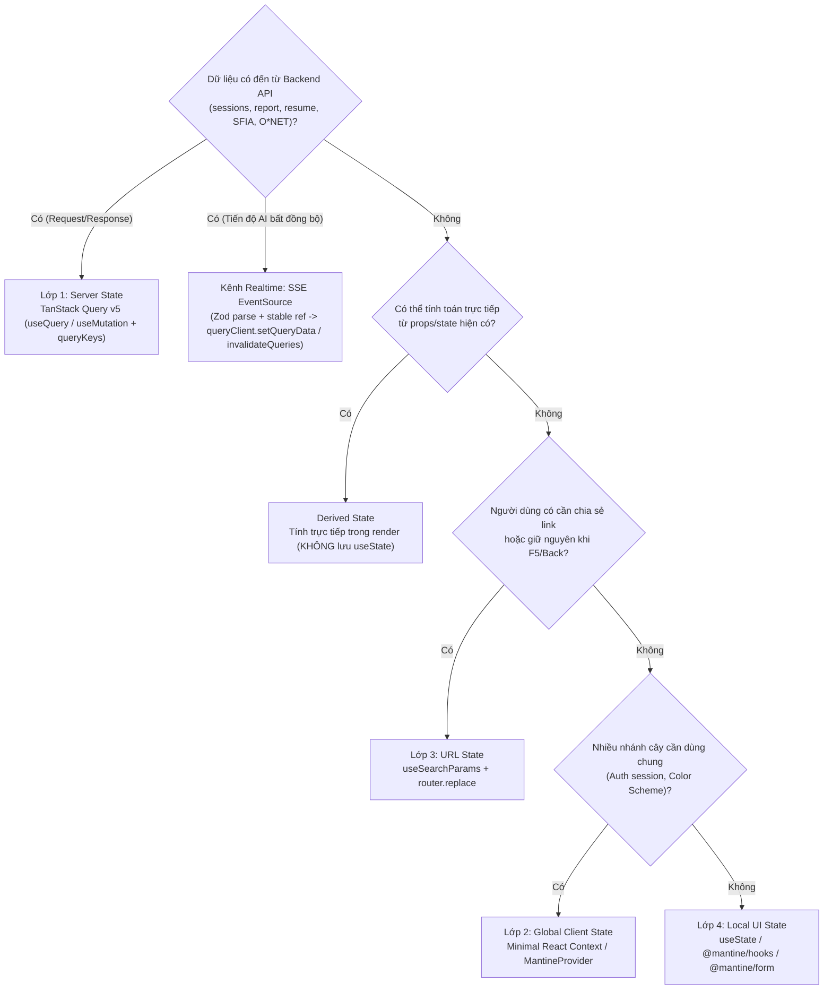

# Chuyên Đề 03: Quản Trị Trạng Thái Đa Tầng & Realtime Stream (State Management)

> **Dự án:** InterviewCoach Frontend (`client/`)  
> **Phiên bản:** 9.0 (InterviewCoach Next.js 16 + React 19 + Mantine v9 Standard)  
> **Cổng điều hướng:** [Master Hub](../README.md) | [Quick Reference](../QUICK_REFERENCE.md) | [Cẩm nang Mantine v9](../../mantine/README.md) | [Cẩm nang TanStack Query v5](../../mantine/04-tanstack-query-guide.md)  
> **Tài liệu liên quan:** [Architecture & Structure](./architecture-and-structure.md) | [Coding Standards](./coding-standards.md) | [API Contracts & Resilience](../03-quality-and-security/api-contracts-and-resilience.md) | [Forms & Validation](../02-ui-and-design-system/forms-and-validation.md)  
> **Tính chất tài liệu:** Chuẩn mực mục tiêu (Normative Standard) dựa trên **TanStack Query v5 (`@tanstack/react-query`)**, **React 19 Context**, **Next.js 16 URL Params**, **`@mantine/hooks`**, và **SSE `EventSource`**; mọi đoạn mã minh họa tự chứa theo tài liệu gốc chính thức (không trích xuất code legacy từ `client/`).  
> **Cơ sở tham chiếu quốc tế:**
>
> - [TanStack Query v5 Official Documentation — Queries, Mutations & Optimistic Updates](https://tanstack.com/query/v5/docs/framework/react/overview)
> - [Next.js 16 Navigation — `useSearchParams`, `usePathname`, `useRouter`](https://nextjs.org/docs/app/api-reference/functions/use-search-params)
> - [Mantine v9 Hooks — State & Timing Utilities](https://mantine.dev/hooks/package/)
> - [React 19 — You Might Not Need an Effect (Derived State)](https://react.dev/learn/you-might-not-need-an-effect)
> - [Vercel React Best Practices (`client-swr-dedup`, `rerender-derived-state-no-effect`, `advanced-event-handler-refs`)](../../../.agents/skills/vercel-react-best-practices/SKILL.md)

---

## MỤC LỤC

1. [Triết Lý Phân Tầng State & Cây Quyết Định Trong 30 Giây](#1-triết-lý-phân-tầng-state-cây-quyết-định-trong-30-giây)
2. [Đặc Tả 4 Lớp State Nền Tảng](#2-đặc-tả-4-lớp-state-nền-tảng)
3. [Realtime Stream State — SSE `EventSource` & Đồng Bộ `QueryClient` Cache](#3-realtime-stream-state-sse-eventsource-đồng-bộ-queryclient-cache)
4. [Derived State, Optimistic UI, Race Conditions & Mở Rộng Đa Tab/Offline](#4-derived-state-optimistic-ui-race-conditions-mở-rộng-đa-taboffline)
5. [Bảng Đối Chiếu Anti-Pattern vs Best Practice](#5-bảng-đối-chiếu-anti-pattern-vs-best-practice)
6. [Ánh Xạ Tooling Kiểm Toán CI](#6-ánh-xạ-tooling-kiểm-toán-ci)
7. [Checklist Định Lượng PR Review Gate (10 Tiêu Chí)](#7-checklist-định-lượng-pr-review-gate-10-tiêu-chí)

---

## 1. Triết Lý Phân Tầng State & Cây Quyết Định Trong 30 Giây

Sai lầm phổ biến nhất ở các ứng dụng Frontend quy mô lớn là dồn dữ liệu máy chủ, trạng thái bộ lọc URL và biến đóng/mở Modal vào cùng một kho chung, dẫn đến đồng bộ thủ công rườm rà, re-render dây chuyền và rò rỉ dữ liệu cũ. **InterviewCoach** áp dụng **Mô hình Phân Tầng State 4 Lớp + Kênh Realtime SSE** dựa trực tiếp trên **TanStack Query v5 (`@tanstack/react-query`)**, React Context tối giản, Next.js App Router URL APIs và `@mantine/hooks` mà không cài thêm store cồng kềnh bên ngoài.



---

## 2. Đặc Tả 4 Lớp State Nền Tảng

### 2.1. Lớp 1 — Server State Với TanStack Query v5 & `queryKeys` Factory (`client-swr-dedup`)

Theo nguyên tắc khử trùng lặp request tại client (`client-swr-dedup` trong `vercel-react-best-practices`) và tài liệu chính thức của **TanStack Query v5**, **tuyệt đối không** viết `useEffect` gọi `fetch` rồi `setState` thủ công. Mọi dữ liệu đọc từ server đi qua `useQuery` kèm bộ **`queryKeys` factory tập trung** (`@/lib/query-client`) và chuyển tiếp `AbortSignal` để khử trùng lặp request tự động:

```ts
// Incorrect: Fetch trong useEffect không có cache, không deduping, dễ race condition
import { useEffect, useState } from 'react'

function useSessionsBad() {
  const [sessions, setSessions] = useState<unknown[]>([])
  useEffect(() => {
    fetch('/api/v1/sessions')
      .then((res) => res.json())
      .then(setSessions)
  }, [])
  return sessions
}

// Correct: TanStack Query v5 + queryKeys Factory + AbortSignal + kiểu trả về tường minh
import { useQuery, useQueryClient } from '@tanstack/react-query'
import { apiClient } from '@/lib/api-client'
import { queryKeys } from '@/lib/query-client'

export interface SessionSummary {
  id: string
  roleTitle: string
  status: 'IN_PROGRESS' | 'COMPLETED' | 'CANCELLED'
}

async function fetchCandidateSessions(
  signal?: AbortSignal
): Promise<SessionSummary[]> {
  const res = await apiClient.get<{ sessions: SessionSummary[] }>('/sessions', {
    signal,
  })
  return res.sessions ?? []
}

export interface UseSessionsListResult {
  sessions: SessionSummary[]
  isLoading: boolean
  error: Error | null
  refetch: () => Promise<void>
  mutate: () => Promise<void>
}

export function useSessionsList(): UseSessionsListResult {
  const queryClient = useQueryClient()
  const { data, error, isLoading, refetch } = useQuery<SessionSummary[]>({
    queryKey: queryKeys.sessions.list(),
    queryFn: ({ signal }) => fetchCandidateSessions(signal),
    staleTime: 5_000,
  })

  return {
    sessions: data ?? [],
    isLoading,
    error: error instanceof Error ? error : null,
    refetch: async () => {
      await refetch()
    },
    mutate: () =>
      queryClient.invalidateQueries({ queryKey: queryKeys.sessions.all }),
  }
}
```

### 2.2. Lớp 2 — Global Client Session State Tối Giản

- **Phạm vi duy nhất được phép:** Trạng thái phiên xác thực tối giản (`user`, `role`, `isLoading`, `logout`) trong Auth Context và chế độ màu sáng/tối thông qua `MantineProvider` (`useMantineColorScheme()`).
- **Quy tắc bắt buộc:**
  - Luôn bọc Provider `value` bằng `useMemo` và callbacks bằng `useCallback` để ngăn re-render toàn cây ứng dụng.
  - **Cấm** lưu danh sách sessions, hồ sơ CV, hay dữ liệu bảng SFIA/O\*NET vào React Context gốc.

### 2.3. Lớp 3 — URL State Cho Bộ Lọc, Tab & Phân Trang

Với bộ lọc bảng, tab chính, phân trang cần chia sẻ đường dẫn hoặc giữ nguyên khi F5, dùng `useSearchParams`, `usePathname`, và `useRouter` từ `next/navigation`:

```ts
// Correct: Đọc và cập nhật URL params an toàn kiểu, hoist hằng số ngoài render
'use client'

import { useCallback } from 'react'
import { usePathname, useRouter, useSearchParams } from 'next/navigation'

const VALID_TABS = new Set(['taxonomy', 'matrix', 'analytics'] as const)
type CatalogTab = 'taxonomy' | 'matrix' | 'analytics'
const DEFAULT_TAB: CatalogTab = 'taxonomy'

function parseTab(raw: string | null): CatalogTab {
  if (raw === 'taxonomy' || raw === 'matrix' || raw === 'analytics') {
    return raw
  }
  return VALID_TABS.has(DEFAULT_TAB) ? DEFAULT_TAB : 'taxonomy'
}

export interface UseCatalogUrlStateResult {
  activeTab: CatalogTab
  setTab: (nextTab: CatalogTab) => void
}

export function useCatalogUrlState(): UseCatalogUrlStateResult {
  const router = useRouter()
  const pathname = usePathname()
  const searchParams = useSearchParams()

  const activeTab = parseTab(searchParams.get('tab'))

  const setTab = useCallback(
    (nextTab: CatalogTab) => {
      const next = new URLSearchParams(searchParams.toString())
      if (nextTab === DEFAULT_TAB) {
        next.delete('tab')
      } else {
        next.set('tab', nextTab)
      }
      const query = next.toString()
      router.replace(`${pathname}${query ? `?${query}` : ''}`, {
        scroll: false,
      })
    },
    [pathname, router, searchParams]
  )

  return { activeTab, setTab }
}
```

### 2.4. Lớp 4 — Local UI State & `@mantine/hooks`

- Dành cho trạng thái tạm thời gắn chặt vòng đời 1 component: đóng/mở `Modal`/`Drawer`, tìm kiếm cục bộ, bước hiện tại của wizard.
- Luôn ưu tiên **`@mantine/hooks`** (`useDisclosure`, `useToggle`, `useListState`, `useDebouncedValue`, `usePagination`) thay vì tự viết `useEffect` lắng nghe DOM/window. Xem tra cứu nhanh tại [Hướng dẫn Setup Forms & Hooks](../../mantine/02-setup-forms-hooks-guide.md).

---

## 3. Realtime Stream State — SSE `EventSource` & Đồng Bộ `QueryClient` Cache

Với các tác vụ AI bất đồng bộ (sinh câu hỏi phỏng vấn, tổng hợp báo cáo STAR), sử dụng **Server-Sent Events (`EventSource`)** kết hợp 4 nguyên tắc bắt buộc (tuân thủ `STD-TS-001`, `STD-TS-002`, `STD-ADV-002`):

1. **Mô hình hóa vòng đời bằng Union State:** Khai báo rõ `SseStatus = 'idle' | 'connecting' | 'connected' | 'disconnected'`.
2. **Ổn định callback bằng `useRef` có dependency `[onReady]` (hoặc React 19 `useEffectEvent`):** Khớp `advanced-event-handler-refs` — tuyệt đối không viết `useEffect` thiếu dependency array chạy lại mỗi lần render.
3. **Validate payload SSE bằng Zod v4:** Không dùng `JSON.parse(event.data) as Payload`.
4. **Cầu nối SSE → TanStack `QueryClient` Cache:** Khi nhận sự kiện tiến độ AI (`feedback_progress`), gọi `queryClient.setQueryData(queryKeys.sessions.feedbackProgress(sessionId), parsed.data)`; khi nhận `report_ready`, gọi `queryClient.invalidateQueries` cho `report(sessionId)`, `detail(sessionId)` và `list()`.

```ts
// Correct: SSE hook chuẩn React 19 + Zod v4 + đồng bộ trực tiếp TanStack QueryClient Cache
'use client'

import { useEffect, useRef, useState } from 'react'
import { useQueryClient } from '@tanstack/react-query'
import { z } from 'zod'
import { queryKeys } from '@/lib/query-client'

const progressPayloadSchema = z.object({
  totalTurns: z.number().int().nonnegative(),
  evaluatedTurns: z.number().int().nonnegative(),
  progressPercent: z.number().min(0).max(100),
  reportReady: z.boolean(),
})

export type ProgressPayload = z.infer<typeof progressPayloadSchema>
export type SseStatus = 'idle' | 'connecting' | 'connected' | 'disconnected'

export interface UseProgressStreamResult {
  status: SseStatus
  progress: ProgressPayload | null
}

export function useProgressStream(
  sessionId: string | null,
  streamUrl: string | null,
  onReportReady: () => void
): UseProgressStreamResult {
  const queryClient = useQueryClient()
  const [status, setStatus] = useState<SseStatus>('idle')
  const [progress, setProgress] = useState<ProgressPayload | null>(null)

  const onReportReadyRef = useRef(onReportReady)
  useEffect(() => {
    onReportReadyRef.current = onReportReady
  }, [onReportReady])

  useEffect(() => {
    if (!sessionId || !streamUrl) return

    const source = new EventSource(streamUrl, { withCredentials: true })

    source.onopen = () => {
      setStatus('connected')
    }

    source.addEventListener('feedback_progress', (event) => {
      try {
        const parsed = progressPayloadSchema.safeParse(
          JSON.parse((event as MessageEvent<string>).data)
        )
        if (parsed.success) {
          setProgress(parsed.data)
          queryClient.setQueryData(
            queryKeys.sessions.feedbackProgress(sessionId),
            parsed.data
          )
        }
      } catch {
        // Bỏ qua frame JSON lỗi định dạng
      }
    })

    source.addEventListener('report_ready', () => {
      void queryClient.invalidateQueries({
        queryKey: queryKeys.sessions.report(sessionId),
      })
      void queryClient.invalidateQueries({
        queryKey: queryKeys.sessions.detail(sessionId),
      })
      void queryClient.invalidateQueries({
        queryKey: queryKeys.sessions.list(),
      })
      onReportReadyRef.current()
      source.close()
      setStatus('disconnected')
    })

    source.onerror = () => {
      source.close()
      setStatus('disconnected')
    }

    return () => {
      source.close()
    }
  }, [queryClient, sessionId, streamUrl])

  return { status: streamUrl ? status : 'idle', progress }
}
```

---

## 4. Derived State, Optimistic UI, Race Conditions & Mở Rộng Đa Tab/Offline

### 4.1. Derived State: "Compute, Don't Duplicate" (`rerender-derived-state-no-effect`)

Theo quy tắc `rerender-derived-state-no-effect` từ `vercel-react-best-practices`, mọi giá trị tính được từ props hoặc state hiện có phải được tính trực tiếp trong render — cấm sao chép sang `useState` rồi đồng bộ bằng `useEffect`:

```tsx
// Incorrect: Tạo state thừa và dùng useEffect đồng bộ gây thêm 1 vòng render
function SessionStatsBad({ sessions }: { sessions: SessionSummary[] }) {
  const [completedCount, setCompletedCount] = useState(0)
  useEffect(() => {
    setCompletedCount(sessions.filter((s) => s.status === 'COMPLETED').length)
  }, [sessions])
  return <Text>{completedCount}</Text>
}

// Correct: Tính trực tiếp trong render (Derived State thuần)
import { Group, Text } from '@mantine/core'

export function SessionStatsSummary({
  sessions,
}: {
  sessions: Array<{
    id: string
    status: 'IN_PROGRESS' | 'COMPLETED' | 'CANCELLED'
  }>
}) {
  const completedCount = sessions.filter(
    (session) => session.status === 'COMPLETED'
  ).length

  return (
    <Group gap="xs">
      <Text size="sm" c="dimmed">
        Phiên đã hoàn tất:
      </Text>
      <Text size="sm" fw={600}>
        {completedCount}
      </Text>
    </Group>
  )
}
```

### 4.2. Optimistic Updates & Chống Race Conditions Với TanStack Query v5

Khi cập nhật trạng thái (như hủy phiên phỏng vấn hoặc xóa ánh xạ kỹ năng), dùng vòng đời `onMutate` (`cancelQueries` + snapshot + `setQueryData`), `onError` (rollback + `notifications.show`), và `onSettled` (`invalidateQueries`) của `useMutation`:

```ts
// Correct: Optimistic Update + tự động rollback qua TanStack Query v5 useMutation
import { notifications } from '@mantine/notifications'
import { useMutation, useQueryClient } from '@tanstack/react-query'
import { apiClient } from '@/lib/api-client'
import { queryKeys } from '@/lib/query-client'

interface SessionRecord {
  id: string
  status: 'IN_PROGRESS' | 'COMPLETED' | 'CANCELLED'
}

export function useCancelSessionMutation() {
  const queryClient = useQueryClient()
  const listKey = queryKeys.sessions.list()

  return useMutation({
    mutationFn: (sessionId: string) =>
      apiClient.patch(`/sessions/${encodeURIComponent(sessionId)}/status`, {
        status: 'cancelled',
      }),
    onMutate: async (sessionId) => {
      await queryClient.cancelQueries({ queryKey: listKey })
      const previousSessions =
        queryClient.getQueryData<SessionRecord[]>(listKey)

      queryClient.setQueryData<SessionRecord[]>(listKey, (old = []) =>
        old.map((session) =>
          session.id === sessionId
            ? { ...session, status: 'CANCELLED' as const }
            : session
        )
      )

      return { previousSessions }
    },
    onError: (err, _sessionId, context) => {
      if (context?.previousSessions) {
        queryClient.setQueryData(listKey, context.previousSessions)
      }
      notifications.show({
        color: 'danger',
        title: 'Không thể hủy phiên phỏng vấn',
        message:
          err instanceof Error
            ? err.message
            : 'Đã khôi phục trạng thái phiên ban đầu.',
      })
    },
    onSettled: async () => {
      await queryClient.invalidateQueries({ queryKey: queryKeys.sessions.all })
    },
  })
}
```

- **Chống Race Condition khi tìm kiếm:** Kết hợp `useDebouncedValue(query, 300)` (`@mantine/hooks`) với `queryKeys.onet.search(debounced)` và nhận `{ signal }` từ `queryFn` truyền xuống HTTP client (hoặc dùng `AbortController` theo `STD-ASYNC-001` cho các tác vụ imperative).

### 4.3. Mở rộng Đa Tab & Nháp Ngoại Tuyến (`[Target Standard]`)

- **Multi-Tab Auth Sync (`[Target Standard]`):** Phát sự kiện đăng xuất qua `BroadcastChannel('interviewcoach-auth')` để các tab đang mở đồng thời reset Auth Context và xóa sạch TanStack Query cache (`queryClient.clear()`).
- **Persistent Offline Draft (`[Target Standard]`):** Lưu bản nháp câu trả lời dài hoặc JD phi nhạy cảm vào `sessionStorage`/`IndexedDB` kèm kiểm tra schema Zod khi khôi phục.

---

## 5. Bảng Đối Chiếu Anti-Pattern vs Best Practice

| Tình huống                         | Anti-Pattern (Tránh)                                              | Best Practice (Chuẩn mực)                                                                         |
| :--------------------------------- | :---------------------------------------------------------------- | :------------------------------------------------------------------------------------------------ |
| Tải danh sách dữ liệu từ API       | `useEffect(() => { fetch(...).then(setList) }, [])`               | Dùng `useQuery` kèm `queryKeys` Factory và `staleTime` hợp lý (`client-swr-dedup`)                |
| Lưu bộ lọc bảng / tab chia sẻ link | Lưu `activeTab`, `level` trong `useState` khiến F5 mất trạng thái | Đồng bộ URL bằng `useSearchParams` + `router.replace(..., { scroll: false })`                     |
| Đếm hoặc lọc từ mảng có sẵn        | Tạo `useState` phụ + `useEffect` để cập nhật lại                  | Tính trực tiếp trong render (`rerender-derived-state-no-effect`)                                  |
| Cập nhật tiến độ AI bất đồng bộ    | Polling `setInterval` mỗi giây gây quá tải backend                | Dùng SSE `EventSource` (Zod validate + cleanup) đồng bộ `queryClient.setQueryData` / `invalidate` |
| Đóng/mở Modal xác nhận cục bộ      | Đưa state mở Modal vào Context toàn cục                           | Dùng `useDisclosure(false)` từ `@mantine/hooks` ngay trong component                              |
| Cập nhật danh sách sau mutation    | Khóa UI chờ 1.5s hoặc gọi `window.location.reload()`              | Dùng `useMutation` Optimistic UI (`onMutate` + `cancelQueries` + rollback trong `onError`)        |

---

## 6. Ánh Xạ Tooling Kiểm Toán CI

| Khía cạnh State                                             | Công cụ kiểm tra (`client/`)                | Lệnh thực thi                |
| :---------------------------------------------------------- | :------------------------------------------ | :--------------------------- |
| Kiểm tra kiểu `queryKeys`, `QueryClient`, `SseStatus`       | TypeScript 5 (`strict: true`)               | `npm run typecheck`          |
| Phát hiện thiếu/thừa dependency ở `useEffect`/`useCallback` | ESLint 9 (`react-hooks/exhaustive-deps`)    | `npm run lint`               |
| Kiểm thử hook state, optimistic rollback & UI tương tác     | Vitest 4 (`--project unit`) + `@test-utils` | `npm run test:unit`          |
| Kiểm tra chuẩn Mantine v9 trên component tiêu thụ state     | `scripts/check-ui-rules.mjs`                | `npm run ui:lint -- <files>` |

---

## 7. Checklist Định Lượng PR Review Gate (10 Tiêu Chí)

- [ ] **1. Zero `useEffect` Data Fetching:** 100% dữ liệu server đọc qua `useQuery` kèm `queryKeys` Factory rõ ràng (`client-swr-dedup`).
- [ ] **2. Đúng tầng State:** Dữ liệu API ở TanStack Query (`QueryClient`); Auth/Theme ở Context tối giản; Filter/Tab ở URL; trạng thái widget ở `useState`/`@mantine/hooks`.
- [ ] **3. Derived State thuần:** Không có `useState` dư thừa đồng bộ bằng `useEffect` (`rerender-derived-state-no-effect`).
- [ ] **4. URL State chuẩn Next.js 16:** Validate query params từ `useSearchParams`, xóa params mặc định, cập nhật bằng `router.replace(..., { scroll: false })`.
- [ ] **5. Context tối giản & Memoized:** Không lưu mảng dữ liệu server vào Auth Context; Provider value bọc `useMemo`.
- [ ] **6. SSE chuẩn & Cleanup đầy đủ:** Validate payload SSE bằng Zod v4, đồng bộ trực tiếp vào `queryClient.setQueryData` / `invalidateQueries`, gọi `source.close()` khi kết thúc/unmount.
- [ ] **7. Optimistic Rollback:** Cập nhật lạc quan qua `useMutation` bắt buộc có snapshot rollback trong `onError` và thông báo lỗi bằng `@mantine/notifications`.
- [ ] **8. Chống Race Condition:** Tìm kiếm tức thì kết hợp `useDebouncedValue` + `queryKeys` + `AbortSignal` từ `queryFn`.
- [ ] **9. Session Purge sạch:** Khi đăng xuất hoặc hết phiên, reset Auth Context và gọi `queryClient.clear()`.
- [ ] **10. Kiểm thử đầy đủ:** `npm run typecheck`, `npm run lint`, và `npm run test:unit` đạt Exit Code `0`.
