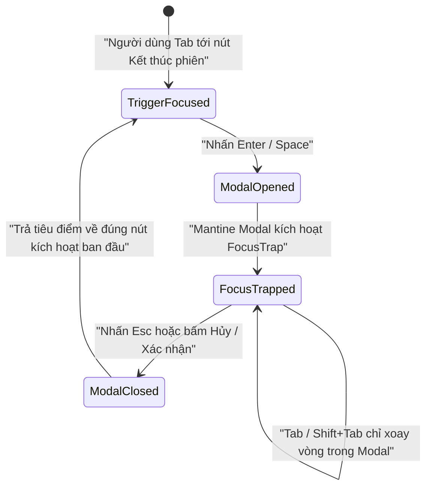

# Chuyên Đề 07: Tiêu Chuẩn Khả Năng Tiếp Cận & W3C WCAG 2.2 AA (`A11Y-*`)

> **Dự án:** InterviewCoach Frontend (`client/`)  
> **Phiên bản:** 9.0 (InterviewCoach Next.js 16 + React 19 + Mantine v9 Standard)  
> **Cổng điều hướng:** [Master Hub](../README.md) | [Quick Reference](../QUICK_REFERENCE.md) | [Cẩm nang Mantine v9](../../mantine/README.md)  
> **Tài liệu liên quan:** [Design System & Styling (`SEM-*`)](./design-system-and-styling.md) | [View Transitions & Motion (`MOTION-*`)](./view-transitions-and-motion.md) | [Responsive & Touch UX (`MOB-*`)](./responsive-and-touch-ux.md) | [Testing & QA](../03-quality-and-security/testing-and-qa.md)  
> **Vai trò SSOT:** Nguồn chân lý duy nhất cho **12 mã quy chuẩn `A11Y-001` đến `A11Y-012`** (Trụ cột S4 của Design System dẫn chiếu trực tiếp về tài liệu này).  
> **Cơ sở tham chiếu quốc tế:**
>
> - [W3C Web Content Accessibility Guidelines (WCAG) 2.2 Level AA](https://www.w3.org/TR/WCAG22/)
> - [W3C WAI-ARIA Authoring Practices Guide (APG)](https://www.w3.org/WAI/ARIA/apg/)
> - [Mantine v9 — Focus Management (`useFocusTrap`) & `useHotkeys`](https://mantine.dev/hooks/use-focus-trap/)
> - [Mantine v9 — VisuallyHidden & Accessibility](https://mantine.dev/core/visually-hidden/)

---

## MỤC LỤC

1. [Triết Lý Khả Năng Tiếp Cận & Vòng Đời Focus Trapping](#1-triết-lý-khả-năng-tiếp-cận-vòng-đời-focus-trapping)
2. [Bộ 12 Quy Chuẩn SSOT `A11Y-001` Đến `A11Y-012` (WCAG 2.2 AA)](#2-bộ-12-quy-chuẩn-ssot-a11y-001-đến-a11y-012-wcag-22-aa)
3. [Ma Trận Điều Hướng Bàn Phím W3C APG Trên Mantine v9](#3-ma-trận-điều-hướng-bàn-phím-w3c-apg-trên-mantine-v9)
4. [Case Study Chuẩn Mantine v9: Milestone Live Region & Kiểm Thử `jest-axe`](#4-case-study-chuẩn-mantine-v9-milestone-live-region-kiểm-thử-jest-axe)
5. [Bảng Đối Chiếu Anti-Pattern vs Best Practice](#5-bảng-đối-chiếu-anti-pattern-vs-best-practice)
6. [Ánh Xạ Tooling Kiểm Toán CI](#6-ánh-xạ-tooling-kiểm-toán-ci)
7. [Checklist Định Lượng PR Review Gate (12 Tiêu Chí)](#7-checklist-định-lượng-pr-review-gate-12-tiêu-chí)

---

## 1. Triết Lý Khả Năng Tiếp Cận & Vòng Đời Focus Trapping

Khả năng tiếp cận (**Accessibility — A11y**) được tích hợp ngay từ nền tảng **Mantine v9**. Mọi luồng nghiệp vụ cốt lõi (xác thực, thiết lập JD, trả lời câu hỏi phỏng vấn, đọc báo cáo STAR, quản trị danh mục) đều phải vận hành trọn vẹn chỉ bằng bàn phím và trình đọc màn hình (Screen Reader).



---

## 2. Bộ 12 Quy Chuẩn SSOT `A11Y-001` Đến `A11Y-012` (WCAG 2.2 AA)

<a id="a11y-001"></a>

### 2.1. `A11Y-001` — Tương Phản Màu Sắc WCAG 2.2 AA (`ERROR` · `[Active]`)

Văn bản thường đạt tỷ lệ tương phản tối thiểu `4.5:1`; văn bản lớn và viền thành phần UI đạt tối thiểu `3:1`. Sử dụng đúng 5 vai trò ngữ nghĩa Mantine (`brand`, `success`, `warning`, `danger`, `neutral`) và `c="dimmed"` tại `client/theme.ts` đảm bảo ngưỡng tương phản nhất quán ở cả Light Mode lẫn Dark Mode.

<a id="a11y-002"></a>

### 2.2. `A11Y-002` — Vùng Chạm Cảm Ứng Tối Thiểu `rem(44px)` (`WARN` · `[Active]`)

Mọi nút bấm và phần tử tương tác trên thiết bị di động phải đạt kích thước tối thiểu `44 x 44px` (`rem(44px)` trong `*.module.css`, hoặc `size="lg"` trên `ActionIcon` cho thao tác chính trên mobile) đáp ứng WCAG 2.2 SC 2.5.8 mở rộng.

<a id="a11y-003"></a>

### 2.3. `A11Y-003` — Cấu Trúc Vùng Địa Landmarks & Skip-Link (`ERROR` · `[Active]`)

Mỗi trang bắt buộc có đầy đủ vùng địa HTML5 ngữ nghĩa qua `AppShell.Header`, `AppShell.Navbar`, `AppShell.Main`, `AppShell.Footer` hoặc `<Box component="main"|"nav"|"section"|"article">`. Bố cục chính cung cấp Skip-link bằng Mantine `<Anchor href="#main-content" className={classes.skipLink}>Bỏ qua tới nội dung chính</Anchor>` hiển thị khi `:focus-visible`.

<a id="a11y-004"></a>

### 2.4. `A11Y-004` — Phân Cấp Tiêu Đề Tuyến Tính `Title order={1..6}` (`WARN` · `[Active]`)

Mỗi trang có đúng 1 `<Title order={1}>` và phân cấp tuần tự `order={2}` → `order={3}` → `order={4}`, không nhảy cóc từ `1` sang `4` chỉ vì cỡ chữ. Khi cần thay đổi kích thước hiển thị mà vẫn giữ cấp ngữ nghĩa đúng, dùng prop `size="h4"` hoặc `fz="lg"`.

<a id="a11y-005"></a>

### 2.5. `A11Y-005` — Văn Bản Thay Thế `alt` & Nhãn `aria-label` (`WARN` · `[Active]`)

- 100% `<Image>` và `<Avatar>` chứa nội dung có ý nghĩa phải có `alt` mô tả rõ; ảnh thuần trang trí đặt `alt=""`.
- 100% nút chỉ có biểu tượng (`ActionIcon`, `CloseButton`, `Burger`) bắt buộc khai báo `aria-label="..."`; icon trang trí đi kèm văn bản gắn `aria-hidden="true"`.

<a id="a11y-006"></a>

### 2.6. `A11Y-006` — Liên Kết Tiếp Cận Form Controls (`WARN` · `[Active]`)

Mọi trường nhập liệu phải liên kết `id` ↔ `<label>` ↔ `aria-describedby` ↔ `aria-invalid`. Dùng trực tiếp Mantine Inputs (`TextInput`, `Select`, `Textarea`, `Radio.Group`) kèm `label`, `description`, `error`, `withAsterisk` sẽ tự động hoàn thiện các thuộc tính ARIA này.

<a id="a11y-007"></a>

### 2.7. `A11Y-007` — Hiển Thị Rõ Nét Tiêu Điểm Bàn Phím `:focus-visible` (`ERROR` · `[Active]`)

Tuyệt đối cấm viết `outline: none` mà không cung cấp vòng tiêu điểm thay thế rõ ràng. Giữ focus ring mặc định của Mantine v9, hoặc với `UnstyledButton` tùy biến, khai báo rõ trong `*.module.css`:

```css
/* Incorrect: Xóa vòng tiêu điểm khiến người dùng bàn phím mất phương hướng
.badTrigger:focus {
  outline: none;
}
*/

/* Correct: Focus ring rõ nét bằng biến màu ngữ nghĩa Mantine */
.trigger {
  border-radius: var(--mantine-radius-md);

  &:focus-visible {
    outline: rem(2px) solid var(--mantine-primary-color-filled);
    outline-offset: rem(2px);
  }
}
```

<a id="a11y-008"></a>

### 2.8. `A11Y-008` — Điều Hướng Bàn Phím Đầy Đủ & Chống Bẫy Bàn Phím (`ERROR` · `[Active]`)

Mọi thao tác chuột phải thực hiện được bằng bàn phím (`Tab`, `Shift+Tab`, `Enter`, `Space`, `Esc`, phím mũi tên). Lớp phủ dùng `Modal`/`Drawer` của Mantine hoặc hook `useFocusTrap()` (`@mantine/hooks`); phím tắt toàn cục (ví dụ `mod+Enter` gửi câu trả lời) đăng ký qua `useHotkeys()` (`@mantine/hooks`) và ghi chú rõ ràng.

<a id="a11y-009"></a>

### 2.9. `A11Y-009` — Thông Báo Trạng Thái Động Bằng ARIA Live Regions (`WARN` · `[Active]`)

Trạng thái bất đồng bộ (lỗi mạng, lưu nháp, tiến độ đánh giá AI, mốc cảnh báo hết giờ) phải thông báo cho trình đọc màn hình qua `@mantine/notifications` hoặc `<VisuallyHidden role="status" aria-live="polite">`. **Không** gắn `aria-live` trực tiếp lên đồng hồ đếm từng giây vì sẽ đọc liên tục mỗi giây; chỉ phát thông báo ở các mốc quan trọng (60 giây, 30 giây, hết giờ).

<a id="a11y-010"></a>

### 2.10. `A11Y-010` — Giảm Chuyển Động Cho Người Nhạy Cảm Tiền Đình (`WARN` · `[Active]`)

Mọi hoạt họa kiểm tra `useReducedMotion()` (`@mantine/hooks`) và CSS Module kèm `@media (prefers-reduced-motion: reduce)` (chi tiết tại [`MOTION-008`](./view-transitions-and-motion.md#motion-008)).

<a id="a11y-011"></a>

### 2.11. `A11Y-011` — Cấm Dùng Màu Sắc Làm Phương Tiện Duy Nhất (`WARN` · `[Active]`)

Trạng thái đạt/cảnh báo/lỗi **luôn phải kết hợp màu ngữ nghĩa với ít nhất một tín hiệu bổ trợ** (văn bản trạng thái tường minh hoặc icon `@tabler/icons-react`) để người khiếm khuyết thị giác màu phân biệt chính xác 100%.

<a id="a11y-012"></a>

### 2.12. `A11Y-012` — Kiểm Thử Khả Năng Tiếp Cận Tự Động Trong CI (`ERROR` · `[Active]`)

- **Unit/Component Test (`[Active]`):** `client/vitest.setup.ts` đã cấu hình sẵn `toHaveNoViolations` từ `jest-axe`; mọi component/form Mantine v9 mới phải có assertion `expect(await axe(container)).toHaveNoViolations()`.
- **Storybook A11y (`[Active/Target]`):** Chạy `npm run test:a11y` (`@storybook/addon-a11y`); mọi story Mantine v9 mới bật `parameters: { a11y: { test: 'error' } }`.

---

## 3. Ma Trận Điều Hướng Bàn Phím W3C APG Trên Mantine v9

| Widget Mantine v9            | Phím mở / kích hoạt              | Di chuyển nội bộ                                     | Đóng / Trả focus              |
| :--------------------------- | :------------------------------- | :--------------------------------------------------- | :---------------------------- |
| `Modal` / `Drawer`           | `Enter` / `Space` trên nút mở    | `Tab` / `Shift+Tab` (FocusTrap)                      | `Esc` → trả focus về trigger  |
| `Tabs`                       | `Tab` vào `Tabs.List`            | `ArrowLeft` / `ArrowRight`                           | `Tab` ra `Tabs.Panel`         |
| `Accordion`                  | `Enter` / `Space` trên `Control` | `ArrowDown` / `ArrowUp` / `Home` / `End`             | `Tab` sang phần tử kế tiếp    |
| `Menu` / `Popover`           | `Enter` / `Space` / `ArrowDown`  | `ArrowDown` / `ArrowUp`                              | `Esc` → trả focus về `Target` |
| `Radio.Group` + `Radio.Card` | `Tab` vào radio đang chọn        | `ArrowUp` / `ArrowDown` / `ArrowLeft` / `ArrowRight` | `Tab` rời nhóm                |
| `Select` / `MultiSelect`     | Gõ chữ hoặc `ArrowDown`          | `ArrowDown` / `ArrowUp` / `Enter`                    | `Esc` đóng danh sách          |

---

## 4. Case Study Chuẩn Mantine v9: Milestone Live Region & Kiểm Thử `jest-axe`

Mẫu tự chứa chuẩn `mantine.dev/core/visually-hidden/` đạt đồng thời `A11Y-001`, `A11Y-009` (chỉ thông báo mốc 60s / 30s / 0s), và `A11Y-011` (màu ngữ nghĩa + icon + nhãn văn bản):

```tsx
// Correct: Bộ đếm giờ phỏng vấn chuẩn WCAG 2.2 AA (Mantine v9 Zero-Hex)
'use client'

import { Badge, Group, Text, VisuallyHidden } from '@mantine/core'
import { IconAlertTriangle, IconClock } from '@tabler/icons-react'

function formatClock(seconds: number): string {
  const safe = Math.max(0, seconds)
  const mins = Math.floor(safe / 60)
  const secs = safe % 60
  return `${String(mins).padStart(2, '0')}:${String(secs).padStart(2, '0')}`
}

function getMilestoneAnnouncement(seconds: number): string {
  if (seconds === 60) return 'Còn lại 1 phút cho câu trả lời này.'
  if (seconds === 30) return 'Còn lại 30 giây cho câu trả lời này.'
  if (seconds <= 0) return 'Đã hết thời gian trả lời câu hỏi.'
  return ''
}

export function AccessibleCountdownBadge({
  remainingSeconds,
  isWarning,
  isExpired,
}: {
  remainingSeconds: number
  isWarning: boolean
  isExpired: boolean
}) {
  const color = isExpired ? 'danger' : isWarning ? 'warning' : 'neutral'
  const statusLabel = isExpired
    ? 'Hết giờ'
    : isWarning
      ? 'Sắp hết giờ'
      : 'Còn lại'
  const announcement = getMilestoneAnnouncement(remainingSeconds)

  return (
    <Group gap="xs" align="center">
      <Badge
        color={color}
        variant="light"
        leftSection={
          isExpired || isWarning ? (
            <IconAlertTriangle size={14} stroke={1.5} aria-hidden="true" />
          ) : (
            <IconClock size={14} stroke={1.5} aria-hidden="true" />
          )
        }
      >
        <Group gap={4}>
          <Text span size="xs">
            {statusLabel}:
          </Text>
          <Text span size="xs" ff="monospace" fw={600}>
            {formatClock(remainingSeconds)}
          </Text>
        </Group>
      </Badge>

      <VisuallyHidden role="status" aria-live="polite" aria-atomic="true">
        {announcement}
      </VisuallyHidden>
    </Group>
  )
}
```

```tsx
// Correct: Unit test xác minh ARIA live region & 0 vi phạm axe với @test-utils
import { describe, expect, it } from 'vitest'
import { axe } from 'jest-axe'
import { render, screen } from '@test-utils'
import { AccessibleCountdownBadge } from './AccessibleCountdownBadge'

describe('AccessibleCountdownBadge', () => {
  it('announces milestone at 30s and passes jest-axe with zero violations', async () => {
    const { container } = render(
      <AccessibleCountdownBadge
        remainingSeconds={30}
        isWarning
        isExpired={false}
      />
    )

    expect(screen.getByRole('status')).toHaveTextContent(/còn lại 30 giây/i)
    expect(await axe(container)).toHaveNoViolations()
  })
})
```

---

## 5. Bảng Đối Chiếu Anti-Pattern vs Best Practice

| Tình huống                     | Anti-Pattern (Tránh)                                                        | Best Practice (Chuẩn mực)                                                                               |
| :----------------------------- | :-------------------------------------------------------------------------- | :------------------------------------------------------------------------------------------------------ |
| Nút chỉ có biểu tượng xóa/đóng | `<ActionIcon onClick={onDelete}><IconTrash /></ActionIcon>` thiếu nhãn      | Luôn gắn `aria-label="Xóa mục"` trên `ActionIcon` và `aria-hidden="true"` trên icon (`A11Y-005`)        |
| Trạng thái đạt / lỗi           | Chỉ đổi chấm màu xanh/đỏ không có văn bản hay biểu tượng                    | Kết hợp `color="success"` / `"danger"` + nhãn chữ + icon `@tabler/icons-react` (`A11Y-011`)             |
| Thứ tự tiêu đề trang           | Dùng `<Title order={1}>` rồi nhảy thẳng `<Title order={4}>` vì muốn chữ nhỏ | Giữ tuyến tính `order={1}` → `order={2}` và chỉnh cỡ chữ bằng prop `size="h4"` (`A11Y-004`)             |
| Thông báo đếm ngược mỗi giây   | Gắn `aria-live="assertive"` trực tiếp lên số giây thay đổi liên tục         | Chỉ thông báo các mốc quan trọng qua `<VisuallyHidden role="status" aria-live="polite">` (`A11Y-009`)   |
| Tùy chỉnh focus                | Viết `outline: none` ở `:focus` mà không có style thay thế                  | Giữ focus ring Mantine hoặc khai báo `:focus-visible` với `--mantine-primary-color-filled` (`A11Y-007`) |

---

## 6. Ánh Xạ Tooling Kiểm Toán CI

| Quy chuẩn                                         | Công cụ kiểm toán (`client/`)                             | Lệnh thực thi                |
| :------------------------------------------------ | :-------------------------------------------------------- | :--------------------------- |
| `A11Y-003..008`, `A11Y-012`                       | Vitest 4 + `@test-utils` + `jest-axe` (`vitest.setup.ts`) | `npm run test:unit`          |
| `A11Y-001..012` trên Storybook                    | Storybook 10 + `@storybook/addon-a11y`                    | `npm run test:a11y`          |
| Chặn non-semantic `onClick`, raw HTML, màu vật lý | `scripts/check-ui-rules.mjs`                              | `npm run ui:lint -- <files>` |
| Kiểm tra focus & thuộc tính JSX A11y              | ESLint 9 (`eslint-config-next`)                           | `npm run lint`               |

---

## 7. Checklist Định Lượng PR Review Gate (12 Tiêu Chí)

- [ ] **1. Contrast AA:** Toàn bộ văn bản và nút dùng semantic roles Mantine đạt ≥ 4.5:1 ở Light & Dark (`A11Y-001`).
- [ ] **2. Touch Target:** Nút thao tác di động đạt tối thiểu `rem(44px)` (`A11Y-002`).
- [ ] **3. Landmarks & Skip-link:** Có đầy đủ `AppShell.*` / `main` / `nav` và Skip-link hoạt động khi bấm `Tab` (`A11Y-003`).
- [ ] **4. Heading Order:** Mỗi trang đúng 1 `Title order={1}` và phân cấp tuyến tính không nhảy cóc (`A11Y-004`).
- [ ] **5. `alt` & `aria-label`:** 100% `Image`/`Avatar` có `alt`, 100% `ActionIcon`/`CloseButton`/`Burger` có `aria-label` (`A11Y-005`).
- [ ] **6. Form Wiring:** Mọi input có `label` và thông báo lỗi liên kết tự động qua Mantine Form (`A11Y-006`).
- [ ] **7. Visible Focus:** Không xóa `outline` thiếu `:focus-visible` (`A11Y-007`).
- [ ] **8. Keyboard Complete:** Toàn bộ luồng hoàn thành được bằng bàn phím, Modal/Drawer khóa focus và đóng bằng `Esc` (`A11Y-008`).
- [ ] **9. Live Regions:** Thông báo lỗi/mốc trạng thái dùng `@mantine/notifications` hoặc `role="status"` không gây spam (`A11Y-009`).
- [ ] **10. Reduced Motion:** Hoạt họa tôn trọng `useReducedMotion()` và `@media (prefers-reduced-motion: reduce)` (`A11Y-010`).
- [ ] **11. Color + Signal:** Mọi trạng thái màu đều đi kèm icon hoặc chữ rõ nghĩa (`A11Y-011`).
- [ ] **12. Zero Axe Violations:** `npm run test:unit` (`jest-axe`) và `npm run test:a11y` đạt 0 vi phạm (`A11Y-012`).
