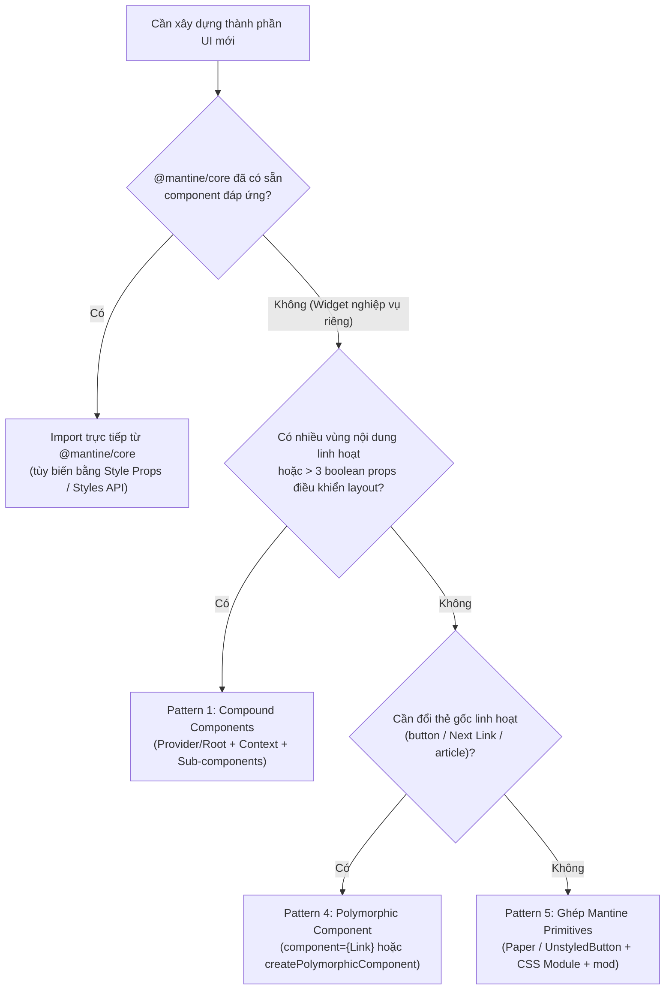

# Chuyên Đề 04: React Component Design Patterns Với Mantine v9 (Component Patterns)

> **Dự án:** InterviewCoach Frontend (`client/`)  
> **Phiên bản:** 9.0 (InterviewCoach Next.js 16 + React 19 + Mantine v9 Standard)  
> **Cổng điều hướng:** [Master Hub](../README.md) | [Quick Reference](../QUICK_REFERENCE.md) | [Cẩm nang Mantine v9](../../mantine/README.md)  
> **Tài liệu liên quan:** [Architecture & Structure](../01-foundations/architecture-and-structure.md) | [Forms & Validation](./forms-and-validation.md) | [Design System & Styling](./design-system-and-styling.md) | [Accessibility](./accessibility.md)  
> **Tính chất tài liệu:** Chuẩn mực thiết kế component kết hợp **Mantine v9 Primitives** với **React 19 Composition Patterns**; toàn bộ mã mẫu tự chứa từ `mantine.dev` và `vercel-composition-patterns`.  
> **Cơ sở tham chiếu quốc tế:**
>
> - [Mantine v9 — Polymorphic Components & Styles API](https://mantine.dev/guides/polymorphic/)
> - [Mantine v9 — Core Components (`Modal.Root`, `Tabs`, `Accordion`, `Table`)](https://mantine.dev/core/package/)
> - [Mantine v9 Hooks — `useUncontrolled`](https://mantine.dev/hooks/use-uncontrolled/)
> - [Next.js 16 App Router — Error Handling (`error.tsx`, `global-error.tsx`)](https://nextjs.org/docs/app/getting-started/error-handling)
> - [Vercel Composition Patterns (`client/.agents/skills/vercel-composition-patterns/`)](../../../.agents/skills/vercel-composition-patterns/SKILL.md)

---

## MỤC LỤC

1. [Triết Lý Compose Over Wrap & Cây Chọn Pattern](#1-triết-lý-compose-over-wrap-cây-chọn-pattern)
2. [Pattern 1: Compound Components & Tránh Phình Boolean Props](#2-pattern-1-compound-components-tránh-phình-boolean-props)
3. [Pattern 2: RSC vs Client Boundary & Container / Presentational](#3-pattern-2-rsc-vs-client-boundary-container-presentational)
4. [Pattern 3: Multi-Level Error Boundaries 3 Cấp](#4-pattern-3-multi-level-error-boundaries-3-cấp)
5. [Pattern 4 & 5: Polymorphic Components & Mantine Styles API](#5-pattern-4-5-polymorphic-components-mantine-styles-api)
6. [Pattern 6: Controlled/Uncontrolled (`useUncontrolled`) & Overlay Stacking](#6-pattern-6-controlleduncontrolled-useuncontrolled-overlay-stacking)
7. [Bảng Đối Chiếu Anti-Pattern vs Best Practice](#7-bảng-đối-chiếu-anti-pattern-vs-best-practice)
8. [Ánh Xạ Tooling CI & Checklist PR Review Gate](#8-ánh-xạ-tooling-ci-checklist-pr-review-gate)

---

## 1. Triết Lý Compose Over Wrap & Cây Chọn Pattern

Thay vì tạo các lớp bọc mỏng trùng lặp trong `components/ui/` hay thêm hàng loạt props boolean điều khiển cấu trúc, mọi component mới của **InterviewCoach** tuân thủ nguyên tắc **Compose over Wrap**: tận dụng trực tiếp `@mantine/core`, chỉ ghép custom domain widgets từ Mantine primitives (`Box`, `Paper`, `UnstyledButton`, `Stack`, `Group`, `createPolymorphicComponent`) khi có yêu cầu nghiệp vụ đặc thù.



---

## 2. Pattern 1: Compound Components & Tránh Phình Boolean Props

Áp dụng 4 quy tắc cốt lõi từ `vercel-composition-patterns`:

- **`architecture-avoid-boolean-props`:** Không thêm nhiều cờ boolean (`isCompact`, `showScore`, `isEditing`, `isAdminView`) làm số tổ hợp trạng thái phình theo hàm mũ.
- **`architecture-compound-components`:** Tách thành các sub-component chia sẻ trạng thái qua Context (`Root`, `Header`, `Evidence`, `Actions`) để người gọi tự lắp ghép rõ ràng.
- **`patterns-explicit-variants` & `patterns-children-over-render-props`:** Tạo component biến thể tường minh và dùng `children` thay cho chuỗi `renderHeader` / `renderFooter` phức tạp.
- **`react19-no-forwardref`:** Trên React 19, dùng `use(Context)` thay cho `useContext(Context)` và truyền `ref` trực tiếp như prop.

```tsx
// Incorrect: Phình boolean props và render props khó bảo trì (architecture-avoid-boolean-props)
function RubricCardBad({
  title,
  passed,
  isCompact,
  showBadge,
  showEvidence,
  evidenceText,
}: {
  title: string
  passed: boolean
  isCompact?: boolean
  showBadge?: boolean
  showEvidence?: boolean
  evidenceText?: string
}) {
  return (
    <Paper withBorder p={isCompact ? 'xs' : 'md'} radius="md">
      <Title order={4}>{title}</Title>
      {showBadge ? (
        <Badge color={passed ? 'success' : 'warning'}>
          {passed ? 'Đạt' : 'Chưa đạt'}
        </Badge>
      ) : null}
      {showEvidence && evidenceText ? (
        <Text size="sm">{evidenceText}</Text>
      ) : null}
    </Paper>
  )
}

// Correct: Compound Component chuẩn React 19 (use) dựng trên Mantine v9 primitives
;('use client')

import { createContext, use, useMemo } from 'react'
import { Badge, Group, Paper, Stack, Text, Title } from '@mantine/core'

interface RubricContextValue {
  criterionName: string
  passed: boolean
}

const RubricContext = createContext<RubricContextValue | null>(null)

function useRubricContext(): RubricContextValue {
  const ctx = use(RubricContext)
  if (!ctx) {
    throw new Error(
      'RubricItem sub-components must be used inside RubricItem.Root'
    )
  }
  return ctx
}

function RubricItemRoot({
  criterionName,
  passed,
  children,
}: RubricContextValue & { children: React.ReactNode }) {
  const value = useMemo(
    () => ({ criterionName, passed }),
    [criterionName, passed]
  )

  return (
    <RubricContext value={value}>
      <Paper withBorder p="md" radius="md">
        <Stack gap="xs">{children}</Stack>
      </Paper>
    </RubricContext>
  )
}

function RubricItemHeader() {
  const { criterionName, passed } = useRubricContext()
  return (
    <Group justify="space-between" align="center">
      <Title order={4}>{criterionName}</Title>
      <Badge color={passed ? 'success' : 'warning'} variant="light">
        {passed ? 'Đạt chuẩn' : 'Cần cải thiện'}
      </Badge>
    </Group>
  )
}

function RubricItemEvidence({ children }: { children: React.ReactNode }) {
  return (
    <Text size="sm" c="dimmed">
      {children}
    </Text>
  )
}

export const RubricItem = {
  Root: RubricItemRoot,
  Header: RubricItemHeader,
  Evidence: RubricItemEvidence,
}
```

---

## 3. Pattern 2: RSC vs Client Boundary & Container / Presentational

Trong **Next.js 16 App Router**, mô hình Container / Presentational được tổ chức rõ thành 3 lớp:

1. **Server Component (`page.tsx`):** Đọc `params`/`searchParams`, khai báo `metadata`, dựng khung bố cục tĩnh (`Container`, `Stack`, `Title`) và truyền props serializable tối giản xuống Client Container (`server-serialization`).
2. **Client Container (`'use client'`):** Quản lý `useQuery` / `useMutation` (`@tanstack/react-query`), `@mantine/form`, `@mantine/hooks` và điều phối trạng thái loading/error.
3. **Presentational Component:** Thuần nhận props và trả về Mantine JSX (tách biệt hoàn toàn khỏi HTTP client), dễ viết Storybook story và unit test cô lập với `@test-utils` (`state-decouple-implementation`).

---

## 4. Pattern 3: Multi-Level Error Boundaries 3 Cấp

Ứng dụng cô lập lỗi runtime theo 3 lớp độc lập theo chuẩn Next.js 16 App Router và Mantine v9:

|           Cấp độ            | Thành phần / Vị trí                                           |      Trạng thái       | Vai trò & Yêu cầu giao diện                                                                                                                |
| :-------------------------: | :------------------------------------------------------------ | :-------------------: | :----------------------------------------------------------------------------------------------------------------------------------------- |
|   **Cấp 1 — Fatal Root**    | `app/global-error.tsx`                                        | `[Target Mantine v9]` | Bắt lỗi nghiêm trọng ở `RootLayout`; hiển thị fallback tối giản kèm `error.digest` và nút thử lại.                                         |
|  **Cấp 2 — Route Segment**  | `app/error.tsx` (hoặc `error.tsx` theo từng Route Group)      | `[Target Mantine v9]` | Cô lập lỗi trong từng trang, giữ nguyên khung điều hướng, dùng Mantine `Alert`/`Button` + `next/link` (không dùng `window.location.href`). |
| **Cấp 3 — Widget Boundary** | Error Boundary cục bộ bọc biểu đồ, trình ghi âm, báo cáo STAR |  `[Target Standard]`  | Khi 1 widget phụ lỗi, hiển thị `<Alert color="danger" variant="light">` kèm nút `<Button>` thử lại mà không làm trắng cả màn hình.         |

```tsx
// Correct: Widget Error Fallback chuẩn Mantine v9 Zero-Hex
'use client'

import { Alert, Button, Stack, Text } from '@mantine/core'
import { IconAlertTriangle, IconRefresh } from '@tabler/icons-react'

export function WidgetErrorFallback({
  title,
  message,
  onRetry,
}: {
  title: string
  message: string
  onRetry: () => void
}) {
  return (
    <Alert
      color="danger"
      variant="light"
      title={title}
      icon={<IconAlertTriangle size={18} stroke={1.5} aria-hidden="true" />}
    >
      <Stack gap="sm">
        <Text size="sm">{message}</Text>
        <Button
          size="xs"
          variant="light"
          color="danger"
          leftSection={
            <IconRefresh size={14} stroke={1.5} aria-hidden="true" />
          }
          onClick={onRetry}
          w="fit-content"
        >
          Tải lại mục này
        </Button>
      </Stack>
    </Alert>
  )
}
```

---

## 5. Pattern 4 & 5: Polymorphic Components & Mantine Styles API

### 5.1. Pattern 4 — Polymorphic Components (`mantine.dev/guides/polymorphic/`)

Mantine v9 hỗ trợ trực tiếp prop `component` an toàn kiểu với `next/link` và helper `createPolymorphicComponent`:

- **Điều hướng nội bộ Next.js 16:** Luôn dùng `component={Link}` trên `Button`, `Anchor`, `NavLink`, `ActionIcon`, `Menu.Item` — **cấm** bọc `<Link><Button /></Link>` gây lỗi lồng thẻ tương tác `<a><button>` vi phạm HTML5/WCAG.
- **Custom Polymorphic Domain Component:** Dùng `createPolymorphicComponent<'div', MyProps>(...)` kết hợp React 19 `ref` as prop (`react19-no-forwardref`).

```tsx
// Correct: Điều hướng component={Link} & custom polymorphic chuẩn Mantine v9 + React 19
import Link from 'next/link'
import {
  Box,
  Button,
  createPolymorphicComponent,
  type BoxProps,
} from '@mantine/core'

export function GoToReportButton({ sessionId }: { sessionId: string }) {
  return (
    <Button
      component={Link}
      href={`/sessions/${sessionId}/report`}
      color="brand"
    >
      Xem báo cáo STAR
    </Button>
  )
}

interface MetricSurfaceProps extends BoxProps {
  children: React.ReactNode
}

function MetricSurfaceBase({
  ref,
  children,
  ...others
}: MetricSurfaceProps & { ref?: React.Ref<HTMLDivElement> }) {
  return (
    <Box ref={ref} p="md" {...others}>
      {children}
    </Box>
  )
}

export const MetricSurface = createPolymorphicComponent<
  'div',
  MetricSurfaceProps
>(MetricSurfaceBase)
```

### 5.2. Pattern 5 — Mantine Styles API & Data-Attribute States (`mod`)

Khi tùy biến phần tử con bên trong component Mantine hoặc thể hiện trạng thái chọn/active, dùng **Styles API (`classNames`, `styles`, `vars`)** (`https://mantine.dev/styles/styles-api/`) và prop **`mod={{ active, selected }}`** kết hợp CSS Module (`*.module.css`) thay cho việc ghép chuỗi `className` hay thư viện tạo variant cũ (`class-variance-authority` là legacy không dùng cho code mới).

---

## 6. Pattern 6: Controlled/Uncontrolled (`useUncontrolled`) & Overlay Stacking

### 6.1. Hỗ trợ kép Controlled & Uncontrolled (`mantine.dev/hooks/use-uncontrolled/`)

Khi xây dựng widget tái sử dụng (như bộ chọn cấp độ năng lực hoặc ngữ cảnh phỏng vấn), dùng `useUncontrolled` từ `@mantine/hooks` để hỗ trợ mượt cả chế độ tự quản lý (`defaultValue`) lẫn chế độ cha điều khiển (`value` + `onChange`):

```tsx
// Correct: Component hỗ trợ kép Controlled/Uncontrolled bằng @mantine/hooks
'use client'

import { SegmentedControl } from '@mantine/core'
import { useUncontrolled } from '@mantine/hooks'

type ContextPack = 'VN' | 'Western'

interface ContextPackSelectorProps {
  value?: ContextPack
  defaultValue?: ContextPack
  onChange?: (value: ContextPack) => void
}

const CONTEXT_PACK_OPTIONS = [
  { label: 'Việt Nam', value: 'VN' },
  { label: 'Western (STAR)', value: 'Western' },
]

export function ContextPackSelector({
  value,
  defaultValue = 'VN',
  onChange,
}: ContextPackSelectorProps) {
  const [currentValue, handleChange] = useUncontrolled<ContextPack>({
    value,
    defaultValue,
    finalValue: 'VN',
    onChange,
  })

  return (
    <SegmentedControl
      value={currentValue}
      onChange={(next) => {
        if (next === 'VN' || next === 'Western') {
          handleChange(next)
        }
      }}
      data={CONTEXT_PACK_OPTIONS}
    />
  )
}
```

### 6.2. Quản trị Stacking Context, Portal & Focus Trap

- Mọi lớp phủ (`Modal`, `Drawer`, `Popover`, `Menu`, `Tooltip`, `Select`) của Mantine v9 mặc định dùng **`Portal`** gắn vào `document.body`, tích hợp sẵn **Focus Trap** và đóng bằng phím `Esc`.
- Tuân thủ thang Z-Index chuẩn Mantine (`100` AppShell, `200` Modal/Drawer, `300` Popover/Combobox, `400` Notification/Overlay — xem [`SEM-TOKEN-009`](./design-system-and-styling.md#sem-token-009)).

---

## 7. Bảng Đối Chiếu Anti-Pattern vs Best Practice

| Tình huống                        | Anti-Pattern (Tránh)                                                      | Best Practice (Chuẩn mực)                                                                                    |
| :-------------------------------- | :------------------------------------------------------------------------ | :----------------------------------------------------------------------------------------------------------- |
| Nút chuyển trang                  | `<Link href="..."><Button>Xem</Button></Link>` (lồng thẻ tương tác)       | `<Button component={Link} href="...">Xem</Button>`                                                           |
| Thẻ chọn có tương tác click       | `<Paper onClick={handleSelect}>...</Paper>` (non-semantic click)          | `<UnstyledButton onClick={handleSelect} mod={{ active }}><Paper withBorder>...</Paper></UnstyledButton>`     |
| Component nhiều biến thể hiển thị | 1 component có 6–8 cờ `isCompact`, `showBadge`, `isAdmin`, `renderFooter` | Tách thành Compound Component (`RubricItem.Root`, `Header`, `Evidence`) (`architecture-avoid-boolean-props`) |
| Đọc Context trên React 19         | Dùng `useContext` và bọc `forwardRef` cho mọi input tùy biến              | Dùng `use(Context)` và truyền `ref` trực tiếp như prop (`react19-no-forwardref`)                             |
| Modal xác nhận                    | Tự viết backdrop + `useEffect` bắt `Esc` + `z-index: 9999`                | Dùng `<Modal>` hoặc `modals.openConfirmModal` từ `@mantine/modals`                                           |
| Lỗi runtime ở widget nặng         | Không bọc Error Boundary khiến sập toàn màn hình                          | Bọc Widget Error Boundary hiển thị `<Alert color="danger">` + nút thử lại                                    |

---

## 8. Ánh Xạ Tooling CI & Checklist PR Review Gate

### Ánh xạ Tooling CI

| Hạng mục                                            | Công cụ (`client/`)                   | Lệnh kiểm tra                |
| :-------------------------------------------------- | :------------------------------------ | :--------------------------- |
| Kiểm tra kiểu Polymorphic & Compound Context        | TypeScript 5                          | `npm run typecheck`          |
| Chặn non-semantic `onClick`, raw HTML, inline style | `scripts/check-ui-rules.mjs`          | `npm run ui:lint -- <files>` |
| Kiểm thử tương tác Portal (`Modal`/`Select`) & A11y | Vitest 4 + `@test-utils` + `jest-axe` | `npm run test:unit`          |
| Kiểm tra trạng thái & biến thể trên Storybook 10    | Storybook (`@storybook/nextjs-vite`)  | `npm run build-storybook`    |

### Checklist PR Review Gate (8 Tiêu Chí)

- [ ] **1. Mantine-First:** Không tạo thin wrapper mới trong `components/ui/`; import trực tiếp `@mantine/core`.
- [ ] **2. Anti-Boolean Bloat:** Component phức tạp có > 3 cờ điều khiển cấu trúc được tách sang Compound Component (`architecture-avoid-boolean-props`).
- [ ] **3. Clean RSC Boundary:** Server page chỉ truyền serializable props tối giản xuống leaf Client Component.
- [ ] **4. Polymorphic Navigation:** 100% nút/link điều hướng dùng `component={Link}` từ `next/link`, không lồng `<a><button>`.
- [ ] **5. Error Boundary:** Widget nặng (biểu đồ, audio, báo cáo AI) có Error Boundary cấp widget với fallback `<Alert color="danger">`.
- [ ] **6. Dual-mode State:** Widget tái sử dụng dùng `useUncontrolled` thay vì `useEffect` đồng bộ prop thủ công.
- [ ] **7. Portal & Z-Index:** Dùng `Modal`/`Drawer`/`Popover` của Mantine, không hardcode `z-index: 9999`.
- [ ] **8. Static & Unit Gate:** Pass `npm run typecheck`, `npm run lint`, `npm run ui:lint -- <files>`, và `npm run test:unit`.
