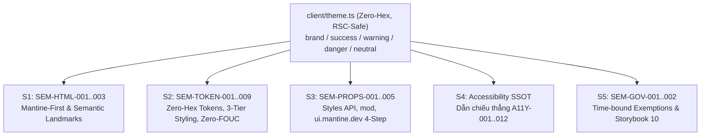
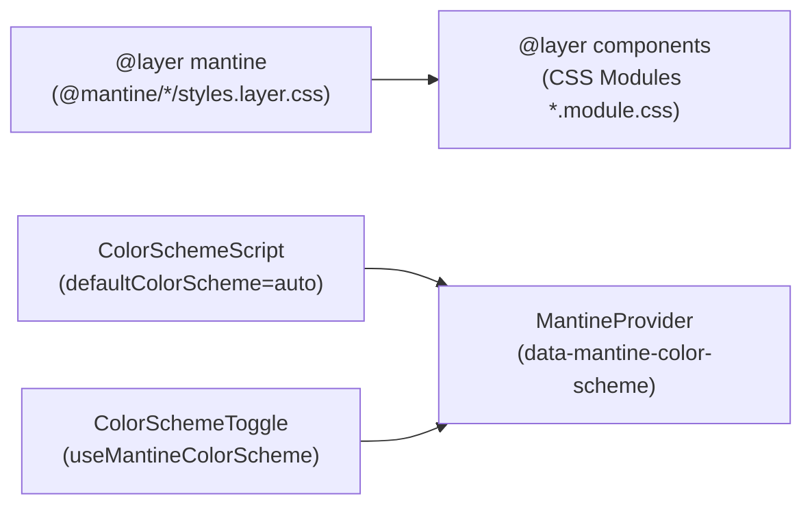

# Chuyên Đề 06: Hệ Thống Thiết Kế Ngữ Nghĩa, Zero-Hex Styling & Storybook Catalog (`SEM-*`)

> **Dự án:** InterviewCoach Frontend (`client/`)  
> **Phiên bản:** 9.0 (InterviewCoach Next.js 16 + React 19 + Mantine v9 Standard)  
> **Cổng điều hướng:** [Master Hub](../README.md) | [Quick Reference](../QUICK_REFERENCE.md) | [Cẩm nang Mantine v9](../../mantine/README.md)  
> **Tài liệu liên quan:** [Quy tắc UI chặt chẽ (`docs/mantine/01`)](../../mantine/01-strict-rules-and-styling.md) | [Setup Theme & CSS Layers (`docs/mantine/02`)](../../mantine/02-setup-forms-hooks-guide.md) | [Component Patterns](./component-patterns.md) | [Accessibility (`A11Y-*`)](./accessibility.md)  
> **Vai trò SSOT:** Nguồn chân lý duy nhất cho **toàn bộ 19 mã quy chuẩn `SEM-*`** (`SEM-HTML-001..003`, `SEM-TOKEN-001..009`, `SEM-PROPS-001..005`, `SEM-GOV-001..002`), gộp trọn kiến trúc Styling 3 bậc Zero-Hex, CSS Cascade Layers chuyển tiếp, 3 Enterprise Layout Archetypes (adapted từ `ui.mantine.dev`) và Storybook 10 Living Catalog.  
> **Cơ sở tham chiếu quốc tế:**
>
> - [Mantine v9 — Theme Object, CSS Variables & PostCSS Preset](https://mantine.dev/styles/postcss-preset/)
> - [Mantine v9 — Color Schemes & Zero-FOUC (`ColorSchemeScript`)](https://mantine.dev/theming/color-schemes/)
> - [Mantine UI — Application UI & Page Sections (`ui.mantine.dev`)](https://ui.mantine.dev/)
> - [MDN Web Docs — CSS Cascade Layers (`@layer`) & Container Queries (`@container`)](https://developer.mozilla.org/en-US/docs/Web/CSS/@layer)
> - [Storybook 10 (`@storybook/nextjs-vite`) Documentation](https://storybook.js.org/docs)

---

## MỤC LỤC

1. [Triết Lý Zero-Hex Mantine-First & Kiến Trúc 5 Trụ Cột](#1-triết-lý-zero-hex-mantine-first-kiến-trúc-5-trụ-cột)
2. [Trụ Cột S1: Mantine-First Primitive Boundary (`SEM-HTML-001..003`)](#2-trụ-cột-s1-mantine-first-primitive-boundary-sem-html-001003)
3. [Trụ Cột S2: Zero-Hex Semantic Tokens, Styling 3 Bậc & CSS Layers (`SEM-TOKEN-001..009`)](#3-trụ-cột-s2-zero-hex-semantic-tokens-styling-3-bậc-css-layers-sem-token-001009)
4. [Trụ Cột S3: Mantine Props, Styles API & Quy Trình `ui.mantine.dev` (`SEM-PROPS-001..005`)](#4-trụ-cột-s3-mantine-props-styles-api-quy-trình-uimantinedev-sem-props-001005)
5. [Trụ Cột S4 & S5: Semantic Accessibility & Governance / Storybook 10 (`SEM-GOV-001..002`)](#5-trụ-cột-s4-s5-semantic-accessibility-governance-storybook-10-sem-gov-001002)
6. [3 Enterprise Layout Archetypes (Adapted Từ `ui.mantine.dev`)](#6-3-enterprise-layout-archetypes-adapted-từ-uimantinedev)
7. [Bảng Đối Chiếu Anti-Pattern vs Best Practice & Ánh Xạ Tooling CI](#7-bảng-đối-chiếu-anti-pattern-vs-best-practice-ánh-xạ-tooling-ci)
8. [Checklist Định Lượng PR Review Gate (12 Tiêu Chí)](#8-checklist-định-lượng-pr-review-gate-12-tiêu-chí)

---

## 1. Triết Lý Zero-Hex Mantine-First & Kiến Trúc 5 Trụ Cột

Hệ thống thiết kế của **InterviewCoach** loại bỏ gánh nặng duy trì bảng màu thủ công và các framework CSS cạnh tranh. Toàn bộ giao diện mới dựa trên **1 nguồn chân lý duy nhất `client/theme.ts`** (Zero-Hex, 100% RSC-safe, ánh xạ 5 vai trò ngữ nghĩa trực tiếp từ `DEFAULT_THEME.colors` của Mantine v9) và tuân theo **thứ tự ưu tiên Styling 3 bậc**:

1. **Bậc 1 — Mantine Style Props:** Cho spacing, màu ngữ nghĩa, typography, kích thước (`p="md"`, `gap="sm"`, `c="dimmed"`, `w={{ base: '100%', sm: '50%' }}`).
2. **Bậc 2 — CSS Modules (`*.module.css`) + `postcss-preset-mantine`:** Cho hover (`@mixin hover`), trạng thái `mod` (`&[data-active]`), `:focus-visible`, `@container` queries, đơn vị `rem()`/`em()`, và `$mantine-breakpoint-xs..xl`.
3. **Bậc 3 — Mantine Styles API (`classNames`, `styles`, `vars`):** Khi cần tùy biến phần tử con bên trong component Mantine.



### Kiến trúc CSS Cascade Layers & Color Scheme Thuần Mantine v9 (`[Active in Codebase]`)

Toàn bộ hạ tầng styling vận hành thuần trên Mantine UI v9 Zero-Hex với 1 nguồn sự thật duy nhất cho Color Scheme (`MantineProvider`):



- `client/app/globals.css` khai báo `@layer mantine, components;` và import 5 tệp `.layer.css` (`@mantine/core`, `@mantine/notifications`, `@mantine/dropzone`, `@mantine/dates`, `@mantine/charts`).
- `MantineProvider` kết hợp `<ColorSchemeScript defaultColorScheme="auto" />` và `useMantineColorScheme()` là nguồn sự thật duy nhất cho Light/Dark/Auto Color Scheme (không còn `next-themes` hay bridge đồng bộ).

---

## 2. Trụ Cột S1: Mantine-First Primitive Boundary (`SEM-HTML-001..003`)

<a id="sem-html-001"></a>

### 2.1. `SEM-HTML-001` — Cấm Thẻ HTML Tương Tác & Nội Dung Thô (`ERROR` · `[Active]`)

Tuyệt đối cấm viết `<button>`, `<a>`, `<form>`, `<input>`, `<select>`, `<textarea>`, `<p>`, `<h1>`–`<h6>`, `<ul>`/`<ol>`/`<li>`, `<table>`, `<hr>`, ``, và inline `<svg>` trong JSX. Import trực tiếp thành phần tương đương từ `@mantine/core` và `@tabler/icons-react`. _(Xem bảng thay thế 1-1 đầy đủ tại [Quy tắc UI chặt chẽ (`docs/mantine/01`)](../../mantine/01-strict-rules-and-styling.md).)_

<a id="sem-html-002"></a>

### 2.2. `SEM-HTML-002` — Cấm Container Phi Ngữ Nghĩa Thô & Bảo Toàn Landmarks (`ERROR` · `[Active]`)

Không viết `<div>`, `<span>` trực tiếp trong JSX; dùng `Box`, `Stack`, `Group`, `Flex`, `Center`, `Container`, `Paper`, `Text span`. Bảo toàn cấu trúc ngữ nghĩa HTML5 bằng `AppShell.Header`/`Navbar`/`Main`/`Footer` hoặc `<Box component="main"|"nav"|"section"|"article"|"aside">`.

<a id="sem-html-003"></a>

### 2.3. `SEM-HTML-003` — Cấm Non-Semantic `onClick` (`ERROR` · `[Active]`)

Tuyệt đối không gắn `onClick` lên `<Box>`, `<Paper>`, `<Card>`, hoặc `<Text>`:

- Hành động tại chỗ → dùng `<Button>`, `<ActionIcon aria-label="...">`, hoặc `<UnstyledButton>`.
- Điều hướng URL → dùng `<Anchor component={Link}>`, `<NavLink component={Link}>`, hoặc `<Button component={Link}>` (`next/link`).

---

## 3. Trụ Cột S2: Zero-Hex Semantic Tokens, Styling 3 Bậc & CSS Layers (`SEM-TOKEN-001..009`)

<a id="sem-token-001"></a>

### 3.1. `SEM-TOKEN-001` — Zero-Hex & Semantic Alias Duy Nhất Tại `client/theme.ts` (`ERROR` · `[Active]`)

Cấm tuyệt đối mã màu HEX (`#...`), `rgb()`/`rgba()`, `hsl()`/`hsla()`, `virtualColor()`, `colorsTuple()`, mảng `MantineColorsTuple` tự định nghĩa, biến `--app-*`, và shade số đứng đơn lẻ (`brand.6`, `--mantine-color-gray-0`) trên toàn dự án. Chỉ đăng ký duy nhất 5 vai trò ngữ nghĩa qua `DEFAULT_THEME.colors` trong `client/theme.ts` (`brand → blue`, `success → teal`, `warning → yellow`, `danger → red`, `neutral → gray`).

<a id="sem-token-002"></a>

### 3.2. `SEM-TOKEN-002` — Chỉ Dùng 5 Vai Trò Ngữ Nghĩa & `dimmed` Trong JSX (`ERROR` · `[Active]`)

Trên props `color` và `c` trong JSX, chỉ được phép dùng: `brand`, `success`, `warning`, `danger`, `neutral`, và `c="dimmed"` (cộng `currentColor`/`inherit`). Chặn hoàn toàn tên màu vật lý (`blue`, `teal`, `yellow`, `red`, `gray`, `green`, `orange`, `white`, `black`, `dark`...).

<a id="sem-token-003"></a>

### 3.3. `SEM-TOKEN-003` — Cấm `bd=`, `bdrs=`, và Inline `style={{...}}` (`ERROR` · `[Active]`)

Không truyền border shorthand `bd="1px solid ..."`, `bdrs="..."` hay inline `style={{...}}` trong JSX. Dùng `<Paper withBorder radius="md">`, `<Card>`, `<Table.ScrollContainer>`, và `<ComponentName>.module.css`.

<a id="sem-token-004"></a>

### 3.4. `SEM-TOKEN-004` — CSS Variables Ngữ Nghĩa Mặc Định Mantine (`ERROR` · `[Active]`)

Trong `*.module.css`, chỉ dùng các biến ngữ nghĩa tự thích ứng Light/Dark của Mantine (`--mantine-color-body`, `--mantine-color-default`, `--mantine-color-default-hover`, `--mantine-color-default-border`, `--mantine-color-text`, `--mantine-color-dimmed`, `--mantine-primary-color-*`, `--mantine-color-(brand|success|warning|danger|neutral)-(filled|light|outline|contrast)`).

- **Ngoại lệ duy nhất cho bề mặt phụ lồng nhau (Nested Subtle Surface):** `light-dark(var(--mantine-color-gray-0), var(--mantine-color-dark-6))`.

<a id="sem-token-005"></a>

### 3.5. `SEM-TOKEN-005` — Cô Lập CSS Trong `*.module.css` & Container Queries (`WARN` · `[Active]`)

Mọi class riêng của component, `@mixin hover`, `:focus-visible`, `&[data-*]`, và `@container` queries đặt trọn trong `<ComponentName>.module.css`. Giữ `client/app/globals.css` thuần khai báo `@layer` và base rules.

```css
/* Incorrect: Hardcode hex, px spacing và biến vật lý đứng đơn lẻ
.badCard {
  background-color: #f8fafc;
  padding: 16px;
  border-radius: 8px;
}
*/

/* Correct: CSS Module Zero-Hex + @container Query + light-dark duy nhất */
.container {
  container-type: inline-size;
}

.card {
  background-color: light-dark(
    var(--mantine-color-gray-0),
    var(--mantine-color-dark-6)
  );
  border: 1px solid var(--mantine-color-default-border);
  border-radius: var(--mantine-radius-md);
  padding: var(--mantine-spacing-md);
  transition: border-color 150ms ease;

  @mixin hover {
    background-color: var(--mantine-color-default-hover);
  }

  &[data-active] {
    background-color: var(--mantine-primary-color-light);
    border-color: var(--mantine-primary-color-filled);
  }
}

@container (min-width: 30rem) {
  .card {
    padding: var(--mantine-spacing-lg);
  }
}
```

<a id="sem-token-006"></a>

### 3.6. `SEM-TOKEN-006` — Cấm Cài Đặt Framework Styling Cạnh Tranh (`ERROR` · `[Active]`)

Không viết Tailwind CSS, `class-variance-authority` (legacy chờ gỡ), `cn()`, `styled-components`, hay Emotion trên code UI mới. Khi sửa hoặc migrate màn hình legacy, chuyển sang hệ thống Mantine v9 + CSS Modules 3 bậc.

<a id="sem-token-007"></a>

### 3.7. `SEM-TOKEN-007` — Thích Ứng Light/Dark Không Chớp Trắng (Zero-FOUC) (`ERROR` · `[Active]`)

`client/app/layout.tsx` bắt buộc đặt `<ColorSchemeScript defaultColorScheme="auto" />` trong `<head>` và trải `{...mantineHtmlProps}` lên `<html>`, bọc `<MantineProvider theme={theme} defaultColorScheme="auto">`. Cấm tự ghi đè màu tối bằng selector `.dark` thủ công trong `*.module.css`.

<a id="sem-token-008"></a>

### 3.8. `SEM-TOKEN-008` — Cấm Hardcode `px` Cho Typography, Spacing & Radius (`ERROR` · `[Active]`)

Dùng theme scale (`xs`–`xl`), `--mantine-spacing-*`, PostCSS `rem()`/`em()`, hoặc numeric props (`mt={24}`, `maw={600}`). Ngoại lệ duy nhất trong `*.module.css` là `1px` hairline border (`border: 1px solid var(--mantine-color-default-border);`) hoặc kích thước ảnh cố định.

<a id="sem-token-009"></a>

### 3.9. `SEM-TOKEN-009` — Thang Z-Index Chuẩn Mantine (`WARN` · `[Active]`)

Tuân thủ 4 tầng Z-Index mặc định của Mantine: `100` (`AppShell`), `200` (`Modal`/`Drawer`), `300` (`Popover`/`Combobox`/`Menu`), `400` (`Notification`/`LoadingOverlay`). Cấm gán tùy tiện `z-index: 9999`.

---

## 4. Trụ Cột S3: Mantine Props, Styles API & Quy Trình `ui.mantine.dev` (`SEM-PROPS-001..005`)

<a id="sem-props-001"></a>

### 4.1. `SEM-PROPS-001` — Tận Dụng Props & Styles API Chuẩn Mantine (`WARN` · `[Active]`)

Sử dụng hệ thống `variant` (`filled`, `light`, `outline`, `subtle`, `default`), `size`, `radius`, `color` ngữ nghĩa và Styles API (`classNames`, `styles`, `vars`) thay vì tạo lớp wrapper variant trùng lặp.

<a id="sem-props-002"></a>

### 4.2. `SEM-PROPS-002` — Custom Component Dựng Trên Mantine Primitives (`ERROR` · `[Active]`)

Khi Mantine chưa có widget nghiệp vụ đặc thù (như thẻ câu hỏi phỏng vấn hoặc thẻ rubric STAR), bắt buộc lắp ghép từ Mantine primitives (`Box`, `Paper`, `UnstyledButton`, `Stack`, `Group`, `createPolymorphicComponent`) để kế thừa toàn bộ theme tokens và color scheme.

<a id="sem-props-003"></a>

### 4.3. `SEM-PROPS-003` — Chuẩn `mod` Data-Attributes Cho Trạng Thái UI (`WARN` · `[Active]`)

Truyền trạng thái trực quan qua prop `mod={{ active, selected, error }}` kết hợp selector `&[data-active]` trong `*.module.css` thay vì ghép chuỗi `className` có điều kiện phức tạp.

<a id="sem-props-004"></a>

### 4.4. `SEM-PROPS-004` — Quy Trình 4 Bước Adapt Snippet `ui.mantine.dev` (`WARN` · `[Active]`)

Khi tham khảo UI block từ [`https://ui.mantine.dev/`](https://ui.mantine.dev/), bắt buộc thực hiện đủ 4 bước trước khi commit: (1) Kiểm tra dependency với `client/package.json` (dùng `@tabler/icons-react`), (2) Thay toàn bộ raw HTML tag sang Mantine component, (3) Chuẩn hóa mọi đơn vị `px` sang `rem()` và màu về Zero-Hex Semantic-Only, (4) Giữ cấu hình theme tại `client/theme.ts` và bảo toàn ranh giới RSC.

<a id="sem-props-005"></a>

### 4.5. `SEM-PROPS-005` — Cấm `key={index}`, Rò Rỉ `0` & Inline `<svg>` (`ERROR` · `[Active]`)

Danh sách động bắt buộc dùng ID ổn định cho `key`; điều kiện hiển thị số dùng ternary `? : null` ([`STD-VCL-001`](../01-foundations/coding-standards.md#std-vcl-001)); biểu tượng bắt buộc nhập từ `@tabler/icons-react` (`stroke={1.5}`), cấm nhúng inline `<svg>` thủ công.

---

## 5. Trụ Cột S4 & S5: Semantic Accessibility & Governance / Storybook 10 (`SEM-GOV-001..002`)

### Trụ cột S4 — Semantic Accessibility (Không nhân bản mã trùng)

Toàn bộ tiêu chuẩn khả năng tiếp cận (tương phản màu, touch target `rem(44px)`, landmarks, heading order, focus trapping, ARIA live regions, `jest-axe`) được quản trị tập trung tại nguồn chân lý duy nhất **`A11Y-001..012`** trong [Chuyên đề Accessibility (`./accessibility.md`)](./accessibility.md).

<a id="sem-gov-001"></a>

### 5.1. `SEM-GOV-001` — Chú Thích Ngoại Lệ Có Thời Hạn (`WARN` · `[Active]`)

Ngoại lệ kỹ thuật hiếm hoi (ví dụ DOM mount node cho audio waveform hoặc thư viện biểu đồ) dùng `<Box ref={...} />` kèm chú thích đúng cú pháp mà `scripts/check-ui-rules.mjs` kiểm tra:
`// interviewcoach-convention-exempt: <RULE_ID> <Lý do ngắn gọn> until: YYYY-MM-DD`.
CI chạy cờ `--strict-expiry` sẽ chặn merge nếu có ngoại lệ quá hạn `until`.

<a id="sem-gov-002"></a>

### 5.2. `SEM-GOV-002` — Storybook 10 Living Catalog & A11y Gate (`WARN` · `[Active/Target]`)

Mọi component tái sử dụng trong `components/<domain>/` đi kèm tệp `<ComponentName>.stories.tsx` chuẩn CSF 3.0 đặt cùng thư mục:

- **Hiện trạng (`[Active in Codebase]`):** `client/.storybook/preview.tsx` đã gắn decorator `withMantineProvider` đồng bộ toolbar Light/Dark & Reduced Motion, cấu hình `a11y: { test: 'todo' }` cho giai đoạn chuyển tiếp.
- **Chuẩn mục tiêu (`[Target Standard]`):** Mọi story Mantine v9 viết mới gắn `parameters: { a11y: { test: 'error' } }`; sau khi hoàn tất migrate sẽ nâng toàn bộ `preview.tsx` lên `test: 'error'`.

---

## 6. 3 Enterprise Layout Archetypes (Adapted Từ `ui.mantine.dev`)

### Archetype 1: Workspace Shell + StatsGrid (`AppShell` + `SimpleGrid` + `Paper`)

Adapted 4 bước Zero-Hex từ mẫu `NavbarSimple` & `StatsGrid` trên `https://ui.mantine.dev/`:

```tsx
// Correct: Workspace shell chuẩn Mantine v9 (Zero-Hex)
'use client'

import {
  AppShell,
  Burger,
  Group,
  NavLink,
  Paper,
  SimpleGrid,
  Stack,
  Text,
  Title,
} from '@mantine/core'
import { useDisclosure } from '@mantine/hooks'
import Link from 'next/link'

export function WorkspaceArchetype({
  stats,
  children,
}: {
  stats: Array<{ id: string; label: string; value: string }>
  children: React.ReactNode
}) {
  const [opened, { toggle }] = useDisclosure(false)

  return (
    <AppShell
      header={{ height: 60 }}
      navbar={{ width: 260, breakpoint: 'sm', collapsed: { mobile: !opened } }}
      padding="md"
    >
      <AppShell.Header>
        <Group h="100%" px="md">
          <Burger
            opened={opened}
            onClick={toggle}
            hiddenFrom="sm"
            size="sm"
            aria-label="Mở thanh điều hướng"
          />
          <Title order={3}>InterviewCoach</Title>
        </Group>
      </AppShell.Header>

      <AppShell.Navbar p="md">
        <NavLink component={Link} href="/sessions" label="Phiên phỏng vấn" />
        <NavLink component={Link} href="/setup" label="Tạo phiên mới" />
        <NavLink component={Link} href="/resume" label="Hồ sơ CV" />
      </AppShell.Navbar>

      <AppShell.Main>
        <Stack gap="lg">
          <SimpleGrid cols={{ base: 1, sm: 3 }} spacing="md">
            {stats.map((item) => (
              <Paper key={item.id} withBorder p="md" radius="md">
                <Text size="xs" c="dimmed">
                  {item.label}
                </Text>
                <Title order={2} mt="xs">
                  {item.value}
                </Title>
              </Paper>
            ))}
          </SimpleGrid>
          {children}
        </Stack>
      </AppShell.Main>
    </AppShell>
  )
}
```

### Archetype 2: Live Session & STAR Report Split View (`Grid` 2 Cột)

```tsx
// Correct: Bố cục chia 2 cột cho màn hình Live Interview / STAR Report
import { Badge, Grid, Group, Paper, Stack, Text, Title } from '@mantine/core'

export function SplitSessionReportArchetype({
  questionTitle,
  transcriptSlot,
  rubricSlot,
}: {
  questionTitle: string
  transcriptSlot: React.ReactNode
  rubricSlot: React.ReactNode
}) {
  return (
    <Grid gutter="lg">
      <Grid.Col span={{ base: 12, lg: 7 }}>
        <Paper withBorder p="lg" radius="md">
          <Stack gap="md">
            <Group justify="space-between">
              <Title order={2} size="h3">
                {questionTitle}
              </Title>
              <Badge color="brand" variant="light">
                STAR Analysis
              </Badge>
            </Group>
            {transcriptSlot}
          </Stack>
        </Paper>
      </Grid.Col>

      <Grid.Col span={{ base: 12, lg: 5 }}>
        <Paper withBorder p="lg" radius="md">
          <Stack gap="md">
            <Title order={3} size="h4">
              Đánh giá tiêu chí
            </Title>
            <Text size="sm" c="dimmed">
              Đối chiếu câu trả lời với khung năng lực SFIA & tiêu chí JD
            </Text>
            {rubricSlot}
          </Stack>
        </Paper>
      </Grid.Col>
    </Grid>
  )
}
```

### Archetype 3: Admin Data Table Panel (`Table.ScrollContainer` + `Pagination`)

Adapted từ nhóm `Tables` trên `https://ui.mantine.dev/category/tables/`:

```tsx
// Correct: Bảng quản trị dữ liệu rộng kèm Pagination chuẩn Zero-Hex
'use client'

import {
  Badge,
  Group,
  Pagination,
  Paper,
  Stack,
  Table,
  Title,
} from '@mantine/core'

export interface CompetencyRow {
  code: string
  name: string
  category: string
  levelRange: string
}

export function AdminDataPanelArchetype({
  rows,
  page,
  totalPages,
  onPageChange,
}: {
  rows: CompetencyRow[]
  page: number
  totalPages: number
  onPageChange: (nextPage: number) => void
}) {
  return (
    <Paper withBorder p="md" radius="md">
      <Stack gap="md">
        <Title order={2} size="h4">
          Danh mục kỹ năng SFIA
        </Title>
        <Table.ScrollContainer minWidth={640}>
          <Table striped highlightOnHover withTableBorder>
            <Table.Thead>
              <Table.Tr>
                <Table.Th>Mã</Table.Th>
                <Table.Th>Tên kỹ năng</Table.Th>
                <Table.Th>Nhóm</Table.Th>
                <Table.Th>Cấp độ</Table.Th>
              </Table.Tr>
            </Table.Thead>
            <Table.Tbody>
              {rows.map((row) => (
                <Table.Tr key={row.code}>
                  <Table.Td>{row.code}</Table.Td>
                  <Table.Td>{row.name}</Table.Td>
                  <Table.Td>{row.category}</Table.Td>
                  <Table.Td>
                    <Badge color="neutral" variant="light">
                      {row.levelRange}
                    </Badge>
                  </Table.Td>
                </Table.Tr>
              ))}
            </Table.Tbody>
          </Table>
        </Table.ScrollContainer>
        <Group justify="flex-end">
          <Pagination
            value={page}
            onChange={onPageChange}
            total={totalPages}
            color="brand"
          />
        </Group>
      </Stack>
    </Paper>
  )
}
```

---

## 7. Bảng Đối Chiếu Anti-Pattern vs Best Practice & Ánh Xạ Tooling CI

### Bảng đối chiếu Anti-Pattern vs Best Practice

| Hạng mục                  | Anti-Pattern (Tránh)                                              | Best Practice (Chuẩn mực)                                                                 |
| :------------------------ | :---------------------------------------------------------------- | :---------------------------------------------------------------------------------------- |
| Màu nút và badge          | `color="blue"`, `color="teal"`, `c="white"`, `bg="brand.6"`       | `color="brand"`, `color="success"`, `c="dimmed"`                                          |
| Viền và bo góc            | `bd="1px solid #e2e8f0"`, `bdrs="8px"`, `style={{ padding: 16 }}` | `<Paper withBorder radius="md" p="md">`                                                   |
| Nền phụ lồng nhau         | `background: var(--mantine-color-gray-0);` đứng đơn lẻ            | `background-color: light-dark(var(--mantine-color-gray-0), var(--mantine-color-dark-6));` |
| Biểu tượng                | Nhúng `<svg viewBox="0 0 24 24">...</svg>` thủ công               | Import từ `@tabler/icons-react` (`stroke={1.5}`)                                          |
| Adapt từ `ui.mantine.dev` | Copy nguyên snippet có `<div>`, `14px`, màu vật lý                | Chạy đủ quy trình 4 bước (`SEM-PROPS-004`) sang Zero-Hex + `rem()`                        |

### Ánh xạ Tooling CI (`client/`)

| Quy chuẩn                                                                 | Công cụ kiểm toán tự động                                         | Lệnh thực thi                                                       |
| :------------------------------------------------------------------------ | :---------------------------------------------------------------- | :------------------------------------------------------------------ |
| `SEM-HTML-001..003`, `SEM-TOKEN-001..004`, `SEM-TOKEN-008`, `SEM-GOV-001` | `scripts/check-ui-rules.mjs` (8 nhóm luật tĩnh)                   | `npm run ui:lint -- <files>` & `npm run ui:lint -- --strict-expiry` |
| `SEM-TOKEN-001`, `SEM-TOKEN-005`, `SEM-TOKEN-008` trên CSS Modules        | Stylelint 17 (`.stylelintrc.json`)                                | `npm run stylelint`                                                 |
| `SEM-GOV-002` & kiểm tra A11y trực quan                                   | Storybook 10 (`@storybook/nextjs-vite`) + `@storybook/addon-a11y` | `npm run build-storybook` & `npm run test:a11y`                     |

---

## 8. Checklist Định Lượng PR Review Gate (12 Tiêu Chí)

- [ ] **1. Mantine-First:** Không còn thẻ raw HTML (`div`, `span`, `p`, `h1`–`h6`, `button`, `a`, `form`, `input`, `table`, `svg`) trong JSX (`SEM-HTML-001`, `SEM-HTML-002`).
- [ ] **2. Semantic Interaction:** Không có `onClick` trên `Box`/`Paper`/`Card`/`Text` (`SEM-HTML-003`).
- [ ] **3. Zero-Hex:** 0 mã màu HEX/RGB/HSL, 0 `virtualColor`/`colorsTuple`/`--app-*` (`SEM-TOKEN-001`).
- [ ] **4. Semantic-Only JSX Colors:** Chỉ dùng 5 vai trò (`brand`, `success`, `warning`, `danger`, `neutral`) và `c="dimmed"` (`SEM-TOKEN-002`).
- [ ] **5. Zero Inline Overrides:** Không dùng `bd=`, `bdrs=`, `style={{...}}` (`SEM-TOKEN-003`).
- [ ] **6. Semantic CSS Vars:** `*.module.css` chỉ dùng biến ngữ nghĩa Mantine hoặc duy nhất `light-dark(var(--mantine-color-gray-0), var(--mantine-color-dark-6))` (`SEM-TOKEN-004`).
- [ ] **7. CSS Isolation & Zero Hardcode `px`:** Style riêng đặt trong `*.module.css` dùng `rem()`/`em()`/`$mantine-breakpoint-*` (`SEM-TOKEN-005`, `SEM-TOKEN-008`).
- [ ] **8. Zero Competing Styling:** Không thêm Tailwind/CSS-in-JS mới; giữ nguyên `@layer` & `styles.layer.css` trong `app/globals.css` (`SEM-TOKEN-006`, `SEM-TOKEN-007`).
- [ ] **9. Mantine Z-Index & Styles API:** Không dùng `z-index: 9999`; dùng `mod={{ active }}` & Styles API (`SEM-TOKEN-009`, `SEM-PROPS-001..003`).
- [ ] **10. Clean Lists & Icons:** Không `key={index}`, không rò rỉ `0`, icon 100% từ `@tabler/icons-react` (`SEM-PROPS-005`).
- [ ] **11. Governance & Storybook:** Ngoại lệ đúng cú pháp `SEM-GOV-001`; component dùng chung có story CSF 3.0 kiểm tra Light/Dark & A11y (`SEM-GOV-002`).
- [ ] **12. Automated Gates:** Đạt Exit Code `0` cho `npm run stylelint`, `npm run ui:lint -- <files>`, và `npm run build-storybook`.
