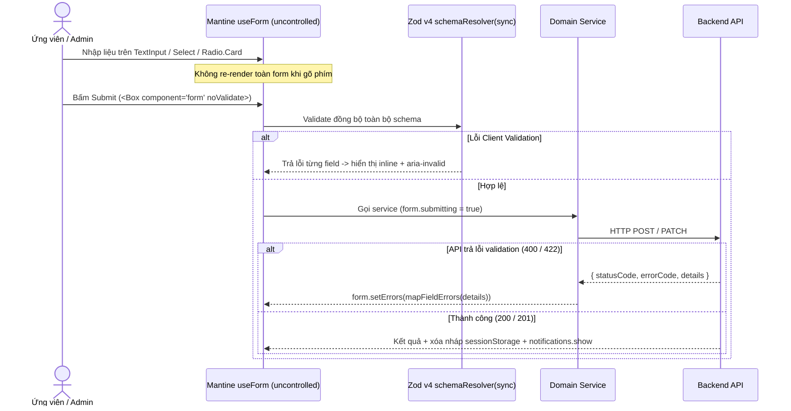

# Chuyên Đề 05: Kiến Trúc Biểu Mẫu & Xác Thực Dữ Liệu Với `@mantine/form` v9 + Zod v4 (Forms & Validation)

> **Dự án:** InterviewCoach Frontend (`client/`)  
> **Phiên bản:** 9.0 (InterviewCoach Next.js 16 + React 19 + Mantine v9 Standard)  
> **Cổng điều hướng:** [Master Hub](../README.md) | [Quick Reference](../QUICK_REFERENCE.md) | [Cẩm nang Mantine v9](../../mantine/README.md)  
> **Tài liệu liên quan:** [Setup Forms & Hooks (`docs/mantine/02`)](../../mantine/02-setup-forms-hooks-guide.md) | [Coding Standards](../01-foundations/coding-standards.md) | [Design System & Styling](./design-system-and-styling.md) | [Accessibility](./accessibility.md)  
> **Trạng thái thực thi:** `@mantine/form` (`^9.8.2`), `@mantine/dropzone` (`^9.8.2`), và `zod` (`^4.4.3`) đã cài sẵn `[Active in Codebase]`. Toàn bộ ví dụ dưới đây tự chứa theo tài liệu gốc `mantine.dev/form/`.  
> **Cơ sở tham chiếu quốc tế:**
>
> - [Mantine Form v9 — `useForm` Uncontrolled Mode](https://mantine.dev/form/use-form/)
> - [Mantine Form v9 — Schema Validation (`schemaResolver`)](https://mantine.dev/form/schema-validation/)
> - [Mantine Form v9 — `createFormContext` & Nested Lists](https://mantine.dev/form/create-form-context/)
> - [Mantine Dropzone v9](https://mantine.dev/x/dropzone/)
> - [Zod v4 Documentation](https://zod.dev/)

---

## MỤC LỤC

1. [Triết Lý Form Uncontrolled & Chính Sách Chuyển Tiếp Legacy](#1-triết-lý-form-uncontrolled-chính-sách-chuyển-tiếp-legacy)
2. [Chuẩn Nền Tảng `@mantine/form` v9 + Zod v4 & Luồng Validation 3 Tầng](#2-chuẩn-nền-tảng-mantineform-v9-zod-v4-luồng-validation-3-tầng)
3. [Danh Mục Mantine Input Controls, Dropzone & Khả Năng Tiếp Cận Form](#3-danh-mục-mantine-input-controls-dropzone-khả-năng-tiếp-cận-form)
4. [Multi-Step Wizard Với `Stepper`, `createFormContext` & Safe Draft Policy](#4-multi-step-wizard-với-stepper-createformcontext-safe-draft-policy)
5. [Dynamic Nested Fields & Upload Tệp Với `@mantine/dropzone`](#5-dynamic-nested-fields-upload-tệp-với-mantinedropzone)
6. [Bảng Đối Chiếu Anti-Pattern vs Best Practice](#6-bảng-đối-chiếu-anti-pattern-vs-best-practice)
7. [Ánh Xạ Tooling CI & Checklist PR Review Gate (10 Tiêu Chí)](#7-ánh-xạ-tooling-ci-checklist-pr-review-gate-10-tiêu-chí)

---

## 1. Triết Lý Form Uncontrolled & Chính Sách Chuyển Tiếp Legacy

Biểu mẫu trong **InterviewCoach** (xác thực, thiết lập phiên phỏng vấn nhiều bước, chỉnh sửa hồ sơ CV, cấu hình dữ liệu quản trị) là nơi tập trung nhiều tương tác người dùng nhất. **`@mantine/form` v9** với `mode: 'uncontrolled'` loại bỏ re-render toàn form khi gõ phím, tự động hoàn thiện ARIA accessibility trên từng input và kết nối trực tiếp với Zod v4 qua `schemaResolver`.



### Chính sách chuyển tiếp Legacy Form (Boy Scout Migration Policy)

1. **Mọi form viết mới:** **100% bắt buộc** dùng `@mantine/form` v9 (`mode: 'uncontrolled'`, `form.key()`, `schemaResolver(zodSchema, { sync: true })`) và `<Box component="form" noValidate>`.
2. **Các form legacy còn dùng `react-hook-form`:** Khi sửa lỗi nhỏ cục bộ chưa cần viết lại toàn bộ màn hình; khi thiết kế lại hoặc migrate màn hình sang Mantine v9, **chuyển dứt điểm sang `@mantine/form` v9** và tuyệt đối không pha trộn 2 thư viện form trong cùng 1 màn hình.

---

## 2. Chuẩn Nền Tảng `@mantine/form` v9 + Zod v4 & Luồng Validation 3 Tầng

> Tham khảo bảng API tra cứu nhanh tại [Hướng dẫn Setup Forms & Hooks (`docs/mantine/02`)](../../mantine/02-setup-forms-hooks-guide.md).

### 2.1. Quy tắc bắt buộc tầng nền

- Khởi tạo `useForm<Values>({ mode: 'uncontrolled', initialValues, validate: schemaResolver(schema, { sync: true }) })`.
- Gắn `key={form.key('fieldPath')}` và `{...form.getInputProps('fieldPath')}` cho từng input (với `Checkbox`/`Switch`, truyền `{ type: 'checkbox' }`).
- Luôn dùng `<Box component="form" onSubmit={form.onSubmit(handleSubmit)} noValidate>` thay vì thẻ `<form>` thô để hiển thị thông báo lỗi nhất quán theo Design System.
- Khóa nút gửi bằng `<Button type="submit" color="brand" loading={form.submitting}>` để chống double-submit.

### 2.2. Chiến lược Validation 3 Tầng & Ánh xạ Lỗi Từ Server

1. **Tầng 1 — Schema Validation đồng bộ (Zod v4):** `schemaResolver(schema, { sync: true })` từ `@mantine/form` làm nguồn chân lý cho cả runtime validation lẫn `z.infer<typeof schema>`.
2. **Tầng 2 — Async Validation có Debounce & Hủy Request:** Khi kiểm tra tính duy nhất phía server (như mã kỹ năng hoặc email), kết hợp `useDebouncedValue` (`@mantine/hooks`) + `AbortController` (`STD-ASYNC-001`) rồi gọi `form.setFieldError('field', message)`.
3. **Tầng 3 — Ánh xạ lỗi Validation từ Backend vào `form.setErrors`:** Chuyển đổi map lỗi theo từng trường (`Record<string, string[]>`) vào form và hiển thị lỗi tổng qua `@mantine/notifications`:

```ts
// Correct: Helper tự chứa ánh xạ lỗi validation từ server vào @mantine/form
import { notifications } from '@mantine/notifications'

export interface FieldValidationErrorShape {
  message?: string
  details?: Record<string, string[]> | null
}

function isFieldValidationError(
  error: unknown
): error is FieldValidationErrorShape {
  return typeof error === 'object' && error !== null && 'details' in error
}

export function applyServerFormErrors(
  error: unknown,
  setErrors: (errors: Record<string, string>) => void
): void {
  if (isFieldValidationError(error) && error.details) {
    const mapped: Record<string, string> = {}
    for (const [field, messages] of Object.entries(error.details)) {
      const firstMessage = messages[0]
      if (firstMessage) {
        mapped[field] = firstMessage
      }
    }
    if (Object.keys(mapped).length > 0) {
      setErrors(mapped)
      return
    }
  }

  const fallbackMessage =
    error instanceof Error
      ? error.message
      : 'Không thể gửi biểu mẫu. Vui lòng thử lại.'

  notifications.show({
    color: 'danger',
    title: 'Thao tác chưa thành công',
    message: fallbackMessage,
  })
}
```

---

## 3. Danh Mục Mantine Input Controls, Dropzone & Khả Năng Tiếp Cận Form

| Nhu cầu nhập liệu          | Component `@mantine/*` chuẩn                     | Ghi chú A11y & Styling Zero-Hex                                                                                |
| :------------------------- | :----------------------------------------------- | :------------------------------------------------------------------------------------------------------------- |
| Văn bản ngắn / Email       | `TextInput`                                      | Tự sinh `id` ↔ `<label>` ↔ `aria-describedby` lỗi; dùng `withAsterisk` cho trường bắt buộc                     |
| Mật khẩu                   | `PasswordInput`                                  | Tích hợp sẵn nút ẩn/hiện mật khẩu hỗ trợ bàn phím                                                              |
| Số lượng / Thời lượng      | `NumberInput`                                    | Khai báo rõ `min`, `max`, `step`, `allowDecimal={false}`                                                       |
| Mô tả JD / Câu trả lời dài | `Textarea`                                       | Dùng `autosize` + `minRows` / `maxRows`                                                                        |
| Chọn 1 / nhiều giá trị     | `Select`, `MultiSelect`, `SegmentedControl`      | Bật `searchable` khi danh sách > 7 mục                                                                         |
| Thẻ chọn trực quan         | `Radio.Group` + `Radio.Card` + `Radio.Indicator` | Tích hợp sẵn điều hướng phím mũi tên & ARIA                                                                    |
| Công tắc / Đồng ý          | `Checkbox`, `Switch`                             | Truyền `{ type: 'checkbox' }` vào `form.getInputProps('agree', { type: 'checkbox' })`                          |
| Tải tệp PDF/DOCX           | `Dropzone` (`@mantine/dropzone`)                 | Đặt `pointer-events: none;` vào `.dropzoneInner` trong `*.module.css`, cấm `style={{ pointerEvents: 'none' }}` |

---

## 4. Multi-Step Wizard Với `Stepper`, `createFormContext` & Safe Draft Policy

### Safe Draft Policy cho `sessionStorage`

- **Chỉ lưu dữ liệu phi nhạy cảm:** Tiêu đề vị trí, nội dung JD, cấu hình loại phiên. **Tuyệt đối không** lưu mật khẩu, token, hay PII nhạy cảm vào `sessionStorage`/`localStorage`.
- **Validate lại khi khôi phục:** Luôn chạy `draftSchema.safeParse(JSON.parse(raw))` trong `try/catch` để tránh crash nếu cấu trúc nháp thay đổi giữa các phiên bản.
- **Xóa sạch đúng vòng đời:** Xóa key nháp ngay sau khi submit thành công và khi người dùng đăng xuất.

### Case Study 1: Multi-Step Interview Setup Wizard (`mantine.dev/form/create-form-context/`)

```tsx
// Correct: Multi-step Wizard bằng Mantine Stepper + Radio.Card + createFormContext
'use client'

import { useState } from 'react'
import {
  Box,
  Button,
  Group,
  Radio,
  SimpleGrid,
  Stack,
  Stepper,
  Text,
  Textarea,
  TextInput,
} from '@mantine/core'
import { createFormContext, schemaResolver } from '@mantine/form'
import { z } from 'zod'

const setupWizardSchema = z.object({
  roleTitle: z.string().trim().min(3, 'Nhập vị trí tối thiểu 3 ký tự'),
  jobDescription: z
    .string()
    .trim()
    .min(30, 'Mô tả công việc cần tối thiểu 30 ký tự'),
  sessionType: z.enum(['hr', 'technical']),
  contextPack: z.enum(['VN', 'Western']),
})

type SetupWizardValues = z.infer<typeof setupWizardSchema>

const [SetupFormProvider, useSetupFormContext, useSetupForm] =
  createFormContext<SetupWizardValues>()

const DRAFT_STORAGE_KEY = 'interviewcoach:setup-wizard-draft:v1'

function ConfigStepFields() {
  const form = useSetupFormContext()
  return (
    <Radio.Group
      label="Loại phỏng vấn"
      key={form.key('sessionType')}
      {...form.getInputProps('sessionType')}
    >
      <SimpleGrid cols={{ base: 1, sm: 2 }} spacing="md" mt="xs">
        <Radio.Card value="technical" radius="md" p="md">
          <Group wrap="nowrap" align="flex-start">
            <Radio.Indicator />
            <Stack gap={2}>
              <Text fw={600} size="sm">
                Technical
              </Text>
              <Text size="xs" c="dimmed">
                Câu hỏi kỹ thuật chuyên sâu theo JD
              </Text>
            </Stack>
          </Group>
        </Radio.Card>
        <Radio.Card value="hr" radius="md" p="md">
          <Group wrap="nowrap" align="flex-start">
            <Radio.Indicator />
            <Stack gap={2}>
              <Text fw={600} size="sm">
                HR / Behavioral
              </Text>
              <Text size="xs" c="dimmed">
                Kinh nghiệm, kỹ năng mềm và tình huống STAR
              </Text>
            </Stack>
          </Group>
        </Radio.Card>
      </SimpleGrid>
    </Radio.Group>
  )
}

export function InterviewSetupWizard({
  onCreateSession,
}: {
  onCreateSession: (values: SetupWizardValues) => Promise<void>
}) {
  const [activeStep, setActiveStep] = useState(0)

  const form = useSetupForm({
    mode: 'uncontrolled',
    initialValues: {
      roleTitle: '',
      jobDescription: '',
      sessionType: 'technical',
      contextPack: 'VN',
    },
    validate: schemaResolver(setupWizardSchema, { sync: true }),
  })

  const handleNextStep = () => {
    const roleCheck = form.validateField('roleTitle')
    const jdCheck = form.validateField('jobDescription')
    if (!roleCheck.hasError && !jdCheck.hasError) {
      setActiveStep((current) => Math.min(current + 1, 1))
    }
  }

  const handleSubmit = async (values: SetupWizardValues) => {
    await onCreateSession(values)
    window.sessionStorage.removeItem(DRAFT_STORAGE_KEY)
  }

  return (
    <SetupFormProvider form={form}>
      <Box component="form" onSubmit={form.onSubmit(handleSubmit)} noValidate>
        <Stack gap="lg">
          <Stepper
            active={activeStep}
            onStepClick={setActiveStep}
            color="brand"
          >
            <Stepper.Step label="Bước 1" description="Nhập JD">
              <Stack gap="md" mt="md">
                <TextInput
                  withAsterisk
                  label="Vị trí ứng tuyển"
                  key={form.key('roleTitle')}
                  {...form.getInputProps('roleTitle')}
                />
                <Textarea
                  withAsterisk
                  label="Mô tả công việc (JD)"
                  minRows={4}
                  autosize
                  key={form.key('jobDescription')}
                  {...form.getInputProps('jobDescription')}
                />
              </Stack>
            </Stepper.Step>

            <Stepper.Step label="Bước 2" description="Cấu hình phiên">
              <Stack gap="md" mt="md">
                <ConfigStepFields />
              </Stack>
            </Stepper.Step>
          </Stepper>

          <Group justify="flex-end">
            {activeStep > 0 ? (
              <Button
                variant="default"
                onClick={() => setActiveStep((step) => step - 1)}
              >
                Quay lại
              </Button>
            ) : null}
            {activeStep < 1 ? (
              <Button color="brand" onClick={handleNextStep}>
                Tiếp tục
              </Button>
            ) : (
              <Button type="submit" color="brand" loading={form.submitting}>
                Bắt đầu phỏng vấn
              </Button>
            )}
          </Group>
        </Stack>
      </Box>
    </SetupFormProvider>
  )
}
```

---

## 5. Dynamic Nested Fields & Upload Tệp Với `@mantine/dropzone`

Với danh sách kinh nghiệm hoặc kỹ năng động, dùng các phương thức gốc `form.insertListItem`, `form.removeListItem`, `form.reorderListItem` (`mantine.dev/form/nested/`) kèm ID ổn định cho `key` (cấm `key={index}` theo [`SEM-PROPS-005`](./design-system-and-styling.md#sem-props-005)):

```tsx
// Correct: Dynamic list + Dropzone chuẩn Zero-Hex (mantine.dev/form/nested/ & /x/dropzone/)
'use client'

import {
  ActionIcon,
  Box,
  Button,
  Group,
  Paper,
  Stack,
  Text,
  TextInput,
} from '@mantine/core'
import { Dropzone, PDF_MIME_TYPE } from '@mantine/dropzone'
import { useForm } from '@mantine/form'
import { IconPlus, IconTrash, IconUpload } from '@tabler/icons-react'
import classes from './ResumeEditor.module.css'

interface SkillItem {
  id: string
  name: string
}

export function ResumeSkillsEditor({
  onUploadPdf,
  onSaveSkills,
}: {
  onUploadPdf: (file: File) => Promise<void>
  onSaveSkills: (skills: SkillItem[]) => Promise<void>
}) {
  const form = useForm<{ skills: SkillItem[] }>({
    mode: 'uncontrolled',
    initialValues: {
      skills: [{ id: 'skill-initial', name: '' }],
    },
  })

  const skills = form.getValues().skills

  const handleAddSkill = () => {
    form.insertListItem('skills', {
      id: crypto.randomUUID(),
      name: '',
    })
  }

  return (
    <Stack gap="lg">
      <Dropzone
        accept={PDF_MIME_TYPE}
        maxSize={5 * 1024 ** 2}
        multiple={false}
        onDrop={(files) => {
          const file = files[0]
          if (file) void onUploadPdf(file)
        }}
      >
        <Group justify="center" gap="sm" className={classes.dropzoneInner}>
          <IconUpload size={24} stroke={1.5} aria-hidden="true" />
          <Stack gap={2}>
            <Text size="sm" fw={500}>
              Kéo thả tệp CV (PDF, tối đa 5MB) hoặc nhấn để chọn
            </Text>
            <Text size="xs" c="dimmed">
              Hệ thống tự động trích xuất kỹ năng để gợi ý câu hỏi phỏng vấn
            </Text>
          </Stack>
        </Group>
      </Dropzone>

      <Box
        component="form"
        onSubmit={form.onSubmit((values) => onSaveSkills(values.skills))}
        noValidate
      >
        <Stack gap="sm">
          {skills.map((item, idx) => (
            <Paper key={item.id} withBorder p="sm" radius="md">
              <Group align="flex-end">
                <TextInput
                  label="Kỹ năng kỹ thuật"
                  placeholder="Ví dụ: TypeScript, PostgreSQL..."
                  flex={1}
                  key={form.key(`skills.${idx}.name`)}
                  {...form.getInputProps(`skills.${idx}.name`)}
                />
                <ActionIcon
                  color="danger"
                  variant="light"
                  aria-label="Xóa kỹ năng"
                  onClick={() => form.removeListItem('skills', idx)}
                >
                  <IconTrash size={16} stroke={1.5} aria-hidden="true" />
                </ActionIcon>
              </Group>
            </Paper>
          ))}

          <Group justify="space-between">
            <Button
              variant="light"
              color="brand"
              leftSection={
                <IconPlus size={16} stroke={1.5} aria-hidden="true" />
              }
              onClick={handleAddSkill}
            >
              Thêm kỹ năng
            </Button>
            <Button type="submit" color="brand" loading={form.submitting}>
              Lưu danh sách
            </Button>
          </Group>
        </Stack>
      </Box>
    </Stack>
  )
}
```

```css
/* ResumeEditor.module.css */
.dropzoneInner {
  pointer-events: none;
  min-height: rem(120px);
}
```

---

## 6. Bảng Đối Chiếu Anti-Pattern vs Best Practice

| Tình huống                    | Anti-Pattern (Tránh)                                                       | Best Practice (Chuẩn mực)                                                                    |
| :---------------------------- | :------------------------------------------------------------------------- | :------------------------------------------------------------------------------------------- |
| Khởi tạo form mới             | Tạo `useState` riêng cho từng ô input hoặc thêm form `react-hook-form` mới | `useForm({ mode: 'uncontrolled', validate: schemaResolver(zodSchema, { sync: true }) })`     |
| Thẻ `<form>` gốc              | Viết thẻ `<form onSubmit={...}>` thô trong JSX                             | `<Box component="form" onSubmit={form.onSubmit(...)} noValidate>`                            |
| Dropzone inner pointer-events | `<Group style={{ pointerEvents: 'none' }}>`                                | `<Group className={classes.dropzoneInner}>` đặt `pointer-events: none;` trong `*.module.css` |
| Lỗi validation từ server      | Chỉ gọi `alert(err.message)` không tô đỏ đúng trường sai                   | Dùng `applyServerFormErrors(err, form.setErrors)` map `details` vào từng field               |
| Danh sách field động          | Dùng `key={index}` khiến mất focus hoặc lệch giá trị khi xóa dòng đầu      | Gán `id: crypto.randomUUID()` ổn định cho từng phần tử + `form.key(\`skills.\${idx}.name\`)` |

---

## 7. Ánh Xạ Tooling CI & Checklist PR Review Gate (10 Tiêu Chí)

### Ánh xạ Tooling CI

| Hạng mục                                                              | Công cụ (`client/`)                      | Lệnh kiểm tra                                     |
| :-------------------------------------------------------------------- | :--------------------------------------- | :------------------------------------------------ |
| Kiểm tra schema Zod v4 & kiểu `useForm<Values>`                       | TypeScript 5                             | `npm run typecheck`                               |
| Cấm `<form>`/`<input>` thô, cấm `style={{}}`, kiểm tra `*.module.css` | `scripts/check-ui-rules.mjs` + Stylelint | `npm run ui:lint -- <files> && npm run stylelint` |
| Kiểm thử submit, validation error & `jest-axe`                        | Vitest 4 + `@test-utils`                 | `npm run test:unit`                               |

### Checklist PR Review Gate (10 Tiêu Chí)

- [ ] **1. Uncontrolled Standard:** Form mới dùng `@mantine/form` `mode: 'uncontrolled'`, `form.key()`, `form.getInputProps()`.
- [ ] **2. Zod v4 SSOT:** Validation dùng `schemaResolver(zodSchema, { sync: true })` và tái sử dụng kiểu `z.infer`.
- [ ] **3. Zero Raw Form Tags:** Bọc bằng `<Box component="form" noValidate>`, không dùng `<form>`, `<input>`, `<select>`, `<textarea>`, `<label>` thô.
- [ ] **4. Anti Double-Submit:** Nút submit gắn `loading={form.submitting}` (hoặc `disabled` khi đang gửi).
- [ ] **5. Server Error Mapping:** Lỗi từ backend `details` được ánh xạ vào `form.setErrors(...)`.
- [ ] **6. A11y đầy đủ:** Trường bắt buộc có `withAsterisk`, nút icon-only (như nút xóa dòng) có `aria-label`.
- [ ] **7. Wizard Safe Draft:** Nháp `sessionStorage` chỉ chứa dữ liệu phi nhạy cảm, parse bằng `zod.safeParse()` và xóa khi submit/logout.
- [ ] **8. Stable Dynamic Keys:** Mọi `insertListItem`/`removeListItem` dùng ID ổn định, cấm `key={index}`.
- [ ] **9. Boy Scout Boundary:** Không trộn `react-hook-form` với `@mantine/form` trong cùng một màn hình migrate.
- [ ] **10. Test Coverage:** Có unit test bằng `@test-utils` kiểm tra validation lỗi, submit thành công và `expect(await axe(container)).toHaveNoViolations()`.
