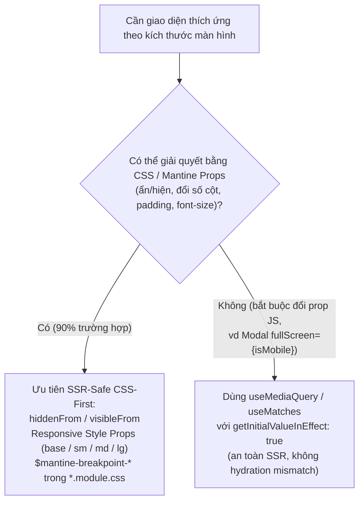

# Chuyên Đề 09: Kiến Trúc Responsive Web, Mobile-First & Touch UX Với Mantine v9 (`MOB-*`)

> **Dự án:** InterviewCoach Frontend (`client/`)  
> **Phiên bản:** 9.0 (InterviewCoach Next.js 16 + React 19 + Mantine v9 Standard)  
> **Cổng điều hướng:** [Master Hub](../README.md) | [Quick Reference](../QUICK_REFERENCE.md) | [Cẩm nang Mantine v9](../../mantine/README.md)  
> **Tài liệu liên quan:** [Design System & Styling (`SEM-*`)](./design-system-and-styling.md) | [Accessibility (`A11Y-*`)](./accessibility.md) | [View Transitions & Motion (`MOTION-*`)](./view-transitions-and-motion.md)  
> **Vai trò SSOT:** Nguồn chân lý duy nhất cho **10 mã quy chuẩn `MOB-001` đến `MOB-010`** dành cho **Responsive Web & Mobile-First** trên Next.js 16 App Router + Mantine v9.  
> **Cơ sở tham chiếu quốc tế:**
>
> - [Mantine v9 — Responsive Styles, `hiddenFrom`/`visibleFrom` & `useMatches`](https://mantine.dev/styles/responsive/)
> - [Mantine v9 — `AppShell`, `Drawer` & `Table.ScrollContainer`](https://mantine.dev/core/app-shell/)
> - [Mantine v9 Hooks — `useMediaQuery`](https://mantine.dev/hooks/use-media-query/)
> - [MDN Web Docs — Dynamic Viewport Units (`dvh`) & `env(safe-area-inset-*)`](https://developer.mozilla.org/en-US/docs/Web/CSS/env)

---

## MỤC LỤC

1. [Triết Lý Responsive Mobile-First & SSR-Safe Trên Next.js 16](#1-triết-lý-responsive-mobile-first-ssr-safe-trên-nextjs-16)
2. [Bộ 10 Quy Chuẩn SSOT `MOB-001` Đến `MOB-010`](#2-bộ-10-quy-chuẩn-ssot-mob-001-đến-mob-010)
3. [Case Study Chuẩn Mantine v9: Mobile Drawer, Mic Fallback & Safe Area CSS](#3-case-study-chuẩn-mantine-v9-mobile-drawer-mic-fallback-safe-area-css)
4. [Bảng Đối Chiếu Anti-Pattern vs Best Practice](#4-bảng-đối-chiếu-anti-pattern-vs-best-practice)
5. [Ánh Xạ Tooling CI & Checklist PR Review Gate (10 Tiêu Chí)](#5-ánh-xạ-tooling-ci-checklist-pr-review-gate-10-tiêu-chí)

---

## 1. Triết Lý Responsive Mobile-First & SSR-Safe Trên Next.js 16

Ứng viên của **InterviewCoach** có thể xem báo cáo STAR, ôn tập câu hỏi hoặc luyện phỏng vấn trực tiếp trên thiết bị di động. Vì Next.js 16 render HTML từ Server (SSR) nơi chưa tồn tại kích thước viewport trình duyệt, mọi bố cục responsive bắt buộc tuân theo nguyên tắc **CSS-First, SSR-Safe** để đạt **0 lỗi hydration mismatch** và **0 dịch chuyển bố cục (CLS)**:



---

## 2. Bộ 10 Quy Chuẩn SSOT `MOB-001` Đến `MOB-010`

<a id="mob-001"></a>

### 2.1. `MOB-001` — 5 Breakpoints Chuẩn Mantine Trong `postcss.config.mjs` (`ERROR` · `[Active]`)

Toàn bộ media query trong `*.module.css` bắt buộc dùng đúng 5 biến breakpoint đã khai báo tập trung tại `client/postcss.config.mjs` (cấm hardcode ngưỡng pixel rời rạc như `@media (max-width: 767px)`):

| Biến PostCSS             | Giá trị (`em`) | Tương đương (~px gốc 16px) | Thiết bị mục tiêu         |
| :----------------------- | :------------: | :------------------------: | :------------------------ |
| `$mantine-breakpoint-xs` |     `36em`     |          `576px`           | Điện thoại cỡ lớn         |
| `$mantine-breakpoint-sm` |     `48em`     |          `768px`           | Tablet dọc                |
| `$mantine-breakpoint-md` |     `62em`     |          `992px`           | Tablet ngang / Laptop nhỏ |
| `$mantine-breakpoint-lg` |     `75em`     |          `1200px`          | Desktop tiêu chuẩn        |
| `$mantine-breakpoint-xl` |     `88em`     |          `1408px`          | Màn hình rộng             |

<a id="mob-002"></a>

### 2.2. `MOB-002` — Ưu Tiên CSS-First SSR-Safe & Giới Hạn `useMatches` / `useMediaQuery` (`WARN` · `[Active]`)

- **Bố cục & ẩn/hiện:** Dùng `hiddenFrom="sm"`, `visibleFrom="lg"`, Responsive Style Props (`cols={{ base: 1, sm: 2, lg: 3 }}`, `p={{ base: 'sm', md: 'lg' }}`), và `@media (min-width: $mantine-breakpoint-md)` trong `*.module.css`.
- **Logic JS thuần:** Chỉ gọi `useMediaQuery('(max-width: 48em)', false, { getInitialValueInEffect: true })` hoặc `useMatches({ base: 1, sm: 2 })` khi bắt buộc truyền prop JS (ví dụ `Modal fullScreen={isMobile}`), giữ an toàn SSR.

<a id="mob-003"></a>

### 2.3. `MOB-003` — Vùng Chạm Cảm Ứng Tối Thiểu `rem(44px)` (`ERROR` · `[Active]`)

Mọi phần tử tương tác trên mobile (`Button`, `ActionIcon`, `NavLink`, tab chọn kỹ năng) phải đạt kích thước vùng chạm tối thiểu **`rem(44px)`** với khoảng hở tối thiểu `var(--mantine-spacing-xs)` giữa 2 nút liền kề (khớp [`A11Y-002`](./accessibility.md#a11y-002)).

<a id="mob-004"></a>

### 2.4. `MOB-004` — Điều Hướng Mobile Bằng `AppShell` + `Drawer` (`ERROR` · `[Active]`)

Thanh điều hướng chính (Sidebar ứng viên/quản trị) và thanh cây danh mục phụ phải tự thu gọn trên màn hình nhỏ qua `AppShell` `collapsed: { mobile: !opened }` hoặc Mantine `<Drawer>` điều khiển bởi `useDisclosure()` + `<Burger aria-label="..." hiddenFrom="sm" />`.

<a id="mob-005"></a>

### 2.5. `MOB-005` — Chống Tràn Ngang Bảng Dữ Liệu Bằng `<Table.ScrollContainer>` (`ERROR` · `[Active]`)

Mọi bảng có từ 4 cột trở lên (danh sách phiên, bảng danh mục năng lực, quản trị người dùng) bắt buộc bọc trong `<Table.ScrollContainer minWidth={640}>` để cuộn ngang mượt mà trên di động mà không phá vỡ khung trang.

<a id="mob-006"></a>

### 2.6. `MOB-006` — Thích Ứng Vùng An Toàn Safe Area Insets (`WARN` · `[Active]`)

Các thanh cố định ở đỉnh hoặc đáy màn hình di động (thanh nộp câu trả lời, nút điều khiển ghi âm) bắt buộc cộng thêm `env(safe-area-inset-top)` / `env(safe-area-inset-bottom)` trong `*.module.css` để không bị thanh Home Indicator hay tai thỏ che khuất.

<a id="mob-007"></a>

### 2.7. `MOB-007` — Sử Dụng `100dvh` Chống Nhảy Bàn Phím Ảo (`WARN` · `[Active]`)

Màn hình chiếm toàn khung nhìn (như không gian phiên phỏng vấn trực tiếp) dùng `min-height: 100dvh;` thay cho `100vh` để tránh bị thanh địa chỉ trình duyệt di động và bàn phím ảo che mất nút gửi câu trả lời.

<a id="mob-008"></a>

### 2.8. `MOB-008` — Responsive Modal & Bottom Drawer Trên Mobile (`WARN` · `[Active]`)

Các hộp thoại có nhiều trường nhập liệu tự chuyển sang `fullScreen={isMobile}` trên `Modal` hoặc dùng `<Drawer position="bottom">` ở breakpoint nhỏ (`max-width: $mantine-breakpoint-sm`).

<a id="mob-009"></a>

### 2.9. `MOB-009` — Trải Nghiệm Quyền Micro & Fallback Văn Bản Trên Mobile (`WARN` · `[Active]`)

Với tính năng ghi âm trả lời phỏng vấn trên trình duyệt di động:

- Kiểm tra an toàn `typeof navigator !== 'undefined' && Boolean(navigator.mediaDevices?.getUserMedia)` để không crash trên trình duyệt nhúng hoặc kết nối thiếu HTTPS.
- Khi quyền Micro bị từ chối (`denied`) hoặc thiết bị không hỗ trợ, hiển thị `<Alert color="warning" variant="light">` kèm nút chuyển ngay sang chế độ nhập văn bản mà không làm gián đoạn phiên phỏng vấn.

<a id="mob-010"></a>

### 2.10. `MOB-010` — Viewport Accessibility & PWA Readiness (`WARN` · `[Active: Viewport A11y]` / `[Target: PWA]`)

- **`[Active]` (Viewport Accessibility):** Không bao giờ đặt `user-scalable=no` hoặc `maximum-scale=1` trong viewport metadata của Next.js; người dùng bắt buộc zoom được tối thiểu `200%` mà không mất nội dung.
- **`[Target Standard]` (PWA Readiness):** Khi cần cài đặt ra màn hình chính, bổ sung `app/manifest.ts` chuẩn Next.js 16 (icons `192x192`/`512x512`) và Service Worker cache chọn lọc tài nguyên tĩnh.

---

## 3. Case Study Chuẩn Mantine v9: Mobile Drawer, Mic Fallback & Safe Area CSS

### Case Study 1: Mobile Drawer SSR-Safe (`mantine.dev/styles/responsive/` & `/core/drawer/`)

```tsx
// Correct: Mobile Drawer SSR-Safe với hiddenFrom + Drawer + touch target rem(44px)
'use client'

import { Box, Button, Drawer, Group, Stack, Text } from '@mantine/core'
import { useDisclosure } from '@mantine/hooks'
import { IconFolder } from '@tabler/icons-react'
import classes from './MobileWorkspace.module.css'

export function MobileCatalogTrigger({
  currentLabel,
  children,
}: {
  currentLabel: string
  children: React.ReactNode
}) {
  const [opened, { open, close }] = useDisclosure(false)

  return (
    <Box hiddenFrom="lg">
      <Group justify="space-between" p="xs">
        <Button
          variant="default"
          onClick={open}
          leftSection={<IconFolder size={18} stroke={1.5} aria-hidden="true" />}
          className={classes.touchButton}
        >
          Danh mục kỹ năng
        </Button>
        <Text size="sm" fw={500} truncate="end">
          {currentLabel}
        </Text>
      </Group>

      <Drawer
        opened={opened}
        onClose={close}
        title="Danh mục kỹ năng"
        size="85%"
      >
        <Stack gap="sm">{children}</Stack>
      </Drawer>
    </Box>
  )
}
```

### Case Study 2: Fallback Quyền Micro Trên Mobile (`MOB-009`) + CSS Safe Area & `100dvh`

```tsx
// Correct: Cảnh báo quyền Micro + chuyển ngay sang nhập văn bản (Zero-Hex)
'use client'

import { Alert, Button, Stack, Text } from '@mantine/core'
import { IconKeyboard, IconMicrophoneOff } from '@tabler/icons-react'

export function MobileMicFallbackAlert({
  reason,
  onSwitchToText,
}: {
  reason: 'denied' | 'unsupported'
  onSwitchToText: () => void
}) {
  return (
    <Alert
      color="warning"
      variant="light"
      title="Không thể truy cập Microphone"
      icon={<IconMicrophoneOff size={18} stroke={1.5} aria-hidden="true" />}
    >
      <Stack gap="sm">
        <Text size="sm">
          {reason === 'denied'
            ? 'Trình duyệt đang chặn quyền Micro. Bạn có thể cấp lại quyền trong cài đặt trang web hoặc trả lời bằng văn bản ngay bên dưới.'
            : 'Thiết bị hoặc trình duyệt hiện tại chưa hỗ trợ ghi âm trực tiếp.'}
        </Text>
        <Button
          color="brand"
          variant="light"
          leftSection={
            <IconKeyboard size={16} stroke={1.5} aria-hidden="true" />
          }
          onClick={onSwitchToText}
          w="fit-content"
        >
          Chuyển sang trả lời bằng văn bản
        </Button>
      </Stack>
    </Alert>
  )
}
```

```css
/* MobileWorkspace.module.css */
.sessionViewport {
  min-height: 100dvh;
  display: flex;
  flex-direction: column;
}

.stickyActionBar {
  position: sticky;
  bottom: 0;
  background-color: var(--mantine-color-body);
  border-top: 1px solid var(--mantine-color-default-border);
  padding: var(--mantine-spacing-sm) var(--mantine-spacing-md);
  padding-bottom: calc(var(--mantine-spacing-sm) + env(safe-area-inset-bottom));
}

.touchButton {
  min-height: rem(44px);
  min-width: rem(44px);

  @media (min-width: $mantine-breakpoint-md) {
    min-height: rem(36px);
  }
}
```

---

## 4. Bảng Đối Chiếu Anti-Pattern vs Best Practice

| Tình huống                          | Anti-Pattern (Tránh)                                                  | Best Practice (Chuẩn mực)                                                                          |
| :---------------------------------- | :-------------------------------------------------------------------- | :------------------------------------------------------------------------------------------------- |
| Ẩn sidebar trên mobile              | Dùng `if (window.innerWidth < 768) return null` gây lỗi hydration SSR | Dùng `hiddenFrom="sm"` / `visibleFrom="sm"` hoặc `AppShell` `collapsed` (`MOB-002`)                |
| Viết media query trong CSS Module   | `@media (max-width: 767px) { padding: 12px; }`                        | `@media (max-width: $mantine-breakpoint-sm) { padding: var(--mantine-spacing-sm); }` (`MOB-001`)   |
| Hiển thị bảng 6 cột trên điện thoại | Để `<Table>` tràn ngang làm vỡ toàn bộ viewport                       | Bọc `<Table.ScrollContainer minWidth={640}><Table>...</Table></Table.ScrollContainer>` (`MOB-005`) |
| Thanh nút cố định đáy trang         | `height: 100vh;` không có safe-area padding                           | `min-height: 100dvh;` + `env(safe-area-inset-bottom)` (`MOB-006`, `MOB-007`)                       |
| Nút bấm di động quá nhỏ             | Nút cao `28px` khó chạm chính xác bằng ngón tay                       | Đặt `min-height: rem(44px)` trên thiết bị chạm (`MOB-003`)                                         |

---

## 5. Ánh Xạ Tooling CI & Checklist PR Review Gate (10 Tiêu Chí)

### Ánh xạ Tooling CI (`client/`)

| Hạng mục                                                                 | Công cụ                                           | Lệnh thực thi                                     |
| :----------------------------------------------------------------------- | :------------------------------------------------ | :------------------------------------------------ |
| Kiểm tra `$mantine-breakpoint-*`, `rem()`, Zero-Hex trong `*.module.css` | Stylelint 17 + `scripts/check-ui-rules.mjs`       | `npm run stylelint && npm run ui:lint -- <files>` |
| Kiểm tra hiển thị đa viewport (`sm`, `md`, `lg`, `xl`)                   | Storybook 10 Viewport Toolbar & Playwright Visual | `npm run test:visual`                             |
| Kiểm tra luồng di động E2E                                               | Playwright                                        | `npm run test:e2e`                                |

### Checklist PR Review Gate (10 Tiêu Chí)

- [ ] **1. Breakpoints chuẩn:** 100% media query dùng `$mantine-breakpoint-xs..xl`, không hardcode px (`MOB-001`).
- [ ] **2. SSR-Safe First:** Bố cục dùng `hiddenFrom`/`visibleFrom` và responsive props; không truy cập `window.innerWidth` trong render (`MOB-002`).
- [ ] **3. Touch Targets:** Mọi nút/icon tương tác trên mobile đạt tối thiểu `rem(44px)` (`MOB-003`).
- [ ] **4. Mobile Navigation:** Sidebar/cây danh mục thu gọn vào `AppShell`/`Drawer` + `Burger` có `aria-label` (`MOB-004`).
- [ ] **5. Responsive Tables:** 100% bảng rộng bọc trong `<Table.ScrollContainer>` (`MOB-005`).
- [ ] **6. Safe Area Insets:** Thanh hành động cố định đỉnh/đáy hỗ trợ `env(safe-area-inset-*)` (`MOB-006`).
- [ ] **7. Dynamic Viewport:** Màn hình full-height dùng `100dvh`, không bị bàn phím ảo che nút submit (`MOB-007`).
- [ ] **8. Responsive Overlays:** Modal lớn hỗ trợ `fullScreen={isMobile}` hoặc chuyển sang `Drawer` trên mobile (`MOB-008`).
- [ ] **9. Voice Fallback:** Lỗi/từ chối quyền Micro hiển thị `<Alert color="warning">` và cho chuyển sang nhập văn bản (`MOB-009`).
- [ ] **10. Zoomable Viewport:** Không khóa `user-scalable=no`, nội dung đọc rõ khi phóng to 200% (`MOB-010`).
