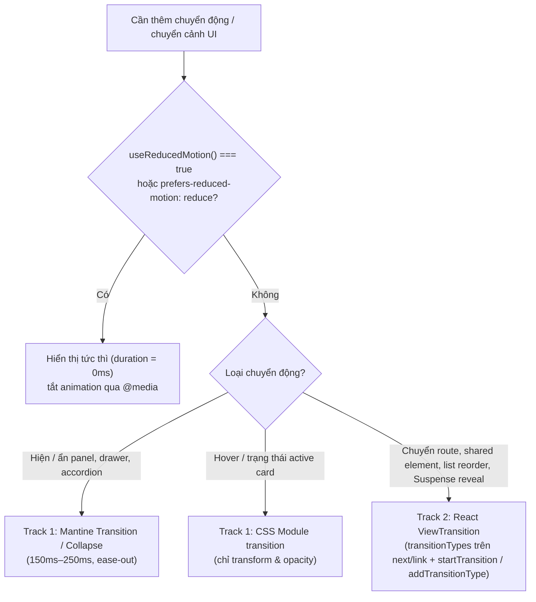

# Chuyên Đề 08: Kỹ Thuật Chuyển Cảnh Giao Diện & Native View Transitions (`MOTION-*`)

> **Dự án:** InterviewCoach Frontend (`client/`)  
> **Phiên bản:** 9.0 (InterviewCoach Next.js 16 + React 19 + Mantine v9 Standard)  
> **Cổng điều hướng:** [Master Hub](../README.md) | [Quick Reference](../QUICK_REFERENCE.md) | [Cẩm nang Mantine v9](../../mantine/README.md)  
> **Tài liệu liên quan:** [Design System & Styling (`SEM-*`)](./design-system-and-styling.md) | [Accessibility (`A11Y-*`)](./accessibility.md) | [Responsive & Touch UX (`MOB-*`)](./responsive-and-touch-ux.md)  
> **Vai trò SSOT:** Nguồn chân lý duy nhất cho **8 mã quy chuẩn `MOTION-001` đến `MOTION-008`**, đồng bộ 100% với **Next.js `16.2.6` App Router** và skill [`vercel-react-view-transitions`](../../../.agents/skills/vercel-react-view-transitions/SKILL.md).  
> **Trạng thái thực thi Dual-Track:**
>
> - **Track 1 — Micro-Interactions & Local UI (`[Active]`):** Mantine `<Transition>` / `<Collapse>` và CSS Modules (`transform`/`opacity`) kết hợp `useReducedMotion()`.
> - **Track 2 — Route, Shared Element & List Transitions (`[Active trên Next.js 16.2.6]`):** React `<ViewTransition>` + `transitionTypes` trên `next/link` / `router.push()` + `startTransition` / `addTransitionType` (Next.js `16.2+` đã tích hợp sẵn `<ViewTransition>` và `transitionTypes`, **không** cài `react@canary`, **không** bật cờ `experimental.viewTransition` cũ, và **không** tự gọi trực tiếp `document.startViewTransition()` khi đã dùng `<ViewTransition>`).
>
> **Cơ sở tham chiếu quốc tế:**
>
> - [Vercel React View Transitions (`client/.agents/skills/vercel-react-view-transitions/`)](../../../.agents/skills/vercel-react-view-transitions/SKILL.md)
> - [Next.js 16 — View Transitions Guide](https://nextjs.org/docs/app/guides/view-transitions)
> - [Mantine v9 — `Transition`, `Collapse` & `useReducedMotion`](https://mantine.dev/core/transition/)
> - [W3C CSS View Transitions Module Level 1 & 2](https://www.w3.org/TR/css-view-transitions-1/)

---

## MỤC LỤC

1. [Triết Lý Chuyển Động Không Gian & Cây Quyết Định Dual-Track](#1-triết-lý-chuyển-động-không-gian-cây-quyết-định-dual-track)
2. [Bộ 8 Quy Chuẩn SSOT `MOTION-001` Đến `MOTION-008`](#2-bộ-8-quy-chuẩn-ssot-motion-001-đến-motion-008)
3. [Case Study Chuẩn Next.js 16.2 + Mantine v9: `ViewTransition` & `Transition`](#3-case-study-chuẩn-nextjs-162-mantine-v9-viewtransition-transition)
4. [Bộ CSS Recipes Chuẩn Cho View Transitions & CSS Modules](#4-bộ-css-recipes-chuẩn-cho-view-transitions-css-modules)
5. [Bảng Đối Chiếu Anti-Pattern vs Best Practice](#5-bảng-đối-chiếu-anti-pattern-vs-best-practice)
6. [Ánh Xạ Tooling CI & Checklist PR Review Gate (8 Tiêu Chí)](#6-ánh-xạ-tooling-ci-checklist-pr-review-gate-8-tiêu-chí)

---

## 1. Triết Lý Chuyển Động Không Gian & Cây Quyết Định Dual-Track

Chuyển động (Motion) chỉ tồn tại để **truyền đạt mối quan hệ không gian hoặc tính liên tục** — nếu không thể diễn đạt rõ chuyển động truyền tải thông tin gì cho người dùng, hãy bỏ nó. Mọi chuyển động trong **InterviewCoach** chạy hoàn toàn trên GPU (`transform`, `opacity`) và tự động tắt khi người dùng bật `prefers-reduced-motion: reduce`.



---

## 2. Bộ 8 Quy Chuẩn SSOT `MOTION-001` Đến `MOTION-008`

<a id="motion-001"></a>

### 2.1. `MOTION-001` — Tính Có Ý Nghĩa Không Gian & GPU-Only (`ERROR` · `[Active]`)

Mọi chuyển động phải phản ánh mối quan hệ không gian/thứ bậc giữa trạng thái cũ và mới, **chỉ animate các thuộc tính chạy trên GPU (`transform`, `opacity`)** trong ngân sách thời lượng **`150ms–300ms`** với `ease-out` (vào) / `ease-in-out` (di chuyển). Cấm animate `width`, `height`, `top`, `left`, `margin` gây layout thrashing.

<a id="motion-002"></a>

### 2.2. `MOTION-002` — Điều Hướng Có Hướng Bằng `transitionTypes` & `addTransitionType` (`WARN` · `[Active]`)

Chỉ dùng trượt có hướng (`nav-forward` / `nav-back`) cho điều hướng phân cấp (danh sách → chi tiết) và luồng tuần tự có thứ tự rõ (bước Wizard, câu hỏi trước/sau). Trên Next.js `16.2+`, gắn trực tiếp `transitionTypes={['nav-forward']}` trên `next/link` (hoặc `router.push(href, { transitionTypes: ['nav-forward'] })`), và dùng `startTransition` + `addTransitionType` cho tương tác cục bộ không đổi URL. Điều hướng ngang giữa các tab dùng fade nhẹ hoặc `default="none"`.

<a id="motion-003"></a>

### 2.3. `MOTION-003` — Vị Trí Đặt Ranh Giới `<ViewTransition>` Chuẩn Xác (`ERROR` · `[Active]`)

`<ViewTransition>` chỉ kích hoạt `enter`/`exit` nếu nó nằm **trước mọi nút DOM** bọc nội dung thay đổi; đồng thời **không** bọc layout-level `<ViewTransition>` quanh `{children}` trong `layout.tsx` nếu các trang con có `<ViewTransition>` riêng (vì nested VT mount/unmount cùng lúc sẽ triệt tiêu `enter`/`exit` của trang con).

<a id="motion-004"></a>

### 2.4. `MOTION-004` — Định Danh `name` Shared Element Độc Nhất Trên Trang (`ERROR` · `[Active]`)

Khi tạo hiệu ứng biến hình phần tử chung (`<ViewTransition name={\`session-title-\${id}\`} share="morph">`), mỗi `name` đang mount trên DOM tại cùng một thời điểm **bắt buộc duy nhất theo ID**. Nếu trùng tên (ví dụ cùng render trong trang lẫn trong Modal), trình duyệt sẽ hủy toàn bộ View Transition.

<a id="motion-005"></a>

### 2.5. `MOTION-005` — Khai Báo `default="none"` Có Chủ Đích (`WARN` · `[Active]`)

Vì mọi lần nhấn `<Link>` trên Next.js App Router đều chạy trong React Transition, mọi `<ViewTransition>` kiểu page-level hoặc named shared-element **bắt buộc** khai báo `default="none"` và chỉ liệt kê tường minh các trigger cần dùng (`enter`, `exit`, `share`) để tránh cross-fade nhòe ngoài ý muốn khi Suspense resolve hoặc revalidate dữ liệu nền.

<a id="motion-006"></a>

### 2.6. `MOTION-006` — Bố Cục Trượt Thích Ứng & List Identity (`WARN` · `[Active]`)

Khi sắp xếp hoặc lọc danh sách, bọc từng phần tử bằng `<ViewTransition key={item.id}>` (giữ `update` mặc định) và bọc phần tử liền kề phía dưới danh sách bằng một `<ViewTransition>` trần để khối bên dưới trượt mượt mà thay vì nhảy giật cục; hoặc dùng Mantine `<Collapse>` cho khối mở/đóng cục bộ.

<a id="motion-007"></a>

### 2.7. `MOTION-007` — Triển Khai Kép Tương Thích Dual-Track (`WARN` · `[Active]`)

Không cài thêm thư viện animation bên thứ ba cho chuyển động UI tiêu chuẩn:

- **Track 1 (Local UI):** Mantine `<Transition>` / `<Collapse>` và CSS Modules cho dropdown, modal, panel ẩn/hiện cục bộ.
- **Track 2 (Native View Transitions):** React `<ViewTransition>` (tích hợp sẵn trên Next.js `16.2.6`, tự động fallback mượt trên trình duyệt chưa hỗ trợ) — **tuyệt đối không** tự gọi `document.startViewTransition()` thủ công song song với `<ViewTransition>`.

<a id="motion-008"></a>

### 2.8. `MOTION-008` — Quy Chuẩn An Toàn Chuyển Động Tiền Đình (`ERROR` · `[Active]`)

100% hoạt họa bắt buộc tôn trọng lựa chọn giảm chuyển động của hệ điều hành:

- Trong React Client Component: đọc `const reduceMotion = useReducedMotion()` từ `@mantine/hooks`, truyền `duration={reduceMotion ? 0 : 200}` cho Mantine `<Transition>`.
- Trong CSS Modules và global stylesheet cho View Transitions: luôn kèm `@media (prefers-reduced-motion: reduce)`.

---

## 3. Case Study Chuẩn Next.js 16.2 + Mantine v9: `ViewTransition` & `Transition`

### Mẫu 1: Placement Rule & Directional Navigation (`vercel-react-view-transitions` + Mantine v9)

```tsx
// Incorrect: Bọc Box/div ngoài ViewTransition làm vô hiệu hóa trigger enter/exit
import { ViewTransition } from 'react'
import { Box, Paper } from '@mantine/core'

function BadTransitionPlacement({ children }: { children: React.ReactNode }) {
  return (
    <Box>
      <ViewTransition enter="fade-in" exit="fade-out" default="none">
        <Paper withBorder p="md">
          {children}
        </Paper>
      </ViewTransition>
    </Box>
  )
}

// Correct: Đặt ViewTransition trước DOM node + Link transitionTypes trên Next.js 16.2+
;('use client')

import { addTransitionType, startTransition, ViewTransition } from 'react'
import Link from 'next/link'
import { Button, Group, Paper, Stack } from '@mantine/core'

export function DirectionalStepTransition({
  children,
}: {
  children: React.ReactNode
}) {
  return (
    <ViewTransition
      enter={{
        'nav-forward': 'slide-from-right',
        'nav-back': 'slide-from-left',
        default: 'none',
      }}
      exit={{
        'nav-forward': 'slide-to-left',
        'nav-back': 'slide-to-right',
        default: 'none',
      }}
      default="none"
    >
      <Paper withBorder p="lg" radius="md">
        {children}
      </Paper>
    </ViewTransition>
  )
}

export function StepNavigationControls({
  detailHref,
  onNextStep,
}: {
  detailHref: string
  onNextStep: () => void
}) {
  const handleAdvance = () => {
    startTransition(() => {
      addTransitionType('nav-forward')
      onNextStep()
    })
  }

  return (
    <Stack gap="sm">
      <Group justify="flex-end">
        <Button color="brand" onClick={handleAdvance}>
          Bước tiếp theo
        </Button>
        <Button
          component={Link}
          href={detailHref}
          transitionTypes={['nav-forward']}
          variant="light"
          color="brand"
        >
          Xem chi tiết báo cáo
        </Button>
      </Group>
    </Stack>
  )
}
```

### Mẫu 2: Local Micro-Interaction Với Mantine `<Transition>` & `useReducedMotion`

```tsx
// Correct: Panel cục bộ dùng Mantine Transition + useReducedMotion (mantine.dev/core/transition/)
'use client'

import { Paper, Stack, Text, Title, Transition } from '@mantine/core'
import { useReducedMotion } from '@mantine/hooks'

export function QuestionTransitionPanel({
  mounted,
  questionIndex,
  prompt,
}: {
  mounted: boolean
  questionIndex: number
  prompt: string
}) {
  const reduceMotion = useReducedMotion()

  return (
    <Transition
      mounted={mounted}
      transition="fade-up"
      duration={reduceMotion ? 0 : 200}
      timingFunction="ease-out"
    >
      {(transitionStyles) => (
        <Paper
          withBorder
          p="lg"
          radius="md"
          // interviewcoach-convention-exempt: SEM-TOKEN-003 Mantine Transition render prop injects GPU transform/opacity styles until: 2026-12-31
          style={transitionStyles}
        >
          <Stack gap="xs">
            <Text size="xs" c="dimmed" fw={600}>
              Câu hỏi số {questionIndex}
            </Text>
            <Title order={2} size="h3">
              {prompt}
            </Title>
          </Stack>
        </Paper>
      )}
    </Transition>
  )
}
```

---

## 4. Bộ CSS Recipes Chuẩn Cho View Transitions & CSS Modules

### Recipe 1: Micro-Interaction Card Hover trong `*.module.css` (GPU-Only + Reduced Motion)

```css
/* InteractiveMotionCard.module.css */
.card {
  transition:
    transform 180ms ease-out,
    border-color 180ms ease-out;

  @mixin hover {
    transform: translateY(rem(-2px));
    border-color: var(--mantine-primary-color-filled);
  }
}

@media (prefers-reduced-motion: reduce) {
  .card {
    transition: none;

    @mixin hover {
      transform: none;
    }
  }
}
```

### Recipe 2: Global View Transition Pseudo-Elements (adapted từ `vercel-react-view-transitions/references/css-recipes.md`)

```css
:root {
  --vt-duration-exit: 150ms;
  --vt-duration-enter: 210ms;
}

@keyframes vt-fade {
  from {
    opacity: 0;
  }
  to {
    opacity: 1;
  }
}

::view-transition-old(.fade-out) {
  animation: var(--vt-duration-exit) ease-in vt-fade reverse;
}

::view-transition-new(.fade-in) {
  animation: var(--vt-duration-enter) ease-out var(--vt-duration-exit) both
    vt-fade;
}

@media (prefers-reduced-motion: reduce) {
  ::view-transition-group(*),
  ::view-transition-old(*),
  ::view-transition-new(*) {
    animation: none;
  }
}
```

---

## 5. Bảng Đối Chiếu Anti-Pattern vs Best Practice

| Tình huống                                  | Anti-Pattern (Tránh)                                                                                | Best Practice (Chuẩn mực)                                                                                                        |
| :------------------------------------------ | :-------------------------------------------------------------------------------------------------- | :------------------------------------------------------------------------------------------------------------------------------- |
| Kích hoạt View Transition trên Next.js 16.2 | Tự gọi `document.startViewTransition()` hoặc bật `experimental.viewTransition` / cài `react@canary` | Dùng trực tiếp `<ViewTransition>` + `transitionTypes` trên `next/link` và `startTransition` + `addTransitionType` (`MOTION-007`) |
| Vị trí đặt `<ViewTransition>`               | Bọc `<ViewTransition>` trong `layout.tsx` quanh `{children}` khi page con có VT riêng               | Đặt `<ViewTransition>` ở page/component trước nút DOM thay đổi (`MOTION-003`)                                                    |
| Thuộc tính CSS animation                    | Animate `height`, `width`, `margin`, `top` gây layout reflow                                        | Chỉ animate `transform` và `opacity` trong `150ms–300ms` (`MOTION-001`)                                                          |
| Chuyển tab ngang (lateral)                  | Dùng hiệu ứng trượt trái/phải tạo cảm giác sai về độ sâu phân cấp                                   | Dùng fade nhẹ hoặc `default="none"`; chỉ trượt có hướng cho danh sách → chi tiết hoặc Wizard (`MOTION-002`)                      |
| Tránh cross-fade thừa                       | Để mặc định `<ViewTransition>` không cấu hình trên trang nhiều Suspense/SWR                         | Khai báo rõ `default="none"` kèm trigger tường minh (`MOTION-005`)                                                               |

---

## 6. Ánh Xạ Tooling CI & Checklist PR Review Gate (8 Tiêu Chí)

### Ánh xạ Tooling CI (`client/`)

| Hạng mục                                       | Công cụ                                                           | Lệnh thực thi                                     |
| :--------------------------------------------- | :---------------------------------------------------------------- | :------------------------------------------------ |
| Kiểm tra CSS Module hợp lệ, `rem()`, Zero-Hex  | Stylelint 17 + `scripts/check-ui-rules.mjs`                       | `npm run stylelint && npm run ui:lint -- <files>` |
| Kiểm tra chế độ Force Reduced Motion trực quan | Storybook 10 (`withReducedMotion` trong `.storybook/preview.tsx`) | `npm run storybook`                               |
| Đảm bảo unit test không flaky vì animation     | `@test-utils` (`MantineProvider env="test"` tự tắt transition)    | `npm run test:unit`                               |

### Checklist PR Review Gate (8 Tiêu Chí)

- [ ] **1. GPU-Only & Duration Budget:** Chỉ animate `transform`/`opacity` trong khoảng `150ms–300ms` (`MOTION-001`).
- [ ] **2. Directional Consistency:** Trượt có hướng chỉ áp dụng cho luồng phân cấp/tuần tự qua `transitionTypes` / `addTransitionType` (`MOTION-002`).
- [ ] **3. Placement Rule:** `<ViewTransition>` đứng trước nút DOM thay đổi và không bọc quanh `{children}` ở layout khi trang con có VT riêng (`MOTION-003`).
- [ ] **4. Unique Names:** Mọi `name` của shared element đang mount cùng lúc là duy nhất theo ID (`MOTION-004`).
- [ ] **5. Intentional Opt-Out:** Page-level và named `<ViewTransition>` khai báo `default="none"` tránh cross-fade thừa (`MOTION-005`).
- [ ] **6. Smooth Displacement:** Danh sách sắp xếp lại dùng `<ViewTransition key={item.id}>` hoặc Mantine `<Collapse>` (`MOTION-006`).
- [ ] **7. Dual-Track Discipline:** Không tự gọi `document.startViewTransition()` khi đã dùng `<ViewTransition>`, không cài thư viện animation ngoài (`MOTION-007`).
- [ ] **8. Mandatory Reduced Motion:** Tôn trọng 100% `useReducedMotion()` và `@media (prefers-reduced-motion: reduce)` (`MOTION-008`).
