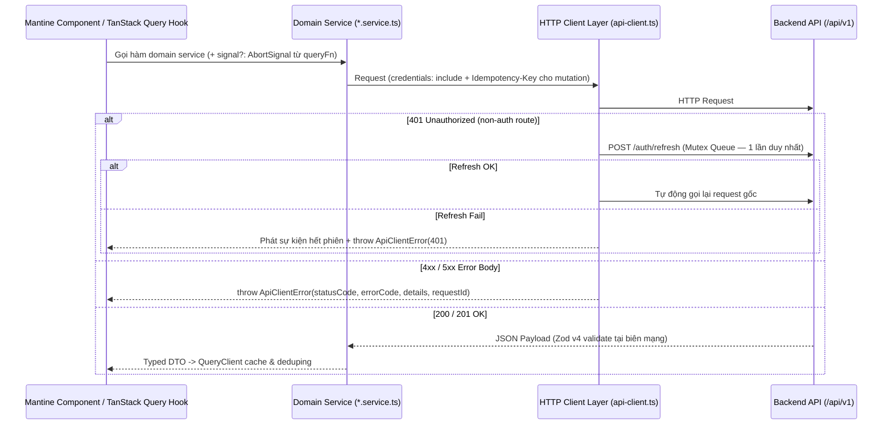

# Chuyên Đề 11: Hợp Đồng API, Khả Năng Chịu Lỗi & Xử Lý Ngoại Tuyến (`API-*`)

> **Dự án:** InterviewCoach Frontend (`client/`)  
> **Phiên bản:** 9.0 (InterviewCoach Next.js 16 + React 19 + Mantine v9 Standard)  
> **Cổng điều hướng:** [Master Hub](../README.md) | [Quick Reference](../QUICK_REFERENCE.md) | [Cẩm nang Mantine v9](../../mantine/README.md)  
> **Tài liệu liên quan:** [State Management (TanStack Query & SSE)](../01-foundations/state-management.md) | [Security & Auth (`SEC-*`)](./security-and-auth.md) | [Testing & QA](./testing-and-qa.md) | [Coding Standards (`STD-*`)](../01-foundations/coding-standards.md)  
> **Vai trò SSOT:** Nguồn chân lý duy nhất cho **12 mã quy chuẩn `API-001` đến `API-012`**, định nghĩa chuẩn mực hợp đồng API, khử trùng lặp với TanStack Query v5 (`client-swr-dedup`), chống waterfall (`async-parallel`, `server-parallel-fetching`), và xử lý ngoại tuyến bằng `@mantine/hooks`.  
> **Cơ sở tham chiếu quốc tế:**
>
> - [RFC 9457 — Problem Details for HTTP APIs](https://datatracker.ietf.org/doc/html/rfc9457)
> - [TanStack Query v5 — Query Deduplication, Caching & Retry](https://tanstack.com/query/v5/docs/framework/react/guides/query-Retries)
> - [Mantine v9 Hooks — `useNetwork`](https://mantine.dev/hooks/use-network/)
> - [MDN Web Docs — `AbortController` & Fetch API](https://developer.mozilla.org/en-US/docs/Web/API/AbortController)
> - [Vercel React Best Practices (`async-parallel`, `server-parallel-fetching`, `client-swr-dedup`)](../../../.agents/skills/vercel-react-best-practices/SKILL.md)

---

## MỤC LỤC

1. [Triết Lý Giao Tiếp Mạng & Đường Ống Request Chuẩn](#1-triết-lý-giao-tiếp-mạng-đường-ống-request-chuẩn)
2. [Bộ 12 Quy Chuẩn SSOT `API-001` Đến `API-012`](#2-bộ-12-quy-chuẩn-ssot-api-001-đến-api-012)
3. [Case Study Tự Chứa: Service Zod + `AbortSignal`, `Promise.all` & Offline UX `useNetwork`](#3-case-study-tự-chứa-service-zod-abortsignal-promiseall-offline-ux-usenetwork)
4. [Bảng Đối Chiếu Anti-Pattern vs Best Practice](#4-bảng-đối-chiếu-anti-pattern-vs-best-practice)
5. [Ánh Xạ Tooling CI & Checklist PR Review Gate (10 Tiêu Chí)](#5-ánh-xạ-tooling-ci-checklist-pr-review-gate-10-tiêu-chí)

---

## 1. Triết Lý Giao Tiếp Mạng & Đường Ống Request Chuẩn

Mọi giao tiếp giữa Frontend (`client/`) và NestJS Backend (`server/`) phải đi qua **đường ống thống nhất, có kiểu chặt chẽ, chống lặp mutation (`Idempotency-Key`), chống race condition (`AbortSignal` + Mutex 401 Refresh), và phản hồi rõ ràng khi mất mạng**. Không gọi `fetch()` rời rạc hay hardcode URL trong component UI.



---

## 2. Bộ 12 Quy Chuẩn SSOT `API-001` Đến `API-012`

<a id="api-001"></a>

### 2.1. `API-001` — Phát Triển Contract-First Từ OpenAPI (`ERROR` · `[Target Standard]`)

Định hướng sinh tự động kiểu TypeScript DTO từ đặc tả OpenAPI của `server/` (như `openapi-typescript`) để triệt tiêu lệch hợp đồng giữa Backend và Frontend. Trong giai đoạn chưa bật code-gen tự động, mọi DTO khai báo rõ ràng theo đúng schema JSON trả về từ Backend.

<a id="api-002"></a>

### 2.2. `API-002` — Chuẩn Hóa Schema Lỗi API (`ERROR` · `[Active/Target]`)

- **Chuẩn lớp lỗi có cấu trúc (`ApiClientError`):** Chuẩn hóa mọi phản hồi lỗi HTTP gồm `statusCode`, `errorCode`, `details?: Record<string, string[]> | null`, `requestId`, `correlationId`, và ánh xạ sang thông điệp tiếng Việt thân thiện cho người dùng.
- **Lộ trình (`[Target Standard]`):** Hỗ trợ chuẩn hóa đầy đủ theo **RFC 9457 Problem Details** (`type`, `title`, `status`, `detail`, `instance`).

<a id="api-003"></a>

### 2.3. `API-003` — Tiếp Nhận & Chuyển Tiếp `signal?: AbortSignal` (`ERROR` · `[Active cho code mới]` / `[Target cho legacy]`)

Mọi hàm tìm kiếm hoặc đọc dữ liệu viết mới ở tầng service bắt buộc nhận `{ signal?: AbortSignal }` và chuyển tiếp xuống `fetch`/HTTP client để hủy request cũ khi người dùng đổi từ khóa hoặc unmount component (khớp [`STD-ASYNC-001`](../01-foundations/coding-standards.md#std-async-001)).

<a id="api-004"></a>

### 2.4. `API-004` — Chống Trùng Mutation (`Idempotency-Key`) & Retry Thích Ứng (`WARN` · `[Active/Target]`)

- **Idempotency-Key (`[Active]`):** 100% mutation (`POST`, `PUT`, `PATCH`, `DELETE`) gửi kèm header **`Idempotency-Key`** (UUID v4) nhằm ngăn tạo trùng phiên phỏng vấn hoặc nộp trùng câu trả lời khi người dùng bấm lặp hoặc mạng chập chờn.
- **Exponential Backoff + Full Jitter (`[Target Standard]`):** Chỉ áp dụng retry tự động cho request `GET` idempotent gặp lỗi tạm thời (`502`, `503`, `504`, lỗi mạng); **tuyệt đối không retry** lỗi `400`/`401`/`403`/`404`/`422`.

<a id="api-005"></a>

### 2.5. `API-005` — Giám Sát Kết Nối Mạng Bằng `useNetwork()` (`WARN` · `[Target Standard — Mantine v9]`)

Thay vì tự gắn `window.addEventListener('online' | 'offline')` và dựng banner bằng raw HTML/Tailwind như các component legacy, chuẩn Mantine v9 sử dụng trực tiếp hook **`useNetwork()`** từ `@mantine/hooks` kết hợp `<Alert color="warning" variant="light">` hoặc `@mantine/notifications`.

<a id="api-006"></a>

### 2.6. `API-006` — Hàng Đợi Thao Tác Ngoại Tuyến (`WARN` · `[Target Standard]`)

Với các thao tác soạn thảo dài có nguy cơ mất mạng giữa chừng (như trả lời câu hỏi phỏng vấn bằng văn bản), lưu nháp cục bộ vào `sessionStorage`/`IndexedDB` kèm `idempotencyKey` cố định để gửi lại an toàn ngay khi `network.online === true`.

<a id="api-007"></a>

### 2.7. `API-007` — Cấm Hardcode Endpoint URL Trong Components (`ERROR` · `[Active]`)

100% lời gọi API phải đi qua tầng domain service (`services/*.service.ts`) sử dụng base URL từ cấu hình môi trường (`NEXT_PUBLIC_API_BASE_URL`). Tuyệt đối không viết `fetch('http://localhost:3000/...')` trong component.

<a id="api-008"></a>

### 2.8. `API-008` — Xác Thực Phản Hồi API Bằng Zod v4 Tại Tầng Service (`WARN` · `[Active cho code mới]`)

Với các payload phức tạp hoặc quan trọng (báo cáo STAR, kết quả phân tích CV, danh mục năng lực), bắt buộc gọi `schema.parse(raw)` tại tầng service để chặn lỗi sai kiểu dữ liệu ngay biên mạng trước khi đi vào React state.

<a id="api-009"></a>

### 2.9. `API-009` — Phân Tầng `staleTime`, `gcTime` & `refetchOnWindowFocus` Trên TanStack Query (`WARN` · `[Active]`)

Cấu hình TanStack Query theo độ biến động của tài nguyên thay vì dùng một giá trị chung:

- Dữ liệu thay đổi thường xuyên (danh sách phiên đang hoạt động): `refetchOnWindowFocus: true`, `staleTime: 5_000`.
- Dữ liệu chuẩn mặc định toàn ứng dụng (`makeQueryClient()`): `refetchOnWindowFocus: true`, `staleTime: 30_000`.
- Dữ liệu tham chiếu ít biến động (khung kỹ năng SFIA, O\*NET, báo cáo đã chốt): `refetchOnWindowFocus: false`, `staleTime: 60_000`.

<a id="api-010"></a>

### 2.10. `API-010` — Chuẩn Hóa Mock Service Worker (`msw` v2) (`ERROR` · `[Target Standard — cài khi triển khai]`)

Khi mở rộng bộ integration tests đa-endpoint, cài `msw` v2 để chặn và giả lập lỗi 401 refresh, 429 rate-limit, 503 AI timeout ở đúng tầng HTTP thay vì mock từng hàm nội bộ.

<a id="api-011"></a>

### 2.11. `API-011` — Triệt Tiêu Request Waterfall Qua Parallel Fetching (`ERROR` · `[Active]`)

Áp dụng trực tiếp quy tắc `async-parallel` và `server-parallel-fetching` từ `vercel-react-best-practices`: khi nhiều lời gọi bất đồng bộ độc lập nhau, bắt buộc chạy song song bằng `Promise.all` (hoặc `Promise.allSettled` nếu cho phép lỗi cục bộ) thay vì `await` nối tiếp nhau.

<a id="api-012"></a>

### 2.12. `API-012` — Khử Trùng Lặp Request Tại Client Với TanStack Query (`WARN` · `[Active]`)

Áp dụng nguyên tắc `client-swr-dedup` từ `vercel-react-best-practices`: nhiều component cùng cần một nguồn dữ liệu gọi chung `useQuery` với khóa từ bộ **`queryKeys` factory** (`@/queries/keys`) và `queryOptions()` (`@/queries/*.queries`) để TanStack Query tự khử trùng lặp chỉ gửi 1 HTTP request duy nhất.

---

## 3. Case Study Tự Chứa: Service Zod + `AbortSignal`, `Promise.all` & Offline UX `useNetwork`

### Mẫu 1: Domain Service Với `AbortSignal`, `Idempotency-Key`, Zod v4 & `Promise.all`

```ts
// Incorrect: Gọi nối tiếp tạo waterfall 3 round-trip (async-parallel)
async function loadWorkspaceBad(baseUrl: string) {
  const profile = await fetch(`${baseUrl}/profile`).then((r) => r.json())
  const sessions = await fetch(`${baseUrl}/sessions`).then((r) => r.json())
  const jds = await fetch(`${baseUrl}/prep/jds`).then((r) => r.json())
  return { profile, sessions, jds }
}

// Correct: Chạy song song Promise.all + AbortSignal + Zod v4 validation
import { z } from 'zod'

export class ApiClientError extends Error {
  constructor(
    message: string,
    public readonly statusCode: number,
    public readonly errorCode?: string,
    public readonly requestId?: string
  ) {
    super(message)
    this.name = 'ApiClientError'
  }
}

const savedJdSchema = z.object({
  id: z.string(),
  title: z.string(),
  updatedAt: z.string().datetime(),
})

const jdListSchema = z.object({
  items: z.array(savedJdSchema),
})

export type SavedJdItem = z.infer<typeof savedJdSchema>

export async function fetchSavedJds(
  baseUrl: string,
  query: string,
  options?: { signal?: AbortSignal }
): Promise<SavedJdItem[]> {
  const qs = query.trim() ? `?q=${encodeURIComponent(query.trim())}` : ''
  const response = await fetch(`${baseUrl}/prep/jds${qs}`, {
    credentials: 'include',
    signal: options?.signal,
  })
  if (!response.ok) {
    throw new ApiClientError('Không thể tải danh sách JD', response.status)
  }
  const raw: unknown = await response.json()
  return jdListSchema.parse(raw).items
}

export async function loadDashboardParallel<TProfile, TSessions>(
  loadProfile: () => Promise<TProfile>,
  loadSessions: () => Promise<TSessions>
): Promise<{ profile: TProfile; sessions: TSessions }> {
  const [profile, sessions] = await Promise.all([loadProfile(), loadSessions()])
  return { profile, sessions }
}
```

### Mẫu 2: Cảnh Báo Ngoại Tuyến Chuẩn Mantine v9 (`mantine.dev/hooks/use-network/`)

```tsx
// Correct: Giám sát kết nối mạng bằng useNetwork (@mantine/hooks) + Alert Zero-Hex
'use client'

import { Alert, Button, Group, Text } from '@mantine/core'
import { useNetwork } from '@mantine/hooks'
import { IconRefresh, IconWifiOff } from '@tabler/icons-react'

export function NetworkStatusAlert({ onRetry }: { onRetry: () => void }) {
  const network = useNetwork()

  if (network.online) return null

  return (
    <Alert
      color="warning"
      variant="light"
      role="alert"
      title="Mất kết nối mạng"
      icon={<IconWifiOff size={18} stroke={1.5} aria-hidden="true" />}
    >
      <Group justify="space-between" align="center" gap="sm">
        <Text size="sm">
          Câu trả lời đang soạn được giữ an toàn. Vui lòng kiểm tra internet và
          thử lại.
        </Text>
        <Button
          size="xs"
          color="brand"
          variant="light"
          leftSection={
            <IconRefresh size={14} stroke={1.5} aria-hidden="true" />
          }
          onClick={onRetry}
        >
          Thử lại
        </Button>
      </Group>
    </Alert>
  )
}
```

---

## 4. Bảng Đối Chiếu Anti-Pattern vs Best Practice

| Tình huống                      | Anti-Pattern (Tránh)                                                   | Best Practice (Chuẩn mực)                                                                               |
| :------------------------------ | :--------------------------------------------------------------------- | :------------------------------------------------------------------------------------------------------ |
| Tải nhiều API độc lập           | `await fetchA(); await fetchB(); await fetchC()` tuần tự               | Gom vào `Promise.all([fetchA(), fetchB(), fetchC()])` (`API-011`, `async-parallel`)                     |
| Tìm kiếm tức thì (autocomplete) | Không truyền `AbortSignal` khiến phản hồi cũ ghi đè phản hồi mới       | Truyền `signal` từ `AbortController` / `queryFn` và gắn `useDebouncedValue` vào `queryKeys` (`API-003`) |
| Nộp form tạo phiên / gửi đáp án | Gửi `POST` không có `Idempotency-Key` dễ tạo trùng bản ghi khi bấm lặp | Tự động gắn `Idempotency-Key` (UUID v4) cho 100% mutation (`API-004`)                                   |
| Đọc JSON phản hồi từ server     | `return (await res.json()) as ReportDto` không kiểm chứng cấu trúc     | Parse bằng `zodSchema.parse(raw)` tại tầng service (`API-008`)                                          |
| Cảnh báo mất mạng trên UI       | Tự gắn `window.addEventListener('offline')` + dựng overlay raw HTML    | Dùng `useNetwork()` (`@mantine/hooks`) + `<Alert color="warning">` (`API-005`)                          |

---

## 5. Ánh Xạ Tooling CI & Checklist PR Review Gate (10 Tiêu Chí)

### Ánh xạ Tooling CI (`client/`)

| Hạng mục                                                    | Công cụ                      | Lệnh thực thi                |
| :---------------------------------------------------------- | :--------------------------- | :--------------------------- |
| Kiểm tra kiểu DTO, `ApiClientError`, `AbortSignal`          | TypeScript 5                 | `npm run typecheck`          |
| Kiểm thử đơn vị tầng service, error handling & retry logic  | Vitest 4 (`--project unit`)  | `npm run test:unit`          |
| Kiểm tra UI thông báo lỗi/offline chuẩn Mantine v9 Zero-Hex | `scripts/check-ui-rules.mjs` | `npm run ui:lint -- <files>` |

### Checklist PR Review Gate (10 Tiêu Chí)

- [ ] **1. Service Boundary:** Không có `fetch()` hoặc hardcode URL trực tiếp trong component (`API-007`).
- [ ] **2. Structured Error:** Mọi lỗi HTTP chuẩn hóa vào `ApiClientError`, không nuốt lỗi âm thầm (`API-002`).
- [ ] **3. AbortSignal Ready:** Mọi hàm search/fetch viết mới nhận và chuyển tiếp `signal?: AbortSignal` (`API-003`).
- [ ] **4. Safe Mutations:** Mọi `POST`/`PUT`/`PATCH`/`DELETE` gắn `Idempotency-Key` chống tạo trùng (`API-004`).
- [ ] **5. Zod Edge Validation:** Payload trọng yếu/phức tạp được xác thực bằng Zod v4 tại tầng service (`API-008`).
- [ ] **6. TanStack Query Granular Cache:** Chọn đúng `staleTime` & `refetchOnWindowFocus` theo độ biến động dữ liệu (`API-009`).
- [ ] **7. Zero Waterfalls:** Các request độc lập chạy song song qua `Promise.all` (`API-011`).
- [ ] **8. Client Deduping:** Nhiều component dùng chung `useQuery` + `queryKeys` thay vì gọi trùng API (`API-012`).
- [ ] **9. Offline UX:** Trạng thái mất mạng dùng `useNetwork()` + `<Alert color="warning">` / `@mantine/notifications` (`API-005`).
- [ ] **10. Test Pass:** `npm run typecheck`, `npm run lint`, và `npm run test:unit` pass 100%.
