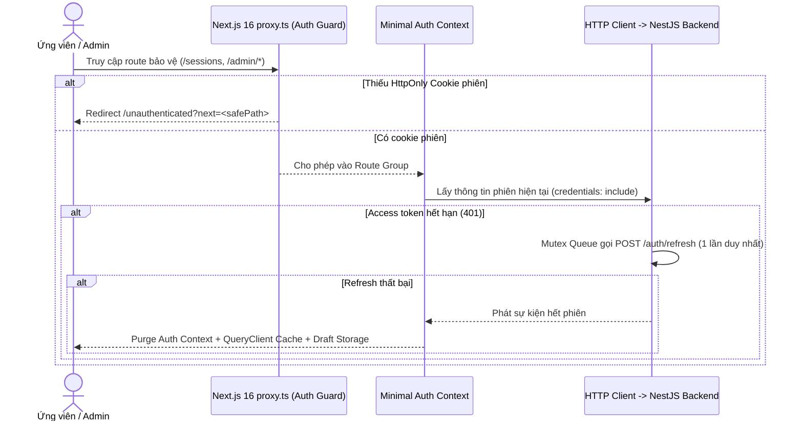

# Chuyên Đề 12: Bảo Mật Giao Diện & Quản Trị Phiên (`SEC-*`)

> **Dự án:** InterviewCoach Frontend (`client/`)  
> **Phiên bản:** 9.0 (InterviewCoach Next.js 16 + React 19 + Mantine v9 Standard)  
> **Cổng điều hướng:** [Master Hub](../README.md) | [Quick Reference](../QUICK_REFERENCE.md) | [Cẩm nang Mantine v9](../../mantine/README.md)  
> **Tài liệu liên quan:** [API Contracts & Resilience (`API-*`)](./api-contracts-and-resilience.md) | [State Management](../01-foundations/state-management.md) | [Observability & Telemetry (`OBS-*`)](../04-performance-and-ops/observability-and-telemetry.md) | [Release & DevOps (`OPS-*`)](../04-performance-and-ops/release-and-devops.md)  
> **Vai trò SSOT:** Nguồn chân lý duy nhất cho **11 mã quy chuẩn `SEC-001` đến `SEC-011`**, phân tách trung thực giữa cơ chế đã có và chuẩn mục tiêu `[Target Standard]` cần hoàn thiện khi migrate.  
> **Cơ sở tham chiếu quốc tế:**
>
> - [OWASP Top 10 & OWASP Cheat Sheet Series (XSS, CSRF, Session Management)](https://cheatsheetseries.owasp.org/)
> - [Next.js 16 — Authentication & Proxy (`proxy.ts`)](https://nextjs.org/docs/app/guides/authentication)
> - [Vercel React Best Practices (`server-auth-actions`)](../../../.agents/skills/vercel-react-best-practices/SKILL.md)

---

## MỤC LỤC

1. [Triết Lý Bảo Mật Defense-in-Depth & Luồng Xác Thực Chuẩn](#1-triết-lý-bảo-mật-defense-in-depth-luồng-xác-thực-chuẩn)
2. [Bộ 11 Quy Chuẩn SSOT `SEC-001` Đến `SEC-011` (OWASP)](#2-bộ-11-quy-chuẩn-ssot-sec-001-đến-sec-011-owasp)
3. [Case Study Tự Chứa: `server-auth-actions`, `getSafeNext`, Safe Link & Clean Session Purge](#3-case-study-tự-chứa-server-auth-actions-getsafenext-safe-link-clean-session-purge)
4. [Bảng Đối Chiếu Anti-Pattern vs Best Practice](#4-bảng-đối-chiếu-anti-pattern-vs-best-practice)
5. [Ánh Xạ Tooling CI & Checklist PR Review Gate (10 Tiêu Chí)](#5-ánh-xạ-tooling-ci-checklist-pr-review-gate-10-tiêu-chí)

---

## 1. Triết Lý Bảo Mật Defense-in-Depth & Luồng Xác Thực Chuẩn

Trình duyệt luôn là môi trường không tin cậy (**Untrusted Client**). **InterviewCoach** áp dụng nguyên tắc **Defense-in-Depth**: khóa phiên bằng **HttpOnly Cookies** ở biên `proxy.ts`, xoay vòng token qua Mutex Refresh Queue, lọc tham số điều hướng `?next=` chống Open Redirect, và luôn xác thực lại quyền hạn độc lập phía server (`server-auth-actions`) cho mọi mutation.



---

## 2. Bộ 11 Quy Chuẩn SSOT `SEC-001` Đến `SEC-011` (OWASP)

<a id="sec-001"></a>

### 2.1. `SEC-001` — Cấm Render HTML Thô Không Sanitize (`ERROR` · `[Target Standard — cài khi triển khai]`)

Tuyệt đối cấm dùng `dangerouslySetInnerHTML` với dữ liệu từ người dùng (JD, CV) hoặc phản hồi LLM/AI. Nếu có yêu cầu hiển thị HTML giàu định dạng, bắt buộc cài **`DOMPurify`** (`isomorphic-dompurify` tương thích SSR) và sanitize nghiêm ngặt trước khi render.

<a id="sec-002"></a>

### 2.2. `SEC-002` — Cấu Hình Content Security Policy (CSP) Chặt Chẽ (`ERROR` · `[Target Standard]`)

Bổ sung header `Content-Security-Policy` trong `headers()` của `client/next.config.ts` (khóa `default-src 'self'`, giới hạn `connect-src` chỉ tới domain API/SSE hợp lệ, đặt `frame-ancestors 'none'`, loại bỏ `'unsafe-eval'`).

<a id="sec-003"></a>

### 2.3. `SEC-003` — Quản Trị Token An Toàn Bằng HttpOnly Cookie (`ERROR` · `[Active]`)

- Sử dụng **HttpOnly Cookies** được thiết lập từ Backend và gửi tự động qua `credentials: 'include'`, kết hợp kiểm tra biên tại Next.js 16 `proxy.ts`.
- **Cấm tuyệt đối:** Lưu JWT Access Token, Refresh Token, hay mật khẩu trong `localStorage`, `sessionStorage`, hoặc biến toàn cục `window`.

<a id="sec-004"></a>

### 2.4. `SEC-004` — Che Giấu Dữ Liệu Định Danh Cá Nhân PII (`ERROR` · `[Target Standard]`)

Dữ liệu cá nhân nhạy cảm (email, số điện thoại, nội dung CV, bản ghi âm/transcript phỏng vấn) không bao giờ được ghi vào `console.*`, đưa lên URL query string, hay gửi thô vào hệ thống telemetry. Khi triển khai logging/Sentry, đi qua bộ lọc PII tập trung (`[Target Standard]`).

<a id="sec-005"></a>

### 2.5. `SEC-005` — Phòng Chống Tấn Công Clickjacking (`ERROR` · `[Target Standard]`)

Áp dụng đồng thời `X-Frame-Options: DENY` và chỉ thị CSP `frame-ancestors 'none'` trong `next.config.ts` để ngăn nhúng trang đăng nhập/phỏng vấn vào `<iframe>` trái phép.

<a id="sec-006"></a>

### 2.6. `SEC-006` — Phòng Chống DOM Clobbering & Prototype Pollution (`WARN` · `[Active]`)

Không gộp trực tiếp object chưa kiểm định từ JSON/URL vào cấu hình ứng dụng; dùng `Map` hoặc `Object.hasOwn()` thay vì tra cứu động trên prototype, và xác thực mọi dữ liệu đầu vào bằng **Zod v4**.

<a id="sec-007"></a>

### 2.7. `SEC-007` — Bảo Mật Liên Kết Ngoài & Chống Open Redirect (`ERROR` · `[Active]`)

- **Liên kết mở tab mới:** 100% đường dẫn ngoài dùng Mantine `<Anchor href="..." target="_blank" rel="noopener noreferrer">` chống Reverse Tabnabbing.
- **Chống Open Redirect:** Mọi giá trị điều hướng `?next=` bắt buộc kiểm tra qua hàm `getSafeNext()` — chỉ chấp nhận đường dẫn nội bộ bắt đầu bằng một dấu `/` đơn, từ chối `https://`, `//evil.com`, và `javascript:`.

<a id="sec-008"></a>

### 2.8. `SEC-008` — Mutex Refresh Queue Chống Race Condition (`ERROR` · `[Active]`)

Khi nhiều request song song đồng thời nhận HTTP `401`, tầng HTTP client khóa hàng đợi bằng một Promise refresh duy nhất để chỉ gọi `POST /auth/refresh` **1 lần**, sau đó giải phóng các request đang chờ (và loại trừ các endpoint `/auth/*` để tránh vòng lặp vô hạn).

<a id="sec-009"></a>

### 2.9. `SEC-009` — Kiểm Soát CORS & Security Headers (`ERROR` · `[Target Standard]`)

Bật `credentials: 'include'` khớp whitelist origin phía Backend (cấm `Access-Control-Allow-Origin: *` đi kèm credentials); bổ sung `Strict-Transport-Security` (HSTS), `X-Content-Type-Options: nosniff`, `Referrer-Policy: strict-origin-when-cross-origin` trong `next.config.ts`.

<a id="sec-010"></a>

### 2.10. `SEC-010` — Quy Trình Hủy Phiên Sạch Sẽ (Session Purge) (`ERROR` · `[Target Standard]`)

Khi người dùng đăng xuất hoặc phiên hết hạn (`auth:session-expired`), quy trình chuẩn bắt buộc thực hiện đủ 4 bước đồng bộ: (1) gọi API hủy HttpOnly cookie phía server, (2) reset Auth Context về `null`, (3) xóa sạch toàn bộ cache TanStack Query nhạy cảm (`queryClient.clear()`), và (4) xóa mọi nháp trong `sessionStorage`.

<a id="sec-011"></a>

### 2.11. `SEC-011` — Xác Thực Quyền Hạn Phía Server Cho Mọi Mutation (`ERROR` · `[Active]`)

Áp dụng trực tiếp quy tắc `server-auth-actions` trong `vercel-react-best-practices`: `proxy.ts`, Layout Guard, hay ẩn nút trên UI chỉ cải thiện trải nghiệm người dùng — **100% Server Actions và Backend API endpoints** bắt buộc xác thực phiên (`authentication`) và phân quyền (`authorization`) độc lập trước khi ghi dữ liệu.

---

## 3. Case Study Tự Chứa: `server-auth-actions`, `getSafeNext`, Safe Link & Clean Session Purge

### Mẫu 1: Validate Input + Authenticate + Authorize Trong Server Action (`server-auth-actions`)

```ts
// Incorrect: Server Action không kiểm tra phiên và quyền hạn
async function deleteSessionBad(
  sessionId: string,
  removeFromDb: (id: string) => Promise<void>
) {
  await removeFromDb(sessionId)
}

// Correct: Validate Zod -> Xác thực phiên -> Kiểm tra quyền sở hữu/RBAC
import { z } from 'zod'

const deleteSessionInputSchema = z.object({
  sessionId: z.string().uuid(),
})

interface VerifiedActor {
  userId: string
  role: 'candidate' | 'admin'
}

export async function authorizeAndDeleteSession(
  rawInput: unknown,
  deps: {
    verifyActor: () => Promise<VerifiedActor | null>
    getSessionOwnerId: (sessionId: string) => Promise<string | null>
    deleteSession: (sessionId: string) => Promise<void>
  }
): Promise<{ deleted: true }> {
  const { sessionId } = deleteSessionInputSchema.parse(rawInput)
  const actor = await deps.verifyActor()
  if (!actor) {
    throw new Error('UNAUTHENTICATED')
  }

  const ownerId = await deps.getSessionOwnerId(sessionId)
  if (!ownerId || (actor.role !== 'admin' && actor.userId !== ownerId)) {
    throw new Error('FORBIDDEN')
  }

  await deps.deleteSession(sessionId)
  return { deleted: true }
}
```

### Mẫu 2: `getSafeNext()`, Safe External `<Anchor>` & Clean Session Purge

```tsx
// Correct: Chống Open Redirect + Liên kết ngoài an toàn Mantine v9 (Zero-Hex)
import { Anchor, Group, Text } from '@mantine/core'
import { IconExternalLink } from '@tabler/icons-react'

export function getSafeNext(
  rawNext: string | null | undefined,
  fallback = '/sessions'
): string {
  if (!rawNext) return fallback
  const trimmed = rawNext.trim()
  if (
    !trimmed.startsWith('/') ||
    trimmed.startsWith('//') ||
    trimmed.includes('\\')
  ) {
    return fallback
  }
  return trimmed
}

export function ReferenceDocLink({
  href,
  label,
}: {
  href: string
  label: string
}) {
  return (
    <Anchor
      href={href}
      target="_blank"
      rel="noopener noreferrer"
      size="sm"
      c="brand"
    >
      <Group gap={4} component="span" display="inline-flex" align="center">
        <Text span>{label}</Text>
        <IconExternalLink size={14} stroke={1.5} aria-hidden="true" />
      </Group>
    </Anchor>
  )
}
```

```ts
// Correct: Hủy phiên đăng xuất sạch sẽ (Server Cookie + Auth State + QueryClient Cache + Draft)
import type { QueryClient } from '@tanstack/react-query'

const SETUP_DRAFT_KEY = 'interviewcoach:setup-wizard-draft:v1'

export async function performCleanLogout(
  queryClient: QueryClient,
  revokeServerSession: () => Promise<void>,
  resetAuthState: () => void
): Promise<void> {
  try {
    await revokeServerSession()
  } finally {
    resetAuthState()
    queryClient.clear()
    if (typeof window !== 'undefined') {
      window.sessionStorage.removeItem(SETUP_DRAFT_KEY)
    }
  }
}
```

---

## 4. Bảng Đối Chiếu Anti-Pattern vs Best Practice

| Tình huống                          | Anti-Pattern (Tránh)                                                   | Best Practice (Chuẩn mực)                                                                      |
| :---------------------------------- | :--------------------------------------------------------------------- | :--------------------------------------------------------------------------------------------- |
| Lưu trữ JWT Access / Refresh Token  | Lưu trong `localStorage.setItem('token', jwt)` dễ bị XSS đánh cắp      | Dùng HttpOnly Secure SameSite Cookies + `credentials: 'include'` (`SEC-003`)                   |
| Chuyển hướng sau đăng nhập `?next=` | `router.push(searchParams.get('next') ?? '/')` không kiểm tra          | Lọc qua `getSafeNext()` chặn `https://`, `//evil.com`, `javascript:` (`SEC-007`)               |
| Đăng xuất người dùng                | Chỉ set `user = null` mà bỏ quên cache `QueryClient` của người dùng cũ | Xóa đồng thời cookie server, Auth state, `queryClient.clear()` và `sessionStorage` (`SEC-010`) |
| Bảo vệ thao tác quản trị / xóa      | Chỉ ẩn nút trên UI hoặc chỉ dựa vào layout guard                       | Xác thực phiên & phân quyền RBAC ngay trong Server Action / Backend endpoint (`SEC-011`)       |
| Mở tài liệu tham khảo ở tab mới     | `<Anchor href={url} target="_blank">` thiếu `rel`                      | Luôn gắn `rel="noopener noreferrer"` (`SEC-007`)                                               |

---

## 5. Ánh Xạ Tooling CI & Checklist PR Review Gate (10 Tiêu Chí)

### Ánh xạ Tooling CI (`client/`)

| Hạng mục                                                 | Công cụ                                 | Lệnh thực thi                                |
| :------------------------------------------------------- | :-------------------------------------- | :------------------------------------------- |
| Kiểm tra lỗ hổng bảo mật dependency                      | npm Audit                               | `npm audit --audit-level=high`               |
| Kiểm thử đơn vị `getSafeNext`, auth guards, logout purge | Vitest 4 (`--project unit`)             | `npm run test:unit`                          |
| Kiểm tra liên kết, JSX & quy chuẩn Mantine v9            | ESLint 9 + `scripts/check-ui-rules.mjs` | `npm run lint && npm run ui:lint -- <files>` |

### Checklist PR Review Gate (10 Tiêu Chí)

- [ ] **1. Zero Raw HTML Injection:** Không dùng `dangerouslySetInnerHTML` chưa qua `DOMPurify` (`SEC-001`).
- [ ] **2. Zero Storage Tokens:** Không lưu access/refresh token hay mật khẩu trong `localStorage`/`sessionStorage` (`SEC-003`).
- [ ] **3. Safe Redirects:** Mọi chuyển hướng từ `?next=` đều lọc qua `getSafeNext()` (`SEC-007`).
- [ ] **4. Safe External Links:** 100% `<Anchor target="_blank">` có `rel="noopener noreferrer"` (`SEC-007`).
- [ ] **5. PII Protection:** Không đưa email, SĐT, CV hay transcript vào URL query string hoặc `console.*` (`SEC-004`).
- [ ] **6. Mutex Refresh Intact:** Không tự gọi `/auth/refresh` rời rạc ngoài hàng đợi Mutex của tầng HTTP client (`SEC-008`).
- [ ] **7. Clean Logout Purge:** Đăng xuất xóa đồng thời server cookie, Auth state, `queryClient.clear()` và nháp `sessionStorage` (`SEC-010`).
- [ ] **8. Server-Side RBAC:** Không chỉ dựa vào ẩn nút phía client để bảo vệ hành động nhạy cảm (`SEC-011`).
- [ ] **9. Input Validation:** Mọi payload/query bên ngoài được xác thực qua Zod v4 (`SEC-006`).
- [ ] **10. Audit Clean:** `npm run lint`, `npm run typecheck`, và `npm run test:unit` pass 100%.
