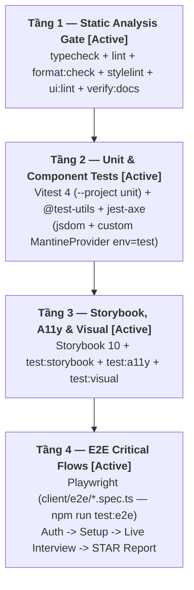

# Chuyên Đề 10: Chiến Lược Kiểm Thử 4 Tầng & Đảm Bảo Chất Lượng (Testing & QA)

> **Dự án:** InterviewCoach Frontend (`client/`)  
> **Phiên bản:** 9.0 (InterviewCoach Next.js 16 + React 19 + Mantine v9 Standard)  
> **Cổng điều hướng:** [Master Hub](../README.md) | [Quick Reference](../QUICK_REFERENCE.md) | [Cẩm nang Mantine v9](../../mantine/README.md)  
> **Tài liệu liên quan:** [Testing & Toolchain (`docs/mantine/03`)](../../mantine/03-testing-and-tooling.md) | [Accessibility (`A11Y-*`)](../02-ui-and-design-system/accessibility.md) | [API Contracts & Resilience (`API-*`)](./api-contracts-and-resilience.md) | [Coding Standards (`STD-*`)](../01-foundations/coding-standards.md)  
> **Trạng thái thực thi:** Vitest 4 (`unit` vs `storybook`), `@test-utils`, `jest-axe`, Storybook 10 (`@storybook/nextjs-vite`), và Playwright đã cấu hình `[Active in Codebase]`; MSW v2 và coverage thresholds cứng là `[Target Standard]`.  
> **Cơ sở tham chiếu quốc tế:**
>
> - [Mantine v9 — Testing with Vitest](https://mantine.dev/guides/vitest/)
> - [Testing Library — Guiding Principles & Query Priority](https://testing-library.com/docs/queries/about#priority)
> - [Vitest 4 Documentation — Projects & Browser Mode](https://vitest.dev/guide/projects)
> - [Playwright Documentation — Best Practices](https://playwright.dev/docs/best-practices)

---

## MỤC LỤC

1. [Triết Lý Kiểm Thử Doanh Nghiệp & Kim Tự Tháp 4 Tầng](#1-triết-lý-kiểm-thử-doanh-nghiệp-kim-tự-tháp-4-tầng)
2. [Cấu Hình Vitest 4, `@test-utils` & Kiểm Thử Portal Mantine v9](#2-cấu-hình-vitest-4-test-utils-kiểm-thử-portal-mantine-v9)
3. [Thứ Tự Ưu Tiên Accessible Queries, Async Assertions & Mocking Boundaries](#3-thứ-tự-ưu-tiên-accessible-queries-async-assertions-mocking-boundaries)
4. [Case Study Chuẩn `mantine.dev/guides/vitest/`: Portal Modal, Form Validation & `jest-axe`](#4-case-study-chuẩn-mantinedevguidesvitest-portal-modal-form-validation-jest-axe)
5. [Định Hướng Coverage, Storybook Visual / A11y & E2E Playwright](#5-định-hướng-coverage-storybook-visual-a11y-e2e-playwright)
6. [Bảng Đối Chiếu Anti-Pattern vs Best Practice](#6-bảng-đối-chiếu-anti-pattern-vs-best-practice)
7. [Ánh Xạ Tooling CI & PR Definition of Done (12 Tiêu Chí)](#7-ánh-xạ-tooling-ci-pr-definition-of-done-12-tiêu-chí)

---

## 1. Triết Lý Kiểm Thử Doanh Nghiệp & Kim Tự Tháp 4 Tầng

Nguyên tắc cốt lõi của kiểm thử tại **InterviewCoach** là **User-Centric Testing (kiểm thử hành vi người dùng thực)** thay vì kiểm thử chi tiết triển khai nội bộ (tên class CSS, tên biến state). Bộ test độc lập với triển khai giúp tự tin migrate màn hình sang Mantine v9 mà không đánh mất hành vi nghiệp vụ.



---

## 2. Cấu Hình Vitest 4, `@test-utils` & Kiểm Thử Portal Mantine v9

> Xem cấu hình tệp chi tiết và bảng lệnh CLI đầy đủ tại [Testing & Toolchain (`docs/mantine/03`)](../../mantine/03-testing-and-tooling.md).

### 2.1. Tách biệt 2 Project trong `client/vitest.config.mts` (`[Active in Codebase]`)

- **Project `unit` (`npm run test:unit`):** Chạy trên `jsdom` kèm `vitest.setup.ts` (`jest-axe`, `matchMedia`, `ResizeObserver`, `PointerEvent`, `scrollIntoView`), kiểm thử unit/component nhanh ở mức giây.
- **Project `storybook` (`npm run test:storybook`):** Chạy trình duyệt Playwright Chromium qua `@storybook/addon-vitest` cho interaction tests trực quan.

### 2.2. 3 Quy tắc bắt buộc khi test component Mantine v9 (`mantine.dev/guides/vitest/`)

1. **Luôn import `{ render, screen, userEvent }` từ `@test-utils`:** Không import `render` trực tiếp từ `@testing-library/react`. Wrapper `test-utils/render.tsx` tự bọc `<MantineProvider theme={theme} env="test"><ModalsProvider>` (`env="test"` tắt transition giúp test nhanh và không flaky).
2. **Kiểm thử Portal (`Modal`, `Drawer`, `Select`, `Menu`, `Popover`):** Vì Mantine render lớp phủ trực tiếp vào `document.body`, luôn truy vấn qua `screen.getByRole(...)` / `screen.findByText(...)` hoặc `within(document.body)` thay vì giới hạn trong `container`.
3. **Môi trường Node test:** Với file test thuần logic Node không cần DOM, khai báo `// @vitest-environment node` ở đầu tệp (`vitest.setup.ts` đã bảo vệ polyfill bằng `if (typeof window !== 'undefined')`).

---

## 3. Thứ Tự Ưu Tiên Accessible Queries, Async Assertions & Mocking Boundaries

### 3.1. Thứ tự ưu tiên Query (W3C APG & Testing Library)

1. `getByRole('button', { name: /bắt đầu phỏng vấn/i })` — **Ưu tiên số 1**, xác minh đồng thời vai trò ngữ nghĩa và nhãn A11y.
2. `getByLabelText(/vị trí ứng tuyển/i)` — Chuẩn cho mọi Mantine Input (`TextInput`, `Select`, `Textarea`).
3. `getByPlaceholderText(...)` / `getByText(...)` — Cho văn bản hiển thị hoặc thông báo lỗi validation.
4. `getByTestId(...)` — **Phương án cuối cùng** khi phần tử không có vai trò ngữ nghĩa hay nhãn rõ ràng.

- **Cấm tuyệt đối:** `container.querySelector('.mantine-Button-root')` hoặc truy vấn theo tên class CSS Module.

### 3.2. Async Assertions & Pattern AAA

- Khởi tạo `const user = userEvent.setup()` ở đầu test case thay cho `fireEvent`.
- Chờ DOM bất đồng bộ bằng `await screen.findBy*` hoặc `await waitFor(...)` — **cấm** `new Promise((r) => setTimeout(r, 500))` gây flaky CI.
- Tuân thủ 3 bước rõ ràng: **Arrange** (chuẩn bị props/stub) → **Act** (`user.type` / `user.click`) → **Assert** (`expect(...)` + `axe(container)`).

### 3.3. Chiến lược Mocking Boundaries (`[Active]` vs `[Target]`)

- **Hiện tại (`[Active]`):** Mock tại đúng **ranh giới dependency/mạng** thông qua injection prop callback (`vi.fn()`), `vi.spyOn(globalThis, 'fetch')` cho tầng HTTP client. **Tuyệt đối không mock** component nội bộ của `@mantine/core` hay `@mantine/form`.
- **Lộ trình (`[Target Standard]`):** Áp dụng **Mock Service Worker (`msw` v2)** chặn ở tầng mạng cho integration tests nhiều endpoint song song (xem [`API-010`](./api-contracts-and-resilience.md#api-010)).

---

## 4. Case Study Chuẩn `mantine.dev/guides/vitest/`: Portal Modal, Form Validation & `jest-axe`

### Mẫu 1: Kiểm thử Modal Portal + Focus & `jest-axe` (AAA Pattern)

```tsx
// Incorrect: Import render trực tiếp từ RTL và query bằng class nội bộ Mantine
import { render } from '@testing-library/react'
function badQuery(container: HTMLElement) {
  return container.querySelector('.mantine-Modal-content')
}

// Correct: Dùng @test-utils, Accessible Queries (screen/within) và jest-axe
import { describe, expect, it, vi } from 'vitest'
import { within } from '@testing-library/react'
import { axe } from 'jest-axe'
import { Button, Modal, Stack, Text } from '@mantine/core'
import { useDisclosure } from '@mantine/hooks'
import { render, screen, userEvent } from '@test-utils'

function EndInterviewAction({ onConfirm }: { onConfirm: () => void }) {
  const [opened, { open, close }] = useDisclosure(false)

  return (
    <>
      <Button color="danger" variant="light" onClick={open}>
        Kết thúc phiên
      </Button>
      <Modal opened={opened} onClose={close} title="Xác nhận kết thúc">
        <Stack gap="md">
          <Text size="sm" c="dimmed">
            Bạn có chắc muốn nộp toàn bộ câu trả lời để tạo báo cáo STAR?
          </Text>
          <Button
            color="danger"
            onClick={() => {
              onConfirm()
              close()
            }}
          >
            Xác nhận nộp bài
          </Button>
        </Stack>
      </Modal>
    </>
  )
}

describe('EndInterviewAction', () => {
  it('opens confirmation modal in Portal, triggers callback, and passes axe', async () => {
    const user = userEvent.setup()
    const handleConfirm = vi.fn()

    const { container } = render(
      <EndInterviewAction onConfirm={handleConfirm} />
    )

    await user.click(screen.getByRole('button', { name: /kết thúc phiên/i }))

    const dialog = await screen.findByRole('dialog')
    const confirmBtn = within(dialog).getByRole('button', {
      name: /xác nhận nộp bài/i,
    })

    expect(dialog).toBeInTheDocument()
    expect(await axe(container)).toHaveNoViolations()

    await user.click(confirmBtn)
    expect(handleConfirm).toHaveBeenCalledTimes(1)
  })
})
```

### Mẫu 2: Kiểm thử `@mantine/form` + Zod v4 Validation (Error & Happy Path)

```tsx
// Correct: Kiểm thử đủ 2 nhánh lỗi validation và submit hợp lệ với @test-utils
import { describe, expect, it, vi } from 'vitest'
import { Box, Button, Stack, TextInput } from '@mantine/core'
import { schemaResolver, useForm } from '@mantine/form'
import { z } from 'zod'
import { render, screen, userEvent } from '@test-utils'

const roleSchema = z.object({
  roleTitle: z.string().trim().min(3, 'Vị trí ứng tuyển tối thiểu 3 ký tự'),
})

function QuickRoleForm({
  onSubmit,
}: {
  onSubmit: (values: z.infer<typeof roleSchema>) => void
}) {
  const form = useForm({
    mode: 'uncontrolled',
    initialValues: { roleTitle: '' },
    validate: schemaResolver(roleSchema, { sync: true }),
  })

  return (
    <Box component="form" onSubmit={form.onSubmit(onSubmit)} noValidate>
      <Stack gap="sm">
        <TextInput
          label="Vị trí ứng tuyển"
          key={form.key('roleTitle')}
          {...form.getInputProps('roleTitle')}
        />
        <Button type="submit" color="brand">
          Tiếp tục
        </Button>
      </Stack>
    </Box>
  )
}

describe('QuickRoleForm', () => {
  it('blocks invalid submit then submits trimmed values when valid', async () => {
    const user = userEvent.setup()
    const handleSubmit = vi.fn()

    render(<QuickRoleForm onSubmit={handleSubmit} />)

    await user.click(screen.getByRole('button', { name: /tiếp tục/i }))
    expect(
      await screen.findByText(/vị trí ứng tuyển tối thiểu 3 ký tự/i)
    ).toBeInTheDocument()
    expect(handleSubmit).not.toHaveBeenCalled()

    await user.type(
      screen.getByLabelText(/vị trí ứng tuyển/i),
      'Frontend Engineer'
    )
    await user.click(screen.getByRole('button', { name: /tiếp tục/i }))

    expect(handleSubmit).toHaveBeenCalledWith(
      { roleTitle: 'Frontend Engineer' },
      expect.anything()
    )
  })
})
```

---

## 5. Định Hướng Coverage, Storybook Visual / A11y & E2E Playwright

### 5.1. Ngưỡng Coverage Mục Tiêu (`[Target Standard]`)

Package `@vitest/coverage-v8` đã cài sẵn trong `client/package.json`. Mục tiêu tập trung vào hành vi quan trọng thay vì chạy theo số dòng hình thức:

- **Tầng utilities & domain services (`lib/`, `services/`):** ≥ **80%** lines/branches (xử lý lỗi, parse Zod, chuyển đổi ngày giờ, HTTP client).
- **Tầng custom hooks (`hooks/`):** ≥ **75%** (TanStack Query hooks, SSE stream, countdown, URL state).
- **Tầng UI components & routes:** Phủ 100% **trạng thái cốt lõi (loading, error/validation, happy path) + 0 vi phạm `jest-axe`**.

### 5.2. Storybook Visual, A11y & Playwright E2E (`[Active in Codebase]`)

- **Storybook A11y:** `npm run test:a11y` kiểm tra `@storybook/addon-a11y`; mọi story Mantine v9 mới bật `parameters: { a11y: { test: 'error' } }`.
- **Visual Regression:** `npm run test:visual` (`playwright.visual.config.ts`) bảo vệ giao diện không vỡ khi migrate sang Mantine v9.
- **Playwright E2E:** `npm run test:e2e` (`client/e2e/*.spec.ts`) kiểm chứng hành trình end-to-end (Auth, Setup Wizard, Live Interview, STAR Report, Admin).

---

## 6. Bảng Đối Chiếu Anti-Pattern vs Best Practice

| Tình huống                           | Anti-Pattern (Tránh)                                                      | Best Practice (Chuẩn mực)                                                     |
| :----------------------------------- | :------------------------------------------------------------------------ | :---------------------------------------------------------------------------- |
| Render component Mantine trong test  | `import { render } from '@testing-library/react'` thiếu `MantineProvider` | Luôn import `{ render, screen, userEvent }` từ `@test-utils` (`env="test"`)   |
| Truy vấn nội dung `Modal` / `Select` | `container.querySelector('.mantine-Modal-body')` (không thấy Portal)      | Dùng `screen.findByRole('dialog')` và `within(dialog).getByRole(...)`         |
| Chờ kết quả bất đồng bộ              | `await new Promise((r) => setTimeout(r, 300))` gây flaky CI               | Dùng `await screen.findBy*` hoặc `await waitFor(...)`                         |
| Mô phỏng thao tác gõ/nhấn            | Dùng `fireEvent.change` bỏ qua sự kiện focus/keyboard thực                | Khởi tạo `const user = userEvent.setup()` và `await user.type` / `user.click` |
| Mock component UI                    | `vi.mock('@mantine/core')` làm vô hiệu hóa test A11y & tương tác thật     | Chỉ mock tại ranh giới service/HTTP (`vi.fn()`, `fetch`, MSW v2)              |

---

## 7. Ánh Xạ Tooling CI & PR Definition of Done (12 Tiêu Chí)

### Bảng lệnh kiểm thử (`client/`)

| Tầng kiểm thử           | Lệnh chạy                                                                                                                  |
| :---------------------- | :------------------------------------------------------------------------------------------------------------------------- |
| Static Analysis Gate    | `npm run typecheck && npm run lint && npm run format:check && npm run stylelint && npm run ui:lint && npm run verify:docs` |
| Unit & Component Tests  | `npm run test:unit`                                                                                                        |
| Storybook Tests & Build | `npm run test:storybook && npm run test:a11y && npm run build-storybook`                                                   |
| Visual & E2E Tests      | `npm run test:visual && npm run test:e2e`                                                                                  |

### Definition of Done (12 Tiêu Chí Nghiệm Thu PR)

- [ ] **1. Type Safety:** `npm run typecheck` đạt 0 lỗi, không `any` (`STD-TS-001`).
- [ ] **2. Lint & Format:** `npm run lint` và `npm run format:check` đạt 0 lỗi.
- [ ] **3. UI & CSS Gate:** `npm run stylelint` và `npm run ui:lint -- <files>` đạt 0 vi phạm Zero-Hex / Mantine-First.
- [ ] **4. `@test-utils` Wrapper:** 100% component test mới import từ `@test-utils`, không import `render` trực tiếp từ RTL.
- [ ] **5. Accessible Queries:** Không query DOM bằng class CSS; ưu tiên `getByRole` và `getByLabelText`.
- [ ] **6. Zero Flaky Waits:** Không dùng `setTimeout` cố định; dùng `findBy*` / `waitFor`.
- [ ] **7. Clean Mocking:** Mock tại ranh giới service hoặc `fetch`, không mock nội bộ `@mantine/core`.
- [ ] **8. A11y Automated:** Component/form mới có assertion `expect(await axe(container)).toHaveNoViolations()`.
- [ ] **9. Edge Cases Covered:** Kiểm thử đủ 3 trạng thái: loading, error/validation, và happy path.
- [ ] **10. Unit Regression Zero:** `npm run test:unit` pass 100%.
- [ ] **11. Build Integrity:** `npm run build` (và `npm run build-storybook` khi sửa stories) pass 100%.
- [ ] **12. Docs Sync:** `npm run verify:docs` pass 0 lỗi khi thay đổi tài liệu.
