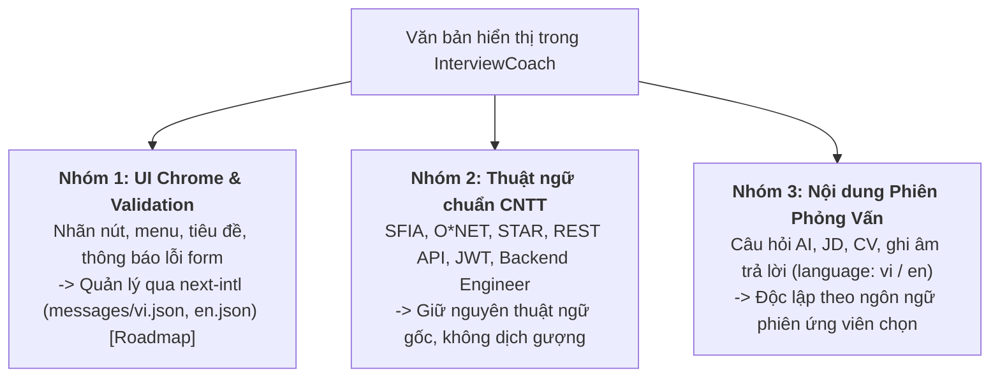

# Chuyên Đề 15: Quốc Tế Hóa & Bản Địa Hóa (`I18N-*`)

> **Dự án:** InterviewCoach Frontend (`client/`)  
> **Phiên bản:** 9.0 (InterviewCoach Next.js 16 + React 19 + Mantine v9 Standard)  
> **Cổng điều hướng:** [Master Hub](../README.md) | [Quick Reference](../QUICK_REFERENCE.md) | [Cẩm nang Mantine v9](../../mantine/README.md)  
> **Tài liệu liên quan:** [Coding Standards (`STD-TIME-*`)](../01-foundations/coding-standards.md) | [Design System & Styling (`SEM-*`)](../02-ui-and-design-system/design-system-and-styling.md) | [Performance (`PERF-*`)](./performance-and-web-vitals.md)  
> **Vai trò SSOT:** Nguồn chân lý duy nhất cho **9 mã quy chuẩn `I18N-001` đến `I18N-009`**.  
> **Trạng thái thực thi (theo D12):** Hiện ứng dụng vận hành đơn ngôn ngữ **`lang="vi"` (`[Active]`)** với hoisted `Intl.*` và CSS Logical Properties. Thư viện mục tiêu cho đa ngôn ngữ trên Next.js App Router là **`next-intl` (`[Target Standard — Roadmap]`, thay thế thư viện cũ)**; quy tắc **`I18N-001` đặt ở mức `ROADMAP` / `WARN`** cho tới khi tích hợp `next-intl`.  
> **Cơ sở tham chiếu quốc tế:**
>
> - [`next-intl` Official Documentation (Next.js App Router)](https://next-intl.dev/)
> - [MDN Web Docs — `Intl.DateTimeFormat`, `Intl.NumberFormat` & CSS Logical Properties](https://developer.mozilla.org/en-US/docs/Web/JavaScript/Reference/Global_Objects/Intl)
> - [Mantine v9 — Right-to-Left (RTL) & `DirectionProvider`](https://mantine.dev/guides/rtl/)

---

## MỤC LỤC

1. [Triết Lý Bản Địa Hóa & Phân Loại 3 Nhóm Văn Bản](#1-triết-lý-bản-địa-hóa-phân-loại-3-nhóm-văn-bản)
2. [Bộ 9 Quy Chuẩn SSOT `I18N-001` Đến `I18N-009`](#2-bộ-9-quy-chuẩn-ssot-i18n-001-đến-i18n-009)
3. [Case Study Tự Chứa: Hoisted `Intl.*`, Mantine `DirectionProvider` & CSS Logical Properties](#3-case-study-tự-chứa-hoisted-intl-mantine-directionprovider-css-logical-properties)
4. [Bảng Đối Chiếu Anti-Pattern vs Best Practice](#4-bảng-đối-chiếu-anti-pattern-vs-best-practice)
5. [Ánh Xạ Tooling CI & Checklist PR Review Gate (8 Tiêu Chí)](#5-ánh-xạ-tooling-ci-checklist-pr-review-gate-8-tiêu-chí)

---

## 1. Triết Lý Bản Địa Hóa & Phân Loại 3 Nhóm Văn Bản

Lộ trình đa ngôn ngữ của **InterviewCoach** hướng tới **2 locale chính: `vi` (mặc định) và `en`** bằng **`next-intl`** (hỗ trợ trực tiếp Next.js 16 Server Components). Vì sản phẩm phục vụ sinh viên và kỹ sư CNTT, văn bản hiển thị được phân tách thành **3 nhóm rành mạch** để tránh dịch gượng thuật ngữ kỹ thuật:



---

## 2. Bộ 9 Quy Chuẩn SSOT `I18N-001` Đến `I18N-009`

<a id="i18n-001"></a>

### 2.1. `I18N-001` — Zero Hardcoded UI Strings (`WARN` / `ROADMAP` · `[Target Standard — cài next-intl]`)

- **Hiện tại (`[Active]`):** Ứng dụng chạy đơn ngôn ngữ `lang="vi"` nên văn bản tiếng Việt trong JSX chưa bị chặn trên CI; tuy nhiên cần giữ chuỗi ngắn gọn, nhất quán và gom thông báo lỗi mã nghiệp vụ vào bảng ánh xạ tập trung.
- **Roadmap (`[Target Standard]`):** Sau khi cài `next-intl`, 100% văn bản Nhóm 1 (UI Chrome, validation, toast) đi qua `getTranslations()` (Server Component) hoặc `useTranslations()` (Client Component).

<a id="i18n-002"></a>

### 2.2. `I18N-002` — Cấu Trúc Khóa Dịch Phân Cấp 4 Tầng (`WARN` · `[Target Standard]`)

Tổ chức tệp từ điển `messages/vi.json` và `messages/en.json` theo 4 tầng rõ nghĩa `[feature].[screen].[section].[element]` (ví dụ `setup.wizard.step1.roleTitleLabel`, `sessions.report.rubric.passedBadge`), tránh khóa phẳng gây trùng tên.

<a id="i18n-003"></a>

### 2.3. `I18N-003` — Bản Địa Hóa Số & Tiền Tệ Qua `Intl.NumberFormat` (`ERROR` · `[Active]`)

Mọi con số thống kê (điểm phần trăm, số lượt phỏng vấn, đơn giá) bắt buộc định dạng qua `Intl.NumberFormat` với mã tiền tệ ISO 4217 chuẩn (`VND`, `USD`), không nối ký tự `"đ"` hay phân cách hàng nghìn bằng regex thủ công.

<a id="i18n-004"></a>

### 2.4. `I18N-004` — Bản Địa Hóa Ngày Giờ Tường Minh Timezone (`ERROR` · `[Active]`)

Mọi mốc thời gian ISO-8601 UTC từ Backend hiển thị ra giao diện qua `Intl.DateTimeFormat` có khai báo tường minh `timeZone: 'Asia/Ho_Chi_Minh'`, đảm bảo chuỗi ngày giờ đồng nhất 100% giữa Server Component và Client Component (không lệch hydration).

<a id="i18n-005"></a>

### 2.5. `I18N-005` — Bố Cục Đa Hướng RTL Bằng CSS Logical Properties (`WARN` · `[Active]`)

Trong `*.module.css`, ưu tiên CSS Logical Properties (`padding-inline`, `margin-inline-start`, `inset-inline-end`, `text-align: start`) thay cho `padding-left`/`margin-right`, và sử dụng Mantine `<DirectionProvider>` (`https://mantine.dev/guides/rtl/`) cùng style props logic (`ps`, `pe`, `ms`, `me`) để sẵn sàng đảo hướng RTL.

<a id="i18n-006"></a>

### 2.6. `I18N-006` — Nạp Động Từ Điển Theo Route/Namespace (`WARN` · `[Target Standard]`)

Khi tích hợp `next-intl`, chỉ truyền đúng namespace cần thiết cho từng Route Group từ Server Component xuống `NextIntlClientProvider` để giữ client bundle gọn nhẹ (`PERF-002`).

<a id="i18n-007"></a>

### 2.7. `I18N-007` — Số Nhiều & Nội Suy Biến Chuẩn ICU (`WARN` · `[Target Standard]`)

Xử lý số nhiều bằng cú pháp ICU MessageFormat (`{count, plural, =0 {Chưa có phiên nào} one {# phiên} other {# phiên}}`) và nội suy biến có tên (`{roleTitle}`) thay vì nối chuỗi bằng dấu `+`.

<a id="i18n-008"></a>

### 2.8. `I18N-008` — Type-Safe Message Keys & Fallback (`WARN` · `[Target Standard]`)

Bật TypeScript module augmentation của `next-intl` từ `messages/vi.json` để IDE autocomplete khóa dịch và bắt lỗi sai khóa ngay tại compile-time; đặt fallback locale mặc định về `vi`.

<a id="i18n-009"></a>

### 2.9. `I18N-009` — Hoisting Instance `Intl.*` Khỏi Vòng Lặp Render (`ERROR` · `[Active]`)

Khởi tạo `new Intl.DateTimeFormat(...)` và `new Intl.NumberFormat(...)` **một lần duy nhất ở module scope**, tuyệt đối không gọi `new Intl.*` bên trong thân component render hoặc vòng lặp `.map()`.

---

## 3. Case Study Tự Chứa: Hoisted `Intl.*`, Mantine `DirectionProvider` & CSS Logical Properties

```tsx
// Incorrect: Khởi tạo Intl.NumberFormat và Intl.DateTimeFormat ngay trong render
function BadScoreCard({ ratio, iso }: { ratio: number; iso: string }) {
  const pct = new Intl.NumberFormat('vi-VN', { style: 'percent' }).format(ratio)
  const dt = new Intl.DateTimeFormat('vi-VN').format(new Date(iso))
  return (
    <Text>
      {pct} - {dt}
    </Text>
  )
}

// Correct: Hoisted Intl.* ở module scope + timeZone tường minh + Mantine v9 Zero-Hex
import { Badge, Group, Paper, Stack, Text } from '@mantine/core'
import classes from './LocalizedMetricCard.module.css'

const SCORE_PERCENT_FORMATTER = new Intl.NumberFormat('vi-VN', {
  style: 'percent',
  maximumFractionDigits: 0,
})

const VIETNAM_DATE_FORMATTER = new Intl.DateTimeFormat('vi-VN', {
  timeZone: 'Asia/Ho_Chi_Minh',
  day: '2-digit',
  month: '2-digit',
  year: 'numeric',
  hour: '2-digit',
  minute: '2-digit',
})

function formatIsoToVietnam(isoUtc: string): string {
  const parsed = new Date(isoUtc)
  return Number.isNaN(parsed.getTime())
    ? ''
    : VIETNAM_DATE_FORMATTER.format(parsed)
}

export function LocalizedSessionScoreCard({
  roleTitle,
  scoreRatio,
  completedAtIso,
}: {
  roleTitle: string
  scoreRatio: number
  completedAtIso: string
}) {
  return (
    <Paper withBorder p="md" radius="md" className={classes.card}>
      <Stack gap="xs">
        <Group justify="space-between" align="center">
          <Text fw={600} size="sm">
            {roleTitle}
          </Text>
          <Badge color="success" variant="light">
            {SCORE_PERCENT_FORMATTER.format(scoreRatio)}
          </Badge>
        </Group>
        <Text component="time" dateTime={completedAtIso} size="xs" c="dimmed">
          Hoàn tất: {formatIsoToVietnam(completedAtIso)}
        </Text>
      </Stack>
    </Paper>
  )
}
```

```css
/* LocalizedMetricCard.module.css — Chuẩn CSS Logical Properties sẵn sàng RTL */
.card {
  padding-inline: var(--mantine-spacing-md);
  border-inline-start: rem(3px) solid var(--mantine-primary-color-filled);
  text-align: start;
}
```

---

## 4. Bảng Đối Chiếu Anti-Pattern vs Best Practice

| Tình huống                         | Anti-Pattern (Tránh)                                                          | Best Practice (Chuẩn mực)                                                                                |
| :--------------------------------- | :---------------------------------------------------------------------------- | :------------------------------------------------------------------------------------------------------- |
| Định dạng ngày giờ trong danh sách | Gọi `new Intl.DateTimeFormat('vi-VN')` bên trong `.map()` không có `timeZone` | Hoist `Intl.DateTimeFormat` ra module scope kèm `timeZone: 'Asia/Ho_Chi_Minh'` (`I18N-004`, `I18N-009`)  |
| Định dạng phần trăm / tiền tệ      | `${Math.round(score * 100)}%` hoặc nối tay `"đ"`                              | Dùng hoisted `Intl.NumberFormat` với `style: 'percent'` hoặc ISO 4217 (`I18N-003`)                       |
| Viết spacing / border theo hướng   | `padding-left: var(--mantine-spacing-md); text-align: left;`                  | Dùng `padding-inline-start`, `border-inline-start`, `text-align: start` (`I18N-005`)                     |
| Dịch thuật ngữ chuyên ngành CNTT   | Dịch gượng `SFIA`, `STAR`, `REST API` sang tiếng Việt khó hiểu                | Giữ nguyên thuật ngữ chuyên ngành chuẩn quốc tế (Nhóm 2)                                                 |
| Chuẩn bị đa ngôn ngữ `next-intl`   | Import thư viện cũ (`i18next`) hoặc `next-intl` rời rạc trước khi thống nhất  | Tuân thủ roadmap: cài `next-intl` với khóa 4 tầng và type-safe keys (`I18N-001`, `I18N-002`, `I18N-008`) |

---

## 5. Ánh Xạ Tooling CI & Checklist PR Review Gate (8 Tiêu Chí)

| Tình huống                         | Anti-Pattern (Tránh)                                                          | Best Practice (Chuẩn mực)                                                                                |
| :--------------------------------- | :---------------------------------------------------------------------------- | :------------------------------------------------------------------------------------------------------- |
| Định dạng ngày giờ trong danh sách | Gọi `new Intl.DateTimeFormat('vi-VN')` bên trong `.map()` không có `timeZone` | Hoist `Intl.DateTimeFormat` ra module scope kèm `timeZone: 'Asia/Ho_Chi_Minh'` (`I18N-004`, `I18N-009`)  |
| Định dạng phần trăm / tiền tệ      | `${Math.round(score * 100)}%` hoặc nối tay `"đ"`                              | Dùng hoisted `Intl.NumberFormat` với `style: 'percent'` hoặc ISO 4217 (`I18N-003`)                       |
| Viết spacing / border theo hướng   | `padding-left: var(--mantine-spacing-md); text-align: left;`                  | Dùng `padding-inline-start`, `border-inline-start`, `text-align: start` (`I18N-005`)                     |
| Dịch thuật ngữ chuyên ngành CNTT   | Dịch gượng `SFIA`, `STAR`, `REST API` sang tiếng Việt khó hiểu                | Giữ nguyên thuật ngữ chuyên ngành chuẩn quốc tế (Nhóm 2)                                                 |
| Chuẩn bị đa ngôn ngữ `next-intl`   | Import thư viện cũ (`i18next`) hoặc `next-intl` rời rạc trước khi thống nhất  | Tuân thủ roadmap: cài `next-intl` với khóa 4 tầng và type-safe keys (`I18N-001`, `I18N-002`, `I18N-008`) |

---

## 5. Ánh Xạ Tooling CI & Checklist PR Review Gate (8 Tiêu Chí)

### Ánh xạ Tooling CI (`client/`)

| Hạng mục                                                      | Công cụ                                     | Lệnh thực thi                                     |
| :------------------------------------------------------------ | :------------------------------------------ | :------------------------------------------------ |
| Kiểm tra kiểu hàm format ngày/số & `next-intl` (khi tích hợp) | TypeScript 5                                | `npm run typecheck`                               |
| Kiểm tra CSS Logical Properties & Zero-Hex                    | Stylelint 17 + `scripts/check-ui-rules.mjs` | `npm run stylelint && npm run ui:lint -- <files>` |
| Kiểm thử đơn vị hàm format thời gian múi giờ cố định          | Vitest 4 (`--project unit`)                 | `npm run test:unit`                               |

### Checklist PR Review Gate (8 Tiêu Chí)

- [ ] **1. Timezone-Safe Dates:** 100% ngày giờ hiển thị khai báo tường minh `timeZone` chống lệch SSR/Client (`I18N-004`).
- [ ] **2. Hoisted `Intl.*`:** Không khởi tạo `new Intl.DateTimeFormat` / `Intl.NumberFormat` bên trong component render hay `.map()` (`I18N-009`).
- [ ] **3. Standard Number/Currency:** Số và tiền tệ định dạng qua `Intl.NumberFormat` (`I18N-003`).
- [ ] **4. Logical CSS:** Ưu tiên `padding-inline`, `margin-inline`, `ps`/`pe`/`ms`/`me`, `text-align: start` sẵn sàng RTL (`I18N-005`).
- [ ] **5. Domain Terminology:** Giữ nguyên thuật ngữ chuẩn quốc tế (`SFIA`, `O*NET`, `STAR`) không dịch gượng.
- [ ] **6. Centralized Error Messages:** Thông báo lỗi nghiệp vụ gom vào bảng ánh xạ tập trung, không lặp rải rác.
- [ ] **7. Roadmap Readiness:** Không import `next-intl` trước khi cài đặt & khởi tạo dictionary (`I18N-001`, `I18N-008`).
- [ ] **8. Static & Unit Gate:** Pass `npm run typecheck`, `npm run stylelint`, `npm run ui:lint -- <files>`, và `npm run test:unit`.
