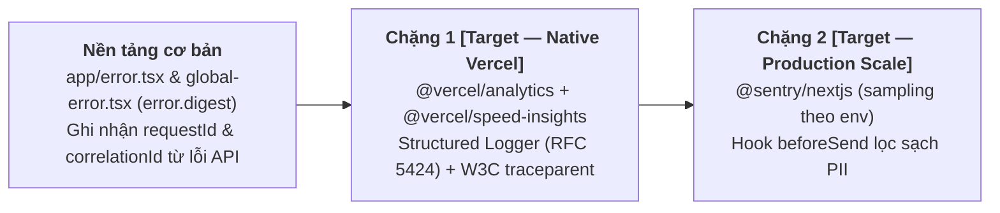

# Chuyên Đề 14: Giám Sát, Đo Lường Từ Xa (Telemetry) & Ghi Log (`OBS-*`)

> **Dự án:** InterviewCoach Frontend (`client/`)  
> **Phiên bản:** 9.0 (InterviewCoach Next.js 16 + React 19 + Mantine v9 Standard)  
> **Cổng điều hướng:** [Master Hub](../README.md) | [Quick Reference](../QUICK_REFERENCE.md) | [Cẩm nang Mantine v9](../../mantine/README.md)  
> **Tài liệu liên quan:** [Security & Auth (`SEC-*`)](../03-quality-and-security/security-and-auth.md) | [API Contracts & Resilience (`API-*`)](../03-quality-and-security/api-contracts-and-resilience.md) | [Performance & Web Vitals (`PERF-*`)](./performance-and-web-vitals.md) | [Release & DevOps (`OPS-*`)](./release-and-devops.md)  
> **Vai trò SSOT:** Nguồn chân lý duy nhất cho **9 mã quy chuẩn `OBS-001` đến `OBS-009`**, định nghĩa chuẩn Error Boundary Mantine v9, truy vết phân tán W3C `traceparent`, và lộ trình 2 chặng `[Target Standard — cài khi triển khai]` trên Vercel.  
> **Cơ sở tham chiếu quốc tế:**
>
> - [Next.js 16 App Router — Error Handling (`error.tsx`, `global-error.tsx`)](https://nextjs.org/docs/app/getting-started/error-handling)
> - [W3C Trace Context Specification (`traceparent`)](https://www.w3.org/TR/trace-context/)
> - [RFC 5424 — The Syslog Protocol (Log Severity Levels)](https://datatracker.ietf.org/doc/html/rfc5424)
> - [Vercel Analytics & Speed Insights for Next.js](https://vercel.com/docs/speed-insights)
> - [Sentry for Next.js App Router](https://docs.sentry.io/platforms/javascript/guides/nextjs/)

---

## MỤC LỤC

1. [Triết Lý Observability & Lộ Trình Triển Khai 2 Chặng Trên Vercel](#1-triết-lý-observability-lộ-trình-triển-khai-2-chặng-trên-vercel)
2. [Bộ 9 Quy Chuẩn SSOT `OBS-001` Đến `OBS-009`](#2-bộ-9-quy-chuẩn-ssot-obs-001-đến-obs-009)
3. [Case Study Tự Chứa: Route Error Boundary Mantine v9, POJO Context & W3C `traceparent`](#3-case-study-tự-chứa-route-error-boundary-mantine-v9-pojo-context-w3c-traceparent)
4. [Bảng Đối Chiếu Anti-Pattern vs Best Practice](#4-bảng-đối-chiếu-anti-pattern-vs-best-practice)
5. [Ánh Xạ Tooling CI & Checklist PR Review Gate (8 Tiêu Chí)](#5-ánh-xạ-tooling-ci-checklist-pr-review-gate-8-tiêu-chí)

---

## 1. Triết Lý Observability & Lộ Trình Triển Khai 2 Chặng Trên Vercel

Mục tiêu của Observability là rút ngắn thời gian chẩn đoán sự cố (**MTTR**) bằng cách nối liền **lỗi trên trình duyệt** → **request HTTP tại NestJS Backend** → **tác vụ chấm điểm tại AI Service**, đồng thời đảm bảo tuyệt đối không rò rỉ PII của ứng viên.



---

## 2. Bộ 9 Quy Chuẩn SSOT `OBS-001` Đến `OBS-009`

<a id="obs-001"></a>

### 2.1. `OBS-001` — Bắt Lỗi Tập Trung Toàn Cục (`ERROR` · `[Active/Target Mantine v9]`)

Mọi lỗi runtime React chưa được xử lý đi qua **`app/error.tsx`** (cấp Route Segment) và **`app/global-error.tsx`** (cấp `RootLayout`), hiển thị mã **`error.digest`** cho người dùng gửi hỗ trợ, nút `reset()` khôi phục phiên, và điều hướng an toàn bằng `<Button component={Link} href="/">` (không dùng `window.location.href`).

<a id="obs-002"></a>

### 2.2. `OBS-002` — Liên Kết Truy Vết Phân Tán W3C `traceparent` (`ERROR` · `[Active: requestId]` / `[Target Chặng 1: traceparent]`)

- **Hiện tại (`[Active]`):** Bảo toàn `requestId` và `correlationId` trả về từ phản hồi lỗi Backend trong lớp lỗi HTTP.
- **Lộ trình (`[Target Standard — Chặng 1]`):** Sinh và đính kèm header chuẩn W3C **`traceparent: 00-<32-hex-traceId>-<16-hex-spanId>-01`** ở mọi request từ Frontend để nối liền chuỗi trace xuyên suốt `client/` → `server/` → `ai-service/`.

<a id="obs-003"></a>

### 2.3. `OBS-003` — Cấu Hình Sentry Phân Cấp Theo Môi Trường (`WARN` · `[Target Standard — Chặng 2, cài @sentry/nextjs]`)

Khi triển khai Chặng 2 (`npm install @sentry/nextjs`), tách cấu hình sampling theo biến môi trường:

- `development`: tắt gửi event lên cloud (`enabled: false`).
- `preview` / `staging`: `tracesSampleRate: 0.5`.
- `production`: `tracesSampleRate: 0.1` (tránh cạn quota), thu thập 100% unhandled exceptions.

<a id="obs-004"></a>

### 2.4. `OBS-004` — Lọc Bỏ Triệt Để PII Khỏi Telemetry Payload (`ERROR` · `[Target Standard — Chặng 2]`)

Mọi sự kiện gửi ra Sentry hoặc endpoint telemetry bắt buộc đi qua hook **`beforeSend`** để loại bỏ hoặc che các trường nhạy cảm: `email`, `phone`, `password`, `authorization`, `cookie`, nội dung `resumeText` và `transcript` của ứng viên (đồng bộ [`SEC-004`](../03-quality-and-security/security-and-auth.md#sec-004)).

<a id="obs-005"></a>

### 2.5. `OBS-005` — Tiêu Chuẩn Structured Logger (`WARN` · `[Target Standard — Chặng 1]`)

Xây dựng module logger phân cấp mức độ chuẩn **RFC 5424** (`debug`, `info`, `warn`, `error`) nhận ngữ cảnh JSON có cấu trúc (`{ module, route, requestId }`) thay thế hoàn toàn `console.*` rải rác trong codebase.

<a id="obs-006"></a>

### 2.6. `OBS-006` — Giám Sát Người Dùng Thực (RUM) Qua `sendBeacon` (`WARN` · `[Target Standard — Chặng 1]`)

Thu thập chỉ số Core Web Vitals thực tế (LCP, INP, CLS) và gửi bất đồng bộ không chặn luồng đóng trang qua `navigator.sendBeacon()` (hoặc thông qua `@vercel/speed-insights`).

<a id="obs-007"></a>

### 2.7. `OBS-007` — Chỉ Log Plain Objects (POJO), Cấm Circular DOM (`WARN` · `[Active]`)

Dữ liệu đính kèm trong log/telemetry bắt buộc là Plain Old JavaScript Object (chỉ gồm chuỗi, số, boolean, mảng/object phẳng đã chọn lọc). Cấm log trực tiếp React `SyntheticEvent`, `HTMLElement`, hoặc toàn bộ đối tượng `Response` gây lỗi `TypeError: Converting circular structure to JSON`.

<a id="obs-008"></a>

### 2.8. `OBS-008` — Khử Bỏ Debug Console Trong Production Build (`ERROR` · `[Active]` / `[Target: compiler.removeConsole]`)

- **`[Active]`:** Cấm `console.log()` và `debugger` qua ESLint & [`STD-CLEAN-001`](../01-foundations/coding-standards.md#std-clean-001).
- **`[Target Standard]`:** Bổ sung `compiler: { removeConsole: { exclude: ['error', 'warn'] } }` trong `client/next.config.ts` làm lớp bảo vệ cuối khi build production.

<a id="obs-009"></a>

### 2.9. `OBS-009` — Đo Lường RUM Native Trên Vercel (`WARN` · `[Target Standard — Chặng 1]`)

Vì `client/` triển khai trên **Vercel** (`client/vercel.json`), Chặng 1 ưu tiên tích hợp **`@vercel/analytics`** và **`@vercel/speed-insights`** nạp trì hoãn sau hydration (`bundle-defer-third-party`) để theo dõi p75 CWV theo từng route với overhead tối thiểu.

---

## 3. Case Study Tự Chứa: Route Error Boundary Mantine v9, POJO Context & W3C `traceparent`

### Mẫu 1: Route Error Boundary (`app/error.tsx`) Chuẩn Mantine v9 Zero-Hex

```tsx
// Correct: Route Error Boundary Mantine v9 hiển thị error.digest + reset() + Link
'use client'

import Link from 'next/link'
import { Alert, Button, Container, Group, Stack, Text } from '@mantine/core'
import { IconAlertTriangle, IconHome, IconRefresh } from '@tabler/icons-react'

export default function RouteErrorBoundary({
  error,
  reset,
}: {
  error: Error & { digest?: string }
  reset: () => void
}) {
  return (
    <Container size="sm" py="xl">
      <Alert
        color="danger"
        variant="light"
        title="Đã xảy ra sự cố không mong muốn"
        icon={<IconAlertTriangle size={20} stroke={1.5} aria-hidden="true" />}
      >
        <Stack gap="md">
          <Text size="sm">
            Hệ thống gặp lỗi khi xử lý yêu cầu. Bạn có thể thử tải lại phân vùng
            này hoặc quay về trang chủ.
          </Text>
          {error.digest ? (
            <Text size="xs" c="dimmed" ff="monospace">
              Mã tra cứu sự cố: {error.digest}
            </Text>
          ) : null}
          <Group gap="sm">
            <Button
              color="brand"
              size="sm"
              leftSection={
                <IconRefresh size={16} stroke={1.5} aria-hidden="true" />
              }
              onClick={reset}
            >
              Thử lại
            </Button>
            <Button
              component={Link}
              href="/"
              variant="default"
              size="sm"
              leftSection={
                <IconHome size={16} stroke={1.5} aria-hidden="true" />
              }
            >
              Về trang chủ
            </Button>
          </Group>
        </Stack>
      </Alert>
    </Container>
  )
}
```

### Mẫu 2: POJO Error Context (Không PII) & W3C `traceparent`

```ts
// Incorrect: Log nguyên object chứa PII hoặc DOM event
function badLog(event: unknown, userEmail: string) {
  console.log({ event, userEmail })
}

// Correct: Chuẩn hóa POJO error context sạch PII + sinh header W3C traceparent
export interface SafeErrorContext {
  name: string
  statusCode?: number
  errorCode?: string
  requestId?: string
  correlationId?: string
  route: string
}

interface StructuredHttpError {
  name: string
  statusCode: number
  errorCode?: string
  requestId?: string
  correlationId?: string
}

function isStructuredHttpError(err: unknown): err is StructuredHttpError {
  return (
    typeof err === 'object' &&
    err !== null &&
    'statusCode' in err &&
    typeof (err as { statusCode: unknown }).statusCode === 'number'
  )
}

export function buildSafeErrorContext(
  error: unknown,
  route: string
): SafeErrorContext {
  if (isStructuredHttpError(error)) {
    return {
      name: error.name,
      statusCode: error.statusCode,
      errorCode: error.errorCode,
      requestId: error.requestId,
      correlationId: error.correlationId,
      route,
    }
  }

  return {
    name: error instanceof Error ? error.name : 'UnknownError',
    route,
  }
}

function randomHex(byteLength: number): string {
  const bytes = new Uint8Array(byteLength)
  crypto.getRandomValues(bytes)
  return Array.from(bytes, (b) => b.toString(16).padStart(2, '0')).join('')
}

export function createW3cTraceparent(): string {
  const traceId = randomHex(16)
  const spanId = randomHex(8)
  return `00-${traceId}-${spanId}-01`
}
```

---

## 4. Bảng Đối Chiếu Anti-Pattern vs Best Practice

| Tình huống                                | Anti-Pattern (Tránh)                                                    | Best Practice (Chuẩn mực)                                                                                |
| :---------------------------------------- | :---------------------------------------------------------------------- | :------------------------------------------------------------------------------------------------------- |
| Điều hướng về trang chủ trong `error.tsx` | `onClick={() => (window.location.href = '/')}`                          | Dùng `<Button component={Link} href="/">` chuẩn Next.js + Mantine (`OBS-001`)                            |
| Ghi log ngữ cảnh lỗi                      | Truyền nguyên `user` object (có email/CV) hoặc `SyntheticEvent` vào log | Chỉ chọn lọc các trường POJO không chứa PII (`statusCode`, `requestId`, `route`) (`OBS-004`, `OBS-007`)  |
| Nạp SDK analytics/RUM                     | Import đồng bộ chặn render ban đầu                                      | Nạp trì hoãn sau hydration (`bundle-defer-third-party`) hoặc gửi qua `sendBeacon` (`OBS-006`, `OBS-009`) |
| Gỡ lỗi nhanh trên nhánh phát triển        | Để sót `console.log(payload)` và `debugger` khi tạo PR                  | Xóa sạch trước khi commit; cấu hình `compiler.removeConsole` làm lớp chốt cuối (`OBS-008`)               |
| Truy vết lỗi xuyên dịch vụ                | Ghi log cục bộ không có `traceparent` / `requestId`                     | Đính kèm W3C `traceparent` và lưu `requestId`/`correlationId` vào lỗi (`OBS-002`)                        |

---

## 5. Ánh Xạ Tooling CI & Checklist PR Review Gate (8 Tiêu Chí)

### Ánh xạ Tooling CI (`client/`)

| Hạng mục                                               | Công cụ                      | Lệnh thực thi                       |
| :----------------------------------------------------- | :--------------------------- | :---------------------------------- |
| Chặn `console.log()` & kiểm tra kiểu dữ liệu telemetry | ESLint 9 + TypeScript 5      | `npm run lint && npm run typecheck` |
| Kiểm tra UI Error Boundary chuẩn Mantine v9 Zero-Hex   | `scripts/check-ui-rules.mjs` | `npm run ui:lint -- <files>`        |
| Kiểm thử Error Boundary & hàm `buildSafeErrorContext`  | Vitest 4 (`--project unit`)  | `npm run test:unit`                 |

### Checklist PR Review Gate (8 Tiêu Chí)

- [ ] **1. Global Error Boundaries:** `app/error.tsx` và `app/global-error.tsx` hiển thị `error.digest`, nút `reset()` và nút điều hướng chuẩn Mantine v9 (`OBS-001`).
- [ ] **2. Correlation Preserved:** Không làm mất `requestId` / `correlationId` khi xử lý lỗi HTTP (`OBS-002`).
- [ ] **3. Zero PII in Telemetry:** Không gửi email, SĐT, CV, hay transcript thô vào log/error payload (`OBS-004`).
- [ ] **4. POJO-Only Context:** Không log `HTMLElement`, `SyntheticEvent`, hay object chứa tham chiếu vòng (`OBS-007`).
- [ ] **5. Zero Debug Console:** Không còn `console.log()` hay `debugger` trong mã nguồn PR (`OBS-008`).
- [ ] **6. Stage Discipline:** Không import `@sentry/nextjs` hoặc `@vercel/analytics` trước khi cài đặt theo đúng Chặng 1 / Chặng 2 (`OBS-003`, `OBS-009`).
- [ ] **7. Non-Blocking RUM:** Telemetry chạy bất đồng bộ sau hydration, không chặn main thread (`OBS-006`).
- [ ] **8. Static & Unit Gate:** Pass `npm run typecheck`, `npm run lint`, và `npm run test:unit`.
