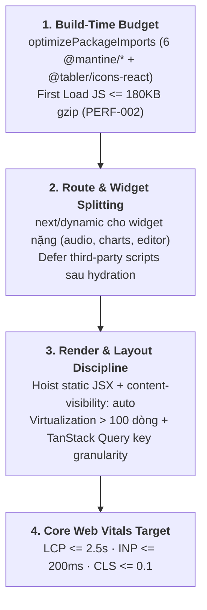

# Chuyên Đề 13: Kỹ Thuật Hiệu Năng & Core Web Vitals (`PERF-*`)

> **Dự án:** Intervia Frontend (`client/`)  
> **Phiên bản:** 9.0 (Intervia Next.js 16 + React 19 + Mantine v9 Standard)  
> **Cổng điều hướng:** [Master Hub](../README.md) | [Quick Reference](../QUICK_REFERENCE.md) | [Cẩm nang Mantine v9](../../mantine/README.md)  
> **Tài liệu liên quan:** [Architecture & Structure](../01-foundations/architecture-and-structure.md) | [Coding Standards (`STD-*`)](../01-foundations/coding-standards.md) | [State Management](../01-foundations/state-management.md) | [Observability & Telemetry (`OBS-*`)](./observability-and-telemetry.md)  
> **Vai trò SSOT:** Nguồn chân lý duy nhất cho **13 mã quy chuẩn `PERF-001` đến `PERF-013`**, áp dụng ngân sách **First Load JS ≤ 180KB (gzip)** và đồng bộ trực tiếp với 8 nhóm hiệu năng trong `vercel-react-best-practices`.  
> **Cơ sở tham chiếu quốc tế:**
>
> - [web.dev — Core Web Vitals (LCP, INP, CLS)](https://web.dev/articles/vitals)
> - [Next.js 16 — Package Bundling (`optimizePackageImports`), `next/dynamic`, `next/image`, `next/font`](https://nextjs.org/docs/app/guides/package-bundling)
> - [Vercel React Best Practices (`bundle-dynamic-imports`, `bundle-defer-third-party`, `rendering-content-visibility`, `rendering-hoist-jsx`)](../../../.agents/skills/vercel-react-best-practices/SKILL.md)

---

## MỤC LỤC

1. [Triết Lý Hiệu Năng & Đường Ống Tối Ưu Core Web Vitals](#1-triết-lý-hiệu-năng-đường-ống-tối-ưu-core-web-vitals)
2. [Bộ 13 Quy Chuẩn SSOT `PERF-001` Đến `PERF-013`](#2-bộ-13-quy-chuẩn-ssot-perf-001-đến-perf-013)
3. [Case Study Chuẩn `vercel-react-best-practices` + Mantine v9: Dynamic Split, Hoist JSX & `content-visibility`](#3-case-study-chuẩn-vercel-react-best-practices-mantine-v9-dynamic-split-hoist-jsx-content-visibility)
4. [Bảng Đối Chiếu Anti-Pattern vs Best Practice](#4-bảng-đối-chiếu-anti-pattern-vs-best-practice)
5. [Ánh Xạ Tooling CI & Checklist PR Review Gate (10 Tiêu Chí)](#5-ánh-xạ-tooling-ci-checklist-pr-review-gate-10-tiêu-chí)

---

## 1. Triết Lý Hiệu Năng & Đường Ống Tối Ưu Core Web Vitals

Hiệu năng Frontend tuân theo nguyên tắc **Đo lường trước — Tối ưu theo ngân sách**: khóa chặt ngân sách dung lượng ngay từ build-time (tree-shaking, `optimizePackageImports`, dynamic imports) đến runtime (virtualization, hoisting JSX tĩnh, CSS `content-visibility: auto`).



---

## 2. Bộ 13 Quy Chuẩn SSOT `PERF-001` Đến `PERF-013`

<a id="perf-001"></a>

### 2.1. `PERF-001` — Ngưỡng Chuẩn Mực Core Web Vitals (`ERROR` · `[Active]`)

Mọi trang trọng yếu (`/`, `/login`, `/sessions`, `/setup`, `/sessions/[sessionId]/report`) phải đạt ngưỡng xanh trên p75 người dùng thực:

- **LCP (Largest Contentful Paint):** ≤ `2.5s`
- **INP (Interaction to Next Paint):** ≤ `200ms`
- **CLS (Cumulative Layout Shift):** ≤ `0.1`

<a id="perf-002"></a>

### 2.2. `PERF-002` — Ngân Sách First Load JS ≤ 180KB (gzip) (`ERROR` · `[Active Budget]` / `[Target Standard — @next/bundle-analyzer]`)

Khóa chặt ngân sách **First Load JS ≤ 180KB (gzip)** cho các public và auth routes. Khi bổ sung dependency mới vào `client/package.json` hoặc migrate trang lớn, sử dụng **`@next/bundle-analyzer`** (`[Target Standard — cài khi triển khai]: npm install -D @next/bundle-analyzer`) để kiểm toán chi tiết từng chunk trước khi merge.

<a id="perf-003"></a>

### 2.3. `PERF-003` — Phân Tách Mã Thành Phần Nặng Bằng `next/dynamic` (`ERROR` · `[Active]`)

Áp dụng quy tắc `bundle-dynamic-imports`: mọi widget nặng không cần ở lần vẽ đầu tiên (trình ghi âm Web Speech/Audio, biểu đồ phân tích năng lực, khối xuất báo cáo) bắt buộc nạp động bằng `next/dynamic` kèm fallback Mantine `<Skeleton>` giữ đúng chiều cao để chống CLS.

<a id="perf-004"></a>

### 2.4. `PERF-004` — Bắt Buộc Ảo Hóa Danh Sách/Bảng > 100 Phần Tử (`ERROR` · `[Target Standard — @tanstack/react-virtual]`)

Bất kỳ danh sách hoặc bảng nào vượt quá **100 dòng** (danh mục kỹ năng quản trị, lịch sử phiên dài hạn, transcript nhiều lượt) bắt buộc dùng phân trang phía server (`Pagination`) hoặc virtualization bằng **`@tanstack/react-virtual`** để giữ cây DOM gọn nhẹ.

<a id="perf-005"></a>

### 2.5. `PERF-005` — Tối Ưu Hóa Hình Ảnh Qua `next/image` (`WARN` · `[Active]`)

Sử dụng `next/image` (hoặc Mantine `<Image component={NextImage} />`) với `width`/`height` tường minh để khóa tỷ lệ khung hình chống CLS; chỉ gắn `priority` cho duy nhất ảnh LCP đầu trang (above-the-fold), phần còn lại lazy-load mặc định.

<a id="perf-006"></a>

### 2.6. `PERF-006` — Memoization Có Đo Lường (`WARN` · `[Active]`)

Áp dụng `rerender-simple-expression-in-memo` và [`STD-MEMO-001`](../01-foundations/coding-standards.md#std-memo-001): không bọc `useMemo`/`useCallback` cho phép tính nguyên thủy rẻ; chỉ memoize phép biến đổi mảng lớn hoặc tham chiếu truyền vào Context/component bọc `React.memo`.

<a id="perf-007"></a>

### 2.7. `PERF-007` — Tối Ưu Web Fonts Bằng `next/font/google` (`WARN` · `[Active in Codebase]`)

Font `Geist` và `Geist_Mono` được tự lưu trữ (self-host) tại `client/app/layout.tsx` qua `next/font/google` và nối CSS variable vào `client/theme.ts`. Cấm chèn `<link href="https://fonts.googleapis.com/...">` thủ công.

<a id="perf-008"></a>

### 2.8. `PERF-008` — Chống Layout Thrashing & Forced Synchronous Reflow (`WARN` · `[Active]`)

Không xen kẽ đọc thuộc tính hình học DOM (`offsetHeight`, `getBoundingClientRect()`) với thao tác ghi style trong cùng vòng lặp; gom toàn bộ thao tác đọc trước rồi mới cập nhật qua CSS Modules hoặc `requestAnimationFrame`.

<a id="perf-009"></a>

### 2.9. `PERF-009` — Phân Tách Context & Độ Hạt TanStack Query Key (`WARN` · `[Active]`)

Không đưa trạng thái thay đổi liên tục (đồng hồ đếm giây, từ khóa đang gõ, bộ lọc bảng) vào Context gốc; chia nhỏ `queryKeys` của TanStack Query theo thực thể, tận dụng tùy chọn `select` của `useQuery` khi chỉ cần 1 lát cắt dữ liệu, và dùng `@mantine/form` `mode: 'uncontrolled'` để giới hạn phạm vi re-render.

<a id="perf-010"></a>

### 2.10. `PERF-010` — Tree-Shaking & `optimizePackageImports` (`ERROR` · `[Active in Codebase]`)

`client/next.config.ts` đã bật `experimental.optimizePackageImports` cho 6 package `@mantine/*` và `@tabler/icons-react` (`bundle-barrel-imports`). Cấm nhập thư viện nguyên khối nặng (`moment`, `lodash` CJS nguyên gói) — dùng `Intl` gốc và hàm ES hiện đại.

<a id="perf-011"></a>

### 2.11. `PERF-011` — Tối Ưu Bỏ Qua Layout Ngoài Khung Nhìn (`WARN` · `[Active]`)

Áp dụng quy tắc `rendering-content-visibility`: đặt `content-visibility: auto;` kết hợp `contain-intrinsic-size` (dùng `rem()`) trong `*.module.css` cho các mục dài nằm dưới nếp gấp (danh sách transcript hoặc các thẻ bài dưới trang Landing).

<a id="perf-012"></a>

### 2.12. `PERF-012` — Hoisting Phần Tử JSX Tĩnh Khỏi Render Scope (`WARN` · `[Active]`)

Áp dụng quy tắc `rendering-hoist-jsx`: các hằng số mảng option, biểu tượng tĩnh, hoặc skeleton fallback cố định phải khai báo ở module scope bên ngoài function component để không tạo mới đối tượng JSX trên mỗi lần re-render.

<a id="perf-013"></a>

### 2.13. `PERF-013` — Trì Hoãn Script & Thư Viện Bên Thứ Ba (`ERROR` · `[Active]`)

Áp dụng quy tắc `bundle-defer-third-party`: các script phân tích/theo dõi không thiết yếu cho lần vẽ đầu tiên phải nạp sau hydration qua `next/dynamic(..., { ssr: false })` hoặc `next/script` `strategy="lazyOnload"`.

---

## 3. Case Study Chuẩn `vercel-react-best-practices` + Mantine v9: Dynamic Split, Hoist JSX & `content-visibility`

### Mẫu 1: `bundle-dynamic-imports` & `rendering-hoist-jsx` (Adapted Sang Mantine v9)

```tsx
// Incorrect: Import tĩnh widget nặng vào main chunk và tạo lại Skeleton JSX trong render
import { HeavyAudioWidget } from './HeavyAudioWidget'

function BadCapturePanel({ isLoading }: { isLoading: boolean }) {
  return isLoading ? (
    <Skeleton height={160} radius="md" />
  ) : (
    <HeavyAudioWidget />
  )
}

// Correct: Lazy-load widget nặng bằng next/dynamic + Hoist static JSX ra module scope
;('use client')

import dynamic from 'next/dynamic'
import { Group, Paper, Skeleton, Stack, Text } from '@mantine/core'
import { IconMicrophone } from '@tabler/icons-react'
import classes from './TranscriptSection.module.css'

const MIC_ICON = <IconMicrophone size={16} stroke={1.5} aria-hidden="true" />
const RECORDER_SKELETON = <Skeleton height={160} radius="md" />

const AudioCaptureWidget = dynamic(
  () => import('./AudioCaptureWidget').then((mod) => mod.AudioCaptureWidget),
  {
    ssr: false,
    loading: () => RECORDER_SKELETON,
  }
)

export function AnswerCapturePanel({
  isReady,
  onSubmit,
}: {
  isReady: boolean
  onSubmit: (transcript: string) => Promise<void>
}) {
  return (
    <Paper withBorder p="md" radius="md" className={classes.panel}>
      <Stack gap="sm">
        <Group gap="xs">
          {MIC_ICON}
          <Text size="sm" fw={600}>
            Ghi âm câu trả lời (tối đa 3 phút)
          </Text>
        </Group>
        {isReady ? (
          <AudioCaptureWidget onSubmit={onSubmit} />
        ) : (
          RECORDER_SKELETON
        )}
      </Stack>
    </Paper>
  )
}
```

### Mẫu 2: CSS `content-visibility: auto` Cho Danh Sách Dài (`rendering-content-visibility`)

```css
/* TranscriptSection.module.css — Zero-Hex + rem() + content-visibility */
.panel {
  content-visibility: auto;
  contain-intrinsic-size: 0 rem(240px);
}

.transcriptItem {
  content-visibility: auto;
  contain-intrinsic-size: 0 rem(80px);
  padding-block: var(--mantine-spacing-sm);
  border-bottom: 1px solid var(--mantine-color-default-border);
}
```

---

## 4. Bảng Đối Chiếu Anti-Pattern vs Best Practice

| Tình huống                        | Anti-Pattern (Tránh)                                              | Best Practice (Chuẩn mực)                                                                                     |
| :-------------------------------- | :---------------------------------------------------------------- | :------------------------------------------------------------------------------------------------------------ |
| Nhúng trình ghi âm / biểu đồ nặng | `import { Chart } from './Chart'` kéo toàn bộ chunk vào trang chủ | Dùng `next/dynamic(..., { ssr: false, loading: () => <Skeleton /> })` (`PERF-003`)                            |
| Render 500 dòng bảng / transcript | Map trực tiếp 500 `<Table.Tr>` vào DOM cùng lúc                   | Dùng server `Pagination`, `@tanstack/react-virtual`, hoặc `content-visibility: auto` (`PERF-004`, `PERF-011`) |
| Khai báo option tĩnh & icon nút   | Khởi tạo mảng `const OPTIONS = [...]` bên trong thân component    | Hoist mảng hằng số và static JSX ra ngoài module scope (`PERF-012`, `rendering-hoist-jsx`)                    |
| Nhúng script analytics bên thứ ba | Import đồng bộ ở đầu `RootLayout` chặn FCP/LCP                    | Nạp trì hoãn sau hydration qua `next/dynamic` (`ssr: false`) hoặc `next/script` `lazyOnload` (`PERF-013`)     |
| Ảnh hero không ghi kích thước     | `` gây nhảy bố cục (CLS > 0.1)             | Dùng `next/image` (hoặc `<Image component={NextImage} />`) có `width`/`height` + `priority` (`PERF-005`)      |

---

## 5. Ánh Xạ Tooling CI & Checklist PR Review Gate (10 Tiêu Chí)

### Ánh xạ Tooling CI (`client/`)

| Hạng mục                                                       | Công cụ                                     | Lệnh thực thi                                     |
| :------------------------------------------------------------- | :------------------------------------------ | :------------------------------------------------ |
| Kiểm tra build output & dung lượng First Load JS từng route    | Next.js 16 Production Build                 | `npm run build`                                   |
| Phân tích chi tiết chunk bundle (`[Target Standard]`)          | `@next/bundle-analyzer`                     | `ANALYZE=true npm run build`                      |
| Kiểm tra CSS Modules (`content-visibility`, `rem()`, Zero-Hex) | Stylelint 17 + `scripts/check-ui-rules.mjs` | `npm run stylelint && npm run ui:lint -- <files>` |

### Checklist PR Review Gate (10 Tiêu Chí)

- [ ] **1. CWV Safe:** Không gây tăng CLS (ảnh có `width`/`height`, skeleton giữ đúng chiều cao) (`PERF-001`, `PERF-005`).
- [ ] **2. Bundle Budget:** Giữ First Load JS ≤ 180KB (gzip) cho public/auth routes; đã kiểm tra tác động dung lượng khi thêm package (`PERF-002`).
- [ ] **3. Dynamic Splitting:** Widget nặng (audio, biểu đồ, trình xuất báo cáo) nạp qua `next/dynamic` (`PERF-003`).
- [ ] **4. Large Lists Guarded:** Bảng/danh sách > 100 dòng có phân trang server hoặc virtualization (`PERF-004`).
- [ ] **5. Fonts via `next/font`:** Không chèn `<link>` Google Fonts thủ công (`PERF-007`).
- [ ] **6. Zero Layout Thrashing:** Không xen kẽ đọc/ghi DOM trong vòng lặp (`PERF-008`).
- [ ] **7. Scoped Rerenders:** Không nhét state thay đổi nhanh vào Context gốc; form dùng `mode: 'uncontrolled'` (`PERF-009`).
- [ ] **8. Tree-Shaking Clean:** Không nhập monolithic library; giữ đủ `optimizePackageImports` trong `next.config.ts` (`PERF-010`).
- [ ] **9. Static Hoisting & Content Visibility:** Hằng số/JSX tĩnh hoist ngoài component; danh sách dài below-the-fold dùng `content-visibility: auto` (`PERF-011`, `PERF-012`).
- [ ] **10. Deferred 3rd-Party Scripts:** Script/analytics phụ nạp sau hydration (`PERF-013`).
