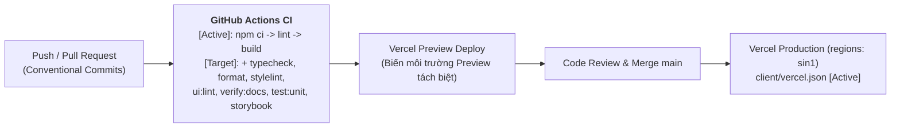

# Chuyên Đề 16: Kỹ Thuật Phát Hành, Đa Môi Trường & CI/CD DevOps Frontend (`OPS-*`)

> **Dự án:** InterviewCoach Frontend (`client/`)  
> **Phiên bản:** 9.0 (InterviewCoach Next.js 16 + React 19 + Mantine v9 Standard)  
> **Cổng điều hướng:** [Master Hub](../README.md) | [Quick Reference](../QUICK_REFERENCE.md) | [Cẩm nang Mantine v9](../../mantine/README.md)  
> **Tài liệu liên quan:** [Security & Auth (`SEC-*`)](../03-quality-and-security/security-and-auth.md) | [Performance & Web Vitals (`PERF-*`)](./performance-and-web-vitals.md) | [Observability (`OBS-*`)](./observability-and-telemetry.md) | [Testing & QA](../03-quality-and-security/testing-and-qa.md)  
> **Vai trò SSOT:** Nguồn chân lý duy nhất cho **12 mã quy chuẩn `OPS-001` đến `OPS-012`**, phản ánh trung thực cấu hình triển khai (`client/vercel.json`, `client/next.config.ts`, `.github/workflows/ci.yml`), chuẩn hóa theo Next.js 16 Production Checklist và nguyên tắc `vercel-optimize`.  
> **Cơ sở tham chiếu quốc tế:**
>
> - [Next.js 16 — Production Checklist](https://nextjs.org/docs/app/guides/production-checklist)
> - [Vercel Optimize Skill (`client/.agents/skills/vercel-optimize/`)](../../../.agents/skills/vercel-optimize/SKILL.md)
> - [Semantic Versioning 2.0.0](https://semver.org/) & [Conventional Commits 1.0.0](https://www.conventionalcommits.org/)

---

## MỤC LỤC

1. [Triết Lý Release Engineering & Pipeline Triển Khai Vercel](#1-triết-lý-release-engineering-pipeline-triển-khai-vercel)
2. [Bộ 12 Quy Chuẩn SSOT `OPS-001` Đến `OPS-012`](#2-bộ-12-quy-chuẩn-ssot-ops-001-đến-ops-012)
3. [Ma Trận Phân Tầng Cache-Busting & Case Study CI/Env](#3-ma-trận-phân-tầng-cache-busting-case-study-cienv)
4. [Bảng Đối Chiếu Anti-Pattern vs Best Practice](#4-bảng-đối-chiếu-anti-pattern-vs-best-practice)
5. [Ánh Xạ Tooling CI & Checklist PR Review Gate (10 Tiêu Chí)](#5-ánh-xạ-tooling-ci-checklist-pr-review-gate-10-tiêu-chí)

---

## 1. Triết Lý Release Engineering & Pipeline Triển Khai Vercel

Quy trình phát hành Frontend hướng tới 3 tiêu chí: **Fail-Fast** (phát hiện lỗi cấu hình môi trường ngay lúc build), **Zero-Downtime Deployment trên Vercel (`sin1`)**, và **Tối ưu dựa trên tín hiệu đo lường thực tế (Metrics-First)** theo nguyên tắc `vercel-optimize` trước khi điều chỉnh chính sách cache hoặc hạ tầng.



---

## 2. Bộ 12 Quy Chuẩn SSOT `OPS-001` Đến `OPS-012`

<a id="ops-001"></a>

### 2.1. `OPS-001` — Xác Thực Biến Môi Trường Fail-Fast (`ERROR` · `[Active: next.config.ts]` / `[Target: Zod Env Schema]`)

- **`[Active in Codebase]`:** `client/next.config.ts` kiểm tra fail-fast `NEXT_PUBLIC_API_BASE_URL` ngay khi khởi động hoặc chạy `npm run build`. Mẫu khai báo biến công khai lưu tại `client/.env.example`.
- **`[Target Standard]`:** Gom toàn bộ biến môi trường vào schema **Zod v4** chạy kiểm tra fail-fast tại khởi động ứng dụng.

<a id="ops-002"></a>

### 2.2. `OPS-002` — Chiến Lược Triển Khai Vercel & Standalone Docker (`ERROR` · `[Active: Vercel]` / `[Target: Standalone Docker]`)

- **`[Active in Codebase]`:** Triển khai chính thức trên **Vercel** qua `client/vercel.json` (`framework: "nextjs"`, `installCommand: "npm ci"`, `buildCommand: "npm run build"`, `regions: ["sin1"]` — Singapore tối ưu độ trễ cho người dùng Việt Nam).
- **`[Target Standard]`:** Khi cần tự host trên VPS cùng `server/`, bật `output: 'standalone'` trong `next.config.ts` và đóng gói Multi-stage Docker Image (`node:20-alpine`, non-root user `nextjs`).

<a id="ops-003"></a>

### 2.3. `OPS-003` — Quản Trị Routing, Redirects 308 & Nén Truyền Tải (`ERROR` · `[Active in Codebase]`)

Mọi điều hướng kế thừa (`/admin-dashboard` → `/admin/dashboard`, `/admin-profile` → `/admin/profile`, `/users` → `/admin/users`) được quản trị tập trung tại `redirects()` trong `client/next.config.ts` (`permanent: true`); Vercel tự động bật nén Brotli/Gzip cho toàn bộ tài nguyên tĩnh.

<a id="ops-004"></a>

### 2.4. `OPS-004` — Chiến Lược Cache-Busting Phân Tầng (`ERROR` · `[Active]`)

Next.js 16 tự gắn content-hash cho các bundle tĩnh dưới `/_next/static/*` (`Cache-Control: public, max-age=31536000, immutable`), trong khi trang HTML động giữ `no-cache` hoặc revalidation kiểm soát để người dùng luôn nhận bản phát hành mới nhất.

<a id="ops-005"></a>

### 2.5. `OPS-005` — Thiết Lập Security Headers Tập Trung (`ERROR` · `[Target Standard]`)

Bổ sung `headers()` trong `client/next.config.ts` trả về đồng bộ: `X-Content-Type-Options: nosniff`, `X-Frame-Options: DENY`, `Referrer-Policy: strict-origin-when-cross-origin`, `Permissions-Policy` (chỉ cấp `microphone=(self)` cho tính năng ghi âm phỏng vấn), và `Strict-Transport-Security` (khớp [`SEC-002`](../03-quality-and-security/security-and-auth.md#sec-002), [`SEC-005`](../03-quality-and-security/security-and-auth.md#sec-005)).

<a id="ops-006"></a>

### 2.6. `OPS-006` — Quản Trị Maintenance Mode & Feature Flags (`WARN` · `[Active: Maintenance Mode]` / `[Target: Feature Flags Registry]`)

- **`[Active in Codebase]`:** Chế độ bảo trì kích hoạt qua biến `NEXT_PUBLIC_MAINTENANCE_MODE=true` (luôn giữ bypass cho `/maintenance`, `/admin`, `/_next`, `/favicon`).
- **`[Target Standard]`:** Khi triển khai tính năng thử nghiệm mới, quản trị cờ tập trung qua registry có hạn thu hồi rõ ràng sau khi rollout 100%.

<a id="ops-007"></a>

### 2.7. `OPS-007` — Semantic Versioning 2.0 & Conventional Commits (`WARN` · `[Active]`)

Mọi commit và release tag tuân thủ **SemVer (`MAJOR.MINOR.PATCH`)** và **Conventional Commits** (`feat(client): ...`, `fix(setup): ...`, `docs(client): ...`, `refactor(ui): ...`, `test(client): ...`, `chore(deps): ...`).

<a id="ops-008"></a>

### 2.8. `OPS-008` — Điểm Kiểm Tra Sức Khỏe Vận Hành (`/api/health`) (`WARN` · `[Target Standard]`)

Khi tự host hoặc gắn uptime monitoring độc lập, bổ sung Next.js Route Handler `app/api/health/route.ts` trả về HTTP `200` kèm `{ status: 'ok', timestamp }` không phụ thuộc trạng thái đăng nhập.

<a id="ops-009"></a>

### 2.9. `OPS-009` — Phân Tách Biến Build-Time vs Server Runtime (`WARN` · `[Active]`)

Chỉ gắn tiền tố `NEXT_PUBLIC_` cho cấu hình công khai an toàn để trình duyệt đọc (`NEXT_PUBLIC_API_BASE_URL`, `NEXT_PUBLIC_MAINTENANCE_MODE`). **Tuyệt đối không** gắn `NEXT_PUBLIC_` cho secret, API key nội bộ, hay token xác thực.

<a id="ops-010"></a>

### 2.10. `OPS-010` — Chốt Chặn Kiểm Toán & Pipeline CI (`ERROR` · `[Active: ci.yml rút gọn]` / `[Target: Full CI Gate]`)

- **`[Active in .github/workflows/ci.yml]`:** Job `client` (Node `20`, `working-directory: client`) hiện đang chạy `npm ci` → `npm run lint` → `npm run build`.
- **`[Target CI Pipeline]`:** Mở rộng job `client` trên GitHub Actions chạy đủ chuỗi chất lượng: `typecheck`, `lint`, `format:check`, `stylelint`, `ui:lint -- --strict-expiry`, `verify:docs`, `test:unit`, `build`, `build-storybook`, và `npm audit --audit-level=high`.

<a id="ops-011"></a>

### 2.11. `OPS-011` — Chính Sách Bộ Đệm Biên Mạng An Toàn (`WARN` · `[Target Standard]`)

Chỉ áp dụng `Cache-Control: public, s-maxage=60, stale-while-revalidate=300` cho trang/tài nguyên công khai hoàn toàn không chứa dữ liệu cá nhân (ví dụ Landing `(public)`). Theo nguyên tắc `vercel-optimize`, **giữ động (dynamic / `private, no-store`)** toàn bộ route phụ thuộc auth, error, fallback, và dữ liệu theo phiên (`(candidate)`, `(admin)`).

<a id="ops-012"></a>

### 2.12. `OPS-012` — Bảo Mật Triển Khai Vercel Production & Token Hygiene (`ERROR` · `[Active]`)

Tách biệt hoàn toàn Environment Variables trên Vercel theo 3 môi trường (`Development`, `Preview`, `Production`). Tuyệt đối không commit `.env.local` lên git và **không bao giờ in hoặc truyền `VERCEL_TOKEN`, `--token ...`, hay `Authorization: Bearer ...` trực tiếp trong câu lệnh shell có thể lưu lịch sử/log** (khớp `vercel-optimize`).

---

## 3. Ma Trận Phân Tầng Cache-Busting & Case Study CI/Env

### Ma trận phân tầng Cache-Control cho Next.js 16 trên Vercel

| Loại tài nguyên / Route                         | Chính sách `Cache-Control` khuyến nghị            | Lý do kỹ thuật                                        |
| :---------------------------------------------- | :------------------------------------------------ | :---------------------------------------------------- |
| `/_next/static/*` (JS, CSS có content-hash)     | `public, max-age=31536000, immutable`             | Tên tệp đổi theo nội dung build, tối đa hóa cache hit |
| Route công khai `(public)` không chứa PII       | `public, s-maxage=60, stale-while-revalidate=300` | Phản hồi nhanh từ Edge, tự làm mới nền (`OPS-011`)    |
| Route bảo vệ `(candidate)`, `(admin)`, `/api/*` | `private, no-store`                               | Chống rò rỉ dữ liệu người dùng chéo phiên trên CDN    |
| Trang lỗi / fallback / maintenance              | `no-cache, no-store`                              | Không giữ lại phản hồi lỗi tạm thời trên bộ đệm biên  |

### Mẫu 1: Fail-Fast Env Validation Với Zod v4 (`[Target Standard]`)

```ts
// Correct: Validate fail-fast biến môi trường public bằng Zod v4
import { z } from 'zod'

const publicEnvSchema = z.object({
  NEXT_PUBLIC_API_BASE_URL: z
    .string()
    .url('NEXT_PUBLIC_API_BASE_URL phải là URL hợp lệ'),
  NEXT_PUBLIC_MAINTENANCE_MODE: z
    .enum(['true', 'false'])
    .optional()
    .default('false'),
})

export function parsePublicEnv(
  source: Record<string, string | undefined>
): z.infer<typeof publicEnvSchema> {
  return publicEnvSchema.parse({
    NEXT_PUBLIC_API_BASE_URL: source.NEXT_PUBLIC_API_BASE_URL,
    NEXT_PUBLIC_MAINTENANCE_MODE: source.NEXT_PUBLIC_MAINTENANCE_MODE,
  })
}
```

### Mẫu 2: Target CI Job Cho `client/` (`.github/workflows/ci.yml` — `[Target Standard]`)

```yaml
client:
  name: Client Quality Gate
  runs-on: ubuntu-latest
  defaults:
    run:
      working-directory: client
  steps:
    - uses: actions/checkout@v4
    - uses: actions/setup-node@v4
      with:
        node-version: '20'
        cache: npm
        cache-dependency-path: client/package-lock.json
    - run: npm ci
    - run: npm run typecheck
    - run: npm run lint
    - run: npm run format:check
    - run: npm run stylelint
    - run: npm run ui:lint -- --strict-expiry
    - run: npm run verify:docs
    - run: npm run test:unit
    - run: npm run build
      env:
        NEXT_PUBLIC_API_BASE_URL: http://localhost:3000/api/v1
    - run: npm run build-storybook
```

---

## 4. Bảng Đối Chiếu Anti-Pattern vs Best Practice

| Tình huống                                | Anti-Pattern (Tránh)                                              | Best Practice (Chuẩn mực)                                                                          |
| :---------------------------------------- | :---------------------------------------------------------------- | :------------------------------------------------------------------------------------------------- |
| Khai báo biến môi trường bí mật           | Đặt `NEXT_PUBLIC_OPENAI_KEY=...` để tiện đọc ở client             | Chỉ dùng `NEXT_PUBLIC_` cho biến công khai; giữ secret ở server runtime (`OPS-009`)                |
| Bật cache CDN cho mọi route               | Gắn `s-maxage=300` chung cho toàn site bao gồm `/sessions`        | Chỉ cache public route không chứa PII; giữ `private, no-store` cho route sau đăng nhập (`OPS-011`) |
| Thao tác Vercel CLI trong terminal        | Chạy `vercel deploy --token=<secret>` để lộ token trong shell log | Dùng phiên đăng nhập `vercel login` và biến secrets trên CI (`OPS-012`)                            |
| Thiếu biến môi trường khi build           | Để ứng dụng build xong rồi mới crash ở runtime của người dùng     | Kiểm tra fail-fast bằng Zod / `next.config.ts` ngay tại bước build (`OPS-001`)                     |
| Merge PR chỉ dựa vào chạy thử máy cá nhân | Bỏ qua `stylelint`, `ui:lint`, `verify:docs`, `test:unit`         | Thực thi đầy đủ bộ lệnh Quality Gate trước khi merge (`OPS-010`)                                   |

---

## 5. Ánh Xạ Tooling CI & Checklist PR Review Gate (10 Tiêu Chí)

### Ánh xạ Tooling CI (`client/`)

| Hạng mục kiểm soát phát hành              | Công cụ                                                           | Lệnh thực thi                                                                    |
| :---------------------------------------- | :---------------------------------------------------------------- | :------------------------------------------------------------------------------- |
| Type Safety, Lint & Format                | TypeScript 5 + ESLint 9 + Prettier                                | `npm run typecheck && npm run lint && npm run format:check`                      |
| UI Zero-Hex, CSS Modules & Docs Integrity | Stylelint 17 + `check-ui-rules.mjs` + `verify-docs-integrity.mjs` | `npm run stylelint && npm run ui:lint -- --strict-expiry && npm run verify:docs` |
| Kiểm thử & Build sản phẩm                 | Vitest 4 + Next.js 16 + Storybook 10                              | `npm run test:unit && npm run build && npm run build-storybook`                  |
| Kiểm toán lỗ hổng thư viện                | npm Audit                                                         | `npm audit --audit-level=high`                                                   |

### Checklist PR Review Gate (10 Tiêu Chí)

- [ ] **1. Env Hygiene:** Biến môi trường mới đã khai báo mẫu trong `client/.env.example`, không commit `.env.local` (`OPS-001`, `OPS-012`).
- [ ] **2. Zero Secret Leaks:** Không đặt secret/private key dưới tiền tố `NEXT_PUBLIC_` và không in token ra shell log (`OPS-009`, `OPS-012`).
- [ ] **3. Clean Redirects:** Mọi route thay đổi URL đều cập nhật `redirects()` trong `next.config.ts` (`OPS-003`).
- [ ] **4. No Private CDN Caching:** Route `(candidate)` / `(admin)` giữ `private, no-store`, không gắn header public cache (`OPS-011`).
- [ ] **5. Maintenance Safe:** Không vô tình chặn `/maintenance` hoặc `/admin` khi cấu hình bảo trì (`OPS-006`).
- [ ] **6. Conventional Commits:** Tiêu đề commit/PR rõ phạm vi (`feat(client)`, `fix(client)`, `docs(client)`) (`OPS-007`).
- [ ] **7. Security Audit:** Dependency mới đã kiểm tra kích thước & `npm audit --audit-level=high` (`OPS-010`).
- [ ] **8. Static & Docs Pass:** `typecheck`, `lint`, `format:check`, `stylelint`, `ui:lint`, `verify:docs` đạt 0 lỗi.
- [ ] **9. Tests Pass:** `npm run test:unit` pass 100%.
- [ ] **10. Production Build Pass:** `npm run build` (và `npm run build-storybook` khi đụng stories) đạt Exit Code `0`.
