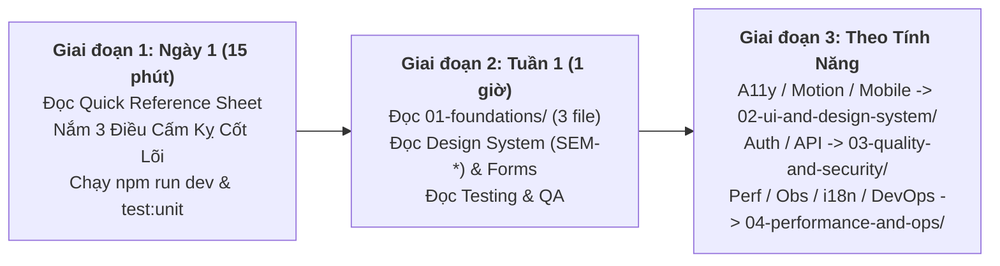

# Quick Reference Sheet: Sổ Tay Tra Cứu Nhanh Chuẩn Frontend InterviewCoach

> **Dự án:** InterviewCoach Frontend (`client/`)  
> **Phiên bản:** 9.0 (InterviewCoach Next.js 16 + React 19 + Mantine v9 Standard)  
> **Cổng điều hướng:** [Master Hub (16 Chuyên đề / 4 Miền)](./README.md) | [Cẩm nang Mantine v9](../mantine/README.md) | [Bộ luật AI Agents (`AGENTS.md`)](../../../AGENTS.md)  
> **Mục tiêu:** Tra cứu nhanh 3 điều cấm kỵ, 12 tiêu chí DoD PR, 4 Cheat-Recipes tự chứa theo chuẩn `mantine.dev` / `tanstack.com/query/v5`, và ma trận đồng bộ 2 chiều chính xác **131 Core Rule IDs (+ 18 Vercel Sub-Rules)**.

---

## MỤC LỤC

1. [Lộ Trình Đọc 3 Giai Đoạn & 3 Điều Cấm Kỵ Cốt Lõi](#1-lộ-trình-đọc-3-giai-đoạn-3-điều-cấm-kỵ-cốt-lõi)
2. [Checklist Nghiệm Thu PR 12 Tiêu Chí (Definition of Done)](#2-checklist-nghiệm-thu-pr-12-tiêu-chí-definition-of-done)
3. [Top 4 Công Thức Viết Mã Tự Chứa (Cheat-Recipes)](#3-top-4-công-thức-viết-mã-tự-chứa-cheat-recipes)
4. [Bảng Tổng Hợp 11 Nhóm Tiền Tố Quy Chuẩn (131 Core + 18 Sub-Rules)](#4-bảng-tổng-hợp-11-nhóm-tiền-tố-quy-chuẩn-131-core-18-sub-rules)
5. [Phụ Lục Tra Cứu Toàn Diện 131 Core Rule IDs (+ 18 Vercel Sub-Rules)](#5-phụ-lục-tra-cứu-toàn-diện-131-core-rule-ids-18-vercel-sub-rules)
6. [Các Lệnh CLI Hàng Ngày Cho Kỹ Sư (`client/`)](#6-các-lệnh-cli-hàng-ngày-cho-kỹ-sư-client)

---

## 1. Lộ Trình Đọc 3 Giai Đoạn & 3 Điều Cấm Kỵ Cốt Lõi



### 3 Điều Cấm Kỵ Cốt Lõi Cần Nhớ Ngay Ngày Đầu

1. **`ERROR` — Zero `any`:** Cấm dùng `any` và ép kiểu cưỡng bức `as unknown as` ([`STD-TS-001`](./01-foundations/coding-standards.md#std-ts-001)).
2. **`ERROR` — Mantine-First — Zero Raw HTML:** Cấm dùng thẻ HTML thô (`<div>`, `<span>`, `<p>`, `<h1>`–`<h6>`, `<button>`, `<a>`, `<form>`, `<input>`, `<table>`, `<svg>`) hay gắn `onClick` vào `Box`/`Paper`/`Card`/`Text` ([`SEM-HTML-001`](./02-ui-and-design-system/design-system-and-styling.md#sem-html-001)–[`003`](./02-ui-and-design-system/design-system-and-styling.md#sem-html-003)).
3. **`ERROR` — Zero-Hex Semantic-Only & No Inline Overrides:** Cấm HEX/RGB/HSL, màu vật lý (`blue`/`teal`/`red`/`gray`/`white`/`black`...), shade số đơn lẻ (`brand.6`), `bd=`, `bdrs=`, `style={{...}}`, và hardcode `px` ([`SEM-TOKEN-001`](./02-ui-and-design-system/design-system-and-styling.md#sem-token-001)–[`008`](./02-ui-and-design-system/design-system-and-styling.md#sem-token-008)).

---

## 2. Checklist Nghiệm Thu PR 12 Tiêu Chí (Definition of Done)

```markdown
### PR Verification Checklist (InterviewCoach Frontend v9.0)

- [ ] 1. Type Safety: 0 lỗi `npm run typecheck`, không dùng `any` / `as unknown as` (STD-TS-001).
- [ ] 2. Mantine-First: 0 thẻ raw HTML & 0 non-semantic `onClick` (SEM-HTML-001..003).
- [ ] 3. Zero-Hex Styling: 100% dùng 5 vai trò ngữ nghĩa (`brand|success|warning|danger|neutral`), `c="dimmed"`, `*.module.css` + `rem()` (SEM-TOKEN-001..008).
- [ ] 4. Forms & Zod v4: Form mới dùng `@mantine/form` (`uncontrolled`) + `schemaResolver(zodSchema, { sync: true })` + `<Box component="form" noValidate>`.
- [ ] 5. State & TanStack Query: Không fetch trong `useEffect`; dữ liệu server qua TanStack Query v5 `queryKeys` Factory (`client-swr-dedup`) & hỗ trợ `AbortSignal` (STD-ASYNC-001, API-003).
- [ ] 6. Time & Errors: ISO-8601 UTC + hoisted `Intl.DateTimeFormat` + lớp lỗi có cấu trúc `ApiClientError` (STD-TIME-001..002, STD-ERR-001).
- [ ] 7. Clean React 19: Component `.tsx` ≤ 250 dòng, dùng `ref` as prop, ternary `? : null`, 0 `console.log`/`debugger` (STD-SIZE-001, STD-REF-001, STD-VCL-001, STD-CLEAN-001).
- [ ] 8. Accessibility: Đủ `aria-label`, heading tuyến tính, touch target `rem(44px)`, và `jest-axe` 0 violations (A11Y-001..012).
- [ ] 9. Testing: Unit test mới import `{ render, screen, userEvent }` từ `@test-utils`; `npm run test:unit` pass 100%.
- [ ] 10. Static UI & CSS Gate: `npm run lint`, `npm run format:check`, `npm run stylelint`, `npm run ui:lint -- <files>` đạt Exit Code 0.
- [ ] 11. Build Gate: `npm run build` (và `npm run build-storybook` khi đụng stories) đạt Exit Code 0.
- [ ] 12. Docs Gate: `npm run verify:docs` đạt 0 errors, 0 warnings khi chỉnh sửa tài liệu.
```

---

## 3. Top 4 Công Thức Viết Mã Tự Chứa (Cheat-Recipes)

### Recipe 1: Custom Clickable Component Dựng Từ Mantine Primitives (`SEM-PROPS-002`)

```tsx
// Correct: UnstyledButton + Paper withBorder + mod + CSS Module Zero-Hex (mantine.dev)
'use client'

import { Paper, Stack, Text, Title, UnstyledButton } from '@mantine/core'
import classes from './SessionCard.module.css'

export interface SessionCardProps {
  title: string
  subtitle: string
  active?: boolean
  onSelect: () => void
}

export function SessionCard({
  title,
  subtitle,
  active,
  onSelect,
}: SessionCardProps) {
  return (
    <UnstyledButton
      onClick={onSelect}
      className={classes.root}
      mod={{ active }}
      w="100%"
    >
      <Paper withBorder p="md" radius="md" className={classes.card}>
        <Stack gap="xs">
          <Title order={3} size="h4">
            {title}
          </Title>
          <Text size="sm" c="dimmed">
            {subtitle}
          </Text>
        </Stack>
      </Paper>
    </UnstyledButton>
  )
}
```

```css
/* SessionCard.module.css */
.root {
  display: block;
  text-align: start;
  border-radius: var(--mantine-radius-md);

  &:focus-visible {
    outline: rem(2px) solid var(--mantine-primary-color-filled);
    outline-offset: rem(2px);
  }
}

.card {
  background-color: light-dark(
    var(--mantine-color-gray-0),
    var(--mantine-color-dark-6)
  );
  transition: border-color 150ms ease;

  @mixin hover {
    background-color: var(--mantine-color-default-hover);
  }

  .root[data-active] & {
    background-color: var(--mantine-primary-color-light);
    border-color: var(--mantine-primary-color-filled);
  }
}
```

### Recipe 2: Biểu Mẫu Type-Safe Với `@mantine/form` v9 (`uncontrolled`) + Zod v4

```tsx
// Correct: mode 'uncontrolled' + form.key() + schemaResolver({ sync: true }) (mantine.dev/form/)
'use client'

import { Box, Button, Group, Select, Stack, TextInput } from '@mantine/core'
import { schemaResolver, useForm } from '@mantine/form'
import { z } from 'zod'

const quickSessionSchema = z.object({
  roleTitle: z.string().trim().min(3, 'Vị trí ứng tuyển tối thiểu 3 ký tự'),
  sessionType: z.enum(['hr', 'technical']),
})

type QuickSessionValues = z.infer<typeof quickSessionSchema>

const SESSION_TYPE_OPTIONS = [
  { value: 'technical', label: 'Kỹ thuật (Technical)' },
  { value: 'hr', label: 'Hành vi (HR / STAR)' },
]

export function QuickSessionForm({
  onSubmit,
}: {
  onSubmit: (values: QuickSessionValues) => Promise<void>
}) {
  const form = useForm<QuickSessionValues>({
    mode: 'uncontrolled',
    initialValues: { roleTitle: '', sessionType: 'technical' },
    validate: schemaResolver(quickSessionSchema, { sync: true }),
  })

  return (
    <Box component="form" onSubmit={form.onSubmit(onSubmit)} noValidate>
      <Stack gap="md">
        <TextInput
          withAsterisk
          label="Vị trí ứng tuyển"
          placeholder="Ví dụ: Frontend Engineer (Next.js)"
          key={form.key('roleTitle')}
          {...form.getInputProps('roleTitle')}
        />
        <Select
          withAsterisk
          label="Loại phỏng vấn"
          data={SESSION_TYPE_OPTIONS}
          key={form.key('sessionType')}
          {...form.getInputProps('sessionType')}
        />
        <Group justify="flex-end">
          <Button type="submit" color="brand" loading={form.submitting}>
            Tạo phiên
          </Button>
        </Group>
      </Stack>
    </Box>
  )
}
```

### Recipe 3: Data-Fetching Hook Tự Chứa Chuẩn TanStack Query v5 `queryOptions()` Factory (`flow-loader-query-pattern`, `client-swr-dedup`)

```ts
// Correct: TanStack Query v5 queryOptions() Factory + queryKeys + AbortSignal + Zod v4 tự chứa
import { type QueryClient, queryOptions, useQuery } from '@tanstack/react-query'
import { z } from 'zod'

const sessionOverviewSchema = z.object({
  id: z.string(),
  roleTitle: z.string(),
  status: z.enum(['IN_PROGRESS', 'COMPLETED', 'CANCELLED']),
})

const sessionOverviewResponseSchema = z.object({
  sessions: z.array(sessionOverviewSchema),
})

export type SessionOverview = z.infer<typeof sessionOverviewSchema>

async function fetchSessionOverview(
  signal?: AbortSignal
): Promise<SessionOverview[]> {
  const response = await fetch('/api/v1/sessions', {
    credentials: 'include',
    signal,
  })
  if (!response.ok) {
    throw new Error('Không thể tải danh sách phiên phỏng vấn.')
  }
  const raw: unknown = await response.json()
  return sessionOverviewResponseSchema.parse(raw).sessions
}

export const sessionOverviewQueries = {
  all: () => ['sessions'] as const,
  list: () =>
    queryOptions({
      queryKey: ['sessions', 'list'] as const,
      queryFn: ({ signal }) => fetchSessionOverview(signal),
      staleTime: 10_000,
    }),
}

export function useSessionsOverview() {
  return useQuery(sessionOverviewQueries.list())
}

export async function prefetchSessionsOverview(
  queryClient: QueryClient
): Promise<void> {
  await queryClient.ensureQueryData(sessionOverviewQueries.list())
}
```

### Recipe 4: Unit Test Chuẩn Vitest 4 + `@test-utils` + `jest-axe` (`mantine.dev/guides/vitest/`)

```tsx
// Correct: Import render/screen/userEvent từ @test-utils + Accessible Queries + axe
import { describe, expect, it, vi } from 'vitest'
import { axe } from 'jest-axe'
import { render, screen, userEvent } from '@test-utils'
import { SessionCard } from './SessionCard'

describe('SessionCard', () => {
  it('invokes onSelect when clicked and has zero axe violations', async () => {
    const user = userEvent.setup()
    const handleSelect = vi.fn()

    const { container } = render(
      <SessionCard
        title="Backend Engineer"
        subtitle="Phỏng vấn kỹ thuật · 30 phút"
        onSelect={handleSelect}
      />
    )

    await user.click(screen.getByRole('button', { name: /backend engineer/i }))
    expect(handleSelect).toHaveBeenCalledTimes(1)
    expect(await axe(container)).toHaveNoViolations()
  })
})
```

---

## 4. Bảng Tổng Hợp 11 Nhóm Tiền Tố Quy Chuẩn (131 Core + 18 Sub-Rules)

|    Tiền tố     | Lĩnh vực chuyên môn                                        |        Số quy tắc        |      Mức độ      | File SSOT duy nhất                                                                                                     |
| :------------: | :--------------------------------------------------------- | :----------------------: | :--------------: | :--------------------------------------------------------------------------------------------------------------------- |
|  **`STD-*`**   | Coding Standards, TS Strict, React 19 & JS Perf            | **16 Core** _(+ 18 Sub)_ | `ERROR` / `WARN` | [`01-foundations/coding-standards.md`](./01-foundations/coding-standards.md)                                           |
|  **`SEM-*`**   | Semantic Design System, Zero-Hex Styling & Storybook       |          **19**          | `ERROR` / `WARN` | [`02-ui-and-design-system/design-system-and-styling.md`](./02-ui-and-design-system/design-system-and-styling.md)       |
|  **`A11Y-*`**  | Accessibility WCAG 2.2 AA & Focus Management               |          **12**          | `ERROR` / `WARN` | [`02-ui-and-design-system/accessibility.md`](./02-ui-and-design-system/accessibility.md)                               |
| **`MOTION-*`** | Dual-Track Motion & Native View Transitions                |          **8**           | `ERROR` / `WARN` | [`02-ui-and-design-system/view-transitions-and-motion.md`](./02-ui-and-design-system/view-transitions-and-motion.md)   |
|  **`MOB-*`**   | Responsive Web, Mobile-First & Touch UX Mantine v9         |          **10**          | `ERROR` / `WARN` | [`02-ui-and-design-system/responsive-and-touch-ux.md`](./02-ui-and-design-system/responsive-and-touch-ux.md)           |
|  **`API-*`**   | API Contracts, Query Deduping, Idempotency & Offline       |          **12**          | `ERROR` / `WARN` | [`03-quality-and-security/api-contracts-and-resilience.md`](./03-quality-and-security/api-contracts-and-resilience.md) |
|  **`SEC-*`**   | Frontend Security (OWASP), Auth Proxy & Session Purge      |          **11**          | `ERROR` / `WARN` | [`03-quality-and-security/security-and-auth.md`](./03-quality-and-security/security-and-auth.md)                       |
|  **`PERF-*`**  | Core Web Vitals, Bundle Budget ≤ 180KB & Virtualization    |          **13**          | `ERROR` / `WARN` | [`04-performance-and-ops/performance-and-web-vitals.md`](./04-performance-and-ops/performance-and-web-vitals.md)       |
|  **`OBS-*`**   | Observability, Error Boundaries, Trace & Vercel RUM        |          **9**           | `ERROR` / `WARN` | [`04-performance-and-ops/observability-and-telemetry.md`](./04-performance-and-ops/observability-and-telemetry.md)     |
|  **`I18N-*`**  | Internationalization (`next-intl` Roadmap), `Intl.*` & RTL |          **9**           | `ERROR` / `WARN` | [`04-performance-and-ops/internationalization.md`](./04-performance-and-ops/internationalization.md)                   |
|  **`OPS-*`**   | Fail-Fast Env, Vercel `sin1`, CI/CD & SemVer               |          **12**          | `ERROR` / `WARN` | [`04-performance-and-ops/release-and-devops.md`](./04-performance-and-ops/release-and-devops.md)                       |
|    **TỔNG**    | **11 Miền Tiền Tố — 1 File = 1 Prefix SSOT**               |  **131 Core + 18 Sub**   |        —         | **100% đối soát 2 chiều qua `npm run verify:docs`**                                                                    |

---

## 5. Phụ Lục Tra Cứu Toàn Diện 131 Core Rule IDs (+ 18 Vercel Sub-Rules)

### 5.1. Coding Standards & TypeScript Strict (`STD-*`: 16 Core + 18 Sub)

|                              Mã Quy Chuẩn                               | Trọng tâm                                                                                   | Mức độ  |    Trạng thái     |
| :---------------------------------------------------------------------: | :------------------------------------------------------------------------------------------ | :-----: | :---------------: |
|     [`STD-TS-001`](./01-foundations/coding-standards.md#std-ts-001)     | Cấm `any` và ép kiểu `as unknown as`; dùng `unknown` + Zod/Type Guard                       | `ERROR` |    `[Active]`     |
|     [`STD-TS-002`](./01-foundations/coding-standards.md#std-ts-002)     | Khai báo tường minh kiểu trả về cho exported functions, services & hooks                    | `WARN`  |    `[Active]`     |
|     [`STD-TS-003`](./01-foundations/coding-standards.md#std-ts-003)     | Discriminated Unions & kiểm tra an toàn khi truy cập mảng/Record                            | `WARN`  | `[Active/Target]` |
|  [`STD-ASYNC-001`](./01-foundations/coding-standards.md#std-async-001)  | Liên kết `signal?: AbortSignal` cho search/fetch viết mới                                   | `ERROR` | `[Active/Target]` |
|   [`STD-TIME-001`](./01-foundations/coding-standards.md#std-time-001)   | 100% thời gian trao đổi API là ISO-8601 UTC (`Z`)                                           | `ERROR` |    `[Active]`     |
|   [`STD-TIME-002`](./01-foundations/coding-standards.md#std-time-002)   | Hiển thị ngày giờ qua hoisted `Intl.DateTimeFormat` có `timeZone` tường minh                | `ERROR` |    `[Active]`     |
|    [`STD-ERR-001`](./01-foundations/coding-standards.md#std-err-001)    | Phân cấp lỗi có cấu trúc (`ApiClientError` + RFC 9457 Target), cấm throw string             | `ERROR` | `[Active/Target]` |
|   [`STD-PURE-001`](./01-foundations/coding-standards.md#std-pure-001)   | Pure Render & bất biến dữ liệu (không mutate props/state)                                   | `ERROR` |    `[Active]`     |
|   [`STD-NAME-001`](./01-foundations/coding-standards.md#std-name-001)   | Đặt tên đối xứng: boolean `is/has/can`, handler `handle*`, prop `on*`                       | `WARN`  |    `[Active]`     |
|   [`STD-SIZE-001`](./01-foundations/coding-standards.md#std-size-001)   | Giới hạn tệp component `.tsx` ≤ 250 dòng                                                    | `WARN`  |    `[Active]`     |
|    [`STD-REF-001`](./01-foundations/coding-standards.md#std-ref-001)    | Truyền `ref` trực tiếp như prop & dùng `use()` chuẩn React 19 (`react19-no-forwardref`)     | `ERROR` |    `[Active]`     |
|  [`STD-CLEAN-001`](./01-foundations/coding-standards.md#std-clean-001)  | Cấm `console.log()` và `debugger` trong mã nguồn production                                 | `ERROR` |    `[Active]`     |
| [`STD-EXEMPT-001`](./01-foundations/coding-standards.md#std-exempt-001) | Ngoại lệ chuẩn `interviewcoach-convention-exempt: <RULE_ID> <reason> until: YYYY-MM-DD`     | `WARN`  |    `[Active]`     |
|   [`STD-MEMO-001`](./01-foundations/coding-standards.md#std-memo-001)   | Memoization tỉnh táo (`useMemo`/`useCallback` có lý do rõ)                                  | `WARN`  |    `[Active]`     |
|  [`STD-MAGIC-001`](./01-foundations/coding-standards.md#std-magic-001)  | Cấm magic pixel và magic z-index                                                            | `WARN`  |    `[Active]`     |
|    [`STD-VCL-001`](./01-foundations/coding-standards.md#std-vcl-001)    | Render điều kiện dùng ternary `? : null` chống rò rỉ `"0"` (`rendering-conditional-render`) | `ERROR` |    `[Active]`     |

- **18 Vercel Sub-Rules đi kèm (xem bảng chi tiết tại `coding-standards.md`):**
  - [Nhóm 14 JS Performance Sub-Rules (`STD-JS-001..014`)](./01-foundations/coding-standards.md#std-js-group)
  - [Nhóm 4 Advanced React Sub-Rules (`STD-ADV-001..004`)](./01-foundations/coding-standards.md#std-adv-group)

### 5.2. Semantic Design System & Zero-Hex Styling (`SEM-*`: 19)

|                                      Mã Quy Chuẩn                                       | Trọng tâm                                                                                | Mức độ  |
| :-------------------------------------------------------------------------------------: | :--------------------------------------------------------------------------------------- | :-----: |
|  [`SEM-HTML-001`](./02-ui-and-design-system/design-system-and-styling.md#sem-html-001)  | Cấm thẻ HTML tương tác & nội dung thô; import trực tiếp `@mantine/core`                  | `ERROR` |
|  [`SEM-HTML-002`](./02-ui-and-design-system/design-system-and-styling.md#sem-html-002)  | Cấm `<div>`/`<span>` thô; bảo toàn landmarks bằng `AppShell.*` / `Box component`         | `ERROR` |
|  [`SEM-HTML-003`](./02-ui-and-design-system/design-system-and-styling.md#sem-html-003)  | Cấm gắn `onClick` vào `Box`, `Paper`, `Card`, `Text`                                     | `ERROR` |
| [`SEM-TOKEN-001`](./02-ui-and-design-system/design-system-and-styling.md#sem-token-001) | Zero-Hex & Semantic Alias duy nhất qua `DEFAULT_THEME.colors` tại `theme.ts`             | `ERROR` |
| [`SEM-TOKEN-002`](./02-ui-and-design-system/design-system-and-styling.md#sem-token-002) | JSX `color`/`c` chỉ dùng 5 vai trò ngữ nghĩa (`brand..neutral`) & `dimmed`               | `ERROR` |
| [`SEM-TOKEN-003`](./02-ui-and-design-system/design-system-and-styling.md#sem-token-003) | Cấm `bd=`, `bdrs=`, và inline `style={{...}}` trong JSX                                  | `ERROR` |
| [`SEM-TOKEN-004`](./02-ui-and-design-system/design-system-and-styling.md#sem-token-004) | CSS Modules dùng semantic `--mantine-*` + duy nhất ngoại lệ `light-dark(gray-0, dark-6)` | `ERROR` |
| [`SEM-TOKEN-005`](./02-ui-and-design-system/design-system-and-styling.md#sem-token-005) | Cô lập CSS theo component trong `*.module.css` & `@container`                            | `WARN`  |
| [`SEM-TOKEN-006`](./02-ui-and-design-system/design-system-and-styling.md#sem-token-006) | Cấm cài đặt framework styling cạnh tranh; áp dụng Styling 3 bậc & CSS Layers             | `ERROR` |
| [`SEM-TOKEN-007`](./02-ui-and-design-system/design-system-and-styling.md#sem-token-007) | Zero-FOUC Light/Dark qua `<ColorSchemeScript>` & `{...mantineHtmlProps}`                 | `ERROR` |
| [`SEM-TOKEN-008`](./02-ui-and-design-system/design-system-and-styling.md#sem-token-008) | Cấm hardcode `px` cho typography, spacing, radius (dùng scale / `rem()`)                 | `ERROR` |
| [`SEM-TOKEN-009`](./02-ui-and-design-system/design-system-and-styling.md#sem-token-009) | Tuân thủ thang Z-Index Mantine (`100`–`400`), cấm `z-index: 9999`                        | `WARN`  |
| [`SEM-PROPS-001`](./02-ui-and-design-system/design-system-and-styling.md#sem-props-001) | Tận dụng `variant`, `size`, `radius` & Styles API thay vì tạo wrapper lặp                | `WARN`  |
| [`SEM-PROPS-002`](./02-ui-and-design-system/design-system-and-styling.md#sem-props-002) | Custom domain component dựng trên Mantine primitives                                     | `ERROR` |
| [`SEM-PROPS-003`](./02-ui-and-design-system/design-system-and-styling.md#sem-props-003) | Chuẩn `mod={{ active, selected }}` + `&[data-*]` trong `*.module.css`                    | `WARN`  |
| [`SEM-PROPS-004`](./02-ui-and-design-system/design-system-and-styling.md#sem-props-004) | Quy trình 4 bước adapt snippet từ `ui.mantine.dev`                                       | `WARN`  |
| [`SEM-PROPS-005`](./02-ui-and-design-system/design-system-and-styling.md#sem-props-005) | Cấm `key={index}`, rò rỉ `0` và inline `<svg>` (dùng `@tabler/icons-react`)              | `ERROR` |
|   [`SEM-GOV-001`](./02-ui-and-design-system/design-system-and-styling.md#sem-gov-001)   | Ngoại lệ có thời hạn chuẩn `interviewcoach-convention-exempt`                            | `WARN`  |
|   [`SEM-GOV-002`](./02-ui-and-design-system/design-system-and-styling.md#sem-gov-002)   | Storybook 10 Living Catalog (`*.stories.tsx` CSF 3.0 + Light/Dark + A11y)                | `WARN`  |

### 5.3. Accessibility WCAG 2.2 AA (`A11Y-*`: 12)

|                           Mã Quy Chuẩn                            | Trọng tâm                                                                | Mức độ  |
| :---------------------------------------------------------------: | :----------------------------------------------------------------------- | :-----: |
| [`A11Y-001`](./02-ui-and-design-system/accessibility.md#a11y-001) | Tương phản màu WCAG 2.2 AA ≥ 4.5:1 (text) & ≥ 3:1 (UI)                   | `ERROR` |
| [`A11Y-002`](./02-ui-and-design-system/accessibility.md#a11y-002) | Vùng chạm cảm ứng mobile tối thiểu `rem(44px)`                           | `WARN`  |
| [`A11Y-003`](./02-ui-and-design-system/accessibility.md#a11y-003) | Landmarks (`AppShell.*` / `main` / `nav`) & Skip-link                    | `ERROR` |
| [`A11Y-004`](./02-ui-and-design-system/accessibility.md#a11y-004) | Phân cấp `Title order={1..6}` tuyến tính không nhảy cóc                  | `WARN`  |
| [`A11Y-005`](./02-ui-and-design-system/accessibility.md#a11y-005) | `alt` trên `Image`/`Avatar` & `aria-label` trên mọi nút icon-only        | `WARN`  |
| [`A11Y-006`](./02-ui-and-design-system/accessibility.md#a11y-006) | Liên kết A11y Form Controls (`label`, `error`, `aria-describedby`)       | `WARN`  |
| [`A11Y-007`](./02-ui-and-design-system/accessibility.md#a11y-007) | Cấm `outline: none` thiếu `:focus-visible` rõ nét                        | `ERROR` |
| [`A11Y-008`](./02-ui-and-design-system/accessibility.md#a11y-008) | Điều hướng bàn phím đầy đủ, `useFocusTrap` & `useHotkeys`                | `ERROR` |
| [`A11Y-009`](./02-ui-and-design-system/accessibility.md#a11y-009) | ARIA Live Regions (`@mantine/notifications`, `VisuallyHidden` milestone) | `WARN`  |
| [`A11Y-010`](./02-ui-and-design-system/accessibility.md#a11y-010) | Tôn trọng `useReducedMotion()` & `prefers-reduced-motion`                | `WARN`  |
| [`A11Y-011`](./02-ui-and-design-system/accessibility.md#a11y-011) | Cấm dùng màu sắc làm phương tiện duy nhất (luôn kèm icon/chữ)            | `WARN`  |
| [`A11Y-012`](./02-ui-and-design-system/accessibility.md#a11y-012) | Kiểm thử A11y tự động 0 vi phạm qua `jest-axe` & `test:a11y`             | `ERROR` |

### 5.4. View Transitions & Motion (`MOTION-*`: 8)

|                                    Mã Quy Chuẩn                                     | Trọng tâm                                                                             | Mức độ  |
| :---------------------------------------------------------------------------------: | :------------------------------------------------------------------------------------ | :-----: |
| [`MOTION-001`](./02-ui-and-design-system/view-transitions-and-motion.md#motion-001) | Ý nghĩa không gian, GPU-only (`transform`/`opacity`), `150ms–300ms`                   | `ERROR` |
| [`MOTION-002`](./02-ui-and-design-system/view-transitions-and-motion.md#motion-002) | Điều hướng có hướng bằng `transitionTypes` / `addTransitionType`                      | `WARN`  |
| [`MOTION-003`](./02-ui-and-design-system/view-transitions-and-motion.md#motion-003) | Placement Rule: đặt `<ViewTransition>` trước DOM node, không bọc layout quanh page VT | `ERROR` |
| [`MOTION-004`](./02-ui-and-design-system/view-transitions-and-motion.md#motion-004) | `name` duy nhất theo ID cho Shared Element đang mount                                 | `ERROR` |
| [`MOTION-005`](./02-ui-and-design-system/view-transitions-and-motion.md#motion-005) | Khai báo `default="none"` có chủ đích cho page/named `<ViewTransition>`               | `WARN`  |
| [`MOTION-006`](./02-ui-and-design-system/view-transitions-and-motion.md#motion-006) | List identity `<ViewTransition key={item.id}>` & Mantine `Collapse`                   | `WARN`  |
| [`MOTION-007`](./02-ui-and-design-system/view-transitions-and-motion.md#motion-007) | Dual-Track trên Next.js `16.2.6`: Mantine `Transition` + React `<ViewTransition>`     | `WARN`  |
| [`MOTION-008`](./02-ui-and-design-system/view-transitions-and-motion.md#motion-008) | An toàn tiền đình qua `useReducedMotion()` & `@media (prefers-reduced-motion)`        | `ERROR` |

### 5.5. Responsive Web & Touch UX (`MOB-*`: 10)

|                               Mã Quy Chuẩn                                | Trọng tâm                                                                   | Mức độ  |
| :-----------------------------------------------------------------------: | :-------------------------------------------------------------------------- | :-----: |
| [`MOB-001`](./02-ui-and-design-system/responsive-and-touch-ux.md#mob-001) | 5 breakpoints chuẩn `$mantine-breakpoint-xs..xl` (`postcss.config.mjs`)     | `ERROR` |
| [`MOB-002`](./02-ui-and-design-system/responsive-and-touch-ux.md#mob-002) | Ưu tiên CSS-First SSR-Safe (`hiddenFrom`/`visibleFrom`, responsive props)   | `WARN`  |
| [`MOB-003`](./02-ui-and-design-system/responsive-and-touch-ux.md#mob-003) | Touch target tối thiểu `rem(44px)` trên thiết bị cảm ứng                    | `ERROR` |
| [`MOB-004`](./02-ui-and-design-system/responsive-and-touch-ux.md#mob-004) | Điều hướng mobile bằng `AppShell` + `Drawer` + `Burger`                     | `ERROR` |
| [`MOB-005`](./02-ui-and-design-system/responsive-and-touch-ux.md#mob-005) | Bọc bảng rộng bằng `<Table.ScrollContainer>` chống tràn ngang               | `ERROR` |
| [`MOB-006`](./02-ui-and-design-system/responsive-and-touch-ux.md#mob-006) | Thích ứng Safe Area Insets (`env(safe-area-inset-*)`)                       | `WARN`  |
| [`MOB-007`](./02-ui-and-design-system/responsive-and-touch-ux.md#mob-007) | Sử dụng `100dvh` chống nhảy viewport bàn phím ảo                            | `WARN`  |
| [`MOB-008`](./02-ui-and-design-system/responsive-and-touch-ux.md#mob-008) | Responsive Modal (`fullScreen={isMobile}`) & Bottom Drawer                  | `WARN`  |
| [`MOB-009`](./02-ui-and-design-system/responsive-and-touch-ux.md#mob-009) | Mobile Microphone permission UX & fallback nhập văn bản                     | `WARN`  |
| [`MOB-010`](./02-ui-and-design-system/responsive-and-touch-ux.md#mob-010) | Viewport Accessibility (`[Active]`, zoom 200%) & PWA Readiness (`[Target]`) | `WARN`  |

### 5.6. API Contracts & Resilience (`API-*`: 12)

|                                  Mã Quy Chuẩn                                  | Trọng tâm                                                                                      | Mức độ  |    Trạng thái     |
| :----------------------------------------------------------------------------: | :--------------------------------------------------------------------------------------------- | :-----: | :---------------: |
| [`API-001`](./03-quality-and-security/api-contracts-and-resilience.md#api-001) | Contract-First sinh DTO từ OpenAPI backend                                                     | `ERROR` |    `[Target]`     |
| [`API-002`](./03-quality-and-security/api-contracts-and-resilience.md#api-002) | Chuẩn hóa lỗi API (`ApiClientError` + RFC 9457 Target)                                         | `ERROR` | `[Active/Target]` |
| [`API-003`](./03-quality-and-security/api-contracts-and-resilience.md#api-003) | Chuyển tiếp `signal?: AbortSignal` xuống HTTP client                                           | `ERROR` | `[Active/Target]` |
| [`API-004`](./03-quality-and-security/api-contracts-and-resilience.md#api-004) | `Idempotency-Key` tự động cho mutation + Backoff/Jitter GET `[Target]`                         | `WARN`  | `[Active/Target]` |
| [`API-005`](./03-quality-and-security/api-contracts-and-resilience.md#api-005) | Giám sát kết nối mạng qua `useNetwork()` (`@mantine/hooks`) + `Alert`                          | `WARN`  |    `[Target]`     |
| [`API-006`](./03-quality-and-security/api-contracts-and-resilience.md#api-006) | Hàng đợi thao tác / lưu nháp ngoại tuyến kèm `idempotencyKey`                                  | `WARN`  |    `[Target]`     |
| [`API-007`](./03-quality-and-security/api-contracts-and-resilience.md#api-007) | Cấm hardcode endpoint URL trong components (qua `services/*.service.ts`)                       | `ERROR` |    `[Active]`     |
| [`API-008`](./03-quality-and-security/api-contracts-and-resilience.md#api-008) | Xác thực payload phản hồi trọng yếu bằng Zod v4 tại tầng service                               | `WARN`  |    `[Active]`     |
| [`API-009`](./03-quality-and-security/api-contracts-and-resilience.md#api-009) | Phân tầng `staleTime`, `gcTime` & `refetchOnWindowFocus` trên TanStack Query theo độ biến động | `WARN`  |    `[Active]`     |
| [`API-010`](./03-quality-and-security/api-contracts-and-resilience.md#api-010) | Chuẩn hóa Mock Service Worker (`msw` v2) cho integration test                                  | `ERROR` |    `[Target]`     |
| [`API-011`](./03-quality-and-security/api-contracts-and-resilience.md#api-011) | Triệt tiêu request waterfall bằng `Promise.all` (`async-parallel`, `server-parallel-fetching`) | `ERROR` |    `[Active]`     |
| [`API-012`](./03-quality-and-security/api-contracts-and-resilience.md#api-012) | Khử trùng lặp request client bằng TanStack Query Cache & `queryKeys` (`client-swr-dedup`)      | `WARN`  |    `[Active]`     |

### 5.7. Frontend Security & Auth (`SEC-*`: 11)

|                            Mã Quy Chuẩn                             | Trọng tâm                                                                                    | Mức độ  | Trạng thái |
| :-----------------------------------------------------------------: | :------------------------------------------------------------------------------------------- | :-----: | :--------: |
| [`SEC-001`](./03-quality-and-security/security-and-auth.md#sec-001) | Cấm render HTML thô không qua `DOMPurify.sanitize()`                                         | `ERROR` | `[Target]` |
| [`SEC-002`](./03-quality-and-security/security-and-auth.md#sec-002) | Cấu hình Content Security Policy (CSP) chặt trong `next.config.ts`                           | `ERROR` | `[Target]` |
| [`SEC-003`](./03-quality-and-security/security-and-auth.md#sec-003) | HttpOnly Cookies + `proxy.ts`; cấm lưu token ở `localStorage`                                | `ERROR` | `[Active]` |
| [`SEC-004`](./03-quality-and-security/security-and-auth.md#sec-004) | Che giấu PII, không lộ email/CV/transcript vào log hay URL                                   | `ERROR` | `[Target]` |
| [`SEC-005`](./03-quality-and-security/security-and-auth.md#sec-005) | Chống Clickjacking (`X-Frame-Options: DENY`, `frame-ancestors 'none'`)                       | `ERROR` | `[Target]` |
| [`SEC-006`](./03-quality-and-security/security-and-auth.md#sec-006) | Phòng chống DOM Clobbering & Prototype Pollution (`Map`, `Object.hasOwn`, Zod)               | `WARN`  | `[Active]` |
| [`SEC-007`](./03-quality-and-security/security-and-auth.md#sec-007) | `<Anchor target="_blank" rel="noopener noreferrer">` & `getSafeNext()` chống Open Redirect   | `ERROR` | `[Active]` |
| [`SEC-008`](./03-quality-and-security/security-and-auth.md#sec-008) | Mutex Refresh Queue chống 401 race condition                                                 | `ERROR` | `[Active]` |
| [`SEC-009`](./03-quality-and-security/security-and-auth.md#sec-009) | Kiểm soát CORS (`credentials: 'include'`) & Security Headers (HSTS)                          | `ERROR` | `[Target]` |
| [`SEC-010`](./03-quality-and-security/security-and-auth.md#sec-010) | Session Purge sạch khi logout (Server cookie + Auth Context + `queryClient.clear()` + draft) | `ERROR` | `[Target]` |
| [`SEC-011`](./03-quality-and-security/security-and-auth.md#sec-011) | Xác thực quyền hạn phía server cho mọi mutation (`server-auth-actions`)                      | `ERROR` | `[Active]` |

### 5.8. Performance & Core Web Vitals (`PERF-*`: 13)

|                                 Mã Quy Chuẩn                                  | Trọng tâm                                                                                   | Mức độ  |    Trạng thái     |
| :---------------------------------------------------------------------------: | :------------------------------------------------------------------------------------------ | :-----: | :---------------: |
| [`PERF-001`](./04-performance-and-ops/performance-and-web-vitals.md#perf-001) | Đạt ngưỡng Core Web Vitals (`LCP ≤ 2.5s`, `INP ≤ 200ms`, `CLS ≤ 0.1`)                       | `ERROR` |    `[Active]`     |
| [`PERF-002`](./04-performance-and-ops/performance-and-web-vitals.md#perf-002) | Ngân sách First Load JS ≤ 180KB (gzip) & `@next/bundle-analyzer`                            | `ERROR` | `[Active/Target]` |
| [`PERF-003`](./04-performance-and-ops/performance-and-web-vitals.md#perf-003) | Phân tách widget nặng qua `next/dynamic` (`bundle-dynamic-imports`)                         | `ERROR` |    `[Active]`     |
| [`PERF-004`](./04-performance-and-ops/performance-and-web-vitals.md#perf-004) | Ảo hóa danh sách/bảng > 100 dòng (`@tanstack/react-virtual`)                                | `ERROR` |    `[Target]`     |
| [`PERF-005`](./04-performance-and-ops/performance-and-web-vitals.md#perf-005) | Tối ưu hình ảnh qua `next/image` (WebP/AVIF, explicit dimensions)                           | `WARN`  |    `[Active]`     |
| [`PERF-006`](./04-performance-and-ops/performance-and-web-vitals.md#perf-006) | Dùng `useMemo`/`useCallback` có đo lường (`rerender-simple-expression-in-memo`)             | `WARN`  |    `[Active]`     |
| [`PERF-007`](./04-performance-and-ops/performance-and-web-vitals.md#perf-007) | Self-host font `Geist` / `Geist_Mono` qua `next/font/google`                                | `WARN`  |    `[Active]`     |
| [`PERF-008`](./04-performance-and-ops/performance-and-web-vitals.md#perf-008) | Tách đọc/ghi DOM chống Layout Thrashing                                                     | `WARN`  |    `[Active]`     |
| [`PERF-009`](./04-performance-and-ops/performance-and-web-vitals.md#perf-009) | Phân tách Context & độ hạt TanStack Query `queryKeys` chống re-render lan rộng              | `WARN`  |    `[Active]`     |
| [`PERF-010`](./04-performance-and-ops/performance-and-web-vitals.md#perf-010) | `optimizePackageImports` cho `@mantine/*` & `@tabler/icons-react` (`bundle-barrel-imports`) | `ERROR` |    `[Active]`     |
| [`PERF-011`](./04-performance-and-ops/performance-and-web-vitals.md#perf-011) | `content-visibility: auto` cho khối below-the-fold (`rendering-content-visibility`)         | `WARN`  |    `[Active]`     |
| [`PERF-012`](./04-performance-and-ops/performance-and-web-vitals.md#perf-012) | Hoisting phần tử JSX/hằng số tĩnh khỏi render scope (`rendering-hoist-jsx`)                 | `WARN`  |    `[Active]`     |
| [`PERF-013`](./04-performance-and-ops/performance-and-web-vitals.md#perf-013) | Trì hoãn script/SDK bên thứ ba sau hydration (`bundle-defer-third-party`)                   | `ERROR` |    `[Active]`     |

### 5.9. Observability & Telemetry (`OBS-*`: 9)

|                                 Mã Quy Chuẩn                                 | Trọng tâm                                                                       | Mức độ  |     Trạng thái     |
| :--------------------------------------------------------------------------: | :------------------------------------------------------------------------------ | :-----: | :----------------: |
| [`OBS-001`](./04-performance-and-ops/observability-and-telemetry.md#obs-001) | Bắt lỗi tập trung tại `app/error.tsx` & `app/global-error.tsx` chuẩn Mantine v9 | `ERROR` | `[Active/Target]`  |
| [`OBS-002`](./04-performance-and-ops/observability-and-telemetry.md#obs-002) | `requestId`/`correlationId` `[Active]` & W3C `traceparent` `[Target Chặng 1]`   | `ERROR` | `[Active/Target]`  |
| [`OBS-003`](./04-performance-and-ops/observability-and-telemetry.md#obs-003) | Cấu hình `@sentry/nextjs` phân cấp sampling theo môi trường                     | `WARN`  | `[Target Chặng 2]` |
| [`OBS-004`](./04-performance-and-ops/observability-and-telemetry.md#obs-004) | Lọc bỏ PII qua hook `beforeSend` trước khi gửi telemetry                        | `ERROR` | `[Target Chặng 2]` |
| [`OBS-005`](./04-performance-and-ops/observability-and-telemetry.md#obs-005) | Structured Logger phân cấp RFC 5424                                             | `WARN`  | `[Target Chặng 1]` |
| [`OBS-006`](./04-performance-and-ops/observability-and-telemetry.md#obs-006) | Thu thập chỉ số RUM không chặn luồng qua `sendBeacon`                           | `WARN`  | `[Target Chặng 1]` |
| [`OBS-007`](./04-performance-and-ops/observability-and-telemetry.md#obs-007) | Chỉ log Plain Objects (POJO), cấm Circular DOM / `SyntheticEvent`               | `WARN`  |     `[Active]`     |
| [`OBS-008`](./04-performance-and-ops/observability-and-telemetry.md#obs-008) | Khử bỏ debug console trong production build                                     | `ERROR` | `[Active/Target]`  |
| [`OBS-009`](./04-performance-and-ops/observability-and-telemetry.md#obs-009) | Đo lường RUM native trên Vercel (`@vercel/analytics` & `speed-insights`)        | `WARN`  | `[Target Chặng 1]` |

### 5.10. Internationalization & Localization (`I18N-*`: 9)

|                              Mã Quy Chuẩn                               | Trọng tâm                                                               |       Mức độ       | Trạng thái |
| :---------------------------------------------------------------------: | :---------------------------------------------------------------------- | :----------------: | :--------: |
| [`I18N-001`](./04-performance-and-ops/internationalization.md#i18n-001) | Zero Hardcoded UI Strings qua `next-intl` (`vi` + `en`)                 | `WARN` / `ROADMAP` | `[Target]` |
| [`I18N-002`](./04-performance-and-ops/internationalization.md#i18n-002) | Cấu trúc khóa dịch 4 tầng `[feature].[screen].[section].[element]`      |       `WARN`       | `[Target]` |
| [`I18N-003`](./04-performance-and-ops/internationalization.md#i18n-003) | Bản địa hóa số & tiền tệ qua `Intl.NumberFormat` (ISO 4217)             |      `ERROR`       | `[Active]` |
| [`I18N-004`](./04-performance-and-ops/internationalization.md#i18n-004) | Bản địa hóa ngày giờ tường minh `timeZone` chống lệch SSR/Client        |      `ERROR`       | `[Active]` |
| [`I18N-005`](./04-performance-and-ops/internationalization.md#i18n-005) | Bố cục đa hướng RTL bằng `<DirectionProvider>` & CSS Logical Properties |       `WARN`       | `[Active]` |
| [`I18N-006`](./04-performance-and-ops/internationalization.md#i18n-006) | Nạp động từ điển theo route/namespace với `next-intl`                   |       `WARN`       | `[Target]` |
| [`I18N-007`](./04-performance-and-ops/internationalization.md#i18n-007) | Pluralization chuẩn ICU MessageFormat & nội suy biến an toàn            |       `WARN`       | `[Target]` |
| [`I18N-008`](./04-performance-and-ops/internationalization.md#i18n-008) | Type-safe message keys & fallback locale về `vi`                        |       `WARN`       | `[Target]` |
| [`I18N-009`](./04-performance-and-ops/internationalization.md#i18n-009) | Hoisting instance `Intl.*` khỏi vòng lặp render                         |      `ERROR`       | `[Active]` |

### 5.11. Release Engineering & DevOps (`OPS-*`: 12)

|                            Mã Quy Chuẩn                             | Trọng tâm                                                                                 | Mức độ  |    Trạng thái     |
| :-----------------------------------------------------------------: | :---------------------------------------------------------------------------------------- | :-----: | :---------------: |
| [`OPS-001`](./04-performance-and-ops/release-and-devops.md#ops-001) | Fail-fast env check (`next.config.ts` `[Active]`, Zod env schema `[Target]`)              | `ERROR` | `[Active/Target]` |
| [`OPS-002`](./04-performance-and-ops/release-and-devops.md#ops-002) | Triển khai Vercel (`vercel.json` `sin1`) `[Active]` & Standalone Docker `[Target]`        | `ERROR` | `[Active/Target]` |
| [`OPS-003`](./04-performance-and-ops/release-and-devops.md#ops-003) | Quản trị Redirects 308 tập trung tại `next.config.ts` & nén Brotli/Gzip                   | `ERROR` |    `[Active]`     |
| [`OPS-004`](./04-performance-and-ops/release-and-devops.md#ops-004) | Phân tầng Cache-Busting (`/_next/static/*` immutable, HTML dynamic `no-cache`)            | `ERROR` |    `[Active]`     |
| [`OPS-005`](./04-performance-and-ops/release-and-devops.md#ops-005) | Thiết lập Security Headers tập trung trong `next.config.ts`                               | `ERROR` |    `[Target]`     |
| [`OPS-006`](./04-performance-and-ops/release-and-devops.md#ops-006) | Maintenance Mode (`NEXT_PUBLIC_MAINTENANCE_MODE`) & Feature Flags                         | `WARN`  | `[Active/Target]` |
| [`OPS-007`](./04-performance-and-ops/release-and-devops.md#ops-007) | SemVer 2.0 & Conventional Commits                                                         | `WARN`  |    `[Active]`     |
| [`OPS-008`](./04-performance-and-ops/release-and-devops.md#ops-008) | Healthcheck Route Handler `/api/health` (HTTP 200)                                        | `WARN`  |    `[Target]`     |
| [`OPS-009`](./04-performance-and-ops/release-and-devops.md#ops-009) | Phân tách biến `NEXT_PUBLIC_*` vs server secrets                                          | `WARN`  |    `[Active]`     |
| [`OPS-010`](./04-performance-and-ops/release-and-devops.md#ops-010) | Chốt chặn CI Pipeline (`.github/workflows/ci.yml` `[Active]` → Full Gate `[Target]`)      | `ERROR` | `[Active/Target]` |
| [`OPS-011`](./04-performance-and-ops/release-and-devops.md#ops-011) | Chính sách Edge Cache an toàn (public stale-while-revalidate, giữ dynamic cho auth/error) | `WARN`  |    `[Target]`     |
| [`OPS-012`](./04-performance-and-ops/release-and-devops.md#ops-012) | Bảo mật triển khai Vercel Production & CLI Token Hygiene                                  | `ERROR` |    `[Active]`     |

### 5.12. Bảng Tra Cứu Quy Chuẩn Kỹ Thuật Vercel & TanStack (5 Nhóm Web / Next.js — Khớp 100% `SKILL.md`)

Đối chiếu trực tiếp từ `client/.agents/skills/` (loại bỏ hoàn toàn nhóm mobile native không áp dụng cho web Next.js):

| Skill nguồn (`client/.agents/skills/`)                                                                         | Các rule/nguyên tắc thật đã xác minh                                                                                                                                                                                                                                                                                                                                                                       | Chuyên đề phụ trách                                                                                  |
| :------------------------------------------------------------------------------------------------------------- | :--------------------------------------------------------------------------------------------------------------------------------------------------------------------------------------------------------------------------------------------------------------------------------------------------------------------------------------------------------------------------------------------------------- | :--------------------------------------------------------------------------------------------------- |
| **[`tanstack-integration-best-practices`](../../.agents/skills/tanstack-integration-best-practices/SKILL.md)** | `flow-loader-query-pattern` (`queryOptions()`, `ensureQueryData`, `prefetchQuery`), `cache-single-source` (QueryClient làm SSOT duy nhất), `setup-query-client-context` (isolated `QueryClient` cho SSR & test), `ssr-dehydrate-hydrate` (`ReactQueryDevtools`)                                                                                                                                            | `01-foundations/state-management.md`, `03-quality-and-security/*`, `mantine/04-tanstack-query-guide` |
| **[`vercel-react-best-practices`](../../.agents/skills/vercel-react-best-practices/SKILL.md)**                 | `async-parallel`, `bundle-barrel-imports`, `bundle-dynamic-imports`, `bundle-defer-third-party`, `server-auth-actions`, `server-parallel-fetching`, `server-serialization`, `client-swr-dedup`, `rerender-derived-state-no-effect`, `rerender-simple-expression-in-memo`, `rendering-conditional-render`, `rendering-content-visibility`, `rendering-hoist-jsx`, `js-*` (14 rules), `advanced-*` (4 rules) | `01-foundations/*`, `03-quality-and-security/*`, `04-performance-and-ops/*`                          |
| **[`vercel-composition-patterns`](../../.agents/skills/vercel-composition-patterns/SKILL.md)**                 | `architecture-avoid-boolean-props`, `architecture-compound-components`, `state-decouple-implementation`, `state-context-interface`, `state-lift-state`, `patterns-explicit-variants`, `patterns-children-over-render-props`, `react19-no-forwardref`                                                                                                                                                       | `02-ui-and-design-system/component-patterns.md`, `01-foundations/coding-standards.md`                |
| **[`vercel-react-view-transitions`](../../.agents/skills/vercel-react-view-transitions/SKILL.md)**             | `<ViewTransition>`, `transitionTypes` (`next/link`, `router.push`), `addTransitionType`, `default="none"`, shared element `name`, placement rule, reduced motion CSS                                                                                                                                                                                                                                       | `02-ui-and-design-system/view-transitions-and-motion.md`                                             |
| **[`vercel-optimize`](../../.agents/skills/vercel-optimize/SKILL.md)**                                         | Metrics-first audit (Observability Plus), deterministic gating, safe caching policy (`private, no-store` cho auth/error routes), version-aware citations, CLI token hygiene                                                                                                                                                                                                                                | `04-performance-and-ops/release-and-devops.md`, `observability-and-telemetry.md`                     |

### 5.13. 10 Quy Tắc Vàng Bắt Buộc Cho Lập Trình Viên InterviewCoach (10 Core Rules)

|  STT   | Mã Quy Tắc                   | Nội dung bắt buộc                                                                                                                                                                             | Lỗi thường gặp cần tránh                                                      |
| :----: | :--------------------------- | :-------------------------------------------------------------------------------------------------------------------------------------------------------------------------------------------- | :---------------------------------------------------------------------------- |
| **01** | `RULE-MANTINE-FIRST`         | Import trực tiếp `@mantine/core`, `@mantine/hooks`, `@tabler/icons-react`; không dùng thẻ raw HTML hay thêm wrapper mới trong `components/ui/`.                                               | Viết `<div onClick={...}>`, `<button>`, hoặc bọc `<PrimaryButton>`.           |
| **02** | `RULE-ZERO-HEX-D2`           | Chỉ dùng 5 vai trò ngữ nghĩa (`brand`, `success`, `warning`, `danger`, `neutral`), `c="dimmed"`, và CSS variables ngữ nghĩa Mantine (ngoại lệ duy nhất `light-dark(gray-0, dark-6)`).         | Viết `#2563eb`, `color="blue"`, `c="white"`, `bg="brand.6"`, `style={{...}}`. |
| **03** | `RULE-THREE-TIER-STYLE`      | Styling theo 3 bậc: Style Props → `*.module.css` (`rem()`, `$mantine-breakpoint-*`, `mod`) → Styles API; cấm `bd=`, `bdrs=`, hardcode `px`.                                                   | Viết `mt="16px"`, `bd="1px solid ..."`, hoặc class Tailwind trên code mới.    |
| **04** | `RULE-MANTINE-FORM-ZOD`      | Form mới 100% dùng `@mantine/form` (`mode: 'uncontrolled'`, `form.key()`) + Zod v4 `schemaResolver({ sync: true })` + `<Box component="form" noValidate>`.                                    | Tạo `useState` lẻ cho từng ô input hoặc thêm form `react-hook-form` mới.      |
| **05** | `RULE-QUERY-SERVER-STATE`    | Đọc dữ liệu server qua **TanStack Query v5** (`useQuery` / `useMutation` + `queryKeys` Factory, `client-swr-dedup`) và đồng bộ tiến độ SSE qua `QueryClient`; cấm `useEffect` fetch thủ công. | Gọi `fetch()` trong `useEffect` rồi lưu mảng vào Auth Context.                |
| **06** | `RULE-ABORT-AND-IDEMPOTENCY` | Mọi API đi qua tầng service (`services/*.service.ts`) với `Idempotency-Key` cho mutation, Zod parse biên mạng, và `signal?: AbortSignal` cho search/fetch.                                    | Gọi `fetch('/api/...')` trực tiếp trong component mà không hủy request cũ.    |
| **07** | `RULE-TIME-AND-ERRORS`       | Giao tiếp API chuẩn ISO-8601 UTC; hiển thị qua hoisted `Intl.DateTimeFormat` có `timeZone` tường minh; lỗi có cấu trúc qua `ApiClientError`.                                                  | Nối chuỗi ngày tháng thủ công hoặc `throw 'Lỗi server'`.                      |
| **08** | `RULE-EXEMPT-GOVERNANCE`     | Ngoại lệ kỹ thuật hiếm hoi bắt buộc ghi `// interviewcoach-convention-exempt: <RULE_ID> <reason> until: YYYY-MM-DD`.                                                                          | Bỏ qua cảnh báo bằng comment tự chế hoặc không ghi hạn `until:`.              |
| **09** | `RULE-DIRECT-IMPORT-PERF`    | Tránh barrel files nội bộ (`bundle-barrel-imports`), giữ First Load JS ≤ 180KB gzip, lazy-load widget nặng bằng `next/dynamic` (`bundle-dynamic-imports`).                                    | Tạo barrel `index.ts` khổng lồ hoặc import thư viện monolithic.               |
| **10** | `RULE-TEST-UTILS-A11Y`       | Unit test mới import từ `@test-utils` (`MantineProvider env="test"`), query bằng `getByRole`, và kiểm chứng `axe(container)` 0 vi phạm.                                                       | Import `render` trực tiếp từ RTL hoặc query bằng `.className`.                |

---

## 6. Các Lệnh CLI Hàng Ngày Cho Kỹ Sư (`client/`)

```bash
# 1. Phát triển cục bộ (Next.js tại :5173 & Storybook tại :6006)
npm run dev
npm run dev:all

# 2. Kiểm toán tĩnh (TypeScript, ESLint, Prettier, Stylelint, Mantine Zero-Hex)
npm run typecheck
npm run lint
npm run format:check
npm run stylelint
npm run ui:lint
npm run ui:lint -- app/duong-dan.tsx components/moi/

# 3. Kiểm thử Unit, Storybook A11y, Visual & E2E
npm run test:unit
npm run test:storybook
npm run test:a11y
npm run test:visual
npm run test:e2e

# 4. Kiểm toán toàn vẹn tài liệu & Build sản phẩm
npm run verify:docs
npm run build
npm run build-storybook
```
