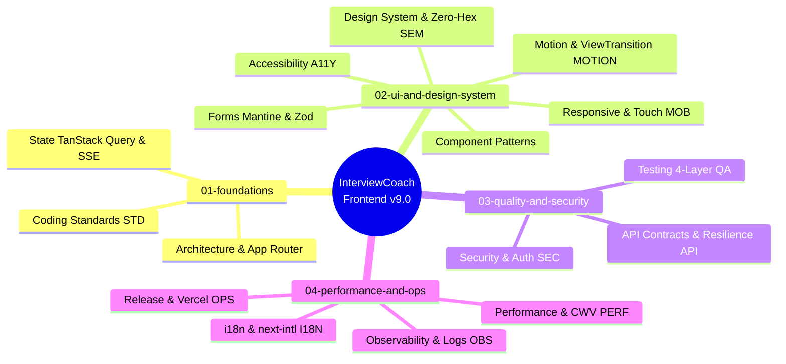
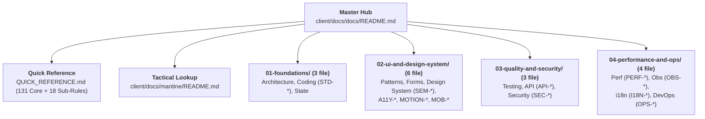

# Master Hub: Hệ Thống Quy Chuẩn Kiến Trúc Frontend InterviewCoach (`client/docs/docs/`)

> **Dự án:** InterviewCoach Frontend (`client/`)  
> **Phiên bản:** 9.0 (InterviewCoach Next.js 16 + React 19 + Mantine v9 Standard)  
> **Cổng tra cứu nhanh:** [Quick Reference Sheet & Ma trận 131 Rule IDs](./QUICK_REFERENCE.md) | [Cẩm nang thực chiến Mantine v9](../mantine/README.md) | [Bộ luật AI Agents (`AGENTS.md`)](../../../AGENTS.md)  
> **Trạng thái:** Nguồn chân lý duy nhất (Single Source of Truth — SSOT) định nghĩa chuẩn mực kiến trúc, quy chuẩn viết mã, kiểm thử, bảo mật và vận hành cho toàn bộ Frontend của InterviewCoach.

---

## MỤC LỤC

1. [Giới Thiệu, Chính Sách Clean Normative Docs & Kiến Trúc 4 Miền](#1-giới-thiệu-chính-sách-clean-normative-docs-kiến-trúc-4-miền)
2. [Bối Cảnh Kỹ Thuật Chuẩn Hóa Của InterviewCoach Frontend](#2-bối-cảnh-kỹ-thuật-chuẩn-hóa-của-interviewcoach-frontend)
3. [Sitemap Toàn Bộ 16 Chuyên Đề Theo 4 Miền Chức Năng](#3-sitemap-toàn-bộ-16-chuyên-đề-theo-4-miền-chức-năng)
4. [Khung Cấu Trúc 6 Phần Thống Nhất (Unified 6-Part Anatomy)](#4-khung-cấu-trúc-6-phần-thống-nhất-unified-6-part-anatomy)
5. [4 Lộ Trình Đọc Tài Liệu Theo Vai Trò](#5-4-lộ-trình-đọc-tài-liệu-theo-vai-trò)
6. [Ma Trận Trách Nhiệm (RACI) & Quy Trình RFC Governance](#6-ma-trận-trách-nhiệm-raci-quy-trình-rfc-governance)
7. [Các Câu Hỏi Thường Gặp (FAQ) Cho Kỹ Sư & AI Agents](#7-các-câu-hỏi-thường-gặp-faq-cho-kỹ-sư-ai-agents)

---

## 1. Giới Thiệu, Chính Sách Clean Normative Docs & Kiến Trúc 4 Miền

Hệ thống quy chuẩn Frontend của **InterviewCoach** được tổ chức theo mô hình **Master Hub & 4 Miền Chức Năng** (16 chuyên đề + `QUICK_REFERENCE.md`, tổng **131 Core Rule IDs + 18 Vercel Sub-Rules**), đảm bảo nguyên tắc **1 File = 1 Tiền tố SSOT — 0 chồng lấn**:

- **`client/docs/docs/` (Bộ Tiêu chuẩn Kiến trúc Doanh nghiệp):** Giải thích _tại sao_ (triết lý, sơ đồ Mermaid), đặc tả chính thức từng Rule ID, Case Studies tự chứa, đối chiếu `Anti-Pattern` vs `Best Practice`, ánh xạ CI Gate và PR Review Checklist.
- **`client/docs/mantine/` (Cẩm nang tra cứu nhanh — Tactical Lookup):** Bản đồ URL `mantine.dev` / `ui.mantine.dev`, bảng thay thế 1-1 Raw HTML → Mantine v9, setup cấu hình cốt lõi và bảng lệnh CLI hằng ngày.

### Chính sách Clean Normative Docs (Tách biệt khỏi mã nguồn legacy)

Vì nhiều màn hình cũ trong `client/` đang trong quá trình chuyển đổi (migrate) và còn chứa nợ kỹ thuật, toàn bộ tài liệu trong `client/docs/` tuân thủ 3 nguyên tắc nghiêm ngặt được chốt chặn tự động bởi `scripts/verify-docs-integrity.mjs`:

1. **Không trích xuất code từ mã nguồn nghiệp vụ cũ trong `client/`:** 100% đoạn mã tích cực trong tài liệu phải tự chứa (self-contained), lấy và adapt trực tiếp từ [`https://mantine.dev/`](https://mantine.dev/), [`https://ui.mantine.dev/`](https://ui.mantine.dev/), [`https://tanstack.com/query/v5`](https://tanstack.com/query/v5), [`client/.agents/skills/tanstack-integration-best-practices/`](../../.agents/skills/tanstack-integration-best-practices/SKILL.md), và bộ kỹ năng [`client/.agents/skills/vercel-*`](../../.agents/skills/vercel-react-best-practices/SKILL.md). Chỉ cho phép import hai alias nền tảng đã chuẩn hóa (`@/theme` và `@test-utils`).
2. **Mantine v9 Zero-Hex Precedence:** Mọi ví dụ chuyển đổi từ tài liệu React/Vercel đều phải được kiểm chứng tự động qua `analyzeSource()` (`scripts/check-ui-rules.mjs`) để đạt 0 raw HTML, 0 HEX/RGB/HSL và 0 hardcode `px`.
3. **Zero Raw-Icon Typography:** Tài liệu sử dụng nhãn chữ kỹ thuật chuẩn (`ERROR`, `WARN`, `ROADMAP`, `// Incorrect:`, `// Correct:`) thay cho raw Unicode emojis để giữ tính chuyên nghiệp và khả năng đọc cao.

---

## 2. Bối Cảnh Kỹ Thuật Chuẩn Hóa Của InterviewCoach Frontend

| Thành phần              | Stack chuẩn hóa (`client/package.json`)                                                                                                               | Ghi chú thực thi                                                                                         |
| :---------------------- | :---------------------------------------------------------------------------------------------------------------------------------------------------- | :------------------------------------------------------------------------------------------------------- |
| **Framework & Runtime** | Next.js `16.2.6` (App Router, `proxy.ts`), React `19.2.4`, TypeScript `^5`, `npm`                                                                     | 5 Route Groups: `(public)`, `(auth)`, `(candidate)`, `(admin)`, `(common)`                               |
| **UI Library & Icons**  | Mantine UI v9 (`@mantine/core`, `hooks`, `form`, `notifications`, `modals`, `dropzone`, `dates`, `charts` `^9.8.2`) + `@tabler/icons-react` `^3.52.0` | **Mantine-First & Zero-Hex Semantic-Only** (`client/theme.ts` RSC-safe, 5 vai trò ngữ nghĩa)             |
| **Styling & CSS Gate**  | PostCSS (`postcss-preset-mantine`, `postcss-simple-vars`), CSS Modules (`*.module.css`), Stylelint `^17.16.0`                                         | Thuần Mantine v9 qua `@layer mantine, components;` + `styles.layer.css` (100% Zero-Hex)                  |
| **Data, State & Forms** | `@tanstack/react-query` `^5`, SSE `EventSource`, Minimal React Context, Next.js URL params, `@mantine/form` (`uncontrolled`) + `zod` `^4.4.3`         | Không cài thêm store bên ngoài hay lớp wrapper form thừa                                                 |
| **Testing & QA**        | Vitest `^4.1.10` (`unit` vs `storybook`), `@test-utils`, `jest-axe`, Storybook `^10.5.5` (`@storybook/nextjs-vite`), Playwright `^1.62.1`             | Tích hợp `scripts/check-ui-rules.mjs` (`ui:lint`) và `scripts/verify-docs-integrity.mjs` (`verify:docs`) |
| **Deployment**          | Vercel (`client/vercel.json`, `regions: ["sin1"]`) + GitHub Actions CI                                                                                | Fail-fast `NEXT_PUBLIC_API_BASE_URL` tại `client/next.config.ts`                                         |

---

## 3. Sitemap Toàn Bộ 16 Chuyên Đề Theo 4 Miền Chức Năng

### Miền 1 — `01-foundations/` (Nền tảng Kiến trúc, Coding & State)

|  STT   | Chuyên đề                                                                  |       Tiền tố SSOT        | Nội dung trọng tâm                                                                                                                                                                                     |
| :----: | :------------------------------------------------------------------------- | :-----------------------: | :----------------------------------------------------------------------------------------------------------------------------------------------------------------------------------------------------- |
| **01** | [Architecture & Structure](./01-foundations/architecture-and-structure.md) |       _(Guidebook)_       | 5 Route Groups, `proxy.ts`, RSC vs `'use client'` (`server-serialization`), Hybrid Co-location & Rule of Three, đóng băng `components/ui/`, `bundle-barrel-imports`                                    |
| **02** | [Coding Standards](./01-foundations/coding-standards.md)                   | **`STD-*`** (16 + 18 Sub) | TypeScript Strict, `AbortSignal`, ISO-8601 UTC & hoisted `Intl.DateTimeFormat`, Structured Errors, React 19 `ref`/`use()`, `interviewcoach-convention-exempt`, Ternary `? : null`, 18 Vercel Sub-Rules |
| **03** | [State Management](./01-foundations/state-management.md)                   |       _(Guidebook)_       | 4 lớp State (TanStack Query v5 `queryKeys` Factory `client-swr-dedup`, Minimal Context, URL `useSearchParams`, `@mantine/hooks`), kênh SSE `EventSource` + Zod, Derived State, Optimistic Rollback     |

### Miền 2 — `02-ui-and-design-system/` (UI, Forms, Zero-Hex Design System, A11y, Motion & Responsive)

|  STT   | Chuyên đề                                                                             |    Tiền tố SSOT    | Nội dung trọng tâm                                                                                                                                                                                      |
| :----: | :------------------------------------------------------------------------------------ | :----------------: | :------------------------------------------------------------------------------------------------------------------------------------------------------------------------------------------------------ |
| **04** | [Component Patterns](./02-ui-and-design-system/component-patterns.md)                 |   _(Guidebook)_    | Compound Components (`architecture-avoid-boolean-props`), RSC/Client split, Error Boundaries 3 cấp, Polymorphic (`component={Link}`, `createPolymorphicComponent`), Styles API, `useUncontrolled`       |
| **05** | [Forms & Validation](./02-ui-and-design-system/forms-and-validation.md)               |   _(Guidebook)_    | `@mantine/form` `uncontrolled` + Zod v4 `schemaResolver({ sync: true })`, Boy Scout Migration Policy, `<Stepper>` + `createFormContext` Safe Draft, Dynamic List & `<Dropzone>`                         |
| **06** | [Design System & Styling](./02-ui-and-design-system/design-system-and-styling.md)     |  **`SEM-*`** (19)  | SSOT trọn vẹn 19 `SEM-*`, Zero-Hex Semantic-Only (`theme.ts`), Styling 3 bậc, CSS Layers chuyển tiếp, 3 Enterprise Layout Archetypes từ `ui.mantine.dev`, Storybook 10                                  |
| **07** | [Accessibility (WCAG 2.2 AA)](./02-ui-and-design-system/accessibility.md)             | **`A11Y-*`** (12)  | SSOT duy nhất 12 `A11Y-*`, Landmarks, Heading Order, Focus Trapping, APG Keyboard Matrix, `VisuallyHidden` milestone live announcer, `jest-axe` & `@storybook/addon-a11y`                               |
| **08** | [View Transitions & Motion](./02-ui-and-design-system/view-transitions-and-motion.md) | **`MOTION-*`** (8) | SSOT 8 `MOTION-*`, Dual-Track Next.js `16.2.6` (`<ViewTransition>`, `transitionTypes`, `addTransitionType` + Mantine `Transition`/`Collapse`), Placement Rule, GPU-only, `useReducedMotion`             |
| **09** | [Responsive & Touch UX](./02-ui-and-design-system/responsive-and-touch-ux.md)         |  **`MOB-*`** (10)  | SSOT 10 `MOB-*` thuần Web Mantine v9: 5 breakpoints `$mantine-breakpoint-*`, SSR-safe `hiddenFrom`/`visibleFrom`, `rem(44px)`, `AppShell` + `Drawer`, `<Table.ScrollContainer>`, `100dvh`, Mic fallback |

### Miền 3 — `03-quality-and-security/` (Kiểm thử, Hợp đồng API & Bảo mật)

|  STT   | Chuyên đề                                                                               |   Tiền tố SSOT   | Nội dung trọng tâm                                                                                                                                                                                       |
| :----: | :-------------------------------------------------------------------------------------- | :--------------: | :------------------------------------------------------------------------------------------------------------------------------------------------------------------------------------------------------- |
| **10** | [Testing & QA](./03-quality-and-security/testing-and-qa.md)                             |  _(Guidebook)_   | Kim tự tháp 4 tầng khớp `package.json`, Vitest 4 (`unit` vs `storybook`), `@test-utils`, Portal testing (`within`), Form Zod v4 testing, Accessible Queries, 12 tiêu chí DoD                             |
| **11** | [API Contracts & Resilience](./03-quality-and-security/api-contracts-and-resilience.md) | **`API-*`** (12) | SSOT 12 `API-*`, `Idempotency-Key`, `ApiClientError`, `AbortSignal`, Zod response validation, `Promise.all` (`async-parallel`), TanStack Query `client-swr-dedup`, `useNetwork()` Offline UX             |
| **12** | [Security & Auth](./03-quality-and-security/security-and-auth.md)                       | **`SEC-*`** (11) | SSOT 11 `SEC-*` (OWASP), HttpOnly Cookies + Next.js 16 `proxy.ts`, `getSafeNext()` chống Open Redirect, Mutex 401 Refresh, `server-auth-actions`, Session Purge `[Target]`, `DOMPurify` & CSP `[Target]` |

### Miền 4 — `04-performance-and-ops/` (Hiệu năng, Giám sát, i18n & DevOps)

|  STT   | Chuyên đề                                                                            |   Tiền tố SSOT    | Nội dung trọng tâm                                                                                                                                                                                             |
| :----: | :----------------------------------------------------------------------------------- | :---------------: | :------------------------------------------------------------------------------------------------------------------------------------------------------------------------------------------------------------- |
| **13** | [Performance & Web Vitals](./04-performance-and-ops/performance-and-web-vitals.md)   | **`PERF-*`** (13) | SSOT 13 `PERF-*`, CWV, ngân sách First Load JS ≤ 180KB gzip, `optimizePackageImports`, `bundle-dynamic-imports`, `@tanstack/react-virtual` `[Target]`, `rendering-content-visibility`, `rendering-hoist-jsx`   |
| **14** | [Observability & Telemetry](./04-performance-and-ops/observability-and-telemetry.md) |  **`OBS-*`** (9)  | SSOT 9 `OBS-*`, Mantine v9 `error.tsx` & `global-error.tsx` (`error.digest`), W3C `traceparent`, POJO context sạch PII, lộ trình 2 chặng trên Vercel (Chặng 1: Vercel RUM + Logger; Chặng 2: `@sentry/nextjs`) |
| **15** | [Internationalization](./04-performance-and-ops/internationalization.md)             | **`I18N-*`** (9)  | SSOT 9 `I18N-*`, `I18N-001` ở mức `WARN` / `ROADMAP` chờ `next-intl` (`vi` + `en`), phân loại 3 nhóm chuỗi CNTT, hoisted `Intl.*`, RTL `<DirectionProvider>` + CSS Logical Properties                          |
| **16** | [Release Engineering & DevOps](./04-performance-and-ops/release-and-devops.md)       | **`OPS-*`** (12)  | SSOT 12 `OPS-*`, fail-fast `NEXT_PUBLIC_API_BASE_URL`, Vercel `sin1`, Ma trận Cache-Busting an toàn theo `vercel-optimize`, CI Gate, Token Hygiene, SemVer & Conventional Commits                              |

---

## 4. Khung Cấu Trúc 6 Phần Thống Nhất (Unified 6-Part Anatomy)

Mọi chuyên đề trong 16 tài liệu đều tuân thủ 6 khối chuẩn (được kiểm tra tự động bởi `checkSixPartAnatomy` trong `verify:docs`):

1. **Header Metadata & Mục lục:** Khai báo `Phiên bản: 9.0`, vai trò SSOT, trạng thái `[Active]` / `[Target]`, và liên kết tham chiếu quốc tế.
2. **Triết lý Kiến trúc & Sơ đồ Mermaid:** Hình dung nhanh ranh giới, luồng dữ liệu hoặc cây quyết định.
3. **Đặc tả Kỹ thuật & Rule IDs:** Mỗi Rule ID gắn neo `<a id="...">` đối soát 2 chiều chính xác 131 Core IDs với `QUICK_REFERENCE.md`.
4. **Case Studies Tự Chứa & Bảng Đối Chiếu Anti-Pattern vs Best Practice:** Mã mẫu tự chứa lấy từ `mantine.dev`, `ui.mantine.dev`, và `vercel-*` skills, chuẩn `.prettierrc`, pass `analyzeSource()`.
5. **Bảng Ánh Xạ Tooling Kiểm Toán CI:** Liên kết trực tiếp tới lệnh `npm run ...` trong `client/package.json`.
6. **Checklist Định Lượng PR Review Gate:** Tối thiểu 6–12 tiêu chí checkbox kiểm chứng được cho tác giả và reviewer.

---

## 5. 4 Lộ Trình Đọc Tài Liệu Theo Vai Trò

| Vai trò                              | Thứ tự đọc khuyến nghị                                                    | Mục tiêu                                                                         |
| :----------------------------------- | :------------------------------------------------------------------------ | :------------------------------------------------------------------------------- |
| **Kỹ sư mới (Onboarding — Ngày 1)**  | `QUICK_REFERENCE.md` → `../mantine/README.md` → `01-foundations/*`        | Nắm 3 điều cấm kỵ, cấu trúc App Router, TanStack Query & bộ lệnh kiểm toán       |
| **Feature Developer (UI / Migrate)** | `02-ui-and-design-system/*` → `03-quality-and-security/testing-and-qa.md` | Xây giao diện Mantine v9 Zero-Hex, Form Zod v4, A11y & unit test `@test-utils`   |
| **Tech Lead / Reviewer / QA**        | `QUICK_REFERENCE.md` (Ma trận 131 Rule IDs) → `03-quality-and-security/*` | Review PR theo DoD 12 tiêu chí, kiểm soát API contract, bảo mật & coverage       |
| **DevOps / Performance Owner**       | `04-performance-and-ops/*`                                                | Kiểm soát First Load JS ≤ 180KB gzip, Vercel CI/CD, Observability & Cache policy |

---

## 6. Ma Trận Trách Nhiệm (RACI) & Quy Trình RFC Governance

| Hạng mục                                          | Feature Dev | Tech Lead | QA / Reviewer | AI Agent |
| :------------------------------------------------ | :---------: | :-------: | :-----------: | :------: |
| Tuân thủ 131 Core Rule IDs trong PR               |    **R**    |   **A**   |     **C**     |  **R**   |
| Duyệt ngoại lệ `interviewcoach-convention-exempt` |    **R**    |   **A**   |     **I**     |  **C**   |
| Đề xuất sửa đổi / bổ sung quy chuẩn (RFC)         |    **C**    |   **A**   |     **C**     |  **I**   |
| Chạy `npm run verify:docs` khi sửa tài liệu       |    **R**    |   **A**   |     **C**     |  **R**   |

### Quy trình cập nhật quy chuẩn (RFC Governance)

1. Mở PR chỉnh sửa trực tiếp file SSOT tương ứng trong `client/docs/docs/<miền>/` và đồng bộ `QUICK_REFERENCE.md` nếu thêm/sửa Rule ID.
2. Đảm bảo chạy `npm run verify:docs` trong `client/` đạt **0 errors, 0 warnings** (xác thực 0 raw emoji, 0 `@/` legacy extract, 16/16 đạt 6-Part Anatomy, 131/131 Core Rule IDs synced 2 chiều, và 100% code blocks pass `analyzeSource()`).
3. Tech Lead duyệt thay đổi và cập nhật trạng thái (`[Target]` → `[Active]`) chỉ sau khi mã nguồn thực tế đã đáp ứng 100%.

---

## 7. Các Câu Hỏi Thường Gặp (FAQ) Cho Kỹ Sư & AI Agents

- **Hỏi: Có được sao chép code từ các component/hook cũ trong `client/` để làm mẫu cho tính năng mới hoặc tài liệu không?**  
  **Đáp:** **Không.** Mã nguồn legacy trong `client/` còn tồn tại nhiều điểm chưa chuẩn (barrel imports, Tailwind/Radix, thiếu return type, thiếu Zod validation). Luôn lấy chuẩn từ tài liệu trong `client/docs/`, [`mantine.dev`](https://mantine.dev/), [`ui.mantine.dev`](https://ui.mantine.dev/), và `client/.agents/skills/vercel-*`.
- **Hỏi: Tôi nên tạo wrapper `<PrimaryButton>` trong `components/ui/` không?**  
  **Đáp:** **Không.** Theo nguyên tắc **Mantine-First** (`SEM-HTML-001`, `SEM-PROPS-001`), import trực tiếp `<Button color="brand">` từ `@mantine/core`. Thư mục `components/ui/` legacy đã được gỡ bỏ hoàn toàn.
- **Hỏi: Khi nào được phép dùng ngoại lệ `interviewcoach-convention-exempt`?**  
  **Đáp:** Chỉ trong tình huống kỹ thuật bất khả kháng (DOM mount ref cho audio canvas hoặc `style={transitionStyles}` của Mantine `Transition`), bắt buộc ghi đúng định dạng `// interviewcoach-convention-exempt: <RULE_ID> <lý do> until: YYYY-MM-DD` (`SEM-GOV-001`, `STD-EXEMPT-001`).
- **Hỏi: Tại sao một số mục ghi `[Target Standard]`?**  
  **Đáp:** Để đảm bảo 100% trung thực với hiện trạng — kỹ sư và AI coding agents tuyệt đối không import package chưa cài (`next-intl`, `@sentry/nextjs`, `msw`, `dompurify`, `@tanstack/react-virtual`) trước khi cài đặt theo đúng lộ trình.
- **Hỏi: Đọc `client/docs/mantine/` hay `client/docs/docs/` trước khi viết code UI?**  
  **Đáp:** Mở `client/docs/mantine/` khi cần tra nhanh URL `mantine.dev`, bảng thay thế HTML hoặc lệnh CLI; đọc `client/docs/docs/` khi cần nắm kiến trúc, mẫu tự chứa chuẩn quốc tế và đối chiếu đủ 131 Core Rule IDs.
