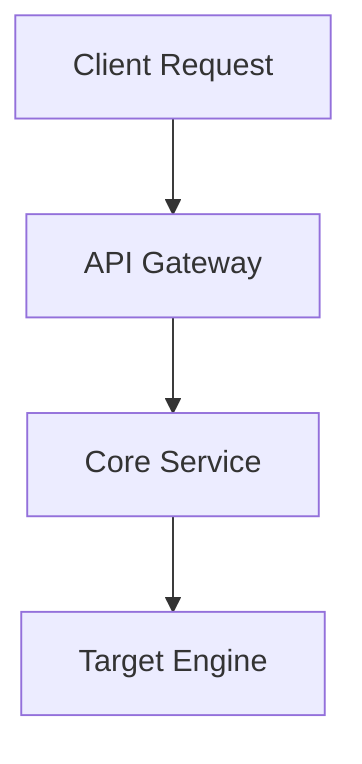

# Quy chuẩn Quản trị & Cấu trúc Tài liệu Kiến trúc Hệ thống
> **InterviewCoach Architecture Documentation Guidelines (`docs/architecture/`)** — Bộ quy chuẩn phân loại taxonomy, quy ước đặt tên, bộ khung cấu trúc chuẩn 5 phần (Standard Anatomy), mẫu template Markdown và quy trình chuẩn hóa tài liệu sau mỗi Phase refactor.

---

## 1. Triết lý & Mục tiêu (Philosophy & Objectives)

1. **Living Documentation ("As-Built" thay vì "As-Planned")**:
   - Tài liệu tại `docs/architecture/` phản ánh 100% hiện trạng mã nguồn thực tế đang vận hành, không phải bản kế hoạch dự thảo.
   - Khi mã nguồn thay đổi, tài liệu kiến trúc tương ứng bắt buộc phải được cập nhật đồng thời.
2. **Onboarding-First Design**:
   - Mọi thư mục phân hệ (subsystem) bắt buộc phải đóng vai trò là tài liệu hướng dẫn kỹ sư mới (*Onboarding Guide*) để có thể clone repo, cài đặt môi trường, chạy service và thực hiện lệnh gọi thử nghiệm trong vòng dưới 15 phút.
3. **Mở rộng Bền vững (Scalability without Clutter)**:
   - Cấu trúc thư mục được phân định rõ ràng theo miền chức năng, cho phép bổ sung các Phase tiếp theo (Phase 2 RAG, Phase 3 Assessment, Phase 4 vLLM, Phase 5 DevOps/Infra) mà không làm xáo trộn hay phân mảnh hệ thống tài liệu.

---

## 2. Taxonomy & Mô hình Phân loại Thư mục (Directory Taxonomy)

Hệ thống tài liệu tại `docs/architecture/` được tổ chức theo mô hình **Miền chức năng (Functional Subsystems)** kết hợp thư mục dùng chung:

```text
docs/architecture/
├── README.md                          # Master Architecture Map, Directory Index & Quick Links
├── CONVENTIONS.md                     # Quy chuẩn Tài liệu (Tài liệu này)
├── overview/                          # Kiến trúc Tổng thể: Polyglot, Strangler Fig, Global Topology
├── audio-engine/                      # Subsystem: STT, TTS, In-Memory DSP, Voice Metrics, MediaModule
├── rag-search/                        # Subsystem: pgvector, Hybrid RAG, Embeddings, Question Matching
├── assessment-engine/                 # Subsystem: Deep Assessment, SFIA Scoring Engine, AI Evaluator
├── llm-runtime/                       # Subsystem: vLLM Serving, Self-Hosted LLM Inference, Streaming
├── infra-devops/                      # Subsystem: Docker, CI/CD Actions Matrix, Backup/DR, Observability
├── backend-core/                      # Shared Core: NestJS Modular Monolith, Prisma, ACID, BullMQ
└── adrs/                              # Architecture Decision Records (ADR-001, ADR-002, ...)
```

---

## 3. Quy ước Đặt tên & Cấu trúc Tệp (Naming Conventions)

1. **Tên Thư mục**:
   - Sử dụng định dạng `kebab-case` thuần túy, đại diện cho domain/phân hệ kỹ thuật: `audio-engine`, `rag-search`, `infra-devops`.
   - **Tuyệt đối không dùng**: Số thứ tự phase (ví dụ: `01_audio_engine/`) làm tên thư mục trong `docs/architecture/` để bảo đảm tính trường tồn khi các phân hệ tiến hóa độc lập.
2. **Tên Tệp Chuyên đề**:
   - Sử dụng định dạng `kebab-case.md` (ví dụ: `stt-pipeline.md`, `python-ai-service-runtime.md`, `contracts-and-testing.md`).
   - **Tuyệt đối không dùng**: Tiền tố số thứ tự task như `01_TASK_1.1_...` để tránh tình trạng phải đổi tên hàng loạt tệp khi tái cấu trúc hoặc chèn thêm tài liệu mới.
3. **Tệp Dẫn đường Bắt buộc**:
   - Mỗi thư mục phân hệ con **bắt buộc phải có tệp `README.md`** đóng vai trò là cửa ngõ tổng quan và hướng dẫn Onboarding cho phân hệ đó.

---

## 4. Bộ khung Cấu trúc Chuẩn 5 Phần (Standard Document Anatomy)

Mọi tài liệu chuyên đề kỹ thuật chuyên sâu (`*.md`) bên trong các thư mục phân hệ bắt buộc phải tuân thủ nghiêm ngặt cấu trúc 5 phần sau:

### 4.1 Header Metadata
```markdown
# [TÊN TIÊU ĐỀ KỸ THUẬT IN HOA HOẶC TITLE CASE]

> **Trạng thái**: Living / Production Specification  
> **Cấp độ**: Deep Technical Specification (Architecture & Implementation)  
> **Áp dụng cho**: [Liệt kê các module/thư mục mã nguồn áp dụng, ví dụ: ai-service/app/services/stt/, server/src/modules/media/]  
> **Tài liệu cha**: [README.md](README.md)  
> **Cập nhật lần cuối**: [YYYY-MM-DD]  
```

### 4.2 Phần 1: Bối cảnh, Mục tiêu & Lý do Thiết kế (Design Rationale & Trade-offs)
- Nêu rõ vấn đề kỹ thuật cần giải quyết và mục tiêu cốt lõi.
- Phân tích rõ các phương án đã xem xét và lý do chọn giải pháp hiện tại (ví dụ: Tại sao chọn In-memory PyAV thay vì ghi file đĩa `/tmp`? Tại sao chọn Hybrid TTS Kokoro + EdgeTTS?).

### 4.3 Phần 2: Sơ đồ Kiến trúc & Luồng Dữ liệu (Mermaid Topology & Sequence Diagrams)
- Bắt buộc có ít nhất một sơ đồ **Mermaid** trực quan (`graph TD/LR` cho kiến trúc thành phần hoặc `sequenceDiagram` cho luồng tuần tự).
- Thể hiện rõ các thành phần tương tác, giao thức kết nối, và ranh giới dịch vụ.

### 4.4 Phần 3: Chi tiết Hiện thực Kỹ thuật (Technical Implementation)
- Giải thích cấu trúc mã nguồn, các lớp/hàm trọng tâm, cơ chế khởi tạo và vòng đời (*Lifespan / Singletons*).
- Nêu rõ các thuật toán đặc thù (ví dụ: xử lý DSP 16kHz mono, đo lường WPM dựa trên `speechDurationSeconds`, regex lọc từ đệm song ngữ).
- Trích dẫn các đoạn code then chốt để minh họa (kèm đường dẫn link file thực tế).

### 4.5 Phần 4: Đặc tả Hợp đồng & Giao diện (Wire Contract Specification)
- Đặc tả chi tiết các endpoint HTTP / RPC: URL, HTTP Method, Headers xác thực (`x-internal-secret`).
- Request Schema và Response Schema với 100% thuộc tính dùng chuẩn `camelCase`.
- Bảng ánh xạ mã lỗi chuẩn hóa (*Error Envelope*) và HTTP status codes tương ứng.

### 4.6 Phần 5: Hướng dẫn Kiểm thử, Vận hành & Xử lý Sự cố (Testing, Operations & Troubleshooting)
- Câu lệnh cụ thể để chạy Unit Test và Contract Test cho phân hệ.
- Bảng danh mục biến môi trường liên quan kèm giá trị mặc định.
- Cẩm nang các lỗi thường gặp trong thực tế (*Common Pitfalls*) và hướng dẫn khắc phục từng bước (*Step-by-step resolution*).

---

## 5. Mẫu Template Chuẩn cho Tài liệu Chuyên đề (Reusable Markdown Template)

Dưới đây là mẫu khung Markdown để copy và tạo mới bất kỳ tài liệu chuyên đề nào:

```markdown
# [TÊN TÀI LIỆU CHUYÊN ĐỀ]

> **Trạng thái**: Living / Production Specification  
> **Cấp độ**: Deep Technical Specification  
> **Áp dụng cho**: `<path/to/codebase>`  
> **Tài liệu cha**: [README.md](README.md)  
> **Cập nhật lần cuối**: 2026-10-08  

---

## 1. BỐI CẢNH, MỤC TIÊU & LÝ DO THIẾT KẾ (DESIGN RATIONALE)
### 1.1 Bối cảnh & Vấn đề Cần giải quyết
<!-- Mô tả vấn đề hiện tại và phạm vi giải quyết -->

### 1.2 Lý do Lựa chọn Giải pháp Kỹ thuật (Trade-offs)
<!-- Bảng hoặc danh sách so sánh các phương án và lý do lựa chọn -->

---

## 2. SƠ ĐỒ KIẾN TRÚC & LUỒNG DỮ LIỆU (DIAGRAMS)


---

## 3. CHI TIẾT HIỆN THỰC KỸ THUẬT (TECHNICAL IMPLEMENTATION)
### 3.1 Cấu trúc Module & Điểm khởi tạo
<!-- Liệt kê file và vai trò -->

### 3.2 Cơ chế Xử lý & Thuật toán Trọng tâm
<!-- Giải thích chi tiết logic, công thức hoặc luồng xử lý -->

---

## 4. ĐẶC TẢ HỢP ĐỒNG & GIAO DIỆN (WIRE CONTRACT SPECIFICATION)
### 4.1 Endpoints & Giao thức
- **URL**: `POST /api/v1/...`
- **Headers**: `x-internal-secret: <secret>`

### 4.2 Payload Schema (Wire camelCase)
```json
{
  "fieldExample": "value"
}
```

### 4.3 Bảng Mã Lỗi Chuẩn hóa
| HTTP Status | Error Code | Ý nghĩa | Cách xử lý |
| :---: | :--- | :--- | :--- |
| 400 | `VALIDATION_ERROR` | Dữ liệu đầu vào không hợp lệ | Kiểm tra lại body |

---

## 5. HƯỚNG DẪN KIỂM THỬ, VẬN HÀNH & XỬ LÝ SỰ CỐ
### 5.1 Lệnh Kiểm thử (Testing Commands)
```bash
# Lệnh chạy test
```

### 5.2 Biến Môi trường Liên quan
| Biến | Mặc định | Mô tả |
| :--- | :--- | :--- |

### 5.3 Cẩm nang Xử lý Sự cố Thường gặp (Troubleshooting)
1. **Triệu chứng A**:
   - *Nguyên nhân*: ...
   - *Cách khắc phục*: ...
```

---

## 6. Quy trình 4 Bước Chuẩn hóa sau mỗi Phase Refactor

Khi kết thúc một Phase trong lộ trình Refactor, kỹ sư hoặc AI Agent **bắt buộc** thực hiện tuần tự 4 bước sau:

1. **Bước 1: Kiểm định Tiêu chí Hoàn thành (Quality Gate Audit)**:
   - Chạy toàn bộ test suites (`pytest`, `jest`).
   - Kiểm tra build và conventions (`npm run build`, `npm run check:conventions`).
   - Đảm bảo service khởi động và phản hồi healthcheck thành công.
2. **Bước 2: Chuyển thể Nội dung sang `docs/architecture/<subsystem>/`**:
   - Tạo mới hoặc cập nhật thư mục phân hệ tương ứng.
   - Viết `README.md` của phân hệ kèm mục **Developer Onboarding Quickstart**.
   - Chuyển thể các kế hoạch triển khai từng task thành các tài liệu chuyên đề theo bộ khung 5 phần ở trên.
3. **Bước 3: Gắn Banner Hoàn thành cho Kế hoạch cũ**:
   - Gắn callout banner `COMPLETED` tại đầu các file plan tương ứng trong `docs/refactor-docs/<phase>/` dẫn link sang tài liệu kiến trúc chính thức.
4. **Bước 4: Đồng bộ Mục lục Toàn hệ thống**:
   - Thêm liên kết vào `docs/architecture/README.md`.
   - Cập nhật ma trận trạng thái trong `docs/refactor-docs/00_OVERVIEW_STRATEGIC_BLUEPRINT.md`.
   - Cập nhật mục tài liệu kiến trúc tại `docs/README.md`.
