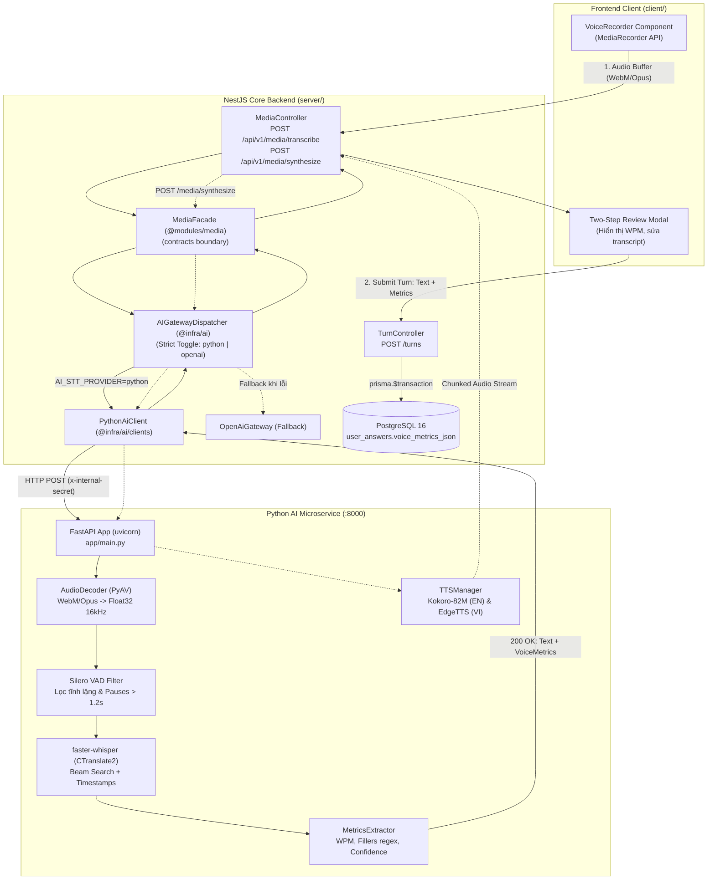

# PHÂN HỆ AUDIO ENGINE: STT, TTS & IN-MEMORY AUDIO PROCESSING
> **Audio Engine Subsystem Master Guide & Developer Onboarding** — Trung tâm kiến trúc xử lý âm thanh, nhận diện giọng nói (STT), tổng hợp giọng nói (TTS), trích xuất chỉ số âm học và tích hợp NestJS MediaModule.

---

## 1. TỔNG QUAN PHÂN HỆ (SUBSYSTEM OVERVIEW)

Audio Engine là phân hệ xử lý giọng nói thời gian thực của InterviewCoach, được thiết kế nhằm giải quyết triệt để 2 vấn đề lớn trong các ứng dụng phỏng vấn ảo truyền thống:
1. **Sự bất ổn định của Web Speech API**: Trình duyệt thường xuyên ngắt kết nối khi ứng viên im lặng suy nghĩ, không đồng nhất giữa Chrome/Safari/Firefox, và không có khả năng phân tích nhịp ngập ngừng hay từ đệm kỹ thuật.
2. **Chi phí và Độ trễ cao của Cloud API**: Gọi OpenAI Whisper API trên đám mây tiêu tốn $0.006/phút và chịu độ trễ mạng quốc tế $1.5\text{s} - 3.5\text{s}$.

Audio Engine chuyển đổi toàn bộ pipeline sang mô hình **Tự lưu trữ Cục bộ (Self-hosted Compute)** với **PyAV In-memory DSP**, **Silero VAD**, **faster-whisper (CTranslate2)**, và **Hybrid TTS (Kokoro-82M EN + EdgeTTS VI)**, mang lại tốc độ nhận diện nhanh gấp 4 lần và chi phí vận hành bằng 0 trên hạ tầng tự quản lý.

---

## 2. SƠ ĐỒ KIẾN TRÚC TOÀN PHÂN HỆ (SUBSYSTEM TOPOLOGY)



---

## 3. DEVELOPER ONBOARDING QUICKSTART (HƯỚNG DẪN DÀNH CHO KỸ SƯ MỚI)

Mục này hướng dẫn kỹ sư mới khởi chạy và kiểm thử phân hệ Audio Engine trên môi trường Local Development trong vòng 5 phút:

### 3.1 Bước 1: Yêu cầu Tiên quyết (Prerequisites)
- **Python**: Phiên bản `>= 3.11` (khuyến nghị Python 3.11 hoặc 3.12).
- **Trình quản lý gói `uv`**: Cài đặt Astral `uv` (công cụ thay thế `pip` với tốc độ cài đặt x10-x100 lần):
  ```powershell
  # Cài đặt uv trên Windows (PowerShell)
  powershell -ExecutionPolicy ByPass -c "irm https://astral.sh/uv/install.ps1 | iex"
  ```
- **Node.js**: Phiên bản `>= 20.x` và `npm`.
- **C/C++ Build Tools**: Đã cài đặt Visual C++ Build Tools hoặc `ffmpeg` (để PyAV giải mã nhị phân âm thanh).

### 3.2 Bước 2: Khởi chạy Python AI Microservice (`ai-service/`)
1. Di chuyển vào thư mục `ai-service`:
   ```bash
   cd ai-service
   ```
2. Cài đặt toàn bộ dependencies tự động qua `uv.lock`:
   ```bash
   uv sync
   ```
3. Tạo tệp `.env` cục bộ (sao chép từ `.env.example`):
   ```bash
   cp .env.example .env
   ```
4. Khởi động FastAPI server với chế độ Hot-reload:
   ```bash
   uv run uvicorn app.main:app --host 0.0.0.0 --port 8000 --reload
   ```
   Service sẽ nạp cấu hình và thông báo:
   ```text
   INFO:     service_starting env=development device=cpu whisperModel=small
   INFO:     Uvicorn running on http://0.0.0.0:8000 (Press CTRL+C to quit)
   ```

### 3.3 Bước 3: Cấu hình Biến Môi trường Đồng bộ giữa các Tầng

| Biến Môi Trường | Tệp Áp Dụng | Giá Trị Mặc Định Khuyến Nghị | Ý Nghĩa Kỹ Thuật |
| :--- | :--- | :--- | :--- |
| `INTERNAL_AI_SECRET` | `ai-service/.env` & `server/.env` | `dev-secret-internal-ai-key` | Khóa xác thực header `x-internal-secret` giữa NestJS và Python |
| `AI_SERVICE_URL` | `server/.env` | `http://localhost:8000` | Địa chỉ mạng của Python AI Microservice |
| `AI_STT_PROVIDER` | `server/.env` | `python` | Provider STT: `python` (faster-whisper) hoặc `openai` (Whisper API Fallback) |
| `AI_STT_TIMEOUT_MS`| `server/.env` | `60000` | Giới hạn timeout cuộc gọi STT (mặc định 60s cho audio dài trên CPU) |
| `WHISPER_MODEL_SIZE`| `ai-service/.env` | `small` | Kích thước mô hình STT (`tiny`, `base`, `small`, `medium`) |
| `WHISPER_DEVICE` | `ai-service/.env` | `cpu` | Thiết bị phần cứng suy luận (`cpu` hoặc `cuda`) |
| `WHISPER_COMPUTE_TYPE`| `ai-service/.env` | `int8` | Kiểu lượng tử hóa CTranslate2 (`int8` trên CPU, `float16` trên GPU) |

### 3.4 Bước 4: Kiểm tra Sức khỏe Dịch vụ (Healthcheck với cURL)
Mở một cửa sổ dòng lệnh khác và kiểm tra phản hồi từ service:

```bash
# 1. Kiểm tra Liveness Probe
curl -i http://localhost:8000/healthz
# Kỳ vọng: HTTP/1.1 200 OK -> {"status":"ok","version":"1.0.0"}

# 2. Kiểm tra Readiness Probe (Xác nhận các model ML đã nạp vào RAM)
curl -i http://localhost:8000/ready
# Kỳ vọng: HTTP/1.1 200 OK -> {"status":"ready","whisperModel":"small","whisperDevice":"cpu"}
```

### 3.5 Bước 5: Gọi Thử Nghiệm API STT & TTS
```bash
# 1. Thử nghiệm Tổng hợp Giọng nói (TTS)
curl -X POST http://localhost:8000/api/v1/tts/synthesize \
  -H "Content-Type: application/json" \
  -H "x-internal-secret: dev-secret-internal-ai-key" \
  -d '{"text": "Chào bạn, hãy giới thiệu về bản thân và các dự án gần đây của bạn.", "language": "vi"}' \
  --output test_speech.wav

# 2. Thử nghiệm Chuyển đổi Giọng nói thành Văn bản (STT) với file vừa tạo
curl -X POST http://localhost:8000/api/v1/stt/transcribe \
  -H "x-internal-secret: dev-secret-internal-ai-key" \
  -F "file=@test_speech.wav;type=audio/wav" \
  -F "language=vi" \
  -F "vad_filter=true"
```
Kết quả trả về chuẩn JSON `camelCase`:
```json
{
  "text": "Chào bạn, hãy giới thiệu về bản thân và các dự án gần đây của bạn.",
  "language": "vi",
  "durationSeconds": 4.2,
  "metrics": {
    "wordsPerMinute": 142.8,
    "speechDurationSeconds": 4.2,
    "totalPauseDurationSeconds": 0.0,
    "pauseCount": 0,
    "fillerWordsCount": 0,
    "fillerWords": [],
    "confidenceScore": 0.96
  },
  "words": []
}
```

### 3.6 Bước 6: Chạy Bộ Kiểm thử Đảm bảo Tính Toàn vẹn (Run Test Suites)
```bash
# 1. Chạy toàn bộ test suites của Python AI Service (Contracts + Unit tests)
cd ai-service
uv run pytest

# 2. Chạy test suites của NestJS Media Module
cd ../server
npm test -- media-facade.service.spec.ts media.controller.spec.ts ai-gateway-dispatcher.service.spec.ts
```

---

## 4. MỤC LỤC TÀI LIỆU CHUYÊN SÂU (TECHNICAL DEEP DIVES)

Để tìm hiểu sâu hơn từng thành phần của phân hệ, hãy đọc các tài liệu kỹ thuật sau:

1. **[FastAPI Runtime Core & Đóng gói Container](python-ai-service-runtime.md)**:
   - Cơ chế Lifespan, cấu hình Pydantic BaseSettings, bảo mật `x-internal-secret`, Structlog JSON, Prometheus metrics, và Dockerfile multi-stage CPU/GPU.
2. **[STT Pipeline & Khai phá Chỉ số Âm học (Voice Metrics)](stt-pipeline.md)**:
   - Xử lý âm thanh In-Memory (Zero-Disk) qua PyAV, Silero VAD lọc tĩnh lặng & phát hiện khoảng lặng ngập ngừng $> 1.2\text{s}$, faster-whisper CTranslate2, và công thức tính WPM / từ đệm song ngữ.
3. **[Hybrid TTS Pipeline & Truyền phát Âm thanh](tts-pipeline.md)**:
   - Kiến trúc kết hợp Kokoro-82M neural TTS (Tiếng Anh) và Microsoft Edge TTS (Tiếng Việt), truyền phát nhị phân Chunked Streaming, và cơ chế fallback Web Speech API.
4. **[Hợp đồng Giao tiếp & Kiểm thử Hợp đồng Đa ngôn ngữ](contracts-and-testing.md)**:
   - Chuẩn hóa Wire `camelCase`, mô hình Shared JSON Fixtures tại `contracts/fixtures/`, và cơ chế Dual Contract Testing (Pytest $\leftrightarrow$ Jest) triệt tiêu Schema Drift.
5. **[Tích hợp NestJS Core & Luồng Two-Step Voice Flow](nestjs-integration-flow.md)**:
   - Kiến trúc `MediaController`, `MediaFacade`, `PythonAiClient`, quy trình Two-Step Voice Flow và cơ chế chuyển mạch dự phòng tức thời Strict Toggle.
