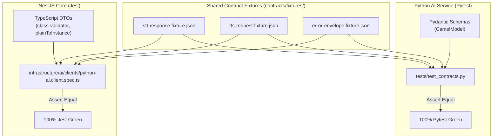

# WIRE CONTRACT SPECIFICATION & DUAL CONTRACT TESTING FRAMEWORK

> **Trạng thái**: Living / Production Specification  
> **Cấp độ**: Deep Technical Specification (Inter-Service Contracts & Testing Architecture)  
> **Áp dụng cho**: `contracts/fixtures/`, `ai-service/app/schemas/`, `server/src/modules/media/dto/`, `server/src/infrastructure/ai/`  
> **Tài liệu cha**: [README.md](README.md)  
> **Cập nhật lần cuối**: 2026-10-08  

---

## 1. BỐI CẢNH, MỤC TIÊU & LÝ DO THIẾT KẾ (DESIGN RATIONALE)

### 1.1 Nguy cơ Lệch Chuẩn Hợp đồng Ngầm (Silent Schema Drift)
Trong kiến trúc Polyglot Monorepo gồm 2 ngôn ngữ:
- **NestJS (TypeScript)**: Theo quy ước đặt tên biến chuẩn JavaScript/JSON là `camelCase` (ví dụ: `wordsPerMinute`, `speechDurationSeconds`).
- **FastAPI (Python)**: Theo quy ước đặt tên chuẩn PEP 8 là `snake_case` (ví dụ: `words_per_minute`, `speech_duration_seconds`).

Nếu không có quy chuẩn hợp đồng thống nhất:
1. Lập trình viên Python sẽ serialize JSON thành `snake_case`, trong khi NestJS DTO mong đợi `camelCase`, dẫn đến các trường dữ liệu bị `undefined` âm thầm mà không báo lỗi biên dịch (*Silent Null Bug*).
2. Khi một bên sửa tên trường hoặc xóa trường, bên kia sập lỗi HTTP 500 khi triển khai lên môi trường Production.

### 1.2 Quyết định Kiến trúc: Wire Contract Chuẩn hóa & Dual Testing
1. **100% Wire JSON là `camelCase`**: Mọi dữ liệu truyền qua mạng HTTP REST giữa NestJS và Python bắt buộc phải sử dụng định dạng `camelCase`.
2. **Tự động Hóa Chuyển đổi qua Pydantic `CamelModel`**: Phía Python viết code chuẩn `snake_case`, nhưng Pydantic tự động chuyển đổi sang `camelCase` khi dump ra JSON (`alias_generator=to_camel`).
3. **Mô hình Shared JSON Fixtures**: Đặt tại thư mục dùng chung `contracts/fixtures/`, đóng vai trò là "bản cam kết hợp đồng duy nhất" (*Single Source of Truth*).
4. **Cơ chế Dual Contract Testing**: Cả Pytest (Python) và Jest (NestJS) đều chạy test độc lập đối soát với cùng một bộ JSON fixtures để phát hiện lệch hợp đồng ngay tại máy lập trình viên.

---

## 2. SƠ ĐỒ ĐỐI SOÁT HỢP ĐỒNG SONG HÀNH (DUAL CONTRACT TESTING FLOW)



---

## 3. CHI TIẾT HIỆN THỰC KỸ THUẬT (TECHNICAL IMPLEMENTATION)

### 3.1 Pydantic Base CamelModel (`ai-service/app/schemas/base.py`)
Triển khai tại [`ai-service/app/schemas/base.py`](file:///c:/Users/An/Documents/GR1/InterviewCoach/ai-service/app/schemas/base.py):
```python
from pydantic import BaseModel, ConfigDict
from pydantic.alias_generators import to_camel


class CamelModel(BaseModel):
    model_config = ConfigDict(
        alias_generator=to_camel,
        populate_by_name=True,
        from_attributes=True,
    )
```
Tất cả các schema STT và TTS trong Python kế thừa từ `CamelModel`:
```python
class VoiceMetrics(CamelModel):
    words_per_minute: float
    speech_duration_seconds: float
    total_pause_duration_seconds: float
    pause_count: int
    filler_words_count: int
    filler_words: list[str]
    confidence_score: float
```
Khi gọi `metrics.model_dump(by_alias=True)`, Pydantic tự động sinh ra các khóa `wordsPerMinute`, `speechDurationSeconds`, v.v.

### 3.2 NestJS Response Serialization DTOs (`server/src/modules/media/dto/`)
Phía NestJS sử dụng `class-transformer` để deserialize an toàn:
```typescript
export class VoiceMetricsDto {
  @IsNumber()
  wordsPerMinute: number;

  @IsNumber()
  speechDurationSeconds: number;

  @IsNumber()
  totalPauseDurationSeconds: number;

  @IsInt()
  pauseCount: number;

  @IsInt()
  fillerWordsCount: number;

  @IsArray()
  fillerWords: string[];

  @IsNumber()
  confidenceScore: number;
}
```

---

## 4. DANH MỤC SHARED FIXTURES & ĐẶC TẢ WIRE JSON

Thư mục [`contracts/fixtures/`](file:///c:/Users/An/Documents/GR1/InterviewCoach/contracts/fixtures/):

### 4.1 Fixture STT Response (`stt-response.fixture.json`)
```json
{
  "text": "Dạ em chào anh chị, em có hai năm kinh nghiệm làm việc với NestJS.",
  "language": "vi",
  "durationSeconds": 5.8,
  "metrics": {
    "wordsPerMinute": 145.2,
    "speechDurationSeconds": 5.1,
    "totalPauseDurationSeconds": 0.0,
    "pauseCount": 0,
    "fillerWordsCount": 1,
    "fillerWords": ["dạ"],
    "confidenceScore": 0.94
  },
  "words": [
    {
      "word": "Dạ",
      "start": 0.12,
      "end": 0.35,
      "confidence": 0.96
    }
  ]
}
```

### 4.2 Fixture TTS Request (`tts-request.fixture.json`)
```json
{
  "text": "Could you please explain how index scans work in PostgreSQL?",
  "language": "en",
  "voice": "af_heart",
  "speed": 1.0
}
```

### 4.3 Fixture Error Envelope (`error-envelope.fixture.json`)
```json
{
  "errorCode": "NO_SPEECH_DETECTED",
  "message": "Không phát hiện thấy âm thanh giọng nói rõ ràng trong bản ghi.",
  "timestamp": "2026-10-08T00:00:00.000Z",
  "path": "/api/v1/stt/transcribe",
  "details": null
}
```

---

## 5. HƯỚNG DẪN KIỂM THỬ & QUY TRÌNH MỞ RỘNG HỢP ĐỒNG

### 5.1 Lệnh Chạy Kiểm Thử Hợp Đồng Tự Động
```bash
# 1. Chạy Contract Tests phía Python
cd ai-service
uv run pytest tests/test_contracts.py -v

# 2. Chạy Contract Tests phía NestJS
cd ../server
npm test -- python-ai.client.spec.ts
```

### 5.2 Quy Trình 3 Bước Mở Rộng Hợp Đồng An Toàn (Non-Breaking Contract Evolution)
Khi cần bổ sung một trường dữ liệu mới (ví dụ: `pitchVariance` trong `VoiceMetrics`):
1. **Bước 1: Cập nhật JSON Fixture trước (Contract-First)**:
   - Mở `contracts/fixtures/stt-response.fixture.json` và bổ sung trường mới với giá trị mẫu.
2. **Bước 2: Cập nhật Pydantic Model (Python)**:
   - Thêm trường mới vào `ai-service/app/schemas/stt.py`. Chạy `uv run pytest tests/test_contracts.py` để đảm bảo test pass.
3. **Bước 3: Cập nhật TypeScript DTO (NestJS)**:
   - Thêm trường mới vào `server/src/modules/media/dto/`. Chạy `npm test` để xác nhận NestJS deserialize thành công.
