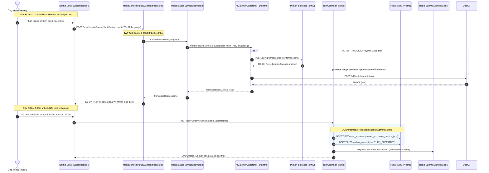

# NESTJS INTEGRATION, TWO-STEP VOICE INTAKE & STRICT TOGGLE ARCHITECTURE

> **Trạng thái**: Living / Production Specification  
> **Cấp độ**: Deep Technical Specification (Backend Architecture & End-to-End Flow)  
> **Áp dụng cho**: `server/src/modules/media/`, `server/src/infrastructure/ai/`, `server/src/modules/interview-live/`  
> **Tài liệu cha**: [README.md](README.md)  
> **Cập nhật lần cuối**: 2026-10-08  

---

## 1. BỐI CẢNH, MỤC TIÊU & LÝ DO THIẾT KẾ (DESIGN RATIONALE)

### 1.1 Triết lý Clean Architecture & Ranh giới Module
Để duy trì tính ổn định của hệ thống lõi NestJS theo các tiêu chuẩn kiến trúc nghiêm ngặt tại [`server/CONVENTIONS.md`](file:///c:/Users/An/Documents/GR1/InterviewCoach/server/CONVENTIONS.md):
1. **Cô lập Tầng Trình diễn (Strict Presentation Layer Isolation)**:
   - `MediaController` chỉ nhận file nhị phân, kiểm tra MIME type, dung lượng tối đa 25MB và ủy quyền xử lý trực tiếp cho `MediaFacade`. Tuyệt đối không import database hay vendor SDKs trong Controller.
2. **Giao tiếp Xuyên Module qua Facade Pattern**:
   - Module `interview-live` (`TurnController`, `VoiceAnswerIntakeHandler`) không phụ thuộc trực tiếp vào `ai-service` hay AI Gateways, mà chỉ nhận dữ liệu đã được xác thực qua DTO và gọi thông qua `MediaFacade`.
3. **Mô hình Thu thập Giọng nói 2 Bước (Two-Step Voice Intake Flow)**:
   - *Bước 1 (Transcribe & Review)*: Ứng viên ghi âm, nhận transcript và chỉ số giọng nói sơ bộ trên UI để kiểm tra, sửa từ bị phát âm sai hoặc micro rè.
   - *Bước 2 (Submit Turn)*: Ứng viên chính thức nộp câu trả lời kèm chỉ số âm học đã xác nhận, kích hoạt chấm điểm vào lượt phỏng vấn.
4. **Quản trị Rủi ro qua Strict Feature Flags & Circuit Breaker**:
   - Sử dụng `AIGatewayDispatcher` cho phép chuyển mạch tức thời sang OpenAI Whisper Cloud mà không cần redeploy code thông qua biến môi trường `AI_STT_PROVIDER`.

---

## 2. SƠ ĐỒ TUẦN TỰ HOÀN CHỈNH (END-TO-END SEQUENCE DIAGRAM)



---

## 3. CHI TIẾT HIỆN THỰC KỸ THUẬT (TECHNICAL IMPLEMENTATION)

### 3.1 Media Controller (`server/src/modules/media/media.controller.ts`)
Triển khai tại [`server/src/modules/media/media.controller.ts`](file:///c:/Users/An/Documents/GR1/InterviewCoach/server/src/modules/media/media.controller.ts):
- Kiểm tra danh sách MIME types được phép (`ALLOWED_MIME_TYPES`): `audio/webm`, `audio/wav`, `audio/mp4`, `audio/ogg`, `audio/mpeg`.
- Giới hạn kích thước file upload: `25MB` qua NestJS `FileInterceptor`.
- Xử lý endpoint `POST /api/v1/media/synthesize` trả về luồng `StreamingResponse` với header `Transfer-Encoding: chunked`.

### 3.2 Media Facade Pattern (`server/src/modules/media/contracts/media-facade.service.ts`)
Triển khai tại [`server/src/modules/media/contracts/media-facade.service.ts`](file:///c:/Users/An/Documents/GR1/InterviewCoach/server/src/modules/media/contracts/media-facade.service.ts):
```typescript
@Injectable()
export class MediaFacade {
  constructor(
    private readonly voiceMetricsService: VoiceMetricsService,
    @Inject(AI_GATEWAY_TOKEN)
    private readonly aiGateway: IAIGateway,
  ) {}

  async transcribeAudio(
    file: Express.Multer.File,
    language?: 'vi' | 'en',
  ): Promise<TranscribeResponseDto> {
    const result = await this.aiGateway.transcribeWithMetrics({
      audioBuffer: file.buffer,
      mimeType: file.mimetype,
      language,
    });
    return plainToInstance(TranscribeResponseDto, result);
  }

  async synthesizeSpeech(
    text: string,
    language?: 'vi' | 'en',
  ): Promise<{ stream: NodeJS.ReadableStream; contentType: string }> {
    return this.aiGateway.synthesizeSpeech({ text, language });
  }
}
```

### 3.3 Điều Phối & Chuyển Mạch Dự Phòng (`ai-gateway-dispatcher.service.ts`)
Triển khai tại [`server/src/infrastructure/ai/ai-gateway-dispatcher.service.ts`](file:///c:/Users/An/Documents/GR1/InterviewCoach/server/src/infrastructure/ai/ai-gateway-dispatcher.service.ts):
- Đọc biến môi trường `AI_STT_PROVIDER`:
  - Nếu `python`: Gửi request tới `PythonAiClient`. Nếu xảy ra lỗi hoặc timeout, tự động kích hoạt `OpenAiGateway` dự phòng và bổ sung telemetry cảnh báo.
  - Nếu `openai`: Gửi trực tiếp tới `OpenAiGateway`.

### 3.4 Client Giao Tiếp Microservice (`python-ai.client.ts`)
Triển khai tại [`server/src/infrastructure/ai/clients/python-ai.client.ts`](file:///c:/Users/An/Documents/GR1/InterviewCoach/server/src/infrastructure/ai/clients/python-ai.client.ts):
- Sử dụng native `fetch` bất đồng bộ kèm `AbortSignal.timeout(60_000)`.
- Gắn header bảo mật `x-internal-secret` và truyền mã định danh `x-request-id`, `x-correlation-id`.
- Chuyển đổi nhị phân stream từ FastAPI thành `NodeJS.ReadableStream` cho tính năng tổng hợp giọng nói.

---

## 4. MA TRẬN ÁNH XẠ MÃ LỖI (EXCEPTION MAPPING MATRIX)

Khi `PythonAiClient` nhận phản hồi lỗi từ microservice, hàm `handleHttpError` ánh xạ sang `InterviewAIException` tương ứng:

| HTTP Status (Python) | Error Code (Python) | HTTP Status (NestJS) | NestJS ErrorCode | Xử lý Nghiệp vụ |
| :---: | :--- | :---: | :--- | :--- |
| **400** | `NO_SPEECH_DETECTED` | **400** | `NO_SPEECH_DETECTED` | Client yêu cầu ứng viên kiểm tra micro |
| **403** | `INVALID_INTERNAL_SECRET` | **403** | `FORBIDDEN` | Lỗi cấu hình biến môi trường nội bộ |
| **413** | `PAYLOAD_TOO_LARGE` | **413** | `PAYLOAD_TOO_LARGE` | File âm thanh hoặc văn bản quá dài |
| **415** | `UNSUPPORTED_MEDIA_TYPE` | **415** | `UNSUPPORTED_MEDIA_TYPE` | Định dạng file âm thanh không hợp lệ |
| **422** | `VALIDATION_ERROR` | **400** | `VALIDATION_ERROR` | Dữ liệu multipart/form-data sai cấu trúc |
| **500 / 502** | `INTERNAL_SERVER_ERROR` | **502** | `AI_SERVICE_UNAVAILABLE` | Kích hoạt chuyển mạch dự phòng sang OpenAI |
| **Timeout (>60s)** | N/A | **504** | `AI_TIMEOUT` | Kích hoạt chuyển mạch dự phòng sang OpenAI |

---

## 5. HƯỚNG DẪN KIỂM THỬ, VẬN HÀNH & XỬ LÝ SỰ CỐ

### 5.1 Kiểm thử Đơn vị Phía NestJS
```bash
cd server
npm test -- media-facade.service.spec.ts media.controller.spec.ts ai-gateway-dispatcher.service.spec.ts
```

### 5.2 Kiểm tra Quy chuẩn Kiến trúc (Verify Architecture Rules)
```bash
cd server
npm run check:conventions
```

### 5.3 Xử lý Sự cố Thường gặp
1. **Lỗi `AI_SERVICE_UNAVAILABLE (502 Bad Gateway)`**:
   - *Triệu chứng*: NestJS không thể kết nối tới cổng 8000 của Python service.
   - *Khắc phục*: Kiểm tra xem `ai-service` đã khởi động chưa bằng lệnh `curl http://localhost:8000/healthz`. Nếu cần tiếp tục phục vụ người dùng gấp, tạm thời cấu hình `AI_STT_PROVIDER=openai` trong `server/.env`.
2. **Lỗi `Unsupported audio format (audio/ogg)`**:
   - *Triệu chứng*: Người dùng tải lên định dạng âm thanh lạ bị từ chối với HTTP 415.
   - *Khắc phục*: Kiểm tra danh sách `ALLOWED_MIME_TYPES` trong `media.controller.ts`.
