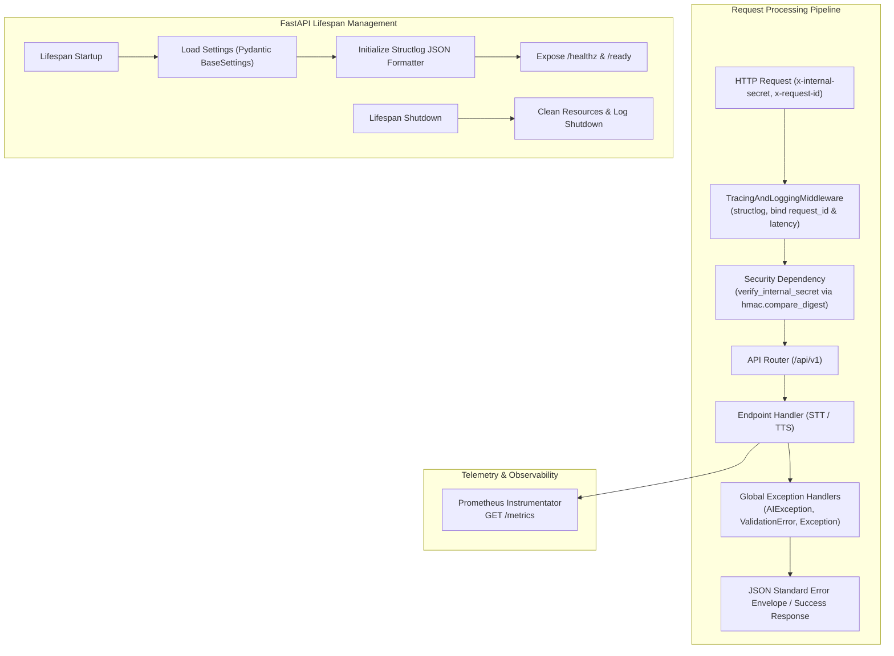

# FASTAPI RUNTIME CORE, SECURITY & MULTI-STAGE CONTAINERIZATION

> **Trạng thái**: Living / Production Specification  
> **Cấp độ**: Deep Technical Specification (Infrastructure & Core Runtime)  
> **Áp dụng cho**: `ai-service/app/core/`, `ai-service/app/main.py`, `ai-service/Dockerfile*`  
> **Tài liệu cha**: [README.md](README.md)  
> **Cập nhật lần cuối**: 2026-10-08  

---

## 1. BỐI CẢNH, MỤC TIÊU & LÝ DO THIẾT KẾ (DESIGN RATIONALE)

### 1.1 Vấn đề Cần giải quyết
Các mô hình máy học (Machine Learning) âm thanh và ngôn ngữ (như Whisper, Kokoro, TorchScript VAD) đòi hỏi tài nguyên tính toán lớn (bộ nhớ RAM, CPU đa luồng hoặc GPU CUDA). Nếu chạy các tác vụ này trực tiếp trong runtime Node.js của NestJS:
- Event Loop của Node.js sẽ bị chặn (CPU starvation), khiến các kết nối HTTP/SSE thời gian thực của người dùng bị giật lag nghiêm trọng.
- Node.js thiếu hệ sinh thái thư viện xử lý mảng số học đa chiều tốc độ cao (NumPy, PyAV C bindings, PyTorch).

### 1.2 Quyết định Kiến trúc & Đánh đổi (Trade-offs)
1. **FastAPI & Python 3.11+ làm Dedicated Compute Microservice**: Tận dụng tối đa C-extensions và hỗ trợ tính toán bất đồng bộ (`asyncio`) hiệu năng cao.
2. **Quản lý Phụ thuộc Siêu tốc bằng Astral `uv`**: Thay thế `pip` và `poetry` truyền thống để tối ưu hóa thời gian tải và cài đặt thư viện máy học từ 10-15 phút xuống dưới 30 giây, khóa phiên bản tất định qua `uv.lock`.
3. **Bảo mật Liên Dịch vụ Tốc độ cao qua `x-internal-secret`**: Thay vì triển khai OAuth2/JWT nặng nề cho giao tiếp mạng nội bộ (mạng riêng Docker / localhost), sử dụng header bí mật kết hợp hàm so sánh chuỗi kháng Timing Attack (`hmac.compare_digest`).
4. **Chuẩn hóa Ngoại lệ theo Standard Error Envelope**: Khớp 100% với cấu trúc `InterviewAIException` của NestJS, loại bỏ việc trả về HTML stack trace hoặc lỗi không đồng nhất.

---

## 2. SƠ ĐỒ KIẾN TRÚC THÀNH PHẦN CORE (CORE ARCHITECTURE DIAGRAM)



---

## 3. CHI TIẾT HIỆN THỰC KỸ THUẬT (TECHNICAL IMPLEMENTATION)

### 3.1 Vòng đời Dịch vụ & Khởi tạo (Lifespan Management)
Triển khai tại [`ai-service/app/main.py`](file:///c:/Users/An/Documents/GR1/InterviewCoach/ai-service/app/main.py):
- Sử dụng `@asynccontextmanager` làm cơ chế `lifespan`:
  ```python
  @asynccontextmanager
  async def lifespan(_app: FastAPI) -> AsyncGenerator[None, None]:
      settings = get_settings()
      setup_logging(settings.log_level)
      logger.info(
          "service_starting",
          env=settings.app_env,
          device=settings.whisper_device,
          whisperModel=settings.whisper_model_size,
      )
      yield
      logger.info("service_shutting_down")
  ```
- Tích hợp `prometheus_fastapi_instrumentator` tự động thu thập và công khai các chỉ số tài nguyên qua `GET /metrics`.

### 3.2 Quản trị Cấu hình Tập trung (Pydantic BaseSettings)
Triển khai tại [`ai-service/app/core/config.py`](file:///c:/Users/An/Documents/GR1/InterviewCoach/ai-service/app/core/config.py):
- Tự động nạp và kiểm tra kiểu từ tệp `.env`:
  ```python
  class Settings(BaseSettings):
      model_config = SettingsConfigDict(
          env_file=".env",
          env_file_encoding="utf-8",
          case_sensitive=False,
          extra="ignore",
      )
      app_env: Literal["development", "staging", "production"] = "development"
      port: int = 8000
      internal_ai_secret: str = Field(
          default="interviewai-super-secret-dev-key-change-in-prod"
      )
      whisper_model_size: str = "small"
      whisper_device: Literal["cpu", "cuda"] = "cpu"
      whisper_compute_type: Literal["int8", "float16", "float32"] = "int8"
      whisper_threads: int = 4
      vad_threshold: float = 0.5
      kokoro_voice_default: str = "af_heart"
      edge_tts_vi_voice_default: str = "vi-VN-HoaiMyNeural"
  ```
- Sử dụng `@lru_cache` để nạp cấu hình duy nhất một lần (Singleton pattern).

### 3.3 Bảo mật Liên Dịch vụ (Timing-Safe Authentication)
Triển khai tại [`ai-service/app/core/security.py`](file:///c:/Users/An/Documents/GR1/InterviewCoach/ai-service/app/core/security.py):
```python
async def verify_internal_secret(
    x_internal_secret: str = Header(..., description="Bí mật liên dịch vụ bắt buộc")
) -> None:
    settings = get_settings()
    # Sử dụng compare_digest để triệt tiêu lỗ hổng Timing Attack
    if not hmac.compare_digest(x_internal_secret, settings.internal_ai_secret):
        raise AIException(
            error_code="INVALID_INTERNAL_SECRET",
            message="Xác thực liên dịch vụ thất bại: Khóa x-internal-secret không hợp lệ.",
            status_code=403,
        )
```

### 3.4 Ghi log Có Cấu trúc & Truy vết Yêu cầu (Tracing & Structured Logging)
Triển khai tại [`ai-service/app/core/logging.py`](file:///c:/Users/An/Documents/GR1/InterviewCoach/ai-service/app/core/logging.py):
- Tự động trích xuất `x-request-id` và `x-correlation-id` từ HTTP headers, hoặc sinh ngẫu nhiên `uuid4` nếu client chưa gửi.
- Toàn bộ log được định dạng chuẩn JSON (`structlog`) kèm thông số thời gian xử lý (`latency_ms`), phục vụ cho hệ thống giám sát tập trung (Grafana Loki/ELK).

### 3.5 Đóng gói Docker Multi-Stage (CPU & GPU Dual Profile)
Triển khai tại [`ai-service/Dockerfile`](file:///c:/Users/An/Documents/GR1/InterviewCoach/ai-service/Dockerfile):
- **Stage 1 (Builder)**: Sử dụng image `ghcr.io/astral-sh/uv:0.4.15` để biên dịch dependencies vào virtual environment sạch `/build/.venv`.
- **Stage 2 (Runtime)**: Image nền `python:3.11-slim`, chỉ cài đặt các thư viện C cần thiết (`ffmpeg`, `libavcodec-dev`, `libavformat-dev`, `libswresample-dev`), loại bỏ trình biên dịch GCC để giảm dung lượng image xuống mức tối thiểu và tăng cường an ninh container.
- Hỗ trợ thêm [`ai-service/Dockerfile.gpu`](file:///c:/Users/An/Documents/GR1/InterviewCoach/ai-service/Dockerfile.gpu) dựa trên nền tảng CUDA 12 cho máy chủ sản xuất có GPU.

---

## 4. ĐẶC TẢ HỢP ĐỒNG LỖI CHUẨN HÓA (STANDARD ERROR ENVELOPE)

Khi phát sinh lỗi nghiệp vụ hoặc ngoại lệ hệ thống, `ai-service` luôn trả về cấu trúc lỗi JSON cố định:

```json
{
  "errorCode": "INVALID_INTERNAL_SECRET",
  "message": "Xác thực liên dịch vụ thất bại: Khóa x-internal-secret không hợp lệ.",
  "timestamp": "2026-10-08T02:22:15.123Z",
  "path": "/api/v1/stt/transcribe",
  "details": null
}
```

### Bảng Mã Lỗi Core
| HTTP Status | Error Code | Ý nghĩa Kỹ thuật | Hành vi của NestJS |
| :---: | :--- | :--- | :--- |
| **400** | `NO_SPEECH_DETECTED` | Silero VAD không tìm thấy âm thanh giọng nói | Báo người dùng nói lại |
| **403** | `INVALID_INTERNAL_SECRET` | Sai khóa bí mật liên dịch vụ | Báo lỗi cấu hình môi trường |
| **413** | `PAYLOAD_TOO_LARGE` | Dung lượng file audio hoặc độ dài văn bản vượt ngưỡng | Báo lỗi payload quá lớn |
| **415** | `UNSUPPORTED_MEDIA_TYPE` | Định dạng MIME của file âm thanh không được hỗ trợ | Yêu cầu định dạng khác |
| **422** | `VALIDATION_ERROR` | Tham số query/body/form sai định dạng | Báo lỗi validation DTO |
| **500** | `INTERNAL_SERVER_ERROR` | Lỗi ngoại lệ chưa được xử lý | Kích hoạt Fallback sang OpenAI |

---

## 5. HƯỚNG DẪN KIỂM THỬ, VẬN HÀNH & XỬ LÝ SỰ CỐ

### 5.1 Kiểm thử Đơn vị Core
```bash
cd ai-service
# Chạy toàn bộ test suites
uv run pytest

# Chạy riêng kiểm thử hợp đồng và bảo mật
uv run pytest tests/test_contracts.py -v
```

### 5.2 Xử lý Sự cố Thường gặp (Troubleshooting)
1. **Lỗi `ImportError: PyAV/av or libavcodec not found`**:
   - *Nguyên nhân*: Thiếu thư viện C/C++ `ffmpeg` trên hệ thống phát triển cục bộ.
   - *Khắc phục*: Cài đặt `ffmpeg` qua winget (`winget install Gyan.FFmpeg`) hoặc dùng Docker container chuẩn bị sẵn.
2. **Lỗi `403 Forbidden: Khóa x-internal-secret không hợp lệ`**:
   - *Nguyên nhân*: Giá trị `INTERNAL_AI_SECRET` trong `server/.env` không khớp với `ai-service/.env`.
   - *Khắc phục*: Đồng bộ giá trị `INTERNAL_AI_SECRET=dev-secret-internal-ai-key` trong cả 2 tệp `.env`.
3. **Mô hình tải lại mỗi khi có request**:
   - *Nguyên nhân*: Không sử dụng phương thức Singleton `get_instance()`.
   - *Khắc phục*: Đảm bảo các engine STT/TTS được nạp qua singleton pattern được định nghĩa trong `app/services/stt/` và `app/services/tts/`.
