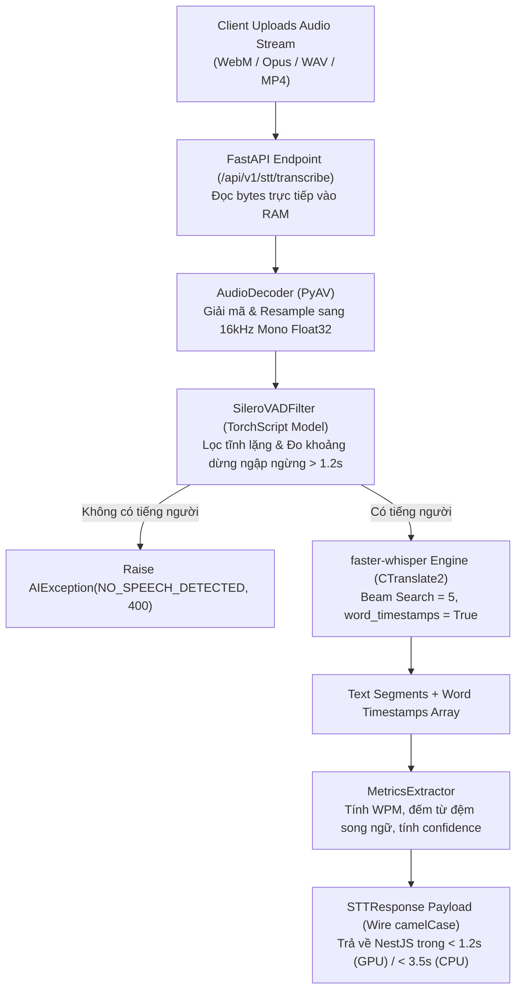

# STT PIPELINE, IN-MEMORY AUDIO DSP & ADVANCED VOICE METRICS

> **Trạng thái**: Living / Production Specification  
> **Cấp độ**: Deep Technical Specification (Audio DSP & Speech Recognition)  
> **Áp dụng cho**: `ai-service/app/services/stt/`, `ai-service/app/api/v1/stt.py`, `ai-service/app/schemas/stt.py`  
> **Tài liệu cha**: [README.md](README.md)  
> **Cập nhật lần cuối**: 2026-10-08  

---

## 1. BỐI CẢNH, MỤC TIÊU & LÝ DO THIẾT KẾ (DESIGN RATIONALE)

### 1.1 Thách thức trong Phỏng vấn Trực tuyến Giọng nói
Trong kịch bản phỏng vấn thử nghiệm bằng giọng nói cho ứng viên CNTT:
1. **Nhiều định dạng âm thanh trình duyệt**: Trình duyệt Chrome/Edge thường thu âm định dạng `audio/webm;codecs=opus`, trong khi Safari sử dụng `audio/mp4`, và một số client gửi `audio/wav`.
2. **Quyền riêng tư & An toàn Dữ liệu (Privacy-First)**: Ghi file âm thanh của người dùng ra đĩa cứng `/tmp` gây nguy cơ rò rỉ dữ liệu nhạy cảm và làm nghẽn I/O ổ đĩa khi có hàng trăm ứng viên phỏng vấn đồng thời.
3. **Đánh giá Năng lực Thuyết trình (Presentation Metrics)**: Không chỉ nhận diện chữ viết (transcript), hệ thống cần phân tích nhịp điệu phát âm: Tốc độ nói (Words Per Minute), mức độ ngập ngừng (hesitation pauses $> 1.2\text{s}$), và thói quen lạm dụng từ đệm kỹ thuật (filler words) của ứng viên.

### 1.2 Quyết định Kiến trúc & Đánh đổi
- **Zero-Disk In-Memory Processing**: Dùng thư viện C `PyAV` (`av.open`) giải mã trực tiếp từ bộ nhớ đệm RAM (`io.BytesIO`) sang mảng số học `NumPy Float32` $16.000\text{ Hz}$ Mono chuẩn. Tuyệt đối không tạo file tạm trên ổ đĩa.
- **Bộ lọc Silero VAD (Voice Activity Detection)**: Model TorchScript siêu nhẹ ($< 2\text{MB}$), nhận diện vùng có tiếng người, cắt tỉa khoảng lặng thừa, và trích xuất số lần ngập ngừng kéo dài $> 1.2\text{s}$.
- **faster-whisper (CTranslate2)**: Tăng tốc suy luận gấp 4 lần so với OpenAI Whisper gốc nhờ lượng tử hóa INT8 trên CPU hoặc FP16 trên GPU, đồng thời bật `word_timestamps=True` để có mốc thời gian chính xác từng từ.
- **Trích xuất Chỉ số Âm học Song ngữ (Bilingual Voice Metrics)**: Sử dụng regex chuyên biệt phát hiện từ đệm cả tiếng Việt (*à, ừm, kiểu như, thì là*) và tiếng Anh kỹ thuật (*um, uh, like, actually, basically*).

---

## 2. SƠ ĐỒ LUỒNG XỬ LÝ ÂM THANH IN-MEMORY (AUDIO DSP PIPELINE)



---

## 3. CHI TIẾT HIỆN THỰC KỸ THUẬT (TECHNICAL IMPLEMENTATION)

### 3.1 Giải mã Âm thanh Trong Bộ nhớ RAM (`audio_decoder.py`)
Triển khai tại [`ai-service/app/services/stt/audio_decoder.py`](file:///c:/Users/An/Documents/GR1/InterviewCoach/ai-service/app/services/stt/audio_decoder.py):
- Mở container nhị phân trực tiếp từ `io.BytesIO(audio_bytes)` bằng `av.open`.
- Thiết lập bộ lọc chuyển đổi tần số `AudioResampler(format='flt', layout='mono', rate=16000)`.
- Chuyển đổi các audio frames thành mảng `np.ndarray` 1 chiều dạng `float32` trong khoảng $[-1.0, 1.0]$.
- Tính toán tổng thời lượng âm thanh: $\text{duration} = \frac{\text{len(pcm\_array)}}{16000}$.

### 3.2 Bộ lọc Tĩnh lặng & Đo khoảng lặng Ngập ngừng (`vad_filter.py`)
Triển khai tại [`ai-service/app/services/stt/vad_filter.py`](file:///c:/Users/An/Documents/GR1/InterviewCoach/ai-service/app/services/stt/vad_filter.py):
- Nạp mô hình Silero VAD TorchScript theo mẫu Singleton (`SileroVADFilter.get_instance()`).
- Phân tích các mốc thời gian phát âm (`speech_timestamps`):
  - Lọc bỏ nhiễu nền và khoảng lặng vô nghĩa ở đầu và cuối bản ghi.
  - Tính toán khoảng cách giữa các đoạn nói liên tiếp: Nếu $\text{gap} = \text{start}_{i+1} - \text{end}_i > 1.2\text{ giây}$, tăng biến đếm `pause_count` và cộng dồn vào `total_pause_duration_seconds`.
  - Nếu không phát hiện thấy bất kỳ đoạn nói nào, cờ `has_speech = False` được kích hoạt để trả lỗi HTTP 400 `NO_SPEECH_DETECTED`.

### 3.3 Nhận diện Giọng nói Nhanh với faster-whisper (`whisper_engine.py`)
Triển khai tại [`ai-service/app/services/stt/whisper_engine.py`](file:///c:/Users/An/Documents/GR1/InterviewCoach/ai-service/app/services/stt/whisper_engine.py):
- Sử dụng Singleton `WhisperEngine.get_instance()`, nạp mô hình `WhisperModel(model_size, device=device, compute_type=compute_type)`.
- Thiết lập tham số giải mã tối ưu:
  - `beam_size = 5` nhằm bảo đảm độ chính xác nhận diện từ vựng kỹ thuật.
  - `word_timestamps = True` để trích xuất thời điểm bắt đầu và kết thúc của từng từ (`start`, `end`, `probability`).
  - Hỗ trợ ngôn ngữ tiếng Việt (`language='vi'`) và tiếng Anh (`language='en'`).

### 3.4 Khai phá Bộ Chỉ số Giọng nói Chuyên sâu (`metrics_extractor.py`)
Triển khai tại [`ai-service/app/services/stt/metrics_extractor.py`](file:///c:/Users/An/Documents/GR1/InterviewCoach/ai-service/app/services/stt/metrics_extractor.py):
- **Tốc độ nói (Words Per Minute - WPM)**:
  $$\text{WPM} = \frac{\text{word\_count}}{\text{speech\_duration\_seconds} / 60}$$
  *Lưu ý*: WPM được tính dựa trên thời lượng phát âm thực tế (`speech_duration_seconds`), không tính trên tổng thời gian bản ghi để phản ánh chính xác tốc độ nhả chữ của ứng viên.
- **Bộ lọc Từ đệm Song ngữ (Bilingual Filler Words)**:
  Sử dụng biểu thức chính quy (Regex) bắt khớp ranh giới từ `\b` không phân biệt hoa thường:
  - Tiếng Việt: `à`, `ừm`, `ờ`, `thì là`, `kiểu như`, `kiểu là`, `coi như`, `nói chung là`, `thì mà`.
  - Tiếng Anh: `um`, `uh`, `er`, `ah`, `like`, `you know`, `actually`, `basically`, `literally`, `sort of`, `kind of`.
- **Độ tin cậy phát âm (`confidenceScore`)**:
  Trung bình cộng xác suất của toàn bộ các từ được nhận diện từ Whisper (`word.probability`).

---

## 4. ĐẶC TẢ HỢP ĐỒNG API (WIRE CONTRACT SPECIFICATION)

### 4.1 Endpoint Đặc tả
- **URL**: `POST /api/v1/stt/transcribe`
- **Content-Type**: `multipart/form-data`
- **Headers Bắt buộc**: `x-internal-secret: <secret>`, `x-request-id: <uuid>`

### 4.2 Tham số Đầu vào (Form Fields)
| Trường | Kiểu | Mặc định | Mô tả |
| :--- | :--- | :--- | :--- |
| `file` | `UploadFile` (Binary) | *Bắt buộc* | Buffer file âm thanh (`webm`, `wav`, `mp4`, `ogg`) |
| `language` | `string` | `"vi"` | Mã ngôn ngữ nhận diện (`"vi"` hoặc `"en"`) |
| `vad_filter` | `boolean` | `true` | Bật/tắt bộ lọc tĩnh lặng Silero VAD |

### 4.3 Dữ liệu Phản hồi (JSON Wire `camelCase`)
```json
{
  "text": "Dạ em chào anh chị, em có hai năm kinh nghiệm làm việc với NestJS và PostgreSQL.",
  "language": "vi",
  "durationSeconds": 5.8,
  "metrics": {
    "wordsPerMinute": 145.2,
    "speechDurationSeconds": 5.1,
    "totalPauseDurationSeconds": 0.0,
    "pauseCount": 0,
    "fillerWordsCount": 1,
    "fillerWords": ["dạ"],
    "confidenceScore": 0.94
  },
  "words": [
    {
      "word": "Dạ",
      "start": 0.12,
      "end": 0.35,
      "confidence": 0.96
    },
    {
      "word": "em",
      "start": 0.38,
      "end": 0.52,
      "confidence": 0.98
    }
  ]
}
```

---

## 5. HƯỚNG DẪN KIỂM THỬ, VẬN HÀNH & XỬ LÝ SỰ CỐ

### 5.1 Kiểm thử Tự động STT Pipeline
```bash
cd ai-service
# Chạy toàn bộ kiểm thử đơn vị của STT pipeline
uv run pytest tests/test_stt.py -v
```

### 5.2 Xử lý Sự cố Thường gặp
1. **Lỗi `NO_SPEECH_DETECTED (400)`**:
   - *Triệu chứng*: Endpoint trả về HTTP 400 kèm thông báo "Không phát hiện thấy âm thanh giọng nói rõ ràng".
   - *Nguyên nhân*: Ứng viên gửi file chỉ chứa tiếng rè của micro hoặc khoảng lặng dài mà không nói.
   - *Xử lý*: Phía client hiển thị cảnh báo: "Micro không thu được giọng nói của bạn, vui lòng kiểm tra thiết bị và thử lại".
2. **Tốc độ STT chậm trên máy CPU**:
   - *Nguyên nhân*: Mô hình đang chọn là `medium` hoặc `large-v3` trên môi trường không có GPU.
   - *Khắc phục*: Đặt `WHISPER_MODEL_SIZE=small` hoặc `base` và `WHISPER_COMPUTE_TYPE=int8` trong tệp `ai-service/.env`.
