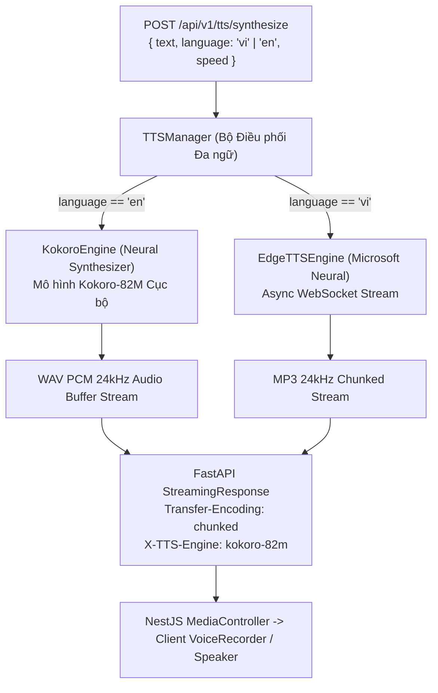

# HYBRID TTS PIPELINE & CHUNKED AUDIO STREAMING

> **Trạng thái**: Living / Production Specification  
> **Cấp độ**: Deep Technical Specification (Speech Synthesis & Media Streaming)  
> **Áp dụng cho**: `ai-service/app/services/tts/`, `ai-service/app/api/v1/tts.py`, `ai-service/app/schemas/tts.py`  
> **Tài liệu cha**: [README.md](README.md)  
> **Cập nhật lần cuối**: 2026-10-08  

---

## 1. BỐI CẢNH, MỤC TIÊU & LÝ DO THIẾT KẾ (DESIGN RATIONALE)

### 1.1 Yêu cầu về Giọng Đọc Phỏng Vấn Viên AI (AI Interviewer Persona)
Trong một buổi phỏng vấn kỹ thuật trực tuyến:
1. **Chất lượng Giọng Đọc Tự nhiên**: Giọng đọc của AI Interviewer cần truyền cảm, phát âm ngữ điệu chuẩn xác, tránh âm thanh thô ráp của các bộ tổng hợp giọng nói mặc định trên trình duyệt (Web Speech API).
2. **Hỗ trợ Song ngữ Việt - Anh**:
   - Các câu hỏi kỹ thuật chuyên sâu bằng tiếng Anh yêu cầu giọng đọc studio quốc tế chuẩn (US/UK accent).
   - Các câu hỏi phỏng vấn hành vi hoặc kỹ thuật bằng tiếng Việt yêu cầu giọng đọc bản xứ tự nhiên (chuẩn giọng Hà Nội hoặc TP.HCM).
3. **Phản hồi Tức thì (Low First-Byte Latency)**: Không bắt ứng viên chờ tải xong toàn bộ tệp âm thanh; âm thanh cần được phát dạng luồng (Chunked Streaming) để phát loa ngay khi các byte đầu tiên sẵn sàng.

### 1.2 Quyết định Kiến trúc: Mô hình Hybrid TTS
Hệ thống kết hợp 2 công nghệ tổng hợp giọng nói tối ưu cho từng ngôn ngữ:

| Ngôn Ngữ | Động Cơ TTS Lựa Chọn | Lý Do Kỹ Thuật & Ưu Điểm |
| :---: | :--- | :--- |
| **Tiếng Anh (`en`)** | **Kokoro-82M** (Neural TTS Tự lưu trữ) | Kích thước siêu nhỏ ($82\text{M}$ tham số), chất lượng phòng thu (Studio-quality), tự chạy offline cục bộ với Real-Time Factor (RTF) $< 0.15$. |
| **Tiếng Việt (`vi`)** | **Microsoft Edge TTS** | Giọng đọc `vi-VN-HoaiMyNeural` và `vi-VN-NamMinhNeural` ngắt nghỉ cực kỳ tự nhiên, hỗ trợ chuyển đổi từ viết tắt kỹ thuật, không tốn tài nguyên GPU máy chủ. |

---

## 2. SƠ ĐỒ ĐIỀU PHỐI HYBRID TTS (HYBRID ROUTING & STREAMING DIAGRAM)



---

## 3. CHI TIẾT HIỆN THỰC KỸ THUẬT (TECHNICAL IMPLEMENTATION)

### 3.1 Bộ Điều Phối Đa Ngữ (`tts_manager.py`)
Triển khai tại [`ai-service/app/services/tts/tts_manager.py`](file:///c:/Users/An/Documents/GR1/InterviewCoach/ai-service/app/services/tts/tts_manager.py):
- Phân tích trường `request.language`:
  - Nếu `language == "en"`: Ủy quyền cho `KokoroEngine.synthesize(request.text, voice=request.voice, speed=request.speed)`. Trả về `media_type="audio/wav"`.
  - Nếu `language == "vi"` (hoặc mặc định): Ủy quyền cho `EdgeTTSEngine.synthesize(request.text, voice=request.voice, speed=request.speed)`. Trả về `media_type="audio/mpeg"`.
- Trả về tuple: `(audio_stream, media_type, engine_used)`.

### 3.2 Động Cơ Tiếng Anh Kokoro-82M (`kokoro_engine.py`)
Triển khai tại [`ai-service/app/services/tts/kokoro_engine.py`](file:///c:/Users/An/Documents/GR1/InterviewCoach/ai-service/app/services/tts/kokoro_engine.py):
- Nạp trọng số mô hình `Kokoro` theo mô hình Singleton để tránh chi phí tải mô hình lặp lại.
- Giọng mặc định: `af_heart` (giọng nữ ấm áp, chuẩn tiếng Anh Mỹ).
- Sinh luồng nhị phân dạng WAV PCM tần số lấy mẫu $24.000\text{ Hz}$.

### 3.3 Động Cơ Tiếng Việt Edge TTS (`edge_tts_engine.py`)
Triển khai tại [`ai-service/app/services/tts/edge_tts_engine.py`](file:///c:/Users/An/Documents/GR1/InterviewCoach/ai-service/app/services/tts/edge_tts_engine.py):
- Sử dụng thư viện `edge_tts.Communicate(text, voice)`.
- Giọng mặc định: `vi-VN-HoaiMyNeural` (giọng nữ chuẩn Bắc) hoặc `vi-VN-NamMinhNeural` (giọng nam chuẩn Nam).
- Tạo luồng phát sóng bất đồng bộ (`async generator`) truyền thẳng các chunk nhị phân MP3 về client mà không cần lưu trữ toàn bộ file vào RAM.

### 3.4 Phản hồi Truyền phát Nhị phân (FastAPI StreamingResponse)
Triển khai tại [`ai-service/app/api/v1/tts.py`](file:///c:/Users/An/Documents/GR1/InterviewCoach/ai-service/app/api/v1/tts.py):
```python
@router.post("/synthesize")
async def synthesize_speech(request: TTSRequest) -> StreamingResponse:
    # 1. Kiểm tra giới hạn độ dài ký tự (tối đa 1.000 ký tự cho một câu hỏi)
    if len(request.text) > 1000:
        raise AIException(
            error_code="TEXT_TOO_LONG",
            message="Độ dài văn bản vượt quá giới hạn tối đa 1.000 ký tự.",
            status_code=413,
        )

    # 2. Sinh luồng âm thanh
    audio_stream, media_type, engine_used = await TTSManager.synthesize(request)

    headers = {
        "X-TTS-Engine": engine_used,
        "Cache-Control": "public, max-age=86400",
    }
    return StreamingResponse(audio_stream, media_type=media_type, headers=headers)
```

---

## 4. ĐẶC TẢ HỢP ĐỒNG API (WIRE CONTRACT SPECIFICATION)

### 4.1 Endpoint Đặc tả
- **URL**: `POST /api/v1/tts/synthesize`
- **Content-Type**: `application/json`
- **Headers Bắt buộc**: `x-internal-secret: <secret>`

### 4.2 Cấu trúc Yêu cầu (JSON Body)
```json
{
  "text": "Could you please explain how index scans work in PostgreSQL?",
  "language": "en",
  "voice": "af_heart",
  "speed": 1.0
}
```

### 4.3 Dữ liệu Phản hồi
- **Status Code**: `200 OK`
- **Content-Type**: `audio/wav` (đối với Kokoro) hoặc `audio/mpeg` (đối với EdgeTTS)
- **Transfer-Encoding**: `chunked`
- **Response Headers**:
  - `X-TTS-Engine`: Tên động cơ đã xử lý (`kokoro-82m` hoặc `edge-tts`).
  - `X-Audio-Duration-Seconds`: Thời lượng âm thanh ước tính.
  - `Cache-Control`: `public, max-age=86400` (cho phép trình duyệt cache câu hỏi).

---

## 5. HƯỚNG DẪN KIỂM THỬ, VẬN HÀNH & XỬ LÝ SỰ CỐ

### 5.1 Kiểm thử Đơn vị TTS Pipeline
```bash
cd ai-service
uv run pytest tests/test_tts.py -v
```

### 5.2 Xử lý Sự cố Thường gặp
1. **Lỗi `TEXT_TOO_LONG (413)`**:
   - *Nguyên nhân*: Câu hỏi gửi sang vượt quá 1.000 ký tự.
   - *Khắc phục*: Tách nhỏ câu hỏi hoặc tóm tắt nội dung trước khi gọi tổng hợp giọng nói.
2. **EdgeTTS mất kết nối internet**:
   - *Triệu chứng*: Quá trình kết nối WebSocket tới Microsoft Edge TTS bị timeout hoặc lỗi mạng.
   - *Khắc phục*: Client Next.js tích hợp sẵn cơ chế dự phòng tự động chuyển sang Web Speech API trên trình duyệt để đọc câu hỏi cho ứng viên mà không làm gián đoạn bài phỏng vấn.
