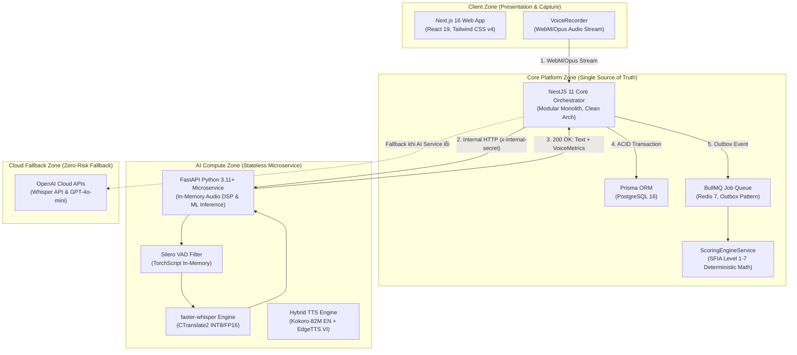
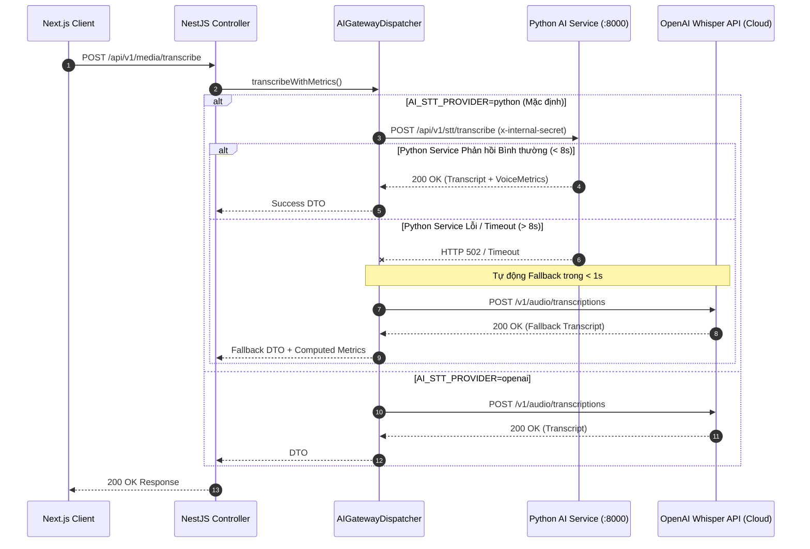

# KIẾN TRÚC TỔNG THỂ HỆ THỐNG INTERVIA (SYSTEM OVERVIEW)

> **Trạng thái**: Living / Production Specification  
> **Cấp độ**: Global System Architecture  
> **Áp dụng cho**: Toàn bộ hệ sinh thái Intervia (`client/`, `server/`, `ai-service/`, `contracts/`)  
> **Tài liệu cha**: [docs/architecture/README.md](../README.md)  
> **Cập nhật lần cuối**: 2026-10-08  

---

## 1. BỐI CẢNH & TRIẾT LÝ KIẾN TRÚC (ARCHITECTURAL PHILOSOPHY)

Nền tảng **Intervia** là giải pháp luyện phỏng vấn kỹ thuật toàn diện cho sinh viên và kỹ sư CNTT. Để cân bằng giữa tính toàn vẹn dữ liệu nghiệp vụ, độ tin cậy của thuật toán tính điểm và hiệu năng xử lý mô hình trí tuệ nhân tạo (AI/ML), hệ thống kiên định áp dụng triết lý:

$$\mathbf{Pragmatic\ Polyglot\ Architecture} = \mathbf{NestJS\ Core\ Orchestrator} + \mathbf{Python\ AI\ Stateless\ Compute}$$

### 1.1 Phân định Ranh giới Trách nhiệm (Separation of Concerns)
1. **NestJS Core Orchestrator (`server/`)**:
   - Đóng vai trò **Single Source of Truth** và **Business Orchestrator**.
   - Làm chủ toàn bộ logic xác thực, phân quyền đa vai trò (RBAC), quản lý phiên phỏng vấn (Session State Machine), tính toàn vẹn giao dịch ACID (`prisma.$transaction`), Outbox Pattern qua Redis BullMQ.
   - Làm chủ thuật toán tính điểm và cấp độ SFIA hoàn toàn tất định bằng toán học.
2. **Python AI Microservice (`ai-service/`)**:
   - Đóng vai trò **Dedicated Stateless Compute Microservice**.
   - Chuyên biệt hóa cho các tác vụ tính toán nặng: Giải mã âm thanh In-Memory (PyAV), lọc VAD (Silero), nhận diện giọng nói cục bộ (`faster-whisper`), tổng hợp giọng nói (Kokoro, EdgeTTS), và các pipeline NLP/RAG.
   - Tuyệt đối **không kết nối trực tiếp cơ sở dữ liệu** và không giữ trạng thái phiên người dùng.

---

## 2. CHIẾN LƯỢC CHUYỂN ĐỔI: STRANGLER FIG & ZERO-RISK FALLBACK

Để giảm thiểu 100% rủi ro khi chuyển dịch từ Cloud API sang AI Microservice tự lưu trữ, hệ thống áp dụng mô hình **Strangler Fig Pattern** kết hợp cơ chế chuyển mạch nghiêm ngặt (**Strict Provider Toggle**):

### 2.1 Các Ưu điểm Cốt lõi của Chiến lược
- **Thời gian chuyển mạch $< 1\text{s}$**: Chỉ cần đổi biến môi trường `AI_STT_PROVIDER=openai` trong `.env`, hệ thống chuyển hướng toàn bộ lưu lượng sang OpenAI Whisper mà không cần sửa code hay redeploy.
- **Circuit Breaker Tự động**: Khi Python AI Service gặp sự cố hoặc timeout quá $8.000\text{ms}$, NestJS tự động gọi Cloud Fallback và log cảnh báo cảnh giới hạn, người dùng cuối không bị gián đoạn trải nghiệm.
- **Zero-Disk In-Memory Processing**: Âm thanh người dùng không ghi ra đĩa cứng hay lưu trữ ngoài, bảo vệ quyền riêng tư tuyệt đối (*Privacy-First*).

---

## 3. CÁC PHÂN HỆ KIẾN TRÚC TRỌNG TÂM (SYSTEM SUBSYSTEMS)

| Phân hệ | Thư mục Tài liệu | Mô tả Chức năng | Trạng thái |
| :--- | :--- | :--- | :---: |
| **Audio Engine** | [docs/architecture/audio-engine/](../audio-engine/README.md) | STT `faster-whisper`, Hybrid TTS (Kokoro EN + EdgeTTS VI), trích xuất WPM, pauses, bilingual fillers. | 🟢 **Hoàn thành** |
| **Hybrid RAG & Vector Search** | [docs/architecture/rag-search/](../rag-search/README.md) | Khai phá `pgvector`, HNSW vector indexing, BGE embeddings, Question Bank recommendation. | 🟡 *Planned (Phase 2)* |
| **Deep Assessment & Scoring** | [docs/architecture/assessment-engine/](../assessment-engine/README.md) | Chấm điểm rubric đa chiều, đo lường năng lực SFIA Level 1-7, Single-Pass Evaluator. | 🟡 *Planned (Phase 3)* |
| **LLM Inference Scaling** | [docs/architecture/llm-runtime/](../llm-runtime/README.md) | Self-hosted LLM qua vLLM, suy luận song song, tối ưu hóa độ trễ phản hồi theo lượt. | 🟡 *Planned (Phase 4)* |
| **Infra & DevOps** | [docs/architecture/infra-devops/](../infra-devops/README.md) | Docker multi-stage CPU/GPU, GitHub Actions matrix, Contract testing tự động, DR/Backup. | 🟡 *Planned (Phase 5)* |

---

## 4. QUY CHUẨN KỸ THUẬT ÁP DỤNG
- Quy chuẩn tài liệu: [docs/architecture/CONVENTIONS.md](../CONVENTIONS.md)
- Quy chuẩn backend NestJS: [server/CONVENTIONS.md](../../../server/CONVENTIONS.md)
- Hướng dẫn vận hành hệ thống: [docs/RUNNING_GUIDE.md](../../RUNNING_GUIDE.md)
