# Kế Hoạch Triển Khai Chi Tiết: Chuẩn Hóa Tài Liệu UI Sang Mantine v9 & Khởi Tạo Nền Tảng Template Mantine-Next.js (`client/`)

> **Trạng thái kế hoạch:** Đã rà soát kỹ thuật & chốt toàn bộ kiến trúc qua 2 phiên `/grill-me` (sẵn sàng triển khai).

## 1. Goal Description & Tóm Tắt Quyết Định Kiến Trúc (Locked-in ADR)

Chuyển đổi toàn diện hệ thống tài liệu quy chuẩn Frontend trong `client/docs/docs/` (19 file) từ bộ quy chuẩn kế thừa của dự án **RoGym** (Vite SPA + React Router + Tailwind CSS + Radix UI + CVA + React Hook Form + TanStack Query + Zustand + LINE LIFF/Expo) sang chuẩn **InterviewCoach Frontend** dựa trên **Next.js 16 App Router + React 19 + Mantine UI v9 (`9.8.x`) + `@mantine/form` + `@mantine/hooks` + SWR + `npm`**, đồng thời cài đặt thư viện UI và khởi tạo đầy đủ các file nền tảng của **template Mantine-Next.js** an toàn song song Tailwind v4 mà **chưa refactor mã nguồn các trang/component nghiệp vụ hiện có**.

### Bảng 12 Quyết Định Đã Chốt Qua Các Phiên `/grill-me`

|    #    | Hạng mục                                       | Quyết định đã thống nhất (Bắt buộc tuân thủ 100%)                                                                                                                                                                                                                                                                                                                                                                                                                                                                                                                                                                                                                                                                                   |
| :-----: | :--------------------------------------------- | :---------------------------------------------------------------------------------------------------------------------------------------------------------------------------------------------------------------------------------------------------------------------------------------------------------------------------------------------------------------------------------------------------------------------------------------------------------------------------------------------------------------------------------------------------------------------------------------------------------------------------------------------------------------------------------------------------------------------------------- |
| **D1**  | **Phạm vi `client/docs/docs/`**                | Chuẩn hóa toàn diện cả **19 file** theo **InterviewCoach + Next.js 16 App Router + Mantine v9 + SWR + `npm`**; đổi toàn bộ thương hiệu RoGym → InterviewCoach; lược bỏ phần không dùng (LINE LIFF, Expo, Vite SPA, React Router, TanStack Query, Zustand).                                                                                                                                                                                                                                                                                                                                                                                                                                                                          |
| **D2**  | **Chính sách Màu Zero-Hex & Semantic-Only Roles** | **Zero-Hex & Chỉ dùng Vai Trò Ngữ Nghĩa (chốt cập nhật qua phiên `/grill-me` Phase 2)**: KHÔNG viết bất kỳ mã màu HEX/RGB/HSL, `colorsTuple(...)`, `virtualColor(...)`, `--app-*` color, `c="white"`, `c="black"`, shade số đứng đơn lẻ (`--mantine-color-gray-0`, `brand.6`), hay bất kỳ tên màu vật lý nào (`blue`, `teal`, `yellow`, `red`, `gray`, `green`, `amber`, `orange`, `dark`...) trong JSX & CSS Modules. Trong `client/theme.ts` (SSOT duy nhất, 100% RSC-safe), đăng ký 5 alias ngữ nghĩa trỏ trực tiếp sang bảng màu mặc định của Mantine qua `DEFAULT_THEME.colors`: `primaryColor: 'brand'` (`brand → blue`), `success → teal`, `warning → yellow`, `danger → red`, `neutral → gray`; văn bản phụ dùng `c="dimmed"`. **Ngoại lệ duy nhất** cho nền phụ lồng nhau (*nested subtle surface*) trong `*.module.css`: `light-dark(var(--mantine-color-gray-0), var(--mantine-color-dark-6))`. |
| **D3**  | **Kiến trúc UI Primitives**                    | **Mantine-First trực tiếp**: Các trang/feature import thẳng component từ `@mantine/core` (`Button`, `TextInput`, `Paper`, `Modal`, `Box component="form"`, ...). KHÔNG tạo lớp wrapper mỏng thừa trong `components/ui/`. Chỉ tạo custom component dựng từ Mantine primitives khi Mantine không có widget nghiệp vụ đó.                                                                                                                                                                                                                                                                                                                                                                                                              |
| **D4**  | **Chuẩn Form & Validation**                    | **`@mantine/form` v9** (`mode: 'uncontrolled'`, `form.key()`, `form.getInputProps()`, `schemaResolver(zodSchema, { sync: true })` với **Zod v4**) là chuẩn duy nhất trong tài liệu mới.                                                                                                                                                                                                                                                                                                                                                                                                                                                                                                                                             |
| **D5**  | **Bộ Package Cài Đặt**                         | Runtime: `@mantine/core@^9.8.0`, `@mantine/hooks@^9.8.0`, `@mantine/form@^9.8.0`, `@mantine/notifications@^9.8.0`, `@mantine/modals@^9.8.0`, `@mantine/dropzone@^9.8.0`, `@tabler/icons-react`. Dev: `postcss`, `postcss-preset-mantine`, `postcss-simple-vars`, `stylelint`, `stylelint-config-standard`. Dùng `npm`.                                                                                                                                                                                                                                                                                                                                                                                                                |
| **D6**  | **Template Mantine-Next.js + CSS Layers**      | Sử dụng **`@mantine/*/styles.layer.css`** (`@layer mantine`) khai báo qua thứ tự `@layer theme, base, mantine, components, utilities;` ở đầu `client/app/globals.css` để chạy song song Tailwind v4 mà **không ghi đè reset/utility cũ và không làm vỡ `test:visual`**. `client/theme.ts` **không đặt `'use client'`** (plain config an toàn RSC). Trong `app/layout.tsx` gắn `ColorSchemeScript`, `mantineHtmlProps`, `MantineProvider`, `<Notifications />`, `<ModalsProvider>`. Giữ `@tailwindcss/postcss` sau `postcss-preset-mantine` & `postcss-simple-vars` trong `postcss.config.mjs`.                                                                                                                                       |
| **D7**  | **Hub, Chuyên đề 17, Legacy Docs & README**    | Dùng `client/docs/docs/README.md` làm **Master Hub** (bỏ liên kết chết tới `FRONTEND_CONVENTIONS.md` và `src/*/README.md`). Chuyên đề 17 đổi hoàn toàn sang **Responsive Web, Mobile-First & Touch UX với Mantine v9**. Đánh dấu **Deprecated** trên **4 file legacy**: `client/docs/design-system.md`, `client/docs/design-system/00-Introduction.mdx`, `client/docs/design-system/components/forms.md`, `client/stories/foundations/Conventions.mdx`. Đồng thời cập nhật `client/README.md` khớp kiến trúc thực tế (Next.js 16 + Mantine v9 + SWR + route groups hiện có).                                                                                                                                                          |
| **D8**  | **Hệ thống Rule IDs (0 Trùng Lặp)**            | Giữ nguyên 11 nhóm tiền tố (`STD-*`, `SEM-*`, `A11Y-*`, `SEC-*`, `PERF-*`, `OBS-*`, `API-*`, `I18N-*`, `OPS-*`, `MOTION-*`, `MOB-*`). **Bỏ hẳn nhóm mã trùng `SEM-A11Y-*`** (Trụ cột S4 trong `08` trỏ thẳng tới SSOT `A11Y-001..012` ở `09`). Chốt chuẩn **19 mã `SEM-*`** và **10 mã `MOB-*`** cho Mantine v9 + Next.js. Trong `QUICK_REFERENCE.md`, xóa 38 rules React Native khỏi Mục 5.12 và viết lại Mục 5.13 thành 10 Core Rules chuẩn InterviewCoach + Mantine v9 + SWR. Bảo đảm khớp 100% anchor giữa `QUICK_REFERENCE.md` và 17 chuyên đề.                                                                                                                                                                                   |
| **D9**  | **Chiều sâu & Độ dài Tài liệu**                | Chuẩn Enterprise súc tích & thực chiến: giữ đầy đủ **Khung 6 Phần** (Header Metadata, Triết lý + Mermaid, Đặc tả Rule IDs, Do's/Don'ts + Case Studies InterviewCoach thực tế, CI Tooling, Checklist PR Review Gate). Định mức ~250–500 dòng/file cho các chuyên đề UI/Kiến trúc trọng tâm và ~200–350 dòng/file cho các chuyên đề vận hành.                                                                                                                                                                                                                                                                                                                                                                                           |
| **D10** | **Tooling, Vitest Split, Stylelint & Docs CI** | Đồng bộ `client/docs/mantine/` (4 file), `AGENTS.md` (sửa broken link `./docs/mantine/README.md` → `client/docs/mantine/README.md`), `.agents/AGENTS.md`, `.claude/rules/ui-conventions.md`. Chuẩn bị `test-utils/` + smoke test + `vitest.setup.ts` + `.storybook/preview.tsx`. Tách `"test:unit": "vitest run --project unit"` và `"test:storybook": "vitest run --project storybook"`. Cấu hình `.stylelintrc.json` hỗ trợ đầy đủ `rem()`/`em()`/`light-dark()`/`$mantine-breakpoint-*`. Xây dựng `scripts/check-ui-rules.mjs` (mặc định quét `test-utils/` + `**/*.module.css`, hỗ trợ CLI args & `--all`, phủ đủ 8 nhóm luật Zero-Hex/SEM). Cập nhật toàn diện `scripts/verify-docs-integrity.mjs` (gồm cả `checkMarkdownCodeBlocks()`). |
| **D11** | **Dual Theme Sync Bridge (Chuyển tiếp)**       | Thêm client component nhỏ `client/components/mantine-color-scheme-sync.tsx` (~20 dòng) lắng nghe `resolvedTheme` từ `next-themes` và đồng bộ sang `useMantineColorScheme().setColorScheme(...)`, bảo đảm khi người dùng bấm `ThemeToggle` cũ thì cả UI Tailwind cũ và component Mantine mới luôn khớp 100% Light/Dark. (Sẽ gỡ cùng `next-themes` sau khi migrate xong `ThemeToggle`).                                                                                                                                                                                                                                                                                                                                               |
| **D12** | **Phân Tách `[Active]` vs `[Target]` & Style** | Trong Nhóm D (`10`–`15`), gắn nhãn tường minh **`[Active in Codebase]`** (những file/package đang có sẵn) vs **`[Target Standard — cài khi triển khai]`** (chưa cài: `next-intl` thay `i18next`, `dompurify`, `msw`, `@sentry/nextjs`, `lib/logger.ts`); hạ `I18N-001` xuống `🟡 WARN / Roadmap` cho tới khi tích hợp `next-intl`. Mọi mã nguồn mới/chỉnh sửa tuân thủ `client/.prettierrc` (`semi: false`, `singleQuote: true`, `trailingComma: 'es5'`).                                                                                                                                                                                                                                                                      |

### Ranh Giới Phạm Vi (In-Scope vs Out-of-Scope)

| Trong Phạm Vi (IN SCOPE)                                                                                                                                                                                                                                                                | Ngoài Phạm Vi (OUT OF SCOPE — KHÔNG Chạm Tới)                                                                                                                                              |
| :-------------------------------------------------------------------------------------------------------------------------------------------------------------------------------------------------------------------------------------------------------------------------------------- | :----------------------------------------------------------------------------------------------------------------------------------------------------------------------------------------- |
| Cài đặt Mantine v9 (`9.8.x`), `@tabler/icons-react`, PostCSS plugins, Stylelint trong `client/package.json` và cập nhật scripts (`test:unit`, `test:storybook`, `stylelint`, `ui:lint`, `verify:docs`)                                                                                  | Gỡ bỏ các thư viện cũ (`tailwindcss`, `@radix-ui/*`, `lucide-react`, `react-hook-form`, `sonner`, `next-themes`, `class-variance-authority`)                                               |
| Khởi tạo/cập nhật file nền tảng template: `theme.ts`, `postcss.config.mjs`, `next.config.ts`, `app/layout.tsx`, thêm khai báo `@layer` + `@import '@mantine/*/styles.layer.css'` ở đầu `app/globals.css`, `components/mantine-color-scheme-sync.tsx`                                      | Refactor bất kỳ trang/component nghiệp vụ nào trong `client/app/**/page.tsx`, `client/components/ui/**`, `client/components/auth/**`, ..., `client/app/styles/*`, các `*.stories.tsx` cũ   |
| Thiết lập hạ tầng test & lint: `test-utils/*`, `vitest.config.mts`, `vitest.setup.ts`, `tsconfig.json`, `.storybook/preview.tsx`, `.stylelintrc.json`, `scripts/check-ui-rules.mjs`, cập nhật `scripts/verify-docs-integrity.mjs`                                                       | Sửa `client/scripts/audit-conventions.mjs` và `client/scripts/audit/*`                                                                                                                     |
| Chuẩn hóa 19 file `client/docs/docs/*`, 4 file `client/docs/mantine/*`, 3 file AI Rules (`AGENTS.md`, `.agents/AGENTS.md`, `.claude/rules/ui-conventions.md`), `client/README.md`, đánh dấu deprecated 4 file legacy (`design-system.md`, `00-Introduction.mdx`, `forms.md`, `Conventions.mdx`) | Sửa mã nguồn backend `server/`, AI service `ai-service/`, hoặc tài liệu `docs/refactor-docs/`                                                                                              |

---

## 2. Lộ Trình Thực Thi 4 Giai Đoạn (Execution Roadmap)

```mermaid
flowchart TD
    P1["<b>PHASE 1: Dependencies & Template Mantine-Next.js</b><br/>npm install @mantine/*@^9.8.0 + @tabler/icons-react + postcss + stylelint<br/>Tạo theme.ts (Zero-Hex, no use client) & mantine-color-scheme-sync.tsx<br/>Sửa postcss.config.mjs, next.config.ts, app/globals.css (@layer), app/layout.tsx"]
    P2["<b>PHASE 2: Testing, Storybook & Lint Foundation</b><br/>Tạo test-utils/ + mantine-setup.test.tsx<br/>Sửa tsconfig.json, vitest.config.mts, vitest.setup.ts, .storybook/preview.tsx<br/>Tạo .stylelintrc.json (full Mantine rules), scripts/check-ui-rules.mjs (8 rules)<br/>Cập nhật package.json scripts (tách test:unit vs test:storybook)"]
    G1{"Gate 1: typecheck + lint + stylelint<br/>+ ui:lint + test:unit + build<br/>+ build-storybook PASS?"}
    P3["<b>PHASE 3: Đồng Bộ Sources of Truth, Legacy & AI Rules</b><br/>Cập nhật 4 file client/docs/mantine/ & client/README.md<br/>Đồng bộ AGENTS.md (fix broken link), .agents/AGENTS.md, .claude/rules/ui-conventions.md<br/>Đánh dấu deprecated 4 file legacy (design-system.md, 00-Introduction.mdx, forms.md, Conventions.mdx)"]
    P4["<b>PHASE 4: Chuẩn Hóa 19 File client/docs/docs/ & Verify Script</b><br/>Nhóm B (UI/DS: 03, 04, 05, 06, 08, 09, 16)<br/>Nhóm C (Arch/State/Test/Resp: 01, 02, 07, 17)<br/>Nhóm D (Ops + Active/Target badges: 10, 11, 12, 13, 14, 15)<br/>Nhóm A (Hub: README.md, QUICK_REFERENCE.md)<br/>Cập nhật scripts/verify-docs-integrity.mjs (gồm checkMarkdownCodeBlocks)"]
    G2{"Gate 2: verify:docs (0 errors)<br/>+ format:check + full check PASS?"}

    P1 --> P2 --> G1
    G1 -- "PASS" --> P3 --> P4 --> G2
```



---

## 3. Ghi Chú Kiến Trúc Quan Trọng Trước Khi Triển Khai

> [!IMPORTANT]
> **Bảo Toàn 100% Giao Diện Tailwind Cũ Bằng CSS Cascade Layers (`styles.layer.css`)**:
> Theo D6, thay vì import `@mantine/*/styles.css` unlayered (vốn sẽ thắng mọi `@layer base/utilities` của Tailwind v4 theo chuẩn CSS Cascade), ta khai báo thứ tự layer tường minh ngay đầu `client/app/globals.css`:
>
> ```css
> @layer theme, base, mantine, components, utilities;
> @import '@mantine/core/styles.layer.css';
> @import '@mantine/notifications/styles.layer.css';
> @import '@mantine/dropzone/styles.layer.css';
> ```
>
> - Đặt `mantine` sau `base` và trước `utilities`: component Mantine hoạt động đúng chuẩn thiết kế của Mantine, đồng thời các utility class Tailwind trên trang cũ không bị reset unlayered đè vỡ, và `npm run test:visual` được bảo toàn.
> - **Ghi chú dọn dẹp giai đoạn sau (khi gỡ Tailwind hoàn toàn)**: xóa `@tailwindcss/postcss`, `@import 'tailwindcss'`, `ThemeProvider` (`next-themes`) và `MantineColorSchemeSync`; khi đó có thể giữ `styles.layer.css` hoặc chuyển sang import trực tiếp `@mantine/*/styles.css` trong `app/layout.tsx`.

> [!NOTE]
> **Bảng Ánh Xạ Màu Chuẩn Duy Nhất — Zero-Hex Semantic-Only Mantine v9 (theo D2 cập nhật)**:
>
> | Vai trò ngữ nghĩa                    | Prop JSX (`color` / `c`)    | CSS Variable chuẩn trong `*.module.css`                                                     | Bị cấm                                                                          |
> | :----------------------------------- | :-------------------------- | :------------------------------------------------------------------------------------------ | :------------------------------------------------------------------------------ |
> | **Primary / Hành động chính**        | *(mặc định)* hoặc `brand`   | `--mantine-primary-color-filled`, `--mantine-primary-color-light`, `--mantine-primary-color-contrast`, `--mantine-color-brand-*` | `blue`, `#...`, `brand.6`, `--mantine-color-blue-*`, `--mantine-color-brand-0..9` |
> | **Success / Xác thực / Đạt chuẩn**   | `success` *(duy nhất)*      | `--mantine-color-success-filled`, `--mantine-color-success-light`, `--mantine-color-success-outline` | `teal`, `green`, `emerald`, `--mantine-color-teal-*`, `--mantine-color-success-0..9` |
> | **Warning / Cảnh báo / Chú ý**       | `warning` *(duy nhất)*      | `--mantine-color-warning-filled`, `--mantine-color-warning-light`, `--mantine-color-warning-outline` | `yellow`, `amber`, `orange`, `--mantine-color-yellow-*`, `--mantine-color-warning-0..9` |
> | **Danger / Lỗi / Hành động phá hủy** | `danger` *(duy nhất)*       | `--mantine-color-danger-filled`, `--mantine-color-danger-light`, `--mantine-color-danger-outline` | `red`, `rose`, `destructive`, `--mantine-color-red-*`, `--mantine-color-danger-0..9` |
> | **Neutral / Metadata / Badge phụ**   | `neutral` *(duy nhất)*      | `--mantine-color-neutral-filled`, `--mantine-color-neutral-light`                           | `gray`, `slate`, `dark`, `--mantine-color-gray-*`, `--mantine-color-neutral-0..9` |
> | **Văn bản chính / phụ**              | *(mặc định)* / `c="dimmed"` | `--mantine-color-text`, `--mantine-color-dimmed`                                            | `c="white"`, `c="black"`, `--app-text-muted`                                    |
> | **Bề mặt chính & Viền**              | `Paper withBorder` / `Card` | `--mantine-color-body`, `--mantine-color-default`, `--mantine-color-default-hover`, `--mantine-color-default-border` | `--app-bg-*`, `--app-border-*`, `bd="1px solid ..."`                            |
> | **Nested Subtle Surface (Ngoại lệ duy nhất)** | *(đặt trong CSS Module)*  | `light-dark(var(--mantine-color-gray-0), var(--mantine-color-dark-6))`                      | Dùng `--mantine-color-gray-0` hay `--mantine-color-dark-6` đứng đơn lẻ           |

---

## 4. Proposed Changes — Phase 1 & Phase 2 (Mã Nguồn Nền Tảng Template Mantine-Next.js)

> **Quy chuẩn format bắt buộc (D12)**: Toàn bộ file tạo mới và chỉnh sửa dưới đây tuân thủ `client/.prettierrc` (`semi: false`, `singleQuote: true`, `trailingComma: 'es5'`).

### 4.1. Cài đặt Dependencies & Scripts (`client/package.json`)

#### [MODIFY] [package.json](file:///c:/Users/An/Documents/GR1/InterviewCoach/client/package.json)

Thực thi lệnh cài đặt trong thư mục `client/`:

```bash
npm install @mantine/core@^9.8.0 @mantine/hooks@^9.8.0 @mantine/form@^9.8.0 @mantine/notifications@^9.8.0 @mantine/modals@^9.8.0 @mantine/dropzone@^9.8.0 @tabler/icons-react
npm install -D postcss postcss-preset-mantine postcss-simple-vars stylelint stylelint-config-standard
```

Cập nhật và bổ sung các scripts sau trong `client/package.json`:

```json
{
  "scripts": {
    "stylelint": "stylelint \"**/*.module.css\" --allow-empty-input",
    "ui:lint": "node scripts/check-ui-rules.mjs",
    "verify:docs": "node scripts/verify-docs-integrity.mjs",
    "test:unit": "vitest run --project unit",
    "test:storybook": "vitest run --project storybook"
  }
}
```

- `--allow-empty-input` cho `stylelint` tránh exit code `2` khi dự án chưa tạo file `*.module.css` nào.
- Tách `--project unit` ra khỏi `storybook` giúp `npm run test:unit` chạy nhanh và thuần `jsdom`, không bị kéo trình duyệt Playwright của Storybook chạy theo.

---

### 4.2. File Template Mantine-Next.js & Bridge Chuyển Tiếp (`client/`)

#### [NEW] [theme.ts](file:///c:/Users/An/Documents/GR1/InterviewCoach/client/theme.ts)

Tuân thủ D2 (Zero-Hex, đăng ký 5 màu ngữ nghĩa qua `DEFAULT_THEME.colors` — không viết mã HEX, không dùng `virtualColor`) và D6 (không dùng `'use client'` để 100% RSC-safe khi import từ Server Component `app/layout.tsx`):

```ts
import {
  createTheme,
  DEFAULT_THEME,
  type DefaultMantineColor,
  type MantineColorsTuple,
} from '@mantine/core'

export type SemanticColor =
  | 'brand'
  | 'success'
  | 'warning'
  | 'danger'
  | 'neutral'

declare module '@mantine/core' {
  export interface MantineThemeColorsOverride {
    colors: Record<SemanticColor | DefaultMantineColor, MantineColorsTuple>
  }
}

export const theme = createTheme({
  primaryColor: 'brand',
  colors: {
    brand: DEFAULT_THEME.colors.blue,
    success: DEFAULT_THEME.colors.teal,
    warning: DEFAULT_THEME.colors.yellow,
    danger: DEFAULT_THEME.colors.red,
    neutral: DEFAULT_THEME.colors.gray,
  },
  fontFamily: 'var(--font-geist-sans), ui-sans-serif, system-ui, sans-serif',
  fontFamilyMonospace:
    'var(--font-geist-mono), ui-monospace, SFMono-Regular, Menlo, monospace',
  defaultRadius: 'md',
})
```

#### [NEW] [mantine-color-scheme-sync.tsx](file:///c:/Users/An/Documents/GR1/InterviewCoach/client/components/mantine-color-scheme-sync.tsx)

Client bridge nhỏ (D11) đồng bộ trạng thái Light/Dark của `next-themes` (`ThemeToggle` hiện tại) sang `MantineProvider`:

```tsx
'use client'

import { useEffect } from 'react'
import { useTheme } from 'next-themes'
import { useMantineColorScheme } from '@mantine/core'

export function MantineColorSchemeSync() {
  const { resolvedTheme } = useTheme()
  const { setColorScheme } = useMantineColorScheme()

  useEffect(() => {
    if (resolvedTheme === 'dark' || resolvedTheme === 'light') {
      setColorScheme(resolvedTheme)
    }
  }, [resolvedTheme, setColorScheme])

  return null
}
```

#### [MODIFY] [postcss.config.mjs](file:///c:/Users/An/Documents/GR1/InterviewCoach/client/postcss.config.mjs)

```js
const config = {
  plugins: {
    'postcss-preset-mantine': {},
    'postcss-simple-vars': {
      variables: {
        'mantine-breakpoint-xs': '36em',
        'mantine-breakpoint-sm': '48em',
        'mantine-breakpoint-md': '62em',
        'mantine-breakpoint-lg': '75em',
        'mantine-breakpoint-xl': '88em',
      },
    },
    // Giữ lại trong giai đoạn chuyển tiếp cho các component cũ dùng Tailwind v4
    '@tailwindcss/postcss': {},
  },
}

export default config
```

#### [MODIFY] [next.config.ts](file:///c:/Users/An/Documents/GR1/InterviewCoach/client/next.config.ts)

Giữ nguyên env check `NEXT_PUBLIC_API_BASE_URL` và `redirects()`, bổ sung `experimental.optimizePackageImports`:

```ts
const nextConfig: NextConfig = {
  experimental: {
    optimizePackageImports: [
      '@mantine/core',
      '@mantine/hooks',
      '@mantine/form',
      '@mantine/notifications',
      '@mantine/modals',
      '@mantine/dropzone',
      '@tabler/icons-react',
    ],
  },
  redirects() {
    // ... giữ nguyên 3 redirect rules hiện có
  },
}
```

#### [MODIFY] [globals.css](file:///c:/Users/An/Documents/GR1/InterviewCoach/client/app/globals.css)

Chỉ bổ sung khai báo thứ tự `@layer` và import 3 file `.layer.css` của Mantine ngay đầu file; giữ nguyên 100% các import Tailwind (`tokens.css`, `themes.css`, `utilities.css`) và `@layer base` hiện có:

```css
@layer theme, base, mantine, components, utilities;

@import '@mantine/core/styles.layer.css';
@import '@mantine/notifications/styles.layer.css';
@import '@mantine/dropzone/styles.layer.css';

@import 'tailwindcss';
@import './styles/tokens.css';
@import './styles/themes.css';
@import './styles/utilities.css';

@plugin "tailwindcss-animate";
/* ... giữ nguyên @layer base hiện có ... */
```

#### [MODIFY] [layout.tsx](file:///c:/Users/An/Documents/GR1/InterviewCoach/client/app/layout.tsx)

```tsx
import './globals.css'

import type { Metadata } from 'next'
import { Geist, Geist_Mono } from 'next/font/google'
import {
  ColorSchemeScript,
  MantineProvider,
  mantineHtmlProps,
} from '@mantine/core'
import { ModalsProvider } from '@mantine/modals'
import { Notifications } from '@mantine/notifications'
import { theme } from '@/theme'
import { ThemeProvider } from '@/components/theme-provider'
import { MantineColorSchemeSync } from '@/components/mantine-color-scheme-sync'
import { AuthProvider } from '@/lib/auth-context'
import { OfflineBanner } from '@/components/patterns/OfflineBanner'

const geistSans = Geist({
  variable: '--font-geist-sans',
  subsets: ['latin'],
})

const geistMono = Geist_Mono({
  variable: '--font-geist-mono',
  subsets: ['latin'],
})

export const metadata: Metadata = {
  title: 'AI Mock Interview — Luyện phỏng vấn với AI',
  description:
    'Nền tảng luyện phỏng vấn AI cho sinh viên CNTT Việt Nam. Paste Job Description, trả lời câu hỏi, nhận phản hồi chi tiết.',
}

export default function RootLayout({
  children,
}: Readonly<{
  children: React.ReactNode
}>) {
  return (
    <html
      lang="vi"
      {...mantineHtmlProps}
      className={`${geistSans.variable} ${geistMono.variable} h-full antialiased`}
    >
      <head>
        <ColorSchemeScript defaultColorScheme="auto" />
      </head>
      <body className="flex min-h-full flex-col" suppressHydrationWarning>
        <MantineProvider theme={theme} defaultColorScheme="auto">
          <Notifications position="top-right" />
          <ModalsProvider>
            <ThemeProvider
              attribute="class"
              defaultTheme="system"
              enableSystem
              disableTransitionOnChange
            >
              <MantineColorSchemeSync />
              <AuthProvider>
                <OfflineBanner />
                {children}
              </AuthProvider>
            </ThemeProvider>
          </ModalsProvider>
        </MantineProvider>
      </body>
    </html>
  )
}
```

---

### 4.3. Testing, Storybook, Stylelint & `ui:lint` Foundation (`client/`)

#### [NEW] [render.tsx](file:///c:/Users/An/Documents/GR1/InterviewCoach/client/test-utils/render.tsx)

```tsx
import {
  render as testingLibraryRender,
  type RenderOptions,
} from '@testing-library/react'
import { MantineProvider } from '@mantine/core'
import { ModalsProvider } from '@mantine/modals'
import { theme } from '@/theme'

export function render(ui: React.ReactNode, options?: RenderOptions) {
  return testingLibraryRender(<>{ui}</>, {
    wrapper: ({ children }: { children: React.ReactNode }) => (
      <MantineProvider theme={theme} env="test">
        <ModalsProvider>{children}</ModalsProvider>
      </MantineProvider>
    ),
    ...options,
  })
}
```

#### [NEW] [index.ts](file:///c:/Users/An/Documents/GR1/InterviewCoach/client/test-utils/index.ts)

```ts
import userEvent from '@testing-library/user-event'

export * from '@testing-library/react'
export { render } from './render'
export { userEvent }
```

#### [NEW] [mantine-setup.test.tsx](file:///c:/Users/An/Documents/GR1/InterviewCoach/client/test-utils/mantine-setup.test.tsx)

Smoke test xác minh `@test-utils`, `MantineProvider`, `theme.ts`, `@mantine/form` + `zod` (`schemaResolver(schema, { sync: true })`), và `vitest.setup.ts` (`matchMedia`, `ResizeObserver`) hoạt động trơn tru trên Vitest 4 + React 19:

- Render `<Box component="form">` với `<TextInput>`, `<Button>`, `<Paper withBorder>` qua `render` từ `@test-utils` (tuân thủ 100% quy chuẩn `ui:lint`, không dùng raw HTML).
- Kiểm tra validation Zod v4 qua `schemaResolver(schema, { sync: true })` và tương tác `userEvent`.
- Kiểm tra `axe(container)` không có vi phạm `jest-axe`.

#### [MODIFY] [tsconfig.json](file:///c:/Users/An/Documents/GR1/InterviewCoach/client/tsconfig.json)

Bổ sung alias `@test-utils`:

```json
"paths": {
  "@/*": ["./*"],
  "@test-utils": ["./test-utils/index.ts"]
}
```

#### [MODIFY] [vitest.config.mts](file:///c:/Users/An/Documents/GR1/InterviewCoach/client/vitest.config.mts)

Trong project `unit`:

- Bổ sung alias `'@test-utils': path.resolve(dirname, 'test-utils/index.ts')`.
- Bổ sung `'test-utils/**/*.test.{ts,tsx}'` vào mảng `include`.

#### [MODIFY] [vitest.setup.ts](file:///c:/Users/An/Documents/GR1/InterviewCoach/client/vitest.setup.ts)

Giữ nguyên các mock hiện có (`jest-axe`, `ResizeObserver`, `PointerEvent`, `hasPointerCapture`...) và bổ sung đầy đủ polyfills yêu cầu của Mantine v9 trên `jsdom`:

- `window.matchMedia` mock (hỗ trợ `addListener`, `removeListener`, `addEventListener`, `removeEventListener`, `dispatchEvent`).
- `window.getComputedStyle` fallback an toàn.
- `HTMLElement.prototype.scrollIntoView = () => {}`.

#### [MODIFY] [preview.tsx](file:///c:/Users/An/Documents/GR1/InterviewCoach/client/.storybook/preview.tsx)

- Giữ `import '../app/globals.css'` ở dòng đầu (đã bao gồm `@layer` + 3 file `@mantine/*/styles.layer.css`, tránh import trùng và tránh vỡ stories Tailwind cũ).
- Bổ sung Decorator `withMantineProvider` bọc `<MantineProvider theme={theme} forceColorScheme={scheme}><ModalsProvider><Story /></ModalsProvider></MantineProvider>`, tính `const scheme = context.globals.theme === 'dark' ? 'dark' : 'light'` để đồng bộ 100% với toolbar Light/Dark hiện có của Storybook (`withThemeByClassName`).

#### [NEW] [.stylelintrc.json](file:///c:/Users/An/Documents/GR1/InterviewCoach/client/.stylelintrc.json)

```json
{
  "extends": ["stylelint-config-standard"],
  "rules": {
    "color-no-hex": true,
    "function-disallowed-list": ["rgb", "rgba", "hsl", "hsla"],
    "function-no-unknown": [
      true,
      {
        "ignoreFunctions": ["rem", "em", "light-dark"]
      }
    ],
    "at-rule-no-unknown": [
      true,
      {
        "ignoreAtRules": ["mixin", "add-mixin", "define-mixin"]
      }
    ],
    "media-query-no-invalid": null,
    "selector-class-pattern": null,
    "declaration-property-value-no-unknown": null
  }
}
```

*(Tương thích đầy đủ với `stylelint` v18 + `stylelint-config-standard` và toàn bộ cú pháp `rem()`, `em()`, `light-dark()`, `@mixin hover/light/dark`, `$mantine-breakpoint-*` của `postcss-preset-mantine` + `postcss-simple-vars`.)*

#### [NEW] [check-ui-rules.mjs](file:///c:/Users/An/Documents/GR1/InterviewCoach/client/scripts/check-ui-rules.mjs)

Script kiểm toán tĩnh quy chuẩn Mantine v9 Zero-Hex Semantic-Only cho các file TSX/TS/CSS Module mới:

- **Chế độ chọn file (chốt qua `/grill-me` Phase 2)**:
  - **Không truyền đối số (`npm run ui:lint`)**: mặc định quét `test-utils/**/*.{ts,tsx}`, `**/*.module.css`, `theme.ts`, và `components/mantine-color-scheme-sync.tsx` (bỏ qua `node_modules`, `.next`, `storybook-static`).
  - **Truyền đường dẫn cụ thể (`npm run ui:lint -- app/new-page.tsx components/new/`)**: quét đúng các file/thư mục được truyền.
  - **Cờ `--all` (`npm run ui:lint -- --all`)**: quét toàn bộ `app/`, `components/`, `test-utils/`, `theme.ts` và `**/*.module.css` (dùng sau khi migrate xong Tailwind).
  - **Cờ `--strict-expiry`**: biến cảnh báo `WARN` của ngoại lệ `interviewcoach-convention-exempt` quá hạn (`until: YYYY-MM-DD`) thành `ERROR` (exit 1) cho CI.
- **8 nhóm rule kiểm tra tự động (khớp 100% `SEM-HTML-*`, `SEM-TOKEN-*` & `SEM-GOV-001`)**:
  1. **Zero Custom Hex/RGB/HSL (`SEM-TOKEN-001`)**: Phát hiện `#RGB`/`#RRGGBB`/`#RRGGBBAA`, `rgb(...)`, `rgba(...)`, `hsl(...)`, `hsla(...)` trong JSX/TSX/TS và `*.module.css`.
  2. **Zero Physical Colors, Custom Palette & Black/White (`SEM-TOKEN-001`, `SEM-TOKEN-002`)**: Phát hiện `virtualColor(...)`, `colorsTuple(...)`, định nghĩa mảng `MantineColorsTuple`, biến màu `--app-*`, và trong JSX props `color="..."` / `c="..."` chỉ cho phép allowlist ngữ nghĩa (`brand`, `success`, `warning`, `danger`, `neutral`, `dimmed`, cộng `currentColor`/`inherit`/`var(--mantine-...)` ngữ nghĩa) — chặn toàn bộ tên màu vật lý (`blue`, `teal`, `yellow`, `red`, `gray`, `green`, `orange`, `white`, `black`, `dark`...).
  3. **Zero Standalone Numeric Shades & Physical CSS Vars (`SEM-TOKEN-001`, `SEM-TOKEN-004`)**: Phát hiện `--mantine-color-<name>-[0-9]`, `--mantine-color-<physical>-*` (`blue`, `teal`, `yellow`, `red`, `gray`, `green`, ...) hoặc `color="<name>.<0-9>"` / `c="<name>.<0-9>"`; **chỉ miễn trừ** biểu thức duy nhất `light-dark(var(--mantine-color-gray-0), var(--mantine-color-dark-6))` trong `*.module.css`.
  4. **Ban `bd=`, `bdrs=`, `style={{...}}` (`SEM-TOKEN-003`)**: Phát hiện prop inline border/radius-shorthand và inline `style` object trong JSX.
  5. **Ban Hardcoded String `px` trên JSX Style Props (`SEM-TOKEN-008`)**: Phát hiện `mt="16px"`, `p="12px"`, `fz="14px"`, `gap="8px"`, `w="200px"`, `radius="8px"`...
  6. **Ban Hardcoded `px` trong `*.module.css` (`SEM-TOKEN-008`)**: Phát hiện giá trị `px` thô cho font-size, padding, margin, gap, border-radius trong `*.module.css` (tự động bỏ qua khi nằm trong `rem(...px)` / `em(...px)`, hairline `1px` border, hoặc dòng có ngoại lệ `interviewcoach-convention-exempt:`).
  7. **Ban Raw HTML Elements (`SEM-HTML-001`, `SEM-HTML-002`)**: Phát hiện `<div`, `<span`, `<p>`, `<p `, `<h1..h6`, `<button`, `<a `, `<form`, `<input`, `<select`, `<textarea`, `<ul`, `<ol`, `<li`, `<table`, `<hr`, ` <Lý do> until: YYYY-MM-DD` (khớp đúng `<RULE_ID>` bị bỏ qua, trên cùng dòng hoặc dòng liền trên); cảnh báo `WARN` khi quá hạn `until` (và fail khi bật `--strict-expiry`).

---

## 5. Proposed Changes — Phase 3 (Đồng Bộ Sources of Truth, Legacy Docs & AI Rules)

### 5.1. Cập nhật Bộ Cẩm Nang Mantine (`client/docs/mantine/` — 4 file) & `client/README.md`

| File                                                              | Thay đổi cụ thể                                                                                                                                                                                                                                                                                                                                                                                                                                                                                                                                                                                                                                                      |
| :---------------------------------------------------------------- | :------------------------------------------------------------------------------------------------------------------------------------------------------------------------------------------------------------------------------------------------------------------------------------------------------------------------------------------------------------------------------------------------------------------------------------------------------------------------------------------------------------------------------------------------------------------------------------------------------------------------------------------------------------------- |
| **[MODIFY] `client/docs/mantine/README.md`**                      | Cập nhật bảng Stack sang **Next.js `16.2.6` (App Router)**, **React `19.2.4`**, **`@mantine/core` `9.8.x`**, **`npm`**, `client/app/layout.tsx`, `client/theme.ts`, `client/postcss.config.mjs`, `client/next.config.ts`. Đổi guide sang [`https://mantine.dev/guides/next/`](https://mantine.dev/guides/next/). Cập nhật bảng `client/.agents/skills/` (áp dụng đầy đủ rule Next.js App Router/RSC thay vì bỏ qua). Bổ sung liên kết 2 chiều sang `../docs/README.md`.                                                                                                                                                                                                  |
| **[MODIFY] `client/docs/mantine/01-strict-rules-and-styling.md`** | Đổi `react-router-dom` `Link` → `next/link` (`component={Link}`). Đổi `postcss.config.cjs` → `postcss.config.mjs`, `client/src/theme.ts` → `client/theme.ts`. **Cập nhật Mục 5 (Zero-Hex Semantic-Only Mantine Colors — theo D2)**: xóa `virtualColor`/`--app-bg-subtle`/mã HEX, thay bằng bảng ánh xạ 5 màu ngữ nghĩa đăng ký qua `DEFAULT_THEME.colors` trong `client/theme.ts` (Primary: mặc định/`brand`, Success: `success`, Warning: `warning`, Danger: `danger`, Neutral: `neutral`, Text phụ: `c="dimmed"`, chặn toàn bộ tên màu vật lý `blue`/`teal`/`red`/`gray`..., giữ ngoại lệ duy nhất Nested Subtle Surface: `light-dark(var(--mantine-color-gray-0), var(--mantine-color-dark-6))`). Đổi lệnh cuối mục sang `npm run ...`. |
| **[MODIFY] `client/docs/mantine/02-setup-forms-hooks-guide.md`**  | Cập nhật Mục 1 sang **Next.js App Router**: `app/globals.css` (`@layer` + `.layer.css` trong giai đoạn chuyển tiếp), `app/layout.tsx` (`mantineHtmlProps`, `ColorSchemeScript`, `MantineProvider`, `<Notifications />`, `<ModalsProvider>`), `next.config.ts` (`optimizePackageImports`), `client/theme.ts` (Zero-Hex, font `Geist` / `Geist_Mono`, không dùng `'use client'` hay `virtualColor`). Cập nhật Mục 2 `@mantine/form` với ví dụ **Zod v4 + `schemaResolver(schema, { sync: true })`**. Cập nhật Mục 4 trạng thái package bằng `npm install` (xóa `yarn add`, `@openmapvn/openmapvn-gl`, `leaflet`).                                                     |
| **[MODIFY] `client/docs/mantine/03-testing-and-tooling.md`**      | Cập nhật từ `vite-plus` (`vp`) / `yarn` / `*.story.tsx` sang **Vitest 4** (`client/vitest.config.mts` tách `unit` vs `storybook`, `client/vitest.setup.ts`, `client/test-utils/render.tsx`), **Storybook 10 (`@storybook/nextjs-vite`)** dùng `*.stories.tsx` khớp `client/.storybook/main.ts`, và bảng lệnh **`npm run ...`** đầy đủ (`dev`, `typecheck`, `lint`, `format:check`, `stylelint`, `ui:lint`, `test:unit`, `test:storybook`, `test:a11y`, `test:visual`, `test:e2e`, `verify:docs`, `build`, `storybook`, `build-storybook`).                                                                                                                               |
| **[MODIFY] `client/README.md`**                                   | Cập nhật stack thực tế (**Next.js 16 App Router, React 19, Mantine UI v9, SWR**; ghi rõ Tailwind v4 đang ở giai đoạn chuyển tiếp), sửa cấu trúc thư mục cũ `(app)/` thành đúng route groups thực tế (`app/(public|auth|candidate|admin|common)/`, `theme.ts`, `test-utils/`, `services/`, `hooks/`), bổ sung bảng lệnh CLI mới (`typecheck`, `stylelint`, `ui:lint`, `test:unit`, `verify:docs`, `storybook`) và liên kết tới `docs/docs/README.md` & `docs/mantine/README.md`.                                                                                                                                                                                              |

### 5.2. Hợp nhất Toàn Bộ File Luật AI Agents (3 file — Xóa Mâu Thuẫn & Sửa Broken Link)

| File                                                                                                                             | Thay đổi cụ thể                                                                                                                                                                                                                                                                                                                                                                                                                                                                                                                                                                                                   |
| :------------------------------------------------------------------------------------------------------------------------------- | :---------------------------------------------------------------------------------------------------------------------------------------------------------------------------------------------------------------------------------------------------------------------------------------------------------------------------------------------------------------------------------------------------------------------------------------------------------------------------------------------------------------------------------------------------------------------------------------------------------------- |
| **[MODIFY] [AGENTS.md](file:///c:/Users/An/Documents/GR1/InterviewCoach/AGENTS.md)**                                             | Cập nhật Mục 1 Stack sang **Next.js `16.2.6` + React `19.2.4` + Mantine `9.8.x` + `@tabler/icons-react` + SWR + `npm` + ESLint 9 + Prettier + Stylelint 18 + Vitest 4 + Storybook 10 + Playwright** (bỏ `vite-plus`, `yarn@4.18.1`, `leaflet`, `react-router-dom`). Cập nhật Mục 3.7 sang **Zero-Hex Built-in Mantine Defaults (D2: 1 màu/vai trò + ngoại lệ `light-dark(...)` duy nhất)**. Cập nhật Mục 4 lệnh xác minh sang `npm run ...`. Cập nhật Mục 5 skills (áp dụng đầy đủ rule Next.js App Router/RSC). **Sửa đường dẫn hỏng ở Mục 6**: `./docs/mantine/README.md` → `client/docs/mantine/README.md` và bổ sung link `client/docs/docs/README.md`. |
| **[MODIFY] [.agents/AGENTS.md](file:///c:/Users/An/Documents/GR1/InterviewCoach/.agents/AGENTS.md)**                             | Thay toàn bộ mục **Frontend UI Generation Rules** (hiện ép Tailwind/CVA/`cn()`/`@/components/ui/` và trỏ tới `Conventions.mdx`) bằng 5 quy tắc cốt lõi **Mantine v9 Next.js Zero-Hex** tham chiếu `AGENTS.md`, `client/docs/mantine/` và `client/docs/docs/`. **Giữ nguyên 100%** 2 mục *Backend Architecture (`server/`)* và *Refactor Phase Lifecycle (`docs/architecture/`)*.                                                                                                                                                                                                                                       |
| **[MODIFY] [.claude/rules/ui-conventions.md](file:///c:/Users/An/Documents/GR1/InterviewCoach/.claude/rules/ui-conventions.md)** | Viết lại 5 quy tắc Frontend từ Tailwind/CVA/`cn()` sang Mantine v9: (1) Mantine-First & Cấm Raw HTML; (2) Zero-Hex — 1 màu mặc định Mantine/vai trò & ngoại lệ `light-dark()` duy nhất; (3) Style Props → CSS Modules (`rem()`, `$mantine-breakpoint-*`) → Styles API (cấm `bd`/`bdrs`/`style={{}}`/hardcode `px`); (4) `@mantine/form` (`uncontrolled`) + Zod v4 (`schemaResolver`) & `@mantine/hooks`; (5) Semantic Landmarks & Accessibility (`Title`, `AppShell.*`, `aria-label`, cấm `onClick` trên `Box`/`Paper`/`Text`).                                                                                        |

### 5.3. Đánh dấu Deprecated Toàn Bộ Tài Liệu Design System / Form Tailwind Cũ (4 file)

Gắn khối cảnh báo `> [!CAUTION]` (hoặc khối thông báo MDX hợp lệ cho Storybook) ngay đầu file, ghi rõ tài liệu thuộc hệ thống legacy Tailwind v4 + Radix + RHF + CVA đang chờ migrate và trỏ về [Master Hub `client/docs/docs/README.md`](file:///c:/Users/An/Documents/GR1/InterviewCoach/client/docs/docs/README.md) cùng [Cẩm nang Mantine v9 `client/docs/mantine/README.md`](file:///c:/Users/An/Documents/GR1/InterviewCoach/client/docs/mantine/README.md):

1. **[MODIFY] [design-system.md](file:///c:/Users/An/Documents/GR1/InterviewCoach/client/docs/design-system.md)**
2. **[MODIFY] [00-Introduction.mdx](file:///c:/Users/An/Documents/GR1/InterviewCoach/client/docs/design-system/00-Introduction.mdx)** *(giữ hợp lệ cú pháp MDX Storybook)*
3. **[MODIFY] [forms.md](file:///c:/Users/An/Documents/GR1/InterviewCoach/client/docs/design-system/components/forms.md)**
4. **[MODIFY] [Conventions.mdx](file:///c:/Users/An/Documents/GR1/InterviewCoach/client/stories/foundations/Conventions.mdx)** *(giữ hợp lệ cú pháp MDX Storybook)*

---

## 6. Proposed Changes — Phase 4 (Đặc Tả Chi Tiết 19 File `client/docs/docs/` & `verify-docs-integrity.mjs`)

### 6.1. Bảng Tái Định Nghĩa Hệ Thống Mã Quy Chuẩn `SEM-*` (19 Mã) & `MOB-*` (10 Mã)

> **Lưu ý chống trùng lặp (D8):** Bỏ hoàn toàn nhóm mã cũ `SEM-A11Y-*`. Trụ cột S4 trong `08-semantic-design-system.md` dẫn chiếu trực tiếp sang bộ SSOT `A11Y-001..012` tại `09-accessibility.md`.

|    Mã Quy Chuẩn     | Đặc tả MỚI (InterviewCoach + Mantine v9 Zero-Hex)                                                                                                                                                                                                                                                                                                                                                                                                                                                                                                                                                                     |  Mức độ  |
| :-----------------: | :-------------------------------------------------------------------------------------------------------------------------------------------------------------------------------------------------------------------------------------------------------------------------------------------------------------------------------------------------------------------------------------------------------------------------------------------------------------------------------------------------------------------------------------------------------------------------------------------------------------------- | :------: |
| **`SEM-HTML-001`**  | **Mantine-First Primitive Boundary**: Cấm mọi thẻ HTML tương tác & nội dung thô (`<button>`, `<a>`, `<form>`, `<input>`, `<select>`, `<textarea>`, `<p>`, `<h1>`–`<h6>`, `<ul>`, `<table>`, `<hr>`, ``, `<svg>`) trong JSX; dùng trực tiếp `@mantine/core` & `@tabler/icons-react`.                                                                                                                                                                                                                                                                                                                              | 🔴 ERROR |
| **`SEM-HTML-002`**  | **Cấm Container Phi Ngữ Nghĩa Thô**: Không viết `<div>`, `<span>` trực tiếp trong JSX; dùng `Box`, `Stack`, `Group`, `Flex`, `Paper`, `Text span`, và bảo toàn landmark bằng `AppShell.*` hoặc `Box component="main"\|"nav"\|"section"\|"article"`.                                                                                                                                                                                                                                                                                                                                                                   | 🔴 ERROR |
| **`SEM-HTML-003`**  | **Cấm Non-Semantic `onClick`**: Tuyệt đối không gắn `onClick` vào `Box`, `Paper`, `Card`, `Text`; dùng `Button`, `ActionIcon`, `UnstyledButton` (hành động) hoặc `Anchor` / `NavLink` / `Button component={Link}` (điều hướng `next/link`).                                                                                                                                                                                                                                                                                                                                                                            | 🔴 ERROR |
| **`SEM-TOKEN-001`** | **Zero-Hex & Semantic Alias via Built-in Mantine Palette Only**: Cấm viết bất kỳ mã màu HEX (`#...`), `rgb()`, `rgba()`, `hsl()`, `hsla()`, `virtualColor()`, `colorsTuple()`, bảng màu HEX tự định nghĩa, biến `--app-*` color, hay shade số đứng đơn lẻ trong toàn bộ dự án (kể cả `theme.ts` và `*.module.css`). Chỉ được ánh xạ 5 vai trò ngữ nghĩa từ `DEFAULT_THEME.colors` tại duy nhất `client/theme.ts`. | 🔴 ERROR |
| **`SEM-TOKEN-002`** | **Chỉ Dùng Vai Trò Ngữ Nghĩa & `dimmed` Trong JSX**: Trong JSX props (`color`, `c`), chỉ cho phép 5 vai trò ngữ nghĩa (`brand`, `success`, `warning`, `danger`, `neutral`) và `c="dimmed"` (cộng `currentColor`/`inherit`/`var(--mantine-...)` ngữ nghĩa); chặn toàn bộ tên màu vật lý (`blue`, `teal`, `yellow`, `red`, `gray`, `green`, `orange`, `white`, `black`, `dark`...). | 🔴 ERROR |
| **`SEM-TOKEN-003`** | **Cấm `bd=`, `bdrs=`, và Inline `style={{...}}`**: Không truyền border shorthand `bd="1px solid ..."`, `bdrs="..."` hay `style={{...}}` trong JSX; dùng `<Paper withBorder radius="...">`, `<Card>`, `<Table.ScrollContainer>`, và `<Component>.module.css`.                                                                                                                                                                                                                                                                                                                                                          | 🔴 ERROR |
| **`SEM-TOKEN-004`** | **CSS Variables Ngữ Nghĩa Mặc Định Mantine**: Trong `*.module.css`, chỉ dùng biến ngữ nghĩa tự thích ứng Light/Dark của Mantine (`--mantine-color-body`, `--mantine-color-default`, `--mantine-color-default-hover`, `--mantine-color-default-border`, `--mantine-color-text`, `--mantine-color-dimmed`, `--mantine-primary-color-*`, `--mantine-color-(brand\|success\|warning\|danger\|neutral)-light\|filled\|outline\|contrast`); chặn `--mantine-color-<physical>-*`. Ngoại lệ duy nhất cho nested subtle surface: `light-dark(var(--mantine-color-gray-0), var(--mantine-color-dark-6))`. | 🔴 ERROR |
| **`SEM-TOKEN-005`** | **Cô Lập CSS Theo Component (`*.module.css`)**: Toàn bộ class riêng và state selector (`mod={{ active }}` + `&[data-active]`, `:focus-visible`, `@mixin hover`) đặt trong `<ComponentName>.module.css`; không thêm class riêng vào global CSS.                                                                                                                                                                                                                                                                                                                                                                        | 🟡 WARN  |
| **`SEM-TOKEN-006`** | **Cấm Cài Đặt Framework Styling Cạnh Tranh**: Không dùng Tailwind CSS, `styled-components`, Emotion hay CSS-in-JS khác cho code UI mới; mọi styling theo thứ tự 3 bậc: Style Props → CSS Modules (`postcss-preset-mantine`) → Styles API.                                                                                                                                                                                                                                                                                                                                                                             | 🔴 ERROR |
| **`SEM-TOKEN-007`** | **Thích Ứng Light/Dark Không Chớp Trắng (Zero-FOUC)**: Bắt buộc khai báo `<ColorSchemeScript defaultColorScheme="auto" />` trong `<head>` và `{...mantineHtmlProps}` trên `<html>` tại `app/layout.tsx`; dùng biến semantic Mantine hoặc `light-dark()` thay vì ghi đè thủ công theo class `.dark`.                                                                                                                                                                                                                                                                                                                  | 🔴 ERROR |
| **`SEM-TOKEN-008`** | **Cấm Hardcode `px` Cho Typography, Spacing & Radius**: Dùng theme scale (`xs`..`xl`), `--mantine-spacing-*`, PostCSS `rem()` / `em()`, hoặc numeric props (`mt={24}`, `maw={600}`). Chỉ ngoại lệ `1px` hairline border trong `*.module.css` hoặc kích thước ảnh cố định.                                                                                                                                                                                                                                                                                                                                              | 🔴 ERROR |
| **`SEM-TOKEN-009`** | **Thang Z-Index Chuẩn Mantine**: Dùng z-index mặc định của Mantine Overlay/Portal (`100` AppShell, `200` Modal/Drawer, `300` Popover/Combobox, `400` Notification/Overlay), không hardcode magic `z-index: 9999`.                                                                                                                                                                                                                                                                                                                                                                                                     | 🟡 WARN  |
| **`SEM-PROPS-001`** | **Tận Dụng Props & Styles API Chuẩn Mantine**: Sử dụng `variant` (`filled`, `light`, `outline`, `subtle`, `default`), `size`, `radius`, `color` và Styles API (`classNames`, `styles`, `vars`) thay vì tạo wrapper CVA trùng lặp.                                                                                                                                                                                                                                                                                                                                                                                     | 🟡 WARN  |
| **`SEM-PROPS-002`** | **Custom Component Dựng Trên Mantine Primitives**: Khi Mantine chưa có widget đặc thù, bắt buộc ghép từ primitives Mantine (`Box`, `Paper`, `UnstyledButton`, `createPolymorphicComponent`) để kế thừa style props và theme tokens.                                                                                                                                                                                                                                                                                                                                                                                   | 🔴 ERROR |
| **`SEM-PROPS-003`** | **Chuẩn `mod` Data-Attributes Cho Trạng Thái**: Truyền trạng thái UI qua `mod={{ active, selected, error }}` kết hợp selector `&[data-active]` trong `*.module.css` thay vì ghép chuỗi class thủ công.                                                                                                                                                                                                                                                                                                                                                                                                                | 🟡 WARN  |
| **`SEM-PROPS-004`** | **Quy Trình 4 Bước Adapt Snippet `ui.mantine.dev`**: Khi lấy block từ `ui.mantine.dev`, bắt buộc kiểm tra dependency, loại bỏ raw HTML, chuẩn hóa `rem()`/Zero-Hex (D2), và đồng bộ `theme.ts`.                                                                                                                                                                                                                                                                                                                                                                                                                       | 🟡 WARN  |
| **`SEM-PROPS-005`** | **Cấm `key={index}`, Rò Rỉ `0` & Inline `<svg>`**: Dùng ID ổn định cho `key`, dùng ternary `? : null` (`STD-VCL-001`), và dùng icon `@tabler/icons-react` thay vì inline `<svg>`.                                                                                                                                                                                                                                                                                                                                                                                                                                     | 🔴 ERROR |
|  **`SEM-GOV-001`**  | **Chú Thích Ngoại Lệ Có Thời Hạn**: Ngoại lệ hiếm hoi (như DOM ref cho canvas/audio waveform) dùng `<Box ref={...} />` kèm `// interviewcoach-convention-exempt: <RULE_ID> [Lý do] until: YYYY-MM-DD`.                                                                                                                                                                                                                                                                                                                                                                                                                | 🟡 WARN  |
|  **`SEM-GOV-002`**  | **Storybook 10 Living Catalog (`*.stories.tsx`)**: Mọi component tái sử dụng có story CSF 3.0 kèm kiểm tra Light/Dark & `@storybook/addon-a11y`.                                                                                                                                                                                                                                                                                                                                                                                                                                                                      | 🟡 WARN  |
| **`MOB-001..010`**  | **Responsive Web & Mobile-First với Mantine v9** (thay toàn bộ LINE LIFF/Expo): 5 breakpoints `$mantine-breakpoint-xs..xl` (`MOB-001`), Responsive Style Props & `useMatches`/`useMediaQuery` (`MOB-002`), Touch target ≥ `rem(44px)` (`MOB-003`), `AppShell` + `Drawer` mobile navigation (`MOB-004`), `<Table.ScrollContainer>` cho bảng rộng (`MOB-005`), Safe Area `env(safe-area-inset-*)` (`MOB-006`), `100dvh` chống nhảy viewport bàn phím ảo (`MOB-007`), Responsive Modal/Drawer (`fullScreen` trên mobile) (`MOB-008`), Mobile Audio/Microphone permission UX cho Interview Session (`MOB-009`), PWA & Viewport Accessibility (`MOB-010`). |  🔴/🟡   |

---

### 6.2. Đặc Tả Chi Tiết Từng File Trong `client/docs/docs/` (19 File)

Tất cả 17 chuyên đề đều tuân thủ **Unified 6-Part Anatomy**:

1. **Header Metadata & Tham chiếu Quốc tế** (Phiên bản `9.0 — InterviewCoach Next.js 16 + Mantine v9 Standard`, liên kết Hub `./README.md` & `../mantine/README.md`).
2. **Triết Lý Kiến Trúc & Sơ Đồ Mermaid** (dùng cú pháp `flowchart`/`sequenceDiagram`/`stateDiagram-v2` hợp lệ, label có ngoặc kép khi chứa ký tự đặc biệt).
3. **Đặc Tả Kỹ Thuật Chi Tiết & Bảng Rule IDs** (có anchor `<a id="rule-id"></a>` chuẩn để `QUICK_REFERENCE.md` liên kết chính xác).
4. **Thực Hành Thực Tế: Do's & Don'ts + Case Studies InterviewCoach** (lấy ngữ cảnh thật: Auth, Setup Interview Wizard, Resume Dropzone, Live Interview Session, STAR Assessment Report, Admin SFIA/O\*NET).
5. **Ánh Xạ Tooling Kiểm Toán CI** (`npm run typecheck`, `lint`, `format:check`, `stylelint`, `ui:lint`, `test:unit`, `build-storybook`, `verify:docs`, `build`).
6. **Bảng Checklist Định Lượng PR Review Gate**.

#### Nhóm A — Master Hub & Sổ Tay Tra Cứu Nhanh (2 File)

1. **`client/docs/docs/README.md`** *(~260–320 dòng)*
   - Vai trò: **Master Hub Portal** duy nhất (thay thế `FRONTEND_CONVENTIONS.md` không tồn tại).
   - Bối cảnh kỹ thuật thực tế: InterviewCoach Frontend — Next.js `16.2.6` (App Router), React `19.2.4`, TypeScript 5, Mantine UI `9.8.x` (Zero-Hex), `@mantine/form` + Zod v4, `@mantine/hooks`, `@tabler/icons-react`, SWR, React Context, Vitest 4, Storybook 10, Playwright, `npm`.
   - Sơ đồ Mermaid Mindmap + Flowchart Hub & 17 Spokes + Liên kết trực tiếp sang `../mantine/README.md`.
   - Sitemap đủ 17 chuyên đề (cập nhật tên & mô tả chuyên đề 05, 06, 08, 17).
   - 4 Lộ trình đọc theo vai trò (Onboarding, Feature Dev, Tech Lead/QA, SecOps/DevOps), Ma trận RACI, RFC Governance, FAQ cập nhật Mantine-First (xóa hoàn toàn `RoGym`, `ButtonLink`, `rogym-convention-exempt`, `TanStack Query`, `Zustand`, `src/*/README.md`).

2. **`client/docs/docs/QUICK_REFERENCE.md`** *(~350–450 dòng)*
   - Lộ trình đọc 3 giai đoạn + 3 điều cấm kỵ cốt lõi (Zero `any`, Zero Raw HTML / Mantine-First, Zero Custom HEX/RGB/`px`/`style={{}}`).
   - Checklist 12 tiêu chí DoD PR chuẩn InterviewCoach + `npm run ...`.
   - **4 Cheat-Recipes viết lại 100%** (theo style `client/.prettierrc` không chấm phẩy, nháy đơn):
     - *Recipe 1*: Custom Clickable Component dựng từ Mantine primitives (`UnstyledButton` + `Paper withBorder` + `Stack` + `Title` + `Text c="dimmed"` + `*.module.css` với `mod={{ active }}` và `rem()`).
     - *Recipe 2*: Form Type-Safe bằng `@mantine/form` (`mode: 'uncontrolled'`) + `schemaResolver(zodSchema, { sync: true })` (Zod v4) + `<Box component="form">` + `<TextInput>` + `<Select>` + `<Button type="submit" loading={form.submitting}>`.
     - *Recipe 3*: Data-Fetching Hook bằng **SWR** + `AbortController` + Service Layer (`services/session.service.ts`) + Key Factory.
     - *Recipe 4*: Unit Test bằng **Vitest 4** + **`@test-utils`** (`render`, `screen`, `userEvent` với `MantineProvider env="test"`).
   - Bảng tổng hợp 11 nhóm tiền tố + **Ma trận Rule ID đầy đủ** (cập nhật đúng tổng số Rule ID thực tế, bỏ con số cũ "106"/"135+", khớp 100% anchor tới 17 chuyên đề).
   - **Cập nhật Mục 5.12 (Vercel Master Rules Taxonomy)**: Xóa bỏ hoàn toàn **38 rules React Native (`rn-*`)**, giữ lại đúng 4 nhóm Web/Next.js (`Vercel React Best Practices`, `Vercel Composition Patterns`, `Vercel React View Transitions`, `Vercel Optimize Doctrines`).
   - **Viết lại Mục 5.13 (10 Core Rules)**: Chuẩn hóa 10 quy tắc vàng cho InterviewCoach + Mantine v9 + SWR + Next.js 16 (thay `TanStack Query`, `Zustand`, `useTranslation()`, `@/lib/logger`, `rogym-convention-exempt` bằng `Mantine-First`, `Zero-Hex D2`, `SWR Server State`, `AbortSignal`, `interviewcoach-convention-exempt`, `@test-utils`, ...).
   - Bảng lệnh CLI `npm run ...` khớp `client/package.json`.

#### Nhóm B — 7 Chuyên Đề UI, Design System, Forms, Styling & Accessibility (Trọng Tâm)

3. **`client/docs/docs/03-coding-standards.md`** *(~320–420 dòng)*
   - Quy tắc `STD-TS-001..003`, `STD-ASYNC-001`, `STD-TIME-001..002` (tham chiếu `lib/date-time.ts`), `STD-ERR-001` (RFC 9457), `STD-PURE-001`, `STD-NAME-001`, `STD-SIZE-001` (≤ 250 dòng/file `.tsx`), `STD-REF-001` (React 19 `ref` as prop), `STD-CLEAN-001`, `STD-EXEMPT-001` (`interviewcoach-convention-exempt`), `STD-MEMO-001`, `STD-MAGIC-001`, `STD-VCL-001` (ternary `? : null`).
   - **Bảng Ánh Xạ 1-1 Raw HTML → Mantine v9 Components** khớp hoàn toàn với `client/docs/mantine/01-strict-rules-and-styling.md`.
   - Ví dụ thực tế Next.js 16 + React 19 + Mantine v9 + `npm run typecheck && npm run lint && npm run ui:lint`.

4. **`client/docs/docs/04-component-patterns.md`** *(~350–450 dòng)*
   - Thay thế hoàn toàn Radix `asChild`, CVA, Tailwind:
     - Pattern 1: **Mantine Compound Components** (`Modal.Root`, `Accordion`, `Tabs`, `Menu`, `Table`) & xây dựng compound domain components (`SessionCard` / `AssessmentRubric`).
     - Pattern 2: **Container / Presentational & RSC vs Client Boundary** (`page.tsx` Server Component truyền props xuống `'use client'` Mantine interactive views).
     - Pattern 3: **Multi-level Error Boundaries** kết hợp Next.js `app/error.tsx`, `app/global-error.tsx` và Widget Error Boundary bằng Mantine `<Alert color="danger">`.
     - Pattern 4: **Polymorphic Components chuẩn Mantine** (`component={Link}` từ `next/link`, `createPolymorphicComponent`).
     - Pattern 5: **Mantine Styles API & Composition** (`classNames`, `styles`, `vars`, `mod={{ active }}`, `Box`/`Paper`/`UnstyledButton`).
     - Pattern 6: **Controlled vs Uncontrolled State** bằng `useUncontrolled` (`@mantine/hooks`) và quản lý Portal/Focus Trap của Mantine (`Modal`, `Drawer`, `Popover`).

5. **`client/docs/docs/05-forms-and-validation.md`** *(~380–480 dòng)*
   - Viết lại hoàn toàn cho **`@mantine/form` v9 + Zod v4**:
     - Nguyên lý `mode: 'uncontrolled'` + `form.key('path')` + `{...form.getInputProps('path')}` chống re-render khi gõ.
     - Wrapper form bắt buộc `<Box component="form" onSubmit={form.onSubmit(...)} noValidate>` (Mantine-first, bỏ bộ ba wrapper cũ `<Form>`/`<FormField>`/`<SubmitButton>`).
     - Validation phân tầng: built-in validators (`isNotEmpty`, `isEmail`, `hasLength`) & `schemaResolver(zodSchema, { sync: true })`, map lỗi API RFC 9457 về `form.setErrors` / `form.setFieldError`, async validation với `useDebouncedValue` + `AbortController`.
     - Danh mục đầy đủ Mantine Inputs (`TextInput`, `PasswordInput`, `NumberInput`, `Textarea`, `Select`, `MultiSelect`, `Checkbox`, `Switch`, `Radio`, `SegmentedControl`, `@mantine/dropzone`).
     - Multi-Step Wizard với Mantine **`<Stepper>`** + `createFormContext` + lưu nháp `sessionStorage` (Case Study: **Interview Setup Wizard `/setup`**).
     - Dynamic Nested Fields với `form.insertListItem` / `removeListItem` / `reorderListItem` (Case Study: **Resume Experience / Skills Editor `/resume`**).

6. **`client/docs/docs/06-styling-and-design-tokens.md`** *(~350–450 dòng)*
   - Viết lại hoàn toàn sang **Zero-Hex Mantine v9 Styling Architecture (D2 + D6)**:
     - **Thứ tự ưu tiên Styling 3 bậc**: (1) Mantine Style Props → (2) CSS Modules (`*.module.css`) + `postcss-preset-mantine` (`rem()`, `em()`, `$mantine-breakpoint-*`, `@mixin hover`, `light-dark()`) → (3) Styles API (`classNames`, `styles`, `vars`).
     - **Chính sách Zero-Hex & Semantic-Only Roles**: Bảng ánh xạ chuẩn (`brand`, `success`, `warning`, `danger`, `neutral`, `dimmed` đăng ký qua `DEFAULT_THEME.colors` tại `client/theme.ts`), toàn bộ biến CSS ngữ nghĩa được phép, ngoại lệ duy nhất `light-dark(var(--mantine-color-gray-0), var(--mantine-color-dark-6))` cho nested subtle surface; cấm tuyệt đối tên màu vật lý (`blue`, `teal`, `red`, `gray`...), HEX/RGB/HSL, `virtualColor`, `--app-*`, `bd`/`bdrs`/`style={{}}`, hardcode `px`.
     - **CSS Layers trong giai đoạn chuyển tiếp (`styles.layer.css`)** và **Zero-FOUC Light/Dark/Auto**: `<ColorSchemeScript defaultColorScheme="auto" />` + `{...mantineHtmlProps}` + `useMantineColorScheme()`.
     - **Container Queries (`@container`)** thuần CSS Modules & **Icon Standard** (`@tabler/icons-react`, `stroke={1.5}`).
     - Tích hợp `stylelint` (`.stylelintrc.json`) và `npm run ui:lint`.

7. **`client/docs/docs/08-semantic-design-system.md`** *(~380–480 dòng)*
   - **SSOT cho toàn bộ 19 mã `SEM-*`** theo 4 Trụ Cột S1–S4 + S5 Governance:
     - S1: Semantic HTML & Mantine-First Primitive Boundary (`SEM-HTML-001..003`).
     - S2: Zero-Hex Mantine Built-in Semantic Tokens & Theme (`SEM-TOKEN-001..009`).
     - S3: Mantine Props, Styles API, `mod` & `ui.mantine.dev` 4-Step Adaptation (`SEM-PROPS-001..005`).
     - S4: Semantic Accessibility — dẫn chiếu trực tiếp SSOT `A11Y-001..012` tại `09-accessibility.md` (không nhân bản `SEM-A11Y-*`).
     - S5: Governance (`SEM-GOV-001..002`).
   - 3 Enterprise Layout Archetypes viết bằng Mantine (`AppShell`, `SimpleGrid`, `Grid`, `Paper withBorder`, `Table.ScrollContainer`) theo domain **InterviewCoach**: (1) Candidate/Admin Dashboard, (2) Session & STAR Report Split View, (3) Admin SFIA/O\*NET Data Panel.
   - Quy chuẩn **Storybook 10 (`@storybook/nextjs-vite`)** với `MantineProvider` Decorator & `@storybook/addon-a11y`.

8. **`client/docs/docs/09-accessibility.md`** *(~280–360 dòng)*
   - Bộ quy chuẩn SSOT duy nhất `A11Y-001..012` chuẩn WCAG 2.2 AA gắn với Mantine v9:
     - Tương phản màu mặc định Mantine đạt chuẩn AA ở cả Light & Dark.
     - Vùng chạm ≥ `rem(44px)` trên mobile (`ActionIcon`, `Button`).
     - Landmarks bằng `AppShell.Header`/`Navbar`/`Main`/`Footer` & `Box component="main"|"nav"|"section"`, Skip-link bằng `Anchor`.
     - `Title order={1..6}` tuyến tính, `ActionIcon`/`CloseButton` bắt buộc `aria-label`, cấm `onClick` trên `Box`/`Paper`/`Text`.
     - Focus management & keyboard navigation với `useFocusTrap`, `useHotkeys`, `useReducedMotion` (`@mantine/hooks`), `aria-live` qua `@mantine/notifications`.
     - Kiểm thử tự động với `jest-axe` (`vitest.setup.ts`) và `@storybook/addon-a11y` (`npm run test:a11y`).

9. **`client/docs/docs/16-view-transitions-and-motion.md`** *(~240–320 dòng)*
   - Bộ quy chuẩn `MOTION-001..008`: W3C `document.startViewTransition()`, React `<ViewTransition>`, Mantine `<Transition>` & `<Collapse>`, CSS Modules recipes (`transform`/`opacity` only, `150ms–300ms`), tôn trọng `useReducedMotion()` (`@mantine/hooks`) và `@media (prefers-reduced-motion: reduce)`.

#### Nhóm C — 4 Chuyên Đề Kiến Trúc, State, Kiểm Thử & Responsive Web

10. **`client/docs/docs/01-architecture-and-structure.md`** *(~300–380 dòng)*
    - Bản đồ thư mục thực tế `client/` của **InterviewCoach Next.js 16 App Router**: `app/(public|auth|candidate|admin|common)/`, `components/`, `hooks/`, `lib/`, `services/`, `config/`, `middleware/`, `proxy.ts`, `theme.ts`, `test-utils/`, `stories/`, `e2e/`, `scripts/`.
    - Ranh giới **Server Components vs `'use client'`** với Mantine v9 (`theme.ts` plain config vs component tương tác/hooks).
    - Co-location (`Component.tsx` + `Component.module.css` + `Component.test.tsx` + `Component.stories.tsx`), Rule of Three, Asset Pipeline (`next/image`, `next/font` `Geist`).

11. **`client/docs/docs/02-state-management.md`** *(~300–380 dòng)*
    - Mô hình phân tầng State 4 lớp khớp 100% stack thực tế của InterviewCoach:
      1. **Server State**: **SWR** (`swr` v2 — key factory, `useSWR`, `useSWRMutation`, `mutate`, deduping, revalidation — tham chiếu `hooks/useSessions.ts`).
      2. **Global Client Session State**: **React Context** (`lib/auth-context.tsx`, `hooks/useAuth.ts`, `MantineProvider` color scheme).
      3. **URL State**: Next.js `useSearchParams`, `usePathname`, `useRouter`.
      4. **Local UI State**: `useState` + **`@mantine/hooks`** (`useDisclosure`, `useToggle`, `useListState`, `useLocalStorage`, `useDebouncedValue`, `usePagination`).
    - Derived State ("Compute, Don't Duplicate"), Multi-Tab Sync (`BroadcastChannel`), Race Conditions (`AbortController`), Optimistic UI cho Interview Sessions & Candidate Profile.

12. **`client/docs/docs/07-testing-and-quality-assurance.md`** *(~300–380 dòng)*
    - Kim tự tháp kiểm thử 4 tầng khớp 100% `client/package.json`:
      - Tầng 1 (Static): `npm run typecheck`, `npm run lint`, `npm run format:check`, `npm run stylelint`, `npm run ui:lint`, `npm run verify:docs`.
      - Tầng 2 (Unit & Component): **Vitest 4** (`npm run test:unit` chạy `--project unit`) + **`@test-utils`** (`MantineProvider env="test"`, `ModalsProvider`), cách query Portal của Mantine (`screen`/`within(document.body)`), `vitest.setup.ts` mocks, `jest-axe`.
      - Tầng 3 (Storybook & A11y & Visual): **Storybook 10** (`@storybook/nextjs-vite`) + `npm run test:storybook` + `npm run test:a11y` + `npm run test:visual` (`playwright.visual.config.ts`) + `npm run build-storybook`.
      - Tầng 4 (E2E): **Playwright** (`client/e2e/*.spec.ts`, `npm run test:e2e`).
    - Bảng PR Definition of Done 12 tiêu chí.

13. **`client/docs/docs/17-mobile-and-native-architecture.md`** *(~260–340 dòng)*
    - **Chuyển đổi hoàn toàn** thành **Chuyên Đề 17: Kiến Trúc Responsive Web, Mobile-First & Touch UX Với Mantine v9** (xóa 100% LINE LIFF, React Native, Expo, FlashList).
    - Bộ quy chuẩn `MOB-001..010`: 5 breakpoints `$mantine-breakpoint-xs..xl` (`36em`–`88em`), responsive style props (`w={{ base: '100%', sm: '50%' }}`), `useMatches`/`useMediaQuery`, `AppShell` responsive navbar/drawer, `<Table.ScrollContainer>`, Modal `fullScreen={isMobile}`, touch target ≥ `rem(44px)`, Safe Area & `100dvh`, trải nghiệm phiên phỏng vấn âm thanh trên mobile, PWA readiness.

#### Nhóm D — 6 Chuyên Đề Vận Hành Doanh Nghiệp (Gắn Nhãn Tường Minh `[Active in Codebase]` vs `[Target Standard]` theo D12)

> **Quy tắc bắt buộc cho toàn bộ Nhóm D (D12):** Mỗi công cụ/thư viện/module được nêu phải gắn rõ trạng thái **`[Active]`** (đã có trong `client/package.json` / `client/lib/`) hoặc **`[Target Standard — cài khi triển khai]`** (chưa cài hiện tại) để dev và AI coding agents tuyệt đối không import file hoặc package chưa tồn tại.

14. **`client/docs/docs/10-frontend-security-and-auth.md`** *(~240–320 dòng)*
    - `SEC-001..011`: OWASP, Auth flow **`[Active]`** qua `client/middleware/` + `client/proxy.ts` + `lib/auth-context.tsx`, token hygiene, bảo mật link với Mantine `<Anchor target="_blank" rel="noopener noreferrer">`, server-side auth checks; đánh dấu **`[Target Standard]`** cho `DOMPurify` (khi cần render HTML giàu định dạng), CSP & Security Headers nâng cao trong `next.config.ts`, và `lib/pii-masker.ts`.

15. **`client/docs/docs/11-performance-and-web-vitals.md`** *(~240–320 dòng)*
    - `PERF-001..013`: Core Web Vitals (LCP ≤ 2.5s, INP ≤ 200ms, CLS ≤ 0.1), **`[Active]`** `experimental.optimizePackageImports` cho `@mantine/*` & `@tabler/icons-react`, `next/dynamic` code-splitting, `next/image` & `next/font` (`Geist`), `content-visibility`, JSX hoisting, defer third-party scripts; đánh dấu **`[Target Standard]`** cho virtualization (`@tanstack/react-virtual`) khi danh sách Admin SFIA/O\*NET/Sessions > 100 dòng.

16. **`client/docs/docs/12-observability-and-telemetry.md`** *(~220–300 dòng)*
    - `OBS-001..009`: **`[Active]`** bắt lỗi tập trung qua `app/error.tsx` & `app/global-error.tsx`, `NEXT_PUBLIC_*` env config; đánh dấu **`[Target Standard]`** cho W3C `traceparent` đồng bộ `server/`, `@sentry/nextjs`, `lib/logger.ts` (structured logging), PII scrubbing `beforeSend`, và `@vercel/analytics` / `@vercel/speed-insights`.

17. **`client/docs/docs/13-api-contracts-and-resilience.md`** *(~240–320 dòng)*
    - `API-001..012`: **`[Active]`** `client/lib/api-client.ts`, `client/services/*.service.ts`, `hooks/useSessions.ts` (SWR deduping & parallel fetching), `zod` response validation, `AbortController`, `useNetwork` (`@mantine/hooks`) cho `OfflineBanner` & `@mantine/notifications` cho cảnh báo lỗi mạng; đánh dấu **`[Target Standard]`** cho OpenAPI code-gen, RFC 7807/9457 Problem Details client wrapper, Exponential Backoff + Jitter, và `msw` v2.

18. **`client/docs/docs/14-internationalization-and-localization.md`** *(~220–300 dòng)*
    - `I18N-001..009`: **`[Active]`** `Intl.DateTimeFormat` / `Intl.NumberFormat` hoisting (`lib/date-time.ts`), Mantine `<DirectionProvider>` + CSS Logical Properties (`padding-inline`, `margin-block`) cho RTL; đánh dấu **`[Target Standard — Roadmap]`** cho **`next-intl`** (chuẩn Next.js App Router, thay thế `i18next`), tách dictionary theo module, và **hạ `I18N-001` (Zero hardcoded strings) sang `🟡 WARN / Roadmap`** cho tới khi tích hợp `next-intl` (hiện ứng dụng đang chạy đơn ngôn ngữ `lang="vi"`).

19. **`client/docs/docs/15-release-engineering-and-devops.md`** *(~240–320 dòng)*
    - `OPS-001..012`: **`[Active]`** fail-fast env check `NEXT_PUBLIC_API_BASE_URL` trong `next.config.ts`, triển khai **Vercel (`client/vercel.json`)**, SemVer & Conventional Commits, CI pipeline chuẩn `npm ci` → `typecheck` → `lint` → `format:check` → `stylelint` → `ui:lint` → `verify:docs` → `test:unit` → `build` → `build-storybook`; đánh dấu **`[Target Standard]`** cho Next.js Standalone Docker (`output: 'standalone'`), Zod env schema, Edge SWR Cache-Control headers, Security Headers, và Feature Flags.

---

### 6.3. Cập nhật Script Kiểm Tra Toàn Vẹn Tài Liệu (`client/scripts/verify-docs-integrity.mjs`)

#### [MODIFY] [verify-docs-integrity.mjs](file:///c:/Users/An/Documents/GR1/InterviewCoach/client/scripts/verify-docs-integrity.mjs)

- Đổi `DOCS_DIR` thành `path.resolve(CLIENT_DIR, 'docs/docs')` và bổ sung `MANTINE_DOCS_DIR = path.resolve(CLIENT_DIR, 'docs/mantine')`.
- Cập nhật `TARGET_FILES`: 19 file `client/docs/docs/*.md` + 4 file `client/docs/mantine/*.md` (gỡ bỏ toàn bộ đường dẫn chết `FRONTEND_CONVENTIONS.md`, `src/*/README.md`, `appendix-b-audit-rule-map.md`).
- Cập nhật `getExtendedMarkdownFiles()`: quét `client/docs/docs/`, `client/docs/mantine/`, `AGENTS.md`, `.agents/AGENTS.md`, `.claude/rules/ui-conventions.md`, `client/README.md`.
- Cập nhật `REQUIRED_KEYWORDS_BY_FILE` theo từ khóa chuẩn Mantine v9 + Next.js 16 + InterviewCoach (ví dụ: `05` kiểm tra `@mantine/form`, `uncontrolled`, `schemaResolver`, `Zod`; `06` kiểm tra `postcss-preset-mantine`, `ColorSchemeScript`, `mantineHtmlProps`, `rem()`, `--mantine-color-`; `08` kiểm tra `Mantine-First`, `SEM-HTML-`, `SEM-TOKEN-`, `SEM-PROPS-`, `Storybook`; `14` kiểm tra `next-intl`, `Intl`, `I18N-`; `17` kiểm tra `MOB-`, `useMatches`, `AppShell`, `44`).
- Cập nhật `checkDocVersion()` khớp phiên bản `9.0` (chỉ áp dụng cho `client/docs/docs/*.md`).
- **Tách `checkBannedPhrases()` thành 2 cấp rõ ràng (D10)** tránh báo lỗi giả:
  - **ERROR** (tuyệt đối cấm xuất hiện ở mọi dòng): `RoGym`, `--rogym-`, `rogym-convention-exempt`, `FRONTEND_CONVENTIONS.md`, `LINE LIFF`, `vite-plus`, `src/components/README.md`, `src/stores/README.md`.
  - **WARN** (tự động bỏ qua các dòng ghi chú so sánh / anti-pattern chứa `❌`, `Không dùng`, `Out-of-Scope`, `bỏ qua`, `thay thế`): `TanStack Query`, `Zustand`, `react-router-dom`.
- **Viết lại `checkMarkdownCodeBlocks()`** (sửa triệt để lỗi kế thừa Tailwind/RoGym cũ):
  - Xóa toàn bộ rule cũ ép `@/utils/cn`, `text-muted-foreground`, `@/lib/logger`, `rogym-convention-exempt`.
  - Kiểm tra trên các code block `tsx`/`ts`/`jsx`/`js`/`css` tích cực (tự động bỏ qua block hoặc dòng có `// ❌`, `// SAI`, `/* ❌`, `anti-pattern`, `legacy`, `không nên`): cấm mã màu HEX/`rgb()`, cấm `style={{`, cấm `bd=`, cấm `console.log(` không có comment ngoại lệ.
- Thay `checkAppendixBSync()` bằng `checkQuickRefRuleSync()`: tự động kiểm tra mọi Rule ID được liệt kê trong `QUICK_REFERENCE.md` đều tồn tại anchor hợp lệ ở file chuyên đề SSOT tương ứng và đảm bảo 0 trùng lặp `SEM-*`.

---

## 7. Verification Plan & Acceptance Criteria

> **Điều kiện môi trường (`NEXT_PUBLIC_API_BASE_URL`)**: Đã xác minh tồn tại trong `client/.env` và `client/.env.local`, nên `next.config.ts` đủ điều kiện chạy `npm run build` cục bộ (trên CI cần truyền env này).

### Automated Checks (Chạy trong thư mục `client/`)

| Bước  | Lệnh kiểm tra                                                                 | Tiêu chí đạt (Pass Criteria)                                                                                                                                                                                     |
| :---: | :---------------------------------------------------------------------------- | :--------------------------------------------------------------------------------------------------------------------------------------------------------------------------------------------------------------- |
| **1** | `npm run typecheck`                                                           | Exit code `0`, 0 lỗi TypeScript trên toàn bộ `client/` (gồm `theme.ts`, `app/layout.tsx`, `components/mantine-color-scheme-sync.tsx`, `test-utils/*`).                                                          |
| **2** | `npm run lint`                                                                | Exit code `0`, 0 lỗi ESLint.                                                                                                                                                                                     |
| **3** | `npm run format:check` *(hoặc kiểm tra Prettier trên toàn bộ file tạo/sửa)*   | Exit code `0`, 100% file tạo mới & chỉnh sửa khớp `client/.prettierrc` (`semi: false`, `singleQuote: true`).                                                                                                     |
| **4** | `npm run stylelint`                                                           | Exit code `0`, cấu hình `.stylelintrc.json` (Stylelint v18 + Mantine functions/mixins/breakpoints) hợp lệ.                                                                                                       |
| **5** | `npm run ui:lint` & `npm run ui:lint -- test-utils/`                          | Exit code `0`, 0 vi phạm cả 8 nhóm quy tắc Mantine Zero-Hex trên file smoke test mới.                                                                                                                            |
| **6** | `npm run test:unit`                                                           | Exit code `0`, 100% unit tests hiện có + `test-utils/mantine-setup.test.tsx` PASS trong `--project unit` (`jsdom`).                                                                                              |
| **7** | `npm run build`                                                               | Exit code `0`, Next.js 16 production build thành công với `postcss-preset-mantine` + `styles.layer.css` + `optimizePackageImports` + `MantineProvider`.                                                          |
| **8** | `npm run build-storybook`                                                     | Exit code `0`, Storybook 10 build tĩnh thành công với `MantineProvider` decorator và 2 file MDX mới gắn banner Deprecated (`00-Introduction.mdx`, `Conventions.mdx`).                                            |
| **9** | `npm run verify:docs`                                                         | Exit code `0`, **0 errors**, **0 broken links/anchors** (kể cả `AGENTS.md`), **0 Mermaid syntax errors**, **0 stale RoGym/LINE LIFF/vite-plus keywords** trên toàn bộ 19 file `docs/docs/` + 4 file `docs/mantine/` + 3 file AI Rules + `client/README.md`. |

### Manual Verification (Người dùng kiểm tra nhanh sau khi hoàn tất)

1. Chạy `npm run dev` trong `client/` và mở `http://localhost:5173`:
   - Kiểm tra không có lỗi React hydration mismatch trên `<html>` (`mantineHtmlProps` + `ColorSchemeScript`).
   - Kiểm tra giao diện Tailwind hiện có không bị lệch nền/spacing nhờ `@layer` + `styles.layer.css`.
   - Bấm nút `ThemeToggle` hiện có và kiểm tra trên DevTools `<html>` đồng thời cập nhật cả `class="dark"` lẫn `data-mantine-color-scheme="dark"` (`MantineColorSchemeSync`).
2. Chạy `npm run storybook` và kiểm tra toolbar Light/Dark hoạt động cùng `MantineProvider` và stories cũ không bị vỡ layout.
3. Rà soát nhanh [`client/docs/docs/README.md`](file:///c:/Users/An/Documents/GR1/InterviewCoach/client/docs/docs/README.md), [`client/docs/docs/QUICK_REFERENCE.md`](file:///c:/Users/An/Documents/GR1/InterviewCoach/client/docs/docs/QUICK_REFERENCE.md) và [`client/docs/docs/06-styling-and-design-tokens.md`](file:///c:/Users/An/Documents/GR1/InterviewCoach/client/docs/docs/06-styling-and-design-tokens.md) xác nhận đúng 100% định hướng Zero-Hex Mantine-First (12 ADRs).
