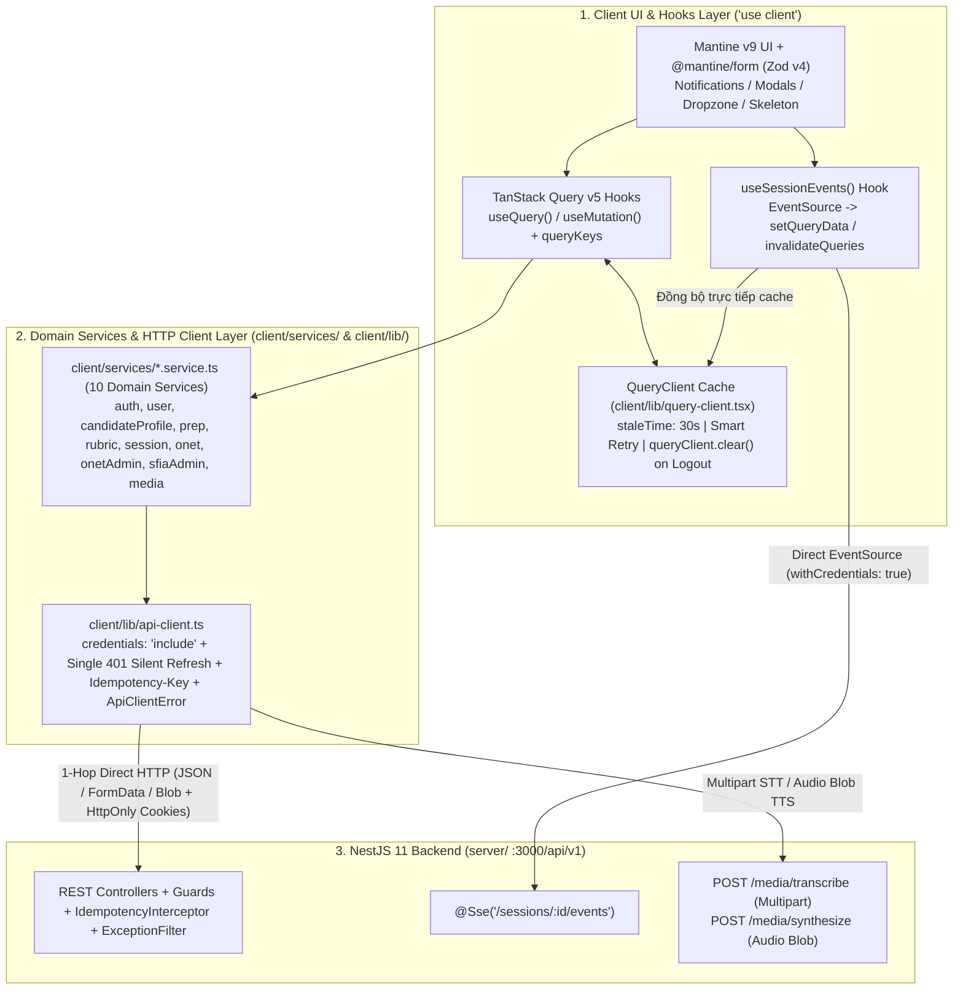

# Kế Hoạch Triển Khai Tinh Gọn: Chuẩn Hóa Tài Liệu & Chuyển Đổi Sang Mantine UI v9 + TanStack Query v5 + Zod v4

## 1. Mục Tiêu & Chiến Lược Tổng Thể (Executive Summary)

Dự án **InterviewCoach Frontend (`client/`)** chuyển đổi tầng quản lý Server State từ `swr` v2 sang **TanStack Query v5 (`@tanstack/react-query`)** theo kiến trúc **Tinh Gọn (1-Hop Direct REST)** — kết hợp trực tiếp với **Mantine UI v9**, **`@mantine/form` + Zod v4** và tầng **`client/services/*.service.ts` + `client/lib/api-client.ts`** hiện có:

- **UI & Design System:** **Mantine UI v9 (`^9.8.2`)** — Mantine-First, Zero-Hex Semantic-Only (`client/theme.ts`), `@mantine/form` (`mode: 'uncontrolled'`) + **Zod v4 (`^4.4.3`)**, `@mantine/hooks`, `@mantine/notifications`, `@mantine/modals`, `@mantine/dropzone`, và các mẫu giao diện chuẩn hóa từ `https://ui.mantine.dev/`.
- **Async Server State & Caching Layer (Pure Client-Side):** **TanStack Query v5 (`@tanstack/react-query`)** quản lý tập trung trong 1 tệp duy nhất **`client/lib/query-client.tsx`** (`<QueryProvider>`, `makeQueryClient()`, `getQueryClient()`, bộ **`queryKeys` phân cấp** kết hợp trực tiếp với helper **`queryOptions()` Factory** theo chuẩn `tanstack.com/query/v5` & `client/.agents/skills/tanstack-integration-best-practices`), hỗ trợ `useQuery`, `useSuspenseQuery`, `useMutation`, `ensureQueryData`, Optimistic Updates type-safe qua `DataTag`, hủy request qua `AbortSignal`, và đồng bộ Realtime trực tiếp từ **SSE (`EventSource`)** vào `QueryClient` cache (`cache-single-source`).
- **HTTP Transport & Domain Services Layer (1-Hop Direct REST):** Giữ nguyên 100% **`client/services/*.service.ts`** và **`client/lib/api-client.ts`** gọi trực tiếp tới **NestJS 11 Backend (`:3000/api/v1/*`)** với một cơ chế duy nhất cho `HttpOnly` Cookie (`credentials: 'include'`), **Browser 401 Silent Refresh**, tự động đính kèm **`Idempotency-Key`**, và chuẩn hóa lỗi **`ApiClientError`**.

---

### Các Quyết Định Đơn Giản Hóa Kiến Trúc (Đã Chốt Qua `/grill-me`)

> [!IMPORTANT]
>
> 1. **Loại bỏ hoàn toàn lớp Next.js tRPC BFF Proxy:**
>    - Không dựng Route Handler `/api/trpc/[trpc]`, không tạo 10 BFF routers trùng lặp 1:1 với NestJS Controllers, không cần Server-Side Cookie / `Set-Cookie` passthrough hay BFF 401 Refresh Mutex.
>    - Mọi request (JSON, Multipart `FormData`, Binary Audio `Blob`, và `EventSource` SSE) đều đi **trực tiếp 1 hop từ Trình duyệt tới NestJS (`:3000/api/v1`)** qua một cơ chế xác thực `HttpOnly` cookie và 401 Silent Refresh duy nhất tại `client/lib/api-client.ts`.
> 2. **Pure Client-Side TanStack Query v5 (Không RSC Prefetch / `HydrateClient` / `superjson`):**
>    - Bỏ hoàn toàn lớp RSC Server Prefetch, `HydrateClient`, `superjson` và `server-only`.
>    - Chỉ sử dụng `<QueryProvider>` ở phía Client kết hợp với Mantine `<Skeleton>` cho trạng thái tải dữ liệu, tương thích tự nhiên 100% với cơ chế `HttpOnly` cookie của trình duyệt.
> 3. **Tổ chức tầng dữ liệu tối giản (`client/lib/query-client.tsx` + `client/services/*.service.ts`):**
>    - Giữ nguyên 100% các tệp `client/services/*.service.ts` làm tầng gọi `apiClient`.
>    - Chỉ bổ sung **1 tệp hạ tầng mới duy nhất** `client/lib/query-client.tsx` chứa `makeQueryClient()`, `getQueryClient()`, `<QueryProvider>` và bộ `queryKeys` factory tập trung để các hooks/pages gọi trực tiếp `useQuery` / `useMutation`.
> 4. **Lộ trình 2 Chặng Gọn Nhẹ & Zero-Breakage (Docs-First → Core Setup & Gỡ Bỏ SWR):**
>    - **Chặng 1 (Docs-First):** Hoàn thiện hệ thống tài liệu kiến trúc (`client/docs/mantine/`, `client/docs/docs/`, `AGENTS.md`, `.agents/AGENTS.md`, `.claude/rules/ui-conventions.md`, `client/README.md`) cùng 2 tài liệu mới `04-tanstack-query-guide.md` và `05-mantine-templates-catalog.md`, vượt qua 100% cổng kiểm toán `npm run verify:docs`.
>    - **Chặng 2 (Core TanStack Query v5 & Gỡ Bỏ SWR):** Cài đặt `@tanstack/react-query`, dựng `client/lib/query-client.tsx`, tích hợp vào `RootLayout` / `@test-utils` / Storybook, nâng cấp `useSessions.ts`, `useSessionEvents.ts`, `AuthProvider` (`queryClient.clear()` khi logout/hết phiên) và gỡ bỏ hoàn toàn `swr`. Các trang đang gọi `client/services/*` trực tiếp tiếp tục hoạt động ổn định 100% (Zero-Breakage) và sẽ chuyển dần sang `useQuery` / `useMutation` khi refactor UI sang Mantine v9.
> 5. **Bảo toàn 100% Kiến trúc NestJS Backend (`server/`) & Playwright E2E (`client/e2e/`):**
>    - Không sửa đổi bất kỳ dòng code nào của `server/`.
>    - Toàn bộ các bài kiểm thử Playwright E2E (`page.route('**/api/v1/**')`) giữ nguyên 100% tính tương thích vì trình duyệt vẫn gọi trực tiếp `/api/v1/*`.

---

## 2. Kiến Trúc Kỹ Thuật Đích Tinh Gọn (Simplified Target Technical Architecture)



### Bảng Đối Chiếu Mức Độ Tinh Gọn (So Với Kiến Trúc tRPC BFF Cũ)

| Tiêu chí kỹ thuật                       | Kiến trúc tRPC BFF cũ (Phức tạp)                                                                                                              | Kiến trúc Tinh gọn mới (Đã chốt)                                                         |
| :-------------------------------------- | :-------------------------------------------------------------------------------------------------------------------------------------------- | :--------------------------------------------------------------------------------------- |
| **Số chặng mạng (Network Hops)**        | 2 hops cho JSON (`Browser -> Next.js BFF -> NestJS`), 1 hop cho Media/SSE                                                                     | **1 hop đồng nhất** (`Browser -> NestJS :3000/api/v1`) cho cả JSON, Media và SSE         |
| **Số lượng packages cài thêm**          | 7 packages (`@tanstack/react-query`, `@trpc/server`, `@trpc/client`, `@trpc/tanstack-react-query`, `superjson`, `server-only`, `client-only`) | **1 package runtime** (`@tanstack/react-query` + `@tanstack/react-query-devtools` ở dev) |
| **Số file hạ tầng phải tạo mới**        | > 25 files (`client/trpc/*`, 10 routers, 10 BFF schemas, `/api/trpc/[trpc]/route.ts`, `bff-client.ts`, `server.tsx`...)                       | **1 file duy nhất** (`client/lib/query-client.tsx`)                                      |
| **Cơ chế Cookie & 401 Silent Refresh**  | 2 cơ chế song song (Server BFF Refresh Mutex + `responseMeta` `Set-Cookie` forwarding VÀ Browser Refresh trong `api-client.ts`)               | **1 cơ chế duy nhất** sẵn có trong `client/lib/api-client.ts`                            |
| **Tầng `client/services/*.service.ts`** | Phải xóa toàn bộ 13 files và viết lại 29 màn hình ngay lập tức                                                                                | **Giữ nguyên 100%**, tái sử dụng trực tiếp làm `queryFn` / `mutationFn` (Zero-Breakage)  |
| **Tương thích Playwright E2E**          | Vỡ `page.route('**/api/v1/**')` do trình duyệt gọi `/api/trpc/*`                                                                              | **Tương thích 100%** không cần sửa E2E mocks                                             |

---

## 3. Lộ Trình Chi Tiết 2 Chặng Thực Thi (Detailed 2-Phase Execution Plan)

---

### CHẶNG 1 (DOCS-FIRST): Hoàn Thiện Hệ Thống Tài Liệu Kiến Trúc, Bộ Luật AI & Catalog Templates Mantine v9 + TanStack Query v5

Mục tiêu của Chặng 1 là cập nhật `client/docs/` thành nguồn chân lý duy nhất (SSOT) cho kiến trúc **Mantine UI v9 + TanStack Query v5 + `@mantine/form` (Zod v4) + `client/services/*`**, bao gồm bộ mẫu giao diện từ `ui.mantine.dev` và vượt qua 100% cổng kiểm toán `npm run verify:docs`.

#### 1.1. Mở Rộng Cẩm Nang Thực Chiến & Catalog Templates Trong `client/docs/mantine/`

##### [NEW] `client/docs/mantine/04-tanstack-query-guide.md`

Cẩm nang thực chiến kết hợp **Mantine v9 + TanStack Query v5 + `@mantine/form` (Zod v4) + `client/services/*`** trên Next.js 16 App Router:

1. **Kiến trúc Client-Side Server State (`client/lib/query-client.tsx` & `client/services/*`):**
   - Cấu hình `makeQueryClient()` (smart retry bỏ qua lỗi `4xx` và `REPORT_NOT_READY`, `staleTime: 30_000`), `<QueryProvider>`, và bộ **`queryKeys` factory tập trung** (`queryKeys.auth`, `queryKeys.users`, `queryKeys.candidateProfile`, `queryKeys.prep`, `queryKeys.rubrics`, `queryKeys.sessions`, `queryKeys.onet`, `queryKeys.onetAdmin`, `queryKeys.sfiaAdmin`).
   - Luồng 1-Hop Direct REST qua `client/services/*.service.ts` và `client/lib/api-client.ts` (`credentials: 'include'`, 401 Silent Refresh, `Idempotency-Key`, `ApiClientError`).
2. **Pattern 1 — `useQuery` + `queryKeys` + Mantine `<Skeleton>` / `<Alert color="danger">`:**
   - Cách đọc dữ liệu chuẩn từ `client/services/*` bằng `useQuery({ queryKey: queryKeys.sessions.list(), queryFn: () => ... })` và hiển thị `<Skeleton>` không gây layout shift.
3. **Pattern 2 — `@mantine/form` (`uncontrolled`, Zod v4) + `useMutation` + `@mantine/notifications`:**
   - Xác thực form ở client bằng `schemaResolver(zodSchema, { sync: true })`.
   - Ánh xạ tự động lỗi validation trả về từ NestJS (`err instanceof ApiClientError && err.details`) thẳng vào `form.setErrors(...)` của Mantine Form và hiển thị thông báo qua `notifications.show({ color: 'danger' | 'success', ... })`.
4. **Pattern 3 — Mantine `<Combobox>` / `<Select>` Tìm Kiếm Tức Thì (`useDebouncedValue` + TanStack Query `AbortSignal`):**
   - Kết hợp `useDebouncedValue(search, 300)` từ `@mantine/hooks` với `useQuery({ queryKey: queryKeys.onet.search(debounced), queryFn: ({ signal }) => ... })` — TanStack Query tự động hủy request in-flight qua `signal` khi từ khóa thay đổi.
5. **Pattern 4 — Optimistic Updates & `@mantine/modals` (`modals.openConfirmModal`):**
   - Xác nhận xóa/cập nhật bằng `modals.openConfirmModal`, thực hiện cập nhật lạc quan (`onMutate` -> `queryClient.cancelQueries` + `setQueryData`, `onError` -> rollback + `notifications.show`, `onSettled` -> `invalidateQueries`).
6. **Pattern 5 — Đồng bộ Realtime SSE (`EventSource`) & Binary Media (`@mantine/dropzone` / Audio Blob) với `QueryClient` Cache:**
   - Cách `useSessionEvents` đẩy dữ liệu trực tiếp vào `queryClient.setQueryData(queryKeys.sessions.feedbackProgress(sessionId), ...)` và `queryClient.invalidateQueries({ queryKey: queryKeys.sessions.detail(sessionId) })`.

##### [NEW] `client/docs/mantine/05-mantine-templates-catalog.md`

Bộ **Full-Stack Mantine v9 UI Templates Catalog** (tham khảo & adapt 4 bước Zero-Hex từ `https://ui.mantine.dev/` kết hợp trực tiếp với TanStack Query v5 `useQuery` / `useMutation`, `queryKeys`, `client/lib/api-client.ts` và `@mantine/form` Zod v4 — dùng làm bản thiết kế mẫu khi nâng cấp UI cho các màn hình):

1. **Template Nhóm 1 — Workspace AppShell & Navigation (`ui.mantine.dev/category/navbars/` & `headers/`):**
   - Mẫu `NavbarNested` / `NavbarSimple` + `UserMenu` + `ColorSchemeToggle` dùng `<AppShell>`, `<NavLink component={Link}>`, `<Menu>`, `<Avatar>`, kết nối `useAuth()` / `authService` và gọi `queryClient.clear()` khi đăng xuất.
2. **Template Nhóm 2 — Authentication & Security (`ui.mantine.dev/category/authentication/` & `inputs/`):**
   - Mẫu `AuthenticationTitle` (Đăng nhập / Đăng ký / Đặt lại mật khẩu) + `PasswordStrength` (`<PasswordInput>`, `<Progress>`, `<Popover>`) kết nối `@mantine/form` (`uncontrolled`) + `useMutation` gọi `authService.login` / `register`.
3. **Template Nhóm 3 — Candidate Dashboard, StatsGrid & Session Cards (`ui.mantine.dev/category/stats/` & `cards/`):**
   - Mẫu `StatsGrid` + `SessionCard` (`<UnstyledButton mod={{ active }}>` + `<Paper withBorder>`) + bộ lọc URL (`<SegmentedControl>`, `<TextInput>`) + `<Skeleton>` / EmptyState kết nối `useSessions()` (`queryKeys.sessions.list()`).
4. **Template Nhóm 4 — Multi-Step Interview Setup Wizard (`mantine.dev/core/stepper/` & `x/dropzone/`):**
   - Mẫu `<Stepper>` 3 bước + `<Dropzone>` tải CV/JD + `<Combobox>` / `<Select>` tìm nghề O\*NET + `<Radio.Group>` chọn chế độ phỏng vấn kết nối `queryKeys.onet.search`, `prepService.saveJobDescription`, `sessionService.createSession`.
5. **Template Nhóm 5 — Live Interview Split-View & STAR Competency Report (`ui.mantine.dev/category/stats/` — `StatsRing` & `Accordion`):**
   - Mẫu Split-View 2 cột (`<Grid>`, `<RingProgress>`, `<Timeline>`, `<Accordion>`, `<Badge color="brand|success|warning|danger">`) kết nối `queryKeys.sessions.detail`, `queryKeys.sessions.report` và SSE `useSessionEvents`.
6. **Template Nhóm 6 — Admin Master-Detail & Server-Paginated Data Table (`ui.mantine.dev/category/tables/`):**
   - Mẫu `<Table.ScrollContainer>` + `<Pagination>` + `<Drawer>` inspection sheet + `keepPreviousData` (`placeholderData`) kết nối `queryKeys.sfiaAdmin.*`, `queryKeys.onetAdmin.*`, và `queryKeys.users.*`.
7. **Template Nhóm 7 — Public Hero Landing & System Status Pages (`ui.mantine.dev/category/hero/` & `error-pages/`):**
   - Mẫu Hero Section, Features Grid và Error Banner (`401`, `403`, `429`, `503`, `OfflineBanner` với `useNetwork()`).

##### [MODIFY] [client/docs/mantine/README.md](../../client/docs/mantine/README.md), [02-setup-forms-hooks-guide.md](../../client/docs/mantine/02-setup-forms-hooks-guide.md), [03-testing-and-tooling.md](../../client/docs/mantine/03-testing-and-tooling.md)

- Cập nhật bảng Stack trong `client/docs/mantine/README.md`: Thay `swr` (`^2.4.1`) bằng `@tanstack/react-query` (`^5`); bổ sung mục lục liên kết tới `04-tanstack-query-guide.md` và `05-mantine-templates-catalog.md`.
- Cập nhật `02-setup-forms-hooks-guide.md`: Minh họa `RootLayout` bọc `<QueryProvider>`, ví dụ `useDebouncedValue` kết hợp `useQuery` + `queryKeys.onet.search(debounced)`.
- Cập nhật `03-testing-and-tooling.md`: Minh họa `test-utils/render.tsx` tạo `QueryClient` cô lập cho mỗi bài test (`retry: false`, `gcTime: 0`) bọc quanh `<MantineProvider>`.

---

#### 1.2. Nâng Cấp Đồng Bộ Các Chuyên Đề SSOT Trong `client/docs/docs/`

Mọi thay đổi trong `client/docs/docs/` tuân thủ nghiêm ngặt **Unified 6-Part Anatomy**, **Zero Raw-Icon Typography**, **Zero Client Code Extraction**, và bảo toàn đúng **131 Core Rule IDs (+ 18 Vercel Sub-Rules)**:

1. **[MODIFY] [client/docs/docs/README.md](../../client/docs/docs/README.md) (Master Hub):**
   - Cập nhật Mindmap (`State TanStack Query & SSE`, `API Contracts & Resilience API`) và bảng Bối cảnh kỹ thuật mục `Data, State & Forms`: `@tanstack/react-query` `^5`, SSE `EventSource`, Minimal React Context, Next.js URL params, `@mantine/form` (`uncontrolled`) + `zod` `^4.4.3`.
   - Cập nhật bảng Sitemap cho Chuyên đề 03 (`State Management`) và Chuyên đề 11 (`API Contracts & Resilience`).
2. **[MODIFY] [client/docs/docs/QUICK_REFERENCE.md](../../client/docs/docs/QUICK_REFERENCE.md):**
   - Tiêu chí DoD số 5: Đổi từ `State & SWR` sang `State & TanStack Query` (đọc dữ liệu server qua `useQuery` + `queryKeys` factory và `client/services/*`).
   - **Recipe 3:** Thay công thức SWR v2 bằng **Công thức Chuẩn TanStack Query v5 (`useQuery` / `useMutation` + `queryKeys` Factory) Tự Chứa**.
   - Cập nhật mô tả ngắn của `API-009`, `API-012`, `SEC-010`, `PERF-009`, `RULE-SWR-SERVER-STATE` sang TanStack Query v5 (`QueryClient`, `queryKeys`, `queryClient.clear()`) trong khi giữ nguyên tên rule gốc `client-swr-dedup` ở dòng ánh xạ skill `vercel-react-best-practices`.
3. **[MODIFY] [client/docs/docs/01-foundations/state-management.md](../../client/docs/docs/01-foundations/state-management.md):**
   - Viết lại **Mục 2.1 (Lớp 1 — Server State Với TanStack Query v5 & `queryKeys` Factory)**:
     - Cách dùng `useQuery`, `useMutation`, `useQueryClient` kết hợp `queryKeys` factory và tầng domain services.
   - Viết lại **Mục 3 (Realtime Stream State — SSE `EventSource` & Đồng Bộ TanStack `QueryClient` Cache)**:
     - Ví dụ tự chứa minh họa `queryClient.setQueryData` khi nhận event tiến độ AI và `queryClient.invalidateQueries` khi báo cáo hoàn tất.
   - Viết lại **Mục 4.2 (Optimistic Updates & Chống Race Conditions Với TanStack Query v5)**:
     - Mẫu `onMutate` (`cancelQueries` + snapshot + `setQueryData`), `onError` (rollback + Mantine `notifications.show`), `onSettled` (`invalidateQueries`).
4. **[MODIFY] [client/docs/docs/03-quality-and-security/api-contracts-and-resilience.md](../../client/docs/docs/03-quality-and-security/api-contracts-and-resilience.md):**
   - Cập nhật Sequence Diagram và các quy chuẩn `API-003` (truyền `AbortSignal` từ TanStack Query `queryFn` xuống `services/*` & `apiClient`), `API-009` (`staleTime` & `gcTime` theo độ biến động dữ liệu), `API-012` (khử trùng lặp request tự động qua TanStack Query Cache & `queryKeys`).
5. **[MODIFY] Các chuyên đề có tham chiếu `useSWR` / `SWR`:**
   - [01-foundations/architecture-and-structure.md](../../client/docs/docs/01-foundations/architecture-and-structure.md) (bảng phân tách Server/Client Component và cây thư mục thêm `lib/query-client.tsx`).
   - [01-foundations/coding-standards.md](../../client/docs/docs/01-foundations/coding-standards.md) (bảng Master Standards Router).
   - [02-ui-and-design-system/component-patterns.md](../../client/docs/docs/02-ui-and-design-system/component-patterns.md) (Client Container dùng `useQuery` / `useMutation`).
   - [02-ui-and-design-system/view-transitions-and-motion.md](../../client/docs/docs/02-ui-and-design-system/view-transitions-and-motion.md) (`Suspense` + TanStack Query).
   - [03-quality-and-security/security-and-auth.md](../../client/docs/docs/03-quality-and-security/security-and-auth.md) (`SEC-010` gọi `queryClient.clear()` khi logout hoặc `auth:session-expired`).
   - [03-quality-and-security/testing-and-qa.md](../../client/docs/docs/03-quality-and-security/testing-and-qa.md) (tầng custom hooks kiểm thử TanStack Query hooks).
   - [04-performance-and-ops/performance-and-web-vitals.md](../../client/docs/docs/04-performance-and-ops/performance-and-web-vitals.md) (`PERF-009` độ hạt `queryKeys` & tùy chọn `select` chống re-render).

---

#### 1.3. Cập Nhật Linter Kiểm Toán Tài Liệu & Bộ Luật AI Agents

##### [MODIFY] [client/scripts/verify-docs-integrity.mjs](../../client/scripts/verify-docs-integrity.mjs)

- **Siết chặt tuyệt đối `ALLOWED_INTERNAL_ALIASES` (Chống trích xuất code legacy từ `client/`):**
  Chỉ cho phép 2 alias nền tảng `@/theme` và `@test-utils`. Mọi code block trong tài liệu bắt buộc tự chứa (self-contained) theo chuẩn chính thức từ `https://tanstack.com/query/v5`, `https://mantine.dev/`, `https://ui.mantine.dev/` và `client/.agents/skills/tanstack-integration-best-practices` (cấm import `@/lib/api-client`, `@/lib/query-client`, `@/services/*`, `@/components/*`):
  ```js
  const ALLOWED_INTERNAL_ALIASES = new Set(["@/theme", "@test-utils"]);
  ```
- Thêm `04-tanstack-query-guide.md` và `05-mantine-templates-catalog.md` vào `TARGET_MANTINE_FILES` và `REQUIRED_KEYWORDS_BY_FILE`:
  - `'docs/mantine/04-tanstack-query-guide.md'`: `['TanStack Query', 'queryOptions', 'useQuery', 'useMutation', 'QueryClient', 'queryKeys', 'AbortSignal']`
  - `'docs/mantine/05-mantine-templates-catalog.md'`: `['AppShell', 'Stepper', 'Dropzone', 'Table.ScrollContainer', 'RingProgress', 'useQuery']`
- Cập nhật `REQUIRED_KEYWORDS_BY_FILE` của:
  - `'docs/docs/01-foundations/state-management.md'`: Thay `'SWR'`, `'useSWR'`, `'Key Factory'` bằng `'TanStack Query'`, `'queryOptions'`, `'useQuery'`, `'QueryClient'`, `'queryKeys'`, `'useSearchParams'`, `'@mantine/hooks'`, `'Derived State'`, `'AbortController'`, `'EventSource'`.
  - `'docs/docs/03-quality-and-security/api-contracts-and-resilience.md'`: Thay `'SWR'` bằng `'TanStack Query'`, `'Idempotency-Key'`, `'ApiClientError'`, `'AbortController'`, `'useNetwork'`, `'Target Standard'`.
- Trong `SOFT_WARN_PHRASES` & `SOFT_WARN_EXCLUSION_RE`:
  - Gỡ bỏ cảnh báo cũ đối với `'TanStack Query'` (vì nay là chuẩn chính thức).
  - Thêm cảnh báo cho `'useSWR'` (`/\buseSWR\b/`) và `from 'swr'` (`/\bfrom\s+['"]swr['"]/`), đồng thời bổ sung `client-swr-dedup` vào `SOFT_WARN_EXCLUSION_RE`.

##### [MODIFY] [AGENTS.md](../../AGENTS.md), [.agents/AGENTS.md](../../.agents/AGENTS.md), [.claude/rules/ui-conventions.md](../../.claude/rules/ui-conventions.md), [client/README.md](../../client/README.md)

- Cập nhật danh mục công nghệ chuẩn: Thay `swr` (`^2.4.1`) bằng `@tanstack/react-query` (`^5`).
- Đăng ký skill `tanstack-integration-best-practices/SKILL.md` vào bảng Project Skills trong `AGENTS.md`, `client/docs/mantine/README.md`, và `client/docs/docs/QUICK_REFERENCE.md` (áp dụng `queryOptions()`, `cache-single-source`, `ensureQueryData`, isolated `QueryClient`).
- Ghi rõ quy tắc Server State: Dùng `@tanstack/react-query` (`queryOptions()`, `useQuery`, `useMutation`, `queryKeys` phân cấp) kết hợp với tầng domain services và giữ `QueryClient` cache làm nguồn chân lý duy nhất.

> **Cổng nghiệm thu Chặng 1:** Chạy `npm run verify:docs` và kiểm tra Prettier trên toàn bộ tài liệu/script thuộc phạm vi Chặng 1 đạt **0 errors, 0 warnings**.

---

### CHẶNG 2: Cài Đặt TanStack Query v5, Dựng `client/lib/query-client.tsx`, Nâng Cấp Core Hooks & Gỡ Bỏ Hoàn Toàn `swr`

Mục tiêu của Chặng 2 là đưa TanStack Query v5 vào vận hành thực tế trên `client/` với độ phức tạp tối thiểu (chỉ thêm 1 file `client/lib/query-client.tsx`), thay thế `useSWR` trong `useSessions.ts`, đồng bộ SSE cache trong `useSessionEvents.ts`, dọn cache khi đăng xuất trong `AuthProvider`, và gỡ bỏ hoàn toàn `swr` mà không làm gãy bất kỳ trang hay bài test hiện hữu nào.

#### 2.1. Cập Nhật Dependencies (`client/package.json`)

- **Cài đặt:** `@tanstack/react-query` (`^5.x`) vào `dependencies` và `@tanstack/react-query-devtools` (`^5.x`) vào `devDependencies`.
- **Gỡ bỏ:** `swr` khỏi `dependencies` (`npm uninstall swr`).

#### 2.2. Xây Dựng Hạ Tầng `client/lib/query-client.tsx` (1 File Duy Nhất)

##### [NEW] `client/lib/query-client.tsx`

1. **Hàm `makeQueryClient()` & Browser Singleton `getQueryClient()`:**
   - `defaultOptions.queries.staleTime = 30 * 1000` (30 giây).
   - `defaultOptions.queries.refetchOnWindowFocus = true`.
   - `defaultOptions.queries.retry`: Retry tối đa 2 lần cho lỗi mạng hoặc `502`/`503`/`504`; trả về `false` ngay lập tức nếu lỗi là `ApiClientError` có `statusCode` thuộc `400..499` hoặc `errorCode === 'REPORT_NOT_READY'`.
2. **Component `<QueryProvider>` (`'use client'`):**
   - Cung cấp `<QueryClientProvider client={queryClient}>` cho toàn bộ ứng dụng.
3. **Bộ `queryKeys` Factory Tập Trung (Bao phủ toàn bộ 10 miền nghiệp vụ):**
   - `queryKeys.auth`: `all: ['auth'] as const`, `me: () => ['auth', 'me'] as const`
   - `queryKeys.users`: `all: ['users'] as const`, `me: () => ['users', 'me'] as const`, `adminList: () => ['users', 'admin-list'] as const`, `adminDetail: (id: string) => ['users', 'admin-detail', id] as const`
   - `queryKeys.candidateProfile`: `all: ['candidate-profile'] as const`, `detail: () => ['candidate-profile', 'detail'] as const`
   - `queryKeys.prep`: `all: ['prep'] as const`, `savedJds: () => ['prep', 'saved-jds'] as const`
   - `queryKeys.rubrics`: `all: ['rubrics'] as const`, `active: (contextPackId: string, sessionType?: string) => ['rubrics', 'active', contextPackId, sessionType ?? 'all'] as const`
   - `queryKeys.sessions`:
     - `all: ['sessions'] as const`
     - `list: () => ['sessions', 'list'] as const`
     - `detail: (sessionId: string) => ['sessions', 'detail', sessionId] as const`
     - `status: (sessionId: string) => ['sessions', 'status', sessionId] as const`
     - `questions: (sessionId: string) => ['sessions', 'questions', sessionId] as const`
     - `feedbackProgress: (sessionId: string) => ['sessions', 'feedback-progress', sessionId] as const`
     - `report: (sessionId: string) => ['sessions', 'report', sessionId] as const`
   - `queryKeys.onet`:
     - `all: ['onet'] as const`
     - `search: (query?: string, limit?: number) => ['onet', 'search', query ?? '', limit ?? 20] as const`
     - `tech: (socCode: string) => ['onet', 'tech', socCode] as const`
   - `queryKeys.onetAdmin`:
     - `all: ['onet-admin'] as const`
     - `summary: () => ['onet-admin', 'summary'] as const`
     - `majorGroups: () => ['onet-admin', 'major-groups'] as const`
     - `occupations: (filters?: Record<string, unknown>) => ['onet-admin', 'occupations', filters ?? {}] as const`
     - `topOccupations: (filters?: Record<string, unknown>) => ['onet-admin', 'top-occupations', filters ?? {}] as const`
     - `sfiaCoverage: (filters?: Record<string, unknown>) => ['onet-admin', 'sfia-coverage', filters ?? {}] as const`
     - `detail: (socCode: string) => ['onet-admin', 'detail', socCode] as const`
     - `alternateTitles: (socCode: string, page?: number, limit?: number, search?: string) => ['onet-admin', 'alternate-titles', socCode, page ?? 1, limit ?? 20, search ?? ''] as const`
     - `sfiaMappings: (socCode: string) => ['onet-admin', 'sfia-mappings', socCode] as const`
     - `sfiaLibrary: () => ['onet-admin', 'sfia-library'] as const`
   - `queryKeys.sfiaAdmin`:
     - `all: ['sfia-admin'] as const`
     - `categories: () => ['sfia-admin', 'categories'] as const`
     - `subcategories: (categoryCode?: string) => ['sfia-admin', 'subcategories', categoryCode ?? 'all'] as const`
     - `skills: (filters?: Record<string, unknown>) => ['sfia-admin', 'skills', filters ?? {}] as const`
     - `skillDetail: (skillCode: string) => ['sfia-admin', 'skill-detail', skillCode] as const`
     - `levels: () => ['sfia-admin', 'levels'] as const`
     - `attributes: () => ['sfia-admin', 'attributes'] as const`
     - `matrix: (categoryCode?: string) => ['sfia-admin', 'matrix', categoryCode ?? 'all'] as const`
     - `coverage: () => ['sfia-admin', 'coverage'] as const`

#### 2.3. Tích Hợp Provider & Nâng Cấp Core Hooks / Services

| Tệp nguồn (`client/...`)                                                                                                                                              | Thay đổi cụ thể                                                                                                                                                                                                                                                                                                                                                                                         |
| :-------------------------------------------------------------------------------------------------------------------------------------------------------------------- | :------------------------------------------------------------------------------------------------------------------------------------------------------------------------------------------------------------------------------------------------------------------------------------------------------------------------------------------------------------------------------------------------------ |
| **[MODIFY] [client/app/layout.tsx](../../client/app/layout.tsx)**                                                                                                     | Bọc `<QueryProvider>` bên ngoài `<AuthProvider>` để mọi hook và component trong ứng dụng truy cập được `QueryClient`.                                                                                                                                                                                                                                                                                   |
| **[MODIFY] [client/test-utils/render.tsx](../../client/test-utils/render.tsx)**                                                                                       | Tạo instance `QueryClient` mới cho mỗi lần gọi `render()` (`defaultOptions: { queries: { retry: false, gcTime: 0 }, mutations: { retry: false } }`) và bọc `<QueryClientProvider>` quanh `<MantineProvider theme={theme} env="test">`.                                                                                                                                                                  |
| **[MODIFY] [client/.storybook/preview.tsx](../../client/.storybook/preview.tsx)**                                                                                     | Bọc `<QueryProvider>` trong decorator `withMantineProvider` để mọi Story sử dụng hooks TanStack Query đều render mượt mà.                                                                                                                                                                                                                                                                               |
| **[MODIFY] [client/lib/auth-context.tsx](../../client/lib/auth-context.tsx)**                                                                                         | Dùng `useOptionalQueryClient()` để gọi `queryClient.clear()` khi `logout()` hoặc khi nhận sự kiện `auth:session-expired` (đảm bảo quy tắc `SEC-010` xóa sạch dữ liệu nhạy cảm trong bộ nhớ cache mà không làm crash unit test legacy).                                                                                                                                                                  |
| **[MODIFY] [client/hooks/useSessions.ts](../../client/hooks/useSessions.ts) & [app/(candidate)/sessions/page.tsx](<../../client/app/(candidate)/sessions/page.tsx>)** | Thay thế hoàn toàn `useSWR` bằng `useQuery(sessionQueries.list())` chuẩn TanStack Query v5 (`queryOptions()`), trả về đầy đủ trạng thái `UseQueryResult` kèm `sessions: query.data ?? []` và `invalidate`, đồng thời đổi lời gọi `mutate()` sang `refetch()` tại `app/(candidate)/sessions/page.tsx`.                                                                                                   |
| **[MODIFY] [client/hooks/useSessionEvents.ts](../../client/hooks/useSessionEvents.ts)**                                                                               | Tích hợp `useOptionalQueryClient()` để khi nhận 4 sự kiện SSE thực tế của NestJS (`session.status`, `session.feedback_progress`, `report.ready`, `session.completed`), ngoài việc gọi callbacks hiện tại còn tự động đồng bộ `queryClient.setQueryData` / `queryClient.invalidateQueries` cho `status(sessionId)`, `feedbackProgress(sessionId)`, `report(sessionId)`, `detail(sessionId)` và `list()`. |
| **[MODIFY] [client/services/session.service.ts](../../client/services/session.service.ts) & [onet.service.ts](../../client/services/onet.service.ts)**                | Bổ sung tham số tùy chọn `signal?: AbortSignal` vào các hàm đọc dữ liệu (`getSessions`, `getSession`, `getSessionStatus`, `getQuestions`, `getFeedbackProgress`, `getReport`, `searchOccupations`, `getOccupationTech`) truyền xuống `apiClient.get(..., { signal })` để hỗ trợ hủy request tự động từ `sessionQueries` & `onetQueries` (`queryOptions()`).                                             |
| **[MODIFY] [client/next.config.ts](../../client/next.config.ts) & [client/scripts/check-ui-rules.mjs](../../client/scripts/check-ui-rules.mjs)**                      | Thêm `'@tanstack/react-query'` vào `experimental.optimizePackageImports` trong `next.config.ts`; thêm `'hooks'` vào danh sách thư mục quét mặc định khi chạy `--all` trong `check-ui-rules.mjs`.                                                                                                                                                                                                        |
| **[NEW] `client/lib/__tests__/query-client.test.tsx`**                                                                                                                | Unit test kiểm chứng `makeQueryClient` (smart retry bỏ qua lỗi 4xx & `REPORT_NOT_READY`), `queryKeys` & `sessionQueries`/`onetQueries` (`queryOptions()`, chuyển tiếp `AbortSignal`), và hook `useSessions` chạy trên TanStack Query v5.                                                                                                                                                                |

> **Cổng nghiệm thu Chặng 2:** Chạy toàn bộ cổng kiểm định tại `client/` đạt Exit Code 0.

---

## 4. Kế Hoạch Kiểm Chứng & Nghiệm Thu Từng Chặng (Verification Plan)

### 4.1. Cổng Kiểm Chứng Chặng 1 (Docs-First Gate)

```bash
cd client
npm run verify:docs      # Kiểm tra toàn vẹn 100% tài liệu (28 files Markdown, 131 Rule IDs, Code Block Zero-Hex & Zero-Extract Linter, Link & Anchor Integrity, 6-Part Anatomy)
npx prettier --check "docs/**/*.md" "README.md" "scripts/verify-docs-integrity.mjs" "../AGENTS.md" "../.agents/AGENTS.md" "../.claude/rules/ui-conventions.md" "../docs/documents-update/doc-update2.md"
```

### 4.2. Cổng Kiểm Chứng Chặng 2 (Code & Quality Gate)

```bash
cd client
npm run typecheck        # tsc --noEmit (0 lỗi TypeScript)
npm run lint             # ESLint 9 (0 lỗi)
npx prettier --check "lib/query-client.tsx" "lib/__tests__/query-client.test.tsx" "lib/auth-context.tsx" "hooks/useSessions.ts" "hooks/useSessionEvents.ts" "services/session.service.ts" "services/onet.service.ts" "app/layout.tsx" "app/(candidate)/sessions/page.tsx" "test-utils/render.tsx" ".storybook/preview.tsx" "next.config.ts" "scripts/check-ui-rules.mjs" "../docs/documents-update/doc-update2.md"
npm run stylelint        # Stylelint trên **/*.module.css (0 lỗi)
npm run ui:lint          # check-ui-rules.mjs (0 lỗi Zero-Hex & Mantine v9)
npm run test:unit        # Vitest 4 (--project unit) chạy toàn bộ unit tests (100% PASS)
npm run build            # Next.js 16 production build (Exit Code 0)
npm run verify:docs      # Đảm bảo tài liệu và codebase đồng bộ tuyệt đối (0 errors, 0 warnings)
```
