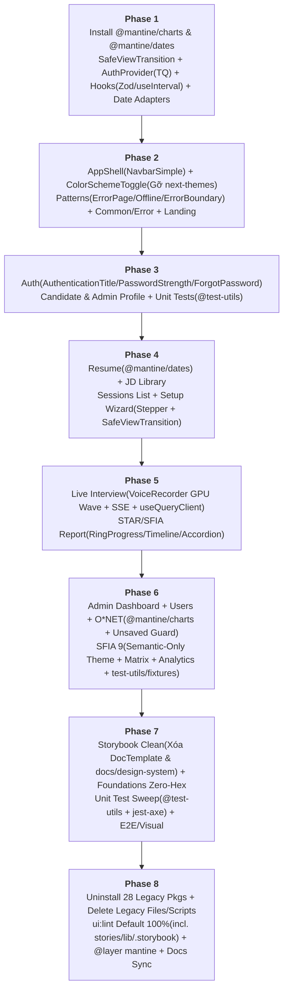

# Đặc Tả Kế Hoạch Triển Khai Master: Chuẩn Hóa 100% Frontend (`client/`) Sang Mantine UI v9 Zero-Hex

> **Dự án:** InterviewCoach Frontend (`client/`)  
> **Chuẩn mục tiêu:** Next.js `16.2.6` (App Router, RSC-First) + React `19.2.4` + Mantine UI v9 (`^9.8.2`, Zero-Hex Semantic-Only 5 vai trò) + [`ui.mantine.dev`](https://ui.mantine.dev/) Archetypes + `@tabler/icons-react` + `@mantine/form` (`uncontrolled`) + Zod v4 + `@mantine/hooks` + `@mantine/charts` + `@mantine/dates` + TanStack Query v5 (`queryOptions()`)  
> **Hiện trạng đo được:** `node scripts/check-ui-rules.mjs --all` báo **2.286 lỗi** trên 297 file; có **28 package legacy** (26 runtime/Tailwind/Radix/RHF + 2 Storybook legacy), **22 `page.tsx`** (30 file App Router đặc biệt), **37 file `.tsx`** vượt ngưỡng 250 dòng (`STD-SIZE-001`, không tính `components/ui/` và `FormField.tsx`), **100 file unit test** (26 trong `components/ui/`, 5 trong `components/patterns/`, **69 file** giữ lại, 75 file import trực tiếp `@testing-library/react`), 114 file dùng `lucide-react`, 113 file dùng `components/ui/`, 81 file dùng `lib/utils.ts` (`cn`).  
> **Đích đến:** **0 package legacy**, **0 file legacy**, **0 lỗi & 0 exemption (code sản phẩm & stories)** trên `npm run ui:lint -- --strict-expiry` quét **100% `client/`**, và **Exit Code 0** trên toàn bộ chuỗi `typecheck` → `lint` → `format:check` → `stylelint` → `ui:lint` → `test:unit` → `test:storybook` → `build` → `build-storybook` → `verify:docs`.

---

## MỤC LỤC

1. [Tổng Hợp 12 Quyết Định Kiến Trúc Đã Chốt](#1-tổng-hợp-12-quyết-định-kiến-trúc-đã-chốt)
2. [User Review Required & Ràng Buộc Tuyệt Đối](#2-user-review-required--ràng-buộc-tuyệt-đối)
3. [Hệ Thống Bất Biến Kỹ Thuật (Non-Negotiable Invariants)](#3-hệ-thống-bất-biến-kỹ-thuật-non-negotiable-invariants)
4. [Lộ Trình 8 Phase & Đặc Tả File-by-File (100% Codebase)](#4-lộ-trình-8-phase--đặc-tả-file-by-file-100-codebase)
   - [Phase 1: Platform, Extensions (`@mantine/charts`, `@mantine/dates`), `SafeViewTransition` & Core `hooks/` / `lib/`](#phase-1-platform-extensions-mantinecharts-mantinedates-safeviewtransition--core-hooks--lib)
   - [Phase 2: AppShell, Navigation, ColorSchemeToggle (Gỡ `next-themes`), Patterns & Public Landing](#phase-2-appshell-navigation-colorschemetoggle-gỡ-next-themes-patterns--public-landing)
   - [Phase 3: Authentication & Account Profile](#phase-3-authentication--account-profile)
   - [Phase 4: Candidate Workspace — Resume, JD Library, Sessions List & Setup Wizard](#phase-4-candidate-workspace--resume-jd-library-sessions-list--setup-wizard)
   - [Phase 5: Live Interview Room & STAR/SFIA Evaluation Report](#phase-5-live-interview-room--starsfia-evaluation-report)
   - [Phase 6: Admin Portal — Dashboard, Users, O\*NET Browser & SFIA 9 Framework](#phase-6-admin-portal--dashboard-users-onet-browser--sfia-9-framework)
   - [Phase 7: Storybook Clean, Unit Test Sweep (`@test-utils` + `jest-axe`) & Visual/E2E Alignment](#phase-7-storybook-clean-unit-test-sweep-test-utils--jest-axe--visuale2e-alignment)
   - [Phase 8: Hard Cleanup, Hardening `ui:lint` 100% & Đồng Bộ Tài Liệu (`verify:docs`)](#phase-8-hard-cleanup-hardening-uilint-100--đồng-bộ-tài-liệu-verifydocs)
5. [Danh Mục Xóa Sạch 100% (Complete Deletion Manifest)](#5-danh-mục-xóa-sạch-100-complete-deletion-manifest)
6. [Ma Trận Bảo Toàn Hành Vi Nghiệp Vụ (Zero-Regression Contract)](#6-ma-trận-bảo-toàn-hành-vi-nghiệp-vụ-zero-regression-contract)
7. [Kế Hoạch Kiểm Chứng & Tiêu Chí Nghiệm Thu (Verification Plan)](#7-kế-hoạch-kiểm-chứng--tiêu-chí-nghiệm-thu-verification-plan)

---

## 1. Tổng Hợp 12 Quyết Định Kiến Trúc Đã Chốt

|   #    | Quyết định đã thống nhất                           | Chuẩn áp dụng                                                                                                                                                                                                                                                                                                                                                                                                                                                                                                                                                                    |
| :----: | :------------------------------------------------- | :------------------------------------------------------------------------------------------------------------------------------------------------------------------------------------------------------------------------------------------------------------------------------------------------------------------------------------------------------------------------------------------------------------------------------------------------------------------------------------------------------------------------------------------------------------------------------- |
| **1**  | **Xóa sạch wrapper thừa**                          | Xóa 100% `components/ui/` (80 file), `components/form/` (3 file), `components/theme-provider.tsx`, `components/mantine-color-scheme-sync.tsx`, `app/(auth)/LogoutAction.tsx`, `components/auth/LogoutButton.{tsx,test.tsx,stories.tsx}`, 5 wrapper trong `components/patterns/` (`DataPatterns`, `DialogPatterns`, `FeedbackPatterns`, `FormPatterns`, `LayoutPatterns`), `lib/utils.ts`, `app/styles/*`, `components.json`. Chỉ giữ & chuẩn hóa thuần Mantine v9 trong `components/patterns/`: **`ErrorPageTemplate`**, **`OfflineBanner`**, **`ErrorBoundary`**, và **`SafeViewTransition`**. |
| **2**  | **Cài thêm 2 Mantine extensions**                  | Cài `@mantine/charts` (`recharts`, load qua `next/dynamic`) cho biểu đồ O\*NET/SFIA và `@mantine/dates` (`dayjs`, locale `vi`) cho `MonthPickerInput`/`DatePickerInput` trong Resume (kèm helper chuyển đổi 2 chiều `YYYY-MM` ↔ `YYYY-MM-DD` trong `lib/date-time.ts`).                                                                                                                                                                                                                                                                                                           |
| **3**  | **Cứng 5 vai trò màu Semantic-Only**               | Giữ nguyên [client/theme.ts](../../client/theme.ts) (`brand`, `success`, `warning`, `danger`, `neutral` + `c="dimmed"`). Không thêm màu vật lý, không nới `ui:lint`. SFIA (6 Categories / 7 Levels) phân biệt bằng 5 màu ngữ nghĩa + `variant` (`filled`/`light`/`outline`/`dot`) + icon `@tabler/icons-react` + mã nhãn (`L1`..`L7`, `STRAT_ARCH`...).                                                                                                                                                                                                                        |
| **4**  | **Chuẩn hóa triệt để `hooks/` & `lib/`**           | `AuthProvider` dùng `useQuery(authQueries.me())` + `useMutation(logout)`; xóa `useOptionalQueryClient` ở Phase 8 (sau khi các caller & test đã chuyển sang `@test-utils`), xóa `hooks/useAuth.ts`, `hooks/useSessions.ts`, `lib/utils.ts`; `useCountdown` dùng `useInterval` (`@mantine/hooks`); `useSessionEvents` validate SSE payload bằng Zod v4.                                                                                                                                                                                                                            |
| **5**  | **Dọn sạch Storybook, Docs Legacy & Scripts**      | Xóa bộ `scripts/audit*`, `verify-batch-1..4.mjs`, `migrate-ui-imports.mjs`, `verify-starter-template.mjs`; xóa `client/docs/design-system/` (deprecated), `.storybook/DocTemplate.tsx` (dùng mặc định Storybook 10), `stories/Configure.mdx`, `stories/assets/*`, `stories/foundations/*` cũ, `components/ui/*.stories.tsx`, `stories/*Patterns*`; gỡ `@storybook/addon-themes` & `next-router-mock`; dọn `.storybook/preview.tsx` & `.storybook/main.ts` thuần Mantine; cập nhật domain stories + 1 trang Foundations Zero-Hex + đồng bộ `e2e/visual/design-system.spec.ts`.           |
| **6**  | **Lộ trình 8 Phase + Unit Test Song Hành**         | Mỗi phase pass `typecheck` + `lint` + `stylelint` + `ui:lint` + `test:unit` + `build` độc lập; unit test của module nào chuyển sang `@test-utils` ngay trong phase migrate module đó (tránh gãy test khi đổi Radix → Mantine & bỏ `useOptionalQueryClient`). Phase 8 gỡ sạch **28 package legacy**, mở rộng `ui:lint` mặc định quét 100% `client/` (gồm cả `stories/`, `lib/`, `config/`, `.storybook/`), rút `globals.css` sang `@layer mantine, components;`, và đồng bộ toàn bộ tài liệu (pass `verify:docs`).                                                                     |
| **7**  | **Tách triệt để 37 file > 250 dòng (`STD-SIZE-001`)** | Toàn bộ **37 file `.tsx`** vượt 250 dòng (bao gồm đầy đủ `OnetTopOccupations`, `OnetTechSkillsTab`, `OnetTasksTab`, `OnetSfiaSpectrumBar`, `SfiaMatrixToolbar`) được tách gọn về ≤ 250 dòng/file (dùng `app/.../_components/` theo Rule of Three cho component đặc thù 1 route); dời `components/sfia/sfia-mock-data.ts` (698 dòng) sang `test-utils/fixtures/sfia.fixture.ts`.                                                                                                                                                                                                  |
| **8**  | **RSC `page.tsx` + Zero Runtime Barrels**          | Toàn bộ **22 `page.tsx`** trong 5 route groups là Server Component xuất `metadata` riêng và render `*Client.tsx` (hoặc static Mantine JSX). Xóa sạch các runtime barrel (`services/index.ts`, `components/{onet,sfia,patterns}/index.ts`) sang direct import; chỉ giữ `types/index.ts` (type-only).                                                                                                                                                                                                                                                                                 |
| **9**  | **Ranh giới `services/` & Zod v4**                 | Giữ nguyên chữ ký & hợp đồng HTTP của 11 `services/*.service.ts` (chỉ dọn direct import & `AbortSignal`); áp dụng Zod v4 chặt chẽ cho 100% Forms, SSE `EventSource`, và dữ liệu draft `localStorage`.                                                                                                                                                                                                                                                                                                                                                                              |
| **10** | **Tự do Redesign Mantine-Native (Data-First)**     | **Không rập khuôn hay cố thiết kế na ná giao diện cũ** — chấp nhận giao diện mới nhìn **khác hẳn** thiết kế trước đây. Tự do tái cấu trúc bố cục, cách nhóm thông tin, phân rã/đổi tên component nội bộ và phối hợp linh hoạt nhiều block [`ui.mantine.dev`](https://ui.mantine.dev/) + `@mantine/core` (`AppShell`, `Stepper`, `Timeline`, `Tree`, `Tabs`, `Drawer`, `HoverCard`, `RingProgress`, `Progress.Root`...) + `@mantine/charts` (`BarChart`, `RadarChart`, `DonutChart`, `AreaChart`) + `@mantine/dates` để tối ưu hiển thị dữ liệu trên toàn bộ 22 trang. Chỉ khóa cứng 3 ranh giới: **URL/query params**, **API contracts & nghiệp vụ (Mục 6)**, và **bộ luật Zero-Hex/A11Y/≤250d**. |
| **11** | **Dual-Track Motion An Toàn (`MOTION-001..008`)**  | Track 1 trên toàn bộ UI (Mantine `Transition`/`Collapse` + `useReducedMotion` + GPU-only CSS Modules); Track 2 bật `experimental.viewTransition: true` trong `next.config.ts` + type augmentation `react/canary` + wrapper **`SafeViewTransition`** & `startTypedTransition()` (dùng `ViewTransition`/`addTransitionType` thật trên Next.js 16 runtime, fallback passthrough trên Vitest/Storybook dùng `react@19.2.4`) + `transitionTypes={['nav-forward' \| 'nav-back']}` trên `next/link` cho 3 luồng tuần tự: Setup Wizard, Sessions → Session/Report, chuyển câu hỏi Interview. |
| **12** | **Bảo toàn 100% hành vi nghiệp vụ**                | Giữ nguyên 100% URL routes, permanent redirects, API payloads và toàn bộ tương tác đặc thù (draft `localStorage`, URL params sync, SSE streaming, Voice/WebSpeech fallback, chart cross-filtering, O\*NET Unsaved Changes Guard `isSfiaDirty` + `beforeunload`, CRUD O\*NET–SFIA, CSV/JSON/Markdown exports, AI prompt copy, auto-login sau `confirmPasswordReset`).                                                                                                                                                                                                                |

---

## 2. User Review Required & Ràng Buộc Tuyệt Đối

> [!IMPORTANT]
> **Tự do Redesign Mantine-Native (Data-First — Chấp nhận khác hẳn giao diện cũ):**
> - **Không cố giữ hình dáng hay bố cục của giao diện cũ:** Trên toàn bộ **22 trang (`page.tsx`)**, người/agent triển khai **không cần** thiết kế giống hoặc na ná UI Tailwind trước đây. Hoàn toàn chủ động tái cấu trúc bố cục (layout), cách nhóm dữ liệu, và phối hợp đa dạng nhiều component từ [`ui.mantine.dev`](https://ui.mantine.dev/), `@mantine/core`, `@mantine/charts` (`BarChart`, `RadarChart`, `DonutChart`, `AreaChart`, `Sparkline`), và `@mantine/dates` sao cho hiển thị dữ liệu trực quan và dễ thao tác nhất.
> - **Ranh giới khóa cứng vs Tự do:** Chỉ khóa cứng **(1) URL routes / query params / redirects**, **(2) API contracts & toàn bộ hành vi nghiệp vụ (Mục 6)** (chỉ hiển thị dữ liệu sẵn có từ 11 services, không tự phát sinh yêu cầu backend mới), và **(3) quy chuẩn kỹ thuật** (Zero-Hex 5 màu ngữ nghĩa, `ui:lint` = 0, A11Y WCAG 2.2, `STD-SIZE-001` ≤ 250 dòng). Mọi yếu tố trình bày, cấu trúc component nội bộ, và unit test/story/E2E selector đều được quyền tái thiết kế & viết lại theo hành vi người dùng (behavior-driven).

> [!WARNING]
> **Ràng buộc Zero-Breakage & Dark Mode 1 nguồn sự thật (Phase 1 → 7):**
> 1. Không xóa `tailwindcss`, `components/ui/`, `lib/utils.ts`, hay `useOptionalQueryClient()` cho đến **Phase 8** (sau khi 100% trang, component, story và test đã hết import legacy).
> 2. Ngay tại **Phase 2**, **gỡ hẳn `ThemeProvider` (`next-themes`)** khỏi `app/layout.tsx` và xóa `components/theme-provider.tsx` để Mantine `MantineProvider` trở thành **nguồn sự thật duy nhất** cho Color Scheme (tránh 2 thư viện cùng ghi class `.dark`). Trong Phase 2–7, sửa `MantineColorSchemeSync` thành listener mỏng 1 chiều: đọc `useComputedColorScheme('light', { getInitialValueInEffect: true })` → `document.documentElement.classList.toggle('dark', computed === 'dark')` để các trang Tailwind chưa migrate ở Phase 3–6 vẫn hiển thị đúng Dark Mode; đến **Phase 8** xóa hẳn `MantineColorSchemeSync`.

> [!CAUTION]
> **Cấm tuyệt đối vi phạm 8 nhóm luật `check-ui-rules.mjs` và chính sách Exemption:** Mọi file mới hoặc file đã migrate ở Phase 1–7 phải chạy `npm run ui:lint -- <files>` đạt **0 errors, 0 warnings, 0 exemptions** trên 100% code sản phẩm, `stories/` và `.storybook/` ngay trong phase đó (lưu ý `style={transitionStyles}` của Mantine `<Transition>` không phải object literal `style={{...}}` nên pass `SEM-TOKEN-003` không cần exemption). Đối với `*.test.tsx`, ưu tiên dùng Mantine primitives và `@test-utils`; chỉ xem xét exemption tối thiểu có hạn nếu thật sự cần mock DOM đặc thù trong test.

---

## 3. Hệ Thống Bất Biến Kỹ Thuật (Non-Negotiable Invariants)

### 3.1. Kiến Trúc Phụ Thuộc & Luồng 8 Phase



### 3.2. Chính Sách Màu Zero-Hex Semantic-Only (5 Vai Trò Cố Định)

Giữ nguyên 100% [client/theme.ts](../../client/theme.ts) (RSC-safe, không `'use client'`):

| Vai trò (`color` / `c`)      | Mapping tại `theme.ts`        | Phạm vi dùng chuẩn                                                                     |
| :--------------------------- | :---------------------------- | :------------------------------------------------------------------------------------- |
| `brand` _(mặc định primary)_ | `DEFAULT_THEME.colors.blue`   | CTA chính, `NavLink` active, tab/step đang chọn, điểm chuẩn tốt, biểu đồ series chính  |
| `success`                    | `DEFAULT_THEME.colors.teal`   | Hoàn thành, điểm cao (≥ 70), xác nhận thành công, Core SFIA skill, trạng thái `active` |
| `warning`                    | `DEFAULT_THEME.colors.yellow` | Cảnh báo nhẹ, sắp hết giờ, điểm trung bình (50–69), trạng thái chờ/paused/completing   |
| `danger`                     | `DEFAULT_THEME.colors.red`    | Lỗi API/validation, xóa phá hủy, điểm thấp (< 50), hết giờ, tài khoản bị khóa, hủy     |
| `neutral`                    | `DEFAULT_THEME.colors.gray`   | Metadata, Secondary skill, badge trung tính, cột nền phụ, trạng thái nháp              |
| `dimmed` _(chỉ prop `c`)_    | `--mantine-color-dimmed`      | Văn bản phụ, timestamp, caption, placeholder mô tả                                     |

**Bề mặt & Viền trong `*.module.css`:**

- Chỉ dùng biến ngữ nghĩa Mantine: `--mantine-color-body`, `--mantine-color-default`, `--mantine-color-default-hover`, `--mantine-color-default-border`, `--mantine-color-text`, `--mantine-color-dimmed`, `--mantine-primary-color-filled|light|contrast`, `--mantine-color-<role>-filled|light|outline|contrast`.
- Ngoại lệ duy nhất cho bề mặt phụ lồng nhau: `light-dark(var(--mantine-color-gray-0), var(--mantine-color-dark-6))`.
- Cấm tuyệt đối: HEX `#...`, `rgb()`/`rgba()`, `hsl()`/`hsla()`, tên màu vật lý (`blue`/`teal`/`red`/`gray`/`white`/`black`...), shade số (`brand.6`, `--mantine-color-gray-0` đơn lẻ), `bd=`, `bdrs=`, `style={{...}}`, hardcode `px` cho font/spacing/radius (chỉ cho phép `1px` hairline border trong `*.module.css` hoặc `rem(...)`).

### 3.3. Bảng Ánh Xạ Màu Semantic-Only Chính Thức Cho SFIA 9 (`components/sfia/sfia-theme.ts`)

Thay thế 100% màu vật lý (`blue`, `emerald`, `violet`, `cyan`, `amber`, `rose`, `slate`) bằng đúng 5 vai trò ngữ nghĩa kết hợp `BadgeVariant` + icon `@tabler/icons-react` + mã chữ (đạt **WCAG 1.4.1** & **0 lỗi `ui:lint`**):

| Nhóm SFIA          | Mã                            | `color` (`SemanticColor`) | `badgeVariant` | Icon `@tabler/icons-react` |
| :----------------- | :---------------------------- | :-----------------------: | :------------: | :------------------------- |
| **Categories (6)** | `STRAT_ARCH`                  |          `brand`          |    `light`     | `IconCompass`              |
|                    | `CHG_TRANS`                   |         `success`         |    `light`     | `IconRefresh`              |
|                    | `DEV_IMPL`                    |          `brand`          |   `outline`    | `IconCode`                 |
|                    | `DELIV_OP`                    |         `success`         |   `outline`    | `IconServer`               |
|                    | `PPL_SKILL`                   |         `warning`         |    `light`     | `IconUsers`                |
|                    | `REL_ENG`                     |         `neutral`         |     `dot`      | `IconHeartHandshake`       |
|                    | _(Default)_                   |         `neutral`         |    `light`     | `IconCategory`             |
| **Levels (7)**     | `L1` — Follow                 |         `neutral`         |   `outline`    | — (nhãn `L1`)              |
|                    | `L2` — Assist                 |         `neutral`         |    `light`     | — (nhãn `L2`)              |
|                    | `L3` — Apply                  |          `brand`          |   `outline`    | — (nhãn `L3`)              |
|                    | `L4` — Enable                 |          `brand`          |    `light`     | — (nhãn `L4`)              |
|                    | `L5` — Ensure / Advise        |         `success`         |    `light`     | — (nhãn `L5`)              |
|                    | `L6` — Initiate / Influence   |         `warning`         |    `light`     | — (nhãn `L6`)              |
|                    | `L7` — Set strategy / Inspire |         `danger`          |    `light`     | — (nhãn `L7`)              |
| **Attributes (5)** | `AUTONOMY`                    |          `brand`          |    `light`     | `IconCompass`              |
|                    | `INFLUENCE`                   |          `brand`          |   `outline`    | `IconUsers`                |
|                    | `COMPLEXITY`                  |         `warning`         |    `light`     | `IconCpu`                  |
|                    | `BUSINESS_SKILLS`             |         `success`         |    `light`     | `IconBriefcase`            |
|                    | `KNOWLEDGE`                   |         `neutral`         |    `light`     | `IconBook`                 |

### 3.4. Quy Ước Chuẩn Cho Forms, Modals, Notifications, Hooks & Motion

1. **Forms (`@mantine/form` + Zod v4):** 100% form dùng `useForm({ mode: 'uncontrolled', initialValues, validate: schemaResolver(zodSchema, { sync: true }) })`, `key={form.key('field')}`, `{...form.getInputProps('field')}`, bọc trong `<Box component="form" onSubmit={form.onSubmit(...)} noValidate>`. Lỗi field từ server (`ApiClientError.details`) ánh xạ qua `form.setErrors(...)`.
2. **Confirm Dialogs (`@mantine/modals`):** 100% thao tác xác nhận phá hủy (xóa User, khóa/mở khóa, xóa mục Resume, xóa mapping O\*NET–SFIA, rời O\*NET khi chưa lưu `isSfiaDirty`, kết thúc sớm phiên phỏng vấn) gọi `modals.openConfirmModal({ title, children: <Text size="sm">...</Text>, labels: { confirm, cancel }, confirmProps: { color: 'danger' }, onConfirm })`.
3. **Toasts (`@mantine/notifications`):** 100% thông báo dùng `notifications.show({ title, message, color: 'success' | 'danger' | 'warning' | 'brand', icon })`. Cấm gọi `notifications` bên trong pure utility `.ts` (tách side-effect toast về UI handler).
4. **Hooks (`@mantine/hooks`):**
   - `useDisclosure` cho mọi `Modal`, `Drawer`, `Collapse`, Mobile Navbar.
   - `useDebouncedValue` (300ms) cho mọi ô search kết nối TanStack Query (`OnetSidebar`, `CareerInfoGroup`, `AdminUsers`, `SfiaSidebarTree`).
   - `useInterval` trong `useCountdown` và `too-many-requests`.
   - `useNetwork` trong `OfflineBanner`.
   - `useLocalStorage` / `useSessionStorage` (kèm Zod `safeParse`) cho Setup draft và `SfiaAnatomyBanner`.
   - `useClipboard` hoặc `<CopyButton>` cho mọi nút copy (SOC code, AI prompt, SFIA skill details).
   - `useReducedMotion` cho mọi Mantine `<Transition>` / `<Collapse>`.
5. **Dual-Track Motion An Toàn (`MOTION-001..008`):**
   - **Track 1:** Mantine `<Transition duration={reduceMotion ? 0 : 200}>`, `<Collapse>`, CSS Module chỉ chuyển động `transform`/`opacity` (`150ms–300ms`) kèm `@media (prefers-reduced-motion: reduce) { transition: none; animation: none; }`.
   - **Track 2 (Next.js 16.2.6 + React 19.2.4 safe):**
     - Bật `experimental: { viewTransition: true }` trong [client/next.config.ts](../../client/next.config.ts) và thêm ambient type `client/types/react-view-transition.d.ts` (khai báo `ViewTransition` & `addTransitionType` khớp `react/canary` để `tsc --noEmit` luôn sạch).
     - Dùng wrapper **`SafeViewTransition`** (`client/components/patterns/SafeViewTransition.tsx`) và helper `startTypedTransition(type, updater)` — tại Next.js 16 runtime (dùng `next/dist/compiled/react`), nó render `<ViewTransition default="none" enter={...} exit={...}>` thật; tại Vitest (`jsdom`) và Storybook (`@storybook/nextjs-vite`) nơi `react@19.2.4` không export `ViewTransition`/`addTransitionType`, nó fallback passthrough `<>{children}</>` và `startTransition(updater)` an toàn, không crash.
     - Đặt `<SafeViewTransition>` **trước DOM node** (không bọc layout-level quanh `{children}` gây triệt tiêu), gắn `transitionTypes={['nav-forward']}` / `['nav-back']` trên `next/link` cho 3 luồng tuần tự:
       1. **Setup Wizard** (chuyển bước Step 0 ↔ Step 1 ↔ Step 2)
       2. **Sessions List ↔ Live Session / Report** (điều hướng vào chi tiết và quay lại danh sách)
       3. **Live Interview Room** (chuyển câu hỏi hiện tại sang câu tiếp theo)
     - Khai báo và **giữ xuyên suốt đến sau Phase 8** 4 keyframes `.slide-from-right`, `.slide-to-left`, `.slide-from-left`, `.slide-to-right` cùng `@media (prefers-reduced-motion: reduce)` trong [client/app/globals.css](../../client/app/globals.css).
6. **File Size (`STD-SIZE-001`), Co-location & RSC:**
   - Mọi file `.tsx` giữ **≤ 250 dòng** (tách component đặc thù 1 route vào `app/.../_components/`, tách sub-component tái sử dụng/cùng domain vào `components/<domain>/`).
   - Toàn bộ **22 `page.tsx`** là **Server Component** xuất `export const metadata: Metadata = { title: '...', description: '...' }` và render `<*Client />` (hoặc static Mantine JSX).
   - Import trực tiếp file nguồn (`@/services/session.service`), cấm barrel runtime `index.ts`.

### 3.5. Nguyên Tắc Thiết Kế Mantine-Native Redesign (Data-First, Không Rập Khuôn UI Cũ)

Mọi đề xuất component/block trong các bảng Phase 2–6 bên dưới đóng vai trò là **định hướng thiết kế giàu dữ liệu (linh hoạt, không khóa cứng ánh xạ 1-1 theo file cũ)**. Khi triển khai từng màn hình:

1. **Chọn dạng hiển thị theo bản chất dữ liệu thay vì sao chép bố cục cũ:**

| Bản chất dữ liệu / Tác vụ | Tổ hợp Mantine v9 & [`ui.mantine.dev`](https://ui.mantine.dev/) khuyến nghị (có thể phối hợp nhiều dạng cùng trang) |
| :------------------------ | :------------------------------------------------------------------------------------------------------------------- |
| **KPI & Tổng quan nhanh** | `StatsGrid`, `StatsRing`, `StatsSegments` (`Progress.Root`), `SemiCircleProgress`, `NumberFormatter`, `SimpleGrid` |
| **So sánh đa chiều / Năng lực (STAR, SFIA, Kỹ năng)** | `RadarChart` (đa trục năng lực), `BarChart` (so sánh Target vs Achieved / phân bố nhóm), `DonutChart` (tỷ trọng danh mục), `RingProgress` |
| **Dữ liệu phân cấp & Khám phá (O\*NET SOC, SFIA Category → Skill)** | `Tree` (`useTree`), `Accordion`, `NavLink` lồng nhau, `Drawer` chi tiết, `HoverCard` xem nhanh mô tả, `Spotlight`-style searchable `Combobox` |
| **Dữ liệu theo trình tự thời gian / Bước thực hiện** | `Timeline` (Kinh nghiệm làm việc, Học vấn, Lộ trình cải thiện, Tiến trình SSE), `Stepper` (Setup Wizard, Reset Password, Tiến độ câu hỏi) |
| **Biểu mẫu phức tạp & Lựa chọn trực quan** | `Tabs` dọc/ngang phân vùng (thay trang cuộn quá dài), `Radio.Card` / `Checkbox.Card`, `Chip.Group`, `TagsInput`, `SegmentedControl`, `MonthPickerInput` / `DatePickerInput` |
| **Bảng mật độ cao & So sánh ma trận** | `Table.ScrollContainer`, `Table` sticky header/column, `Pagination`, `ActionIcon` + `Tooltip`, `Menu` xuất CSV/JSON/Markdown, `Spoiler` / `Highlight` cho văn bản dài |
| **Luồng tương tác tập trung (Phòng phỏng vấn)** | Split-View 2 cột (`Grid` / CSS Module) tách vùng ngữ cảnh câu hỏi + tiến độ khỏi vùng nhập/thu âm trả lời |

2. **Tự do tái cấu trúc cây component nội bộ:** Không cần giữ nguyên tên, số lượng hay chữ ký props của các component trình bày trung gian cũ (ví dụ `ProfileSection`, `ProfileField`, hay cách chia 7 block dọc của Resume) nếu bố cục Mantine mới gọn và rõ hơn — chỉ cần đảm bảo xóa sạch file cũ không còn dùng và đồng bộ imports/tests/stories.
3. **Chính sách Test & Story theo hành vi (Behavior-Driven):** Khi bố cục đổi khác hẳn UI cũ, **viết lại** unit test (`@test-utils`), story và E2E selector bám theo hành vi nghiệp vụ & accessible queries (`getByRole`, `getByLabelText`, `getByText`) thay vì cố giữ cấu trúc DOM hay props cũ chỉ để test cũ chạy qua.
4. **Zero Backend Scope Creep:** Chỉ tối ưu cách trình bày các trường dữ liệu đã có sẵn trong 11 `services/*.service.ts` — không tự đặt thêm field chưa có API hỗ trợ.

---

## 4. Lộ Trình 8 Phase & Đặc Tả File-by-File (100% Codebase)

---

### Phase 1: Platform, Extensions (`@mantine/charts`, `@mantine/dates`), `SafeViewTransition` & Core `hooks/` / `lib/`

**Mục tiêu:** Nâng cấp nền tảng Mantine (`charts` & `dates`), chuẩn hóa `SafeViewTransition` an toàn cho Next/Vitest/Storybook, chuẩn hóa `AuthProvider`, `useCountdown`, `useSessionEvents` (Zod v4), helper chuyển đổi ngày `@mantine/dates` v9, và `@test-utils`.

#### 1.1. Packages & Cấu hình nền tảng

| Action     | File                                                                                               | Chi tiết thay đổi cụ thể                                                                                                                                                                                                                                                                                                                                   |
| :--------- | :------------------------------------------------------------------------------------------------- | :--------------------------------------------------------------------------------------------------------------------------------------------------------------------------------------------------------------------------------------------------------------------------------------------------------------------------------------------------------- |
| `[MODIFY]` | [client/package.json](../../client/package.json)                                                   | Chạy `npm install @mantine/charts@^9.8.2 recharts @mantine/dates@^9.8.2 dayjs` trong `client/`.                                                                                                                                                                                                                                                           |
| `[MODIFY]` | [client/next.config.ts](../../client/next.config.ts)                                               | Thêm `'@mantine/charts'` và `'@mantine/dates'` vào `experimental.optimizePackageImports`; bật **`experimental.viewTransition: true`**. Giữ nguyên fail-fast `NEXT_PUBLIC_API_BASE_URL` và 3 `redirects()`.                                                                                                                                                 |
| `[NEW]`    | `client/types/react-view-transition.d.ts`                                                          | Ambient type augmentation bổ sung `ViewTransition`, `ViewTransitionProps`, `addTransitionType` cho module `'react'` (khớp `node_modules/@types/react/canary.d.ts`) để `tsc --noEmit` sạch mà không cài `react@canary`.                                                                                                                                      |
| `[NEW]`    | `client/components/patterns/SafeViewTransition.tsx`                                                | Client wrapper kiểm tra runtime `React.ViewTransition` & `React.addTransitionType`; render `<ViewTransition default="none" ...>` thật trên Next.js 16 và passthrough `<>{children}</>` trên Vitest/Storybook (`react@19.2.4`). Xuất thêm `startTypedTransition(type, fn)` dùng `startTransition`.                                                            |
| `[MODIFY]` | [client/app/globals.css](../../client/app/globals.css)                                             | Thêm `@import '@mantine/dates/styles.layer.css';` và `@import '@mantine/charts/styles.layer.css';` ngay sau `@mantine/dropzone/styles.layer.css`. Bổ sung 4 keyframes View Transitions (`.slide-from-right`, `.slide-to-left`, `.slide-from-left`, `.slide-to-right`) + `@media (prefers-reduced-motion: reduce)`. _(Giữ `@import 'tailwindcss'` tạm đến Phase 8)_. |
| `[NEW]`    | `client/components/app-providers.tsx`                                                              | Client wrapper gom `<DatesProvider settings={{ locale: 'vi', firstDayOfWeek: 1 }}>` (có `import 'dayjs/locale/vi'`), `<Notifications position="top-right" />`, `<ModalsProvider>`, `<QueryProvider>`, `<AuthProvider>` để [client/app/layout.tsx](../../client/app/layout.tsx) gọn sạch RSC.                                                                 |
| `[MODIFY]` | [client/app/layout.tsx](../../client/app/layout.tsx)                                               | Sử dụng `AppProviders`, giữ `<ColorSchemeScript defaultColorScheme="auto" />` + `{...mantineHtmlProps}` + `Geist` / `Geist_Mono` variables. _(Giữ tạm `ThemeProvider` & `MantineColorSchemeSync` trong Phase 1; gỡ `ThemeProvider` ngay ở Phase 2 khi bật `ColorSchemeToggle` của Mantine)_.                                                               |
| `[MODIFY]` | [client/test-utils/render.tsx](../../client/test-utils/render.tsx)                                 | Bọc thêm `<DatesProvider settings={{ locale: 'vi', firstDayOfWeek: 1 }}>` (có `import 'dayjs/locale/vi'`) và `<Notifications />` bên trong `<MantineProvider theme={theme} env="test"><ModalsProvider>`.                                                                                                                                                   |
| `[MODIFY]` | [client/test-utils/mantine-setup.test.tsx](../../client/test-utils/mantine-setup.test.tsx)         | Bổ sung test smoke cho `DatesProvider`, `Notifications`, và `SafeViewTransition` fallback.                                                                                                                                                                                                                                                                 |

#### 1.2. Core `lib/` & `hooks/` & `services/`

| Action     | File                                                                                                                                                                                                                        | Chi tiết thay đổi cụ thể                                                                                                                                                                                                                                                                                                                                                                                                                                                                                       |
| :--------- | :-------------------------------------------------------------------------------------------------------------------------------------------------------------------------------------------------------------------------- | :------------------------------------------------------------------------------------------------------------------------------------------------------------------------------------------------------------------------------------------------------------------------------------------------------------------------------------------------------------------------------------------------------------------------------------------------------------------------------------------------------------- |
| `[MODIFY]` | [client/lib/query-client.tsx](../../client/lib/query-client.tsx)                                                                                                                                                            | Chuyển toàn bộ import service từ `@/services` sang direct import (`@/services/auth.service`, `@/services/session.service`, ...). Giữ toàn bộ `queryKeys` & `*Queries` factories (`queryOptions()`). Đánh dấu `useOptionalQueryClient` là `@deprecated` ở Phase 1 (xóa hẳn ở Phase 8 sau khi 100% caller & test chuyển sang `@test-utils`).                                                                                                                                                                    |
| `[MODIFY]` | [client/lib/auth-context.tsx](../../client/lib/auth-context.tsx)                                                                                                                                                            | Viết lại thuần TanStack Query v5: dùng `useQuery({ ...authQueries.me(), retry: false })` thay `useState` + `useEffect(setTimeout)`; dùng `useMutation({ mutationFn: () => authService.logout(), onSettled: () => { queryClient.clear(); queryClient.setQueryData(queryKeys.auth.me(), null) } })`; hàm `refresh()` gọi `queryClient.fetchQuery(authQueries.me())` trả về `UserRole \| null`; lắng nghe `auth:session-expired` gọi `queryClient.clear()`. Direct import `@/services/auth.service`. _(Đã kiểm tra: 0 unit test import trực tiếp `AuthProvider`)_. |
| `[MODIFY]` | [client/lib/date-time.ts](../../client/lib/date-time.ts)                                                                                                                                                                    | Giữ toàn bộ formatter hiện tại; bổ sung 2 pure helper cho `@mantine/dates` v9 (`DateValue = string \| null` dạng `'YYYY-MM-DD'`): `toMantineMonthDate('YYYY-MM' \| null): string \| null` (`→ 'YYYY-MM-01'`) và `fromMantineMonthDate('YYYY-MM-DD' \| null): string` (`→ 'YYYY-MM'`) kèm unit test tránh lệch timezone.                                                                                                                                                                                       |
| `[MODIFY]` | [client/hooks/useCountdown.ts](../../client/hooks/useCountdown.ts)                                                                                                                                                          | Thay `setInterval` thủ công bằng `useInterval` từ `@mantine/hooks`, giữ chính xác tính toán mốc `Date.now()` chống drift, trả về `{ remainingSeconds, isWarning, isExpired }`.                                                                                                                                                                                                                                                                                                                                 |
| `[MODIFY]` | [client/hooks/useSessionEvents.ts](../../client/hooks/useSessionEvents.ts)                                                                                                                                                  | Direct import `@/services/session.service`. Thêm Zod v4 schemas (`sessionStatusEventSchema`, `feedbackProgressEventSchema`, `sessionErrorEventSchema`) dùng `safeParse()` cho toàn bộ SSE event data thay vì `JSON.parse(...) as ...`. _(Giữ tạm `useOptionalQueryClient()` trong Phase 1 để không làm gãy `sessions/[sessionId]/page.test.tsx` chưa migrate; đổi sang `useQueryClient()` chuẩn ở Phase 5 ngay khi migrate trang & test đó)_.                                                                   |
| `[CHECK]`  | [client/lib/api-client.ts](../../client/lib/api-client.ts), [client/lib/auth-redirect.ts](../../client/lib/auth-redirect.ts), [client/lib/interview-options.ts](../../client/lib/interview-options.ts), [client/lib/setup-helpers.ts](../../client/lib/setup-helpers.ts), `client/services/*.service.ts` | Giữ nguyên hợp đồng & logic; kiểm tra 0 `any`, đảm bảo mọi caller chuyển sang direct import (chuẩn bị xóa `services/index.ts` ở Phase 8). Cập nhật `lib/__tests__/*.test.*` sang `@test-utils` nếu có render React.                                                                                                                                                                                                                                                                                         |

**Phase 1 Quality Gate:** `npm run typecheck && npm run lint && npm run stylelint && npm run ui:lint -- lib/auth-context.tsx lib/date-time.ts hooks/useCountdown.ts hooks/useSessionEvents.ts components/app-providers.tsx components/patterns/SafeViewTransition.tsx test-utils/ && npm run test:unit && npm run build`.

---

### Phase 2: AppShell, Navigation, ColorSchemeToggle (Gỡ `next-themes`), Patterns & Public Landing

**Mục tiêu:** Dựng lại toàn bộ vỏ ứng dụng (`AppShell`), thanh điều hướng, nút chuyển Light/Dark thuần Mantine (**gỡ hẳn `ThemeProvider` của `next-themes` ngay tại Phase 2**), xóa `LogoutAction`/`LogoutButton` thừa, chuẩn hóa 3 patterns giữ lại (kèm unit test), 9 trang Error/Common, và toàn bộ trang Public Landing bằng các block từ [`ui.mantine.dev`](https://ui.mantine.dev/).

#### 2.1. AppShell, Navigation, ColorSchemeToggle & Gỡ `ThemeProvider`

| Action     | File                                                                                                                                                                              | `ui.mantine.dev` Archetype / Mantine Components                                                   | Ghi chú chi tiết & CSS Module                                                                                                                                                                                                                                                           |
| :--------- | :-------------------------------------------------------------------------------------------------------------------------------------------------------------------------------- | :------------------------------------------------------------------------------------------------ | :-------------------------------------------------------------------------------------------------------------------------------------------------------------------------------------------------------------------------------------------------------------------------------------- |
| `[MODIFY]` | [client/app/layout.tsx](../../client/app/layout.tsx) & [client/components/mantine-color-scheme-sync.tsx](../../client/components/mantine-color-scheme-sync.tsx)                    | `MantineProvider`, `useComputedColorScheme`                                                       | **Gỡ bỏ `<ThemeProvider>` (`next-themes`) khỏi `layout.tsx`** và xóa `components/theme-provider.tsx`. Đảo [mantine-color-scheme-sync.tsx](../../client/components/mantine-color-scheme-sync.tsx) thành cầu nối 1 chiều siêu mỏng: đọc `useComputedColorScheme('light', { getInitialValueInEffect: true })` → `document.documentElement.classList.toggle('dark', computed === 'dark')` để các trang Tailwind chưa migrate ở Phase 3–6 ăn Dark Mode đồng bộ (xóa hẳn ở Phase 8). |
| `[DELETE]` | [client/components/theme-provider.tsx](../../client/components/theme-provider.tsx), [client/app/(auth)/LogoutAction.tsx](<../../client/app/(auth)/LogoutAction.tsx>), [client/components/auth/LogoutButton.tsx](../../client/components/auth/LogoutButton.tsx) (+ `.test.tsx`, `.stories.tsx`) | Xóa wrapper thừa                                                                                  | Bỏ hoàn toàn `next-themes` provider và 2 wrapper Logout thừa; thay bằng `UserMenuButton` & nút Đăng xuất Mantine trực tiếp dùng `useAuth().logout()`.                                                                                                                                    |
| `[MODIFY]` | [client/config/navigation.ts](../../client/config/navigation.ts)                                                                                                                  | `@tabler/icons-react`                                                                             | Thay toàn bộ 8 icon `lucide-react` bằng `IconLayoutDashboard`, `IconBook`, `IconHierarchy`, `IconUsers`, `IconUser`, `IconMessages`, `IconFilePlus`, `IconFileText`.                                                                                                                    |
| `[NEW]`    | `client/components/layout/ColorSchemeToggle.tsx` + `.module.css`                                                                                                                  | `ActionToggle` (`ActionIcon`, `useMantineColorScheme`, `useComputedColorScheme`)                  | Tránh hydration mismatch bằng CSS toggle `.light` / `.dark` theo chuẩn `mantine.dev/theming/color-schemes/` (`@mixin dark` / `@mixin light`) — không nhấp nháy icon lúc SSR.                                                                                                           |
| `[NEW]`    | `client/components/layout/UserMenuButton.tsx` + `.module.css`                                                                                                                     | `UserButton` (`Menu`, `UnstyledButton`, `Avatar`, `Group`, `Text`)                                | Hiển thị email/role hiện tại từ `useAuth()`, link Hồ sơ (`Menu.Item component={Link}`), nút Đăng xuất (`Menu.Item color="danger"` gọi `logout()` + `router.replace('/login')`).                                                                                                          |
| `[MODIFY]` | [client/components/layout/AppLayout.tsx](../../client/components/layout/AppLayout.tsx) + `AppLayout.module.css`                                                                   | `AppShell` + `NavbarSimple`                                                                       | `header={{ height: 60 }}`, `navbar={{ width: 260, breakpoint: 'md', collapsed: { mobile: !mobileOpened } }}`, `useDisclosure(false)`. Hỗ trợ `isWorkspaceMode` (`overflow: hidden` + full height `calc(100dvh - 60px)`) cho `/admin/onet` & `/admin/sfia`. Bỏ prop `logoutActionSlot`. |
| `[MODIFY]` | [client/components/layout/AppHeader.tsx](../../client/components/layout/AppHeader.tsx)                                                                                            | `AppShell.Header`, `Burger`, `Group`, `ThemeIcon`, `Title`, `ColorSchemeToggle`, `UserMenuButton` | `Burger hiddenFrom="md" aria-label="Mở menu điều hướng"`. Cập nhật `AppHeader.test.tsx` sang `@test-utils`.                                                                                                                                                                            |
| `[MODIFY]` | [client/components/layout/AppSidebar.tsx](../../client/components/layout/AppSidebar.tsx) + [client/components/layout/NavLinks.tsx](../../client/components/layout/NavLinks.tsx)    | `NavbarSimple` (`AppShell.Navbar`, `AppShell.Section`, `ScrollArea`, `NavLink component={Link}`)  | Active state khớp `item.match`, `color="brand"`, tự động `onNavigate` đóng mobile navbar. Footer section chứa `<Button variant="subtle" color="danger" leftSection={<IconLogout />} fullWidth>` gọi `useAuth().logout()`. Cập nhật `AppSidebar.test.tsx` & `NavLinks.test.tsx` sang `@test-utils`. |
| `[MODIFY]` | [client/app/(admin)/layout.tsx](<../../client/app/(admin)/layout.tsx>) & [client/app/(candidate)/layout.tsx](<../../client/app/(candidate)/layout.tsx>)                           | RSC Layout wrapper                                                                                | Bỏ import `LogoutAction` và bỏ prop `logoutActionSlot` mang class Tailwind (`className="w-full justify-start"`).                                                                                                                                                                       |

#### 2.2. Patterns Giữ Lại (3 UI Patterns + Unit Tests) & 9 Trang Common / Error

| Action     | File                                                                                                                                                                                                             | `ui.mantine.dev` / Mantine Components                                                                                                                                                         | Ghi chú chi tiết                                                                                                                                                                            |
| :--------- | :--------------------------------------------------------------------------------------------------------------------------------------------------------------------------------------------------------------- | :-------------------------------------------------------------------------------------------------------------------------------------------------------------------------------------------- | :------------------------------------------------------------------------------------------------------------------------------------------------------------------------------------------ |
| `[MODIFY]` | [client/components/patterns/OfflineBanner.tsx](../../client/components/patterns/OfflineBanner.tsx) + `.module.css` + `[NEW] OfflineBanner.test.tsx`                                                              | `useNetwork()` (`@mantine/hooks`), `Overlay`, `Paper withBorder`, `ThemeIcon color="warning"`, `Button color="brand"`                                                                         | Xóa hoàn toàn `useSyncExternalStore` thủ công. Chỉ render khi `!network.online`, kèm `role="alert" aria-live="assertive"`. Bổ sung unit test dùng `@test-utils`.                            |
| `[MODIFY]` | [client/components/patterns/ErrorPageTemplate.tsx](../../client/components/patterns/ErrorPageTemplate.tsx) + `.module.css` + `[NEW] ErrorPageTemplate.test.tsx`                                                  | `NothingFoundBackground` / `ServerError` (`Container size="sm"`, `Paper withBorder shadow="sm" p="xl"`, `ThemeIcon`, `Title order={1}`, `Text c="dimmed"`, `Code`, `Button component={Link}`) | `iconVariant` đổi từ `'muted'` → `'neutral'` (đúng 5 semantic colors: `'brand' \| 'success' \| 'warning' \| 'danger' \| 'neutral'`). Bổ sung unit test dùng `@test-utils`.                  |
| `[NEW]`    | `client/components/patterns/ErrorBoundary.tsx` + `ErrorBoundary.test.tsx` (dời từ [client/components/ui/ErrorBoundary.tsx](../../client/components/ui/ErrorBoundary.tsx))                                        | React Error Boundary + `Center`, `Alert color="danger"`, `Button`                                                                                                                             | Bỏ hoàn toàn `<div>` và Tailwind; thêm nút thử lại (`reset`). Dời & viết lại `ErrorBoundary.test.tsx` sang `@test-utils` (giữ bản cũ trong `components/ui/` tạm đến Phase 5 đổi import).    |
| `[MODIFY]` | 6 trang `client/app/(common)/*` (`coming-soon`, `maintenance`, `offline`, `too-many-requests`, `unauthenticated`, `unauthorized`)                                                                                | RSC `page.tsx` (`metadata`) + `ErrorPageTemplate` + `@tabler/icons-react`                                                                                                                     | `too-many-requests` tách client countdown dùng `useInterval` (`@mantine/hooks`); `unauthenticated` đọc `searchParams` với `getSafeNext()`.                                                  |
| `[MODIFY]` | [client/app/not-found.tsx](../../client/app/not-found.tsx), [client/app/error.tsx](../../client/app/error.tsx), [client/app/global-error.tsx](../../client/app/global-error.tsx)                                 | `ErrorPageTemplate` (`IconAlertTriangle`, `IconError404`, `error.digest`)                                                                                                                     | `global-error.tsx` (`'use client'`) import `./globals.css`, render `<html lang="vi" {...mantineHtmlProps}><body><MantineProvider theme={theme} defaultColorScheme="auto">` (không chèn `<script>` gây warning React 19 trong Client Component), hiển thị `error.digest`, nút `reset()` & Trang chủ. |

#### 2.3. Public Landing (`client/app/(public)/` & `client/components/landing/`)

> **Định hướng Redesign Data-First:** Tự do tái thiết kế toàn bộ trang chủ bằng tổ hợp các block [`ui.mantine.dev/category/hero/`](https://ui.mantine.dev/category/hero/), [`features/`](https://ui.mantine.dev/category/features/), [`stats/`](https://ui.mantine.dev/category/stats/), [`banners/`](https://ui.mantine.dev/category/banners/), [`faq/`](https://ui.mantine.dev/category/faq/), [`footers/`](https://ui.mantine.dev/category/footers/) — có thể bổ sung thêm section `StatsGroup` (số liệu giá trị nền tảng) hoặc `Timeline` quy trình 3 bước luyện phỏng vấn để truyền đạt sản phẩm rõ hơn thay vì chỉ giữ cứng 3 khối cũ.

| Action     | File (có thể gộp/bổ sung section mới ≤ 250d)                                                                                 | Định hướng `ui.mantine.dev` & Mantine Components                                                                                                                                                                                                                 | Ghi chú & Giá trị hiển thị                                                                                                                                                                                                                                    |
| :--------- | :---------------------------------------------------------------------------------------------------------------------------- | :--------------------------------------------------------------------------------------------------------------------------------------------------------------------------------------------------------------------------------------------------------------- | :------------------------------------------------------------------------------------------------------------------------------------------------------------------------------------------------------------------------------------------------------------ |
| `[MODIFY]` | [client/app/(public)/layout.tsx](<../../client/app/(public)/layout.tsx>) + `PublicLayout.module.css`                          | `HeaderSimple` + `FooterSimple` / `FooterLinks`                                                                                                                                                                                                                  | `<Box component="header">`, `<Container size="lg">`, `<Group justify="space-between">`, `<ColorSchemeToggle />`, nút Đăng nhập (`variant="default"`) & Bắt đầu miễn phí (`color="brand"`), `<Box component="main">`, `<Box component="footer">`.              |
| `[MODIFY]` | [client/app/(public)/page.tsx](<../../client/app/(public)/page.tsx>)                                                          | RSC Page + `metadata`                                                                                                                                                                                                                                            | Ghép các section Landing theo luồng kể chuyện sản phẩm rõ ràng (Hero → Quy trình/Số liệu nổi bật → Tính năng cốt lõi → CTA).                                                                                                                                  |
| `[MODIFY]` | [client/components/landing/HeroSection.tsx](../../client/components/landing/HeroSection.tsx) + `.module.css`                  | **`HeroBullets`** / **`HeroTitle`** (`Badge`, `Title order={1}`, `List` + `ThemeIcon`, `Group` CTA, minh họa trực quan bằng Mantine `Paper`/`RingProgress`/`Badge` preview)                                                                                      | Không cần giữ bố cục cũ; làm nổi bật giá trị cốt lõi (phỏng vấn AI theo JD, chấm điểm STAR + chuẩn SFIA 9).                                                                                                                                                   |
| `[MODIFY]` | [client/components/landing/FeaturesSection.tsx](../../client/components/landing/FeaturesSection.tsx) + `.module.css`          | **`FeaturesCards`** / **`FeaturesGrid`** + tùy chọn **`StatsGroup`** / **`Stepper`** mô phỏng 3 bước hoạt động (`SimpleGrid`, `Card withBorder`, `ThemeIcon`, `@tabler/icons-react`)                                                                            | Trình bày trực quan tính năng & hành trình luyện tập; hover GPU-only.                                                                                                                                                                                         |
| `[MODIFY]` | [client/components/landing/CtaSection.tsx](../../client/components/landing/CtaSection.tsx) + `.module.css`                    | **`ActionBanner`** (`Paper withBorder` với nested subtle surface `light-dark(var(--mantine-color-gray-0), var(--mantine-color-dark-6))`, `Title order={2}`, `Button color="brand" component={Link} href="/register"`)                                            | Kêu gọi hành động rõ ràng, tương phản chuẩn cả Light & Dark.                                                                                                                                                                                                  |

**Phase 2 Quality Gate:** `typecheck` + `lint` + `stylelint` + `ui:lint` trên toàn bộ file Phase 2 (0 errors, 0 exemptions) + cập nhật & chạy `test:unit` cho layout/patterns/landing/common dùng `@test-utils` + `build`.

---

### Phase 3: Authentication & Account Profile

**Mục tiêu:** Loại bỏ 100% `react-hook-form`, `@hookform/resolvers`, `components/form/*` và `sonner` trên toàn bộ Auth & Profile; chuyển sang `@mantine/form` (`uncontrolled`) + Zod v4 + `ui.mantine.dev` Auth Blocks; chuyển toàn bộ unit test Auth & Profile sang `@test-utils`.

#### 3.1. Authentication (`client/app/(auth)/` & `client/components/auth/`)

| Action     | File                                                                                                                                                                                                                | `ui.mantine.dev` / Mantine Components                                    | Chi tiết & Hành vi bảo toàn                                                                                                                                                                                                                                      |
| :--------- | :------------------------------------------------------------------------------------------------------------------------------------------------------------------------------------------------------------------ | :----------------------------------------------------------------------- | :--------------------------------------------------------------------------------------------------------------------------------------------------------------------------------------------------------------------------------------------------------------- |
| `[MODIFY]` | [client/app/(auth)/layout.tsx](<../../client/app/(auth)/layout.tsx>) + `AuthLayout.module.css`                                                                                                                      | **`AuthenticationTitle`** Shell                                          | `<Box component="main" className={classes.wrapper}>`, `<ColorSchemeToggle />` ở góc trên phải, `<Container size={440} w="100%">`, `<Paper withBorder shadow="sm" p="xl" radius="md">`.                                                                           |
| `[MODIFY]` | [client/app/(auth)/login/page.tsx](<../../client/app/(auth)/login/page.tsx>) & [client/app/(auth)/login/LoginClient.tsx](<../../client/app/(auth)/login/LoginClient.tsx>)                                          | RSC `metadata` + `useMutation`                                           | Bảo toàn đọc `?next=` qua `getSafeNext()`, redirect theo role (`admin` → `/admin/dashboard`, `candidate` → safe `next` hoặc `/sessions`), direct import `@/services/auth.service`.                                                                               |
| `[MODIFY]` | [client/components/auth/LoginForm.tsx](../../client/components/auth/LoginForm.tsx)                                                                                                                                  | **`AuthenticationTitle`** (`@mantine/form` + Zod v4)                     | `<Box component="form" onSubmit={form.onSubmit(...)} noValidate>`, `<TextInput>`, `<PasswordInput>`, `<Anchor component={Link} href="/reset-password">`, `<Alert color="danger">`, `<Button type="submit" color="brand" fullWidth loading={isPending}>`.         |
| `[MODIFY]` | [client/app/(auth)/register/page.tsx](<../../client/app/(auth)/register/page.tsx>) & [client/app/(auth)/register/RegisterClient.tsx](<../../client/app/(auth)/register/RegisterClient.tsx>)                         | RSC `metadata` + `useMutation`                                           | Direct import `@/services/auth.service`, chuyển hướng sau đăng ký + `notifications.show({ color: 'success' })`.                                                                                                                                                  |
| `[MODIFY]` | [client/components/auth/RegisterForm.tsx](../../client/components/auth/RegisterForm.tsx)                                                                                                                            | **`PasswordStrength`** (`@mantine/form` + Zod v4 + `Progress`)           | Tính strength qua `onValuesChange` (không re-render form), `<Progress color="danger \| warning \| success">`, checklist tiêu chí bằng `IconCheck` (`c="success"`) / `IconX` (`c="dimmed"`), xác nhận mật khẩu.                                                   |
| `[MODIFY]` | [client/app/(auth)/reset-password/page.tsx](<../../client/app/(auth)/reset-password/page.tsx>) → tách RSC `page.tsx` + `ResetPasswordClient.tsx`                                                                    | **`ForgotPassword`** (`Stepper` / 2 bước + `PinInput` + `@mantine/form`) | Bước 1: nhập email gửi mã; Bước 2: `<PinInput length={6}>` + `<PasswordInput>` (tối thiểu 12 ký tự) + xác nhận mật khẩu. **Bảo toàn hành vi auto-login:** `confirmPasswordReset` trả về `AuthUser` (set cookie) → cập nhật `queryClient.setQueryData(queryKeys.auth.me(), user)`, `notifications.show({ color: 'success' })`, rồi `router.replace('/sessions')`. |
| `[MODIFY]` | [client/components/auth/RoleGuard.tsx](../../client/components/auth/RoleGuard.tsx)                                                                                                                                  | `Center` + `Loader`                                                      | Dùng `useAuth()` từ `@/lib/auth-context` + `<Center mih="50dvh"><Loader color="brand" /></Center>`.                                                                                                                                                              |

#### 3.2. Account Profile (`client/components/profile/` + Candidate & Admin Profile Pages)

> **Định hướng Redesign Data-First:** Thay vì giữ bố cục danh sách thẻ tĩnh cũ, ưu tiên thiết kế kiểu **Account Settings (`Tabs` phân nhóm: Thông tin chung / Bảo mật / Hồ sơ năng lực + `UserInfoIcons` header với `Avatar` & `Badge` trạng thái)**; được phép gộp hoặc bỏ các wrapper trình bày trung gian (`ProfileSection`, `ProfileField`, `ProfileEmptyState`) nếu Mantine `Card`/`Stack`/`Tabs`/`Alert` trực tiếp thể hiện gọn hơn.

| Action     | Phạm vi / File (được tái cấu trúc ≤ 250d)                                                                                                                                                                                                     | Định hướng Mantine v9 Target                                                                                                | Ghi chú & Hành vi bảo toàn                                                                                                                                                     |
| :--------- | :-------------------------------------------------------------------------------------------------------------------------------------------------------------------------------------------------------------------------------------------- | :-------------------------------------------------------------------------------------------------------------------------- | :----------------------------------------------------------------------------------------------------------------------------------------------------------------------------- |
| `[MODIFY]` | [client/components/profile/ProfileSection.tsx](../../client/components/profile/ProfileSection.tsx), [client/components/profile/ProfileField.tsx](../../client/components/profile/ProfileField.tsx), [client/components/profile/ProfileEmptyState.tsx](../../client/components/profile/ProfileEmptyState.tsx) | `Card withBorder`, `Stack`, `Group`, `Title`, `Text c="dimmed"`, `Divider`, `ThemeIcon color="neutral"` _(hoặc gộp/xóa nếu dư thừa khi redesign bằng `Tabs` + `Paper`)_ | Xóa toàn bộ Tailwind & raw HTML.                                                                                                                                               |
| `[MODIFY]` | [client/components/profile/AccountInfoGroup.tsx](../../client/components/profile/AccountInfoGroup.tsx), [client/components/profile/PersonalInfoGroup.tsx](../../client/components/profile/PersonalInfoGroup.tsx), [client/components/profile/ChangePasswordGroup.tsx](../../client/components/profile/ChangePasswordGroup.tsx) | `@mantine/form` (`uncontrolled`) + Zod v4 + `notifications.show` + `Avatar` / `Badge` / `PasswordInput`                     | `PersonalInfoGroup` & `ChangePasswordGroup` hỗ trợ toggle edit (`useDisclosure`), ánh xạ lỗi server vào `form.setErrors`, thay `sonner` bằng `notifications.show`.             |
| `[MODIFY]` | [client/app/(candidate)/profile/page.tsx](<../../client/app/(candidate)/profile/page.tsx>) → RSC `page.tsx` + `_components/ProfileClient.tsx`                                                                                                | `Container size="md"`, `Tabs` / `Grid`, `UserInfoIcons`, `Skeleton`, `Alert color="danger"`                                 | Giữ nút liên kết nhanh sang `/resume`, xóa phụ thuộc `components/patterns/*` & `useOptionalQueryClient`, chuyển sang `useQueryClient()`.                                       |
| `[MODIFY]` | [client/app/(admin)/admin/profile/page.tsx](<../../client/app/(admin)/admin/profile/page.tsx>) → RSC `page.tsx` + `_components/AdminProfileClient.tsx`                                                                                       | `Container size="md"`, `Tabs` / `Grid`, `UserInfoIcons`, `Skeleton`, `Alert color="danger"`                                 | Direct import `@/services/user.service`, `useQueryClient()`.                                                                                                                   |

**Phase 3 Quality Gate:** `typecheck` + `lint` + `stylelint` + `ui:lint` (Phase 3 files = 0 errors) + chuyển unit tests `components/auth/*.test.tsx` & `components/profile/*.test.tsx` sang `@test-utils` & chạy `test:unit` + `build`.

---

### Phase 4: Candidate Workspace — Resume, JD Library, Sessions List & Setup Wizard

**Mục tiêu:** Chuẩn hóa 4 màn hình cốt lõi của ứng viên bằng `@mantine/dates` (qua helper `toMantineMonthDate`/`fromMantineMonthDate`), `<Stepper>`, `<Radio.Card>`, `<Chip>`, `<TagsInput>`, `<RingProgress>`, `StatsGrid`, và Track 2 `<SafeViewTransition>`; tách toàn bộ file > 250 dòng về đúng chuẩn `STD-SIZE-001`; chuyển unit tests tương ứng sang `@test-utils`.

#### 4.1. Resume Builder (`client/app/(candidate)/resume/` & `client/components/resume/`)

> **Định hướng Redesign Data-First:** Khuyến khích chuyển từ 1 trang cuộn dài 7 khối sang **bố cục 2 cột (Sidebar mục lục + `StatsRingCard` tiến độ hoàn thiện sticky bên trái, hoặc `Tabs orientation="vertical"` trên desktop / `Tabs` cuộn ngang trên mobile)**; hiển thị **Kinh nghiệm làm việc & Dự án bằng `<Timeline>`**, **Kỹ năng bằng nhóm `Badge`/`TagsInput`**, **Chứng chỉ & Giải thưởng bằng `SimpleGrid` `Card` + `Tabs`**, giúp hồ sơ dễ đọc và chỉnh sửa gọn hơn hẳn giao diện cũ.

| Action     | File (Hiện tại → Tái cấu trúc ≤ 250 dòng)                                                                                                                                                      | Định hướng Mantine v9 / `@mantine/dates` Target                                                                                     | Chi tiết & Hành vi bảo toàn                                                                                                                                                          |
| :--------- | :--------------------------------------------------------------------------------------------------------------------------------------------------------------------------------------------- | :---------------------------------------------------------------------------------------------------------------------------------- | :----------------------------------------------------------------------------------------------------------------------------------------------------------------------------------- |
| `[MODIFY]` | [client/app/(candidate)/resume/page.tsx](<../../client/app/(candidate)/resume/page.tsx>) → RSC `page.tsx` + `_components/ResumeClient.tsx`                                                     | `Container size="lg"`, **2-column `Grid` / `Tabs orientation="vertical"`** (desktop) + `Skeleton`, `Alert color="danger"`           | Giữ hàm `normalizeWithId`, `useQuery(candidateProfileQueries.detail())`, `useMutation` update cache `queryClient.setQueryData` (dùng `useQueryClient()`).                            |
| `[MODIFY]` | [client/components/resume/ResumeHeader.tsx](../../client/components/resume/ResumeHeader.tsx)                                                                                                   | **`StatsRingCard`** (`Card withBorder`, `RingProgress`, checklist mục đã/chưa hoàn thiện, nút chuyển nhanh từng mục)                | Tính % hoàn thiện, màu ngữ nghĩa (`success` / `brand` / `warning`), liên kết nhanh sang `/profile`.                                                                                  |
| `[MODIFY]` | [client/components/resume/CareerInfoGroup.tsx](../../client/components/resume/CareerInfoGroup.tsx) (421d) → tách `components/resume/OnetOccupationPicker.tsx`                                  | `@mantine/form` + Zod v4, `Select searchable`, `useDebouncedValue` + `onetQueries.search`, `SegmentedControl` / `Radio.Card` SFIA   | Xóa `Combobox` legacy; giữ ánh xạ `POSITION_OPTIONS`, `JD_LEVEL_OPTIONS` và liên kết O\*NET SOC code ↔ SFIA target level.                                                            |
| `[MODIFY]` | [client/components/resume/PersonalityGroup.tsx](../../client/components/resume/PersonalityGroup.tsx)                                                                                           | `Chip.Group multiple` / `Checkbox.Card` + `Textarea`                                                                                | Giữ đầy đủ danh sách đặc điểm trong [client/components/resume/constants.ts](../../client/components/resume/constants.ts).                                                            |
| `[MODIFY]` | [client/components/resume/TechnicalSkillsGroup.tsx](../../client/components/resume/TechnicalSkillsGroup.tsx) (462d) → tách `components/resume/SkillCategoryEditor.tsx` & `OnetSkillSuggestions.tsx` | `TagsInput` / `MultiSelect searchable`, `Badge variant="light" color="brand"`, `Accordion`/`SimpleGrid` theo nhóm kỹ năng           | Giữ tính năng gợi ý công nghệ từ O\*NET (`onetQueries.tech(socCode)`) và phân nhóm `TECH_CATEGORIES`.                                                                                |
| `[MODIFY]` | [client/components/resume/EducationGroup.tsx](../../client/components/resume/EducationGroup.tsx)                                                                                               | **`Timeline`** hiển thị lịch sử học vấn + `@mantine/form` (Zod v4), `TextInput`, `NumberInput`, `Select`                            | Không dùng raw HTML form/input.                                                                                                                                                      |
| `[MODIFY]` | [client/components/resume/WorkExperienceGroup.tsx](../../client/components/resume/WorkExperienceGroup.tsx) (312d) → tách `components/resume/WorkExperienceFormModal.tsx`                       | **`Timeline`** hiển thị kinh nghiệm + **`MonthPickerInput`** (`@mantine/dates`), `Switch` ("Đang làm việc"), `MultiSelect`, `Modal`, `modals.openConfirmModal` | Thay 100% `<input type="month">` bằng `MonthPickerInput` (`valueFormat="MM/YYYY"`), nạp/ghi qua `toMantineMonthDate`/`fromMantineMonthDate` giữ đúng payload `YYYY-MM`.              |
| `[MODIFY]` | [client/components/resume/ProjectsGroup.tsx](../../client/components/resume/ProjectsGroup.tsx) (312d) → tách `components/resume/ProjectFormModal.tsx`                                          | **`SimpleGrid` `Card`** / **`Timeline`** + **`MonthPickerInput`** (`@mantine/dates`), `MultiSelect`, `Textarea autosize`, `Modal`, `modals.openConfirmModal` | Thay 100% `<input type="month">` bằng `MonthPickerInput` qua adapter `YYYY-MM` ↔ `YYYY-MM-DD`.                                                                                       |
| `[MODIFY]` | [client/components/resume/CertificationsGroup.tsx](../../client/components/resume/CertificationsGroup.tsx) (447d) → tách `components/resume/CertificationFormModal.tsx` & `AwardFormModal.tsx` | **`DatePickerInput` / `MonthPickerInput`** (`@mantine/dates`), `Tabs` (Chứng chỉ / Giải thưởng), `SimpleGrid`, `Modal`, `modals.openConfirmModal` | Thay 100% `<input type="date" \| "month">` bằng `@mantine/dates` (`valueFormat="DD/MM/YYYY"` / `"MM/YYYY"`), chuẩn hóa chuỗi ISO payload backend.                                     |

#### 4.2. JD Library & Sessions Dashboard

| Action     | File (Hiện tại → Tách ≤ 250 dòng)                                                                                                                                                                                                      | `ui.mantine.dev` / Mantine Target                                                                                         | Chi tiết & Hành vi bảo toàn                                                                                                                                                                                                                                                                                                                                       |
| :--------- | :------------------------------------------------------------------------------------------------------------------------------------------------------------------------------------------------------------------------------------- | :------------------------------------------------------------------------------------------------------------------------ | :---------------------------------------------------------------------------------------------------------------------------------------------------------------------------------------------------------------------------------------------------------------------------------------------------------------------------------------------------------------- |
| `[MODIFY]` | [client/app/(candidate)/jd-library/page.tsx](<../../client/app/(candidate)/jd-library/page.tsx>) → RSC `page.tsx` + `_components/JdLibraryClient.tsx` + `_components/JdCard.tsx` + `.module.css`                                       | **`BadgeCard`** + `<UnstyledButton component={Link} href={...} transitionTypes={['nav-forward']}>` + `<Paper withBorder>` | Sửa lỗi `SEM-HTML-003` (clickable `<Card>` cũ). Thêm tìm kiếm `<TextInput leftSection={<IconSearch />}>` + lọc level `<SegmentedControl>`, giữ nút "Tạo phiên mới" → `/setup?new=1`, chọn JD → `/setup?jdId=...`.                                                                                                                                                 |
| `[MODIFY]` | [client/app/(candidate)/sessions/page.tsx](<../../client/app/(candidate)/sessions/page.tsx>) (259d) → RSC `page.tsx` + `_components/SessionsClient.tsx` + `_components/SessionListCard.tsx` + `.module.css`                            | **Nhóm 3 Catalog (`StatsGrid` + `SessionCard` + `SegmentedControl`)** + `<SafeViewTransition>`                            | Bỏ `useSessions()`, gọi thẳng `useQuery(sessionQueries.list())`. 3 KPI Cards (`SimpleGrid cols={{ base: 1, sm: 3 }}`), lọc trạng thái (`SegmentedControl`) & search, `<RingProgress size={56}>` / `<Paper>` hiển thị điểm (màu `success`/`warning`/`danger`), link vào `/sessions/[id]` hoặc `/sessions/[id]/report` gắn `transitionTypes={['nav-forward']}`.     |

#### 4.3. Multi-Step Interview Setup Wizard (`client/app/(candidate)/setup/` & `client/components/setup/`)

| Action     | File (Hiện tại → Tách ≤ 250 dòng)                                                                                                                                                                             | Mantine v9 Target                                                                                                                     | Chi tiết & Hành vi bảo toàn                                                                                                                                                                                              |
| :--------- | :------------------------------------------------------------------------------------------------------------------------------------------------------------------------------------------------------------ | :------------------------------------------------------------------------------------------------------------------------------------ | :----------------------------------------------------------------------------------------------------------------------------------------------------------------------------------------------------------------------- |
| `[MODIFY]` | [client/app/(candidate)/setup/page.tsx](<../../client/app/(candidate)/setup/page.tsx>) (601d) → RSC `page.tsx` + `_components/SetupWizardClient.tsx` + `_components/useSetupDraft.ts`                         | **`Stepper`** (3 bước) + **`<SafeViewTransition default="none">`** (`nav-forward` / `nav-back`) + `useLocalStorage` (Zod `safeParse`) | Bảo toàn 100%: đọc `?jdId=` & `?new=1` (`useSearchParams` bọc trong `<Suspense>`), lưu/khôi phục draft `localStorage` an toàn qua Zod, `mapJdLevelToSfia`, `useMutation` tạo phiên & invalidate `queryKeys.sessions.all` (dùng `useQueryClient()`). |
| `[MODIFY]` | [client/components/setup/JdForm.tsx](../../client/components/setup/JdForm.tsx) (571d) → tách `components/setup/JdBasicInfoFields.tsx`, `JdDetailsFields.tsx`, `JdTechStackField.tsx`, `jd-form.schema.ts`      | `@mantine/form` (`uncontrolled`) + Zod v4, `TextInput`, `Select`, `MultiSelect`/`TagsInput`, `Textarea autosize`                      | Loại bỏ hoàn toàn `components/form/*` & manual validation.                                                                                                                                                               |
| `[MODIFY]` | [client/components/setup/SavedJdPicker.tsx](../../client/components/setup/SavedJdPicker.tsx) + `.module.css`                                                                                                  | `<UnstyledButton mod={{ selected }}>` + `<Paper withBorder>`                                                                          | Zero-Hex CSS Module active state (`var(--mantine-primary-color-light)`).                                                                                                                                                 |
| `[MODIFY]` | [client/components/setup/ConfigForm.tsx](../../client/components/setup/ConfigForm.tsx)                                                                                                                        | **`Radio.Card`** / `SegmentedControl` + `Select`                                                                                      | Chọn loại (`technical`/`hr`), thời lượng (`DURATION_OPTIONS`), ngôn ngữ (`vi`/`en`), SFIA level mục tiêu.                                                                                                                |
| `[MODIFY]` | [client/components/setup/ConfirmStep.tsx](../../client/components/setup/ConfirmStep.tsx)                                                                                                                      | `Paper withBorder p="lg"`, `SimpleGrid`, `Badge`, `Alert color="brand"`, `Button color="brand" loading={...}`                         | Tóm tắt đầy đủ JD + cấu hình trước khi gọi API tạo phiên.                                                                                                                                                                |

**Phase 4 Quality Gate:** `typecheck` + `lint` + `stylelint` + `ui:lint` (Phase 4 files = 0 errors) + chuyển unit tests `components/resume/*.test.tsx`, `components/setup/*.test.tsx`, `app/(candidate)/jd-library/page.test.tsx`, `app/(candidate)/setup/page.test.tsx` sang `@test-utils` & chạy `test:unit` + `build`.

---

### Phase 5: Live Interview Room & STAR/SFIA Evaluation Report

**Mục tiêu:** Chia nhỏ 2 trang lớn nhất của ứng viên (`sessions/[sessionId]` 609d & `report` 546d) và `VoiceRecorder` (713d) xuống ≤ 250 dòng/file; chuyển `useSessionEvents.ts` sang `useQueryClient()` chuẩn; loại bỏ hoàn toàn inline `style={{ height }}` trên waveform bằng CSS Module GPU-only (`transform: scaleY`); áp dụng `Timeline`, `Accordion`, `RingProgress`, `ErrorBoundary` (từ `components/patterns/`) và `<SafeViewTransition>`.

#### 5.1. Live Interview Room (`client/app/(candidate)/sessions/[sessionId]/` & `client/components/interview/`)

> **Định hướng Redesign Data-First:** Khuyến khích thiết kế dạng **Split-View 2 cột trên desktop (`Grid` / CSS Module)** theo Nhóm 5 trong [05-mantine-templates-catalog.md](../../client/docs/mantine/05-mantine-templates-catalog.md): cột trái hiển thị tiến trình câu hỏi (`Stepper`/`Progress`), `QuestionCard` và metadata; cột phải là không gian trả lời chuyên biệt (`Tabs` Giọng nói / Văn bản, waveform GPU, transcript review) & thanh trạng thái SSE/Timer cố định trên đầu — trực quan và tập trung hơn hẳn bố cục cột đơn cũ.

| Action     | File (Hiện tại → Tái cấu trúc ≤ 250 dòng)                                                                                                                                                                                                                                                                                        | Định hướng Mantine v9 Target                                                                                                                                                                            | Chi tiết & Hành vi bảo toàn                                                                                                                                                                                   |
| :--------- | :------------------------------------------------------------------------------------------------------------------------------------------------------------------------------------------------------------------------------------------------------------------------------------------------------------------------------- | :------------------------------------------------------------------------------------------------------------------------------------------------------------------------------------------------------ | :------------------------------------------------------------------------------------------------------------------------------------------------------------------------------------------------------------ |
| `[MODIFY]` | [client/hooks/useSessionEvents.ts](../../client/hooks/useSessionEvents.ts)                                                                                                                                                                                                                                                       | `useQueryClient()` (`@tanstack/react-query`)                                                                                                                                                            | Chuyển hoàn toàn từ `useOptionalQueryClient()` sang `useQueryClient()` chuẩn đồng bộ với việc migrate `sessions/[sessionId]/page.test.tsx` sang `@test-utils`.                                                |
| `[MODIFY]` | [client/components/interview/CountdownTimer.tsx](../../client/components/interview/CountdownTimer.tsx)                                                                                                                                                                                                                           | `Badge size="lg" variant="light" color="neutral \| warning \| danger"`, `IconClock`, `VisuallyHidden role="status" aria-live="polite"`                                                                  | Đọc mốc cảnh báo còn 5 phút / 1 phút / hết giờ cho screen reader (`A11Y-008`).                                                                                                                                |
| `[MODIFY]` | [client/components/interview/QuestionCard.tsx](../../client/components/interview/QuestionCard.tsx)                                                                                                                                                                                                                               | `Card withBorder radius="md" p="lg"`, `Progress`, `Badge color="brand"`, `Title order={2}`, `<SafeViewTransition default="none">`                                                                        | Chuyển mượt giữa các câu hỏi có `useReducedMotion()`.                                                                                                                                                         |
| `[MODIFY]` | [client/components/interview/TextAnswerInput.tsx](../../client/components/interview/TextAnswerInput.tsx)                                                                                                                                                                                                                         | `Textarea autosize minRows={6}`, `Badge variant="outline"`, `Button color="brand" leftSection={<IconSend />}`                                                                                           | Giữ đếm từ/ký tự, ràng buộc tối thiểu 10 ký tự, `disabled` state.                                                                                                                                             |
| `[MODIFY]` | [client/components/interview/VoiceRecorder.tsx](../../client/components/interview/VoiceRecorder.tsx) (713d) → tách `components/interview/useVoiceRecorder.ts`, `VoiceRecorder.tsx` (≤ 180d), `VoiceWaveform.tsx` + `VoiceWaveform.module.css`, `VoiceTranscriptReview.tsx`                                                    | `Alert`, `Loader`, `Textarea`, `Badge`, `Button`, `Box className={classes.waveBar} data-level={bucket}`                                                                                                 | **Zero inline `style={{}}`:** 5 thanh sóng âm lượng tử hóa thành 10 mức `data-level="1".."10"` dùng `transform: scaleY(...)` (GPU-only, `MOTION-001` & `SEM-TOKEN-003` = 0 errors, không cần exemption).       |
| `[MODIFY]` | [client/app/(candidate)/sessions/[sessionId]/page.tsx](<../../client/app/(candidate)/sessions/[sessionId]/page.tsx>) (609d) → RSC `page.tsx` (`metadata`) + `_components/SessionRoomClient.tsx`, `_components/LiveInterviewWorkspace.tsx`, `_components/FeedbackProgressPanel.tsx`, `_components/SessionHeaderBar.tsx`            | **Split-View 2 cột**, `ErrorBoundary` (từ `@/components/patterns/ErrorBoundary`), `Tabs` (Giọng nói / Văn bản), `Progress`, `Timeline`/`Stepper` tiến độ SSE, `modals.openConfirmModal` (kết thúc sớm), `notifications.show` | Bảo toàn 100%: `useSessionEvents` (SSE), `useCountdown` auto-submit/complete khi hết giờ, giữ draft per-question, tự động chuyển sang `/sessions/[id]/report` khi `report.ready`, bỏ `useOptionalQueryClient`. |

#### 5.2. Evaluation Report (`client/app/(candidate)/sessions/[sessionId]/report/` & `client/components/report/`)

> **Định hướng Redesign Data-First:** Đây là màn hình giàu dữ liệu nhất của ứng viên — **khuyến khích dùng đa dạng visualization của `@mantine/charts` + `@mantine/core`** thay vì các danh sách text tĩnh cũ: `SemiCircleProgress`/`RingProgress` cho tổng điểm ở Hero Summary, **`RadarChart`** (dynamic-imported) cho hồ sơ đa chiều kỹ năng/STAR, **`BarChart`** (dynamic-imported) so sánh SFIA Target vs Achieved, **`StatsSegments`** (`Progress.Root`) cho phân bổ tiêu chí, **`Timeline`** cho kế hoạch hành động, và **`Accordion variant="separated"` + `Blockquote` + `Spoiler`** cho Annotated Transcript.

| Action     | File (Hiện tại → Tái cấu trúc ≤ 250 dòng)                                                                                                                                                                                                                                                                                | Định hướng `ui.mantine.dev` / `@mantine/charts` Target                                                                                                               | Chi tiết & Hành vi bảo toàn                                                                                   |
| :--------- | :----------------------------------------------------------------------------------------------------------------------------------------------------------------------------------------------------------------------------------------------------------------------------------------------------------------------- | :------------------------------------------------------------------------------------------------------------------------------------------------------------------- | :------------------------------------------------------------------------------------------------------------ |
| `[MODIFY]` | [client/components/report/RecommendationBadge.tsx](../../client/components/report/RecommendationBadge.tsx)                                                                                                                                                                                                               | `Badge size="lg" variant="light" color="success \| brand \| warning \| danger"` + `@tabler/icons-react`                                                              | Ánh xạ rõ từng mức khuyến nghị tuyển dụng.                                                                    |
| `[MODIFY]` | [client/components/report/SessionMetadataCard.tsx](../../client/components/report/SessionMetadataCard.tsx) & [client/components/report/ScoringMethodCard.tsx](../../client/components/report/ScoringMethodCard.tsx)                                                                                                      | `StatsGrid` / `Card withBorder`, `SimpleGrid`, `Accordion` (giải thích phương pháp chấm điểm), `ThemeIcon`                                                           | Xóa hoàn toàn `components/ui/Accordion` & Tailwind.                                                           |
| `[MODIFY]` | [client/components/report/SkillsBreakdownCard.tsx](../../client/components/report/SkillsBreakdownCard.tsx) & [client/components/report/SfiaCompetencyOverview.tsx](../../client/components/report/SfiaCompetencyOverview.tsx)                                                                                            | **`RadarChart`** / **`BarChart`** (`@mantine/charts`, dynamic-imported) + **`StatsRing`** & **`StatsSegments`** (`RingProgress`, `Progress.Root`, `Table.ScrollContainer`, `Badge`) | Trực quan hóa điểm từng kỹ năng & so sánh SFIA Target vs Achieved chỉ bằng 5 màu ngữ nghĩa.                   |
| `[MODIFY]` | [client/components/report/BinaryCriteriaChecklist.tsx](../../client/components/report/BinaryCriteriaChecklist.tsx)                                                                                                                                                                                                       | `StatsSegments` tỷ lệ đạt + `List` / `SimpleGrid` + `ThemeIcon color="success \| danger" size={22} radius="xl"` (`IconCheck`/`IconX`)                                | Rõ ràng đạt/chưa đạt tiêu chí nhị phân.                                                                       |
| `[MODIFY]` | [client/components/report/ActionPlanTimeline.tsx](../../client/components/report/ActionPlanTimeline.tsx)                                                                                                                                                                                                                 | **`Timeline`** (`Timeline.Item`, `Badge`, `List`)                                                                                                                    | Dùng trực tiếp component `<Timeline>` của `@mantine/core`.                                                    |
| `[MODIFY]` | [client/components/report/AnnotatedTranscript.tsx](../../client/components/report/AnnotatedTranscript.tsx)                                                                                                                                                                                                               | **`Accordion variant="separated"`** + `Blockquote color="brand"` + `Badge` STAR + `Spoiler` (cho câu trả lời dài)                                                    | Hiển thị câu hỏi, câu trả lời ứng viên, phân tích S-T-A-R, điểm & gợi ý cải thiện.                            |
| `[MODIFY]` | [client/app/(candidate)/sessions/[sessionId]/report/page.tsx](<../../client/app/(candidate)/sessions/[sessionId]/report/page.tsx>) (546d) → RSC `page.tsx` (`metadata`) + `_components/ReportClient.tsx`, `_components/ReportHeroSummary.tsx`, `_components/ReportNotReadyView.tsx`, `_components/ReportTabsContent.tsx`    | **`SemiCircleProgress`** / `RingProgress` tổng điểm, `Tabs` (Tổng quan / Năng lực SFIA / Transcript / Lộ trình), `Button component={Link} transitionTypes={['nav-back']}` quay lại `/sessions` | Bảo toàn trạng thái `REPORT_NOT_READY` (polling/SSE chờ sinh báo cáo), nút luyện tập lại (`/setup`), bỏ `useOptionalQueryClient`. |

**Phase 5 Quality Gate:** `typecheck` + `lint` + `stylelint` + `ui:lint` (Phase 5 files = 0 errors) + chuyển unit tests `components/interview/*.test.tsx`, `components/report/*.test.tsx`, `sessions/[sessionId]/*.test.tsx` sang `@test-utils` & chạy `test:unit` + `build`.

---

### Phase 6: Admin Portal — Dashboard, Users, O\*NET Browser & SFIA 9 Framework

**Mục tiêu:** Tái thiết kế mạnh toàn bộ 4 phân hệ quản trị theo hướng Data-First bằng đa dạng biểu đồ `@mantine/charts` (`BarChart`, `DonutChart`, `AreaChart` dynamic-imported), **`<Tree>` / `Accordion`** phân cấp, **`StatsRing` / `StatsSegments`**, `<Table.ScrollContainer>`, `<Drawer>`, `<Modal>`, `<HoverCard>`, `<Combobox>`/`<Select searchable>`, và `sfia-theme.ts` Zero-Hex 5 vai trò; tách triệt để toàn bộ **21 file nặng (251–806 dòng)** của Admin về ≤ 250 dòng/file; bảo toàn Unsaved Changes Guard của O\*NET; chuyển `sfia-mock-data.ts` sang `test-utils/fixtures/sfia.fixture.ts`.

> **Định hướng Redesign Data-First cho Admin Portal:** Hoàn toàn chủ động tối ưu lại cách hiển thị dữ liệu quản trị (chấp nhận khác hẳn giao diện cũ):
> - **Admin Dashboard:** Kết hợp `StatsGrid` + `StatsRing` / `DonutChart` tỷ lệ trạng thái người dùng (Hoạt động / Bị khóa / Admin) + `UsersRolesTable` có thanh tỷ lệ/trạng thái rõ ràng.
> - **O\*NET Browser & Analytics:** Phối hợp `BarChart`, `DonutChart` tỷ trọng phủ SFIA, `StatsSegments` cho `OnetTopOccupations`, `HoverCard` xem nhanh mô tả nghề/kỹ năng, `Drawer` chi tiết, `Select searchable`/`Combobox` ánh xạ SFIA.
> - **SFIA 9 Framework:** Tận dụng `<Tree>` (`@mantine/core`) hoặc `NavLink` đa cấp cho cây Category → Subcategory → Skill, `BarChart` + `DonutChart` cho Analytics, `HoverCard` trên ô Matrix (trước khi mở `Drawer` chi tiết), và `Table.ScrollContainer` sticky cho Matrix & Progression.

#### 6.1. Admin Dashboard & Users Management

| Action     | File (Hiện tại → Tách ≤ 250 dòng)                                                                                                                                                         | `ui.mantine.dev` / Mantine Target                                                                                                                                    | Chi tiết & Hành vi bảo toàn                                                                                                                              |
| :--------- | :---------------------------------------------------------------------------------------------------------------------------------------------------------------------------------------- | :------------------------------------------------------------------------------------------------------------------------------------------------------------------- | :------------------------------------------------------------------------------------------------------------------------------------------------------- |
| `[MODIFY]` | [client/app/(admin)/admin/dashboard/page.tsx](<../../client/app/(admin)/admin/dashboard/page.tsx>) (301d) → RSC `page.tsx` + `_components/AdminDashboardClient.tsx` + `_components/RecentUsersTable.tsx` | **`StatsGrid`** (4 KPI: Tổng user, Hoạt động, Bị khóa, Admin) + `Table.ScrollContainer`                                                                              | `SimpleGrid cols={{ base: 1, sm: 2, lg: 4 }}`, `ThemeIcon`, `Badge`, `Skeleton`, `Alert color="danger"`.                                                 |
| `[MODIFY]` | [client/app/(admin)/admin/users/page.tsx](<../../client/app/(admin)/admin/users/page.tsx>) (251d) → RSC `page.tsx` + `_components/AdminUsersClient.tsx` + `_components/UsersTable.tsx`    | **`UsersRolesTable`** (`Table.ScrollContainer`, `Avatar`, `Badge`, `ActionIcon`, `TextInput` + `useDebouncedValue`, `modals.openConfirmModal`, `notifications.show`) | Xóa `AlertDialog` legacy; giữ khóa/mở khóa (`updateUserMutation`), xóa user (`deleteUserMutation`), lọc theo email, guard `role === 'admin'`, dùng `useQueryClient()`. |

#### 6.2. O\*NET Browser (`client/app/(admin)/admin/onet/` & `client/components/onet/`)

| Action     | File (Hiện tại → Tách ≤ 250 dòng)                                                                                                                                                                                                                                                                                                                       | Mantine v9 / `@mantine/charts` Target                                                                                                                            | Chi tiết & Hành vi bảo toàn                                                                                                                                                                      |
| :--------- | :------------------------------------------------------------------------------------------------------------------------------------------------------------------------------------------------------------------------------------------------------------------------------------------------------------------------------------------------------ | :--------------------------------------------------------------------------------------------------------------------------------------------------------------- | :----------------------------------------------------------------------------------------------------------------------------------------------------------------------------------------------- |
| `[MODIFY]` | [client/app/(admin)/admin/onet/page.tsx](<../../client/app/(admin)/admin/onet/page.tsx>) → RSC `page.tsx` (`metadata`) + `_components/OnetWorkspaceClient.tsx` + `.module.css`                                                                                                                                                                         | Master-Detail Split Grid (`CSS Module` flex workspace), `Tabs`, `modals.openConfirmModal`, [client/components/onet/useOnetParams.ts](../../client/components/onet/useOnetParams.ts) | Giữ đồng bộ URL params (`soc`, `tab`, `group`, `search`), direct import toàn bộ `components/onet/*` (bỏ barrel `components/onet/index.ts`). **Bảo toàn 100% Unsaved Changes Guard:** `isSfiaDirty` + `window.beforeunload` + `modals.openConfirmModal` (thay `AlertDialog`) chặn mất thay đổi khi đổi SOC/tab/subtab. |
| `[MODIFY]` | [client/components/onet/SocGroupDistributionChart.tsx](../../client/components/onet/SocGroupDistributionChart.tsx) (245d)                                                                                                                                                                                                                               | **`BarChart`** (`@mantine/charts`, dynamic-imported) + `SegmentedControl` (`occupations` vs `coverage`) + `Badge` lọc nhóm đang chọn                             | Click cột biểu đồ để lọc/bỏ lọc SOC group (`onSelectGroup`); series dùng `color: 'brand'` / `'neutral'`, 0 inline `style={{}}`.                                                                  |
| `[MODIFY]` | [client/components/onet/SfiaSkillCoverageChart.tsx](../../client/components/onet/SfiaSkillCoverageChart.tsx) (189d)                                                                                                                                                                                                                                     | **`BarChart orientation="vertical"`** (`@mantine/charts`, dynamic-imported) + `Chip.Group` lọc category + `Button` mở rộng/thu gọn                               | Series dùng `color: 'brand'` (Core) & `'neutral'` (Secondary).                                                                                                                                   |
| `[MODIFY]` | [client/components/onet/OnetSummaryCards.tsx](../../client/components/onet/OnetSummaryCards.tsx), [client/components/onet/OnetAnalyticsView.tsx](../../client/components/onet/OnetAnalyticsView.tsx), [client/components/onet/OnetTopOccupations.tsx](../../client/components/onet/OnetTopOccupations.tsx) (434d) → tách `components/onet/OnetTopOccupationsTable.tsx` & `OnetTopOccupationsFilters.tsx` | `StatsGrid`, `Table.ScrollContainer`, `SimpleGrid`, `Skeleton`, `Pagination`                                                                                     | Dynamic import 2 charts trên (`ssr: false`, loading `<Skeleton height={260} radius="md" />`). Tách gọn `OnetTopOccupations` ≤ 250d, giữ lọc & sắp xếp top nghề nghiệp.                           |
| `[MODIFY]` | [client/components/onet/OnetSidebar.tsx](../../client/components/onet/OnetSidebar.tsx) (420d) → tách `components/onet/OnetSidebarGroupItem.tsx` + [client/components/onet/OnetMobileDrawer.tsx](../../client/components/onet/OnetMobileDrawer.tsx)                                                                                                      | `TextInput` (`useDebouncedValue`), `Accordion`, `NavLink` / `UnstyledButton mod={{ active }}`, `ScrollArea`, `Drawer`                                            | Giữ tìm kiếm đa tiêu chí & lọc theo SOC group, đổi sang `useQueryClient()`.                                                                                                                      |
| `[MODIFY]` | [client/components/onet/OnetDetailShell.tsx](../../client/components/onet/OnetDetailShell.tsx) (342d) → tách `components/onet/OnetDetailHeader.tsx`                                                                                                                                                                                                     | `Tabs`, `CopyButton` + `Tooltip` (copy SOC code), `Badge`, `ActionIcon`                                                                                          | Thay `navigator.clipboard.writeText` thủ công bằng `<CopyButton>` / `useClipboard`, đổi sang `useQueryClient()`.                                                                                 |
| `[MODIFY]` | [client/components/onet/OnetOverviewTab.tsx](../../client/components/onet/OnetOverviewTab.tsx) (324d) → tách `OnetOverviewStats.tsx`; [client/components/onet/OnetTasksTab.tsx](../../client/components/onet/OnetTasksTab.tsx) (268d) → tách `OnetTaskItem.tsx`; [client/components/onet/OnetTechSkillsTab.tsx](../../client/components/onet/OnetTechSkillsTab.tsx) (368d) → tách `OnetTechCategoryCard.tsx`; [client/components/onet/OnetAlternateTitlesTab.tsx](../../client/components/onet/OnetAlternateTitlesTab.tsx) (331d) → tách `AlternateTitlesTable.tsx` | `Table.ScrollContainer`, `Pagination`, `Badge`, `CopyButton`, `TextInput`                                                                                        | Toàn bộ 4 tab tách gọn ≤ 250 dòng/file; giữ phân trang & tìm kiếm alternate titles, lọc hot technologies.                                                                                        |
| `[MODIFY]` | [client/components/onet/OnetSfiaTab.tsx](../../client/components/onet/OnetSfiaTab.tsx) (806d) → tách `OnetSfiaAddModal.tsx`, `OnetSfiaSummaryBar.tsx`, `OnetSfiaTable.tsx`; [client/components/onet/OnetSfiaRow.tsx](../../client/components/onet/OnetSfiaRow.tsx) (627d) → tách `OnetSfiaRowEditor.tsx`; [client/components/onet/OnetSfiaSpectrumBar.tsx](../../client/components/onet/OnetSfiaSpectrumBar.tsx) (251d → rút gọn ≤ 220d với `.module.css`) | **`Select searchable`** / **`Combobox`** (`@mantine/core`, thay hoàn toàn `cmdk`), `Modal`, `modals.openConfirmModal`, `notifications.show`, `Badge` 7 mức level | 0 `cmdk`, 0 inline `style={{}}`, đổi sang `useQueryClient()`, bảo toàn 100% CRUD mapping SFIA (thêm, sửa `isCore`/`minLevel`/`maxLevel`/`weight`, xóa) & báo `onDirtyChange`.                    |

#### 6.3. SFIA 9 Framework (`client/app/(admin)/admin/sfia/` & `client/components/sfia/`)

| Action     | File (Hiện tại → Tách ≤ 250 dòng)                                                                                                                                                                                                                                                                                                                                                                                                          | Mantine v9 / `@mantine/charts` Target                                                                                                     | Chi tiết & Hành vi bảo toàn                                                                                                                                                                                                                 |
| :--------- | :----------------------------------------------------------------------------------------------------------------------------------------------------------------------------------------------------------------------------------------------------------------------------------------------------------------------------------------------------------------------------------------------------------------------------------------- | :---------------------------------------------------------------------------------------------------------------------------------------- | :------------------------------------------------------------------------------------------------------------------------------------------------------------------------------------------------------------------------------------------ |
| `[MODIFY]` | [client/components/sfia/sfia-theme.ts](../../client/components/sfia/sfia-theme.ts)                                                                                                                                                                                                                                                                                                                                                         | Pure Semantic-Only Lookup (`SemanticColor` + `BadgeVariant` + `iconName`)                                                                 | Xem bảng ánh xạ chi tiết tại **Mục 3.3** (xóa 100% chuỗi Tailwind màu vật lý).                                                                                                                                                              |
| `[MOVE]`   | [client/components/sfia/sfia-mock-data.ts](../../client/components/sfia/sfia-mock-data.ts) (698d) → `client/test-utils/fixtures/sfia.fixture.ts`                                                                                                                                                                                                                                                                                           | Test fixture only                                                                                                                         | Gom fixture về `test-utils/fixtures/sfia.fixture.ts`, loại bỏ 698 dòng mock data khỏi `components/sfia/`, cập nhật 3 file test (`admin/sfia/page.test.tsx`, `SfiaAnalyticsView.test.tsx`, `SfiaBlindSpotsTable.test.tsx`) sang `@/test-utils/fixtures/sfia.fixture`. |
| `[MODIFY]` | [client/components/sfia/sfia-attributes-prompt-helper.ts](../../client/components/sfia/sfia-attributes-prompt-helper.ts)                                                                                                                                                                                                                                                                                                                   | Pure TS helper (zero `sonner`)                                                                                                            | Gỡ `import { toast } from 'sonner'`, đổi `copySfiaLevelPromptToClipboard` trả về `Promise<boolean>` (để UI handler gọi `notifications.show`). Giữ nguyên `sfia-*-export.ts`, `sfia-prompt-helper.ts`, `useSfiaParams.ts`.                   |
| `[MODIFY]` | [client/app/(admin)/admin/sfia/page.tsx](<../../client/app/(admin)/admin/sfia/page.tsx>) (732d) → RSC `page.tsx` (`metadata`) + `_components/SfiaWorkspaceClient.tsx`, `_components/SfiaTopBar.tsx`, `_components/SfiaSkillsModeView.tsx`                                                                                                                                                                                                  | `SegmentedControl` / `Tabs` chuyển 4 chế độ (`skills`, `matrix`, `analytics`, `attributes`), `useSfiaParams`, direct imports              | Xóa barrel `components/sfia/index.ts`, bỏ `sonner` → `notifications.show`, đổi sang `useQueryClient()`.                                                                                                                                     |
| `[MODIFY]` | [client/components/sfia/SfiaSidebarTree.tsx](../../client/components/sfia/SfiaSidebarTree.tsx) (536d) → tách `SfiaCategoryTreeGroup.tsx`, `SfiaSidebarFilters.tsx`; [client/components/sfia/SfiaMobileDrawer.tsx](../../client/components/sfia/SfiaMobileDrawer.tsx)                                                                                                                                                                      | `TextInput` (`useDebouncedValue`), `Accordion`, `NavLink`, `Badge`, `ScrollArea`, `Drawer`                                                | Giữ tìm kiếm theo mã/tên skill, lọc theo category & level.                                                                                                                                                                                  |
| `[MODIFY]` | [client/components/sfia/SfiaDetailPanel.tsx](../../client/components/sfia/SfiaDetailPanel.tsx) (350d) → tách `SfiaDetailHeader.tsx`; [client/components/sfia/SfiaAnatomyBanner.tsx](../../client/components/sfia/SfiaAnatomyBanner.tsx) (265d) → tách `SfiaAnatomyDiagram.tsx`; [client/components/sfia/SfiaGuidanceNotes.tsx](../../client/components/sfia/SfiaGuidanceNotes.tsx); [client/components/sfia/SfiaLevelSpanStepper.tsx](../../client/components/sfia/SfiaLevelSpanStepper.tsx); [client/components/sfia/SfiaLevelStatementCards.tsx](../../client/components/sfia/SfiaLevelStatementCards.tsx) | `Tabs`, `Accordion`, `Alert` (`useLocalStorage` cho dismiss banner), `CopyButton`, `Group` 7 level pills (zero inline style)              | Giữ toàn bộ mô tả cấp độ, guidance notes và link mở `SfiaAiPromptModal`.                                                                                                                                                                    |
| `[MODIFY]` | [client/components/sfia/SfiaQuestionBankTab.tsx](../../client/components/sfia/SfiaQuestionBankTab.tsx) (552d) → tách `SfiaQuestionCard.tsx`, `SfiaQuestionFilters.tsx`; [client/components/sfia/SfiaCreateQuestionModal.tsx](../../client/components/sfia/SfiaCreateQuestionModal.tsx) (334d) → tách `sfia-question.schema.ts`; [client/components/sfia/SfiaAiPromptModal.tsx](../../client/components/sfia/SfiaAiPromptModal.tsx); [client/components/sfia/SfiaOnetMappingsTab.tsx](../../client/components/sfia/SfiaOnetMappingsTab.tsx) (429d) → tách `SfiaOnetMappingRow.tsx` | `Modal`, `@mantine/form` + Zod v4, `Table.ScrollContainer`, `CopyButton`, `Code block`, `notifications.show`, `modals.openConfirmModal`   | Giữ tạo/sửa/xóa câu hỏi ngân hàng SFIA (đổi sang `useQueryClient()`) & copy AI prompt theo định dạng Markdown/JSON.                                                                                                                         |
| `[MODIFY]` | [client/components/sfia/SfiaMatrixView.tsx](../../client/components/sfia/SfiaMatrixView.tsx) (425d) → tách `SfiaMatrixRow.tsx`; [client/components/sfia/SfiaMatrixToolbar.tsx](../../client/components/sfia/SfiaMatrixToolbar.tsx) (251d → rút gọn ≤ 220d với `.module.css`); [client/components/sfia/SfiaMatrixInspectionSheet.tsx](../../client/components/sfia/SfiaMatrixInspectionSheet.tsx) (372d) → tách `SfiaInspectionDetails.tsx` | `Table.ScrollContainer`, `UnstyledButton mod={{ active, available }}` trong CSS Module, **`Drawer`** (thay `Sheet`), `Menu` xuất CSV/JSON | Zero inline style, sticky header/column trong `SfiaMatrixView.module.css`.                                                                                                                                                                  |
| `[MODIFY]` | [client/components/sfia/SfiaAnalyticsView.tsx](../../client/components/sfia/SfiaAnalyticsView.tsx) (663d) → tách `SfiaAnalyticsKpis.tsx`, `SfiaCategoryCoverageChart.tsx` (`BarChart` dynamic), `SfiaLevelDistributionChart.tsx` (`BarChart` dynamic); [client/components/sfia/SfiaBlindSpotsTable.tsx](../../client/components/sfia/SfiaBlindSpotsTable.tsx) (586d) → tách `SfiaBlindSpotsToolbar.tsx`, `SfiaBlindSpotsRow.tsx` | `StatsGrid`, **`BarChart`** (`@mantine/charts` dynamic), `Table.ScrollContainer`, `Pagination`, `Badge`, `Menu` export                    | Loại bỏ 100% biểu đồ thanh vẽ bằng `div style={{ width }}`.                                                                                                                                                                                 |
| `[MODIFY]` | [client/components/sfia/SfiaGenericAttributesView.tsx](../../client/components/sfia/SfiaGenericAttributesView.tsx); [client/components/sfia/SfiaLevelAttributesView.tsx](../../client/components/sfia/SfiaLevelAttributesView.tsx) (334d) → tách `SfiaLevelAttributeCard.tsx`; [client/components/sfia/SfiaAttributesProgressionMatrix.tsx](../../client/components/sfia/SfiaAttributesProgressionMatrix.tsx) (346d) → tách `SfiaProgressionTable.tsx` | `Tabs`, `SimpleGrid`, `Card withBorder`, `Table.ScrollContainer`, `CopyButton`, `Menu` export                                             | Giữ copy rubric prompt & export CSV/JSON/Markdown cho Generic Attributes.                                                                                                                                                                   |

**Phase 6 Quality Gate:** `typecheck` + `lint` + `stylelint` + `ui:lint` (Phase 6 files = 0 errors) + chuyển toàn bộ unit tests `app/(admin)/**/*.test.tsx`, `components/onet/*.test.tsx`, `components/sfia/*.test.tsx` sang `@test-utils` & chạy `test:unit` + `build`.

---

### Phase 7: Storybook Clean, Unit Test Sweep (`@test-utils` + `jest-axe`) & Visual/E2E Alignment

**Mục tiêu:** Dọn dẹp triệt để Storybook thuần Mantine v9 (xóa `DocTemplate.tsx`, `docs/design-system/`, bỏ `@storybook/addon-themes` & `next-router-mock`), tổng kiểm tra 100% unit test còn lại (69 file + 3 pattern tests) đạt 0 import trực tiếp `@testing-library/react` + phủ `jest-axe`, và đồng bộ Playwright Visual + Functional E2E specs.

#### 7.1. Storybook (`client/.storybook/`, `client/stories/` & `client/docs/design-system/`)

| Action     | File                                                                                                                                                                                                                                                                                                                                                             | Chi tiết thay đổi cụ thể                                                                                                                                                                                                                                                                                                                                       |
| :--------- | :--------------------------------------------------------------------------------------------------------------------------------------------------------------------------------------------------------------------------------------------------------------------------------------------------------------------------------------------------------------- | :------------------------------------------------------------------------------------------------------------------------------------------------------------------------------------------------------------------------------------------------------------------------------------------------------------------------------------------------------------- |
| `[DELETE]` | [client/.storybook/DocTemplate.tsx](../../client/.storybook/DocTemplate.tsx) & toàn bộ `client/docs/design-system/` ([00-Introduction.mdx](../../client/docs/design-system/00-Introduction.mdx), [forms.md](../../client/docs/design-system/components/forms.md))                                                                                                 | Xóa custom `DocTemplate.tsx` chứa raw HTML/HEX/emoji (dùng Docs Template mặc định của Storybook 10) và xóa tài liệu design-system legacy đã deprecated.                                                                                                                                                                                                        |
| `[MODIFY]` | [client/.storybook/main.ts](../../client/.storybook/main.ts)                                                                                                                                                                                                                                                                                                     | Bỏ `'../docs/design-system/**/*.mdx'` khỏi mảng `stories` và bỏ `'@storybook/addon-themes'` khỏi mảng `addons`.                                                                                                                                                                                                                                                |
| `[MODIFY]` | [client/.storybook/preview.tsx](../../client/.storybook/preview.tsx)                                                                                                                                                                                                                                                                                             | Xóa import `DocTemplate`, xóa `parameters.docs.page`, xóa Radix `HTMLElement.prototype.focus` polyfill, xóa `withThemeByClassName` (`@storybook/addon-themes`); thêm global toolbar `colorScheme` (`light` / `dark`) truyền thẳng vào `<MantineProvider theme={theme} forceColorScheme={scheme}>`, bọc `<DatesProvider settings={{ locale: 'vi', firstDayOfWeek: 1 }}>`, `<Notifications />`, `<ModalsProvider>`, `<QueryProvider>`. Đặt `parameters.nextjs = { appDirectory: true }`. |
| `[NEW]`    | `client/stories/foundations/DesignSystem.mdx` & `client/stories/foundations/MantineTokens.stories.tsx`                                                                                                                                                                                                                                                           | 1 trang Foundations gọn nhẹ chuẩn Zero-Hex minh họa đúng 5 màu ngữ nghĩa (`brand`, `success`, `warning`, `danger`, `neutral`), `c="dimmed"`, typography scale, spacing & radius tokens của Mantine v9.                                                                                                                                                         |
| `[MODIFY]` | Domain stories giữ lại: `stories/AppHeader.stories.tsx`, `AppLayout.stories.tsx`, `AppSidebar.stories.tsx`, `NavLinks.stories.tsx`, `stories/landing/*`, `stories/interview/*`, `stories/profile/*`, `stories/report/*`, `stories/pages/CommonPages.stories.tsx`, `components/auth/{LoginForm,RegisterForm}.stories.tsx`, `components/setup/*.stories.tsx`       | Cập nhật props & imports theo component Mantine v9 mới; thay `MemoryRouterProvider` (`next-router-mock`) trong `AppHeader.stories.tsx` & `AppSidebar.stories.tsx` bằng `parameters: { nextjs: { appDirectory: true, navigation: { pathname: '...' } } }`; bỏ `logoutActionSlot` raw `<button>`; đảm bảo 100% pass `ui:lint` (0 errors, 0 exemptions) & `npm run build-storybook`. |
| `[DELETE]` | Storybook boilerplate & legacy stories                                                                                                                                                                                                                                                                                                                           | Xóa `stories/Configure.mdx`, `stories/assets/*` (17 file), toàn bộ `stories/foundations/*` cũ (10 `.mdx` + 7 `components/*.tsx`), `stories/*Patterns.stories.tsx` (5 file), `stories/pages/PagePatterns.stories.tsx`, `stories/_templates/*`.                                                                                                                  |

#### 7.2. Unit Test Sweep & Playwright E2E / Visual Specs

| Action     | Phạm vi                                                                                                                                                              | Chi tiết thay đổi cụ thể                                                                                                                                                                                                                                                                                                                                                                                                                                                            |
| :--------- | :------------------------------------------------------------------------------------------------------------------------------------------------------------------- | :---------------------------------------------------------------------------------------------------------------------------------------------------------------------------------------------------------------------------------------------------------------------------------------------------------------------------------------------------------------------------------------------------------------------------------------------------------------------------------- |
| `[MODIFY]` | Rà soát tổng 100% unit tests còn lại (~72 file: 69 file giữ lại + 3 file test patterns mới) trong `app/`, `components/`, `hooks/`, `lib/`                           | **Chính sách Behavior-Driven:** Chủ động **viết lại** unit test theo hành vi nghiệp vụ & accessible queries (`getByRole`, `getByLabelText`, `getByText`) khớp thiết kế Mantine mới thay vì cố giữ DOM/props cũ. Xác minh **0 file** còn import `render` trực tiếp từ `@testing-library/react` (`SEM-TEST-001` — 100% dùng `@test-utils`). Loại bỏ mọi assertion bám class Tailwind (`.bg-brand`, `.text-ink`) + bổ sung `expect(await axe(container)).toHaveNoViolations()` cho các form/modal/navigation trọng yếu. Dùng `within(document.body)` cho Portal (`Modal`, `Drawer`, `Menu`, `Select`). Đảm bảo `npm run test:storybook` pass. |
| `[MODIFY]` | [client/e2e/visual/design-system.spec.ts](../../client/e2e/visual/design-system.spec.ts)                                                                             | Thay story IDs cũ (`components-button--default`...) bằng story IDs mới của Foundations Mantine Zero-Hex + các domain stories chủ chốt (`HeroSection`, `LoginForm`, `AppLayout`, `CommonPages`) ở cả Light & Dark.                                                                                                                                                                                                                                                                   |
| `[MODIFY]` | 7 functional E2E specs trong `client/e2e/` (`login`, `auth-redirect`, `auth-integration`, `sessions-list`, `setup-wizard`, `interview`, `profile-and-resume`)        | Cập nhật selector cho các control chuyển sang Mantine v9 (`Select`/`Combobox`, `MonthPickerInput`, `Stepper`, `Modal`/`Drawer`) ưu tiên `getByRole` / `getByLabel`.                                                                                                                                                                                                                                                                                                                |

**Phase 7 Quality Gate:** `typecheck` + `lint` + `stylelint` + `ui:lint -- stories/ .storybook/ components/ app/` + `test:unit` (0 file import trực tiếp `@testing-library/react`) + `test:storybook` + `build-storybook` + `build`.

---

### Phase 8: Hard Cleanup, Hardening `ui:lint` 100% & Đồng Bộ Tài Liệu (`verify:docs`)

**Mục tiêu:** Cắt sạch hoàn toàn mọi tàn dư của stack cũ (**28 package legacy**, toàn bộ file & scripts legacy), khóa cứng `npm run ui:lint` mặc định quét **100% `client/`** (bao gồm cả `stories/`, `lib/`, `config/`, `.storybook/`) đạt **0 errors / 0 warnings**, rút `app/globals.css` sang `@layer mantine, components;` thuần Mantine (vẫn giữ 4 keyframes Track 2 View Transitions), và đồng bộ toàn bộ tài liệu trong scope `verify:docs`.

#### 8.1. Gỡ Dependencies & Dọn Config Thuần Mantine v9

1. **Gỡ 28 package legacy khỏi [client/package.json](../../client/package.json):**

   ```powershell
   cd client
   npm uninstall @radix-ui/react-accordion @radix-ui/react-alert-dialog @radix-ui/react-checkbox @radix-ui/react-dialog @radix-ui/react-dropdown-menu @radix-ui/react-label @radix-ui/react-popover @radix-ui/react-radio-group @radix-ui/react-select @radix-ui/react-slot @radix-ui/react-switch @radix-ui/react-tabs @radix-ui/react-tooltip tailwindcss @tailwindcss/postcss tailwindcss-animate tailwind-merge prettier-plugin-tailwindcss class-variance-authority clsx cmdk lucide-react next-themes react-hook-form @hookform/resolvers sonner @storybook/addon-themes next-router-mock
   ```

2. **[client/app/globals.css](../../client/app/globals.css):** Xóa `@import 'tailwindcss';`, `@plugin "tailwindcss-animate";`, `@import './styles/tokens.css';`, `@import './styles/themes.css';`, `@import './styles/utilities.css';`, và các biến `--color-*`. Rút gọn sang `@layer mantine, components;` thuần Mantine v9 và **giữ nguyên 4 keyframes View Transitions từ Phase 1**:

   ```css
   @layer mantine, components;

   @import '@mantine/core/styles.layer.css';
   @import '@mantine/notifications/styles.layer.css';
   @import '@mantine/dropzone/styles.layer.css';
   @import '@mantine/dates/styles.layer.css';
   @import '@mantine/charts/styles.layer.css';

   html {
     scroll-behavior: smooth;
     -webkit-text-size-adjust: 100%;
   }

   body {
     min-height: 100dvh;
     text-rendering: optimizeLegibility;
     -webkit-font-smoothing: antialiased;
     -moz-osx-font-smoothing: grayscale;
   }

   /* Track 2 View Transitions (MOTION-001..008) */
   :root {
     --vt-duration-exit: 150ms;
     --vt-duration-enter: 210ms;
   }

   @keyframes vt-slide-from-right {
     from { opacity: 0; transform: translateX(1.5rem); }
     to { opacity: 1; transform: translateX(0); }
   }

   @keyframes vt-slide-to-left {
     from { opacity: 1; transform: translateX(0); }
     to { opacity: 0; transform: translateX(-1.5rem); }
   }

   @keyframes vt-slide-from-left {
     from { opacity: 0; transform: translateX(-1.5rem); }
     to { opacity: 1; transform: translateX(0); }
   }

   @keyframes vt-slide-to-right {
     from { opacity: 1; transform: translateX(0); }
     to { opacity: 0; transform: translateX(1.5rem); }
   }

   ::view-transition-new(.slide-from-right) { animation: var(--vt-duration-enter) ease-out both vt-slide-from-right; }
   ::view-transition-old(.slide-to-left) { animation: var(--vt-duration-exit) ease-in both vt-slide-to-left; }
   ::view-transition-new(.slide-from-left) { animation: var(--vt-duration-enter) ease-out both vt-slide-from-left; }
   ::view-transition-old(.slide-to-right) { animation: var(--vt-duration-exit) ease-in both vt-slide-to-right; }

   @media (prefers-reduced-motion: reduce) {
     ::view-transition-group(*),
     ::view-transition-old(*),
     ::view-transition-new(*) {
       animation: none;
     }
   }
   ```

3. **[client/postcss.config.mjs](../../client/postcss.config.mjs):** Xóa `'@tailwindcss/postcss': {}`.
4. **[client/.prettierrc](../../client/.prettierrc):** Xóa `"plugins": ["prettier-plugin-tailwindcss"]` và `"tailwindFunctions": ["cn", "cva"]`.
5. **[client/app/layout.tsx](../../client/app/layout.tsx):** Xóa `MantineColorSchemeSync` (và xóa file [client/components/mantine-color-scheme-sync.tsx](../../client/components/mantine-color-scheme-sync.tsx)), xóa toàn bộ class Tailwind trên `<html>`/`<body>` (`h-full antialiased`, `flex min-h-full flex-col`).
6. **[client/lib/query-client.tsx](../../client/lib/query-client.tsx):** Xóa hẳn hàm deprecated `useOptionalQueryClient()`.
7. **[client/vitest.setup.ts](../../client/vitest.setup.ts):** Rà soát dọn các chú thích/mock chỉ dành cho Radix UI (giữ `matchMedia`, `getComputedStyle`, `ResizeObserver`, `scrollIntoView` phục vụ Mantine v9 trên `jsdom`).

#### 8.2. Hardening `scripts/check-ui-rules.mjs` & Đồng Bộ Toàn Bộ Tài Liệu (`verify:docs`)

- **[client/scripts/check-ui-rules.mjs](../../client/scripts/check-ui-rules.mjs):**
  - Mở rộng danh sách thư mục quét mặc định (và `--all`) sang **100% codebase UI của `client/`**: `['app', 'components', 'hooks', 'lib', 'config', 'test-utils', 'stories', '.storybook']` + `theme.ts` + `**/*.module.css`.
  - Xóa danh sách 5 file chuyển tiếp cũ (đặc biệt bỏ `components/mantine-color-scheme-sync.tsx` đã bị xóa).
  - Cập nhật [client/scripts/check-ui-rules.test.ts](../../client/scripts/check-ui-rules.test.ts) khớp hành vi mặc định mới.
- **Đồng bộ toàn bộ tài liệu trong scope `verify:docs` (28 file, đảm bảo `npm run verify:docs` đạt 0 errors, 0 warnings):**
  - Root & AI rules: [AGENTS.md](../../AGENTS.md), [.agents/AGENTS.md](../../.agents/AGENTS.md), [.claude/rules/ui-conventions.md](../../.claude/rules/ui-conventions.md), [client/README.md](../../client/README.md).
  - Cẩm nang Mantine (`client/docs/mantine/`): [README.md](../../client/docs/mantine/README.md), [01-strict-rules-and-styling.md](../../client/docs/mantine/01-strict-rules-and-styling.md), [02-setup-forms-hooks-guide.md](../../client/docs/mantine/02-setup-forms-hooks-guide.md), [03-testing-and-tooling.md](../../client/docs/mantine/03-testing-and-tooling.md), [04-tanstack-query-guide.md](../../client/docs/mantine/04-tanstack-query-guide.md), [05-mantine-templates-catalog.md](../../client/docs/mantine/05-mantine-templates-catalog.md).
  - Master Hub & Chuyên đề (`client/docs/docs/`): [README.md](../../client/docs/docs/README.md), [QUICK_REFERENCE.md](../../client/docs/docs/QUICK_REFERENCE.md), [architecture-and-structure.md](../../client/docs/docs/01-foundations/architecture-and-structure.md), [design-system-and-styling.md](../../client/docs/docs/02-ui-and-design-system/design-system-and-styling.md), [view-transitions-and-motion.md](../../client/docs/docs/02-ui-and-design-system/view-transitions-and-motion.md), [testing-and-qa.md](../../client/docs/docs/03-quality-and-security/testing-and-qa.md).
  - Nội dung đồng bộ bắt buộc:
    - Cập nhật `@mantine/charts` và `@mantine/dates` sang trạng thái **đã cài sẵn**.
    - Gỡ các ghi chú "giai đoạn chuyển tiếp song song Tailwind v4 / `next-themes` / `MantineColorSchemeSync` / `components/ui/` đóng băng chờ gỡ".
    - Cập nhật chuẩn `@layer mantine, components;` trong `app/globals.css` khớp giữa `AGENTS.md` và `client/docs/`.
    - Cập nhật `view-transitions-and-motion.md` phản ánh đúng cơ chế `experimental.viewTransition: true` + `SafeViewTransition` trên Next.js 16.2.6 / React 19.2.4.
    - Cập nhật mô tả `npm run ui:lint` mặc định quét 100% `client/` (gồm cả `stories/`, `lib/`, `config/`, `.storybook/`).
  - Kiểm tra kỹ không làm vỡ bất kỳ kiểm tra từ khóa/anchor/6-part anatomy nào trong [client/scripts/verify-docs-integrity.mjs](../../client/scripts/verify-docs-integrity.mjs).

---

## 5. Danh Mục Xóa Sạch 100% (Complete Deletion Manifest)

Tổng hợp toàn bộ tệp/thư mục/package **bắt buộc xóa sạch** (đối soát cuối Phase 8):

| Nhóm                                 | Danh sách tệp / thư mục bị xóa                                                                                                                                                                                                                                                                                                                                                                                                                                                           | Số lượng |
| :----------------------------------- | :--------------------------------------------------------------------------------------------------------------------------------------------------------------------------------------------------------------------------------------------------------------------------------------------------------------------------------------------------------------------------------------------------------------------------------------------------------------------------------------- | :------: |
| **UI Wrapper Legacy**                | Toàn bộ `client/components/ui/` (`Accordion`, `AlertDialog`, `Badge`, `Button`, `Card`, `Checkbox`, `Combobox`, `Command`, `Dialog`, `DropdownMenu`, `ErrorBoundary` [đã dời], `Input`, `Label`, `LoadingSpinner`, `Popover`, `Progress`, `RadioGroup`, `Select`, `Sheet`, `Switch`, `Table`, `Tabs`, `Textarea`, `ThemeToggle`, `Toast`, `Tooltip`, `CompleteFormExample.stories.tsx`, `form-adapters/rhf-form-field.tsx`, và toàn bộ `*.test.tsx`, `*.stories.tsx` bên trong)          | 80 file  |
| **Form & Auth Wrapper Legacy**       | Toàn bộ `client/components/form/` (`FormField.tsx`, `FormSection.tsx`, `index.ts`), `client/app/(auth)/LogoutAction.tsx`, `client/components/auth/LogoutButton.{tsx,test.tsx,stories.tsx}` _(xóa ở Phase 2)_                                                                                                                                                                                                                                                                             |  7 file  |
| **Pattern Wrappers & Barrels**       | `components/patterns/{DataPatterns,DialogPatterns,FeedbackPatterns,FormPatterns,LayoutPatterns}.{tsx,test.tsx}`, `components/patterns/index.ts`, `components/onet/index.ts`, `components/sfia/index.ts`, `services/index.ts`                                                                                                                                                                                                                                                             | 14 file  |
| **Theme Sync Legacy**                | `components/theme-provider.tsx` _(xóa ở Phase 2)_, `components/mantine-color-scheme-sync.tsx` _(xóa ở Phase 8)_                                                                                                                                                                                                                                                                                                                                                                          |  2 file  |
| **CSS & Config Legacy**              | `app/styles/tokens.css`, `app/styles/themes.css`, `app/styles/utilities.css`, `components.json`                                                                                                                                                                                                                                                                                                                                                                                          |  4 file  |
| **Lib & Hook Wrappers Thừa**         | `lib/utils.ts`, `hooks/useAuth.ts`, `hooks/useSessions.ts`                                                                                                                                                                                                                                                                                                                                                                                                                               |  3 file  |
| **Mock Data trong `components/`**    | `components/sfia/sfia-mock-data.ts` _(dời sang `test-utils/fixtures/sfia.fixture.ts`)_                                                                                                                                                                                                                                                                                                                                                                                                   |  1 file  |
| **Storybook & Docs Legacy**          | `.storybook/DocTemplate.tsx`, `docs/design-system/` (2 file deprecated), `stories/Configure.mdx`, `stories/assets/*` (17 file), `stories/foundations/*` cũ (17 file), `stories/{Data,Dialog,Feedback,Form,Layout}Patterns.stories.tsx` (5 file), `stories/pages/PagePatterns.stories.tsx`, `stories/_templates/*` (2 file)                                                                                                                                                                | 46 file  |
| **Scripts Audit & Migration Legacy** | `scripts/audit-conventions.mjs`, `scripts/audit-baseline.json`, toàn bộ `scripts/audit/` (23 file), `scripts/migrate-ui-imports.mjs`, `scripts/verify-batch-1..4.mjs`, `scripts/verify-starter-template.mjs`                                                                                                                                                                                                                                                                             | 31 file  |
| **NPM Packages Legacy**              | 13 `@radix-ui/*`, `tailwindcss`, `@tailwindcss/postcss`, `tailwindcss-animate`, `tailwind-merge`, `prettier-plugin-tailwindcss`, `class-variance-authority`, `clsx`, `cmdk`, `lucide-react`, `next-themes`, `react-hook-form`, `@hookform/resolvers`, `sonner`, `@storybook/addon-themes`, `next-router-mock`                                                                                                                                                                             |  28 gói  |

---

## 6. Ma Trận Bảo Toàn Hành Vi Nghiệp Vụ (Zero-Regression Contract)

Checklist đối chiếu bắt buộc cho từng tính năng đặc thù để đảm bảo **0 tính năng bị rơi rớt**:

- [ ] **Auth & Proxy & Redirects:** 3 permanent redirects trong [client/next.config.ts](../../client/next.config.ts) (`/admin-dashboard`, `/admin-profile`, `/users`), [client/proxy.ts](../../client/proxy.ts), `getSafeNext()` chống Open Redirect trên `/login` & `/unauthenticated`, 401 silent refresh mutex trong [client/lib/api-client.ts](../../client/lib/api-client.ts), `queryClient.clear()` khi logout / `auth:session-expired`, auto-login (`queryClient.setQueryData(queryKeys.auth.me(), user)` + `router.replace('/sessions')`) sau `confirmPasswordReset`.
- [ ] **Resume Builder:** `normalizeWithId()` cho dữ liệu JSON cũ thiếu `id`, O\*NET occupation search debounce & gợi ý tech stack, chọn tháng/ngày bằng `@mantine/dates` (`MonthPickerInput`/`DatePickerInput`) qua adapter `toMantineMonthDate`/`fromMantineMonthDate` giữ đúng format `YYYY-MM` / `YYYY-MM-DD` payload backend, CRUD Education/WorkExperience/Projects/Certifications/Awards.
- [ ] **JD Library & Setup Wizard:** `/jd-library` → `/setup?jdId=...` & `/setup?new=1`; lưu & khôi phục bản nháp Setup qua `useLocalStorage` (validate Zod `safeParse`); `mapJdLevelToSfia()`; 3 bước `Stepper` với `DURATION_OPTIONS` (`30`/`60`/`90` phút) + `<SafeViewTransition>`.
- [ ] **Live Interview Room:** `ErrorBoundary` (từ `components/patterns/`) bọc phòng phỏng vấn; `useSessionEvents` SSE streaming (`session.status`, `session.feedback_progress`, `report.ready`, `session.completed`, `session.error`, exponential backoff reconnect, Zod v4 `safeParse`); `useCountdown` tự hết giờ + `VisuallyHidden` announcer; Voice (`MediaRecorder` + Web Speech fallback + `mediaService.transcribeAudio` + hiển thị WPM/pause/filler metrics + GPU waveform) & Text tabs; giữ draft theo câu hỏi; xác nhận kết thúc sớm bằng `modals.openConfirmModal`.
- [ ] **Evaluation Report:** Xử lý `REPORT_NOT_READY`, điểm tổng + recommendation badge + binary criteria + skills breakdown + SFIA competency overview + action plan `Timeline` + annotated STAR `Accordion` transcript.
- [ ] **Admin O\*NET Browser:** Đồng bộ URL params (`useOnetParams`), **Unsaved Changes Guard (`isSfiaDirty` + `beforeunload` + `modals.openConfirmModal` chặn mất dữ liệu khi đổi SOC/tab)**, click cột `SocGroupDistributionChart` lọc/bỏ lọc bảng, lọc category & mở rộng `SfiaSkillCoverageChart`, mobile `Drawer`, copy SOC code & titles (`CopyButton`), CRUD ánh xạ SFIA (`Select searchable`/`Combobox` thay `cmdk`), phân trang Alternate Titles.
- [ ] **Admin SFIA 9 Framework:** Đồng bộ URL params (`useSfiaParams`), đủ 4 chế độ (`Skills`, `Matrix` + Inspection `Drawer`, `Analytics` + `BarChart` + Blind Spots, `Generic Attributes` + Progression Matrix), xuất CSV/JSON/Markdown (`sfia-*-export.ts`), `SfiaAiPromptModal` + copy prompt, `SfiaCreateQuestionModal` (`@mantine/form` + Zod v4), `SfiaAnatomyBanner` lưu ẩn/hiện qua `useLocalStorage`.
- [ ] **Common & Error States:** 6 trang `(common)` + `not-found.tsx` + `error.tsx` + `global-error.tsx` (hiển thị `error.digest`), countdown retry ở `too-many-requests`, `OfflineBanner` tự hiện/ẩn theo `useNetwork()`.

---

## 7. Kế Hoạch Kiểm Chứng & Tiêu Chí Nghiệm Thu (Verification Plan)

### 7.1. Kiểm Chứng Sau Từng Phase (Phase 1 → 7)

Chạy trong thư mục `client/` ngay sau khi hoàn tất mỗi phase:

```powershell
cd client
npm run typecheck
npm run lint
npm run stylelint
npm run ui:lint -- <cac-file-va-thu-muc-cua-phase>
npm run test:unit
npm run build
```

_(Riêng Phase 7 chạy thêm `npm run test:storybook` và `npm run build-storybook`.)_

### 7.2. Cổng Nghiệm Thu Tổng Thể Cuối Cùng (Sau Phase 8)

```powershell
cd client
npm run typecheck
npm run lint
npm run format:check
npm run stylelint
npm run ui:lint -- --strict-expiry
npm run test:unit
npm run test:storybook
npm run build
npm run build-storybook
npm run verify:docs
```

**Cổng CI / E2E & Visual Regression (chạy khi khởi động server & cập nhật visual baseline Mantine v9):**

```powershell
cd client
npm run test:visual   # Cập nhật baseline mới cho bộ Foundations & Domain stories Mantine v9 (--update-snapshots lần đầu)
npm run test:e2e      # Chạy 7 functional E2E specs với backend + frontend đang hoạt động
```

**Tiêu chí Exit Criteria định lượng (100% Pass):**

1. **0 package legacy** trong [client/package.json](../../client/package.json) (đủ **28 gói**: 13 `@radix-ui/*`, `tailwindcss`, `@tailwindcss/postcss`, `tailwindcss-animate`, `tailwind-merge`, `prettier-plugin-tailwindcss`, `class-variance-authority`, `clsx`, `cmdk`, `lucide-react`, `next-themes`, `react-hook-form`, `@hookform/resolvers`, `sonner`, `@storybook/addon-themes`, `next-router-mock`).
2. **0 file/thư mục legacy** còn sót theo Deletion Manifest ở Mục 5 (xác minh bằng script quét 0 import legacy).
3. `npm run ui:lint -- --strict-expiry` mặc định quét **100% `client/`** (gồm `app`, `components`, `hooks`, `lib`, `config`, `test-utils`, `stories`, `.storybook`, `theme.ts`, `**/*.module.css`) đạt **0 errors, 0 warnings** và **0 exemptions** trên toàn bộ code sản phẩm, `stories/`, `.storybook/` (giảm từ 2.286 lỗi về 0 lỗi).
4. `npm run stylelint` đạt **0 errors** trên toàn bộ `**/*.module.css`.
5. **100% file `.tsx`** (pages & components) đạt chuẩn **≤ 250 dòng** (`STD-SIZE-001`) và toàn bộ **22 `page.tsx`** đều là Server Component xuất `metadata`.
6. **0 file test** import `render` trực tiếp từ `@testing-library/react` (100% dùng `@test-utils`).
7. `typecheck`, `lint`, `format:check`, `stylelint`, `ui:lint -- --strict-expiry`, `test:unit`, `test:storybook`, `build`, `build-storybook`, `verify:docs` đều đạt **Exit Code 0**.

### 7.3. Kiểm Chứng Thủ Công Trực Quan (Manual QA Matrix)

Kiểm tra trực tiếp trên trình duyệt tại 2 chế độ **Light Mode / Dark Mode** × 2 viewport **Desktop (`1280px`) / Mobile (`375px`)**:

1. **Zero-FOUC & Color Scheme:** Reload cứng ở Light/Dark/Auto — không nhấp nháy nền; bấm `ColorSchemeToggle` ở Public Header, Auth Layout và AppShell Header — toàn bộ UI kể cả Modal, Drawer, DatePicker, BarChart, Notifications đổi màu tức thì.
2. **Public & Auth Flow:** `/`, `/login`, `/register` (thanh `PasswordStrength`), `/reset-password` (auto-login → `/sessions` + toast thành công), logout xóa sạch cache.
3. **Candidate Flow:** `/resume` (`MonthPickerInput`/`DatePickerInput` tiếng Việt, kiểm tra payload `YYYY-MM`), `/jd-library` (keyboard Tab + Enter trên `UnstyledButton` card), `/setup` (`Stepper` + `<SafeViewTransition>` + F5 khôi phục draft), `/sessions`, `/sessions/[id]` (Voice waveform + Text + Countdown + SSE), `/sessions/[id]/report` (`RingProgress`, `Timeline`, `Accordion`).
4. **Admin Flow:** `/admin/dashboard`, `/admin/users` (`modals.openConfirmModal` xóa user), `/admin/onet` (Unsaved Changes Guard khi sửa SFIA chưa lưu + click cột `BarChart` lọc bảng + mobile `Drawer` + `Select searchable` SFIA), `/admin/sfia` (đủ 4 views, 6 categories & 7 levels rõ ràng chỉ bằng 5 màu ngữ nghĩa + variant + icon, Matrix Drawer, AI Prompt copy, Export CSV/JSON).
5. **Offline & Error & Reduced Motion:** Bật Offline trong DevTools → `OfflineBanner` hiện và tự ẩn khi có mạng lại; bật `prefers-reduced-motion: reduce` → mọi animation tắt hoàn toàn.
