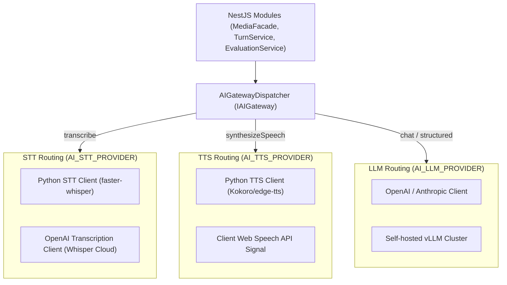
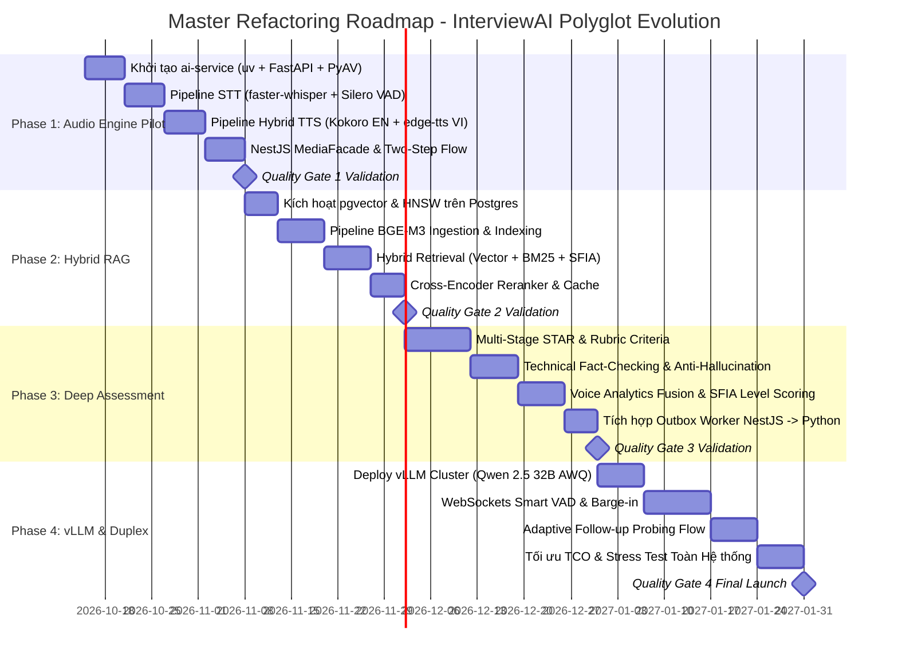

# TÀI LIỆU 00: ĐỊNH HƯỚNG KIẾN TRÚC TỔNG THỂ & CHIẾN LƯỢC REFACTOR DÀI HẠN
# (STRATEGIC ARCHITECTURAL BLUEPRINT & POLYGLOT HYBRID ROADMAP)

> **Trạng thái**: Approved / Production Architecture Specification  
> **Cấp độ tài liệu**: Production Architecture Specification (CTO / Lead System Architect)  
> **Áp dụng cho**: Toàn bộ hệ sinh thái InterviewAI (`client/`, `server/`, và `ai-service/`)  
> **Phiên bản**: 1.1.0 (Đã rà soát & chuẩn hóa luồng Two-Step Voice, Hybrid TTS, và Outbox Consumer)  

---

## 1. TỔNG QUAN CHIẾN LƯỢC (EXECUTIVE SUMMARY)

### 1.1 Bối cảnh & Điểm nghẽn Cốt lõi
Hệ thống **InterviewAI** hiện tại vận hành trên nền tảng **TypeScript Full-Stack**:
* **Frontend**: Next.js (App Router, TailwindCSS, Web Speech API client-side).
* **Backend**: NestJS Core với Clean Architecture / Modular Monolith, Prisma ORM kết nối PostgreSQL, và hàng đợi BullMQ hỗ trợ Transactional Outbox Pattern.

TypeScript và NestJS đã giải quyết xuất sắc các bài toán nền tảng:
1. Xác thực và phân quyền đa vai trò (JWT, Cookie Session, RBAC: `candidate`, `admin`).
2. Quản lý trạng thái phiên phỏng vấn (Session State Machine).
3. Tính toàn vẹn giao dịch ACID trên cơ sở dữ liệu quan hệ (`prisma.$transaction`).
4. Khả năng phục hồi của hệ thống điều phối tác vụ nền qua BullMQ ([`WorkflowDispatcher`](file:///c:/Users/An/Documents/GR1/InterviewCoach/server/src/infrastructure/workflow/workflow-dispatcher.service.ts)).

Tuy nhiên, khi nâng cấp thành một **Hệ thống Luyện Phỏng vấn Thông minh Cấp cao (Advanced AI Coaching Platform)** với các yêu cầu:
* **Speech-to-Text (STT)** chính xác cao, trích xuất chỉ số âm học (WPM, độ ngập ngừng, từ đệm chuyên ngành CNTT cả tiếng Việt và tiếng Anh).
* **Text-to-Speech (TTS)** tự nhiên, đa ngữ (Hybrid TTS: Kokoro-82M cho tiếng Anh chuẩn studio và edge-tts / Piper cho tiếng Việt bản địa tự nhiên).
* Khai phá ngữ nghĩa câu trả lời, so khớp chuẩn năng lực **SFIA 9** và khung nghề nghiệp **O\*NET 29.x**.
* Xây dựng hệ thống **Domain-Aware Hybrid RAG** kết hợp Vector Search (BGE-M3), BM25 và Cross-Encoder Reranker trên PostgreSQL `pgvector`.
* Tự host mô hình suy luận lớn (vLLM) nhằm cắt giảm 85-95% chi phí API thương mại.

Thì **TypeScript bộc lộ các giới hạn kỹ thuật tự nhiên**:
* **Hệ sinh thái AI / Machine Learning nghèo nàn**: Thiếu thư viện xử lý tensor tối ưu, không có khả năng tương tác trực tiếp với CUDA, CTranslate2, PyTorch, HuggingFace Transformers.
* **Chi phí gọi API đám mây tăng phi mã**: Phụ thuộc 100% vào OpenAI API cho audio (Whisper) và chat reasoning khiến chi phí vận hành tăng tuyến tính theo số lượng thí sinh.
* **Nhận diện giọng nói trình duyệt (Web Speech API) thiếu ổn định**: Phụ thuộc hoàn toàn vào engine của trình duyệt (Chrome, Safari, Firefox), không đo lường được âm sắc, khoảng lặng (pauses), và từ đệm (filler words) một cách đồng nhất.

### 1.2 Quyết định Kiến trúc: Polyglot Hybrid Architecture
Thay vì mắc bẫy sai lầm "Đập đi xây lại toàn bộ bằng Python" (The Second-System Effect Fallacy) – vốn mang lại rủi ro phá vỡ toàn bộ cấu trúc dữ liệu, kiểm thử và nghiệp vụ hoàn chỉnh của NestJS – dự án chọn kiến trúc:

$$\mathbf{Polyglot\ Hybrid\ Architecture} = \mathbf{NestJS\ Core\ Orchestrator} + \mathbf{Python\ AI\ Compute\ Engine}$$

1. **NestJS (`server/`)**: Giữ nguyên vị thế **Single Source of Truth** & **Business Orchestrator**. Toàn bộ dữ liệu người dùng, phiên phỏng vấn, phân quyền, giao dịch database và kết nối tương tác với người dùng do NestJS làm chủ.
2. **Python (`ai-service/`)**: Đóng vai trò **Dedicated AI Compute Engine**, hoạt động như một microservice hiệu năng cao, **hoàn toàn phi trạng thái (Stateless Compute)** chuyên biệt cho Audio (STT/TTS), Embeddings, RAG, NLP Semantics, và vLLM.
3. **Mô hình Chuyển đổi**: Áp dụng **Strangler Fig Pattern** kết hợp **Strict Provider Toggle** (điều khiển qua biến môi trường). Mọi tính năng AI được chuyển dịch sang Python theo từng giai đoạn độc lập. Bất kỳ lỗi nào phát sinh đều có thể rollback về luồng Cloud trong < 1 phút.

---

## 2. SƠ ĐỒ KIẾN TRÚC TOÀN HỆ THỐNG (SYSTEM TOPOLOGY)

```mermaid
graph TD
    subgraph ClientLayer["Frontend Layer (client/)"]
        WebUI["Next.js App Router (UI/UX)"]
        LocalMedia["MediaRecorder (WebM/Opus)"]
        BrowserSpeechFallback["Web Speech API (Fallback)"]
    end

    subgraph CoreBackend["NestJS Core Platform (server/)"]
        APIGateway["NestJS API Gateway & Controllers"]
        AuthModule["Auth & RBAC Module"]
        MediaModule["Media Module (MediaFacade)"]
        TurnModule["Interview Live / Turn Module"]
        AIGateway["AIGatewayDispatcher (Strict ENV Toggle)"]
        OutboxWorker["BullMQ Outbox Worker"]
        PrismaService["Prisma ORM Service"]
    end

    subgraph AIService["Python AI Service (ai-service/ - Internal Only)"]
        FastAPIApp["FastAPI Engine (Port 8000)"]
        AudioWorker["Audio Engine (faster-whisper + PyAV + Hybrid TTS)"]
        RAGWorker["Hybrid RAG (BGE-M3 + BM25 + Reranker)"]
        ScoringWorker["Multi-Stage Assessment Engine"]
        vLLMClient["vLLM Adapter / Cloud LLM Client"]
    end

    subgraph DataStorage["Unified Storage Layer"]
        Postgres[("PostgreSQL 16 + pgvector (Port 5432)")]
        RedisQueue[("Redis 7 (BullMQ & Cache - Port 6379)")]
    end

    %% Client Interactions
    WebUI -->|REST API / Cookies Auth| APIGateway
    WebUI -->|WebSockets (Live Updates)| APIGateway
    LocalMedia -->|Step 1: POST /media/transcribe| MediaModule
    WebUI -.->|Offline Fallback| BrowserSpeechFallback

    %% Core Platform Interactions
    APIGateway --> AuthModule
    APIGateway --> MediaModule
    APIGateway --> TurnModule
    MediaModule --> AIGateway
    TurnModule --> PrismaService
    TurnModule --> RedisQueue
    OutboxWorker --> RedisQueue
    OutboxWorker --> PrismaService

    %% Inter-Service Communication (Synchronous & Worker-Driven)
    AIGateway -->|HTTP Sync Stream| FastAPIApp
    AIGateway -.->|Fallback if Python Down| OpenAICloud["OpenAI Cloud APIs"]
    OutboxWorker -->|HTTP Heavy Compute /evaluate| FastAPIApp

    %% Storage
    PrismaService -->|ACID Transactions| Postgres
    RAGWorker -->|Direct Vector Distance <=>| Postgres
```

---

## 3. BẢNG PHÂN ĐỊNH TRÁCH NHIỆM (SEPARATION OF CONCERNS MATRIX)

Để ngăn ngừa tình trạng "rò rỉ nghiệp vụ" (Domain Leakage) giữa hai nền tảng, ranh giới trách nhiệm được quy định bất biến:

| Thành phần / Khả năng | **NestJS Core (`server/`)** | **Python AI Service (`ai-service/`)** | Ghi chú & Ranh giới Kỹ thuật |
| :--- | :---: | :---: | :--- |
| **Xác thực & Danh tính (Auth)** | **SỞ HỮU DUY NHẤT** | Không sở hữu | NestJS quản lý Password hash, JWT token, Cookie session. Python không có bảng User, chỉ nhận internal request được bảo vệ qua secret header. |
| **Quản lý Phiên (Session State)** | **SỞ HỮU DUY NHẤT** | Không sở hữu | Trạng thái buổi phỏng vấn (`generating`, `in_progress`, `completed`) do NestJS cập nhật vào Postgres. |
| **Giao dịch Dữ liệu (ACID DB)** | **SỞ HỮU DUY NHẤT** | Không sở hữu | Mọi thao tác ghi dữ liệu nghiệp vụ (`user_answers`, `interview_sessions`) bắt buộc qua `prisma.$transaction`. |
| **Audio STT (Voice to Text)** | Điều phối qua `MediaFacade` | **SỞ HỮU DUY NHẤT LOGIC** | NestJS nhận buffer từ client, forward sang Python. Python giải mã in-memory qua PyAV, chạy `faster-whisper` + VAD, trả về text và metrics. |
| **Audio TTS (Text to Voice)** | Proxy Stream qua `MediaFacade` | **SỞ HỮU DUY NHẤT LOGIC** | Python chạy Hybrid TTS (Kokoro-82M cho EN + edge-tts/Piper cho VI). NestJS forward stream về client. Fallback client: Web Speech API. |
| **Vector Storage & Embedding** | Đồng sở hữu (Schema) | **SỞ HỮU TÍNH TOÁN** | Prisma định nghĩa cột `vector(1024)`. Python chạy `BGE-M3` để sinh vector và thực hiện truy vấn tương đồng. |
| **RAG Retrieval & Reranking** | Consumer (Nhận kết quả) | **SỞ HỮU DUY NHẤT** | Python thực hiện hybrid search (Vector + BM25 + SFIA filters + Reranker), trả về top câu hỏi cho NestJS. |
| **Chấm điểm Đa chiều (Scoring)** | Trigger & Transaction Lưu DB | **SỞ HỮU LOGIC AI** | NestJS Outbox Worker pull job từ BullMQ -> gọi REST sang Python. Python phân tích STAR, fact-checking, trả về JSON cấu trúc chuẩn. |
| **Hạ tầng LLM Inference** | Consumer | **SỞ HỮU DUY NHẤT** | Python quản lý kết nối tới vLLM (self-hosted) hoặc Cloud LLMs thông qua client OpenAI-compatible. |

---

## 4. GIAO THỨC GIAO TIẾP ĐA KÊNH (DUAL-CHANNEL COMMUNICATION PROTOCOL)

Hệ thống giao tiếp giữa NestJS và Python được chuẩn hóa qua hai kênh riêng biệt tùy thuộc vào yêu cầu độ trễ:

### 4.1 Kênh 1: Synchronous / Low-Latency Streaming (HTTP REST / gRPC)
* **Mục đích**: Phục vụ các tác vụ tương tác trực tiếp với người dùng, yêu cầu phản hồi tức thời ($< 1.5$ giây).
* **Các trường hợp sử dụng**:
  1. **STT Transcribe**: Gửi audio buffer WebM/WAV, nhận lại transcript và voice metrics (`POST /api/v1/stt/transcribe`).
  2. **TTS Synthesize**: Gửi text câu hỏi, nhận lại audio stream chunked WAV/MP3 (`POST /api/v1/tts/synthesize`).
  3. **RAG Candidate Retrieval**: Lấy 3-5 câu hỏi phù hợp nhất cho phiên phỏng vấn mới (`POST /api/v1/rag/retrieve`).
* **Cơ chế**:
  * Giao thức: HTTP/1.1 (FastAPI streaming), sẵn sàng mở rộng sang gRPC khi cần tối ưu binary serialization.
  * Timeout quy chuẩn: $5.000\text{ ms}$ cho STT/TTS; $3.000\text{ ms}$ cho RAG search.
  * Bảo mật: Header nội bộ `x-internal-secret: ${INTERNAL_AI_SECRET}`.

### 4.2 Kênh 2: Asynchronous Event-Driven (NestJS Outbox Worker -> Python Compute API)
* **Mục đích**: Phục vụ các tác vụ nặng, tính toán sâu, không chặn luồng tương tác trực tiếp của người dùng ($10 - 60$ giây).
* **Các trường hợp sử dụng**:
  1. **Multi-Stage Answer Evaluation**: Phân tích cấu trúc STAR, kiểm tra hallucination kỹ thuật, chấm điểm năng lực SFIA.
  2. **Session Final Report Generation**: Tổng hợp báo cáo toàn diện sau khi ứng viên kết thúc buổi phỏng vấn.
  3. **Knowledge Base Batch Ingestion**: Vector hóa hàng loạt câu hỏi mới từ Question Bank hoặc chuẩn SFIA 9 / O\*NET.
* **Cơ chế Triển khai Chuẩn hóa (Tránh Phụ thuộc Chéo BullMQ)**:
  * NestJS ghi nhận job vào PostgreSQL transactional outbox và đẩy payload vào Redis BullMQ Queue (`workflow-jobs`).
  * **NestJS BullMQ Worker đóng vai trò Consumer duy nhất**: Khi nhận job, worker thực hiện cuộc gọi HTTP POST (`/api/v1/assessment/evaluate`) sang Python `ai-service`.
  * Python `ai-service` tính toán phi trạng thái (stateless), trả về structured JSON.
  * NestJS BullMQ Worker nhận kết quả, mở `prisma.$transaction` để lưu vào các bảng nghiệp vụ (`ai_feedback`, `session_reports`) và cập nhật trạng thái outbox event thành công.
  * *Lợi ích then chốt*: Python không cần cài đặt hay duy trì kết nối tới cấu trúc dữ liệu nội bộ của BullMQ trong Redis, loại bỏ hoàn toàn rủi ro sai lệch lock/state giữa hai môi trường runtime Node.js và Python.

---

## 5. MÔ HÌNH QUẢN TRỊ RỦI RO: STRICT PROVIDER TOGGLE & ZERO DOWNTIME

Toàn bộ các tác vụ AI phía NestJS được cô lập đằng sau contract interface thống nhất trong `@infra/ai/`.

### 5.1 Kiến trúc Dispatcher Độc lập theo Tác vụ
Để tuân thủ nguyên lý **Interface Segregation Principle (ISP)** và tránh tình trạng một implementation phải giả lập hoặc throw error cho các phương thức chưa hỗ trợ, hệ thống áp dụng cơ chế Dispatcher theo từng năng lực:



### 5.2 Bảng Biến Môi trường Điều khiển (Feature Flags)
Hệ thống cho phép bật/tắt từng module AI độc lập chỉ bằng cách thay đổi `.env` trên môi trường chạy mà không cần sửa code:

| Biến Môi trường | Giá trị Mặc định | Tùy chọn Hỗ trợ | Mô tả Nghiệp vụ |
| :--- | :---: | :---: | :--- |
| `AI_STT_PROVIDER` | `python` | `python`, `openai`, `browser` | Nguồn xử lý giọng nói thành văn bản. |
| `AI_TTS_PROVIDER` | `python` | `python`, `browser`, `openai` | Nguồn phát âm câu hỏi phỏng vấn (Python: Kokoro cho EN, edge-tts cho VI). |
| `AI_RAG_PROVIDER` | `prisma` | `python`, `prisma` | Nguồn truy xuất ngân hàng câu hỏi (RAG Hybrid vs SQL thường). |
| `AI_EVALUATION_PROVIDER` | `openai` | `python`, `openai` | Nguồn thực thi pipeline chấm điểm chi tiết. |
| `AI_LLM_PROVIDER` | `openai` | `vllm`, `openai`, `claude` | Hạ tầng cung cấp suy luận LLM cho chat/generation. |
| `AI_SERVICE_URL` | `http://localhost:8000` | URL chuỗi | Địa chỉ nội bộ của Python AI Microservice. |
| `INTERNAL_AI_SECRET` | *(chuỗi bí mật)* | Chuỗi bí mật | Secret token xác thực giữa NestJS và Python. |
| `AI_FALLBACK_ENABLED` | `true` | `true`, `false` | Tự động chuyển về OpenAI nếu Python gặp lỗi mạng hoặc timeout. |

---

## 6. LỘ TRÌNH TIẾN HÓA MASTER 4 GIAI ĐOẠN (MASTER TIMELINE & QUALITY GATES)



### Tiêu chí Nghiệm thu Từng Giai đoạn (Quality Gates)
* **Gate 1 (Phase 1 Audio Pilot)**:
  * STT độ chính xác từ (Word Error Rate - WER) cho tiếng Việt CNTT $< 8\%$.
  * Độ trễ STT cho đoạn âm thanh 60 giây $< 1.5$ giây trên GPU (hoặc $< 3.5$ giây trên CPU 8 nhân).
  * Two-Step Flow vận hành hoàn hảo: ứng viên xem và sửa được transcript trước khi nộp câu trả lời.
  * Chuyển đổi `AI_STT_PROVIDER=openai` sang `python` không làm gián đoạn luồng phỏng vấn.
* **Gate 2 (Phase 2 Hybrid RAG)**:
  * Tốc độ truy vấn RAG hybrid $< 200\text{ ms}$ cho top-5 câu hỏi.
  * Tỷ lệ câu hỏi khớp chính xác cả O\*NET SOC Code và SFIA 9 Skill/Level đạt $100\%$.
* **Gate 3 (Phase 3 Deep Assessment)**:
  * Pipeline phát hiện chính xác các trường hợp trả lời thiếu cấu trúc STAR hoặc thông tin kỹ thuật sai lệch.
  * Format kết quả JSON trả về khớp 100% với schema `SessionReport` và `SessionSkill` trong database của NestJS.
* **Gate 4 (Phase 4 vLLM & Real-Time Duplex)**:
  * Độ trễ phản hồi đàm thoại qua WebSockets $< 800\text{ ms}$.
  * Cơ chế Barge-in ngắt phát âm câu hỏi ngay khi người dùng nói trong $< 200\text{ ms}$.
  * Chi phí token LLM giảm tối thiểu $85\%$ so với gọi GPT-4o.

---

## 7. MA TRẬN QUẢN TRỊ RỦI RO HỆ THỐNG (CROSS-CUTTING RISK GOVERNANCE)

| ID | Nguy cơ Rủi ro | Xác suất | Tác động | Biện pháp Phòng ngừa & Kỹ thuật Xử lý |
| :---: | :--- | :---: | :---: | :--- |
| **R1** | **Python Service bị sập hoặc lỗi mạng** | Trung bình | Cao | NestJS triển khai Circuit Breaker và tự động fallback về OpenAI API qua `AI_FALLBACK_ENABLED=true`. Người dùng không bị ngắt quãng phiên phỏng vấn. |
| **R2** | **Xung đột kiểu dữ liệu giữa NestJS và Python** | Thấp | Cao | Sử dụng Pydantic v2 ở Python và Zod / Class-Validator ở NestJS. Mọi schema được đồng bộ qua bộ test hợp đồng (Contract Tests). |
| **R3** | **Quá tải bộ nhớ GPU (CUDA OOM)** | Trung bình | Cao | Áp dụng mô hình lượng tử hóa (AWQ / GPTQ), giới hạn `max_model_len`, và tách riêng worker STT/TTS với worker vLLM trên 2 container độc lập. |
| **R4** | **Lỗi giải mã âm thanh WebM/Opus trong RAM** | Thấp | Cao | Dùng `PyAV` (`av`) giải mã trực tiếp luồng nhị phân sang PCM 16kHz float32. Cài sẵn `ffmpeg` runtime libraries trong Docker image của `ai-service`. |
| **R5** | **Vấn đề quyền riêng tư dữ liệu âm thanh người dùng** | Rất thấp | Nghiêm trọng | Không lưu trữ file âm thanh trên ổ đĩa hay S3. Dữ liệu âm thanh chỉ xử lý dạng In-Memory Buffer và giải phóng ngay sau khi kết thúc STT. |

---

## 8. DANH MỤC TÀI LIỆU CHI TIẾT TRONG BỘ TÀI LIỆU

Để đi sâu vào từng giai đoạn thực thi cụ thể, hãy tham khảo các tài liệu thành phần:
* [Tài liệu 01: Pilot Phase 1 — Khởi tạo `ai-service` & Audio Engine](01_PHASE_1_AUDIO_ENGINE_AND_PILOT.md)
* [Tài liệu 02: Phase 2 — Nền tảng PostgreSQL `pgvector` & Domain-Aware Hybrid RAG](02_PHASE_2_PGVECTOR_HYBRID_RAG_FOUNDATION.md)
* [Tài liệu 03: Phase 3 — Pipeline Chấm điểm Chuyên sâu & Semantic Assessment](03_PHASE_3_DEEP_ASSESSMENT_AND_SEMANTIC_SCORING.md)
* [Tài liệu 04: Phase 4 — Hạ tầng vLLM Tự Host & Trợ lý Đàm thoại Song công](04_PHASE_4_VLLM_SCALING_AND_ADVANCED_CAPABILITIES.md)
* [Tài liệu 05: Vận hành DevOps, Docker Container & Sổ tay Khắc phục Sự cố](05_DEV_OPS_INFRA_AND_DISASTER_RECOVERY.md)
