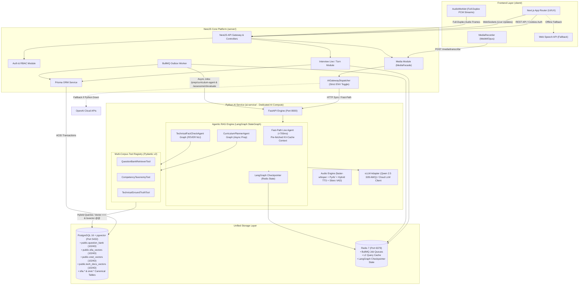
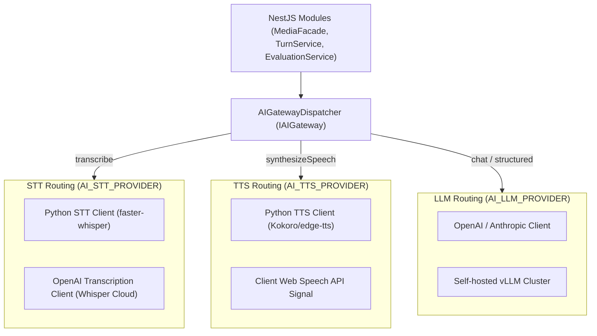

# TÀI LIỆU 00: ĐỊNH HƯỚNG KIẾN TRÚC TỔNG THỂ & CHIẾN LƯỢC REFACTOR DÀI HẠN
# (STRATEGIC ARCHITECTURAL BLUEPRINT & POLYGLOT HYBRID ROADMAP)

> **Trạng thái**: Approved / Production Architecture Specification  
> **Cấp độ tài liệu**: Production Architecture Specification (CTO / Lead System Architect)  
> **Áp dụng cho**: Toàn bộ hệ sinh thái InterviewAI (`client/`, `server/`, và `ai-service/`)  
> **Phiên bản**: 2.0.0 (Chuẩn hóa toàn diện 25 Tasks tuần tự & Từ điển thuật ngữ tiếng Anh kỹ thuật)  

---

## 1. TỔNG QUAN CHIẾN LƯỢC (EXECUTIVE SUMMARY)

### 1.1 Bối cảnh & Điểm nghẽn Cốt lõi
Hệ thống **InterviewAI** hiện tại vận hành trên nền tảng **TypeScript Full-Stack**:
* **Frontend**: Next.js (App Router, TailwindCSS, Web Speech API client-side).
* **Backend**: NestJS Core với Clean Architecture / Modular Monolith, Prisma ORM kết nối PostgreSQL, và Job Queue BullMQ hỗ trợ Transactional Outbox Pattern.

TypeScript và NestJS đã giải quyết xuất sắc các bài toán nền tảng:
1. Xác thực và phân quyền đa vai trò (JWT, Cookie Session, RBAC: `candidate`, `admin`).
2. Quản lý trạng thái phiên phỏng vấn (Session State Machine).
3. Tính toàn vẹn dữ liệu qua ACID Transaction trên cơ sở dữ liệu quan hệ (`prisma.$transaction`).
4. Khả năng phục hồi của hệ thống điều phối tác vụ nền qua BullMQ Job Queue ([WorkflowDispatcher](file:///c:/Users/An/Documents/GR1/InterviewCoach/server/src/infrastructure/workflow/workflow-dispatcher.service.ts)).

Tuy nhiên, khi nâng cấp thành một **Hệ thống Luyện Phỏng vấn Thông minh Cấp cao (Advanced AI Coaching Platform)** với các yêu cầu:
* **Speech-to-Text (STT)** chính xác cao, trích xuất chỉ số âm học (WPM, độ ngập ngừng, từ đệm chuyên ngành CNTT cả tiếng Việt và tiếng Anh).
* **Text-to-Speech (TTS)** tự nhiên, đa ngữ (Hybrid TTS: Kokoro-82M cho tiếng Anh chuẩn studio và edge-tts cho tiếng Việt bản địa tự nhiên).
* Khai phá ngữ nghĩa câu trả lời, so khớp chuẩn năng lực **SFIA 9** và khung nghề nghiệp **O\*NET 29.x**.
* Xây dựng hệ thống **Domain-Aware Hybrid RAG** kết hợp Vector Search (BGE-M3), Sparse Full-Text Search và Cross-Encoder Reranker trên PostgreSQL `pgvector`.
* Tự host mô hình suy luận lớn (vLLM) nhằm cắt giảm 85-92% chi phí API thương mại.

Thì **TypeScript bộc lộ các giới hạn kỹ thuật tự nhiên**:
* **Hệ sinh thái AI / Machine Learning nghèo nàn**: Thiếu thư viện xử lý tensor tối ưu, không có khả năng tương tác trực tiếp với CUDA, CTranslate2, PyTorch, HuggingFace Transformers.
* **Chi phí gọi API đám mây tăng phi mã**: Phụ thuộc 100% vào OpenAI API cho audio (Whisper) và chat reasoning khiến chi phí vận hành tăng tuyến tính theo số lượng thí sinh.
* **Nhận diện giọng nói trình duyệt (Web Speech API) thiếu ổn định**: Phụ thuộc hoàn toàn vào engine của trình duyệt (Chrome, Safari, Firefox), không đo lường được âm sắc, khoảng lặng (pauses), và từ đệm (filler words) một cách đồng nhất.

### 1.2 Quyết định Kiến trúc: Polyglot Hybrid Architecture
Thay vì mắc bẫy sai lầm "Đập đi xây lại toàn bộ bằng Python" (The Second-System Effect Fallacy) – vốn mang lại rủi ro phá vỡ toàn bộ cấu trúc dữ liệu, kiểm thử và nghiệp vụ hoàn chỉnh của NestJS – dự án chọn kiến trúc:

$$\mathbf{Polyglot\ Hybrid\ Architecture} = \mathbf{NestJS\ Core\ Orchestrator} + \mathbf{Python\ AI\ Compute\ Engine}$$

1. **NestJS (`server/`)**: Giữ nguyên vị thế **Single Source of Truth** & **Business Orchestrator**. Toàn bộ dữ liệu người dùng, phiên phỏng vấn, phân quyền, ACID Transactions và kết nối tương tác với người dùng do NestJS làm chủ.
2. **Python (`ai-service/`)**: Đóng vai trò **Dedicated AI Compute Engine**, hoạt động như một microservice hiệu năng cao, **hoàn toàn Stateless Compute** chuyên biệt cho Audio (STT/TTS), Embeddings, Multi-Corpus Retrieval Tools, Agentic StateGraph, và vLLM.
3. **Mô hình Chuyển đổi**: Áp dụng **Strangler Fig Pattern** kết hợp **Strict Provider Toggle** (điều khiển qua biến môi trường). Mọi tính năng AI được chuyển dịch sang Python theo từng giai đoạn độc lập. Bất kỳ lỗi nào phát sinh đều có thể rollback về luồng Cloud Fallback trong $< 1\text{ phút}$.

### 1.3 Tầm Nhìn Kiến Trúc RAG: Chuyển Dịch Toàn Diện Sang Multi-Corpus Agentic RAG
Để giải quyết bài toán tuyển dụng kỹ thuật chuyên sâu mà các hệ thống Naive RAG hoặc Adaptive RAG đơn lẻ không thể đáp ứng:
* **Adaptive RAG đóng vai trò là Sub-strategy**: Cơ chế phân loại độ phức tạp truy vấn (Query Classifier) được nhúng bên trong các Tool để định tuyến giữa Cache hit, Single-hop và Iterative retrieval nhằm kiểm soát chi phí.
* **Agentic RAG đóng vai trò là Master Paradigm**: Xây dựng hệ sinh thái các tác tử tự trị (**Autonomous Multi-Agent**) với vòng lặp suy luận (Reasoning StateGraph), tự động lập kế hoạch (Planning), gọi công cụ (**Tool Calling**) qua 4 nguồn tri thức độc lập, và tự phản tư (**Self-Reflection**).
* **Mô hình Hai Tốc Độ (Dual-Speed Agentic Architecture)**:
  * **Fast-Path Agent (Live Mode)**: Nạp sẵn ngữ cảnh (Pre-fetched Knowledge Context) vào KV-Cache của vLLM đầu mỗi turn, thực thi **Speculative Zero-Hop Streaming** đảm bảo Time-to-First-Audio $< 700\text{ms}$ (vượt chuẩn SLA $< 900\text{ms}$).
  * **Deep Multi-Agent Graph (Async Mode)**: Chạy qua BullMQ Worker (ngân sách $10 - 20\text{s}$) cho khâu Lập kịch bản (Curriculum Planning) và Thẩm định Kỹ thuật (Fact-Checking theo chuẩn FEVER NLI 3 trạng thái: Supported / Contradicted / Unverified).
* **Bảo tồn Tuyệt đối Schema Chuẩn SFIA & O\*NET**: Giữ nguyên 100% các bảng quan hệ gốc trong schema `sfia.*` và `onet.*`. Trang bị năng lực tìm kiếm ngữ nghĩa thông qua các bảng vector vệ tinh (`sfia_vectors`, `onet_vectors`, `tech_docs_vectors`) và mở rộng `public.question_bank` với khóa ngoại (`FOREIGN KEY`).

---

## 2. QUY CHUẨN THUẬT NGỮ KỸ THUẬT BẮT BUỘC (CANONICAL TECHNICAL GLOSSARY)

Quy định này là **chuẩn mực bất biến** cho toàn bộ 36 tài liệu trong `docs/refactor-docs/`. Mọi câu văn khi đề cập tới các khái niệm này bắt buộc sử dụng trực tiếp thuật ngữ tiếng Anh chuẩn, không dịch gượng gạo sang tiếng Việt:

### 2.1 Cơ sở dữ liệu & Tính toàn vẹn Dữ liệu (Database & Persistence)
| Thuật ngữ tiếng Anh chuẩn | Khái niệm cũ (Không dùng) | Định nghĩa & Bối cảnh kỹ thuật trong dự án |
| :--- | :--- | :--- |
| **Transaction / ACID Transaction** | Giao dịch / Giao dịch ACID | Mọi thao tác ghi dữ liệu nhiều bảng bắt buộc bọc trong `prisma.$transaction`. |
| **Table Lock / Row Lock** | Khóa bảng / Khóa dòng | Hiện tượng chặn I/O khi chạy migration hoặc truy vấn quét bảng thiếu index. |
| **Non-blocking / CONCURRENTLY** | Không khóa bảng / Đồng thời | Tạo index qua `CREATE INDEX CONCURRENTLY` ngoài transaction để không gián đoạn hệ thống. |
| **Index / HNSW Index / GIN Index** | Chỉ mục / Chỉ mục vector | Cấu trúc dữ liệu tăng tốc tìm kiếm tương đồng vector (`pgvector`) hoặc full-text search (`tsvector`). |
| **Query / CTE Query** | Truy vấn / Truy vấn CTE | Câu lệnh SQL hoặc Common Table Expressions (`WITH ... AS (...)`) tối ưu hóa logic phức tạp. |
| **Schema Drift** | Lệch lược đồ / Lệch cấu trúc | Sự sai lệch kiểu dữ liệu giữa Prisma Schema, PostgreSQL DB và Pydantic Models. |
| **Idempotency / Idempotent** | Tính bất biến / Lặp lại an toàn | Đặc tính đảm bảo một task/job khi thực thi lại nhiều lần không tạo ra duplicate dữ liệu. |

### 2.2 Kiến trúc phân tán & Giao thức Mạng (Distributed Architecture & Networking)
| Thuật ngữ tiếng Anh chuẩn | Khái niệm cũ (Không dùng) | Định nghĩa & Bối cảnh kỹ thuật trong dự án |
| :--- | :--- | :--- |
| **Stateless / Stateless Compute** | Phi trạng thái | Python AI Service không lưu user session hay DB lock; chỉ nhận bytes/JSON và trả về output. |
| **Stateful** | Có trạng thái | NestJS Core làm chủ trạng thái phiên phỏng vấn (`generating`, `in_progress`, `completed`). |
| **Orchestrator / Dispatcher** | Bộ điều phối | NestJS đóng vai trò Master Orchestrator, điều phối các AI Provider qua `AIGatewayDispatcher`. |
| **Job Queue / Message Queue** | Hàng đợi tác vụ | Hàng đợi BullMQ Redis (`workflow-jobs`) cho các tác vụ nền không đồng bộ. |
| **Worker / Consumer** | Người tiêu thụ / Xử lý nền | Tiến trình NestJS Worker (`FeedbackProcessor`) kéo job từ BullMQ và gọi API Python. |
| **Outbox Pattern** | Mẫu Outbox giao dịch | Lưu job vào bảng PostgreSQL trong cùng transaction trước khi dispatch vào Redis BullMQ. |
| **Circuit Breaker** | Bộ ngắt mạch | Cơ chế ngắt kết nối tạm thời (`opossum`) khi Python service quá tải, lỗi mạng hoặc timeout. |
| **Fallback / Surge Failover** | Chuyển mạch dự phòng | Cơ chế tự động chuyển hướng sang OpenAI Cloud trong $< 1.5\text{s}$ khi Python service gặp sự cố. |
| **In-Memory Buffer** | Vùng đệm trong bộ nhớ | Giải mã và xử lý audio bytes trực tiếp trên RAM (PyAV, `io.BytesIO`), tuyệt đối không ghi file đĩa cứng. |
| **Full-Duplex / Half-Duplex** | Song công / Bán song công | Truyền nhận luồng âm thanh hai chiều đồng thời qua WebSockets (`AudioWorklet`). |
| **Barge-in** | Ngắt lời / Chen ngang | Cơ chế ngắt âm thanh AI ngay khi phát hiện người dùng cất lời trong vòng $< 200\text{ms}$. |
| **Latency (p50, p95, p99)** | Độ trễ | Thời gian đáp ứng từ request đến response ở các phân vị phần trăm. |
| **Throughput** | Băng thông / Thông lượng | Số lượt request hoặc số token sinh ra trên mỗi đơn vị thời gian (tokens/sec). |
| **L2 Cache** | Bộ nhớ đệm tầng 2 | Tầng cache Redis lưu trữ kết quả truy vấn câu hỏi RAG nhằm đạt tốc độ $< 10\text{ms}$. |
| **Agentic RAG / StateGraph** | RAG Tác tử / Đồ thị Trạng thái | Kiến trúc suy luận tự trị bằng LangGraph điều phối Multi-Corpus Tools và tự phản tư. |
| **Dual-Speed Architecture** | Kiến trúc hai tốc độ | Phân tách Fast-Path Agent (<700ms Live) và Deep Multi-Agent Graph (10-20s Async). |
| **Fast-Path Conversational Agent** | Tác tử đàm thoại nhanh | Agent live suy luận zero-hop với Pre-fetched KV-Cache Context, không gọi thêm DB query. |
| **LangGraph Checkpointer** | Bộ lưu snapshot trạng thái | Cơ chế lưu checkpoint đồ thị suy luận vào Redis/Postgres hỗ trợ replay và Admin review. |
| **Multi-Corpus Tool Registry** | Kho công cụ đa nguồn | Tập hợp 3 tools AI chuẩn Pydantic v2 truy vấn `question_bank`, `sfia_vectors`, `onet_vectors`, `tech_docs_vectors`. |
| **FEVER NLI Fact-Checking** | Thẩm định NLI 3 trạng thái | Chuẩn phân loại phát biểu kỹ thuật: Supported, Contradicted, Unverified kèm trích dẫn. |
| **Speculative Zero-Hop Execution** | Thực thi phỏng đoán không bước | Sinh câu hỏi xoáy trực tiếp từ KV-Cache của LLM mà không dừng lại gọi external tools. |

### 2.3 Kiểm thử, Đo lường & Vận hành (Testing, Observability & SRE)
| Thuật ngữ tiếng Anh chuẩn | Khái niệm cũ (Không dùng) | Định nghĩa & Bối cảnh kỹ thuật trong dự án |
| :--- | :--- | :--- |
| **Contract Test** | Kiểm thử hợp đồng | Bộ kiểm thử độc lập kép (Pytest + Jest) chạy trên shared fixtures để xác nhận tính đồng nhất wire JSON. |
| **Quality Gate** | Cổng chất lượng | Bộ tiêu chí kỹ thuật bắt buộc phải vượt qua 100% trước khi kết thúc một Phase. |
| **Distributed Observability** | Khả năng quan sát phân tán | Hệ thống W3C `traceparent` tracing, OpenTelemetry, Prometheus metrics và Grafana dashboards. |
| **LangGraph Node Tracing** | Giám sát đồ thị tác tử | Trace OpenTelemetry cho từng bước trong StateGraph: thời gian tool call, token accounting, checkpointer lag. |
| **Incident Runbook** | Sổ tay ứng cứu sự cố | Bộ quy trình ứng cứu sự cố khẩn cấp cấp độ P1/P2 với các dòng lệnh chuẩn xác. |
| **Zero-Downtime Deployment** | Triển khai không gián đoạn | Chiến lược deploy Expand/Contract và Blue-Green không làm đứt quãng kết nối của thí sinh. |

---

## 3. SƠ ĐỒ KIẾN TRÚC TOÀN HỆ THỐNG (SYSTEM TOPOLOGY)

---

## 4. BẢNG PHÂN ĐỊNH TRÁCH NHIỆM (SEPARATION OF CONCERNS MATRIX)

Để ngăn ngừa tình trạng rò rỉ nghiệp vụ (Domain Leakage) giữa hai nền tảng, ranh giới trách nhiệm được quy định bất biến:

| Thành phần / Khả năng | **NestJS Core (`server/`)** | **Python AI Service (`ai-service/`)** | Ghi chú & Ranh giới Kỹ thuật |
| :--- | :---: | :---: | :--- |
| **Xác thực & Danh tính (Auth)** | **SỞ HỮU DUY NHẤT** | Không sở hữu | NestJS quản lý Password hash, JWT token, Cookie session. Python không có bảng User, chỉ nhận internal request được bảo vệ qua secret header. |
| **Quản lý Phiên (Session State)** | **SỞ HỮU DUY NHẤT** | Không sở hữu | Trạng thái buổi phỏng vấn (`generating`, `in_progress`, `completed`) do NestJS cập nhật vào Postgres. |
| **Giao dịch Dữ liệu (ACID DB)** | **SỞ HỮU DUY NHẤT** | Không sở hữu | Mọi thao tác ghi dữ liệu nghiệp vụ (`user_answers`, `interview_sessions`) bắt buộc qua `prisma.$transaction`. |
| **Audio STT (Voice to Text)** | Điều phối qua `MediaFacade` | **SỞ HỮU DUY NHẤT LOGIC** | NestJS nhận buffer từ client, forward sang Python. Python giải mã in-memory qua PyAV, chạy `faster-whisper` + VAD, trả về text và metrics. |
| **Audio TTS (Text to Voice)** | Proxy Stream qua `MediaFacade` | **SỞ HỮU DUY NHẤT LOGIC** | Python chạy Hybrid TTS (Kokoro-82M cho EN + edge-tts cho VI). NestJS forward stream về client. Fallback client: Web Speech API. |
| **Multi-Corpus Storage & Vector** | Đồng sở hữu (Schema & DDL) | **SỞ HỮU TÍNH TOÁN** | Prisma định nghĩa cột `vector(1024)`. Python chạy `BGE-M3` để sinh vector và batch ingestion pipeline. |
| **Agentic Tools & Tool Registry** | Consumer (Đăng ký tools qua facade) | **SỞ HỮU DUY NHẤT IMPLEMENTATION** | Python cài đặt 3 tools AI chuẩn Pydantic v2: `QuestionBankRetrieverTool`, `CompetencyTaxonomyTool`, `TechnicalGroundTruthTool`. |
| **Agentic StateGraph (LangGraph)** | Trigger Job & Transaction Lưu DB | **SỞ HỮU DUY NHẤT LOGIC SUY LUẬN** | Python quản lý đồ thị `CurriculumPlannerAgent` và `TechnicalFactCheckAgent` (FEVER NLI), trả về kết quả cấu trúc JSON. |
| **Hạ tầng LLM Inference** | Consumer | **SỞ HỮU DUY NHẤT** | Python quản lý kết nối tới vLLM (self-hosted) hoặc Cloud LLMs thông qua client OpenAI-compatible. |

---

## 5. GIAO THỨC GIAO TIẾP ĐA KÊNH (DUAL-CHANNEL COMMUNICATION PROTOCOL)

Hệ thống giao tiếp giữa NestJS và Python được chuẩn hóa qua hai kênh riêng biệt tùy thuộc vào yêu cầu Latency:

### 5.1 Kênh 1: Synchronous / Low-Latency Streaming (HTTP REST / gRPC)
* **Mục đích**: Phục vụ các tác vụ tương tác trực tiếp với người dùng, yêu cầu phản hồi tức thời ($< 1.5$ giây).
* **Các trường hợp sử dụng**:
  1. **STT Transcribe**: Gửi audio buffer WebM/WAV, nhận lại transcript và voice metrics (`POST /api/v1/stt/transcribe`).
  2. **TTS Synthesize**: Gửi text câu hỏi, nhận lại audio stream chunked WAV/MP3 (`POST /api/v1/tts/synthesize`).
  3. **RAG Candidate Retrieval**: Lấy 3-5 câu hỏi phù hợp nhất cho phiên phỏng vấn mới (`POST /api/v1/rag/retrieve`).
* **Cơ chế**:
  * Giao thức: HTTP/1.1 (FastAPI streaming), sẵn sàng mở rộng sang gRPC khi cần tối ưu binary serialization.
  * Timeout quy chuẩn: $5.000\text{ ms}$ cho STT/TTS; $3.000\text{ ms}$ cho RAG search.
  * Bảo mật: Header nội bộ `x-internal-secret: ${INTERNAL_AI_SECRET}`.

### 5.2 Kênh 2: Asynchronous Event-Driven (NestJS Outbox Worker -> Python Compute API)
* **Mục đích**: Phục vụ các tác vụ nặng, tính toán sâu, không chặn luồng tương tác trực tiếp của người dùng ($10 - 60$ giây).
* **Các trường hợp sử dụng**:
  1. **Multi-Stage Answer Evaluation**: Phân tích cấu trúc STAR, kiểm tra hallucination kỹ thuật, chấm điểm năng lực SFIA.
  2. **Session Final Report Generation**: Tổng hợp báo cáo toàn diện sau khi ứng viên kết thúc buổi phỏng vấn.
  3. **Knowledge Base Batch Ingestion**: Vector hóa hàng loạt câu hỏi mới từ Question Bank hoặc chuẩn SFIA 9 / O\*NET.
* **Cơ chế Triển khai Chuẩn hóa (Tránh Phụ thuộc Chéo BullMQ)**:
  * NestJS ghi nhận job vào PostgreSQL transactional outbox và đẩy payload vào Redis BullMQ Queue (`workflow-jobs`).
  * **NestJS BullMQ Worker đóng vai trò Consumer duy nhất**: Khi nhận job, worker thực hiện cuộc gọi HTTP POST (`/api/v1/assessment/evaluate`) sang Python `ai-service`.
  * Python `ai-service` tính toán phi trạng thái (Stateless), trả về structured JSON.
  * NestJS BullMQ Worker nhận kết quả, mở `prisma.$transaction` để lưu vào các bảng nghiệp vụ (`ai_feedback`, `session_reports`) và cập nhật trạng thái outbox event thành công.
  * *Lợi ích then chốt*: Python không cần cài đặt hay duy trì kết nối tới cấu trúc dữ liệu nội bộ của BullMQ trong Redis, loại bỏ hoàn toàn rủi ro sai lệch lock/state giữa hai môi trường runtime Node.js và Python.

---

## 6. MÔ HÌNH QUẢN TRỊ RỦI RO: STRICT PROVIDER TOGGLE & ZERO DOWNTIME

Toàn bộ các tác vụ AI phía NestJS được cô lập đằng sau contract interface thống nhất trong `@infra/ai/`.

### 6.1 Kiến trúc Dispatcher Độc lập theo Tác vụ
Để tuân thủ nguyên lý **Interface Segregation Principle (ISP)** và tránh tình trạng một implementation phải giả lập hoặc throw error cho các phương thức chưa hỗ trợ, hệ thống áp dụng cơ chế Dispatcher theo từng năng lực:

### 6.2 Bảng Biến Môi trường Điều khiển (Feature Flags)
Hệ thống cho phép bật/tắt từng module AI độc lập chỉ bằng cách thay đổi `.env` trên môi trường chạy mà không cần sửa code:

| Biến Môi trường | Giá trị Mặc định | Tùy chọn Hỗ trợ | Mô tả Nghiệp vụ |
| :--- | :---: | :---: | :--- |
| `AI_STT_PROVIDER` | `python` | `python`, `openai`, `browser` | Nguồn xử lý giọng nói thành văn bản. |
| `AI_TTS_PROVIDER` | `python` | `python`, `browser`, `openai` | Nguồn phát âm câu hỏi phỏng vấn (Python: Kokoro cho EN, edge-tts cho VI). |
| `AI_RAG_PROVIDER` | `prisma` | `python`, `prisma` | Nguồn truy xuất ngân hàng câu hỏi (RAG Hybrid vs SQL thường). |
| `AI_EVALUATION_PROVIDER` | `openai` | `python`, `openai` | Nguồn thực thi pipeline chấm điểm chi tiết. |
| `AI_LLM_PROVIDER` | `openai` | `vllm`, `openai`, `claude` | Hạ tầng cung cấp suy luận LLM cho chat/generation. |
| `AI_SERVICE_URL` | `http://localhost:8000` | URL chuỗi | Địa chỉ nội bộ của Python AI Microservice. |
| `INTERNAL_AI_SECRET` | *(chuỗi bí mật)* | Chuỗi bí mật | Secret token xác thực giữa NestJS và Python. |
| `AI_FALLBACK_ENABLED` | `true` | `true`, `false` | Tự động chuyển về OpenAI Fallback nếu Python gặp lỗi mạng hoặc timeout. |

---

## 7. LỘ TRÌNH TIẾN HÓA MASTER 25 TASKS & QUALITY GATES

Toàn bộ quá trình refactor được phân rã thành **25 nhiệm vụ kỹ thuật liên tục (Unbroken 25-Task Sequential Pipeline)**:

```mermaid
graph TD
    subgraph P1["PHASE 1: Audio Engine & Pilot"]
        T11["Task 1.1: Python AI Service Core"] --> T12["Task 1.2: STT Pipeline"]
        T12 --> T13["Task 1.3: Hybrid TTS Pipeline"]
        T13 --> T14["Task 1.4: Wire Contract Tests"]
        T14 --> T15["Task 1.5: NestJS MediaFacade & Two-Step"]
    end

    subgraph P2["PHASE 2: pgvector & Agentic RAG Foundation"]
        T15 --> T21["Task 2.1: pgvector & HNSW Migration"]
        T21 --> T21B["Sub-Task 2.1B: Multi-Corpus Vector Schemas"]
        T21B --> T22["Task 2.2: BGE-M3 Embedding Ingestion"]
        T22 --> T23["Task 2.3: Hybrid CTE Query & RRF"]
        T23 --> T24["Task 2.4: Cross-Encoder Reranker & Cache"]
        T24 --> T25["Task 2.5: QuestionBank Semantic Allocation"]
        T25 --> T26["Task 2.6: Standardized AI Tools"]
        T26 --> T27["Task 2.7: Curriculum Planner StateGraph"]
    end

    subgraph P3["PHASE 3: Multi-Agent Deep Assessment"]
        T27 --> T31["Task 3.1: Pass 1 STAR & Rubric Eval"]
        T31 --> T32["Task 3.2: Technical Fact-Checking"]
        T32 --> T32B["Sub-Task 3.2B: Fact-Checking StateGraph & FEVER NLI"]
        T32B --> T33["Task 3.3: Pass 2 Synthesis & Model Answers"]
        T33 --> T34["Task 3.4: Deterministic Scoring & SFIA"]
        T34 --> T35["Task 3.5: BullMQ Outbox Orchestration"]
    end

    subgraph P4["PHASE 4: vLLM Scaling & Fast-Path Conversational Agent"]
        T35 --> T41["Task 4.1: vLLM Container & AWQ Quant"]
        T41 --> T42["Task 4.2: NestJS Gateway Failover"]
        T42 --> T43["Task 4.3: Full-Duplex WebSocket Gateway"]
        T43 --> T44["Task 4.4: Smart VAD Barge-in (<200ms)"]
        T44 --> T45["Task 4.5: Fast-Path Probing & Zero-Hop Orchestration"]
    end

    subgraph P5["PHASE 5: Enterprise SRE, DevOps & Observability"]
        T45 --> T51["Task 5.1: Polyglot Monorepo & Containers"]
        T51 --> T52["Task 5.2: CI/CD & Automated Verification"]
        T52 --> T53["Task 5.3: Distributed Observability & Agent Tracing"]
        T53 --> T54["Task 5.4: Incident Runbooks P1/P2"]
        T54 --> T55["Task 5.5: Zero-Downtime Deployment"]
    end

    %% Infrastructure Bootstrap Links
    T51 -.->|Bootstrap Pre-requisite: Docker & Compose| T11
    T52 -.->|Bootstrap Pre-requisite: Wire Test Framework| T14
```

> **Ghi chú về Infrastructure Bootstrap Pre-requisites**:  
> Mặc dù Phase 5 nằm ở cuối lộ trình để nghiệm thu toàn bộ hệ thống sản xuất (Enterprise SRE & Production Hardening), các công cụ nền tảng trong [Task 5.1 (Multi-stage Containers & Docker Compose)](05_PHASE_5_DEV_OPS_INFRA/01_POLYGLOT_MONOREPO_AND_MULTI_STAGE_CONTAINERS.md) và [Task 5.2 (Shared Contract Testing Framework)](05_PHASE_5_DEV_OPS_INFRA/02_CI_CD_PIPELINE_AND_AUTOMATED_CONTRACT_TESTS.md) được tham chiếu trực tiếp như những mẫu chuẩn (bootstrap templates) để AI Agent có thể chạy cục bộ ngay từ Task 1.1 và Task 1.4.

### Tiêu chí Nghiệm thu Từng Giai đoạn (Quality Gates)
* **Gate 1 (Phase 1 Audio Pilot)**:
  * STT Word Error Rate (WER) cho tiếng Việt CNTT $< 8\%$.
  * Latency STT đoạn audio 60 giây $< 1.2\text{s}$ trên GPU ($< 3.5\text{s}$ trên CPU).
  * Two-Step Flow vận hành hoàn hảo: ứng viên xem và sửa được transcript trước khi nộp.
  * Strict Toggle `AI_STT_PROVIDER=openai` sang `python` không làm gián đoạn luồng phỏng vấn.
* **Gate 2 (Phase 2 Agentic RAG Foundation)**:
  * Latency truy vấn Hybrid RAG $< 180\text{ ms}$ cho top-5 câu hỏi (Redis Cache Hit $< 10\text{ms}$).
  * Tỷ lệ câu hỏi khớp chính xác cả O\*NET SOC Code và SFIA 9 Skill/Level đạt $100\%$.
  * Fallback sang Prisma query SQL thành công khi Python service tắt.
  * Đồ thị `CurriculumPlannerAgent` tự trị hoàn thành kiểm định rubric qua `RubricAuditorAgent` với tối đa 2 vòng lặp phản tư (Self-Reflection loops).
* **Gate 3 (Phase 3 Multi-Agent Deep Assessment)**:
  * Pipeline phát hiện chính xác 100% lỗi kỹ thuật cài sẵn và tính toán `buzzwordDensityScore`.
  * $100\%$ nhận định kỹ thuật được phân loại theo chuẩn FEVER NLI 3 trạng thái (Supported / Contradicted / Unverified) với trích dẫn bằng chứng từ `sfia_vectors` và `tech_docs_vectors`.
  * Kết quả JSON lưu trọn vẹn trong một `prisma.$transaction`. Điểm số và cấp độ SFIA tính toán tất định 100%.
* **Gate 4 (Phase 4 vLLM & Fast-Path Conversational Agent)**:
  * Time-to-First-Audio (TTFA) qua WebSockets $< 700\text{ ms}$ (P95) nhờ kỹ thuật Speculative Zero-Hop với Pre-fetched KV-Cache Context.
  * Barge-in Latency ngắt âm thanh và dừng GPU trong $< 200\text{ ms}$.
  * Tuân thủ nghiêm ngặt ngân sách hỏi xoáy (Junior $\le 1$, Senior $\le 2$).
  * Chi phí token LLM giảm tối thiểu $85\%$ so với gọi GPT-4o.
* **Gate 5 (Phase 5 Enterprise SRE & Observability)**:
  * Cam kết độ sẵn sàng High Availability $\ge 99.9\%$.
  * 100% Contract Tests pass trong CI GitHub Actions trước khi merge code.
  * $100\%$ các tác vụ chạy qua LangGraph và BullMQ đều truy vết ngược thành công về Trace ID gốc trên Jaeger; $100\%$ token tiêu thụ được hạch toán minh bạch.
  * MTTR khắc phục sự cố nghiêm trọng $< 2\text{ phút}$ theo Incident Runbooks.

---

## 8. MA TRẬN QUẢN TRỊ RỦI RO HỆ THỐNG (CROSS-CUTTING RISK GOVERNANCE)

| ID | Nguy cơ Rủi ro | Xác suất | Tác động | Biện pháp Phòng ngừa & Kỹ thuật Xử lý |
| :---: | :--- | :---: | :---: | :--- |
| **R1** | **Python Service sập hoặc lỗi mạng** | Trung bình | Cao | NestJS triển khai Circuit Breaker và tự động Fallback về OpenAI API qua `AI_FALLBACK_ENABLED=true`. Phiên phỏng vấn không bị đứt quãng. |
| **R2** | **Schema Drift giữa NestJS và Python** | Thấp | Cao | Sử dụng Pydantic v2 ở Python và Class-Validator ở NestJS. 100% wire JSON là `camelCase`. Kiểm soát bằng Dual Contract Tests trên shared fixtures. |
| **R3** | **Quá tải bộ nhớ GPU (CUDA OOM)** | Trung bình | Cao | Áp dụng lượng tử hóa AWQ, giới hạn `max_model_len`, và tách riêng worker STT/TTS với worker vLLM trên 2 container độc lập. |
| **R4** | **Lỗi giải mã âm thanh WebM/Opus trong RAM** | Thấp | Cao | Dùng `PyAV` (`av`) giải mã In-Memory Buffer trực tiếp sang PCM 16kHz float32. Cài sẵn `ffmpeg` runtime libraries trong Docker image của `ai-service`. |
| **R5** | **Rò rỉ dữ liệu âm thanh người dùng** | Rất thấp | Nghiêm trọng | Tuyệt đối không lưu file âm thanh trên ổ đĩa hay S3. Dữ liệu chỉ xử lý dạng In-Memory Buffer trên RAM và giải phóng ngay sau khi kết thúc STT. |

---

## 9. DANH MỤC TÀI LIỆU CHI TIẾT TRONG BỘ TÀI LIỆU

Hệ thống tài liệu được tổ chức phân cấp, gồm 5 Phase và 25 tasks kỹ thuật chi tiết:

* [Tài liệu 01: Pilot Phase 1 — Khởi tạo `ai-service` & Audio Engine](01_PHASE_1_AUDIO_ENGINE_AND_PILOT.md)  
  *(Thư mục chi tiết: [01_PHASE_1_AUDIO_ENGINE/](01_PHASE_1_AUDIO_ENGINE/00_PHASE_1_OVERVIEW_AND_ARCHITECTURE.md) — Tasks 1.1 đến 1.5)*
* [Tài liệu 02: Phase 2 — Nền tảng PostgreSQL `pgvector` & Domain-Aware Hybrid RAG](02_PHASE_2_PGVECTOR_HYBRID_RAG_FOUNDATION.md)  
  *(Thư mục chi tiết: [02_PHASE_2_PGVECTOR_HYBRID_RAG/](02_PHASE_2_PGVECTOR_HYBRID_RAG/00_PHASE_2_OVERVIEW_AND_ARCHITECTURE.md) — Tasks 2.1 đến 2.5)*
* [Tài liệu 03: Phase 3 — Pipeline Chấm điểm Chuyên sâu & Semantic Assessment](03_PHASE_3_DEEP_ASSESSMENT_AND_SEMANTIC_SCORING.md)  
  *(Thư mục chi tiết: [03_PHASE_3_DEEP_ASSESSMENT/](03_PHASE_3_DEEP_ASSESSMENT/00_PHASE_3_OVERVIEW_AND_ARCHITECTURE.md) — Tasks 3.1 đến 3.5)*
* [Tài liệu 04: Phase 4 — Hạ tầng vLLM Tự Host & Trợ lý Đàm thoại Song công](04_PHASE_4_VLLM_SCALING_AND_ADVANCED_CAPABILITIES.md)  
  *(Thư mục chi tiết: [04_PHASE_4_VLLM_SCALING/](04_PHASE_4_VLLM_SCALING/00_PHASE_4_OVERVIEW_AND_ARCHITECTURE.md) — Tasks 4.1 đến 4.5)*
* [Tài liệu 05: Vận hành DevOps, Docker Container & Sổ tay Khắc phục Sự cố](05_DEV_OPS_INFRA_AND_DISASTER_RECOVERY.md)  
  *(Thư mục chi tiết: [05_PHASE_5_DEV_OPS_INFRA/](05_PHASE_5_DEV_OPS_INFRA/00_PHASE_5_OVERVIEW_AND_ARCHITECTURE.md) — Tasks 5.1 đến 5.5)*
