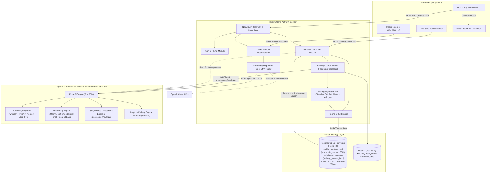

# TÀI LIỆU 00: ĐỊNH HƯỚNG KIẾN TRÚC TỔNG THỂ & CHIẾN LƯỢC REFACTOR DÀI HẠN
# (STRATEGIC ARCHITECTURAL BLUEPRINT & PRAGMATIC POLYGLOT ROADMAP)

> **Trạng thái**: Approved / Pragmatic Production Architecture Specification  
> **Cấp độ tài liệu**: Production Architecture Specification (CTO / Lead System Architect)  
> **Áp dụng cho**: Toàn bộ hệ sinh thái InterviewCoach (`client/`, `server/`, và `ai-service/`)  
> **Phiên bản**: 3.0.0 (Chuẩn hóa toàn diện 15 Tasks tinh gọn, loại bỏ Over-Engineering & Đồng bộ hiện trạng Codebase)  

---

## 1. TỔNG QUAN CHIẾN LƯỢC (EXECUTIVE SUMMARY)

### 1.1 Bối cảnh & Điểm nghẽn Cốt lõi
Hệ thống **InterviewCoach** vận hành trên nền tảng Full-Stack hiện đại:
* **Frontend**: Next.js 16 (App Router, React 19, Tailwind CSS v4).
* **Backend**: NestJS 11 Core với Clean Architecture / Modular Monolith, Prisma ORM kết nối PostgreSQL 16, và Job Queue BullMQ hỗ trợ Transactional Outbox Pattern qua Redis 7.

NestJS và TypeScript đã giải quyết xuất sắc các bài toán nền tảng cốt lõi:
1. Xác thực và phân quyền đa vai trò (JWT, Cookie Session, RBAC: `candidate`, `admin`).
2. Quản lý trạng thái phiên phỏng vấn (Session State Machine).
3. Tính toàn vẹn dữ liệu qua ACID Transaction trên cơ sở dữ liệu quan hệ (`prisma.$transaction`).
4. Khả năng phục hồi của hệ thống điều phối tác vụ nền qua BullMQ Job Queue ([WorkflowDispatcher](file:///c:/Users/An/Documents/GR1/InterviewCoach/server/src/infrastructure/workflow/workflow-dispatcher.service.ts)).
5. **Đặc biệt**: Hệ thống đã triển khai thuật toán tính điểm và suy luận cấp độ SFIA 9 tất định 100% bằng toán học tại [`ScoringEngineService`](file:///c:/Users/An/Documents/GR1/InterviewCoach/server/src/modules/interview-assessment/evaluation/scoring-engine.service.ts).

Tuy nhiên, khi nâng cấp trải nghiệm luyện phỏng vấn giọng nói chuyên sâu:
* **Nhận diện giọng nói trình duyệt (Web Speech API) thiếu ổn định**: Phụ thuộc vào engine của từng trình duyệt (Chrome, Safari, Firefox), ngắt kết nối khi im lặng, không trích xuất được nhịp ngập ngừng (pauses) hay từ đệm (filler words).
* **Xử lý âm thanh trong Node.js bị hạn chế**: Thiếu các thư viện tối ưu để giải mã buffer âm thanh trực tiếp trên RAM, chạy mô hình Whisper cục bộ hoặc tổng hợp giọng nói tự nhiên.
* **Tìm kiếm câu hỏi chưa tối ưu ngữ nghĩa**: Hiện tại phân bổ câu hỏi chủ yếu dựa trên bộ lọc phân loại O\*NET và SFIA; cần bổ sung năng lực Vector Search ngữ nghĩa (`pgvector`) trên nội dung câu hỏi để so khớp tốt hơn với Job Description của ứng viên.

### 1.2 Quyết định Kiến trúc: Pragmatic Polyglot Architecture
Dự án kiên định với định hướng dài hạn, ổn định, không làm phức tạp hóa hệ thống:

$$\mathbf{Pragmatic\ Polyglot\ Architecture} = \mathbf{NestJS\ Core\ Orchestrator} + \mathbf{Python\ AI\ Stateless\ Compute}$$

1. **NestJS (`server/`)**: Giữ nguyên vị thế **Single Source of Truth** & **Business Orchestrator**. Toàn bộ dữ liệu người dùng, phiên phỏng vấn, phân quyền, ACID Transactions, Outbox Worker và thuật toán tính điểm tất định do NestJS làm chủ 100%.
2. **Python (`ai-service/`)**: Đóng vai trò **Dedicated AI Compute Engine**, hoạt động như một microservice hiệu năng cao, **hoàn toàn Stateless Compute** chuyên biệt cho Audio (STT `faster-whisper`, TTS `edge-tts` & `Kokoro-82M`), RAG Embedding, Single-Pass Assessment, và Turn-based Adaptive Probing.
3. **Mô hình Chuyển đổi**: Áp dụng **Strangler Fig Pattern** kết hợp **Strict Provider Toggle** (điều khiển qua biến môi trường). Mọi tính năng AI có thể chuyển đổi linh hoạt giữa Python service và Cloud API Fallback trong $< 1\text{s}$ mà không làm gián đoạn trải nghiệm của người dùng.

---

## 2. SƠ ĐỒ KIẾN TRÚC TOÀN HỆ THỐNG (SYSTEM TOPOLOGY)

---

## 3. BẢNG PHÂN ĐỊNH TRÁCH NHIỆM (SEPARATION OF CONCERNS MATRIX)

| Thành phần / Khả năng | **NestJS Core (`server/`)** | **Python AI Service (`ai-service/`)** | Ghi chú & Ranh giới Kỹ thuật |
| :--- | :---: | :---: | :--- |
| **Xác thực & Danh tính (Auth)** | **SỞ HỮU DUY NHẤT** | Không sở hữu | NestJS quản lý Password hash, JWT token, Cookie session. Python chỉ nhận internal request được bảo vệ qua secret header. |
| **Quản lý Phiên (Session State)** | **SỞ HỮU DUY NHẤT** | Không sở hữu | Trạng thái buổi phỏng vấn (`generating`, `in_progress`, `completed`) do NestJS cập nhật vào Postgres. |
| **Giao dịch Dữ liệu (ACID DB)** | **SỞ HỮU DUY NHẤT** | Không sở hữu | Mọi thao tác ghi dữ liệu nghiệp vụ (`user_answers`, `interview_sessions`) bắt buộc qua `prisma.$transaction`. |
| **Tính điểm Tất định (Scoring)** | **SỞ HỮU DUY NHẤT (ĐÃ CÓ)** | Không sở hữu | [`ScoringEngineService`](file:///c:/Users/An/Documents/GR1/InterviewCoach/server/src/modules/interview-assessment/evaluation/scoring-engine.service.ts) tính điểm `questionScore` và suy luận cấp độ SFIA 9 100% bằng toán học. |
| **Audio STT (Voice to Text)** | Điều phối qua `MediaFacade` | **SỞ HỮU DUY NHẤT LOGIC** | NestJS chuyển audio buffer sang Python. Python giải mã in-memory qua PyAV, chạy `faster-whisper`, trả về text và chỉ số âm học. |
| **Audio TTS (Text to Voice)** | Proxy Stream qua `MediaFacade` | **SỞ HỮU DUY NHẤT LOGIC** | Python chạy Hybrid TTS (`edge-tts` cho VI, `Kokoro-82M` cho EN). NestJS forward stream về client. Fallback client: Web Speech API. |
| **Vector Storage (`pgvector`)** | Sở hữu Schema & DDL | Hỗ trợ Ingestion | Prisma định nghĩa cột `embedding vector(1536)` trên `question_bank`. Python cung cấp endpoint sinh vector. |
| **Đánh giá Câu trả lời (Assessment)** | Điều phối BullMQ & Lưu DB | **SỞ HỮU PROMPT LOGIC** | Python thực thi Single-Pass LLM Evaluation, trả về JSON cấu trúc Pydantic v2. NestJS Worker nhận JSON và tính điểm. |
| **Hỏi xoáy đào sâu (Adaptive Probing)** | Quản lý Sub-turn & UI State | **SỞ HỮU HEURISTIC LOGIC** | Python sinh câu hỏi đào sâu bám sát công nghệ ứng viên vừa trình bày; NestJS lưu vào `probingContextJson`. |

---

## 4. BẢNG BIẾN MÔI TRƯỜNG ĐIỀU KHIỂN (FEATURE FLAGS)

Hệ thống cho phép chuyển mạch tức thời giữa Python AI Service và Cloud API Fallback qua biến môi trường:

| Biến Môi trường | Giá trị Mặc định | Tùy chọn Hỗ trợ | Mô tả Nghiệp vụ |
| :--- | :---: | :---: | :--- |
| `AI_STT_PROVIDER` | `python` | `python`, `openai`, `browser` | Nguồn xử lý giọng nói thành văn bản. |
| `AI_TTS_PROVIDER` | `python` | `python`, `browser`, `openai` | Nguồn phát âm câu hỏi phỏng vấn (`edge-tts` cho VI, `Kokoro-82M` cho EN). |
| `AI_EMBEDDING_PROVIDER` | `openai` | `openai`, `local` | Nguồn sinh embedding cho pgvector (OpenAI `text-embedding-3-small` hoặc local model). |
| `AI_EVALUATION_PROVIDER` | `python` | `python`, `openai` | Nguồn thực thi prompt đánh giá câu trả lời. |
| `AI_SERVICE_URL` | `http://localhost:8000` | URL chuỗi | Địa chỉ nội bộ của Python AI Microservice. |
| `INTERNAL_AI_SECRET` | *(chuỗi bí mật)* | Chuỗi bí mật | Secret token xác thực giữa NestJS và Python (`x-internal-secret`). |
| `AI_FALLBACK_ENABLED` | `true` | `true`, `false` | Tự động chuyển về OpenAI Cloud Fallback nếu Python service timeout $> 8.000\text{ms}$. |

---

## 5. LỘ TRÌNH THỰC DỤNG 15 TASKS (PRAGMATIC 15-TASK ROADMAP)

Lộ trình refactor dài hạn được tinh giản thành **15 nhiệm vụ kỹ thuật liên tục**, phân bổ đều trong 5 giai đoạn:

```mermaid
graph TD
    subgraph P1["PHASE 1: Audio Engine & Voice Pilot"]
        T11["Task 1.1: Python AI Service Core Setup"] --> T12["Task 1.2: STT Pipeline & Voice Metrics"]
        T12 --> T13["Task 1.3: Hybrid TTS Pipeline"]
        T13 --> T14["Task 1.4: Wire Contract Tests"]
        T14 --> T15["Task 1.5: NestJS Integration & Two-Step Flow"]
    end

    subgraph P2["PHASE 2: pgvector & Question Bank"]
        T15 --> T21["Task 2.1: pgvector & HNSW Migration"]
        T21 --> T22["Task 2.2: Embedding Service & Batch Ingestion"]
        T22 --> T23["Task 2.3: Semantic Retrieval & Metadata Filter"]
        T23 --> T24["Task 2.4: NestJS Allocation Integration"]
    end

    subgraph P3["PHASE 3: Assessment & Scoring"]
        T24 --> T31["Task 3.1: Single-Pass Assessment Endpoint"]
        T31 --> T32["Task 3.2: ScoringEngine Verification (ALREADY IMPLEMENTED)"]
        T32 --> T33["Task 3.3: BullMQ Outbox Orchestration"]
    end

    subgraph P4["PHASE 4: Adaptive Probing"]
        T33 --> T41["Task 4.1: Adaptive Probing Engine & Budget"]
        T41 --> T42["Task 4.2: NestJS Sub-turn Intake & Data Model"]
    end

    subgraph P5["PHASE 5: DevOps & Observability"]
        T42 --> T51["Task 5.1: Multi-stage Docker & Secure Compose"]
        T51 --> T52["Task 5.2: CI/CD & Automated Contract Tests"]
        T52 --> T53["Task 5.3: Structured JSON Logging & Correlation-ID"]
        T53 --> T54["Task 5.4: Safe Migrations & Cloud Rollback"]
    end
```

---

## 6. DANH MỤC TÀI LIỆU CHI TIẾT TRONG BỘ TÀI LIỆU REFACTOR

* [Tài liệu 01: Pilot Phase 1 — Khởi tạo `ai-service` & Audio Engine](01_PHASE_1_AUDIO_ENGINE_AND_PILOT.md)  
  *(Thư mục chi tiết: [01_PHASE_1_AUDIO_ENGINE/](01_PHASE_1_AUDIO_ENGINE/00_PHASE_1_OVERVIEW_AND_ARCHITECTURE.md) — Tasks 1.1 đến 1.5)*
* [Tài liệu 02: Phase 2 — Nền tảng PostgreSQL `pgvector` & Ngân hàng Câu hỏi](02_PHASE_2_PGVECTOR_HYBRID_RAG_FOUNDATION.md)  
  *(Thư mục chi tiết: [02_PHASE_2_PGVECTOR_HYBRID_RAG/](02_PHASE_2_PGVECTOR_HYBRID_RAG/00_PHASE_2_OVERVIEW_AND_ARCHITECTURE.md) — Tasks 2.1 đến 2.4)*
* [Tài liệu 03: Phase 3 — Đánh giá Câu trả lời & Tính điểm Tất định](03_PHASE_3_DEEP_ASSESSMENT_AND_SEMANTIC_SCORING.md)  
  *(Thư mục chi tiết: [03_PHASE_3_DEEP_ASSESSMENT/](03_PHASE_3_DEEP_ASSESSMENT/00_PHASE_3_OVERVIEW_AND_ARCHITECTURE.md) — Tasks 3.1 đến 3.3)*
* [Tài liệu 04: Phase 4 — Trải nghiệm Hỏi Đào Sâu Theo Lượt (Adaptive Probing)](04_PHASE_4_VLLM_SCALING_AND_ADVANCED_CAPABILITIES.md)  
  *(Thư mục chi tiết: [04_PHASE_4_VLLM_SCALING/](04_PHASE_4_VLLM_SCALING/00_PHASE_4_OVERVIEW_AND_ARCHITECTURE.md) — Tasks 4.1 và 4.2)*
* [Tài liệu 05: Phase 5 — DevOps Tinh gọn, Docker Compose & Structured Logging](05_DEV_OPS_INFRA_AND_DISASTER_RECOVERY.md)  
  *(Thư mục chi tiết: [05_PHASE_5_DEV_OPS_INFRA/](05_PHASE_5_DEV_OPS_INFRA/00_PHASE_5_OVERVIEW_AND_ARCHITECTURE.md) — Tasks 5.1 đến 5.4)*
