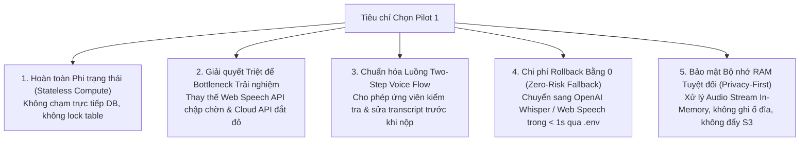

# TÀI LIỆU TỔNG QUAN: PHASE 1 — KHỞI TẠO AI-SERVICE & NỀN TẢNG AUDIO ENGINE (STT/TTS)
# (MASTER OVERVIEW, SYSTEM ARCHITECTURE & PILOT ROADMAP)

> **Trạng thái**: Approved / Production Architecture Specification  
> **Cấp độ**: Production Specification (System Architect / Lead Engineer)  
> **Áp dụng cho**: Khởi tạo `ai-service/`, Mở rộng `MediaModule` và `IAIGateway` trong `server/`  
> **Tài liệu tham chiếu**: [00_OVERVIEW_STRATEGIC_BLUEPRINT.md](../00_OVERVIEW_STRATEGIC_BLUEPRINT.md)  
> **Phiên bản**: 2.0.0 (Đã phân rã chi tiết thành bộ tài liệu chuyên sâu 5 tasks)  

---

## 1. MỤC TIÊU CHIẾN LƯỢC & TẠI SAO CHỌN AUDIO ENGINE LÀM PILOT 1

Trong chiến lược chuyển dịch **Polyglot Hybrid Architecture** và mô hình **Strangler Fig Pattern**, việc lựa chọn điểm khởi đầu (Pilot Project) quyết định mức độ an toàn và thành công của toàn bộ lộ trình refactor. Audio Engine (STT/TTS) được chọn làm Pilot 1 vì 5 lý do kỹ thuật then chốt:



1. **Hoàn toàn phi trạng thái (Stateless Compute)**:
   * Chuyển đổi giọng nói thành văn bản (Speech-to-Text) và tổng hợp giọng nói (Text-to-Speech) chỉ nhận byte buffer và trả về JSON/Audio stream.
   * Không phụ thuộc vào quan hệ cơ sở dữ liệu hay lock dữ liệu phức tạp trong PostgreSQL, giảm thiểu 100% rủi ro làm hỏng schema nghiệp vụ hiện có.
2. **Khắc phục triệt để điểm nghẽn trải nghiệm người dùng**:
   * *Web Speech API trên trình duyệt*: Không đồng nhất giữa các trình duyệt (Chrome, Safari, Firefox), ngắt kết nối khi im lặng, không trích xuất được nhịp ngập ngừng (pauses) hay từ đệm (filler words).
   * *OpenAI Whisper API*: Chi phí cao ($0.006/phút), chịu độ trễ mạng quốc tế ($1.5s - 3.5s$), không phân tích được các chỉ số ngữ âm chuyên sâu cho ứng viên.
3. **Trải nghiệm ứng viên chuẩn mực qua Two-Step Flow**:
   * Tách biệt công đoạn *Ghi âm & Chuyển ngữ* (Transcribe & Review) với công đoạn *Chính thức nộp câu trả lời* (Submit Turn).
   * Ứng viên có quyền xem lại transcript, sửa các thuật ngữ kỹ thuật bị phát âm sai hoặc micro rè trước khi nộp bài vào hệ thống chấm điểm.
4. **Chi phí Rollback bằng 0 (Zero-Risk Fallback)**:
   * Thiết kế thông qua mẫu `AIGatewayDispatcher` và Strict Feature Flags (`AI_STT_PROVIDER=python|openai`).
   * Nếu service Python gặp sự cố hoặc timeout $> 8.000\text{ms}$, hệ thống NestJS tự động chuyển hướng request sang OpenAI Whisper API trong $< 1\text{s}$ mà người dùng không hề hay biết.
5. **Quyền riêng tư tuyệt đối (Privacy-First In-Memory Processing)**:
   * Toàn bộ luồng âm thanh được giải mã và xử lý trực tiếp trên RAM (In-Memory Buffer qua PyAV và io.BytesIO).
   * Tuyệt đối không ghi file tạm ra đĩa cứng và không lưu trữ file âm thanh người dùng lên S3/Cloud Storage, bảo đảm tuân thủ quy định bảo mật dữ liệu nhạy cảm.

---

## 2. KIẾN TRÚC TỔNG THỂ HỆ THỐNG PILOT 1

```mermaid
graph LR
    subgraph ClientLayer["Frontend Client (Next.js)"]
        UI["VoiceRecorder Component"]
        ClientFallback["Web Speech API Fallback"]
    end

    subgraph NestBackend["NestJS Core Platform (server/)"]
        MediaCtrl["MediaController<br/>POST /api/v1/media/transcribe"]
        MediaFcd["MediaFacade<br/>(@modules/media)"]
        Dispatcher["AIGatewayDispatcher<br/>(@infra/ai)"]
        PyGateway["PythonAIGateway"]
        OpenAIGw["OpenAIGateway (Fallback)"]
        TurnCtrl["TurnController<br/>POST /turns"]
        TurnSvc["VoiceAnswerIntakeHandler"]
        Postgres[("PostgreSQL<br/>user_answers.voice_metrics_json")]
    end

    subgraph PythonEngine["Python AI Microservice (:8000)"]
        FastAPI["FastAPI App (uvicorn)"]
        PyAV["PyAV Decoder (16kHz Mono)"]
        Silero["Silero VAD Filter"]
        Whisper["faster-whisper (CTranslate2)"]
        Metrics["Metrics Extractor (WPM, Pauses, Fillers)"]
        TTS["Hybrid TTS (Kokoro EN + EdgeTTS VI)"]
    end

    UI -->|"1. WebM/Opus Stream"| MediaCtrl
    MediaCtrl --> MediaFcd
    MediaFcd --> Dispatcher
    Dispatcher -->|"AI_STT_PROVIDER=python"| PyGateway
    Dispatcher -.->|"Fallback khi Python lỗi"| OpenAIGw
    PyGateway -->|"Internal HTTP/1.1 (x-internal-secret)"| FastAPI
    FastAPI --> PyAV --> Silero --> Whisper --> Metrics
    Metrics -->|"200 OK: Text + VoiceMetrics"| PyGateway
    PyGateway --> Dispatcher --> MediaFcd --> MediaCtrl --> UI
    
    UI -->|"2. Submit Turn: Text + Metrics"| TurnCtrl
    TurnCtrl --> TurnSvc --> Postgres
    
    UI -.->|"TTS Request"| FastAPI
    FastAPI --> TTS -->|"Chunked Audio Stream"| UI
```



---

## 3. DANH MỤC CÁC TÀI LIỆU CHUYÊN SÂU TỪNG TASK (TASK BREAKDOWN)

Phase 1 được phân rã thành 5 tài liệu kỹ thuật chuyên sâu độc lập, kèm mã nguồn triển khai chi tiết:

| Task ID | Tệp Tài liệu Đặc tả | Trọng tâm Kỹ thuật & Phạm vi Triển khai |
| :---: | :--- | :--- |
| **Task 1.1** | [01_PYTHON_AI_SERVICE_SETUP_AND_CORE.md](01_PYTHON_AI_SERVICE_SETUP_AND_CORE.md) | Khởi tạo dự án `ai-service/` với `uv`, `pyproject.toml`, cấu trúc thư mục chuẩn, Dockerfile Multi-stage (CPU/GPU dual profile, `ffmpeg` & `libav`), Structlog JSON structured logging, Pydantic Settings, Middleware bảo mật `x-internal-secret` và bộ xử lý ngoại lệ Error Envelope. |
| **Task 1.2** | [02_STT_PIPELINE_FASTER_WHISPER_AND_METRICS.md](02_STT_PIPELINE_FASTER_WHISPER_AND_METRICS.md) | Xây dựng pipeline STT In-memory hoàn chỉnh: PyAV giải mã WebM/Opus/WAV không ghi đĩa, Silero VAD lọc tĩnh lặng & phát hiện khoảng lặng ngập ngừng $> 1.2\text{s}$, mô hình `faster-whisper` CTranslate2 tối ưu hóa Beam-search & word timestamps, trích xuất chỉ số âm học (WPM, từ đệm kỹ thuật song ngữ Việt-Anh). |
| **Task 1.3** | [03_TTS_PIPELINE_HYBRID_KOKORO_AND_EDGE_TTS.md](03_TTS_PIPELINE_HYBRID_KOKORO_AND_EDGE_TTS.md) | Kiến trúc Hybrid TTS đa ngữ: Kokoro-82M self-hosted neural TTS cho tiếng Anh chuẩn studio và Microsoft Edge TTS cho tiếng Việt tự nhiên chuẩn giọng Bắc/Nam, cơ chế phát stream nhị phân Chunked Transfer Encoding qua FastAPI, cơ chế tự động chuyển hướng client Web Speech API khi mạng gián đoạn. |
| **Task 1.4** | [04_CONTRACT_SPECIFICATION_AND_SCHEMA_TESTS.md](04_CONTRACT_SPECIFICATION_AND_SCHEMA_TESTS.md) | Đặc tả Contract giao tiếp NestJS ↔ Python: Quy chuẩn Wire `camelCase`, Schema `/stt/transcribe`, `/tts/synthesize`, `/healthz`, `/ready`, Bảng mã lỗi `InterviewAIException` ↔ Python Error Envelope, Chiến lược Contract Testing tự động bằng Pytest & Jest với Shared JSON Fixtures chống rủi ro Schema Drift. |
| **Task 1.5** | [05_NESTJS_INTEGRATION_AND_TWO_STEP_FLOW.md](05_NESTJS_INTEGRATION_AND_TWO_STEP_FLOW.md) | Tích hợp vào NestJS Core: Mở rộng `MediaModule` (`MediaController`, `MediaFacade`), chuẩn hóa luồng Two-Step Voice Flow, cập nhật `SubmitAnswerDto` & `VoiceAnswerIntakeHandler` ghi nhận `voiceMetricsJson` trong `prisma.$transaction`, bộ điều phối `AIGatewayDispatcher` hỗ trợ Strict Toggle và Circuit Breaker. |

---

## 4. LỘ TRÌNH TRIỂN KHAI CHI TIẾT (PHASE 1 ROADMAP)

```mermaid
gantt
    title Kế hoạch Triển khai Chi tiết Phase 1 (Audio Engine Pilot)
    dateFormat  YYYY-MM-DD
    section Khởi tạo & Core Infra
    Task 1.1: Khởi tạo ai-service & Docker Multi-stage :t1_1, 2026-10-15, 5d
    section STT Engine Pipeline
    Task 1.2: PyAV + Silero VAD + faster-whisper + Metrics :t1_2, after t1_1, 6d
    section TTS Engine Pipeline
    Task 1.3: Hybrid TTS (Kokoro-82M EN & EdgeTTS VI)    :t1_3, after t1_2, 5d
    section Contract & Testing
    Task 1.4: Wire Contract & Automated Contract Tests   :t1_4, after t1_3, 4d
    section NestJS Core & Two-Step
    Task 1.5: MediaModule, Two-Step Flow & Strict Toggle :t1_5, after t1_4, 5d
    Nghiệm thu Quality Gate 1                           :milestone, after t1_5, 0d
```

---

## 5. MA TRẬN KỊCH BẢN LỖI & PHƯƠNG ÁN XỬ LÝ (FAILURE MODES & RECOVERY)

| Kịch bản Lỗi | Nguyên nhân Gốc rễ | Hành vi Hệ thống | Biện pháp Khắc phục Tự động / Thủ công |
| :--- | :--- | :--- | :--- |
| **Python Service Down (503 / ConnRefused)** | Container crash hoặc đứt mạng nội bộ Docker. | `AIGatewayDispatcher` phát hiện timeout sau $2.000\text{ms}$. | Nếu `AI_FALLBACK_ENABLED=true`: Chuyển sang OpenAI Whisper Cloud. Trả transcript cho ứng viên, metrics tính bằng Regex Fallback. |
| **Buffer âm thanh rỗng / hỏng (`AUDIO_CORRUPTED`)** | Microphone ngắt đột ngột, client gửi gói tin 0-byte hoặc định dạng hỏng. | `MediaController` hoặc PyAV ném ngoại lệ `InvalidData`. | Bắt lỗi trả về HTTP 400 chuẩn: *"Bản ghi âm không hợp lệ hoặc không có dữ liệu âm thanh. Vui lòng ghi âm lại."* |
| **Môi trường quá ồn, không có giọng nói rõ ràng** | Tiếng ồn xung quanh át tiếng nói. | Silero VAD lọc sạch toàn bộ buffer, text trả về rỗng (`""`). | NestJS phát hiện text rỗng, trả thông báo UI: *"Không phát hiện thấy giọng nói rõ ràng. Vui lòng thử lại nơi yên tĩnh hơn."* |
| **Độ trễ xử lý vượt ngưỡng (Timeout Spike > 8s)** | CPU/GPU bị nghẽn do quá nhiều request đồng thời. | Axios/HttpModule timeout kích hoạt tại $8.000\text{ms}$. | Hủy kết nối Python, chuyển request sang OpenAI Whisper và ghi log cảnh báo Prometheus `stt_high_latency_spike`. |
| **Lỗi kết nối EdgeTTS (Tiếng Việt)** | Mạng Internet máy chủ ra ngoài gián đoạn. | Python `tts_manager` phát hiện lỗi kết nối EdgeTTS. | Trả lỗi có cấu trúc để Client tự động chuyển sang Web Speech API `window.speechSynthesis` phát âm tại trình duyệt. |

---

## 6. TIÊU CHÍ NGHIỆM THU TỔNG THỂ (QUALITY GATE 1 GATES)

Để hoàn tất Phase 1 và sẵn sàng bước sang Phase 2 (pgvector Hybrid RAG), hệ thống bắt buộc phải vượt qua 7 tiêu chí nghiệm thu sau:

1. **Khởi tạo và Chạy Ổn định (Service Liveness & Readiness)**:
   * Container `ai-service` khởi chạy trơn tru với cả hai chế độ CPU (`int8`) và GPU CUDA (`float16`).
   * Endpoint `GET /healthz` trả HTTP 200 `{"status": "ok"}`.
   * Endpoint `GET /ready` trả HTTP 200 chỉ sau khi model `faster-whisper` và `kokoro` đã tải hoàn tất vào RAM/VRAM.
2. **Tuân thủ Hợp đồng Tuyệt đối (Zero Schema Drift)**:
   * 100% JSON payload truyền qua wire đều là `camelCase`.
   * Vượt qua 100% các bài kiểm thử Contract Testing trên cả Pytest (Python) và Jest (NestJS) thông qua bộ fixtures chung.
3. **Độ chính xác STT (Word Error Rate)**:
   * Đạt Word Error Rate (WER) $< 8\%$ trên bộ 20 đoạn thu âm mẫu (10 đoạn tiếng Việt kỹ thuật, 10 đoạn tiếng Anh kỹ thuật).
4. **Hiệu năng & Độ trễ (Benchmark Requirements)**:
   * **GPU (NVIDIA T4 / RTX 3060 trở lên)**: Bản ghi âm 60 giây được xử lý STT và trích xuất chỉ số xong trong $< 1.2$ giây.
   * **CPU (8 vCPUs)**: Bản ghi âm 60 giây được xử lý xong trong $< 3.5$ giây.
   * **TTS Kokoro (English)**: Real-Time Factor (RTF) $< 0.15$.
5. **Không rò rỉ bộ nhớ (Memory Leak Free)**:
   * Chạy kiểm thử tải 500 requests STT liên tiếp không làm tăng dung lượng RAM cơ sở của Python container quá $+200\text{MB}$.
6. **Luồng Two-Step Voice Flow Hoạt động Trơn tru**:
   * Client tải audio lên `POST /api/v1/media/transcribe`, nhận text và voice metrics.
   * Giao diện người dùng cho phép xem lại/chỉnh sửa văn bản trước khi bấm Submit turn.
   * Dữ liệu lưu vào bảng `user_answers` chứa đầy đủ `voiceMetricsJson` (WPM, pause count, filler words, speech duration).
7. **Strict Toggle & Fallback Hoạt động Không Lỗi**:
   * Khi đổi biến môi trường `AI_STT_PROVIDER=openai`, hệ thống chuyển hướng mượt mà sang OpenAI Whisper API mà không phải sửa code.
   * Khi tắt container Python đột ngột, request lập tức fallback sang OpenAI Whisper với độ trễ chuyển mạch $< 1\text{s}$.
