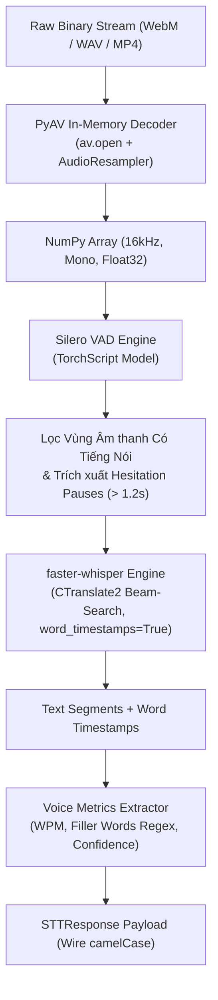

# TASK 1.2: STT PIPELINE — FASTER-WHISPER, IN-MEMORY DECODING & ADVANCED VOICE METRICS

> **Trạng thái**: Approved / Production Specification  
> **Cấp độ**: Deep Technical Specification (Audio DSP & Machine Learning Inference)  
> **Áp dụng cho**: `ai-service/app/services/stt/`, PyAV, Silero VAD, `faster-whisper` (CTranslate2)  
> **Tài liệu cha**: [00_PHASE_1_OVERVIEW_AND_ARCHITECTURE.md](00_PHASE_1_OVERVIEW_AND_ARCHITECTURE.md)  
> **Phiên bản**: 2.0.0  

---

## 1. MỤC TIÊU KỸ THUẬT & KIẾN TRÚC IN-MEMORY

1. **Zero-Disk In-Memory Processing**: Giải mã trực tiếp các định dạng âm thanh từ trình duyệt (`audio/webm;codecs=opus`, `audio/wav`, `audio/mp4`) từ buffer nhị phân trong RAM qua PyAV. Tuyệt đối không ghi file đĩa cứng `/tmp` để loại bỏ 100% rủi ro rò rỉ bảo mật và nghẽn I/O đĩa.
2. **Resampling Chuẩn hóa**: Đưa toàn bộ tín hiệu đầu vào về tần số lấy mẫu $16.000\text{ Hz}$, layout kênh `mono`, định dạng `float32` chuẩn hóa $[-1.0, 1.0]$.
3. **Bộ lọc Tĩnh lặng & Phát hiện Ngập ngừng (Silero VAD)**:
   * Loại bỏ nhiễu nền và khoảng lặng vô nghĩa ở đầu/cuối bản ghi.
   * Nhận diện và đếm chính xác các khoảng lặng ngập ngừng kéo dài $> 1.2\text{ giây}$ (Hesitation Pauses).
4. **Nhận diện Ngữ âm Chính xác cao (faster-whisper)**: Tận dụng CTranslate2 runtime cho tốc độ suy luận nhanh gấp 4 lần OpenAI Whisper gốc, trích xuất mốc thời gian chi tiết từng từ (`word_timestamps=True`).
5. **Khai phá Bộ Chỉ số Giọng nói Chuyên sâu (Advanced Voice Metrics)**:
   * Tốc độ nói WPM (Words Per Minute) tính chuẩn xác trên thời lượng phát âm thực tế (`speechDuration`).
   * Phát hiện từ đệm kỹ thuật song ngữ (Bilingual Filler Words) cả tiếng Việt và tiếng Anh.
   * Đo lường độ tin cậy trung bình của phát âm (`confidenceScore`).



---

## 2. GIẢI MÃ ÂM THANH TRONG BỘ NHỚ RAM (`audio_decoder.py`)

Triển khai tại `ai-service/app/services/stt/audio_decoder.py`:

```python
import io
import av
import numpy as np
import structlog
from app.core.exceptions import AIException

logger = structlog.get_logger()

TARGET_SAMPLE_RATE = 16000


class AudioDecoder:
    """
    Giải mã binary buffer (WebM, WAV, MP4, OGG) trực tiếp trong RAM thành 
    mảng NumPy 1D Mono Float32 ở tần số 16.000 Hz.
    """

    @staticmethod
    def decode_to_pcm_float32(audio_bytes: bytes) -> tuple[np.ndarray, float]:
        if not audio_bytes or len(audio_bytes) == 0:
            raise AIException(
                error_code="AUDIO_EMPTY",
                message="Dữ liệu âm thanh nhận được rỗng (0 bytes).",
                status_code=400,
            )

        try:
            input_buffer = io.BytesIO(audio_bytes)
            container = av.open(input_buffer)
        except Exception as e:
            logger.warn("pyav_open_failed", error=str(e), size=len(audio_bytes))
            raise AIException(
                error_code="AUDIO_CORRUPTED",
                message="Không thể mở hoặc phân tích định dạng container của tệp âm thanh.",
                status_code=400,
                details={"decoderError": str(e)},
            )

        try:
            audio_stream = next(s for s in container.streams if s.type == "audio")
        except StopIteration:
            raise AIException(
                error_code="AUDIO_NO_STREAM",
                message="Không tìm thấy stream âm thanh hợp lệ trong tệp tải lên.",
                status_code=400,
            )

        # Cấu hình bộ chuyển đổi tần số sang 16kHz, Mono, Float32
        resampler = av.AudioResampler(
            format="flt",
            layout="mono",
            rate=TARGET_SAMPLE_RATE,
        )

        frames_data: list[np.ndarray] = []

        try:
            for frame in container.decode(audio_stream):
                resampled_frames = resampler.resample(frame)
                for r_frame in resampled_frames:
                    # Chuyển frame thành mảng numpy float32
                    arr = r_frame.to_ndarray()
                    frames_data.append(arr.flatten())
        except Exception as e:
            logger.warn("pyav_decode_frame_error", error=str(e))
            raise AIException(
                error_code="AUDIO_DECODE_ERROR",
                message="Lỗi trong quá trình giải mã các gói tin âm thanh trong bộ nhớ.",
                status_code=400,
                details={"error": str(e)},
            )
        finally:
            container.close()

        if not frames_data:
            raise AIException(
                error_code="AUDIO_EMPTY_FRAMES",
                message="Tệp âm thanh không chứa khung dữ liệu PCM hợp lệ.",
                status_code=400,
            )

        # Ghép các khung lại thành một mảng 1D duy nhất
        pcm_array = np.concatenate(frames_data).astype(np.float32)

        # Đảm bảo giá trị tín hiệu âm thanh nằm trong khoảng chuẩn hóa [-1.0, 1.0]
        max_abs = np.max(np.abs(pcm_array))
        if max_abs > 1.0:
            pcm_array = pcm_array / max_abs

        duration_seconds = round(float(len(pcm_array) / TARGET_SAMPLE_RATE), 2)
        return pcm_array, duration_seconds
```

---

## 3. BỘ LỌC VAD & PHÁT HIỆN KHOẢNG LẶNG NGẬP NGỪNG (`vad_filter.py`)

Triển khai tại `ai-service/app/services/stt/vad_filter.py` sử dụng **Silero VAD**:

```python
from dataclasses import dataclass
import numpy as np
import torch
import structlog
from app.core.config import get_settings

logger = structlog.get_logger()

PAUSE_THRESHOLD_SECONDS = 1.2  # Ngưỡng khoảng lặng tính là ngập ngừng


@dataclass
class VADResult:
    cleaned_audio: np.ndarray
    speech_duration_seconds: float
    pause_count: int
    total_pause_duration_seconds: float
    has_speech: bool


class SileroVADFilter:
    _instance: "SileroVADFilter | None" = None

    def __init__(self):
        self.settings = get_settings()
        logger.info("loading_silero_vad_model")
        # Nạp mô hình Silero VAD TorchScript siêu nhẹ (chỉ ~2MB)
        self.model, self.utils = torch.hub.load(
            repo_or_dir="snakers4/silero-vad",
            model="silero_vad",
            force_reload=False,
            onnx=False,
        )
        self.get_speech_timestamps, _, _, _, _ = self.utils
        self.model.eval()

    @classmethod
    def get_instance(cls) -> "SileroVADFilter":
        if cls._instance is None:
            cls._instance = cls()
        return cls._instance

    def process(self, audio_array: np.ndarray, sample_rate: int = 16000) -> VADResult:
        tensor_audio = torch.from_numpy(audio_array)

        # Trích xuất danh sách các đoạn có tiếng nói (timestamps)
        speech_timestamps = self.get_speech_timestamps(
            tensor_audio,
            self.model,
            threshold=self.settings.vad_threshold,
            sampling_rate=sample_rate,
            min_speech_duration_ms=self.settings.min_speech_duration_ms,
            min_silence_duration_ms=self.settings.min_silence_duration_ms,
        )

        if not speech_timestamps:
            return VADResult(
                cleaned_audio=np.array([], dtype=np.float32),
                speech_duration_seconds=0.0,
                pause_count=0,
                total_pause_duration_seconds=0.0,
                has_speech=False,
            )

        speech_chunks = []
        pause_count = 0
        total_pause_duration = 0.0

        for i, ts in enumerate(speech_timestamps):
            start = ts["start"]
            end = ts["end"]
            speech_chunks.append(audio_array[start:end])

            # Đo khoảng lặng giữa hai đoạn phát âm liên tiếp
            if i > 0:
                prev_end = speech_timestamps[i - 1]["end"]
                silence_gap = (start - prev_end) / sample_rate
                if silence_gap >= PAUSE_THRESHOLD_SECONDS:
                    pause_count += 1
                    total_pause_duration += silence_gap

        cleaned_audio = np.concatenate(speech_chunks) if speech_chunks else np.array([], dtype=np.float32)
        speech_duration = round(float(len(cleaned_audio) / sample_rate), 2)

        return VADResult(
            cleaned_audio=cleaned_audio,
            speech_duration_seconds=speech_duration,
            pause_count=pause_count,
            total_pause_duration_seconds=round(total_pause_duration, 2),
            has_speech=True,
        )
```

---

## 4. SINGLETON FASTER-WHISPER CTRANSLATE2 ENGINE (`whisper_engine.py`)

Triển khai tại `ai-service/app/services/stt/whisper_engine.py`:

```python
import threading
from typing import Any
import numpy as np
from faster_whisper import WhisperModel
import structlog
from app.core.config import get_settings

logger = structlog.get_logger()


class WhisperEngine:
    _instance: "WhisperEngine | None" = None
    _lock: threading.Lock = threading.Lock()

    def __init__(self):
        settings = get_settings()
        self.device = settings.whisper_device
        self.compute_type = settings.whisper_compute_type
        self.model_size = settings.whisper_model_size

        logger.info(
            "initializing_faster_whisper",
            model_size=self.model_size,
            device=self.device,
            compute_type=self.compute_type,
        )

        self.model = WhisperModel(
            self.model_size,
            device=self.device,
            compute_type=self.compute_type,
            cpu_threads=settings.whisper_threads,
        )

    @classmethod
    def get_instance(cls) -> "WhisperEngine":
        if cls._instance is None:
            with cls._lock:
                if cls._instance is None:
                    cls._instance = cls()
        return cls._instance

    def warmup(self) -> None:
        """Kích hoạt nạp trọng số và test suy luận giả lập 1s âm thanh tĩnh."""
        dummy_audio = np.zeros(16000, dtype=np.float32)
        self.model.transcribe(dummy_audio, language="en", beam_size=1)

    def transcribe(
        self,
        audio_array: np.ndarray,
        language: str = "vi",
    ) -> tuple[str, list[dict[str, Any]]]:
        """
        Thực hiện Beam Search nhận diện ngữ âm và trích xuất word-level timestamps.
        """
        segments, _ = self.model.transcribe(
            audio_array,
            language=language,
            beam_size=5,
            word_timestamps=True,
            vad_filter=False,  # Đã lọc qua Silero VAD trước đó
            temperature=0.0,
        )

        full_text_list = []
        words_metadata: list[dict[str, Any]] = []

        for seg in segments:
            full_text_list.append(seg.text.strip())
            if seg.words:
                for w in seg.words:
                    words_metadata.append({
                        "word": w.word.strip(),
                        "start": round(w.start, 2),
                        "end": round(w.end, 2),
                        "probability": round(w.probability, 4),
                    })

        full_transcript = " ".join(full_text_list).strip()
        return full_transcript, words_metadata
```

---

## 5. TRÍCH XUẤT CHỈ SỐ GIỌNG NÓI CHUYÊN SÂU (`metrics_extractor.py`)

Triển khai tại `ai-service/app/services/stt/metrics_extractor.py`:

```python
import re
from typing import Any
from app.schemas.stt import VoiceMetrics

# Danh mục từ đệm kỹ thuật song ngữ
FILLER_WORDS_VI = [
    r"\bừm\b", r"\bừ\b", r"\bà\b", r"\bthì\b", r"\blà\b",
    r"\bkiểu như\b", r"\bdạ thì\b", r"\bnói chung là\b",
    r"\bcơ mà\b", r"\bvới lại\b", r"\bthế nên là\b",
]

FILLER_WORDS_EN = [
    r"\buh\b", r"\bum\b", r"\blike\b", r"\byou know\b",
    r"\bactually\b", r"\bbasically\b", r"\bliterally\b",
    r"\bright\b", r"\bsort of\b", r"\bkind of\b",
]


class MetricsExtractor:
    @staticmethod
    def extract_metrics(
        text: str,
        speech_duration_seconds: float,
        pause_count: int,
        total_pause_duration_seconds: float,
        words_metadata: list[dict[str, Any]],
        language: str = "vi",
    ) -> VoiceMetrics:
        # 1. Đếm tổng số từ thực tế
        words = re.findall(r"\w+", text.lower())
        word_count = len(words)

        # 2. Tính toán WPM (Words Per Minute) dựa trên speech_duration thực tế
        effective_duration_minutes = max(speech_duration_seconds, 1.0) / 60.0
        wpm = int(round(word_count / effective_duration_minutes)) if word_count > 0 else 0

        # 3. Quét phát hiện từ đệm (Filler Words)
        detected_fillers: list[str] = []
        filler_patterns = FILLER_WORDS_VI if language == "vi" else FILLER_WORDS_EN
        # Đồng thời kiểm tra cả từ đệm tiếng Anh kỹ thuật khi nói tiếng Việt
        if language == "vi":
            filler_patterns = FILLER_WORDS_VI + [r"\buh\b", r"\bum\b", r"\blike\b", r"\bbasically\b"]

        lowered_text = text.lower()
        for pattern in filler_patterns:
            matches = re.findall(pattern, lowered_text)
            if matches:
                detected_fillers.extend(matches)

        # 4. Tính toán Confidence Score trung bình của mô hình Whisper
        if words_metadata:
            probs = [w["probability"] for w in words_metadata]
            avg_prob = float(sum(probs) / len(probs))
            confidence_score = round(avg_prob * 100.0, 1)
        else:
            confidence_score = 90.0 if word_count > 0 else 0.0

        return VoiceMetrics(
            wpm=wpm,
            filler_word_count=len(detected_fillers),
            filler_words=detected_fillers,
            pause_count=pause_count,
            total_pause_duration_seconds=total_pause_duration_seconds,
            speech_duration_seconds=speech_duration_seconds,
            confidence_score=confidence_score,
        )
```

---

## 6. ENDPOINT API STT: `POST /api/v1/stt/transcribe`

Triển khai tại `ai-service/app/api/v1/stt.py`:

```python
from fastapi import APIRouter, UploadFile, File, Form, Depends, Header
from app.core.security import verify_internal_secret
from app.services.stt.audio_decoder import AudioDecoder
from app.services.stt.vad_filter import SileroVADFilter
from app.services.stt.whisper_engine import WhisperEngine
from app.services.stt.metrics_extractor import MetricsExtractor
from app.schemas.stt import STTResponse, STTWordTimestamp
from app.core.exceptions import AIException

router = APIRouter(prefix="/stt", tags=["Speech-To-Text"])


@router.post(
    "/transcribe",
    response_model=STTResponse,
    dependencies=[Depends(verify_internal_secret)],
    summary="Giải mã In-Memory và Trích xuất Transcript kèm Voice Metrics",
)
async def transcribe_audio(
    file: UploadFile = File(..., description="File binary audio từ client (WebM/WAV)"),
    language: str = Form(default="vi", description="Ngôn ngữ nhận diện: vi | en"),
    vad_filter: bool = Form(default=True, description="Kích hoạt bộ lọc Silero VAD"),
    x_request_id: str = Header(default=""),
) -> STTResponse:
    # 1. Đọc audio buffer vào bộ nhớ
    audio_bytes = await file.read()

    # 2. Giải mã bằng PyAV in-memory sang Float32 16kHz
    pcm_array, total_duration = AudioDecoder.decode_to_pcm_float32(audio_bytes)

    # 3. Lọc VAD và đo khoảng lặng
    if vad_filter:
        vad_engine = SileroVADFilter.get_instance()
        vad_res = vad_engine.process(pcm_array)

        if not vad_res.has_speech:
            raise AIException(
                error_code="NO_SPEECH_DETECTED",
                message="Không phát hiện thấy âm thanh giọng nói rõ ràng trong bản ghi.",
                status_code=400,
            )

        processed_audio = vad_res.cleaned_audio
        speech_duration = vad_res.speech_duration_seconds
        pause_count = vad_res.pause_count
        pause_duration = vad_res.total_pause_duration_seconds
    else:
        processed_audio = pcm_array
        speech_duration = total_duration
        pause_count = 0
        pause_duration = 0.0

    # 4. Nhận diện giọng nói qua faster-whisper
    whisper_engine = WhisperEngine.get_instance()
    text, words_data = whisper_engine.transcribe(processed_audio, language=language)

    # 5. Khai phá bộ chỉ số âm học
    metrics = MetricsExtractor.extract_metrics(
        text=text,
        speech_duration_seconds=speech_duration,
        pause_count=pause_count,
        total_pause_duration_seconds=pause_duration,
        words_metadata=words_data,
        language=language,
    )

    words_models = [STTWordTimestamp(**w) for w in words_data]

    return STTResponse(
        text=text,
        language=language,
        duration_seconds=total_duration,
        metrics=metrics,
        words=words_models,
    )
```

---

## 7. KIỂM THỬ ĐƠN VỊ & BENCHMARK ĐỘ TRỄ (`tests/test_stt.py`)

```python
import pytest
import numpy as np
from app.services.stt.audio_decoder import AudioDecoder
from app.services.stt.metrics_extractor import MetricsExtractor
from app.core.exceptions import AIException


def test_decode_empty_bytes_raises_exception():
    with pytest.raises(AIException) as exc_info:
        AudioDecoder.decode_to_pcm_float32(b"")
    assert exc_info.value.error_code == "AUDIO_EMPTY"


def test_metrics_extractor_wpm_calculation():
    text = "Tôi là lập trình viên backend có kinh nghiệm về hệ thống phân tán và docker."
    # 13 từ trong 6.5s -> (13 / (6.5 / 60)) = 120 WPM
    metrics = MetricsExtractor.extract_metrics(
        text=text,
        speech_duration_seconds=6.5,
        pause_count=1,
        total_pause_duration_seconds=1.5,
        words_metadata=[],
        language="vi",
    )
    assert metrics.wpm == 120
    assert metrics.pause_count == 1
    assert metrics.total_pause_duration_seconds == 1.5


def test_filler_words_detection_bilingual():
    text = "Ừm thì tôi nghĩ là dự án này basically rất là phức tạp like kiến trúc microservices."
    metrics = MetricsExtractor.extract_metrics(
        text=text,
        speech_duration_seconds=10.0,
        pause_count=0,
        total_pause_duration_seconds=0.0,
        words_metadata=[],
        language="vi",
    )
    assert metrics.filler_word_count >= 4
    assert "ừm" in metrics.filler_words
    assert "basically" in metrics.filler_words
```
