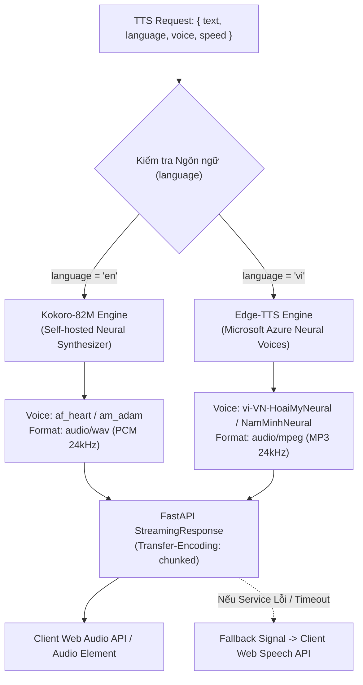

# TASK 1.3: TTS PIPELINE — HYBRID KOKORO-82M & EDGE-TTS MULTILINGUAL SYNTHESIZER

> **Trạng thái**: Approved / Production Specification  
> **Cấp độ**: Deep Technical Specification (Neural Speech Synthesis & Streaming Protocols)  
> **Áp dụng cho**: `ai-service/app/services/tts/`, Kokoro-82M (English), Microsoft Edge-TTS (Vietnamese), Streaming API  
> **Tài liệu cha**: [00_PHASE_1_OVERVIEW_AND_ARCHITECTURE.md](00_PHASE_1_OVERVIEW_AND_ARCHITECTURE.md)  
> **Phiên bản**: 2.0.0  

---

## 1. MỤC TIÊU KỸ THUẬT & CHIẾN LƯỢC HYBRID TTS ĐA NGỮ

Hệ thống luyện phỏng vấn kỹ thuật đòi hỏi giọng đọc của AI Interviewer phải đạt hai tiêu chuẩn khắt khe mà các giải pháp đơn lẻ không thể đáp ứng:
1. **Phát âm Chuẩn xác Thuật ngữ CNTT Tiếng Anh**: Các từ vựng như *Kubernetes, Microservices, Asynchronous, PostgreSQL, Goroutines* phải được đọc tự nhiên theo chuẩn âm bản ngữ studio, không bị phát âm ngọng hoặc lệch ngữ điệu.
2. **Ngữ điệu Tự nhiên Bản địa Tiếng Việt**: Giọng đọc tiếng Việt phải rõ ràng, ấm áp, chuẩn sắc điệu Bắc/Nam, loại bỏ hoàn toàn âm hưởng thô cứng của Web Speech API mặc định trên trình duyệt.



### Các Thông số Kỹ thuật Cốt lõi:
* **Kokoro-82M (English)**:
  * Mô hình siêu gọn nhẹ (82 triệu tham số, chỉ chiếm $\sim 350\text{MB}$ RAM).
  * Real-Time Factor (RTF) $< 0.15$ trên CPU (sinh 1 giây âm thanh chỉ mất $0.15$ giây CPU).
  * Chạy $100\%$ Offline / In-Container, hoàn toàn không phụ thuộc kết nối Internet ra ngoài.
* **Microsoft Edge TTS (Vietnamese)**:
  * Kết nối trực tiếp dịch vụ giọng đọc Neural của Azure (`edge-tts`).
  * Giọng mặc định: `vi-VN-HoaiMyNeural` (Nữ - Hà Nội) hoặc `vi-VN-NamMinhNeural` (Nam - TP.HCM).
  * Không tốn chi phí bản quyền API trả phí, hỗ trợ streaming chunked trực tiếp qua giao thức WebSocket ngầm.

---

## 2. TRIỂN KHAI KOKORO ENGLISH SYNTHESIZER (`kokoro_engine.py`)

Triển khai tại `ai-service/app/services/tts/kokoro_engine.py`:

```python
import io
import threading
from typing import AsyncGenerator
import numpy as np
import soundfile as sf
import structlog
from kokoro import KPipeline

logger = structlog.get_logger()

KOKORO_SAMPLE_RATE = 24000


class KokoroEngine:
    _instance: "KokoroEngine | None" = None
    _lock: threading.Lock = threading.Lock()

    def __init__(self):
        logger.info("initializing_kokoro_tts_pipeline")
        # Khởi tạo pipeline phát âm tiếng Anh ('a' = American English)
        self.pipeline = KPipeline(lang_code="a")

    @classmethod
    def get_instance(cls) -> "KokoroEngine":
        if cls._instance is None:
            with cls._lock:
                if cls._instance is None:
                    cls._instance = cls()
        return cls._instance

    async def generate_audio_stream(
        self,
        text: str,
        voice: str = "af_heart",
        speed: float = 1.0,
    ) -> AsyncGenerator[bytes, None]:
        """
        Sinh luồng âm thanh WAV theo từng chunk nhị phân để giảm Time-To-First-Byte (TTFB).
        """
        try:
            generator = self.pipeline(
                text,
                voice=voice,
                speed=speed,
                split_pattern=r"\n+",
            )

            for _graphemes, _phonemes, audio in generator:
                # audio là numpy array 1D float32
                if isinstance(audio, np.ndarray) and len(audio) > 0:
                    buffer = io.BytesIO()
                    # Xuất chunk dưới dạng WAV 24kHz 16-bit PCM
                    sf.write(buffer, audio, samplerate=KOKORO_SAMPLE_RATE, format="WAV", subtype="PCM_16")
                    buffer.seek(0)
                    yield buffer.read()
        except Exception as e:
            logger.exception("kokoro_synthesis_failed", error=str(e), text=text[:50])
            raise e
```

---

## 3. TRIỂN KHAI EDGE-TTS VIETNAMESE SYNTHESIZER (`edge_tts_engine.py`)

Triển khai tại `ai-service/app/services/tts/edge_tts_engine.py`:

```python
from typing import AsyncGenerator
import edge_tts
import structlog
from app.core.exceptions import AIException

logger = structlog.get_logger()

SUPPORTED_VI_VOICES = {
    "vi-VN-HoaiMyNeural": "Nữ - Giọng Bắc truyền cảm",
    "vi-VN-NamMinhNeural": "Nam - Giọng Nam ấm áp",
}


class EdgeTTSEngine:
    @staticmethod
    async def generate_audio_stream(
        text: str,
        voice: str = "vi-VN-HoaiMyNeural",
        speed: float = 1.0,
    ) -> AsyncGenerator[bytes, None]:
        """
        Truyền phát âm thanh chunked MP3 trực tiếp từ Microsoft Edge Neural TTS.
        """
        if voice not in SUPPORTED_VI_VOICES:
            voice = "vi-VN-HoaiMyNeural"

        # Tính toán tham số tốc độ nói theo định dạng '+X%' hoặc '-X%'
        rate_percent = int((speed - 1.0) * 100)
        rate_str = f"{rate_percent:+d}%"

        try:
            communicate = edge_tts.Communicate(text=text, voice=voice, rate=rate_str)
            async for chunk in communicate.stream():
                if chunk["type"] == "audio":
                    yield chunk["data"]
        except Exception as e:
            logger.exception("edge_tts_stream_error", error=str(e), voice=voice)
            raise AIException(
                error_code="TTS_UPSTREAM_ERROR",
                message="Dịch vụ tổng hợp giọng nói tiếng Việt gián đoạn kết nối.",
                status_code=502,
                details={"error": str(e)},
            )
```

---

## 4. BỘ ĐIỀU PHỐI HYBRID TTS MANAGER (`tts_manager.py`)

Triển khai tại `ai-service/app/services/tts/tts_manager.py`:

```python
from typing import AsyncGenerator
from app.services.tts.kokoro_engine import KokoroEngine
from app.services.tts.edge_tts_engine import EdgeTTSEngine
from app.schemas.tts import TTSRequest
import structlog

logger = structlog.get_logger()


class TTSManager:
    @staticmethod
    async def synthesize(request: TTSRequest) -> tuple[AsyncGenerator[bytes, None], str, str]:
        """
        Điều phối tổng hợp giọng nói dựa trên mã ngôn ngữ.
        Trả về: (audio_generator, content_type, engine_used)
        """
        text = request.text.strip()
        lang = request.language.lower()
        speed = request.speed or 1.0

        if lang == "en":
            voice = request.voice or "af_heart"
            logger.info("dispatching_tts_kokoro_en", voice=voice, speed=speed)
            engine = KokoroEngine.get_instance()
            generator = engine.generate_audio_stream(text=text, voice=voice, speed=speed)
            return generator, "audio/wav", "kokoro"

        # Mặc định tiếng Việt hoặc các ngôn ngữ khác
        voice = request.voice or "vi-VN-HoaiMyNeural"
        logger.info("dispatching_tts_edge_vi", voice=voice, speed=speed)
        generator = EdgeTTSEngine.generate_audio_stream(text=text, voice=voice, speed=speed)
        return generator, "audio/mpeg", "edge-tts"
```

---

## 5. ENDPOINT API STREAMING: `POST /api/v1/tts/synthesize`

Triển khai tại `ai-service/app/api/v1/tts.py`:

```python
from fastapi import APIRouter, Depends, Header
from fastapi.responses import StreamingResponse
from app.core.security import verify_internal_secret
from app.schemas.tts import TTSRequest
from app.services.tts.tts_manager import TTSManager
from app.core.exceptions import AIException

router = APIRouter(prefix="/tts", tags=["Text-To-Speech"])


@router.post(
    "/synthesize",
    dependencies=[Depends(verify_internal_secret)],
    summary="Tổng hợp Giọng nói Đa ngữ Truyền phát (Chunked Audio Stream)",
)
async def synthesize_speech(
    request: TTSRequest,
    x_request_id: str = Header(default=""),
) -> StreamingResponse:
    if not request.text or len(request.text.strip()) == 0:
        raise AIException(
            error_code="EMPTY_TEXT_SYNTHESIS",
            message="Nội dung văn bản yêu cầu đọc không được để trống.",
            status_code=422,
        )

    if len(request.text) > 1000:
        raise AIException(
            error_code="TEXT_TOO_LONG",
            message="Độ dài văn bản vượt quá giới hạn tối đa 1.000 ký tự cho một câu hỏi.",
            status_code=413,
        )

    # Lấy generator và định dạng MIME tương ứng
    audio_stream, media_type, engine_used = await TTSManager.synthesize(request)

    # Ước tính thời lượng phát âm (trung bình 1 từ tiếng Việt/Anh ~ 0.4s)
    word_count = len(request.text.split())
    estimated_duration = round(word_count * 0.4 / (request.speed or 1.0), 1)

    headers = {
        "X-TTS-Engine": engine_used,
        "X-Audio-Duration-Seconds": str(estimated_duration),
        "Cache-Control": "public, max-age=86400",  # Cho phép cache câu hỏi phỏng vấn
    }

    return StreamingResponse(
        audio_stream,
        media_type=media_type,
        headers=headers,
    )
```

---

## 6. GIAO THỨC DỰ PHÒNG TRÌNH DUYỆT (BROWSER SPEECH SYNTHESIS FALLBACK)

Nếu container Python gián đoạn kết nối hoặc NestJS trả về chỉ thị lỗi TTS, Frontend Next.js tự động chuyển đổi sang Web Speech API trực tiếp trên trình duyệt máy ứng viên:

```typescript
// Client-side fallback handler trong voice-player.tsx
export async function playInterviewSpeech(
  text: string,
  audioUrl: string | null,
  lang: 'vi' | 'en' = 'vi'
): Promise<void> {
  // Ưu tiên 1: Chơi Audio Stream chất lượng cao từ Python Microservice
  if (audioUrl) {
    try {
      const audio = new Audio(audioUrl);
      await audio.play();
      return;
    } catch (err) {
      console.warn('[AudioPlayer] Audio stream error, falling back to Web Speech API', err);
    }
  }

  // Ưu tiên 2 (Fallback): Trình duyệt Web Speech Synthesis cục bộ
  if ('speechSynthesis' in window) {
    window.speechSynthesis.cancel(); // Dừng câu đang đọc dở
    const utterance = new SpeechSynthesisUtterance(text);
    utterance.lang = lang === 'en' ? 'en-US' : 'vi-VN';
    utterance.rate = 1.0;
    window.speechSynthesis.speak(utterance);
  }
}
```

---

## 7. KIỂM THỬ ĐƠN VỊ VÀ STREAMING (`tests/test_tts.py`)

```python
import pytest
from app.schemas.tts import TTSRequest
from app.services.tts.tts_manager import TTSManager


@pytest.mark.asyncio
async def test_tts_manager_routes_english_to_kokoro():
    req = TTSRequest(text="Explain the concept of asynchronous event loop.", language="en")
    generator, media_type, engine = await TTSManager.synthesize(req)
    assert media_type == "audio/wav"
    assert engine == "kokoro"


@pytest.mark.asyncio
async def test_tts_manager_routes_vietnamese_to_edge_tts():
    req = TTSRequest(text="Bạn hãy giới thiệu về dự án gần đây nhất của bạn.", language="vi")
    generator, media_type, engine = await TTSManager.synthesize(req)
    assert media_type == "audio/mpeg"
    assert engine == "edge-tts"
```

---

## 8. TASK EXECUTION CONTRACT

### 8.1 Prerequisites (Tiền đề bắt buộc)
- [ ] Hoàn thành **Task 1.1** và **Task 1.2**.
- [ ] Cài đặt các thư viện `kokoro`, `edge-tts`, `soundfile` trong `pyproject.toml`.
- [ ] Tải trước weights mô hình Kokoro-82M (`kokoro-v0_19.onnx` hoặc PyTorch weights) vào thư mục cache container.

### 8.2 Target Deliverables (Sản phẩm mã nguồn đầu ra)
- [ ] `ai-service/app/services/tts/kokoro_engine.py`: Lớp `KokoroEngine` tổng hợp giọng nói tiếng Anh studio offline.
- [ ] `ai-service/app/services/tts/edge_tts_engine.py`: Lớp `EdgeTTSEngine` kết nối Azure Neural Voices cho tiếng Việt bản địa.
- [ ] `ai-service/app/services/tts/tts_manager.py`: Bộ điều phối `TTSManager` định tuyến ngôn ngữ và quản lý chunk generator.
- [ ] `ai-service/app/schemas/tts.py`: Pydantic Models `TTSRequest` (kế thừa `CamelModel`).
- [ ] `ai-service/app/api/v1/tts.py`: Endpoint `POST /api/v1/tts/synthesize` trả về `StreamingResponse`.

### 8.3 Verification Command (Lệnh kiểm thử & Xác thực tự động)
```bash
# Tier 1 (Contract & Unit Verification - Fast & Mocked)
cd ai-service && uv run pytest tests/unit/test_tts.py -v

# Tier 2 (Live Integration Verification)
curl -X POST -H "x-internal-secret: interviewai-super-secret-dev-key-change-in-prod" \
  -H "Content-Type: application/json" \
  -d '{"text":"Explain asynchronous processing in NestJS.","language":"en"}' \
  http://localhost:8000/api/v1/tts/synthesize --output test.wav
```

### 8.4 Definition of Done (DoD)
- [ ] Header HTTP trả về `Content-Type: audio/wav` (cho tiếng Anh) hoặc `audio/mpeg` (cho tiếng Việt) với `Transfer-Encoding: chunked`.
- [ ] Đo đạc Real-Time Factor (RTF) $< 0.15$ trên CPU cho mô hình Kokoro-82M.
- [ ] Tuân thủ tuyệt đối Stateless Compute: không tạo file âm thanh trung gian trên đĩa cứng.
- [ ] Nếu dịch vụ TTS lỗi hoặc timeout, client fallback tự động kích hoạt `window.speechSynthesis` mà không văng crash ứng dụng.

### 8.5 Next Task Transition (Bước chuyển tiếp)
- Tiếp tục sang **Task 1.4: Wire Contract Tests**: [04_CONTRACT_SPECIFICATION_AND_SCHEMA_TESTS.md](04_CONTRACT_SPECIFICATION_AND_SCHEMA_TESTS.md) để thiết lập bộ kiểm thử hợp đồng kép tự động giữa Python và NestJS.

