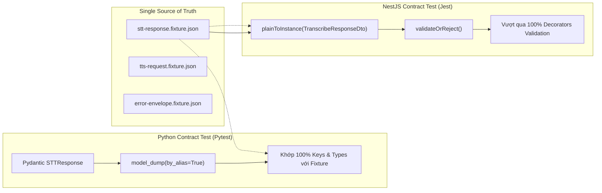

# TASK 1.4: INTER-SERVICE WIRE CONTRACT SPECIFICATION & AUTOMATED SCHEMA DRIFT TESTS

> **Trạng thái**: Approved / Production Specification  
> **Cấp độ**: Deep Technical Specification (API Contract, Serialization & Quality Assurance)  
> **Áp dụng cho**: `contracts/fixtures/`, Python `ai-service/tests/test_contracts.py`, NestJS `server/test/contracts/`  
> **Tài liệu cha**: [00_PHASE_1_OVERVIEW_AND_ARCHITECTURE.md](00_PHASE_1_OVERVIEW_AND_ARCHITECTURE.md)  
> **Phiên bản**: 2.0.0  

---

## 1. NGUYÊN TẮC ZERO SCHEMA DRIFT & QUY CHUẨN WIRE PROTOCOL

Trong kiến trúc **Polyglot Hybrid Architecture** (NestJS + Python), rủi ro lớn nhất là **Schema Drift** (độ lệch định dạng dữ liệu): một bên thay đổi tên trường hoặc kiểu dữ liệu mà bên kia không hay biết, dẫn đến runtime crash âm thầm trong quá trình xử lý phỏng vấn.

Để triệt tiêu $100\%$ rủi ro này, dự án thiết lập 4 nguyên tắc bất biến:
1. **Wire Payload 100% `camelCase`**: Mọi JSON request/response truyền qua mạng nội bộ Docker đều bắt buộc sử dụng định dạng `camelCase`.
   * **Phía Python**: Toàn bộ Pydantic models kế thừa từ `CamelModel` có cấu hình `alias_generator = to_camel` và `populate_by_name = True`.
   * **Phía NestJS**: Các TypeScript DTOs và Interfaces sử dụng trực tiếp các trường `camelCase`, hoàn toàn không cần mapper trung gian, bảo đảm Zero CPU Overhead.
2. **Strict Headers Validation**:
   * `x-internal-secret`: Chuỗi bí mật đối soát nội bộ bảo vệ các endpoint AI.
   * `x-request-id`: UUID định danh phiên request được sinh từ NestJS và truyền xuyên suốt qua Python để đối chiếu logs.
   * `X-Response-Time-Ms`: Header đo lường độ trễ mạng nội bộ được tính toán từ FastAPI middleware.
3. **Thư mục Fixture Chung (`contracts/fixtures/`)**: Đóng vai trò Single Source of Truth cho các payload mẫu chuẩn.
4. **Automated Dual-Runner Contract Tests**: Tích hợp kiểm thử tự động trên cả Pytest và Jest trong CI/CD.



---

## 2. PYDANTIC BASE CONFIGURATION PHÍA PYTHON (`schemas/base.py`)

Tệp `ai-service/app/schemas/base.py`:

```python
from pydantic import BaseModel, ConfigDict
from pydantic.alias_generators import to_camel


class CamelModel(BaseModel):
    """
    Model cơ sở cho toàn bộ Pydantic Schemas trong ai-service.
    Tự động chuyển đổi snake_case trong code Python sang camelCase trên Wire JSON.
    """
    model_config = ConfigDict(
        alias_generator=to_camel,
        populate_by_name=True,
        from_attributes=True,
        arbitrary_types_allowed=True,
    )
```

---

## 3. ĐẶC TẢ CHI TIẾT TỪNG ENDPOINT CONTRACT

### 3.1 Contract STT: `POST /api/v1/stt/transcribe`

* **Method**: `POST`
* **Path**: `/api/v1/stt/transcribe`
* **Content-Type**: `multipart/form-data`
* **Headers**:
  * `x-internal-secret`: `<string>` (Bắt buộc)
  * `x-request-id`: `<uuid>` (Bắt buộc)
* **Form-Data Fields**:
  * `file`: Binary file stream (MIME: `audio/webm`, `audio/wav`, `audio/mp4`, `audio/ogg`). Tối đa $25\text{MB}$.
  * `language`: `'vi'` | `'en'`. Mặc định: `'vi'`.
  * `vadFilter`: `'true'` | `'false'`. Mặc định: `'true'`.

#### Bảng Ánh xạ Kiểu Dữ liệu Response 200 OK:

| Wire Field (`camelCase`) | Python Type (Pydantic) | NestJS Type (TypeScript) | Mô tả Nghiệp vụ & Ý nghĩa |
| :--- | :--- | :--- | :--- |
| `text` | `str` | `string` | Văn bản đã chuẩn hóa ngữ âm. |
| `language` | `str` | `'vi' \| 'en'` | Ngôn ngữ nhận diện được. |
| `durationSeconds` | `float` | `number` | Tổng thời lượng âm thanh (giây). |
| `metrics.wpm` | `int` | `number` | Số từ trên phút tính trên thời gian nói thực tế. |
| `metrics.fillerWordCount` | `int` | `number` | Tổng số lượng từ đệm phát hiện được. |
| `metrics.fillerWords` | `List[str]` | `string[]` | Danh sách các từ đệm cụ thể đã nói. |
| `metrics.pauseCount` | `int` | `number` | Số lượng khoảng lặng ngập ngừng $> 1.2\text{s}$. |
| `metrics.totalPauseDurationSeconds` | `float` | `number` | Tổng thời gian ngập ngừng im lặng (giây). |
| `metrics.speechDurationSeconds` | `float` | `number` | Thời lượng phát âm thực tế (giây). |
| `metrics.confidenceScore` | `float` | `number` | Điểm tin cậy của mô hình ($0.0 \to 100.0$). |
| `words` *(Tùy chọn)* | `Optional[List[STTWordTimestamp]]` | `STTWordTimestamp[]?` | Chi tiết timestamp từng từ. |

#### Pydantic Schema: `app/schemas/stt.py`
```python
from typing import List, Optional
from pydantic import Field
from app.schemas.base import CamelModel


class VoiceMetrics(CamelModel):
    wpm: int = Field(ge=0, description="Words Per Minute tính trên thời gian nói thực tế")
    filler_word_count: int = Field(ge=0, description="Tổng số từ đệm")
    filler_words: List[str] = Field(default_factory=list, description="Danh sách từ đệm chi tiết")
    pause_count: int = Field(ge=0, description="Số lần ngập ngừng im lặng > 1.2s")
    total_pause_duration_seconds: float = Field(ge=0.0, description="Tổng thời gian ngập ngừng")
    speech_duration_seconds: float = Field(ge=0.0, description="Thời gian phát âm thực tế")
    confidence_score: float = Field(ge=0.0, le=100.0, description="Điểm tin cậy trung bình")


class STTWordTimestamp(CamelModel):
    word: str
    start: float
    end: float
    probability: float


class STTResponse(CamelModel):
    text: str
    language: str
    duration_seconds: float
    metrics: VoiceMetrics
    words: Optional[List[STTWordTimestamp]] = None
```

---

### 3.2 Contract TTS: `POST /api/v1/tts/synthesize`

* **Method**: `POST`
* **Path**: `/api/v1/tts/synthesize`
* **Content-Type**: `application/json`
* **Headers**:
  * `x-internal-secret`: `<string>` (Bắt buộc)
  * `x-request-id`: `<uuid>` (Bắt buộc)

#### Pydantic Schema: `app/schemas/tts.py`
```python
from typing import Optional
from pydantic import Field
from app.schemas.base import CamelModel


class TTSRequest(CamelModel):
    text: str = Field(min_length=1, max_length=1000, description="Nội dung văn bản cần đọc")
    language: str = Field(default="vi", description="'vi' cho Tiếng Việt, 'en' cho Tiếng Anh")
    voice: Optional[str] = Field(default=None, description="Tên voice tùy chọn (af_heart, vi-VN-HoaiMyNeural)")
    speed: Optional[float] = Field(default=1.0, ge=0.5, le=2.0, description="Tốc độ đọc từ 0.5 đến 2.0")
```

#### Phản hồi Thành công (Response 200 OK - Chunked Audio Stream)
* **Content-Type**: `audio/wav` (đối với Kokoro English) hoặc `audio/mpeg` (đối với EdgeTTS Vietnamese).
* **Transfer-Encoding**: `chunked`
* **Headers Kèm theo**:
  * `X-TTS-Engine`: `'kokoro'` | `'edge-tts'`
  * `X-Audio-Duration-Seconds`: Chuỗi số biểu thị thời lượng âm thanh ước tính.

---

### 3.3 Contract Liveness & Readiness: `/healthz` & `/ready`

#### 1. Liveness Probe: `GET /healthz`
* **Status**: `200 OK`
* **Content-Type**: `application/json`
* **Body**: `{"status": "ok"}`

#### 2. Readiness Probe: `GET /ready`
* **Status**: `200 OK` (Sẵn sàng nhận request) hoặc `503 Service Unavailable` (Mô hình đang nạp).
* **Body Schema (Pydantic `ReadyResponse`)**:
```json
{
  "status": "ready",
  "device": "cuda:0",
  "vramAllocatedMb": 1420.5,
  "models": {
    "whisper": "loaded",
    "kokoro": "loaded",
    "edgeTts": "ready"
  }
}
```

---

## 4. BẢNG ÁNH XẠ TOÀN DIỆN MÃ LỖI (STANDARD ERROR ENVELOPE)

Khi xảy ra lỗi (HTTP 4xx / 5xx), Python `ai-service` bắt buộc trả về payload có cấu trúc chuẩn sau:

```json
{
  "success": false,
  "errorCode": "AUDIO_CORRUPTED",
  "message": "Không thể giải mã dữ liệu âm thanh WebM/Opus trong RAM",
  "details": {
    "decoderError": "Invalid data found when processing input"
  }
}
```

### Bảng Đối soát Mã lỗi Giữa Hai Nền tảng:

| HTTP Status | Python `errorCode` | NestJS `ErrorCode` Enum | Hành vi Hệ thống & Xử lý Nghiệp vụ |
| :---: | :--- | :--- | :--- |
| **400** | `AUDIO_EMPTY` | `ErrorCode.INVALID_INPUT` | Audio 0 bytes. Client hiển thị thông báo ghi âm lại. |
| **400** | `AUDIO_CORRUPTED` | `ErrorCode.INVALID_INPUT` | File lỗi cấu trúc. Yêu cầu ứng viên ghi âm lại. |
| **400** | `AUDIO_NO_STREAM` | `ErrorCode.INVALID_INPUT` | File không có kênh âm thanh. |
| **400** | `NO_SPEECH_DETECTED` | `ErrorCode.INVALID_INPUT` | VAD lọc sạch vì chỉ có tạp âm. Báo ứng viên nói to hơn. |
| **401** | `INVALID_INTERNAL_SECRET` | `ErrorCode.UNAUTHORIZED` | Header secret không khớp. Ghi log cảnh báo bảo mật. |
| **413** | `AUDIO_TOO_LARGE` | `ErrorCode.PAYLOAD_TOO_LARGE` | File vượt quá $25\text{MB}$. |
| **413** | `TEXT_TOO_LONG` | `ErrorCode.PAYLOAD_TOO_LARGE` | Văn bản TTS dài quá 1.000 ký tự. |
| **422** | `EMPTY_TEXT_SYNTHESIS` | `ErrorCode.VALIDATION_ERROR` | Text TTS rỗng. |
| **500** | `INTERNAL_SERVER_ERROR` | `ErrorCode.AI_SERVICE_ERROR` | Lỗi CTranslate2/PyAV. Kích hoạt fallback OpenAI. |
| **502** | `TTS_UPSTREAM_ERROR` | `ErrorCode.SERVICE_UNAVAILABLE` | Lỗi kết nối EdgeTTS. Fallback sang Web Speech API. |
| **503** | `SERVICE_WARMING_UP` | `ErrorCode.SERVICE_UNAVAILABLE` | Mô hình chưa load xong. Retry hoặc Fallback. |
| **504** | `STT_TIMEOUT` | `ErrorCode.AI_TIMEOUT` | Xử lý vượt ngưỡng $8.000\text{ms}$. Hủy & Fallback. |

---

## 5. THƯ MỤC SHARED JSON FIXTURES (`contracts/fixtures/`)

### Fixture STT Response Mẫu: `contracts/fixtures/stt-response.fixture.json`
```json
{
  "text": "Tôi có 3 năm kinh nghiệm làm việc với kiến trúc microservices và Docker.",
  "language": "vi",
  "durationSeconds": 35.8,
  "metrics": {
    "wpm": 134,
    "fillerWordCount": 2,
    "fillerWords": ["ừm", "kiểu như"],
    "pauseCount": 1,
    "totalPauseDurationSeconds": 1.8,
    "speechDurationSeconds": 34.0,
    "confidenceScore": 96.4
  },
  "words": [
    {
      "word": "Tôi",
      "start": 0.42,
      "end": 0.68,
      "probability": 0.99
    },
    {
      "word": "có",
      "start": 0.70,
      "end": 0.88,
      "probability": 0.98
    }
  ]
}
```

### Fixture Error Envelope Mẫu: `contracts/fixtures/error-envelope.fixture.json`
```json
{
  "success": false,
  "errorCode": "AUDIO_CORRUPTED",
  "message": "Không thể giải mã dữ liệu âm thanh WebM/Opus trong RAM",
  "details": {
    "mimeType": "audio/webm",
    "decoderError": "Invalid data found when processing input"
  }
}
```

---

## 6. BỘ KIỂM THỬ HỢP ĐỒNG TỰ ĐỘNG (DUAL CONTRACT TESTS)

### 6.1 Phía Python: `ai-service/tests/test_contracts.py` (Pytest)

```python
import json
from pathlib import Path
from app.schemas.stt import STTResponse, VoiceMetrics, STTWordTimestamp
from app.schemas.tts import TTSRequest


def test_stt_response_conforms_to_fixture_keys_and_types():
    fixture_path = Path(__file__).parents[2] / "contracts" / "fixtures" / "stt-response.fixture.json"
    with open(fixture_path, "r", encoding="utf-8") as f:
        fixture_data = json.load(f)

    # 1. Khởi tạo instance từ schema Pydantic
    instance = STTResponse(
        text=fixture_data["text"],
        language=fixture_data["language"],
        duration_seconds=fixture_data["durationSeconds"],
        metrics=VoiceMetrics(**fixture_data["metrics"]),
        words=[STTWordTimestamp(**w) for w in fixture_data["words"]],
    )

    # 2. Xuất dữ liệu qua model_dump với by_alias=True
    dumped = instance.model_dump(by_alias=True)

    # 3. Đối chiếu 100% các keys trên wire payload
    assert dumped["text"] == fixture_data["text"]
    assert dumped["durationSeconds"] == fixture_data["durationSeconds"]
    assert dumped["metrics"]["wpm"] == fixture_data["metrics"]["wpm"]
    assert dumped["metrics"]["totalPauseDurationSeconds"] == fixture_data["metrics"]["totalPauseDurationSeconds"]
    assert dumped["words"][0]["word"] == fixture_data["words"][0]["word"]
```

### 6.2 Phía NestJS: `server/test/contracts/python-stt.contract.spec.ts` (Jest)

```typescript
import * as fs from 'fs';
import * as path from 'path';
import { plainToInstance } from 'class-transformer';
import { validateOrReject } from 'class-validator';
import { TranscribeResponseDto } from '../../src/modules/media/dto/transcribe-response.dto';

describe('Python STT Wire Contract Conformance Test', () => {
  it('should successfully deserialize and validate stt-response.fixture.json without schema drift', async () => {
    const fixturePath = path.resolve(
      __dirname,
      '../../../../contracts/fixtures/stt-response.fixture.json',
    );
    const rawFixture = JSON.parse(fs.readFileSync(fixturePath, 'utf8'));

    // Chuyển đổi JSON thuần sang TypeScript DTO instance
    const dtoInstance = plainToInstance(TranscribeResponseDto, rawFixture);

    // Xác thực decorators (class-validator) không ném lỗi
    await expect(validateOrReject(dtoInstance)).resolves.not.toThrow();

    // Đối chiếu tính chính xác của dữ liệu
    expect(dtoInstance.text).toBe(rawFixture.text);
    expect(dtoInstance.durationSeconds).toBe(rawFixture.durationSeconds);
    expect(dtoInstance.metrics.wpm).toBe(rawFixture.metrics.wpm);
    expect(dtoInstance.metrics.pauseCount).toBe(rawFixture.metrics.pauseCount);
    expect(dtoInstance.metrics.fillerWords).toEqual(rawFixture.metrics.fillerWords);
  });
});
```

---

## 7. TASK EXECUTION CONTRACT

### 7.1 Prerequisites (Tiền đề bắt buộc)
- [ ] Hoàn thành **Task 1.2** (STT Pipeline) và **Task 1.3** (TTS Pipeline).
- [ ] Tạo thư mục dùng chung `contracts/fixtures/` tại root repository.
- [ ] Đã cài đặt `class-validator`, `class-transformer` phía NestJS và `pytest` phía Python.

### 7.2 Target Deliverables (Sản phẩm mã nguồn đầu ra)
- [ ] `contracts/fixtures/stt-response.fixture.json`: Golden JSON response cho STT transcribe.
- [ ] `contracts/fixtures/tts-request.fixture.json`: Golden JSON request cho TTS synthesize.
- [ ] `contracts/fixtures/error-envelope.fixture.json`: Golden JSON response cho Standard Error Envelope.
- [ ] `ai-service/app/schemas/base.py`: Lớp cơ sở `CamelModel` đảm bảo `model_dump(by_alias=True)`.
- [ ] `ai-service/tests/contract/test_contracts.py`: Pytest contract suite kiểm tra Pydantic model serialization.
- [ ] `server/test/contracts/python-stt.contract.spec.ts`: Jest contract suite kiểm tra NestJS DTO deserialization & validation.

### 7.3 Verification Command (Lệnh kiểm thử & Xác thực tự động)
```bash
# Tier 1 (NestJS Jest Contract Verification)
cd server && npm run test -- test/contracts/python-stt.contract.spec.ts

# Tier 1 (Python Pytest Contract Verification)
cd ai-service && uv run pytest tests/contract/test_contracts.py -v
```

### 7.4 Definition of Done (DoD)
- [ ] 100% thuộc tính trường trên wire JSON đều là `camelCase`.
- [ ] Cả hai bộ kiểm thử Jest và Pytest đều pass độc lập (Tier 1) bằng cách đọc file fixture trực tiếp, không phụ thuộc vào container đang chạy.
- [ ] Không có bất kỳ cảnh báo deprecation hay validation warning nào từ `class-validator` hoặc Pydantic v2.
- [ ] Xác nhận Schema Drift bằng 0 giữa hai nền tảng.

### 7.5 Next Task Transition (Bước chuyển tiếp)
- Tiếp tục sang **Task 1.5: NestJS Integration & Two-Step Flow**: [05_NESTJS_INTEGRATION_AND_TWO_STEP_FLOW.md](05_NESTJS_INTEGRATION_AND_TWO_STEP_FLOW.md) để tích hợp MediaFacade, AIGatewayDispatcher và luồng Two-Step Voice Flow.

