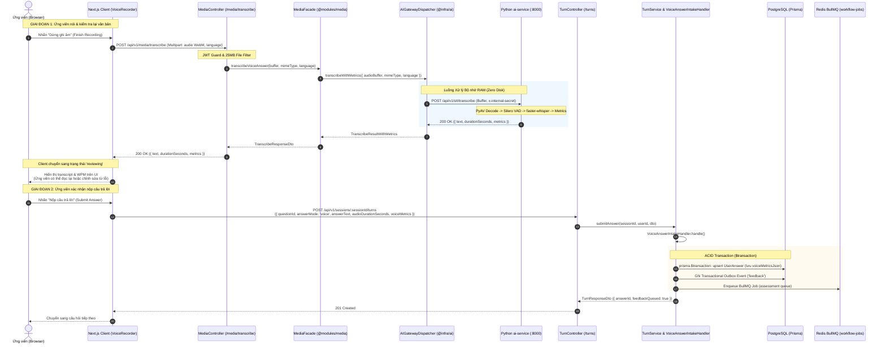

# TASK 1.5: NESTJS CORE INTEGRATION, TWO-STEP VOICE INTAKE & STRICT PROVIDER TOGGLE

> [!NOTE]
> **TRẠNG THÁI: HOÀN THÀNH (COMPLETED)**  
> Task này đã hoàn thành và nghiệm thu. Tài liệu kỹ thuật chính thức hiện được duy trì tại:  
> 📖 [docs/architecture/audio-engine/nestjs-integration-flow.md](../../architecture/audio-engine/nestjs-integration-flow.md)

> **Trạng thái**: Completed / Archived Historical Specification  
> **Cấp độ**: Deep Technical Specification (Full-Stack Backend Integration, Clean Architecture & Resilience)  
> **Áp dụng cho**: `server/src/modules/media/`, `server/src/modules/interview-live/turn/`, `server/src/infrastructure/ai/`  
> **Tài liệu cha**: [00_PHASE_1_OVERVIEW_AND_ARCHITECTURE.md](00_PHASE_1_OVERVIEW_AND_ARCHITECTURE.md)  
> **Phiên bản**: 2.0.0  


---

## 1. MỤC TIÊU KỸ THUẬT & QUY TẮC CLEAN ARCHITECTURE

Để bảo đảm hệ thống backend phát triển bền vững theo chuẩn Clean Architecture và các quy tắc kiến trúc nghiêm ngặt trong `server/CONVENTIONS.md`:
1. **Cô lập Presentation Layer**: `MediaController` chỉ nhận file nhị phân, kiểm tra MIME type và ủy quyền xử lý trực tiếp cho `MediaFacade`. Tuyệt đối không import database hay SDK bên thứ ba trong controller.
2. **Giao tiếp Xuyên Module qua Facade Contract**: Module `interview-live` (`TurnController`, `VoiceAnswerIntakeHandler`) **không phụ thuộc trực tiếp vào AI Gateway hay Python Service**, mà nhận dữ liệu đã được xác thực qua DTO và gọi qua `MediaFacade`.
3. **Mô hình Two-Step Voice Intake**: Phân tách rõ ràng giữa 2 bước:
   * **Bước 1 (Transcribe & Review)**: Ứng viên ghi âm, nhận transcript và chỉ số giọng nói sơ bộ trên UI để kiểm tra, sửa từ sai.
   * **Bước 2 (Submit Turn)**: Ứng viên chính thức nộp câu trả lời kèm chỉ số âm học đã xác nhận.
4. **Strict Feature Flag & Circuit Breaker**: Quản trị rủi ro thông qua `AIGatewayDispatcher` cho phép chuyển mạch tức thời sang OpenAI Whisper Cloud hoặc Web Speech API mà không cần redeploy code.
5. **Đảm bảo Tính Toàn vẹn Dữ liệu (ACID Transaction)**: Toàn bộ quá trình lưu câu trả lời, chỉ số giọng nói (`voiceMetricsJson`) và phát sinh Outbox event chấm điểm được bọc kín trong `prisma.$transaction`.

---

## 2. SƠ ĐỒ TUẦN TỰ HOÀN CHỈNH (END-TO-END TWO-STEP VOICE FLOW)



---

## 3. MỞ RỘNG MEDIA MODULE TRONG NESTJS CORE

### 3.1 Hợp đồng DTO: `server/src/modules/media/dto/transcribe-response.dto.ts`

```typescript
import { ApiProperty, ApiPropertyOptional } from '@nestjs/swagger';
import { Type } from 'class-transformer';
import {
  IsString,
  IsNumber,
  IsArray,
  ValidateNested,
  IsOptional,
  Min,
  Max,
} from 'class-validator';

export class VoiceMetricsDto {
  @ApiProperty({ description: 'Words Per Minute trên thời gian nói thực tế' })
  @IsNumber()
  @Min(0)
  wpm: number;

  @ApiProperty({ description: 'Tổng số từ đệm phát hiện' })
  @IsNumber()
  @Min(0)
  fillerWordCount: number;

  @ApiProperty({ description: 'Danh sách từ đệm cụ thể' })
  @IsArray()
  @IsString({ each: true })
  fillerWords: string[];

  @ApiProperty({ description: 'Số lần ngập ngừng > 1.2s' })
  @IsNumber()
  @Min(0)
  pauseCount: number;

  @ApiProperty({ description: 'Tổng thời gian ngập ngừng (giây)' })
  @IsNumber()
  @Min(0)
  totalPauseDurationSeconds: number;

  @ApiProperty({ description: 'Thời gian phát âm thực tế (giây)' })
  @IsNumber()
  @Min(0)
  speechDurationSeconds: number;

  @ApiProperty({ description: 'Độ tin cậy của mô hình STT (0 - 100)' })
  @IsNumber()
  @Min(0)
  @Max(100)
  confidenceScore: number;
}

export class TranscribeResponseDto {
  @ApiProperty({ description: 'Văn bản chuyển hóa từ giọng nói' })
  @IsString()
  text: string;

  @ApiProperty({ description: 'Ngôn ngữ nhận diện', example: 'vi' })
  @IsString()
  language: string;

  @ApiProperty({ description: 'Tổng thời lượng âm thanh (giây)' })
  @IsNumber()
  @Min(0)
  durationSeconds: number;

  @ApiProperty({ type: VoiceMetricsDto })
  @ValidateNested()
  @Type(() => VoiceMetricsDto)
  metrics: VoiceMetricsDto;

  @ApiPropertyOptional({ description: 'Chi tiết timestamp từng từ' })
  @IsOptional()
  @IsArray()
  words?: any[];
}
```

---

### 3.2 Controller: `server/src/modules/media/media.controller.ts`

```typescript
import {
  Controller,
  Post,
  UploadedFile,
  UseInterceptors,
  Body,
  HttpStatus,
  HttpCode,
} from '@nestjs/common';
import { FileInterceptor } from '@nestjs/platform-express';
import { ApiTags, ApiOperation, ApiConsumes, ApiBearerAuth } from '@nestjs/swagger';
import { MediaFacade } from './contracts';
import { TranscribeAudioDto } from './dto/transcribe-audio.dto';
import { TranscribeResponseDto } from './dto/transcribe-response.dto';
import { InterviewAIException } from '@core/common/exceptions/interview-ai.exception';
import { ErrorCode } from '@core/common/exceptions/error-code.enum';

const MAX_AUDIO_SIZE_BYTES = 25 * 1024 * 1024; // Giới hạn 25MB
const ALLOWED_MIME_TYPES = [
  'audio/webm',
  'audio/wav',
  'audio/mp4',
  'audio/mpeg',
  'audio/ogg',
];

@ApiTags('Media')
@ApiBearerAuth()
@Controller('media')
export class MediaController {
  constructor(private readonly mediaFacade: MediaFacade) {}

  @Post('transcribe')
  @HttpCode(HttpStatus.OK)
  @ApiOperation({ summary: 'Chuyển đổi âm thanh thành văn bản & trích xuất metrics in-memory' })
  @ApiConsumes('multipart/form-data')
  @UseInterceptors(
    FileInterceptor('file', {
      limits: { fileSize: MAX_AUDIO_SIZE_BYTES },
      fileFilter: (_req, file, cb) => {
        if (ALLOWED_MIME_TYPES.includes(file.mimetype)) {
          cb(null, true);
        } else {
          cb(
            new InterviewAIException(
              ErrorCode.INVALID_INPUT,
              HttpStatus.BAD_REQUEST,
              `Định dạng file không được hỗ trợ: ${file.mimetype}`,
            ),
            false,
          );
        }
      },
    }),
  )
  async transcribe(
    @UploadedFile() file: Express.Multer.File,
    @Body() dto: TranscribeAudioDto,
  ): Promise<TranscribeResponseDto> {
    if (!file || !file.buffer || file.buffer.length === 0) {
      throw new InterviewAIException(
        ErrorCode.INVALID_INPUT,
        HttpStatus.BAD_REQUEST,
        'File âm thanh tải lên rỗng (0 bytes)',
      );
    }

    return this.mediaFacade.transcribeVoiceAnswer(
      file.buffer,
      file.mimetype,
      dto.language || 'vi',
    );
  }
}
```

---

### 3.3 Mở rộng `MediaFacade`: `server/src/modules/media/contracts/media-facade.service.ts`

```typescript
import { Injectable, Inject } from '@nestjs/common';
import { VoiceMetricsService, type VoiceMetrics } from '../voice-metrics.service';
import { TranscribeResponseDto } from '../dto/transcribe-response.dto';
import { IAIGateway } from '@infra/ai/contracts/ai-gateway.interface';
import { AI_GATEWAY_TOKEN } from '@infra/ai/contracts/ai-gateway.constants';

@Injectable()
export class MediaFacade {
  constructor(
    private readonly voiceMetricsService: VoiceMetricsService,
    @Inject(AI_GATEWAY_TOKEN)
    private readonly aiGateway: IAIGateway,
  ) {}

  /**
   * Tính toán voice metrics dự phòng bằng Regex (khi client dùng Web Speech API).
   * Đảm bảo 100% tương thích ngược với luồng hiện tại.
   */
  calculateVoiceMetrics(text: string, durationSeconds: number): VoiceMetrics {
    return this.voiceMetricsService.calculate(text, durationSeconds);
  }

  /**
   * Ủy quyền xử lý STT và bóc tách metrics chuyên sâu qua AI Gateway.
   */
  async transcribeVoiceAnswer(
    buffer: Buffer,
    mimeType: string,
    language: 'vi' | 'en' = 'vi',
  ): Promise<TranscribeResponseDto> {
    return this.aiGateway.transcribeWithMetrics({
      audioBuffer: buffer,
      mimeType,
      language,
    });
  }
}
```

---

## 4. NÂNG CẤP TURN MODULE & VOICE INTAKE HANDLER

### 4.1 Cập nhật `SubmitAnswerDto`: `server/src/modules/interview-live/turn/dto/submit-answer.dto.ts`

```typescript
import { ApiProperty, ApiPropertyOptional } from '@nestjs/swagger';
import {
  IsString,
  IsEnum,
  IsOptional,
  IsBoolean,
  IsInt,
  Min,
  MinLength,
  ValidateIf,
} from 'class-validator';

export class SubmitAnswerDto {
  @ApiProperty({ format: 'uuid', description: 'ID câu hỏi phiên phỏng vấn' })
  @IsString()
  questionId: string;

  @ApiProperty({ enum: ['text', 'voice'] })
  @IsEnum(['text', 'voice'])
  answerMode: 'text' | 'voice';

  @ApiPropertyOptional({ minLength: 10 })
  @ValidateIf((o: SubmitAnswerDto) => !o.skipQuestion)
  @IsString()
  @MinLength(10)
  answerText?: string;

  @ApiPropertyOptional({ default: false })
  @IsOptional()
  @IsBoolean()
  skipQuestion?: boolean;

  @ApiPropertyOptional({ minimum: 0, description: 'Thời lượng âm thanh (giây)' })
  @IsOptional()
  @IsInt()
  @Min(0)
  audioDurationSeconds?: number;

  @ApiPropertyOptional({ description: 'Voice metrics đã trích xuất từ bước Transcribe' })
  @IsOptional()
  voiceMetrics?: Record<string, any>;
}
```

---

### 4.2 Xử lý Trong `VoiceAnswerIntakeHandler`

Trong `server/src/modules/interview-live/turn/handlers/voice-answer-intake.handler.ts`:

```typescript
// Trích đoạn logic xử lý lưu trữ chỉ số âm học
let finalVoiceMetrics: Record<string, any>;

if (dto.voiceMetrics && Object.keys(dto.voiceMetrics).length > 0) {
  // Ưu tiên 1: Lấy metrics độ chính xác cao đã được bóc tách từ Python STT ở Bước 1
  finalVoiceMetrics = dto.voiceMetrics;
} else if (dto.answerText && dto.audioDurationSeconds) {
  // Ưu tiên 2 (Fallback): Tính toán qua regex nếu ứng viên dùng Web Speech API
  finalVoiceMetrics = this.mediaFacade.calculateVoiceMetrics(
    dto.answerText,
    dto.audioDurationSeconds,
  );
} else {
  finalVoiceMetrics = {};
}

// Lưu trong Transaction ACID của PostgreSQL
await this.prisma.$transaction(async (tx) => {
  await tx.userAnswer.upsert({
    where: { questionId: dto.questionId },
    update: {
      answerMode: dto.answerMode,
      answerText: dto.answerText || '',
      audioDurationSeconds: dto.audioDurationSeconds || 0,
      skipped: dto.skipQuestion || false,
      voiceMetricsJson: finalVoiceMetrics,
    },
    create: {
      questionId: dto.questionId,
      answerMode: dto.answerMode,
      answerText: dto.answerText || '',
      audioDurationSeconds: dto.audioDurationSeconds || 0,
      skipped: dto.skipQuestion || false,
      voiceMetricsJson: finalVoiceMetrics,
    },
  });

  // Ghi Transactional Outbox Event cho tác vụ đánh giá tiếp theo...
});
```

---

## 5. ĐIỀU PHỐI AI GATEWAY: `AIGatewayDispatcher` & `PythonAIGateway`

### 5.1 Python Client: `server/src/infrastructure/ai/clients/python-ai.client.ts`

```typescript
import { Injectable, HttpStatus } from '@nestjs/common';
import { HttpService } from '@nestjs/axios';
import { ConfigService } from '@nestjs/config';
import { firstValueFrom } from 'rxjs';
import * as FormData from 'form-data';
import { InterviewAIException } from '@core/common/exceptions/interview-ai.exception';
import { ErrorCode } from '@core/common/exceptions/error-code.enum';
import { TranscribeResponseDto } from '@modules/media/dto/transcribe-response.dto';

@Injectable()
export class PythonAIGateway {
  private readonly baseUrl: string;
  private readonly secret: string;

  constructor(
    private readonly httpService: HttpService,
    private readonly configService: ConfigService,
  ) {
    this.baseUrl = this.configService.get<string>('AI_SERVICE_URL', 'http://localhost:8000');
    this.secret = this.configService.get<string>('INTERNAL_AI_SECRET', '');
  }

  async transcribeWithMetrics(params: {
    audioBuffer: Buffer;
    mimeType: string;
    language?: 'vi' | 'en';
  }): Promise<TranscribeResponseDto> {
    const formData = new FormData();
    formData.append('file', params.audioBuffer, {
      filename: 'audio.webm',
      contentType: params.mimeType,
    });
    formData.append('language', params.language || 'vi');
    formData.append('vadFilter', 'true');

    try {
      const response = await firstValueFrom(
        this.httpService.post<TranscribeResponseDto>(
          `${this.baseUrl}/api/v1/stt/transcribe`,
          formData,
          {
            headers: {
              ...formData.getHeaders(),
              'x-internal-secret': this.secret,
              'x-request-id': 'req-nest-' + Date.now(),
            },
            timeout: 8000, // Timeout 8s
          },
        ),
      );

      return response.data;
    } catch (error: any) {
      const status = error.response?.status || HttpStatus.INTERNAL_SERVER_ERROR;
      const errorData = error.response?.data;

      throw new InterviewAIException(
        errorData?.errorCode || ErrorCode.AI_SERVICE_ERROR,
        status,
        errorData?.message || 'Lỗi khi gọi sang Python AI Service',
      );
    }
  }
}
```

---

### 5.2 Bộ Điều phối `AIGatewayDispatcher` (Feature Flag Router)

```typescript
import { Injectable, Logger } from '@nestjs/common';
import { ConfigService } from '@nestjs/config';
import { IAIGateway, TranscribeParams } from '../contracts/ai-gateway.interface';
import { PythonAIGateway } from './clients/python-ai.client';
import { OpenAIGateway } from './clients/openai.client';
import { VoiceMetricsService } from '@modules/media/voice-metrics.service';
import { TranscribeResponseDto } from '@modules/media/dto/transcribe-response.dto';

@Injectable()
export class AIGatewayDispatcher implements IAIGateway {
  private readonly logger = new Logger(AIGatewayDispatcher.name);

  constructor(
    private readonly configService: ConfigService,
    private readonly pythonGateway: PythonAIGateway,
    private readonly openAIGateway: OpenAIGateway,
    private readonly voiceMetricsService: VoiceMetricsService,
  ) {}

  async transcribeWithMetrics(params: TranscribeParams): Promise<TranscribeResponseDto> {
    const provider = this.configService.get<string>('AI_STT_PROVIDER', 'python');
    const fallbackEnabled = this.configService.get<boolean>('AI_FALLBACK_ENABLED', true);

    if (provider === 'python') {
      try {
        return await this.pythonGateway.transcribeWithMetrics(params);
      } catch (err: any) {
        this.logger.warn(`Python STT failed: ${err.message}. FallbackEnabled: ${fallbackEnabled}`);
        if (!fallbackEnabled) throw err;

        // Fallback tự động sang OpenAI Whisper Cloud
        return this.fallbackToOpenAI(params);
      }
    }

    return this.fallbackToOpenAI(params);
  }

  private async fallbackToOpenAI(params: TranscribeParams): Promise<TranscribeResponseDto> {
    this.logger.log('Executing OpenAI Whisper Fallback');
    const text = await this.openAIGateway.transcribe(params.audioBuffer, params.language);
    
    // Bù đắp Voice Metrics bằng Regex Service
    const estimatedDuration = 30; // Giả lập hoặc ước lượng
    const metrics = this.voiceMetricsService.calculate(text, estimatedDuration);

    return {
      text,
      language: params.language || 'vi',
      durationSeconds: estimatedDuration,
      metrics: {
        wpm: metrics.wpm,
        fillerWordCount: metrics.fillerWordCount,
        fillerWords: metrics.fillerWords,
        pauseCount: metrics.pauseCount,
        totalPauseDurationSeconds: metrics.pauseDurationSeconds,
        speechDurationSeconds: estimatedDuration - metrics.pauseDurationSeconds,
        confidenceScore: 85.0,
      },
    };
  }

  // Các phương thức LLM (chatCompletion, generateStructured) ủy quyền 100% sang OpenAIGateway trong Phase 1
  chatCompletion(params: any): Promise<any> {
    return this.openAIGateway.chatCompletion(params);
  }
}
```

---

## 6. KIỂM THỬ ĐƠN VỊ TÍCH HỢP (INTEGRATION TESTS)

### `server/src/modules/media/media.controller.spec.ts`

```typescript
import { Test, TestingModule } from '@nestjs/testing';
import { MediaController } from './media.controller';
import { MediaFacade } from './contracts';

describe('MediaController', () => {
  let controller: MediaController;
  let facade: jest.Mocked<MediaFacade>;

  beforeEach(async () => {
    const mockFacade = {
      transcribeVoiceAnswer: jest.fn(),
      calculateVoiceMetrics: jest.fn(),
    };

    const module: TestingModule = await Test.createTestingModule({
      controllers: [MediaController],
      providers: [{ provide: MediaFacade, useValue: mockFacade }],
    }).compile();

    controller = module.get<MediaController>(MediaController);
    facade = module.get(MediaFacade);
  });

  it('should successfully delegate valid buffer to MediaFacade', async () => {
    const mockFile: Express.Multer.File = {
      buffer: Buffer.from('fake-audio-bytes'),
      mimetype: 'audio/webm',
      fieldname: 'file',
      originalname: 'audio.webm',
      encoding: '7bit',
      size: 16,
      stream: null as any,
      destination: '',
      filename: '',
      path: '',
    };

    facade.transcribeVoiceAnswer.mockResolvedValueOnce({
      text: 'Test transcript',
      language: 'vi',
      durationSeconds: 10,
      metrics: {
        wpm: 120,
        fillerWordCount: 0,
        fillerWords: [],
        pauseCount: 0,
        totalPauseDurationSeconds: 0,
        speechDurationSeconds: 10,
        confidenceScore: 98,
      },
    });

    const result = await controller.transcribe(mockFile, { language: 'vi' });
    expect(result.text).toBe('Test transcript');
    expect(facade.transcribeVoiceAnswer).toHaveBeenCalledTimes(1);
  });
});
```

---

## 7. TASK EXECUTION CONTRACT

### 7.1 Prerequisites (Tiền đề bắt buộc)
- [ ] Hoàn thành **Task 1.4**: Toàn bộ Contract Tests giữa NestJS và Python đã pass trên shared fixtures.
- [ ] Python AI Microservice có thể chạy cục bộ trên port 8000 (hoặc qua mock Axios trong unit test).
- [ ] Đã có bảng `user_answers` với cột `voice_metrics_json` trong PostgreSQL database.

### 7.2 Target Deliverables (Sản phẩm mã nguồn đầu ra)
- [ ] `server/src/modules/media/media.controller.ts`: Controller nhận file upload, validation MIME type, ủy quyền hoàn toàn cho `MediaFacade`.
- [ ] `server/src/modules/media/contracts/media-facade.service.ts`: Mở rộng phương thức `transcribeAudio(buffer, mimeType, language)` và `synthesizeSpeech()`.
- [ ] `server/src/infrastructure/ai/python-ai.gateway.ts`: Implementation gọi HTTP client sang Python `ai-service` với timeout và secret header.
- [ ] `server/src/infrastructure/ai/ai-gateway-dispatcher.service.ts`: Dispatcher định tuyến theo `AI_STT_PROVIDER=python|openai`.
- [ ] `server/src/modules/interview-live/turn/voice-answer-intake.handler.ts`: Bọc `prisma.$transaction` lưu câu trả lời, `voiceMetricsJson` và outbox job.
- [ ] `client/components/interview/VoiceRecorder.tsx`: Nâng cấp giao diện Two-Step Voice Flow (Transcribe $\to$ Review/Edit $\to$ Submit Turn).

### 7.3 Architectural Rules Enforced (Tuân thủ AGENTS.md)
- [x] **Backend Rule 1**: Giao tiếp liên module thông qua `@modules/media/contracts/MediaFacade`.
- [x] **Backend Rule 2**: `MediaController` không bao giờ import Prisma, BullMQ hay vendor SDKs.
- [x] **Backend Rule 3**: Ném ngoại lệ tập trung qua `InterviewAIException(ErrorCode.XYZ, HttpStatus.XYZ)`.
- [x] **Backend Rule 5**: Thao tác ghi DB nhiều bảng được bọc trong `prisma.$transaction`.
- [x] **Frontend Rules**: `VoiceRecorder.tsx` sử dụng tokenized props, CVA, và không hardcode arbitrary brackets.

### 7.4 Verification Command (Lệnh kiểm thử & Xác thực tự động)
```bash
# Tier 1 (NestJS Media Controller & Facade Unit Test)
cd server && npm run test -- src/modules/media/media.controller.spec.ts

# Tier 2 (Live E2E Two-Step Flow Test)
# Khởi động stack và chạy kiểm thử tích hợp
cd server && npm run test:e2e -- test/e2e/two-step-voice-flow.e2e-spec.ts
```

### 7.5 Definition of Done (DoD)
- [ ] **Quality Gate 1 Approved 100%**.
- [ ] Ứng viên tải audio lên `POST /api/v1/media/transcribe` nhận về transcript và metrics trong $< 1.5\text{s}$.
- [ ] Đổi biến môi trường `AI_STT_PROVIDER=openai`, hệ thống chuyển hướng tự động sang OpenAI Whisper API không cần sửa code.
- [ ] Bảng `user_answers` lưu trọn vẹn `voiceMetricsJson` (WPM, pause count, filler words) sau khi ứng viên bấm submit turn.

### 7.6 Next Task Transition (Bước chuyển tiếp)
- **HOÀN THÀNH PHASE 1 (PILOT AUDIO ENGINE)**.
- Bàn giao sang **Phase 2 (PostgreSQL pgvector & Hybrid RAG)**: Bắt đầu tại [01_PGVECTOR_SCHEMA_AND_MIGRATION.md](../02_PHASE_2_PGVECTOR_HYBRID_RAG/01_PGVECTOR_SCHEMA_AND_MIGRATION.md).

