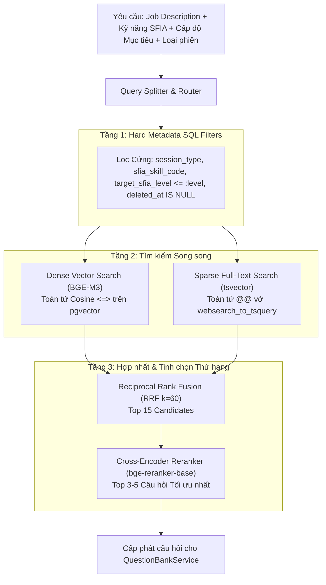

# TÀI LIỆU TỔNG QUAN: PHASE 2 — NỀN TẢNG POSTGRESQL PGVECTOR & DOMAIN-AWARE HYBRID RAG
# (MASTER OVERVIEW, ROADMAP & DETAILED TASK BREAKDOWN)

> **Trạng thái**: Approved / Production Specification  
> **Cấp độ**: Production Specification (System Architect / Lead Engineer)  
> **Áp dụng cho**: PostgreSQL 16 `pgvector`, `ai-service/app/services/rag/`, `server/src/modules/interview-prep/`  
> **Tài liệu tham chiếu**: [00_OVERVIEW_STRATEGIC_BLUEPRINT.md](../00_OVERVIEW_STRATEGIC_BLUEPRINT.md)  
> **Phiên bản**: 2.1.0 (Chuẩn hóa toàn diện chuỗi thực thi tuần tự & Thuật ngữ tiếng Anh kỹ thuật)  

---

## 1. TỔNG QUAN KIẾN TRÚC PHASE 2

Phase 2 giải quyết bài toán cốt lõi: **Tìm kiếm và cấp phát câu hỏi phỏng vấn chuẩn xác theo cả chiều sâu kỹ thuật lẫn cấp độ năng lực SFIA 9 & O\*NET 29.x**.

Thay vì dựa vào Vector Search thuần túy (Naive RAG) dễ bị mất từ khóa và lệch cấp độ, Phase 2 xây dựng hệ thống **Domain-Aware Hybrid RAG 3 Lớp**:

$$\mathbf{Hybrid\ RAG} = \mathbf{Dense\ Semantic\ (BGE-M3)} + \mathbf{Sparse\ Keyword\ (tsvector)} + \mathbf{Metadata\ Filter\ (SFIA/O*NET/Type)} \rightarrow \mathbf{RRF} \rightarrow \mathbf{Reranker}$$



---

## 2. DANH MỤC CÁC TÀI LIỆU CHUYÊN SÂU TỪNG TASK (TASK BREAKDOWN)

Phase 2 được phân rã thành 5 nhiệm vụ kỹ thuật độc lập với tài liệu đặc tả thực thi riêng biệt:

| Thứ tự | Tệp Tài liệu Đặc tả | Trọng tâm Kỹ thuật & Phạm vi Triển khai |
| :---: | :--- | :--- |
| **Task 2.1** | [01_PGVECTOR_SCHEMA_AND_MIGRATION.md](01_PGVECTOR_SCHEMA_AND_MIGRATION.md) | Kích hoạt extension `vector`, schema migration PostgreSQL, Non-blocking HNSW index (`CONCURRENTLY`), GIN index, triggers tự động cập nhật `tsv_content` và cấu hình Prisma `Unsupported`. |
| **Task 2.2** | [02_BGE_M3_EMBEDDING_AND_BATCH_INGESTION.md](02_BGE_M3_EMBEDDING_AND_BATCH_INGESTION.md) | Triển khai mô hình `BAAI/bge-m3` đa ngữ 1024 chiều, context window 8.192 tokens, batch ingestion pipeline cho ngân hàng câu hỏi và cơ chế đồng bộ vector. |
| **Task 2.3** | [03_HYBRID_RETRIEVAL_AND_RRF_RANKING.md](03_HYBRID_RETRIEVAL_AND_RRF_RANKING.md) | Tách bạch Dense JD vs Sparse Tech Keywords (khắc phục bẫy zero-match), câu lệnh SQL CTE kết hợp song song và thuật toán hợp nhất thứ hạng Reciprocal Rank Fusion ($k=60$). |
| **Task 2.4** | [04_CROSS_ENCODER_RERANKER_AND_LATENCY_CACHING.md](04_CROSS_ENCODER_RERANKER_AND_LATENCY_CACHING.md) | Mô hình Cross-Encoder `bge-reranker-base`, cơ chế lọc ứng viên tinh chọn (Top 15 $\to$ Top 5) và tầng Redis L2 Query Cache giảm Latency truy vấn lặp lại xuống $< 10\text{ms}$. |
| **Task 2.5** | [05_NESTJS_INTEGRATION_AND_QUESTION_ALLOCATION.md](05_NESTJS_INTEGRATION_AND_QUESTION_ALLOCATION.md) | Tích hợp vào `QuestionBankService` và luồng `GenerateSessionQuestions`, thay thế Fisher-Yates shuffle bằng semantic ranking, cơ chế Fallback tự động và contract tests. |

---

## 3. KHUNG BÀN GIAO & LIÊN KẾT TUẦN TỰ (PHASE 2 EXECUTION & HANDOVER PROTOCOL)

### 3.1 Tiền đề Bàn giao Nhận từ Phase 1 (Incoming Handover)
* Microservice `ai-service` đã vận hành ổn định trên port 8000 (FastAPI + `uv`).
* `AIGatewayDispatcher` phía NestJS đã thiết lập cơ chế Strict Toggle.
* Đã vượt qua toàn bộ tiêu chí của **Quality Gate 1**.

### 3.2 Chuỗi Thực thi Tuần tự (Task Sequential Flow)
```
Task 2.1 (pgvector Migration) ──> Task 2.2 (BGE-M3 Embedder) ──> Task 2.3 (Hybrid CTE Query)
                                                                           │
Task 2.5 (NestJS Integration) <── Task 2.4 (Reranker & Cache) <───────────┘
```

### 3.3 Handover Sang Phase 3 (Phase 2 -> Phase 3 Transition)
* **Điều kiện hoàn thành Phase 2**: Vượt qua toàn bộ tiêu chí của **Quality Gate 2**.
* **Đầu ra bàn giao**: Ngân hàng câu hỏi `question_bank` được trang bị vector 1024 chiều và `tsv_content`, pipeline cấp phát câu hỏi theo SFIA/O*NET hoạt động ổn định.
* **Tài liệu chuyển tiếp**: Chuyển sang Phase 3 tại [00_PHASE_3_OVERVIEW_AND_ARCHITECTURE.md](../03_PHASE_3_DEEP_ASSESSMENT/00_PHASE_3_OVERVIEW_AND_ARCHITECTURE.md) (Task 3.1: Pass 1 STAR Deconstruction).

---

## 4. CHỈ TIÊU NGHIỆM THU TỔNG THỂ (QUALITY GATE 2)

1. **Hiệu năng Toàn trình (End-to-End Latency)**: Đo đạc 100 lượt truy vấn cấp phát câu hỏi:
   * Average Latency $< 180\text{ ms}$.
   * P99 Latency $< 350\text{ ms}$.
   * Lượt truy vấn Cache Hit trên Redis L2 Cache $< 10\text{ ms}$.
2. **Độ chính xác Nghiệp vụ**:
   * $100\%$ câu hỏi được gợi ý bám sát mã ngành O\*NET và cấp độ SFIA được yêu cầu.
   * Tuyệt đối không lẫn lộn câu hỏi giữa buổi phỏng vấn Technical và HR.
3. **Tính Ổn định & Chịu lỗi (Zero-Downtime Fallback)**:
   * Quá trình tạo index HNSW không gây Table Lock trên production database (`CREATE INDEX CONCURRENTLY`).
   * Khi đổi cờ `AI_RAG_PROVIDER=prisma` hoặc Python service ngắt kết nối, NestJS tự động Fallback sang SQL query thuần mà không làm đứt đoạn tiến trình tạo phiên của người dùng.
