# TÀI LIỆU TỔNG QUAN: PHASE 2 — NỀN TẢNG POSTGRESQL PGVECTOR, MULTI-CORPUS STORAGE & AGENTIC RETRIEVAL TOOLS
# (MASTER OVERVIEW, ROADMAP & DETAILED TASK BREAKDOWN)

> **Trạng thái**: Approved / Production Specification  
> **Cấp độ**: Production Specification (System Architect / Lead Engineer)  
> **Áp dụng cho**: PostgreSQL 16 `pgvector`, `ai-service/app/services/rag/`, `ai-service/app/services/tools/`, `server/src/modules/interview-prep/`  
> **Tài liệu tham chiếu**: [00_OVERVIEW_STRATEGIC_BLUEPRINT.md](../00_OVERVIEW_STRATEGIC_BLUEPRINT.md)  
> **Phiên bản**: 3.0.0 (Tái cấu trúc toàn diện phục vụ Agentic RAG Multi-Corpus & Pydantic Tools)  

---

## 1. TỔNG QUAN KIẾN TRÚC PHASE 2

Phase 2 giải quyết bài toán nền móng cho hệ sinh thái **Agentic RAG**: Cung cấp năng lực **Lưu trữ Đa Nguồn (Multi-Corpus Storage)** và **Bộ Công cụ AI Chuẩn hóa (Standardized Retrieval Tools)**:

$$\mathbf{Multi\text{-}Corpus\ Agentic\ RAG} = \mathbf{BGE\text{-}M3\ Embeddings} + \mathbf{PostgreSQL\ tsvector} + \mathbf{RRF\ \&\ Reranker} \rightarrow \mathbf{Pydantic\ Tool\ Registry}$$

```mermaid
graph TD
    JD["Yêu cầu: Job Description + Kỹ năng SFIA + Cấp độ Mục tiêu"] --> AgentRouter["LangGraph CurriculumPlannerAgent"]
    
    subgraph MultiCorpusStorage["Tầng Lưu Trữ Đa Nguồn (PostgreSQL 16)"]
        QB[("public.question_bank<br/>(1024D vector + tsvector)")]
        SFIAVec[("public.sfia_vectors<br/>(FK -> sfia.skill_levels)")]
        ONETVec[("public.onet_vectors<br/>(FK -> onet.occupation_data)")]
        TechVec[("public.tech_docs_vectors<br/>(1024D RFCs & Specs)")]
    end

    subgraph ToolRegistry["Tầng AI Tool Registry (Pydantic v2 BaseTool)"]
        Tool1["Tool 1: QuestionBankRetrieverTool<br/>Hybrid CTE + RRF k=60 + Reranker"]
        Tool2["Tool 2: CompetencyTaxonomyTool<br/>SFIA 9 Descriptors & O*NET Tasks"]
        Tool3["Tool 3: TechnicalGroundTruthTool<br/>Technical Ground Truth cho Fact-Checking"]
    end

    subgraph AgenticGraph["Tầng Điều Phối Tự Trị (LangGraph)"]
        NodePlan["Node 1: Phân tích Khoảng trống Kỹ năng"]
        NodeSearch["Node 2: Truy vấn Ngân hàng Câu hỏi"]
        NodeGen["Node 3: Tự sinh Câu hỏi Chuẩn hóa (nếu thiếu)"]
        NodeAudit["Node 4: RubricAuditorAgent Thẩm định Chất lượng"]
    end

    AgentRouter --> NodePlan
    NodePlan --> NodeSearch
    NodeSearch --> Tool1
    Tool1 --> QB
    NodeSearch --> NodeGen
    NodeGen --> Tool2
    Tool2 --> SFIAVec
    Tool2 --> ONETVec
    NodeGen --> NodeAudit
    NodeAudit --> Output["Bàn giao cho NestJS GenerateSessionQuestions (1 Transaction)"]
```



---

## 2. DANH MỤC CÁC TÀI LIỆU CHUYÊN SÂU TỪNG TASK (TASK BREAKDOWN)

Phase 2 được phân rã thành 7 nhiệm vụ kỹ thuật chính và 1 nhiệm vụ phụ độc lập:

| Thứ tự | Tệp Tài liệu Đặc tả | Trọng tâm Kỹ thuật & Phạm vi Triển khai |
| :---: | :--- | :--- |
| **Task 2.1** | [01_PGVECTOR_SCHEMA_AND_MIGRATION.md](01_PGVECTOR_SCHEMA_AND_MIGRATION.md) | Kích hoạt extension `vector`, migration `question_bank` (vector 1024 chiều, `tsv_content`), Non-blocking HNSW index (`CONCURRENTLY`), GIN index, trigger tự động cập nhật. |
| **Task 2.1B**| [01B_MULTI_CORPUS_VECTOR_SCHEMAS_AND_INDEXES.md](01B_MULTI_CORPUS_VECTOR_SCHEMAS_AND_INDEXES.md) | Bổ sung DDL, pgvector schemas, triggers và HNSW + GIN indexes cho 3 bảng vector vệ tinh: `sfia_vectors`, `onet_vectors`, `tech_docs_vectors` gắn khóa ngoại về các bảng chuẩn. |
| **Task 2.2** | [02_BGE_M3_EMBEDDING_AND_BATCH_INGESTION.md](02_BGE_M3_EMBEDDING_AND_BATCH_INGESTION.md) | Triển khai mô hình `BAAI/bge-m3` đa ngữ 1024 chiều, batch ingestion pipeline cho cả 4 corpora (`question_bank`, SFIA, O*NET, TechDocs) và cơ chế đồng bộ vector. |
| **Task 2.3** | [03_HYBRID_RETRIEVAL_AND_RRF_RANKING.md](03_HYBRID_RETRIEVAL_AND_RRF_RANKING.md) | Tách bạch Dense JD vs Sparse Tech Keywords (khắc phục bẫy zero-match), câu lệnh SQL CTE kết hợp song song và thuật toán hợp nhất thứ hạng Reciprocal Rank Fusion ($k=60$). |
| **Task 2.4** | [04_CROSS_ENCODER_RERANKER_AND_LATENCY_CACHING.md](04_CROSS_ENCODER_RERANKER_AND_LATENCY_CACHING.md) | Mô hình Cross-Encoder `bge-reranker-base`, cơ chế lọc ứng viên tinh chọn (Top 15 $\to$ Top 5) và tầng Redis L2 Query Cache giảm Latency truy vấn lặp lại xuống $< 10\text{ms}$. |
| **Task 2.5** | [05_NESTJS_INTEGRATION_AND_QUESTION_ALLOCATION.md](05_NESTJS_INTEGRATION_AND_QUESTION_ALLOCATION.md) | Tích hợp vào `QuestionBankService` và luồng `GenerateSessionQuestions`, thay thế Fisher-Yates shuffle bằng semantic ranking, cơ chế Fallback tự động và contract tests. |
| **Task 2.6** | [06_STANDARDIZED_AGENTIC_TOOLS_AND_PYDANTIC_CONTRACTS.md](06_STANDARDIZED_AGENTIC_TOOLS_AND_PYDANTIC_CONTRACTS.md) | Đóng gói toàn bộ pipeline truy vấn thành bộ 3 AI Tools chuẩn hóa (`QuestionBankRetrieverTool`, `CompetencyTaxonomyTool`, `TechnicalGroundTruthTool`) với schema Pydantic v2. |
| **Task 2.7** | [07_CURRICULUM_PLANNER_AGENTIC_GRAPH.md](07_CURRICULUM_PLANNER_AGENTIC_GRAPH.md) | Xây dựng đồ thị LangGraph StateGraph `CurriculumPlannerAgent` và `RubricAuditorAgent`, quản lý state, reflection loop và tích hợp với NestJS BullMQ qua HTTP endpoint. |

---

## 3. KHUNG BÀN GIAO & LIÊN KẾT TUẦN TỰ (PHASE 2 EXECUTION & HANDOVER PROTOCOL)

### 3.1 Tiền đề Bàn giao Nhận từ Phase 1 (Incoming Handover)
* Microservice `ai-service` đã vận hành ổn định trên port 8000 (FastAPI + `uv`).
* `AIGatewayDispatcher` phía NestJS đã thiết lập cơ chế Strict Toggle.
* Đã vượt qua toàn bộ tiêu chí của **Quality Gate 1**.

### 3.2 Chuỗi Thực thi Tuần tự (Task Sequential Flow)
```
Task 2.1 (pgvector Core) ──> Sub-Task 2.1B (Multi-Corpus Schemas) ──> Task 2.2 (BGE-M3 Embedder)
                                                                                  │
Task 2.5 (NestJS Allocator) <── Task 2.4 (Reranker & Cache) <── Task 2.3 (Hybrid CTE & RRF)
         │
         ▼
Task 2.6 (Pydantic Tool Registry) ──> Task 2.7 (LangGraph Curriculum Planner)
```

### 3.3 Handover Sang Phase 3 (Phase 2 -> Phase 3 Transition)
* **Điều kiện hoàn thành Phase 2**: Vượt qua toàn bộ tiêu chí của **Quality Gate 2**.
* **Đầu ra bàn giao**:
  1. Toàn bộ 4 kho tri thức (`question_bank`, `sfia_vectors`, `onet_vectors`, `tech_docs_vectors`) có chỉ mục vector 1024D và GIN hoạt động ổn định.
  2. Bộ 3 AI Tools (`QuestionBankRetrieverTool`, `CompetencyTaxonomyTool`, `TechnicalGroundTruthTool`) sẵn sàng cho các tác tử ở Phase 3 và Phase 4 tiêu thụ.
  3. Pipeline Lập kịch bản câu hỏi qua `CurriculumPlannerAgent` vận hành mượt mà với NestJS BullMQ.
* **Tài liệu chuyển tiếp**: Chuyển sang Phase 3 tại [00_PHASE_3_OVERVIEW_AND_ARCHITECTURE.md](../03_PHASE_3_DEEP_ASSESSMENT/00_PHASE_3_OVERVIEW_AND_ARCHITECTURE.md) (Task 3.1 & Sub-Task 3.2B: Fact-Checking Graph).

---

## 4. CHỈ TIÊU NGHIỆM THU TỔNG THỂ (QUALITY GATE 2)

1. **Hiệu năng Toàn trình (End-to-End Latency)**: Đo đạc 100 lượt truy vấn cấp phát câu hỏi:
   * Average Latency $< 180\text{ ms}$.
   * P99 Latency $< 350\text{ ms}$.
   * Lượt truy vấn Cache Hit trên Redis L2 Cache $< 10\text{ ms}$.
2. **Chuẩn Hóa AI Tools & Contract Tests**:
   * $100\%$ các lệnh gọi qua bộ 3 AI Tools serialize đúng chuẩn Pydantic v2 schemas.
   * $100\%$ test suite Pytest cho Tool Registry vượt qua mà không phát sinh lỗi validation.
3. **Độ chính xác Nghiệp vụ**:
   * $100\%$ câu hỏi được gợi ý bám sát mã ngành O\*NET và cấp độ SFIA được yêu cầu.
   * Tuyệt đối không lẫn lộn câu hỏi giữa buổi phỏng vấn Technical và HR.
4. **Tính Ổn định & Chịu lỗi (Zero-Downtime Fallback)**:
   * Quá trình tạo index HNSW trên cả 4 bảng không gây Table Lock trên production database (`CREATE INDEX CONCURRENTLY`).
   * Giữ nguyên vẹn 100% dữ liệu gốc trong schema `sfia.*` và `onet.*`.
   * Khi đổi cờ `AI_RAG_PROVIDER=prisma` hoặc Python service ngắt kết nối, NestJS tự động Fallback sang SQL query thuần mà không làm đứt đoạn tiến trình tạo phiên của người dùng.
