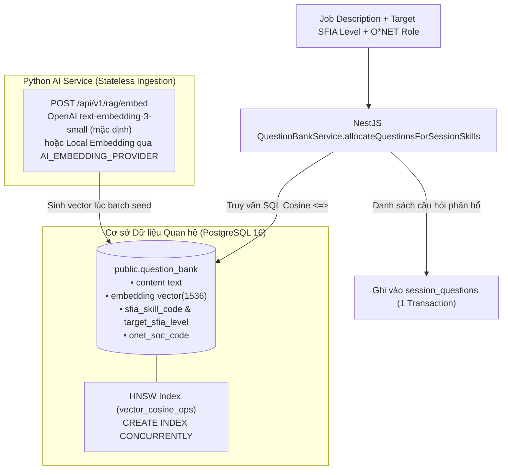

# TÀI LIỆU TỔNG QUAN: PHASE 2 — NỀN TẢNG POSTGRESQL PGVECTOR & NGÂN HÀNG CÂU HỎI
# (MASTER OVERVIEW, ROADMAP & PRAGMATIC TASK BREAKDOWN)

> **Trạng thái**: Approved / Pragmatic Production Specification  
> **Cấp độ**: Production Specification (System Architect / Lead Engineer)  
> **Áp dụng cho**: PostgreSQL 16 `pgvector`, `ai-service/app/services/rag/`, `server/src/modules/interview-prep/`  
> **Tài liệu tham chiếu**: [00_OVERVIEW_STRATEGIC_BLUEPRINT.md](../00_OVERVIEW_STRATEGIC_BLUEPRINT.md)  
> **Phiên bản**: 3.0.0 (Tinh giản thực dụng: pgvector trên `question_bank`, cờ `AI_EMBEDDING_PROVIDER`, loại bỏ multi-corpus và LangGraph)  

---

## 1. TỔNG QUAN KIẾN TRÚC PHASE 2

Phase 2 cung cấp năng lực **Tìm kiếm Ngữ nghĩa trên Ngân hàng Câu hỏi** thông qua PostgreSQL `pgvector`, kết hợp với bộ lọc kỹ năng cứng O\*NET và SFIA 9:

$$\mathbf{Pragmatic\ Semantic\ Allocation} = \mathbf{pgvector\ Cosine\ Similarity\ (1536D)} + \mathbf{O*NET\ \&\ SFIA\ Metadata\ Filters}$$

---

## 2. DANH MỤC CÁC TÀI LIỆU CHUYÊN SÂU TỪNG TASK (TASK BREAKDOWN)

Phase 2 bao gồm 4 nhiệm vụ kỹ thuật thực dụng:

| Thứ tự | Tệp Tài liệu Đặc tả | Trọng tâm Kỹ thuật & Phạm vi Triển khai |
| :---: | :--- | :--- |
| **Task 2.1** | [01_PGVECTOR_SCHEMA_AND_MIGRATION.md](01_PGVECTOR_SCHEMA_AND_MIGRATION.md) | Kích hoạt extension `vector`, bổ sung cột `embedding vector(1536)` cho `public.question_bank`, tạo HNSW index không khóa bảng (`CONCURRENTLY`). |
| **Task 2.2** | [02_BGE_M3_EMBEDDING_AND_BATCH_INGESTION.md](02_BGE_M3_EMBEDDING_AND_BATCH_INGESTION.md) | Triển khai endpoint `POST /api/v1/rag/embed`, hỗ trợ cờ `AI_EMBEDDING_PROVIDER=openai|local` và kịch bản batch ingestion seed vector cho câu hỏi. |
| **Task 2.3** | [03_HYBRID_RETRIEVAL_AND_RRF_RANKING.md](03_HYBRID_RETRIEVAL_AND_RRF_RANKING.md) | Câu lệnh SQL kết hợp tính khoảng cách Cosine (`<=>`) với bộ lọc cứng `sfia_skill_code`, `target_sfia_level` và `session_type`. |
| **Task 2.4** | [05_NESTJS_INTEGRATION_AND_QUESTION_ALLOCATION.md](05_NESTJS_INTEGRATION_AND_QUESTION_ALLOCATION.md) | Tích hợp vào `QuestionBankService.allocateQuestionsForSessionSkills` trong NestJS, cơ chế Fallback tự động khi mất kết nối Python. |

---

## 3. CHỈ TIÊU NGHIỆM THU TỔNG THỂ (QUALITY GATE 2)

1. **Hiệu năng Truy vấn Toàn trình**:
   * Latency tìm kiếm câu hỏi kết hợp vector và metadata filter $< 80\text{ ms}$ trên PostgreSQL.
2. **Độ chính xác Nghiệp vụ**:
   * 100% câu hỏi được gợi ý bám sát mã ngành O\*NET và cấp độ SFIA được yêu cầu.
   * Không lẫn lộn câu hỏi giữa buổi phỏng vấn Technical và HR.
3. **Tính Ổn định & Chịu lỗi (Zero-Downtime Fallback)**:
   * Quá trình tạo index HNSW không gây Table Lock trên database (`CREATE INDEX CONCURRENTLY`).
   * Giữ nguyên vẹn 100% dữ liệu gốc trong schema `sfia.*` và `onet.*`.
   * Khi đổi cờ `AI_RAG_PROVIDER=prisma` hoặc Python service ngắt kết nối, NestJS tự động Fallback sang SQL shuffle thuần mà không làm đứt đoạn tiến trình tạo phiên của người dùng.
