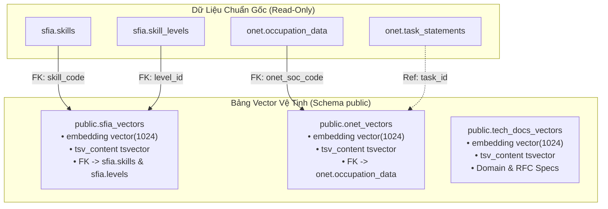

# SUB-TASK 2.1B: MULTI-CORPUS VECTOR SCHEMAS & INDEXES
# (SFIA 9, O*NET 29.x & TECHNICAL GROUND TRUTH DEDICATED VECTOR STORAGE)

> **Trạng thái**: Approved / Production Specification  
> **Cấp độ**: Deep Technical Specification (Database Architecture & Vector Engineering)  
> **Áp dụng cho**: `server/prisma/`, PostgreSQL 16, Extension `pgvector`  
> **Tài liệu cha**: [00_PHASE_2_OVERVIEW_AND_ARCHITECTURE.md](00_PHASE_2_OVERVIEW_AND_ARCHITECTURE.md)  
> **Tài liệu tiên quyết**: [01_PGVECTOR_SCHEMA_AND_MIGRATION.md](01_PGVECTOR_SCHEMA_AND_MIGRATION.md)  
> **Phiên bản**: 1.0.0  

---

## 1. MỤC TIÊU KỸ THUẬT & NGUYÊN TẮC BẢO TỒN SCHEMA GỐC

Trong hệ sinh thái **Agentic RAG**, các tác tử (Agents) cần tra cứu chéo qua nhiều nguồn tri thức độc lập:
1. **Chuẩn năng lực SFIA 9**: Tra cứu phát biểu hành vi (`behavioral statements`), trách nhiệm và hướng dẫn chuyên môn theo từng level 1-7.
2. **Chuẩn nghề nghiệp O\*NET 29.x**: Tra cứu mô tả nhiệm vụ công việc (`task statements`), công nghệ nóng (`hot technologies`), và chức danh tương đương (`alternate titles`).
3. **Kho tri thức kỹ thuật chuẩn mực (Technical Ground Truth)**: Tra cứu tài liệu kỹ thuật, RFCs, cấu hình kiến trúc (PostgreSQL, Docker, Redis, Kafka, Microservices) phục vụ việc Fact-Checking câu trả lời của ứng viên ở Phase 3.

> [!CRITICAL]
> **Nguyên tắc Thiết kế Bất biến — Bảo tồn Schema Chuẩn SFIA & O\*NET**:
> * Cơ sở dữ liệu hiện hữu đã có 2 schema chuẩn hóa: `sfia.*` và `onet.*`. Tuyệt đối **KHÔNG** sửa đổi cấu trúc các bảng gốc của SFIA và O\*NET để tránh xung đột khi re-seed hoặc nâng cấp phiên bản dữ liệu chuẩn.
> * Toàn bộ dữ liệu vector nhúng (Embedding 1024 chiều từ model BGE-M3) và chỉ mục tìm kiếm văn bản (Full-text `tsvector`) được lưu trữ tại **3 bảng vector vệ tinh riêng biệt** nằm trong schema `public`, liên kết bằng khóa ngoại (`FOREIGN KEY`) trỏ về các bảng chuẩn.



---

## 2. FILE MIGRATION SQL CHUẨN (`20261016_multi_corpus_vector_schemas`)

Tạo file: `server/prisma/migrations/20261016_multi_corpus_vector_schemas/migration.sql`:

```sql
-- ==============================================================================
-- BƯỚC 1: BẢNG SFIA VECTORS (TRA CỨU NĂNG LỰC SFIA 9)
-- ==============================================================================
CREATE TABLE IF NOT EXISTS public.sfia_vectors (
  id UUID PRIMARY KEY DEFAULT gen_random_uuid(),
  skill_code VARCHAR(10) NOT NULL REFERENCES sfia.skills(code) ON DELETE CASCADE,
  level_id SMALLINT REFERENCES sfia.levels(level_id),
  category_code VARCHAR(10),
  statement_type VARCHAR(30) NOT NULL DEFAULT 'level_description', -- 'level_description' | 'overall_description' | 'guidance_notes'
  content_chunk TEXT NOT NULL,
  embedding vector(1024) NOT NULL,
  tsv_content tsvector,
  created_at TIMESTAMPTZ(6) DEFAULT NOW()
);

-- ==============================================================================
-- BƯỚC 2: BẢNG ONET VECTORS (TRA CỨU NHIỆM VỤ & CÔNG NGHỆ O*NET 29.x)
-- ==============================================================================
CREATE TABLE IF NOT EXISTS public.onet_vectors (
  id UUID PRIMARY KEY DEFAULT gen_random_uuid(),
  onet_soc_code VARCHAR(10) NOT NULL REFERENCES onet.occupation_data(onetsoc_code) ON DELETE CASCADE,
  entity_type VARCHAR(30) NOT NULL, -- 'occupation' | 'task_statement' | 'software_skill'
  entity_id VARCHAR(50),            -- ID nguồn (ví dụ task_id hoặc commodity_code)
  content_chunk TEXT NOT NULL,
  embedding vector(1024) NOT NULL,
  tsv_content tsvector,
  created_at TIMESTAMPTZ(6) DEFAULT NOW()
);

-- ==============================================================================
-- BƯỚC 3: BẢNG TECH DOCS VECTORS (KHO TRI THỨC KỸ THUẬT CHO FACT-CHECKING)
-- ==============================================================================
CREATE TABLE IF NOT EXISTS public.tech_docs_vectors (
  id UUID PRIMARY KEY DEFAULT gen_random_uuid(),
  domain VARCHAR(50) NOT NULL,      -- 'database', 'backend', 'system_design', 'devops', 'security'
  doc_title VARCHAR(200) NOT NULL,
  version_tag VARCHAR(50),           -- 'postgres-16', 'docker-24', 'kafka-3.5', 'node-20'
  section_heading VARCHAR(200),
  content_chunk TEXT NOT NULL,
  metadata_json JSONB DEFAULT '{}', -- Lưu trữ RFC number, official docs URL, tags
  embedding vector(1024) NOT NULL,
  tsv_content tsvector,
  created_at TIMESTAMPTZ(6) DEFAULT NOW()
);

-- ==============================================================================
-- BƯỚC 4: TRIGGERS TỰ ĐỘNG ĐỒNG BỘ TSVECTOR (DICTIONARY 'SIMPLE')
-- ==============================================================================
CREATE OR REPLACE FUNCTION update_multi_corpus_tsv() RETURNS trigger AS $$
BEGIN
  new.tsv_content := setweight(to_tsvector('simple', coalesce(new.content_chunk, '')), 'A');
  RETURN new;
END
$$ LANGUAGE plpgsql;

DROP TRIGGER IF EXISTS trg_sfia_vectors_tsv ON public.sfia_vectors;
CREATE TRIGGER trg_sfia_vectors_tsv 
  BEFORE INSERT OR UPDATE OF content_chunk ON public.sfia_vectors 
  FOR EACH ROW EXECUTE FUNCTION update_multi_corpus_tsv();

DROP TRIGGER IF EXISTS trg_onet_vectors_tsv ON public.onet_vectors;
CREATE TRIGGER trg_onet_vectors_tsv 
  BEFORE INSERT OR UPDATE OF content_chunk ON public.onet_vectors 
  FOR EACH ROW EXECUTE FUNCTION update_multi_corpus_tsv();

DROP TRIGGER IF EXISTS trg_tech_docs_vectors_tsv ON public.tech_docs_vectors;
CREATE TRIGGER trg_tech_docs_vectors_tsv 
  BEFORE INSERT OR UPDATE OF content_chunk ON public.tech_docs_vectors 
  FOR EACH ROW EXECUTE FUNCTION update_multi_corpus_tsv();

-- ==============================================================================
-- BƯỚC 5: TẠO CHỈ MỤC HNSW VÀ GIN KHÔNG KHÓA BẢNG (NON-BLOCKING)
-- ==============================================================================
-- sfia_vectors
CREATE INDEX CONCURRENTLY IF NOT EXISTS idx_sfia_vectors_embedding_hnsw 
  ON public.sfia_vectors USING hnsw (embedding vector_cosine_ops)
  WITH (m = 16, ef_construction = 64);

CREATE INDEX CONCURRENTLY IF NOT EXISTS idx_sfia_vectors_tsv 
  ON public.sfia_vectors USING gin (tsv_content);

CREATE INDEX CONCURRENTLY IF NOT EXISTS idx_sfia_vectors_skill_level 
  ON public.sfia_vectors (skill_code, level_id);

-- onet_vectors
CREATE INDEX CONCURRENTLY IF NOT EXISTS idx_onet_vectors_embedding_hnsw 
  ON public.onet_vectors USING hnsw (embedding vector_cosine_ops)
  WITH (m = 16, ef_construction = 64);

CREATE INDEX CONCURRENTLY IF NOT EXISTS idx_onet_vectors_tsv 
  ON public.onet_vectors USING gin (tsv_content);

CREATE INDEX CONCURRENTLY IF NOT EXISTS idx_onet_vectors_soc_entity 
  ON public.onet_vectors (onet_soc_code, entity_type);

-- tech_docs_vectors
CREATE INDEX CONCURRENTLY IF NOT EXISTS idx_tech_docs_vectors_embedding_hnsw 
  ON public.tech_docs_vectors USING hnsw (embedding vector_cosine_ops)
  WITH (m = 16, ef_construction = 64);

CREATE INDEX CONCURRENTLY IF NOT EXISTS idx_tech_docs_vectors_tsv 
  ON public.tech_docs_vectors USING gin (tsv_content);

CREATE INDEX CONCURRENTLY IF NOT EXISTS idx_tech_docs_vectors_domain 
  ON public.tech_docs_vectors (domain, version_tag);
```

---

## 3. CẬP NHẬT PRISMA SCHEMA (`schema.prisma`)

Bổ sung khai báo model Prisma cho 3 bảng vector vệ tinh:

```prisma
// ==========================================
// AGENTIC RAG MULTI-CORPUS VECTOR SATELLITES
// ==========================================

model SfiaVector {
  id            String    @id @default(dbgenerated("gen_random_uuid()")) @db.Uuid
  skillCode     String    @map("skill_code") @db.VarChar(10)
  levelId       Int?      @map("level_id") @db.SmallInt
  categoryCode  String?   @map("category_code") @db.VarChar(10)
  statementType String    @default("level_description") @map("statement_type") @db.VarChar(30)
  contentChunk  String    @map("content_chunk") @db.Text
  embedding     Unsupported("vector(1024)")
  tsvContent    Unsupported("tsvector")? @map("tsv_content")
  createdAt     DateTime  @default(now()) @map("created_at") @db.Timestamptz(6)

  @@index([skillCode, levelId], map: "idx_sfia_vectors_skill_level")
  @@map("sfia_vectors")
}

model OnetVector {
  id           String    @id @default(dbgenerated("gen_random_uuid()")) @db.Uuid
  onetSocCode  String    @map("onet_soc_code") @db.VarChar(10)
  entityType   String    @map("entity_type") @db.VarChar(30)
  entityId     String?   @map("entity_id") @db.VarChar(50)
  contentChunk String    @map("content_chunk") @db.Text
  embedding    Unsupported("vector(1024)")
  tsvContent   Unsupported("tsvector")? @map("tsv_content")
  createdAt    DateTime  @default(now()) @map("created_at") @db.Timestamptz(6)

  @@index([onetSocCode, entityType], map: "idx_onet_vectors_soc_entity")
  @@map("onet_vectors")
}

model TechDocsVector {
  id             String    @id @default(dbgenerated("gen_random_uuid()")) @db.Uuid
  domain         String    @db.VarChar(50)
  docTitle       String    @map("doc_title") @db.VarChar(200)
  versionTag     String?   @map("version_tag") @db.VarChar(50)
  sectionHeading String?   @map("section_heading") @db.VarChar(200)
  contentChunk   String    @map("content_chunk") @db.Text
  metadataJson   Json?     @default("{}") @map("metadata_json")
  embedding      Unsupported("vector(1024)")
  tsvContent     Unsupported("tsvector")? @map("tsv_content")
  createdAt      DateTime  @default(now()) @map("created_at") @db.Timestamptz(6)

  @@index([domain, versionTag], map: "idx_tech_docs_vectors_domain")
  @@map("tech_docs_vectors")
}
```

---

## 4. CHIẾN LƯỢC PHÂN ĐOẠN DỮ LIỆU (CHUNKING & INGESTION STRATEGY)

| Nguồn Dữ Liệu | Nguồn Gốc Bảng Chuẩn | Đơn Vị Chunking & Tiêu Chuẩn Ngữ Cảnh | Tần Suất Đồng Bộ |
| :--- | :--- | :--- | :--- |
| **SFIA 9 Statements** | `sfia.skill_levels`, `sfia.skills` | 1 Chunk = Mã kỹ năng + Tên kỹ năng + Cấp độ (1-7) + Toàn văn mô tả năng lực (`description`). Kích thước ~150-300 tokens. | Đồng bộ một lần khi cập nhật chuẩn SFIA (Static). |
| **O\*NET 29.x Tasks** | `onet.task_statements`, `onet.occupation_data` | 1 Chunk = Mã SOC + Chức danh + Toàn văn Task Statement + Chỉ số Relevance. Kích thước ~100-200 tokens. | Đồng bộ một lần khi cập nhật O\*NET database. |
| **Technical Ground Truth** | File Markdown / Cheatsheets nội bộ | Phân đoạn theo Heading cấp 2/3 (`##`, `###`), kích thước tối đa 512 tokens, overlap 50 tokens kèm code snippet ví dụ. | Định kỳ khi bổ sung tài liệu công nghệ mới. |

---

## 5. KỊCH BẢN ROLLBACK (RECOVERY PLAYBOOK)

Nếu migration gặp sự cố cần hoàn nguyên mà không ảnh hưởng tới bảng gốc:
```sql
DROP TABLE IF EXISTS public.tech_docs_vectors CASCADE;
DROP TABLE IF EXISTS public.onet_vectors CASCADE;
DROP TABLE IF EXISTS public.sfia_vectors CASCADE;
DROP FUNCTION IF EXISTS update_multi_corpus_tsv() CASCADE;
```

---

## 6. TIÊU CHÍ NGHIỆM THU (QUALITY GATES)

1. **Toàn vẹn Schema Gốc**: Các bảng `sfia.skills`, `sfia.skill_levels`, `onet.occupation_data`, `onet.task_statements` giữ nguyên 100% số lượng cột và dữ liệu, không có bất kỳ thay đổi nào.
2. **Khóa Ngoại Hợp Lệ**: Không thể insert bản ghi vào `sfia_vectors` với `skill_code` không tồn tại trong `sfia.skills`.
3. **Hiệu năng HNSW**: Index HNSW trên 3 bảng được tạo thành công với cấu hình `m=16, ef_construction=64`.
4. **Trigger Hoạt Động**: Khi insert vào `tech_docs_vectors`, cột `tsv_content` tự động được sinh dữ liệu dạng tsvector.

---

## 7. TASK EXECUTION CONTRACT

### 7.1 Prerequisites (Tiền đề bắt buộc)
- [ ] Hoàn thành **Task 2.1**: Extension `vector` đã kích hoạt trên PostgreSQL 16.
- [ ] Dữ liệu chuẩn SFIA 9 và O\*NET 29.x đã được seed sẵn trong schema `sfia` và `onet`.

### 7.2 Target Deliverables (Sản phẩm mã nguồn đầu ra)
- [ ] `server/prisma/migrations/20261016_multi_corpus_vector_schemas/migration.sql`: DDL 3 bảng vector vệ tinh, triggers và HNSW/GIN indexes.
- [ ] `server/prisma/schema.prisma`: Khai báo 3 models `SfiaVector`, `OnetVector`, `TechDocsVector`.

### 7.3 Architectural Rules Enforced (Tuân thủ AGENTS.md)
- [x] **Backend Rule 5**: DDL migration an toàn, bảo vệ toàn vẹn ACID và không làm thay đổi các bảng chuẩn SFIA/O\*NET.
- [x] **Non-blocking Invariant**: Sử dụng `CREATE INDEX CONCURRENTLY` trên production.
- [x] **Unsupported Type Isolation**: Kiểu `vector(1024)` được cô lập trong Prisma qua `Unsupported`.

### 7.4 Verification Command (Lệnh kiểm thử & Xác thực tự động)
```bash
# Tier 1 (Prisma Schema Validation)
cd server && npx prisma validate

# Tier 2 (Database Migration & FK Verification)
cd server && npx prisma migrate deploy
psql "$DATABASE_URL" -c "\d public.sfia_vectors"
psql "$DATABASE_URL" -c "\d public.onet_vectors"
psql "$DATABASE_URL" -c "\d public.tech_docs_vectors"
```

### 7.5 Definition of Done (DoD)
- [ ] 3 bảng vector vệ tinh được tạo thành công trong schema `public`.
- [ ] Triggers tự động cập nhật `tsv_content` hoạt động chính xác.
- [ ] `npx prisma generate` sinh Prisma Client thành công không lỗi type mismatch.

### 7.6 Next Task Transition (Bước chuyển tiếp)
- Chuyển tiếp sang **Task 2.2: BGE-M3 Embedding Pipeline**: [02_BGE_M3_EMBEDDING_AND_BATCH_INGESTION.md](02_BGE_M3_EMBEDDING_AND_BATCH_INGESTION.md) để xây dựng pipeline sinh vector và batch ingestion cho cả 4 corpora.
