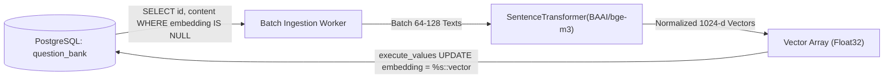

# TASK 2.2: PIPELINE EMBEDDING BGE-M3 & BATCH INGESTION

> **Trạng thái**: Approved / Production Specification  
> **Cấp độ**: Deep Technical Specification (AI Engineering & Data Pipeline)  
> **Áp dụng cho**: `ai-service/app/services/rag/ingestion.py`, BAAI/bge-m3  
> **Tài liệu cha**: [00_PHASE_2_OVERVIEW_AND_ARCHITECTURE.md](00_PHASE_2_OVERVIEW_AND_ARCHITECTURE.md)  
> **Phiên bản**: 1.0.0  

---

## 1. MỤC TIÊU & TẠI SAO CHỌN BAAI/BGE-M3

Trong hệ thống luyện phỏng vấn IT, tài liệu đầu vào thường là Job Description (JD) rất dài, danh sách yêu cầu kỹ thuật chi tiết hoặc ngữ cảnh công nghệ phức tạp. `BGE-M3` (Multi-Lingual, Multi-Functionality, Multi-Granularity) vượt trội nhờ:
1. **Context Window 8.192 tokens**: Nhúng trọn vẹn toàn bộ bản JD và tài liệu kỹ năng mà không cần chia cắt nhỏ (chunking) làm đứt gãy ngữ cảnh.
2. **Kích thước vector 1024 chiều**: Cung cấp không gian biểu diễn ngữ nghĩa phong phú hơn đáng kể so với 384 chiều của `all-MiniLM-L6-v2` hay 768 chiều của BERT.
3. **Đa ngôn ngữ chuyên sâu**: Điểm số MTEB dẫn đầu cho cặp ngôn ngữ Tiếng Việt và Tiếng Anh chuyên ngành CNTT.
4. **Normalized Dense Embeddings**: Vector được L2-normalize (`normalize_embeddings=True`), cho phép so sánh độ tương đồng Cosine tương đương với tích vô hướng (Dot Product), tối ưu hóa tốc độ tính toán cho HNSW index.

---

## 2. THIẾT KẾ DỊCH VỤ INGESTION (`ai-service/app/services/rag/ingestion.py`)

### 2.1 Luồng Xử lý Vector Hóa Hàng Loạt (Batch Processing Flow)



### 2.2 Mã Nguồn Triển khai Chuẩn Hóa
```python
import structlog
from typing import Optional
from sentence_transformers import SentenceTransformer
import psycopg2
from psycopg2.extras import execute_values
from app.core.config import settings

logger = structlog.get_logger(__name__)

class KnowledgeBaseIngestionService:
    def __init__(self, model_name: str = "BAAI/bge-m3"):
        logger.info("Initializing BGE-M3 embedding service...", model=model_name)
        # Tự động điều hướng thiết bị: CUDA -> MPS -> CPU
        device = "cuda" if settings.USE_GPU else "cpu"
        self.model = SentenceTransformer(
            model_name,
            device=device,
            trust_remote_code=True
        )
        if settings.USE_GPU:
            # Ép kiểu FP16 để giảm 50% VRAM và tăng 2x tốc độ tính toán
            self.model.half()
        logger.info("BGE-M3 model loaded successfully", device=device)

    def ingest_unindexed_questions(self, batch_size: int = 64) -> int:
        """
        Quét và sinh embedding cho tất cả các câu hỏi chưa được vector hóa.
        """
        conn = psycopg2.connect(settings.DATABASE_URL)
        total_indexed = 0
        
        try:
            with conn.cursor() as cur:
                while True:
                    cur.execute("""
                        SELECT id, content 
                        FROM question_bank 
                        WHERE embedding IS NULL AND deleted_at IS NULL
                        ORDER BY created_at ASC
                        LIMIT %s;
                    """, (batch_size,))
                    
                    records = cur.fetchall()
                    if not records:
                        logger.info("All questions are indexed. Ingestion cycle complete.")
                        break
                        
                    ids = [r[0] for r in records]
                    texts = [r[1] for r in records]
                    
                    logger.info("Encoding batch of questions...", count=len(texts))
                    embeddings = self.model.encode(
                        texts,
                        batch_size=batch_size,
                        normalize_embeddings=True,
                        show_progress_bar=False
                    )
                    
                    update_payload = [
                        (emb.tolist(), q_id) for emb, q_id in zip(embeddings, ids)
                    ]
                    
                    execute_values(
                        cur,
                        """
                        UPDATE question_bank 
                        SET embedding = data.emb::vector,
                            updated_at = NOW()
                        FROM (VALUES %s) AS data(emb, id)
                        WHERE question_bank.id = data.id::uuid;
                        """,
                        update_payload,
                        template="(%s, %s)"
                    )
                    conn.commit()
                    total_indexed += len(records)
                    logger.info("Batch indexed successfully", count=len(records), total=total_indexed)
                    
        except Exception as e:
            conn.rollback()
            logger.error("Error during batch ingestion", error=str(e))
            raise e
        finally:
            conn.close()
            
        return total_indexed
```

---

## 3. CƠ CHẾ ĐỒNG BỘ KHI CÓ CÂU HỎI MỚI (SYNC STRATEGY)

Hệ thống hỗ trợ 2 cơ chế đồng bộ vector cho câu hỏi mới:

1. **Scheduled Batch Sync (Mặc định)**:
   * Một cron task định kỳ chạy mỗi $10\text{ phút}$ gọi `ingest_unindexed_questions()` để quét các câu hỏi mới được Admin thêm vào QuestionBank.
2. **On-Demand Single Vectorization**:
   * Khi Admin tạo mới câu hỏi qua Admin Portal, NestJS phát sinh outbox event hoặc gọi endpoint nội bộ `POST /api/v1/rag/embed-question` để Python tính vector tức thì cho câu hỏi đó trong $< 50\text{ms}$.

---

## 4. QUẢN LÝ BỘ NHỚ & TÀI NGUYÊN TÍNH TOÁN

| Tham số Cấu hình | Môi trường GPU (NVIDIA T4 / RTX 3060) | Môi trường CPU (8 cores) |
| :--- | :--- | :--- |
| **Compute Precision** | `float16` (Half Precision) | `float32` hoặc `int8` (CTranslate2 / ONNX) |
| **VRAM / RAM Footprint** | $\sim 2.1\text{GB}$ VRAM | $\sim 3.2\text{GB}$ RAM |
| **Batch Size Khuyến nghị**| $64 - 128$ | $16 - 32$ |
| **Tốc độ Mã hóa (Throughput)**| $\sim 250\text{ câu/giây}$ | $\sim 35\text{ câu/giây}$ |

---

## 5. TIÊU CHÍ NGHIỆM THU (QUALITY GATES)

1. **Định dạng Vector**: Vector sinh ra có độ dài chính xác $1024$ phần tử kiểu `float`.
2. **Chuẩn hóa L2**: Độ dài chuẩn $||\mathbf{v}||_2 = \sqrt{\sum v_i^2} \approx 1.0 \pm 0.001$.
3. **Xử lý Ngoại lệ**: Nếu câu hỏi chứa ký tự đặc biệt, HTML tags hoặc rỗng, hàm xử lý an toàn không gây dừng đột ngột (crash) quy trình.
4. **Idempotency**: Chạy lại service ingestion nhiều lần không tạo ra các bản ghi trùng lặp và bỏ qua an toàn các bản ghi đã có vector.

---

## 6. TASK EXECUTION CONTRACT

### 6.1 Prerequisites (Tiền đề bắt buộc)
- [ ] Hoàn thành **Task 2.1**: Cột `embedding vector(1024)` đã được tạo trong bảng `question_bank`.
- [ ] Cài đặt các thư viện `sentence-transformers`, `torch`, `psycopg2-binary` trong `ai-service/pyproject.toml`.
- [ ] Cấu hình biến môi trường kết nối database `DATABASE_URL` trong `ai-service/.env`.

### 6.2 Target Deliverables (Sản phẩm mã nguồn đầu ra)
- [ ] `ai-service/app/services/rag/embedder.py`: Singleton `BGEEmbedder` nạp model `BAAI/bge-m3` sinh dense vector 1024 chiều.
- [ ] `ai-service/app/services/rag/ingestion.py`: Lớp `KnowledgeBaseIngestionService` đọc câu hỏi chưa có vector và cập nhật theo batch 64.
- [ ] `ai-service/app/schemas/rag.py`: Pydantic Models `EmbedRequest`, `EmbedResponse` (kế thừa `CamelModel`).
- [ ] `ai-service/app/api/v1/rag.py`: Endpoints `POST /api/v1/rag/embed` và `POST /api/v1/rag/sync-embeddings`.

### 6.3 Architectural Rules Enforced (Tuân thủ AGENTS.md)
- [x] **Backend Rule 5**: Toàn bộ thao tác nhúng vector là Stateless Compute; cập nhật batch vào DB an toàn và idempotent.
- [x] **Zero Schema Drift**: DTO và JSON payload luôn ở định dạng `camelCase`.

### 6.4 Verification Command (Lệnh kiểm thử & Xác thực tự động)
```bash
# Tier 1 (Unit & Embedding Dimension Test)
cd ai-service && uv run pytest tests/unit/test_embedder.py -v

# Tier 2 (Live Batch Ingestion & Dimension Verification)
curl -X POST -H "x-internal-secret: interviewai-super-secret-dev-key-change-in-prod" \
  -H "Content-Type: application/json" \
  -d '{"texts":["Làm thế nào để thiết kế hệ thống phân tán chịu lỗi cao?"]}' \
  http://localhost:8000/api/v1/rag/embed
```

### 6.5 Definition of Done (DoD)
- [ ] Vector sinh ra có đúng $1024$ chiều float32 và chuẩn hóa L2 norm $\approx 1.0$.
- [ ] Throughput mã hóa đạt $\ge 250\text{ câu/giây}$ trên GPU ($\ge 35\text{ câu/giây}$ trên CPU).
- [ ] Toàn bộ câu hỏi trong `question_bank` được backfill vector mà không bị lỗi dữ liệu.
- [ ] Chạy lại lệnh ingestion nhiều lần không phát sinh lỗi trùng lặp (Idempotent 100%).

### 6.6 Next Task Transition (Bước chuyển tiếp)
- Tiếp tục sang **Task 2.3: Hybrid Retrieval CTE Query & RRF**: [03_HYBRID_RETRIEVAL_AND_RRF_RANKING.md](03_HYBRID_RETRIEVAL_AND_RRF_RANKING.md) để xây dựng truy vấn kết hợp Dense và Sparse search.

