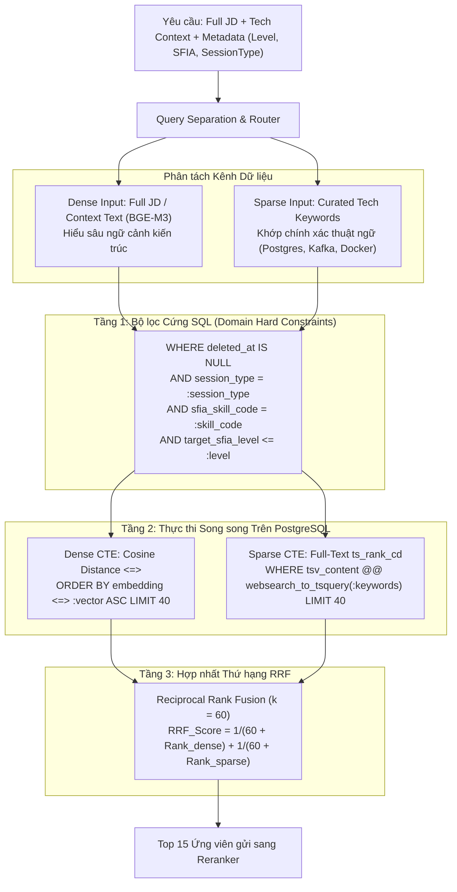

# TASK 2.3: THIẾT KẾ HYBRID RETRIEVAL & THUẬT TOÁN RRF RANKING

> **Trạng thái**: Approved / Production Specification  
> **Cấp độ**: Deep Technical Specification (Search Engineering & Information Retrieval)  
> **Áp dụng cho**: PostgreSQL pgvector, `ai-service/app/services/rag/retrieval.py`  
> **Tài liệu cha**: [00_PHASE_2_OVERVIEW_AND_ARCHITECTURE.md](00_PHASE_2_OVERVIEW_AND_ARCHITECTURE.md)  
> **Phiên bản**: 1.0.0  

---

## 1. NGUYÊN LÝ THIẾT KẾ HYBRID RETRIEVAL 3 TẦNG

Trong bài toán tuyển dụng kỹ thuật, truy vấn ngữ nghĩa thuần túy (Dense Vector Search) thường làm mất mát các từ khóa công nghệ chuyên sâu, trong khi tìm kiếm từ khóa thuần túy (Sparse BM25) lại bỏ qua ngữ cảnh phân tầng cấp độ.

Hệ thống kết hợp **3 tầng truy vấn đồng thời**:



---

## 2. GIẢI QUYẾT BẪY "ZERO-MATCH" CỦA SPARSE SEARCH

> [!CRITICAL]
> **Khắc phục lỗi nối từ AND mặc định**:
> * `plainto_tsquery('simple', text)` mặc định ghép tất cả các token bằng toán tử `&` (`AND`). Khi truyền cả bản JD dài vào, câu hỏi trong ngân hàng chắc chắn không chứa đủ 100% các từ $\rightarrow$ Sparse search trả về $0$ kết quả.
> * **Giải pháp chuẩn hóa**:
>   1. Phía Python trích xuất các từ khóa công nghệ cốt lõi (`techContext` từ kỹ năng + chức danh công việc, ví dụ: `"nestjs postgresql docker microservices"`).
>   2. Sử dụng hàm `websearch_to_tsquery('simple', $keywords)` hoặc chuyển đổi từ khóa thành biểu thức `OR` linh hoạt (`token1 | token2 | token3`).

---

## 3. CÂU LỆNH SQL HYBRID RETRIEVAL TỐI ƯU

Câu lệnh SQL sử dụng kỹ thuật CTE (Common Table Expressions) kết hợp `FULL OUTER JOIN`:

```sql
-- Tham số truyền vào:
-- $1: embedding_vector (1024 float array dạng string: '[0.012, -0.045, ...]')
-- $2: session_type (enum: 'technical' | 'hr')
-- $3: sfia_skill_code (varchar: 'PROG', 'ITOP', ...)
-- $4: target_sfia_level (smallint: 1 - 7)
-- $5: sparse_keywords (varchar: 'nestjs postgresql docker')
-- $6: onet_soc_code (optional varchar: '15-1252.00')
-- $7: context_pack_id (optional varchar: 'VN')

WITH dense_search AS (
  SELECT 
    id, 
    ROW_NUMBER() OVER (ORDER BY embedding <=> $1::vector ASC) AS rank
  FROM question_bank
  WHERE deleted_at IS NULL
    AND session_type = $2::"QuestionSessionType"
    AND ($3::varchar IS NULL OR sfia_skill_code = $3)
    AND ($4::smallint IS NULL OR target_sfia_level <= $4)
    AND ($6::varchar IS NULL OR onet_soc_code = $6)
    AND ($7::varchar IS NULL OR context_pack_id = $7)
    AND embedding IS NOT NULL
  LIMIT 40
),
sparse_search AS (
  SELECT 
    id, 
    ROW_NUMBER() OVER (ORDER BY ts_rank_cd(tsv_content, websearch_to_tsquery('simple', $5)) DESC) AS rank
  FROM question_bank
  WHERE deleted_at IS NULL
    AND session_type = $2::"QuestionSessionType"
    AND tsv_content @@ websearch_to_tsquery('simple', $5)
    AND ($3::varchar IS NULL OR sfia_skill_code = $3)
    AND ($4::smallint IS NULL OR target_sfia_level <= $4)
    AND ($6::varchar IS NULL OR onet_soc_code = $6)
    AND ($7::varchar IS NULL OR context_pack_id = $7)
  LIMIT 40
)
SELECT 
  coalesce(d.id, s.id) AS question_id,
  qb.content,
  qb.onet_soc_code,
  qb.sfia_skill_code,
  qb.target_sfia_level,
  qb.difficulty,
  coalesce(1.0 / (60 + d.rank), 0.0) AS dense_rrf,
  coalesce(1.0 / (60 + s.rank), 0.0) AS sparse_rrf,
  coalesce(1.0 / (60 + d.rank), 0.0) + coalesce(1.0 / (60 + s.rank), 0.0) AS final_rrf_score
FROM dense_search d
FULL OUTER JOIN sparse_search s ON d.id = s.id
JOIN question_bank qb ON qb.id = coalesce(d.id, s.id)
ORDER BY final_rrf_score DESC
LIMIT 15;
```

---

## 4. CÔNG THỨC TOÁN HỌC RECIPROCAL RANK FUSION (RRF)

Thuật toán RRF chuẩn hóa vị trí thứ hạng của tài liệu trong từng danh sách kết quả mà không cần chuẩn hóa thang điểm (score normalization):

$$RRF\_Score(d \in D) = \sum_{m \in M} \frac{1}{k + r_m(d)}$$

Trong đó:
* $M = \{\text{dense}, \text{sparse}\}$: Tập hợp các phương pháp tìm kiếm.
* $k = 60$: Hằng số làm mịn chuẩn (Smoothing constant của nghiên cứu Cormack et al.), giúp các tài liệu có thứ hạng rất cao không áp đảo hoàn toàn các tài liệu xuất hiện đồng thời ở cả hai danh sách.
* $r_m(d)$: Thứ hạng (1-based rank) của tài liệu $d$ trong hệ thống $m$. Nếu $d$ không xuất hiện trong top kết quả của $m$, phần bù điểm bằng $0$.

---

## 5. TIÊU CHÍ NGHIỆM THU (QUALITY GATES)

1. **Hiệu năng Truy vấn SQL**: Thời gian thực thi câu lệnh SQL Hybrid CTE trên PostgreSQL với $10.000+$ câu hỏi $< 35\text{ ms}$.
2. **Khả năng Phục hồi khi Rỗng Kênh**: Nếu Sparse Search trả về $0$ kết quả (do không có từ khóa nào khớp), câu truy vấn vẫn trả về đủ kết quả từ kênh Dense Search nhờ `FULL OUTER JOIN`.
3. **Độ chính xác Bộ lọc Cứng**: $100\%$ kết quả trả về bắt buộc thỏa mãn chính xác `session_type` và cấp độ `target_sfia_level <= :level`.

---

## 6. TASK EXECUTION CONTRACT

### 6.1 Prerequisites (Tiền đề bắt buộc)
- [ ] Hoàn thành **Task 2.2**: Bảng `question_bank` đã được backfill vector nhúng 1024 chiều và index HNSW + GIN hoạt động.
- [ ] Cài đặt `asyncpg` hoặc `psycopg2-binary` trong `ai-service/pyproject.toml`.

### 6.2 Target Deliverables (Sản phẩm mã nguồn đầu ra)
- [ ] `ai-service/app/services/rag/hybrid_retriever.py`: Lớp `HybridRetriever` thực thi câu lệnh SQL CTE kết hợp song song Dense Search và Sparse Full-Text Search.
- [ ] Triển khai thuật toán Reciprocal Rank Fusion (RRF $k=60$) để tính điểm `finalRrfScore` và trả về Top 15 câu hỏi ứng viên.
- [ ] `ai-service/app/schemas/rag.py`: Pydantic Models `HybridRetrieveRequest`, `CandidateQuestion` (kế thừa `CamelModel`).
- [ ] `ai-service/app/api/v1/rag.py`: Endpoint `POST /api/v1/rag/retrieve-candidates`.

### 6.3 Architectural Rules Enforced (Tuân thủ AGENTS.md)
- [x] **Backend Rule 5**: Câu truy vấn SQL CTE hoàn toàn Read-only, không gây lock bảng (`Table Lock`).
- [x] **Tách biệt Ngữ nghĩa**: Tách riêng Dense JD vs Sparse Tech Keywords, loại bỏ triệt để bẫy zero-match của Naive RAG.

### 6.4 Verification Command (Lệnh kiểm thử & Xác thực tự động)
```bash
# Tier 1 (Unit & RRF Algorithm Test)
cd ai-service && uv run pytest tests/unit/test_hybrid_retrieval.py -v

# Tier 2 (Live SQL CTE & Hybrid Candidates Verification)
curl -X POST -H "x-internal-secret: interviewai-super-secret-dev-key-change-in-prod" \
  -H "Content-Type: application/json" \
  -d '{"jobDescription":"Tuyển kỹ sư Go Kafka","techKeywords":"golang kafka","targetSfiaLevel":4,"sessionType":"technical"}' \
  http://localhost:8000/api/v1/rag/retrieve-candidates
```

### 6.5 Definition of Done (DoD)
- [ ] Thời gian thực thi SQL CTE query $< 35\text{ms}$ trên PostgreSQL với $10.000+$ câu hỏi.
- [ ] Khả năng chịu lỗi: Nếu kênh Sparse Search không có từ nào khớp, kênh Dense Search vẫn bảo đảm trả về đủ kết quả nhờ `FULL OUTER JOIN`.
- [ ] $100\%$ kết quả trả về lọc đúng `session_type`, `deleted_at IS NULL`, và `target_sfia_level <= :level`.
- [ ] Wire JSON trả về 100% `camelCase` với mảng 15 phần tử sắp xếp theo `finalRrfScore` giảm dần.

### 6.6 Next Task Transition (Bước chuyển tiếp)
- Tiếp tục sang **Task 2.4: Cross-Encoder Reranker & Redis L2 Cache**: [04_CROSS_ENCODER_RERANKER_AND_LATENCY_CACHING.md](04_CROSS_ENCODER_RERANKER_AND_LATENCY_CACHING.md) để xếp hạng lại Top 15 thành Top 5 câu hỏi tối ưu nhất.

