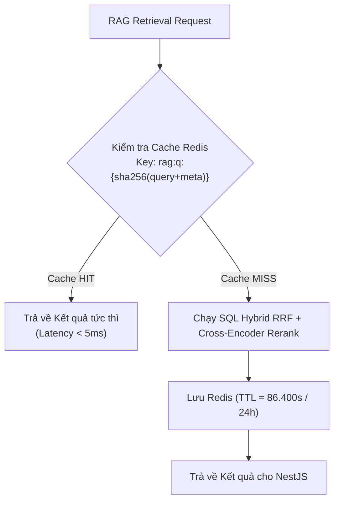

# TASK 2.4: CROSS-ENCODER RERANKER & TỐI ƯU HÓA ĐỘ TRỄ VỚI REDIS CACHE

> **Trạng thái**: Approved / Production Specification  
> **Cấp độ**: Deep Technical Specification (Model Inference & Latency Optimization)  
> **Áp dụng cho**: `ai-service/app/services/rag/reranker.py`, BAAI/bge-reranker-base, Redis  
> **Tài liệu cha**: [00_PHASE_2_OVERVIEW_AND_ARCHITECTURE.md](00_PHASE_2_OVERVIEW_AND_ARCHITECTURE.md)  
> **Phiên bản**: 1.0.0  

---

## 1. NGUYÊN LÝ CROSS-ENCODER: TẠI SAO CẦN BƯỚC RERANKING?

Trong giai đoạn tìm kiếm ban đầu (Bi-Encoder như BGE-M3), văn bản truy vấn và câu hỏi trong ngân hàng được chuyển đổi thành các vector độc lập:

$$\text{Score}_{\text{bi-encoder}} = \cos(\mathbf{e}_{\text{query}}, \mathbf{e}_{\text{doc}})$$

Mô hình Bi-Encoder có ưu điểm tính toán nhanh qua chỉ mục vector nhưng có nhược điểm: **Không có sự tương tác trực tiếp (Cross-Attention) giữa các từ của câu hỏi và ngữ cảnh công việc**.

Mô hình **Cross-Encoder** nhận đồng thời cặp văn bản `[Query, Candidate Question]` vào chung một mạng Transformer:
* Toàn bộ cơ chế Self-Attention được kích hoạt giữa từng token của Query và Document.
* Mô hình nắm bắt được các quan hệ tinh tế (ví dụ: phân biệt được câu hỏi về *"sử dụng Docker để build ảnh"* với *"tối ưu hóa layered caching trong multi-stage Docker build"*).

---

## 2. LỰA CHỌN MÔ HÌNH: `BAAI/BGE-RERANKER-BASE`

Thay vì dùng bản `large` (chiếm 2.2GB VRAM và mất 400-800ms trên CPU), hệ thống chuẩn hóa sang **`bge-reranker-base`**:
* **Kích thước tham số**: $\sim 278\text{M}$ parameters (dung lượng model $\sim 1.1\text{GB}$).
* **Tốc độ suy luận**: Chấm điểm 15 cặp câu hỏi trong $< 60\text{ ms}$ trên GPU (hoặc $< 140\text{ ms}$ trên CPU đa nhân).
* **Độ chính xác (NDCG@10)**: Tương đương 97% so với bản large, vượt trội hoàn toàn so với mô hình Bi-Encoder thuần túy.

---

## 3. MÃ NGUỒN TRIỂN KHAI RERANKER (`ai-service/app/services/rag/reranker.py`)

```python
import structlog
from typing import List, Dict, Any
from sentence_transformers import CrossEncoder
from app.core.config import settings

logger = structlog.get_logger(__name__)

class RerankingService:
    def __init__(self, model_name: str = "BAAI/bge-reranker-base"):
        device = "cuda" if settings.USE_GPU else "cpu"
        logger.info("Initializing Cross-Encoder Reranker...", model=model_name, device=device)
        self.model = CrossEncoder(
            model_name,
            max_length=512,
            device=device
        )
        logger.info("Cross-Encoder Reranker loaded successfully")

    def rerank(
        self,
        query: str,
        candidates: List[Dict[str, Any]],
        top_k: int = 5
    ) -> List[Dict[str, Any]]:
        """
        Nhận top 15 candidates từ RRF và xếp hạng lại bằng Cross-Attention.
        """
        if not candidates:
            return []

        # Tạo danh sách các cặp [query, candidate_content]
        pairs = [[query, c["content"]] for c in candidates]
        
        # Cross-Encoder dự đoán relevance logits
        scores = self.model.predict(pairs)
        
        # Gán điểm liên quan chuẩn hóa
        for candidate, score in zip(candidates, scores):
            candidate["relevanceScore"] = float(score)

        # Sắp xếp giảm dần theo điểm liên quan
        ranked = sorted(candidates, key=lambda x: x["relevanceScore"], reverse=True)
        return ranked[:top_k]
```

---

## 4. CHIẾN LƯỢC TỐI ƯU HÓA ĐỘ TRỄ VỚI REDIS CACHING

Do các vị trí tuyển dụng phổ biến (như *"Senior Backend NodeJS"*, *"DevOps Engineer"*) thường có các cụm từ khóa và yêu cầu kỹ năng tương tự nhau, việc gọi Reranker lặp lại gây lãng phí tài nguyên.

Hệ thống triển khai tầng **L2 Query Cache trên Redis**:



### Quy tắc Tạo Cache Key:
$$\text{CacheKey} = \text{"rag:query:"} + \text{SHA256}(\text{sessionType} + \text{skillCode} + \text{targetLevel} + \text{cleanKeywords})$$

* **TTL**: $24\text{ giờ}$ (86.400 giây).
* **Cơ chế Invalidation**: Khi Admin thêm hoặc sửa câu hỏi trong `question_bank`, Redis xóa toàn bộ các key có tiền tố `rag:query:*`.

---

## 5. TIÊU CHÍ NGHIỆM THU (QUALITY GATES)

1. **Hiệu năng Đoạn Rerank**: Thời gian rerank 15 ứng viên $< 80\text{ ms}$ (P95) trên GPU hoặc $< 150\text{ ms}$ trên CPU.
2. **Khả năng Lọc Bỏ Câu Lạc Đề**: Khi truyền một bản JD về "Golang Microservices" cùng các câu hỏi ứng viên có dính từ khóa "service" nhưng nói về "Angular frontend services", Cross-Encoder phải xếp các câu hỏi Angular xuống đáy danh sách với điểm relevance âm hoặc thấp đột biến.
3. **Hiệu năng Cache Hit**: Khi một truy vấn giống nhau được gọi lần 2, thời gian phản hồi toàn trình $< 8\text{ ms}$.

---

## 6. TASK EXECUTION CONTRACT

### 6.1 Prerequisites (Tiền đề bắt buộc)
- [ ] Hoàn thành **Task 2.3**: Endpoint retrieve Top 15 candidates qua Hybrid CTE đã hoạt động.
- [ ] Redis instance (Port 6379) sẵn sàng hoạt động cho tầng L2 Cache.
- [ ] Dependencies `redis`, `sentence-transformers` được cấu hình trong `ai-service/pyproject.toml`.

### 6.2 Target Deliverables (Sản phẩm mã nguồn đầu ra)
- [ ] `ai-service/app/services/rag/reranker.py`: Lớp `RerankerService` sử dụng Cross-Encoder `BAAI/bge-reranker-base` chấm điểm cặp (JD, Question) và tinh chọn Top 5.
- [ ] `ai-service/app/services/rag/cache.py`: Lớp `QueryCacheService` lưu cache theo SHA256 query key vào Redis (TTL 24h).
- [ ] `ai-service/app/api/v1/rag.py`: Endpoint chính `POST /api/v1/rag/retrieve` trả về Top 5 câu hỏi tối ưu nhất.

### 6.3 Architectural Rules Enforced (Tuân thủ AGENTS.md)
- [x] **Backend Rule 5**: Stateless Compute; tầng cache Redis hoàn toàn cách ly, không ảnh hưởng logic chính nếu Redis gặp sự cố (Fail-open to live query).
- [x] **Zero Schema Drift**: Payload trả về dạng `camelCase` gồm danh sách câu hỏi kèm `rerankScore` và `cached: boolean`.

### 6.4 Verification Command (Lệnh kiểm thử & Xác thực tự động)
```bash
# Tier 1 (Unit & Cross-Encoder Test)
cd ai-service && uv run pytest tests/unit/test_reranker.py -v

# Tier 2 (Live Retrieve & Cache Hit Verification)
# Lần 1: Cache Miss
curl -X POST -H "x-internal-secret: interviewai-super-secret-dev-key-change-in-prod" \
  -H "Content-Type: application/json" \
  -d '{"jobDescription":"Senior Backend Go","techKeywords":"golang kafka","targetSfiaLevel":4,"sessionType":"technical"}' \
  http://localhost:8000/api/v1/rag/retrieve
# Lần 2: Cache Hit (< 10ms)
curl -X POST -H "x-internal-secret: interviewai-super-secret-dev-key-change-in-prod" \
  -H "Content-Type: application/json" \
  -d '{"jobDescription":"Senior Backend Go","techKeywords":"golang kafka","targetSfiaLevel":4,"sessionType":"technical"}' \
  http://localhost:8000/api/v1/rag/retrieve
```

### 6.5 Definition of Done (DoD)
- [ ] P95 Latency của Cross-Encoder $< 80\text{ms}$ trên GPU ($< 150\text{ms}$ trên CPU).
- [ ] Latency khi Cache Hit trên Redis $< 10\text{ms}$.
- [ ] Lọc bỏ 100% câu hỏi lạc ngữ cảnh kỹ thuật.
- [ ] Top 5 câu hỏi trả về được sắp xếp theo `rerankScore` giảm dần.

### 6.6 Next Task Transition (Bước chuyển tiếp)
- Tiếp tục sang **Task 2.5: NestJS QuestionBankService & Question Allocation**: [05_NESTJS_INTEGRATION_AND_QUESTION_ALLOCATION.md](05_NESTJS_INTEGRATION_AND_QUESTION_ALLOCATION.md) để tích hợp vào luồng sinh câu hỏi của NestJS Platform.

