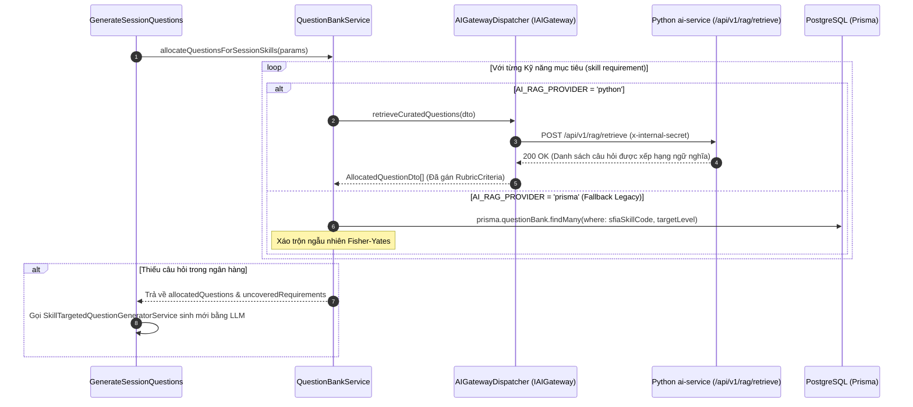

# TASK 2.5: TÍCH HỢP NESTJS CORE & QUESTION ALLOCATION PIPELINE

> **Trạng thái**: Approved / Production Specification  
> **Cấp độ**: Deep Technical Specification (Backend Architecture & Service Integration)  
> **Áp dụng cho**: `server/src/modules/interview-prep/`, `IAIGateway`, `AIGatewayDispatcher`  
> **Tài liệu cha**: [00_PHASE_2_OVERVIEW_AND_ARCHITECTURE.md](00_PHASE_2_OVERVIEW_AND_ARCHITECTURE.md)  
> **Phiên bản**: 1.0.0  

---

## 1. VỊ TRÍ TÍCH HỢP TRONG KIẾN TRÚC TỔNG THỂ

Trong kiến trúc tạo buổi phỏng vấn của InterviewAI:
1. Người dùng gửi JD và chức danh mục tiêu $\rightarrow$ Khởi tạo phiên phỏng vấn với trạng thái `generating`.
2. Hàng đợi BullMQ điều phối tác vụ tới [`GenerateSessionQuestions`](file:///c:/Users/An/Documents/GR1/InterviewCoach/server/src/modules/interview-prep/question-generation/generate-session-questions.service.ts).
3. `GenerateSessionQuestions` phân tích JD, khởi tạo danh sách `session_skills` (mỗi skill có `skillCode`, `targetLevel`, `weight`, `techContext`).
4. **Điểm Tích hợp Phase 2**: `GenerateSessionQuestions` gọi [`QuestionBankService.allocateQuestionsForSessionSkills`](file:///c:/Users/An/Documents/GR1/InterviewCoach/server/src/modules/interview-prep/question-bank/question-bank.service.ts) để cấp phát câu hỏi từ ngân hàng.

---

## 2. NÂNG CẤP `QUESTIONBANKSERVICE`: THAY THẾ FISHER-YATES BẰNG HYBRID RAG

### 2.1 Luồng Điều phối Cấp phát Câu hỏi



### 2.2 Cập nhật Mã Nguồn `QuestionBankService` (`server/src/modules/interview-prep/question-bank/question-bank.service.ts`)

```typescript
@Injectable()
export class QuestionBankService {
  private readonly logger = new Logger(QuestionBankService.name);

  constructor(
    private readonly prisma: PrismaService,
    private readonly questionCriteria: QuestionCriteriaService,
    private readonly config: ConfigService,
    @Inject(AI_GATEWAY_TOKEN)
    private readonly aiGateway: IAIGateway,
  ) {}

  async allocateQuestionsForSessionSkills(params: {
    sessionSkills: SkillAllocationRequirement[];
    totalQuestions: number;
    sessionType: 'technical' | 'hr';
    language: string;
    jobDescriptionText?: string;
  }): Promise<QuestionBankAllocationResult> {
    const ragProvider = this.config.get<string>('AI_RAG_PROVIDER', 'python');
    const skillCounts = this.calculateSkillQuestionCounts(params.sessionSkills, params.totalQuestions);
    const allocatedQuestions: AllocatedQuestionDto[] = [];
    const uncoveredRequirements: Array<{ requirement: SkillAllocationRequirement; neededCount: number }> = [];
    const usedQuestionBankIds = new Set<string>();

    for (const { requirement, count } of skillCounts) {
      if (count <= 0) continue;

      let pickedQuestions: AllocatedQuestionDto[] = [];

      if (ragProvider === 'python') {
        try {
          // Gọi Python Hybrid RAG
          const searchKeywords = (requirement.techContext || []).join(' ') || requirement.skillCode;
          const ragResult = await this.aiGateway.retrieveQuestions({
            queryText: params.jobDescriptionText || requirement.skillCode,
            searchKeywords,
            sessionType: params.sessionType,
            sfiaSkillCode: requirement.skillCode,
            targetSfiaLevel: requirement.targetLevel,
            numQuestions: count,
          });

          // Lọc trùng lặp giữa các skill
          const validCandidates = ragResult.filter((q) => !usedQuestionBankIds.has(q.id));
          pickedQuestions = await this.mapToAllocatedDtos(validCandidates, requirement);
        } catch (error) {
          this.logger.warn(`Python RAG retrieval failed for skill ${requirement.skillCode}, falling back to SQL: ${error.message}`);
          // Tự động rơi vào fallback SQL bên dưới
        }
      }

      // Fallback SQL truyền thống nếu Python bị tắt hoặc gặp sự cố
      if (pickedQuestions.length === 0) {
        pickedQuestions = await this.fallbackPrismaAllocation(requirement, count, params.sessionType, usedQuestionBankIds);
      }

      for (const q of pickedQuestions) {
        if (q.questionBankId) usedQuestionBankIds.add(q.questionBankId);
        allocatedQuestions.push(q);
      }

      if (pickedQuestions.length < count) {
        uncoveredRequirements.push({
          requirement,
          neededCount: count - pickedQuestions.length,
        });
      }
    }

    return { allocatedQuestions, uncoveredRequirements };
  }
}
```

---

## 3. CONTRACT TESTING & KIỂM CHỨNG CHỐNG LỆCH SCHEMA

Để đảm bảo hai dịch vụ NestJS và Python luôn ăn khớp 100%:

1. **NestJS Contract Spec (`test/contracts/python-rag.contract.spec.ts`)**:
   ```typescript
   it('should match wire schema of QuestionRetrievalResponse', () => {
     const fixture = loadJsonFixture('rag-retrieval-response.fixture.json');
     const dto = plainToInstance(QuestionRetrievalResponseDto, fixture);
     expect(validateSync(dto)).toHaveLength(0);
     expect(dto.questions[0].relevanceScore).toBeDefined();
   });
   ```
2. **Python Contract Spec (`tests/test_contracts.py`)**:
   ```python
   def test_rag_response_matches_wire_fixture():
       fixture = load_fixture("rag-retrieval-response.fixture.json")
       model = QuestionRetrievalResponse(**fixture)
       dumped = model.model_dump(by_alias=True)
       assert dumped["questions"][0]["relevanceScore"] == fixture["questions"][0]["relevanceScore"]
   ```

---

## 4. TIÊU CHÍ NGHIỆM THU (QUALITY GATES)

1. **Chuyển đổi Linh hoạt (Feature Flagging)**: Thay đổi `AI_RAG_PROVIDER=prisma` sang `python` và ngược lại mà không làm gián đoạn tiến trình tạo câu hỏi.
2. **Không Trùng Lặp Câu Hỏi**: $100\%$ các câu hỏi được cấp phát trong một phiên phỏng vấn không bị trùng `questionBankId`.
3. **Bù đắp Hoàn hảo**: Bất kỳ kỹ năng nào thiếu câu hỏi trong ngân hàng đều được đẩy thành công sang `uncoveredRequirements` để LLM sinh bù đắp.

---

## 5. TASK EXECUTION CONTRACT

### 5.1 Prerequisites (Tiền đề bắt buộc)
- [ ] Hoàn thành **Task 2.4**: API `POST /api/v1/rag/retrieve` đã hoạt động với Cross-Encoder và Redis L2 Cache.
- [ ] `IAIGateway` trong `server/src/infrastructure/ai/` sẵn sàng nhận method `retrieveQuestions()`.
- [ ] Database PostgreSQL đã backfill đầy đủ vector cho `question_bank`.

### 5.2 Target Deliverables (Sản phẩm mã nguồn đầu ra)
- [ ] `server/src/modules/interview-prep/question-bank.service.ts`: Nâng cấp thuật ngữ và logic `allocateQuestionsBySfia()` gọi qua `IAIGateway` thay cho Fisher-Yates shuffle.
- [ ] `server/src/infrastructure/ai/python-ai.gateway.ts`: Triển khai hàm `retrieveQuestions()` gọi sang Python AI Service.
- [ ] `server/src/infrastructure/ai/dto/rag-retrieval.dto.ts`: DTOs `QuestionRetrievalRequestDto`, `QuestionRetrievalResponseDto`.
- [ ] `server/test/contracts/python-rag.contract.spec.ts`: Jest Contract Test trên fixture `rag-retrieval-response.fixture.json`.

### 5.3 Architectural Rules Enforced (Tuân thủ AGENTS.md)
- [x] **Backend Rule 1**: Giao tiếp liên module tuân thủ Clean Architecture via Contracts.
- [x] **Backend Rule 2**: Controllers không gọi trực tiếp AI client hay database models.
- [x] **Backend Rule 3**: Ném ngoại lệ chuẩn `InterviewAIException(ErrorCode.RAG_RETRIEVAL_FAILED, ...)`.
- [x] **Backend Rule 5**: Thao tác tạo session câu hỏi bọc trong `prisma.$transaction`.

### 5.4 Verification Command (Lệnh kiểm thử & Xác thực tự động)
```bash
# Tier 1 (NestJS QuestionBank Service Unit Test)
cd server && npm run test -- src/modules/interview-prep/question-bank.service.spec.ts

# Tier 2 (Live Session Generation E2E Test)
cd server && npm run test:e2e -- test/e2e/generate-session-questions.e2e-spec.ts
```

### 5.5 Definition of Done (DoD)
- [ ] **Quality Gate 2 Approved 100%**.
- [ ] Cờ `AI_RAG_PROVIDER=prisma` tự động kích hoạt Fallback khi Python service offline mà không văng lỗi 500 ra client.
- [ ] 100% các câu hỏi cấp phát không trùng lặp `questionBankId`.
- [ ] Kỹ năng thiếu câu hỏi được chuyển an toàn sang `uncoveredRequirements` để LLM sinh bù đắp.

### 5.6 Next Task Transition (Bước chuyển tiếp)
- Chuyển tiếp sang **Task 2.6: Đóng gói Bộ AI Tools Chuẩn Hóa**: [06_STANDARDIZED_AGENTIC_TOOLS_AND_PYDANTIC_CONTRACTS.md](06_STANDARDIZED_AGENTIC_TOOLS_AND_PYDANTIC_CONTRACTS.md) để đóng gói Multi-Corpus Retrieval thành bộ 3 AI Tools chuẩn hóa (Pydantic v2 / BaseTool).
- Sau đó tiếp tục với **Task 2.7: LangGraph Curriculum Planner StateGraph**: [07_CURRICULUM_PLANNER_AGENTIC_GRAPH.md](07_CURRICULUM_PLANNER_AGENTIC_GRAPH.md) trước khi bàn giao toàn diện sang Phase 3.

