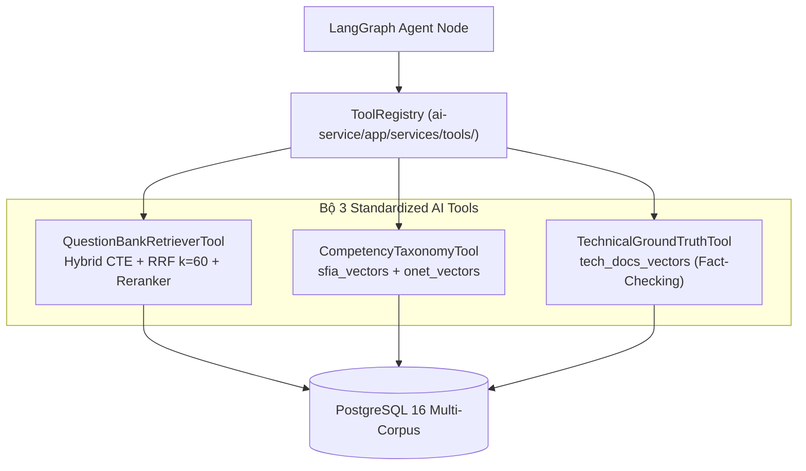

# TASK 2.6: ĐÓNG GÓI BỘ AI TOOLS CHUẨN HÓA & HỢP ĐỒNG PYDANTIC V2
# (STANDARDIZED MULTI-CORPUS AGENTIC TOOL REGISTRY, PYDANTIC V2 SCHEMAS & BASETOOL INTEGRATION)

> **Trạng thái**: Approved / Production Specification  
> **Cấp độ**: Deep Technical Specification (Agentic Architecture & Tool Protocol)  
> **Áp dụng cho**: `ai-service/app/services/tools/`, Pydantic v2, `langchain_core.tools.BaseTool`  
> **Tài liệu cha**: [00_PHASE_2_OVERVIEW_AND_ARCHITECTURE.md](00_PHASE_2_OVERVIEW_AND_ARCHITECTURE.md)  
> **Tài liệu tiên quyết**: [03_HYBRID_RETRIEVAL_AND_RRF_RANKING.md](03_HYBRID_RETRIEVAL_AND_RRF_RANKING.md), [01B_MULTI_CORPUS_VECTOR_SCHEMAS_AND_INDEXES.md](01B_MULTI_CORPUS_VECTOR_SCHEMAS_AND_INDEXES.md)  
> **Phiên bản**: 1.0.0  

---

## 1. NGUYÊN TẮC THIẾT KẾ BỘ CÔNG CỤ CHO AGENT (AGENTIC TOOL DESIGN PRINCIPLES)

Để các tác tử AI (LangGraph StateGraph) có thể tự trị gọi công cụ mà không gây ra lỗi runtime hay hallucination tham số, bộ AI Tools bắt buộc tuân thủ **4 nguyên tắc công nghiệp**:

1. **Strict Input Schema Validation**: 100% tham số đầu vào được ép kiểu chặt chẽ bằng Pydantic v2 `BaseModel` kèm mô tả ngữ nghĩa (`Field(description=...)`) để LLM Function Calling hiểu chính xác mục đích.
2. **Deterministic Output Guarantee**: Kết quả trả về là cấu trúc Python object được chuẩn hóa, không trả về raw string tự do.
3. **Resilience & Fallback Isolation**: Mỗi tool được bọc trong cơ chế Timeout ($< 1.500\text{ms}$) và Error Boundary. Khi database lỗi hoặc không tìm thấy kết quả, tool trả về danh sách rỗng (`[]`) hoặc thông báo có cấu trúc, không bao giờ làm crash toàn bộ đồ thị Agent.
4. **Tool Discovery qua Registry**: Mọi tool được đăng ký tại một điểm tập trung `ToolRegistry` cho phép các Agent ở Phase 2, Phase 3 và Phase 4 tùy biến danh sách tools được phép truy cập.



---

## 2. ĐẶC TẢ CHI TIẾT PYDANTIC V2 SCHEMAS & BASETOOL IMPLEMENTATION

Tạo thư mục: `ai-service/app/services/tools/`

### 2.1 Tool 1: `QuestionBankRetrieverTool`
Tìm kiếm câu hỏi phỏng vấn chuẩn hóa theo Job Description, kỹ năng SFIA, cấp độ và loại phiên.

```python
# ai-service/app/services/tools/question_bank_tool.py
from typing import List, Optional, Literal
from pydantic import BaseModel, Field
from langchain_core.tools import BaseTool
import psycopg2

class QuestionBankSearchArgs(BaseModel):
    job_description: str = Field(description="Toàn văn Job Description hoặc đoạn mô tả yêu cầu công việc cốt lõi")
    sfia_skill_code: Optional[str] = Field(default=None, description="Mã kỹ năng SFIA (ví dụ: 'PROG', 'ITOP', 'SCTM')")
    target_level: Optional[int] = Field(default=None, ge=1, le=7, description="Cấp độ SFIA mục tiêu (1 đến 7)")
    session_type: Literal["hr", "technical"] = Field(default="technical", description="Loại phiên phỏng vấn")
    tech_keywords: Optional[str] = Field(default=None, description="Từ khóa công nghệ (ví dụ: 'nestjs postgresql docker')")
    top_k: int = Field(default=10, ge=1, le=30, description="Số lượng câu hỏi tối đa cần lấy")

class QuestionBankItem(BaseModel):
    id: str
    content: str
    session_type: str
    difficulty: int
    sfia_skill_code: Optional[str]
    target_sfia_level: Optional[int]
    relevance_score: float

class QuestionBankRetrieverTool(BaseTool):
    name: str = "question_bank_retriever"
    description: str = (
        "Tìm kiếm câu hỏi phỏng vấn phù hợp nhất từ ngân hàng câu hỏi chuẩn bằng thuật toán Hybrid RAG "
        "(Dense BGE-M3 + Sparse tsvector + RRF ranking). Sử dụng khi cần phân bổ câu hỏi cho ứng viên."
    )
    args_schema: type[BaseModel] = QuestionBankSearchArgs

    def _run(self, **kwargs) -> List[QuestionBankItem]:
        args = QuestionBankSearchArgs(**kwargs)
        # Thực thi Hybrid Search gọi qua retrieval engine (Task 2.3 & 2.4)
        return self._execute_hybrid_search(args)

    def _execute_hybrid_search(self, args: QuestionBankSearchArgs) -> List[QuestionBankItem]:
        # Implementation kết nối pool database và thực thi CTE query
        ...
```

---

### 2.2 Tool 2: `CompetencyTaxonomyTool`
Tra cứu phát biểu năng lực chuẩn SFIA 9 và danh mục nghề nghiệp O\*NET 29.x.

```python
# ai-service/app/services/tools/competency_taxonomy_tool.py
from typing import List, Optional, Literal
from pydantic import BaseModel, Field
from langchain_core.tools import BaseTool

class CompetencySearchArgs(BaseModel):
    query: str = Field(description="Truy vấn kỹ năng hoặc mô tả nhiệm vụ công việc cần tra cứu")
    corpus: Literal["sfia", "onet", "both"] = Field(default="both", description="Nguồn dữ liệu chuẩn cần tra cứu")
    sfia_skill_code: Optional[str] = Field(default=None, description="Lọc theo mã kỹ năng SFIA cụ thể")
    target_level: Optional[int] = Field(default=None, ge=1, le=7, description="Lọc theo level SFIA (1-7)")
    onet_soc_code: Optional[str] = Field(default=None, description="Lọc theo mã O*NET SOC (ví dụ: '15-1252.00')")
    top_k: int = Field(default=5, ge=1, le=15, description="Số lượng kết quả tối đa")

class CompetencyDescriptorItem(BaseModel):
    corpus: Literal["sfia", "onet"]
    identifier: str  # skill_code (SFIA) hoặc onet_soc_code (O*NET)
    title: str
    level_or_type: Optional[str]
    description: str
    relevance_score: float

class CompetencyTaxonomyTool(BaseTool):
    name: str = "competency_taxonomy_retriever"
    description: str = (
        "Tra cứu mô tả chuẩn mực về năng lực hành vi SFIA 9 và nhiệm vụ nghề nghiệp O*NET 29.x. "
        "Sử dụng khi cần sinh câu hỏi phỏng vấn chuẩn hóa hoặc đối chiếu rubric đánh giá."
    )
    args_schema: type[BaseModel] = CompetencySearchArgs

    def _run(self, **kwargs) -> List[CompetencyDescriptorItem]:
        args = CompetencySearchArgs(**kwargs)
        return self._execute_taxonomy_search(args)

    def _execute_taxonomy_search(self, args: CompetencySearchArgs) -> List[CompetencyDescriptorItem]:
        ...
```

---

### 2.3 Tool 3: `TechnicalGroundTruthTool`
Tra cứu tài liệu kỹ thuật chính thống, RFCs và tiêu chuẩn cấu hình phục vụ Fact-Checking ở Phase 3.

```python
# ai-service/app/services/tools/tech_docs_tool.py
from typing import List, Optional
from pydantic import BaseModel, Field
from langchain_core.tools import BaseTool

class TechDocsSearchArgs(BaseModel):
    claim_or_topic: str = Field(description="Phát biểu kỹ thuật của ứng viên hoặc chủ đề cần đối chứng (ví dụ: 'Kafka Zookeeper controller election')")
    domain: Optional[str] = Field(default=None, description="Lĩnh vực kỹ thuật ('database', 'backend', 'system_design', 'devops')")
    version_tag: Optional[str] = Field(default=None, description="Phiên bản công nghệ (ví dụ: 'postgres-16', 'kafka-3.5')")
    top_k: int = Field(default=5, ge=1, le=10, description="Số lượng bằng chứng tối đa")

class TechDocEvidenceItem(BaseModel):
    doc_id: str
    domain: str
    doc_title: str
    version_tag: Optional[str]
    section_heading: Optional[str]
    evidence_text: str
    metadata: dict
    similarity_score: float

class TechnicalGroundTruthTool(BaseTool):
    name: str = "technical_ground_truth_retriever"
    description: str = (
        "Tra cứu kho tài liệu kỹ thuật, RFCs và kiến trúc chuẩn mực để kiểm chứng tính đúng đắn (Fact-Checking) "
        "của các phát biểu chuyên môn từ ứng viên. Trả về bằng chứng văn bản chính thức."
    )
    args_schema: type[BaseModel] = TechDocsSearchArgs

    def _run(self, **kwargs) -> List[TechDocEvidenceItem]:
        args = TechDocsSearchArgs(**kwargs)
        return self._execute_ground_truth_search(args)

    def _execute_ground_truth_search(self, args: TechDocsSearchArgs) -> List[TechDocEvidenceItem]:
        ...
```

---

## 3. TẬP HỢP CÔNG CỤ TẬP TRUNG (TOOL REGISTRY)

Tạo file: `ai-service/app/services/tools/registry.py`:

```python
from typing import List
from langchain_core.tools import BaseTool
from .question_bank_tool import QuestionBankRetrieverTool
from .competency_taxonomy_tool import CompetencyTaxonomyTool
from .tech_docs_tool import TechnicalGroundTruthTool

class ToolRegistry:
    def __init__(self):
        self._tools = {
            "question_bank": QuestionBankRetrieverTool(),
            "competency": CompetencyTaxonomyTool(),
            "tech_docs": TechnicalGroundTruthTool(),
        }

    def get_prep_tools(self) -> List[BaseTool]:
        """Tools dành cho khâu Lập kịch bản phỏng vấn (Phase 2 & Prep)"""
        return [self._tools["question_bank"], self._tools["competency"]]

    def get_assessment_tools(self) -> List[BaseTool]:
        """Tools dành cho khâu Thẩm định & Fact-Checking (Phase 3 Assessment)"""
        return [self._tools["competency"], self._tools["tech_docs"]]

    def get_tool(self, name: str) -> BaseTool:
        if name not in self._tools:
            raise KeyError(f"Tool '{name}' không tồn tại trong registry.")
        return self._tools[name]
```

---

## 4. KIỂM THỬ HỢP ĐỒNG PYTEST (`tests/test_tool_registry.py`)

```python
import pytest
from app.services.tools.registry import ToolRegistry
from app.services.tools.question_bank_tool import QuestionBankSearchArgs
from app.services.tools.tech_docs_tool import TechDocsSearchArgs

def test_tool_registry_initialization():
    registry = ToolRegistry()
    prep_tools = registry.get_prep_tools()
    assert len(prep_tools) == 2
    assert prep_tools[0].name == "question_bank_retriever"

def test_question_bank_args_validation():
    # Valid
    args = QuestionBankSearchArgs(job_description="Backend NodeJS", sfia_skill_code="PROG", target_level=3)
    assert args.session_type == "technical"

    # Invalid level > 7
    with pytest.raises(ValueError):
        QuestionBankSearchArgs(job_description="Backend", target_level=8)

def test_tech_docs_args_validation():
    args = TechDocsSearchArgs(claim_or_topic="Redis Pub/Sub persistence")
    assert args.top_k == 5
```

---

## 5. KỊCH BẢN ROLLBACK (RECOVERY PLAYBOOK)

Nếu Tool Registry gặp sự cố tương thích phiên bản thư viện:
1. Rollback về phiên bản gọi trực tiếp hàm SQL helper `execute_hybrid_cte_search()` mà không bọc qua `BaseTool`.
2. Kiểm tra log Pydantic validation error bằng việc đặt cờ debug `AI_TOOL_VALIDATION_DEBUG=true`.

---

## 6. TIÊU CHÍ NGHIỆM THU (QUALITY GATES)

1. **Chuẩn Hóa Pydantic**: $100\%$ các tools serialize đúng format JSON Schema tương thích với function-calling của OpenAI và Qwen 2.5.
2. **Xử Lý Lỗi Bọc Kín**: Khi database bị ngắt kết nối, tool bắt ngoại lệ và trả về `[]` kèm log cảnh báo, không làm crash tiến trình gọi của Agent.
3. **Độ Trễ Thực Thi Tool**: Trung bình thời gian thực thi một tool call qua pool DB $< 80\text{ms}$.

---

## 7. TASK EXECUTION CONTRACT

### 7.1 Prerequisites (Tiền đề bắt buộc)
- [ ] Hoàn thành **Sub-Task 2.1B**: Các bảng vector `sfia_vectors`, `onet_vectors`, `tech_docs_vectors` đã sẵn sàng.
- [ ] Thư viện `pydantic>=2.6.0` và `langchain-core>=0.2.0` cài đặt trong `ai-service/pyproject.toml`.

### 7.2 Target Deliverables (Sản phẩm mã nguồn đầu ra)
- [ ] `ai-service/app/services/tools/question_bank_tool.py`: `QuestionBankRetrieverTool`.
- [ ] `ai-service/app/services/tools/competency_taxonomy_tool.py`: `CompetencyTaxonomyTool`.
- [ ] `ai-service/app/services/tools/tech_docs_tool.py`: `TechnicalGroundTruthTool`.
- [ ] `ai-service/app/services/tools/registry.py`: `ToolRegistry`.
- [ ] `ai-service/tests/test_tool_registry.py`: Bộ unit test xác thực schemas và contract.

### 7.3 Architectural Rules Enforced (Tuân thủ AGENTS.md)
- [x] **Backend Rule 1**: Triển khai trong `ai-service/`, phân tách rõ ràng với NestJS presentation.
- [x] **Strict Pydantic Typing**: Mọi model có kiểu dữ liệu rõ ràng, không dùng `Any`.

### 7.4 Verification Command (Lệnh kiểm thử & Xác thực tự động)
```bash
cd ai-service && pytest tests/test_tool_registry.py -v
```

### 7.5 Definition of Done (DoD)
- [ ] Toàn bộ test suite `test_tool_registry.py` đạt 100% pass.
- [ ] Bộ 3 tools đăng ký thành công trong `ToolRegistry` và sẵn sàng cung cấp cho `CurriculumPlannerAgent`.

### 7.6 Next Task Transition (Bước chuyển tiếp)
- Chuyển tiếp sang **Task 2.7: LangGraph Curriculum Planner StateGraph**: [07_CURRICULUM_PLANNER_AGENTIC_GRAPH.md](07_CURRICULUM_PLANNER_AGENTIC_GRAPH.md) để xây dựng tác tử lập kịch bản phỏng vấn tự trị.
