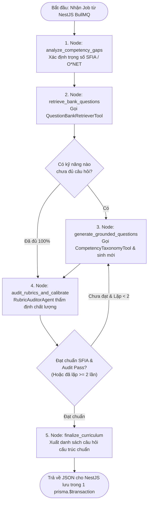

# TASK 2.7: LANGGRAPH CURRICULUM PLANNER AGENTIC GRAPH
# (AUTONOMOUS INTERVIEW CURRICULUM PLANNING, GAP ANALYSIS, TARGETED GENERATION & RUBRIC AUDITING)

> **Trạng thái**: Approved / Production Specification  
> **Cấp độ**: Deep Technical Specification (Agentic Graph & Conversational Planning)  
> **Áp dụng cho**: `ai-service/app/services/prep/curriculum_planner_agent.py`, LangGraph, `server/src/modules/interview-prep/`  
> **Tài liệu cha**: [00_PHASE_2_OVERVIEW_AND_ARCHITECTURE.md](00_PHASE_2_OVERVIEW_AND_ARCHITECTURE.md)  
> **Tài liệu tiên quyết**: [06_STANDARDIZED_AGENTIC_TOOLS_AND_PYDANTIC_CONTRACTS.md](06_STANDARDIZED_AGENTIC_TOOLS_AND_PYDANTIC_CONTRACTS.md)  
> **Phiên bản**: 1.0.0  

---

## 1. MỤC TIÊU KỸ THUẬT & KIẾN TRÚC LANGGRAPH STATEGRAPH

Khi tạo phiên phỏng vấn mới, thay vì bốc câu hỏi cứng nhắc theo thuật toán tuần tự, tác tử **CurriculumPlannerAgent** đóng vai trò như một chuyên gia tuyển dụng cấp cao:
1. **Phân tích Yêu cầu Tuyển dụng (Gap Analysis)**: So khớp Job Description (JD), vị trí mục tiêu (`onet_soc_code`) và cấp độ SFIA kỳ vọng (`target_sfia_level`) để xác định ma trận trọng số kỹ năng.
2. **Cấp phát Thông minh từ Ngân Hàng Câu Hỏi**: Sử dụng `QuestionBankRetrieverTool` tìm các câu hỏi chất lượng cao đã có sẵn trong cơ sở dữ liệu.
3. **Tự Sinh Câu Hỏi Neo Chuẩn (Grounded Generation)**: Với các kỹ năng chưa đủ câu hỏi (`uncoveredRequirements`), tác tử sử dụng `CompetencyTaxonomyTool` để tra cứu chính xác phát biểu năng lực của SFIA 9 và nhiệm vụ O\*NET 29.x, tự động sinh câu hỏi và bộ tiêu chí rubric gắn chặt với bối cảnh thực tế của JD.
4. **Tự Kiểm Định Chất Lượng (Rubric Audit & Reflection)**: Tác tử `RubricAuditorAgent` rà soát lại toàn bộ bộ câu hỏi: kiểm tra độ phân hóa, độ khó tăng dần (Progressive Flow), và tính rõ ràng của tiêu chí đánh giá. Nếu chưa đạt, đồ thị tự động phản tư và sinh lại.



---

## 2. ĐẶC TẢ STATEGRAPH VÀ CÁC NODE THỰC THI

Tạo file: `ai-service/app/services/prep/curriculum_planner_agent.py`:

```python
from typing import List, Dict, Any, Optional, TypedDict
from pydantic import BaseModel, Field
from langgraph.graph import StateGraph, END
from app.services.tools.registry import ToolRegistry

# ==============================================================================
# 1. ĐỊNH NGHĨA TRẠNG THÁI ĐỒ THỊ (GRAPH STATE)
# ==============================================================================
class QuestionPlanItem(BaseModel):
    question_bank_id: Optional[str] = None
    question_text: str
    sfia_skill_code: str
    target_level: int
    difficulty: int
    order_index: int
    source: str = Field(default="bank")  # "bank" | "ai_generated"
    rubric_criteria: List[Dict[str, Any]]

class CurriculumPlannerState(TypedDict):
    session_id: str
    job_description: str
    onet_soc_code: Optional[str]
    target_sfia_level: int
    total_questions: int
    session_type: str
    identified_skills: List[Dict[str, Any]]
    allocated_questions: List[Dict[str, Any]]
    missing_requirements: List[Dict[str, Any]]
    audit_passed: bool
    audit_notes: str
    iteration_count: int

# ==============================================================================
# 2. IMPLEMENTATION CÁC NODE SUY LUẬN
# ==============================================================================
class CurriculumPlannerWorkflow:
    def __init__(self, tool_registry: ToolRegistry, llm_client: Any):
        self.tools = tool_registry.get_prep_tools()
        self.qb_tool = tool_registry.get_tool("question_bank")
        self.comp_tool = tool_registry.get_tool("competency")
        self.llm = llm_client

    def analyze_competency_gaps(self, state: CurriculumPlannerState) -> Dict[str, Any]:
        """Node 1: Phân tích JD và xác định ma trận kỹ năng SFIA cần đánh giá"""
        # LLM trích xuất các kỹ năng trọng tâm dựa trên JD và onet_soc_code
        # Trả về danh sách identified_skills
        ...
        return {"identified_skills": identified_skills, "iteration_count": 0}

    def retrieve_bank_questions(self, state: CurriculumPlannerState) -> Dict[str, Any]:
        """Node 2: Tra cứu câu hỏi từ Question Bank qua Tool"""
        allocated = []
        missing = []
        for skill in state["identified_skills"]:
            res = self.qb_tool.invoke({
                "job_description": state["job_description"],
                "sfia_skill_code": skill["skill_code"],
                "target_level": skill["target_level"],
                "session_type": state["session_type"],
                "top_k": skill["needed_count"]
            })
            if len(res) >= skill["needed_count"]:
                allocated.extend(res[:skill["needed_count"]])
            else:
                allocated.extend(res)
                missing.append({
                    "skill_code": skill["skill_code"],
                    "target_level": skill["target_level"],
                    "needed_count": skill["needed_count"] - len(res)
                })
        return {"allocated_questions": allocated, "missing_requirements": missing}

    def generate_grounded_questions(self, state: CurriculumPlannerState) -> Dict[str, Any]:
        """Node 3: Sinh câu hỏi mới cho kỹ năng thiếu hụt, neo chặt vào SFIA taxonomy"""
        new_generated = list(state["allocated_questions"])
        for req in state["missing_requirements"]:
            # Gọi CompetencyTaxonomyTool lấy mô tả level chính thức
            desc = self.comp_tool.invoke({
                "query": req["skill_code"],
                "corpus": "sfia",
                "sfia_skill_code": req["skill_code"],
                "target_level": req["target_level"]
            })
            # LLM sinh câu hỏi bám sát descriptor kèm rubric tiêu chí
            # new_generated.append(...)
        return {
            "allocated_questions": new_generated,
            "iteration_count": state["iteration_count"] + 1
        }

    def audit_rubrics_and_calibrate(self, state: CurriculumPlannerState) -> Dict[str, Any]:
        """Node 4: RubricAuditorAgent kiểm định chất lượng toàn bộ kịch bản câu hỏi"""
        # Kiểm tra tính lũy tiến (dễ -> khó), tính độc lập và tiêu chí đánh giá
        # Nếu đạt: audit_passed = True; Nếu chưa đạt và iteration < 2: audit_passed = False
        return {"audit_passed": True, "audit_notes": "All questions verified"}

    def route_audit_decision(self, state: CurriculumPlannerState) -> str:
        """Conditional Edge: Quyết định kết thúc hay sinh lại"""
        if state["audit_passed"] or state["iteration_count"] >= 2:
            return "finalize"
        return "regenerate"

    def build_graph(self) -> StateGraph:
        workflow = StateGraph(CurriculumPlannerState)
        workflow.add_node("analyze_competency_gaps", self.analyze_competency_gaps)
        workflow.add_node("retrieve_bank_questions", self.retrieve_bank_questions)
        workflow.add_node("generate_grounded_questions", self.generate_grounded_questions)
        workflow.add_node("audit_rubrics_and_calibrate", self.audit_rubrics_and_calibrate)

        workflow.set_entry_point("analyze_competency_gaps")
        workflow.add_edge("analyze_competency_gaps", "retrieve_bank_questions")
        
        # Rẽ nhánh nếu thiếu câu hỏi
        workflow.add_conditional_edges(
            "retrieve_bank_questions",
            lambda s: "generate" if len(s["missing_requirements"]) > 0 else "audit",
            {"generate": "generate_grounded_questions", "audit": "audit_rubrics_and_calibrate"}
        )
        workflow.add_edge("generate_grounded_questions", "audit_rubrics_and_calibrate")
        
        workflow.add_conditional_edges(
            "audit_rubrics_and_calibrate",
            self.route_audit_decision,
            {"regenerate": "generate_grounded_questions", "finalize": END}
        )
        return workflow.compile()
```

---

## 3. HỢP ĐỒNG API VÀ GIAO TIẾP VỚI NESTJS CORE

### 3.1 Endpoint `POST /api/v1/prep/curriculum-agent`
* **Request Payload**:
  ```json
  {
    "sessionId": "a1b2c3d4-e5f6-7a8b-9c0d-1e2f3a4b5c6d",
    "jobDescriptionText": "Senior NodeJS Engineer với kinh nghiệm PostgreSQL và Microservices...",
    "onetSocCode": "15-1252.00",
    "targetSfiaLevel": 4,
    "totalQuestions": 5,
    "sessionType": "technical",
    "language": "vi"
  }
  ```

* **Response Payload**:
  ```json
  {
    "sessionId": "a1b2c3d4-e5f6-7a8b-9c0d-1e2f3a4b5c6d",
    "questions": [
      {
        "questionBankId": "uuid-qb-1",
        "questionText": "Trình bày cách bạn xử lý hiện tượng dead-lock trong PostgreSQL...",
        "sfiaSkillCode": "DBDS",
        "targetLevel": 4,
        "difficulty": 2,
        "orderIndex": 1,
        "source": "bank",
        "rubricCriteria": [
          {"dimension": "problem_solving", "criteriaText": "Phân tích được log pg_locks và deadlock_timeout"}
        ]
      }
    ],
    "auditSummary": {
      "passed": true,
      "skillCoverageRate": 1.0,
      "bankMatchCount": 4,
      "aiGeneratedCount": 1
    }
  }
  ```

### 3.2 NestJS Consumer (`GenerateSessionQuestions.ts`)
Khi BullMQ worker xử lý job, service gọi HTTP sang endpoint trên. Kết quả trả về được lưu vào bảng `session_questions` và `session_skills` trong duy nhất **1 `prisma.$transaction`**.

---

## 4. KỊCH BẢN ROLLBACK (RECOVERY PLAYBOOK)

1. Nếu `CurriculumPlannerAgent` bị timeout ($> 15\text{s}$) hoặc cụm suy luận vLLM quá tải:
   * NestJS tự động bắt ngoại lệ và kích hoạt **Deterministic SQL Fallback**: gọi trực tiếp `QuestionBankService.allocateQuestionsBySfia()` để bốc câu hỏi từ database.
   * Ghi log cảnh báo `AgenticCurriculumTimeout` với `sessionId` và `correlationId`.

---

## 5. TIÊU CHÍ NGHIỆM THU (QUALITY GATES)

1. **Tuân Thủ Ngân Sách Vòng Lặp**: Đồ thị không bao giờ lặp quá 2 lần trong khâu Reflection (`iteration_count <= 2`).
2. **Bảo Đảm Độ Phủ Kỹ Năng (Coverage)**: $100\%$ các câu hỏi sinh ra hoặc bốc từ ngân hàng đều gán đúng mã `sfiaSkillCode` và `targetLevel`.
3. **Hiệu Năng Toàn Trình**: Tổng thời gian thực thi đồ thị Agent $< 8.0\text{ giây}$ (Average) và $< 14.0\text{ giây}$ (P99).
4. **Tính Toàn Vẹn Giao Dịch**: Toàn bộ câu hỏi được ghi nhận vào PostgreSQL trong duy nhất 1 `prisma.$transaction`.

---

## 6. TASK EXECUTION CONTRACT

### 6.1 Prerequisites (Tiền đề bắt buộc)
- [ ] Hoàn thành **Task 2.6**: Bộ 3 AI Tools trong `ToolRegistry` hoạt động ổn định.
- [ ] Thư viện `langgraph>=0.0.30` cài đặt trong `ai-service/`.

### 6.2 Target Deliverables (Sản phẩm mã nguồn đầu ra)
- [ ] `ai-service/app/services/prep/curriculum_planner_agent.py`: `CurriculumPlannerWorkflow`.
- [ ] `ai-service/app/api/v1/prep_router.py`: Endpoint `POST /api/v1/prep/curriculum-agent`.
- [ ] `server/src/infrastructure/ai/python-ai.gateway.ts`: Method `planInterviewCurriculum()`.
- [ ] `server/src/modules/interview-prep/question-generation/generate-session-questions.service.ts`: Nâng cấp tích hợp gọi Agent.
- [ ] `ai-service/tests/test_curriculum_agent.py`: Unit test đồ thị LangGraph với mock tools.

### 6.3 Architectural Rules Enforced (Tuân thủ AGENTS.md)
- [x] **Backend Rule 1**: Giao tiếp giữa NestJS và Python qua HTTP REST DTOs, không import chéo.
- [x] **Backend Rule 5**: Thao tác lưu `session_questions` bọc trong `prisma.$transaction`.

### 6.4 Verification Command (Lệnh kiểm thử & Xác thực tự động)
```bash
# Tier 1 (Python LangGraph Workflow Unit Test)
cd ai-service && pytest tests/test_curriculum_agent.py -v

# Tier 2 (NestJS Session Generation Integration Test)
cd server && npm run test -- src/modules/interview-prep/question-generation/generate-session-questions.service.spec.ts
```

### 6.5 Definition of Done (DoD)
- [ ] **HOÀN THÀNH PHASE 2 (MULTI-CORPUS AGENTIC RAG FOUNDATION)**.
- [ ] Đồ thị `CurriculumPlannerAgent` vượt qua toàn bộ unit test và contract tests.
- [ ] Bộ câu hỏi được tạo và lưu thành công vào PostgreSQL cho 1 phiên phỏng vấn thử nghiệm.

### 6.6 Next Task Transition (Bước chuyển tiếp)
- **Bàn giao sang Phase 3 (Multi-Agent Deep Assessment & Semantic Scoring)**: Bắt đầu tại [01_PASS_1_STAR_DECONSTRUCTION_AND_RUBRIC_EVAL.md](../03_PHASE_3_DEEP_ASSESSMENT/01_PASS_1_STAR_DECONSTRUCTION_AND_RUBRIC_EVAL.md) và [02B_AGENTIC_FACT_CHECKING_GRAPH_AND_EVIDENCE_RETRIEVAL.md](../03_PHASE_3_DEEP_ASSESSMENT/02B_AGENTIC_FACT_CHECKING_GRAPH_AND_EVIDENCE_RETRIEVAL.md).
