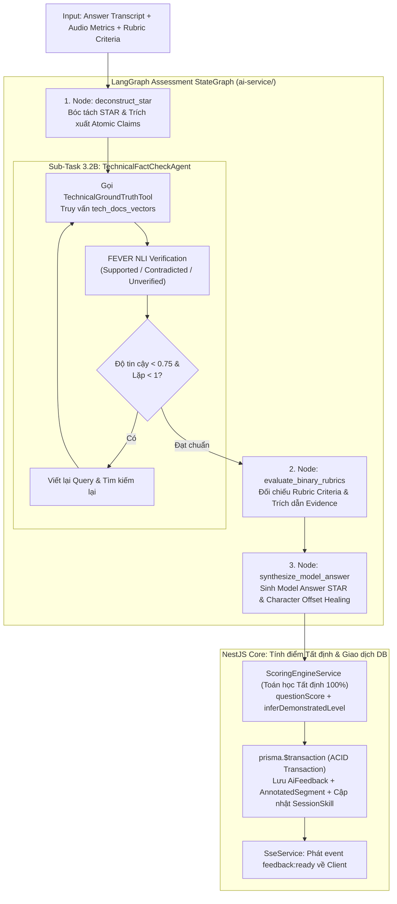

# TÀI LIỆU TỔNG QUAN: PHASE 3 — PIPELINE CHẤM ĐIỂM CHUYÊN SÂU, MULTI-AGENT FACT-CHECKING & SEMANTIC ASSESSMENT
# (MASTER OVERVIEW, ROADMAP & DETAILED TASK BREAKDOWN)

> **Trạng thái**: Approved / Production Specification  
> **Cấp độ**: Production Specification (System Architect / Lead Engineer)  
> **Áp dụng cho**: `server/src/modules/interview-assessment/`, BullMQ Outbox Worker, Python `ai-service/app/services/assessment/`  
> **Tài liệu tham chiếu**: [00_OVERVIEW_STRATEGIC_BLUEPRINT.md](../00_OVERVIEW_STRATEGIC_BLUEPRINT.md), [02_PHASE_2_PGVECTOR_HYBRID_RAG/](../02_PHASE_2_PGVECTOR_HYBRID_RAG/00_PHASE_2_OVERVIEW_AND_ARCHITECTURE.md)  
> **Phiên bản**: 3.0.0 (Tái cấu trúc tích hợp LangGraph Multi-Agent Fact-Checking Graph)  

---

## 1. TỔNG QUAN KIẾN TRÚC PHASE 3

Phase 3 nâng cấp toàn diện cơ chế đánh giá câu trả lời từng lượt (Turn Evaluation) sang **Multi-Agent Deep Assessment StateGraph** kết hợp **Deterministic Scoring 100%**:



---

## 2. DANH MỤC CÁC TÀI LIỆU CHUYÊN SÂU TỪNG TASK (TASK BREAKDOWN)

Phase 3 được phân rã thành 5 nhiệm vụ kỹ thuật chính và 1 nhiệm vụ phụ chuyên sâu:

| Thứ tự | Tệp Tài liệu Đặc tả | Trọng tâm Kỹ thuật & Phạm vi Triển khai |
| :---: | :--- | :--- |
| **Task 3.1** | [01_PASS_1_STAR_DECONSTRUCTION_AND_RUBRIC_EVAL.md](01_PASS_1_STAR_DECONSTRUCTION_AND_RUBRIC_EVAL.md) | Bóc tách 4 thành phần STAR, thẩm định nhị phân (`passed: boolean`) từng tiêu chí rubric cốt lõi/chuyên sâu kèm trích dẫn nguyên văn bằng chứng (`evidence`) và lý do trừ điểm. |
| **Task 3.2** | [02_TECHNICAL_FACT_CHECKING_AND_BUZZWORD_DETECTION.md](02_TECHNICAL_FACT_CHECKING_AND_BUZZWORD_DETECTION.md) | Trích xuất phát biểu kỹ thuật nguyên tử (`atomic claims`), công thức toán học đo lường mật độ từ khóa sáo rỗng (`buzzwordDensityScore` 0-100), và heuristics phát hiện mâu thuẫn. |
| **Task 3.2B**| [02B_AGENTIC_FACT_CHECKING_GRAPH_AND_EVIDENCE_RETRIEVAL.md](02B_AGENTIC_FACT_CHECKING_GRAPH_AND_EVIDENCE_RETRIEVAL.md) | Xây dựng đồ thị LangGraph StateGraph cho `TechnicalFactCheckAgent`, phân loại chuẩn FEVER NLI 3 trạng thái (Supported / Contradicted / Unverified), tự phản tư và tích hợp Checkpointer. |
| **Task 3.3** | [03_PASS_2_SYNTHESIS_MODEL_ANSWER_AND_ANNOTATIONS.md](03_PASS_2_SYNTHESIS_MODEL_ANSWER_AND_ANNOTATIONS.md) | Tổng hợp điểm mạnh/yếu, sinh câu trả lời mẫu hoàn hảo, bài học then chốt và trích xuất phân đoạn đánh dấu văn bản (`annotatedSegments`) với thuật toán Character Offset Healing. |
| **Task 3.4** | [04_DETERMINISTIC_SCORING_AND_SFIA_LEVEL_INFERENCE.md](04_DETERMINISTIC_SCORING_AND_SFIA_LEVEL_INFERENCE.md) | Thuật toán tính điểm toán học tất định 100% trong `ScoringEngineService`: tính `questionScore`, suy luận cấp độ thực tế `inferDemonstratedLevel` (1-7), và tổng hợp điểm cho `session_skills`. |
| **Task 3.5** | [05_BULLMQ_OUTBOX_ORCHESTRATION_AND_NESTJS_WORKER.md](05_BULLMQ_OUTBOX_ORCHESTRATION_AND_NESTJS_WORKER.md) | Điều phối bất đồng bộ qua BullMQ Outbox, `FeedbackProcessor` là Consumer duy nhất, gọi REST sang Python Stateless Compute, lưu trữ DB trong 1 `prisma.$transaction`, bắn SSE realtime. |

---

## 3. KHUNG BÀN GIAO & LIÊN KẾT TUẦN TỰ (PHASE 3 EXECUTION & HANDOVER PROTOCOL)

### 3.1 Tiền đề Bàn giao Nhận từ Phase 2 (Incoming Handover)
* Toàn bộ 4 kho tri thức pgvector và bộ 3 AI Tools (`QuestionBankRetrieverTool`, `CompetencyTaxonomyTool`, `TechnicalGroundTruthTool`) đã hoạt động ổn định.
* Đã vượt qua toàn bộ tiêu chí của **Quality Gate 2**.

### 3.2 Chuỗi Thực thi Tuần tự (Task Sequential Flow)
```
Task 3.1 (Pass 1 STAR) ──> Task 3.2 (Atomic Claims & Buzzword Math)
                                   │
                                   ▼
Task 3.3 (Pass 2 Synthesis) <── Sub-Task 3.2B (LangGraph Fact-Checking Agent)
         │
         ▼
Task 3.4 (Deterministic Scoring) ──> Task 3.5 (BullMQ Outbox Worker)
```

### 3.3 Handover Sang Phase 4 (Phase 3 -> Phase 4 Transition)
* **Điều kiện hoàn thành Phase 3**: Vượt qua toàn bộ tiêu chí của **Quality Gate 3**.
* **Đầu ra bàn giao**: Pipeline đánh giá câu trả lời kết hợp Multi-Agent Fact-Checking đã chạy ổn định qua BullMQ Outbox Worker và lưu dữ liệu trong 1 `prisma.$transaction`.
* **Tài liệu chuyển tiếp**: Chuyển sang Phase 4 tại [00_PHASE_4_OVERVIEW_AND_ARCHITECTURE.md](../04_PHASE_4_VLLM_SCALING/00_PHASE_4_OVERVIEW_AND_ARCHITECTURE.md) (Task 4.1: Deploy vLLM Cluster).

---

## 4. CHỈ TIÊU NGHIỆM THU TỔNG THỂ (QUALITY GATE 3)

1. **Hiệu năng Xử lý Bất đồng bộ & Latency**:
   * Tổng thời gian từ lúc ứng viên submit turn đến khi hiển thị feedback $< 12.0\text{ giây}$ (Average) và $< 20.0\text{ giây}$ (P99).
2. **Độ chính xác Tiêu chí & Fact-Check**:
   * Phân loại chuẩn xác 3 trạng thái (Supported / Contradicted / Unverified) cho $100\%$ các phát biểu kỹ thuật nguyên tử.
   * Phát hiện chính xác $100\%$ các lỗi kiến thức kỹ thuật cài cắm trong test suite fixture.
   * $100\%$ các tiêu chí đạt bắt buộc phải có trích dẫn bằng chứng xác thực (`evidence`) lấy từ transcript.
3. **Tính Toàn vẹn Dữ liệu & Deterministic Scoring**:
   * Điểm số và cấp độ SFIA được tính toán tất định $100\%$ bằng toán học qua `ScoringEngineService`.
   * Toàn bộ dữ liệu `ai_feedbacks`, `annotated_segments` và `session_skills` được cập nhật đồng thời trong cùng một `prisma.$transaction`.
4. **Khả năng Phục hồi (Zero-Downtime Fallback)**:
   * Chuyển đổi cờ `AI_EVALUATION_PROVIDER=openai` hoặc ngắt kết nối Python `ai-service`, NestJS vẫn xử lý và trả về feedback bình thường qua Cloud Fallback.
