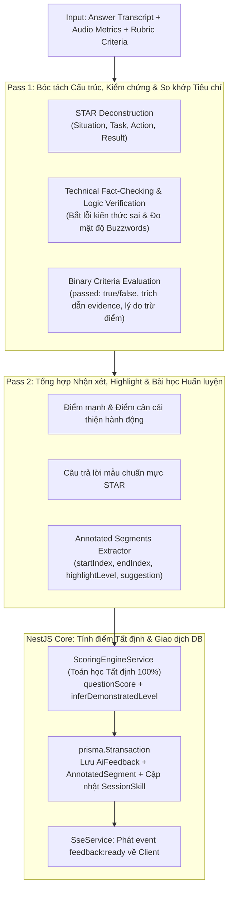
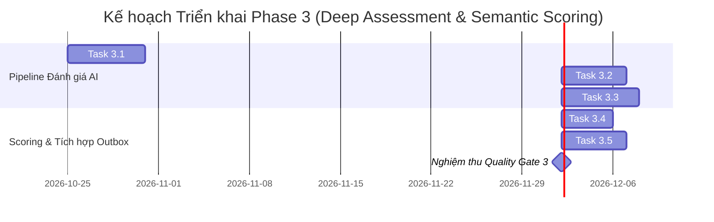

# TÀI LIỆU TỔNG QUAN: PHASE 3 — PIPELINE CHẤM ĐIỂM CHUYÊN SÂU & SEMANTIC ASSESSMENT
# (MASTER OVERVIEW, ROADMAP & DETAILED TASK BREAKDOWN)

> **Trạng thái**: Approved / Production Specification  
> **Áp dụng cho**: `server/src/modules/interview-assessment/`, BullMQ Outbox Worker, Python `ai-service/app/services/assessment/`  
> **Tài liệu tham chiếu**: [00_OVERVIEW_STRATEGIC_BLUEPRINT.md](../00_OVERVIEW_STRATEGIC_BLUEPRINT.md), [02_PHASE_2_PGVECTOR_HYBRID_RAG/](../02_PHASE_2_PGVECTOR_HYBRID_RAG/00_PHASE_2_OVERVIEW_AND_ARCHITECTURE.md)  
> **Phiên bản**: 1.1.0  

---

## 1. TỔNG QUAN KIẾN TRÚC PHASE 3

Phase 3 nâng cấp toàn diện cơ chế đánh giá câu trả lời từng lượt (turn evaluation) từ prompt đơn lẻ dễ bị lạm phát điểm sang **Pipeline Đánh giá 2 Chặng Tối ưu (Optimized 2-Pass Assessment Pipeline)** kết hợp **Tính toán Điểm số Tất định 100%**:

---

## 2. DANH MỤC CÁC TÀI LIỆU CHUYÊN SÂU TỪNG TASK (TASK BREAKDOWN)

Phase 3 được phân rã thành 5 nhiệm vụ kỹ thuật độc lập với tài liệu đặc tả thực thi riêng biệt:

| Thứ tự | Tệp Tài liệu Đặc tả | Trọng tâm Kỹ thuật & Phạm vi Triển khai |
| :---: | :--- | :--- |
| **Task 3.1** | [01_PASS_1_STAR_DECONSTRUCTION_AND_RUBRIC_EVAL.md](01_PASS_1_STAR_DECONSTRUCTION_AND_RUBRIC_EVAL.md) | Bóc tách 4 thành phần STAR, thẩm định nhị phân (`passed: boolean`) từng tiêu chí rubric cốt lõi/chuyên sâu kèm trích dẫn nguyên văn bằng chứng (`evidence`) và lý do trừ điểm. |
| **Task 3.2** | [02_TECHNICAL_FACT_CHECKING_AND_BUZZWORD_DETECTION.md](02_TECHNICAL_FACT_CHECKING_AND_BUZZWORD_DETECTION.md) | Thẩm tra tính đúng đắn kỹ thuật, phát hiện lỗi kiến thức sai lệch (`hallucinationFlags`), đo lường mật độ từ khóa sáo rỗng (`buzzwordDensityScore` 0-100) và phát hiện văn bản AI. |
| **Task 3.3** | [03_PASS_2_SYNTHESIS_MODEL_ANSWER_AND_ANNOTATIONS.md](03_PASS_2_SYNTHESIS_MODEL_ANSWER_AND_ANNOTATIONS.md) | Tổng hợp điểm mạnh/yếu, sinh câu trả lời mẫu hoàn hảo, bài học then chốt và trích xuất phân đoạn đánh dấu văn bản (`annotatedSegments`) với thuật toán tự sửa lệch tọa độ ký tự. |
| **Task 3.4** | [04_DETERMINISTIC_SCORING_AND_SFIA_LEVEL_INFERENCE.md](04_DETERMINISTIC_SCORING_AND_SFIA_LEVEL_INFERENCE.md) | Thuật toán tính điểm toán học tất định 100% trong `ScoringEngineService`: tính `questionScore`, suy luận cấp độ thực tế `inferDemonstratedLevel` (1-7), và tổng hợp điểm cho `session_skills`. |
| **Task 3.5** | [05_BULLMQ_OUTBOX_ORCHESTRATION_AND_NESTJS_WORKER.md](05_BULLMQ_OUTBOX_ORCHESTRATION_AND_NESTJS_WORKER.md) | Điều phối bất đồng bộ qua BullMQ Outbox, `FeedbackProcessor` là Consumer duy nhất, gọi REST sang Python, lưu trữ DB trong 1 transaction, bắn SSE realtime và tự kích hoạt báo cáo phiên. |

---

## 3. LỘ TRÌNH TRIỂN KHAI & TIÊU CHÍ NGHIỆM THU TỔNG THỂ

### Tiêu chí Nghiệm thu Tổng thể (Quality Gate 3):
1. **Hiệu năng Xử lý Bất đồng bộ**:
   * Tổng thời gian từ lúc ứng viên bấm nộp bài đến khi nhận được feedback trên màn hình $< 12.0\text{ giây}$ (Average) và $< 20.0\text{ giây}$ (P99).
2. **Độ chính xác & Chống Ảo giác**:
   * Phát hiện chính xác $100\%$ các lỗi kiến thức kỹ thuật cài cắm trong test suite.
   * $100\%$ các tiêu chí đạt bắt buộc phải có trích dẫn bằng chứng xác thực (`evidence`) lấy từ transcript.
3. **Tính Toàn vẹn Dữ liệu & Tính Tất định**:
   * Điểm số và cấp độ SFIA được tính toán tất định $100\%$ bằng toán học qua `ScoringEngineService`.
   * Toàn bộ dữ liệu `ai_feedbacks`, `annotated_segments` và `session_skills` được cập nhật đồng thời trong cùng một giao dịch database.
