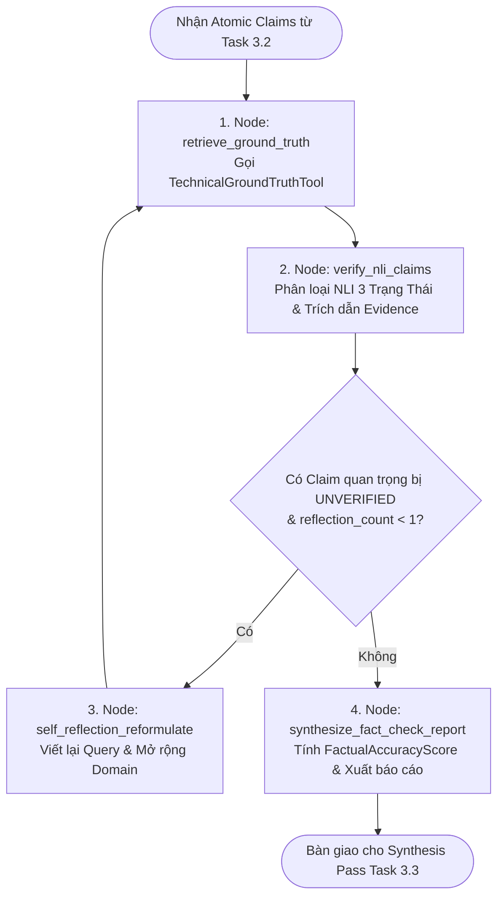

# SUB-TASK 3.2B: LANGGRAPH FACT-CHECKING AGENT & FEVER NLI RETRIEVAL
# (MULTI-STEP FACT-CHECKING STATEGRAPH, NATURAL LANGUAGE INFERENCE & EVIDENCE CITATION)

> **Trạng thái**: Approved / Production Specification  
> **Cấp độ**: Deep Technical Specification (Fact-Checking Agent & Evidence Retrieval)  
> **Áp dụng cho**: `ai-service/app/services/assessment/fact_check_agent.py`, LangGraph, `TechnicalGroundTruthTool`  
> **Tài liệu cha**: [00_PHASE_3_OVERVIEW_AND_ARCHITECTURE.md](00_PHASE_3_OVERVIEW_AND_ARCHITECTURE.md)  
> **Tài liệu tiên quyết**: [02_TECHNICAL_FACT_CHECKING_AND_BUZZWORD_DETECTION.md](02_TECHNICAL_FACT_CHECKING_AND_BUZZWORD_DETECTION.md), [06_STANDARDIZED_AGENTIC_TOOLS_AND_PYDANTIC_CONTRACTS.md](../02_PHASE_2_PGVECTOR_HYBRID_RAG/06_STANDARDIZED_AGENTIC_TOOLS_AND_PYDANTIC_CONTRACTS.md)  
> **Phiên bản**: 1.0.0  

---

## 1. MỤC TIÊU KỸ THUẬT & CHUẨN FEVER NLI 3 TRẠNG THÁI

Thay vì để LLM phán xét cảm tính về kiến thức của ứng viên, tác tử **TechnicalFactCheckAgent** vận hành theo phương pháp luận khoa học dựa trên bộ tiêu chuẩn **FEVER (Fact Extraction and VERification)** kết hợp mô hình suy luận ngôn ngữ tự nhiên **NLI (Natural Language Inference)**:

### 1.1 Chuẩn Phân Loại NLI 3 Trạng Thái
Mỗi phát biểu kỹ thuật nguyên tử (`atomic claim`) sau khi trích xuất được đối soát với tài liệu chính thống trong `tech_docs_vectors` và phân loại vào 1 trong 3 trạng thái bất biến:

| Trạng Thái NLI | Định Nghĩa Kỹ Thuật | Hành Động Hệ Thống |
| :--- | :--- | :--- |
| **`SUPPORTED`** | Tài liệu kỹ thuật chứng minh rõ ràng phát biểu của ứng viên là hoàn toàn chính xác. | Trích dẫn nguyên văn đoạn văn bản xác thực (`evidence_quote`) và doc URL. |
| **`CONTRADICTED`** | Tài liệu kỹ thuật chỉ ra nguyên lý vận hành ngược lại với phát biểu của ứng viên (ví dụ: tuyên bố Kafka lưu tin nhắn trên RAM không ghi đĩa). | Đánh cờ `hallucinationFlag`, trích dẫn nguyên lý đúng từ tài liệu, trừ điểm fact-check. |
| **`UNVERIFIED`** | Không tìm thấy bằng chứng đối chứng trong kho tri thức nội bộ hoặc phát biểu mang tính cảm nhận kinh nghiệm chủ quan. | Không cộng và không trừ điểm; kích hoạt vòng lặp phản tư (Self-Reflection) nếu là công nghệ trọng tâm. |

### 1.2 Công Thức Tính Điểm Chính Xác Kỹ Thuật (`factualAccuracyScore`)
$$\text{FactualAccuracyScore} = \begin{cases} 
100, & \text{nếu } \text{Count(SUPPORTED)} + \text{Count(CONTRADICTED)} = 0 \\
\text{round}\left(\frac{\text{Count(SUPPORTED)}}{\text{Count(SUPPORTED)} + \text{Count(CONTRADICTED)}} \times 100\right), & \text{ngược lại}
\end{cases}$$

---

## 2. THIẾT KẾ ĐỒ THỊ LANGGRAPH STATEGRAPH



Tạo file: `ai-service/app/services/assessment/fact_check_agent.py`:

```python
from typing import List, Dict, Any, Optional, Literal, TypedDict
from pydantic import BaseModel, Field
from langgraph.graph import StateGraph, END
from app.services.tools.registry import ToolRegistry

class ClaimItem(BaseModel):
    claim_id: str
    claim_text: str
    technology_domain: str

class VerificationResult(BaseModel):
    claim_id: str
    claim_text: str
    verdict: Literal["SUPPORTED", "CONTRADICTED", "UNVERIFIED"]
    confidence: float
    evidence_quote: Optional[str] = None
    doc_title: Optional[str] = None
    refutation_explanation: Optional[str] = None

class FactCheckState(TypedDict):
    claims: List[Dict[str, Any]]
    retrieved_evidence: Dict[str, List[Dict[str, Any]]]
    verifications: List[Dict[str, Any]]
    reflection_count: int
    factual_accuracy_score: int
    hallucination_flags: List[str]

class TechnicalFactCheckWorkflow:
    def __init__(self, tool_registry: ToolRegistry, llm_client: Any):
        self.tech_tool = tool_registry.get_tool("tech_docs")
        self.llm = llm_client

    def retrieve_ground_truth(self, state: FactCheckState) -> Dict[str, Any]:
        """Node 1: Tìm kiếm tài liệu kỹ thuật chuẩn qua TechnicalGroundTruthTool"""
        evidence_map = dict(state.get("retrieved_evidence", {}))
        for claim in state["claims"]:
            c_id = claim["claim_id"]
            if c_id not in evidence_map:
                res = self.tech_tool.invoke({
                    "claim_or_topic": claim["claim_text"],
                    "domain": claim.get("technology_domain"),
                    "top_k": 3
                })
                evidence_map[c_id] = [r.model_dump() for r in res]
        return {"retrieved_evidence": evidence_map}

    def verify_nli_claims(self, state: FactCheckState) -> Dict[str, Any]:
        """Node 2: Thẩm định NLI 3 trạng thái qua LLM với Few-shot Prompting"""
        verifications = []
        hallucination_flags = []
        for claim in state["claims"]:
            c_id = claim["claim_id"]
            evidences = state["retrieved_evidence"].get(c_id, [])
            
            # LLM NLI Evaluation logic
            # Phân loại SUPPORTED / CONTRADICTED / UNVERIFIED
            ...
        return {
            "verifications": verifications,
            "hallucination_flags": hallucination_flags
        }

    def should_reflect(self, state: FactCheckState) -> str:
        """Conditional Edge: Kiểm tra xem có cần tự phản tư (Reflection) không"""
        if state.get("reflection_count", 0) >= 1:
            return "synthesize"
        
        # Nếu có claim quan trọng bị UNVERIFIED, kích hoạt phản tư viết lại query
        has_unverified = any(v["verdict"] == "UNVERIFIED" for v in state["verifications"])
        return "reflect" if has_unverified else "synthesize"

    def self_reflection_reformulate(self, state: FactCheckState) -> Dict[str, Any]:
        """Node 3: Phản tư và viết lại câu truy vấn tìm kiếm rộng hơn"""
        # LLM viết lại các claim UNVERIFIED thành abstract concepts
        ...
        return {"reflection_count": state.get("reflection_count", 0) + 1}

    def synthesize_fact_check_report(self, state: FactCheckState) -> Dict[str, Any]:
        """Node 4: Tổng hợp báo cáo và tính điểm toán học FactualAccuracyScore"""
        verifications = state["verifications"]
        supported = sum(1 for v in verifications if v["verdict"] == "SUPPORTED")
        contradicted = sum(1 for v in verifications if v["verdict"] == "CONTRADICTED")
        total_eval = supported + contradicted
        
        score = 100 if total_eval == 0 else round((supported / total_eval) * 100)
        return {
            "factual_accuracy_score": score,
            "hallucination_flags": state["hallucination_flags"]
        }

    def build_graph(self) -> StateGraph:
        workflow = StateGraph(FactCheckState)
        workflow.add_node("retrieve_ground_truth", self.retrieve_ground_truth)
        workflow.add_node("verify_nli_claims", self.verify_nli_claims)
        workflow.add_node("self_reflection_reformulate", self.self_reflection_reformulate)
        workflow.add_node("synthesize_fact_check_report", self.synthesize_fact_check_report)

        workflow.set_entry_point("retrieve_ground_truth")
        workflow.add_edge("retrieve_ground_truth", "verify_nli_claims")
        workflow.add_conditional_edges(
            "verify_nli_claims",
            self.should_reflect,
            {"reflect": "self_reflection_reformulate", "synthesize": "synthesize_fact_check_report"}
        )
        workflow.add_edge("self_reflection_reformulate", "retrieve_ground_truth")
        workflow.add_edge("synthesize_fact_check_report", END)
        return workflow.compile()
```

---

## 3. PYDANTIC V2 HỢP ĐỒNG ĐẦU RA CHO PHASE 3

```python
# ai-service/app/schemas/fact_check_contract.py
from typing import List, Optional, Literal
from pydantic import BaseModel, Field

class FactCheckClaimResult(BaseModel):
    claimText: str = Field(description="Phát biểu kỹ thuật nguyên tử của ứng viên")
    verdict: Literal["SUPPORTED", "CONTRADICTED", "UNVERIFIED"]
    evidenceQuote: Optional[str] = Field(default=None, description="Trích dẫn nguyên văn từ tài liệu kỹ thuật")
    docTitle: Optional[str] = Field(default=None, description="Tiêu đề tài liệu đối chứng")
    refutationExplanation: Optional[str] = Field(default=None, description="Giải thích chi tiết tại sao phát biểu sai lệch")

class FactCheckReportDto(BaseModel):
    factualAccuracyScore: int = Field(ge=0, le=100, description="Điểm chính xác kỹ thuật 0-100")
    hasCriticalErrors: bool = Field(description="Có lỗi kiến thức nghiêm trọng không")
    hallucinationFlags: List[str] = Field(default_factory=list)
    claims: List[FactCheckClaimResult]
```

---

## 4. KỊCH BẢN ROLLBACK (RECOVERY PLAYBOOK)

1. Nếu `TechnicalGroundTruthTool` gặp sự cố kết nối tới `tech_docs_vectors`:
   * Đồ thị tự động gán toàn bộ claims thành nhãn `UNVERIFIED`.
   * Chuyển chế độ sang **Parametric Knowledge Verification**: LLM tự kiểm tra dựa trên pre-trained weights và gắn cờ `isFallback: true` trong response.
   * Không làm gián đoạn pipeline chấm điểm tổng thể của BullMQ Worker.

---

## 5. TIÊU CHÍ NGHIỆM THU (QUALITY GATES)

1. **Chuẩn Xác Phân Loại NLI**: Đạt độ chính xác $\ge 95\%$ trên bộ benchmark 20 claims kỹ thuật kinh điển (10 đúng, 10 sai).
2. **Minh Chứng Bắt Buộc**: $100\%$ các nhãn `SUPPORTED` hoặc `CONTRADICTED` bắt buộc phải kèm theo đoạn trích dẫn `evidenceQuote` không rỗng.
3. **Giới Hạn Vòng Lặp Phản Tư**: Tối đa 1 lần phản tư (`reflection_count <= 1`) để giữ thời gian xử lý toàn đồ thị $< 6.0\text{ giây}$.

---

## 6. TASK EXECUTION CONTRACT

### 6.1 Prerequisites (Tiền đề bắt buộc)
- [ ] Hoàn thành **Sub-Task 2.1B**: Bảng `tech_docs_vectors` đã được tạo và seed tài liệu cơ bản.
- [ ] Hoàn thành **Task 2.6**: `TechnicalGroundTruthTool` hoạt động ổn định.
- [ ] Hoàn thành **Task 3.2**: Thuật toán trích xuất Atomic Claims đã sẵn sàng.

### 6.2 Target Deliverables (Sản phẩm mã nguồn đầu ra)
- [ ] `ai-service/app/services/assessment/fact_check_agent.py`: `TechnicalFactCheckWorkflow`.
- [ ] `ai-service/app/schemas/fact_check_contract.py`: Pydantic models `FactCheckReportDto`.
- [ ] `ai-service/tests/test_fact_check_agent.py`: Bộ unit test xác thực quy trình NLI với mock tools.

### 6.3 Architectural Rules Enforced (Tuân thủ AGENTS.md)
- [x] **Backend Rule 5**: AI Isolation; kiểm chứng hoàn toàn phi trạng thái, trả về structured JSON.
- [x] **CamelModel Contract**: Các trường DTO chuyển về `camelCase` tương thích với NestJS.

### 6.4 Verification Command (Lệnh kiểm thử & Xác thực tự động)
```bash
cd ai-service && pytest tests/test_fact_check_agent.py -v
```

### 6.5 Definition of Done (DoD)
- [ ] Đồ thị `TechnicalFactCheckAgent` vượt qua 100% test cases kiểm chứng NLI.
- [ ] Báo cáo Fact-Check tích hợp thành công vào hàm gọi của `FeedbackProcessor`.

### 6.6 Next Task Transition (Bước chuyển tiếp)
- Chuyển tiếp sang **Task 3.3: Pass 2 Synthesis & Model Answers**: [03_PASS_2_SYNTHESIS_MODEL_ANSWER_AND_ANNOTATIONS.md](03_PASS_2_SYNTHESIS_MODEL_ANSWER_AND_ANNOTATIONS.md) để tổng hợp nhận xét cuối cùng.
